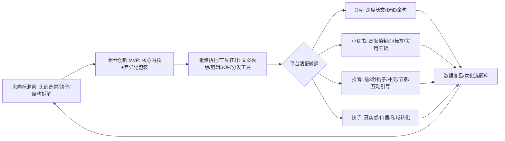
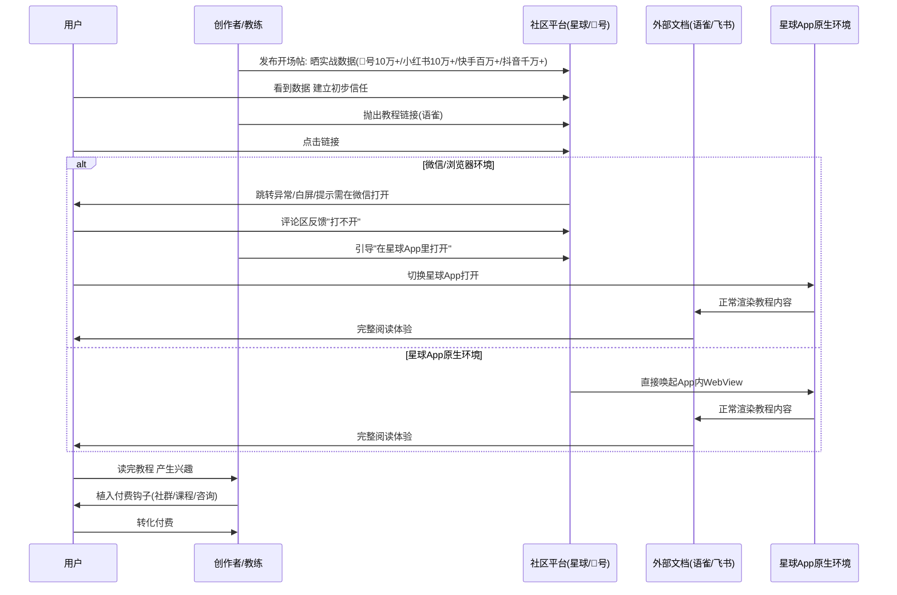
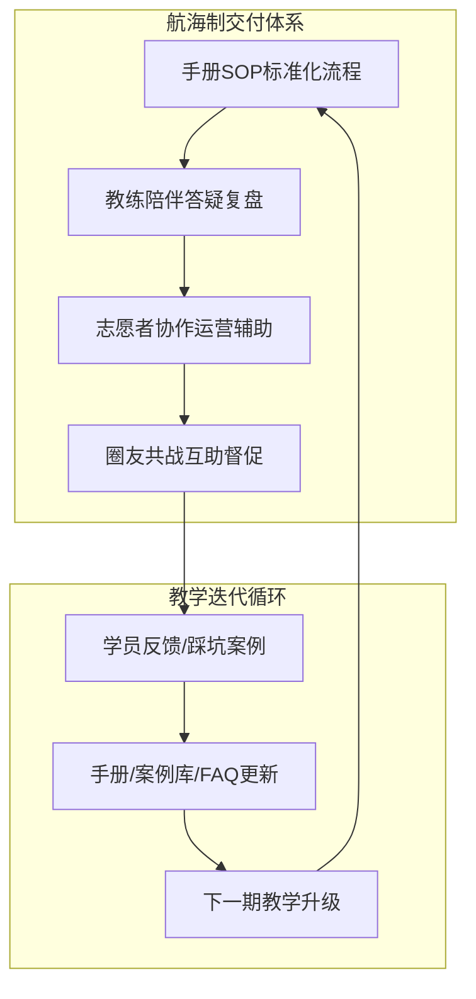

# 第 79 章 风向标航海教练实战背书与跨平台内容复用
作者：龙哥

## 学习目标

- 理解风向标作为趋势捕捉雷达的核心定义与底层逻辑
- 掌握航海教练在实战训练营中的陪跑模式与价值
- 了解跨平台内容复用的一套方法论通吃图文与视频的实操路径
- 学会实战背书引流法：用成果建立信任再沉淀教程的三步走闭环
- 认知星球App链接兼容性等知识分发隐形基建坑的规避策略
- 洞察教练迭代经验：多轮实战打磨成熟教学体系的演进规律

## 79.1 生活类比

想象**风向标航海**是一场**大海航行**。站在甲板上，你面对的是茫茫大海与不可预测的风浪。**风向标**是海上的**灯塔与气象站**，它不帮你划桨，但能告诉你哪里有风（流量）、哪里有礁（坑）、航向在哪里；**航海教练**是经验丰富的**领航员/老船长**，不帮你划桨，但给你标准化的海图（SOP）、陪你实战演练（陪跑）、帮你避开暗礁（答疑复盘）；**跨平台内容复用**是**一艘船通吃东西南北四大洋**（👸号/小红书/快手/抖音），核心航海图（选题逻辑）通用，只需微调帆的角度（呈现形式）便能乘风破浪；**实战背书引流法**是进港前先**挂上战利品旗帜**（晒爆款数据），让港口方信任你的实力，再卸下货物（教程）完成交易；**星球App链接兼容性**是**码头专用的专用吊车/通道**，货船（教程链接）只能靠自家码头（星球App）卸货，去别家码头（微信/浏览器）会被拦截；**教练迭代经验**则是航海图**每一版都标注了上一批船队踩过的坑**，第八版图自然比第一版靠谱得多。

## 79.2 概念地图

第79章：风向标航海教练实战背书与跨平台内容复用
├── 核心概念
│   ├── 风向标 —— 捕捉趋势方向的标杆雷达  —— P001
│   ├── 航海教练 —— 实战训练营中的领路人与陪跑者  —— P002
│   ├── 跨平台内容复用 —— 一套方法论通吃图文与视频  —— P003
│   ├── 实战背书引流法 —— 用成果建立信任再沉淀教程  —— P004
│   ├── 星球App链接兼容性 —— 知识分发的隐形基建坑  —— P005
│   └── 教练迭代经验 —— 多轮实战打磨出的成熟教学体系  —— P006
├── 方法论体系
│   ├── 实战背书引流三步法：成果展示 -> 信任建立 -> 教程转化  —— P004
│   ├── 跨平台选题策略迁移：风向标洞察 -> 组合创新 -> 批量执行 -> 多平台分发  —— P003
│   └── 航海制交付体系：手册SOP + 教练陪伴 + 志愿者协作 + 圈友共战  —— P002
├── 关键发现与规律
│   ├── 跨平台内容复用的普适性主张  —— P003
│   ├── 星球App链接兼容性发现  —— P005
│   └── 教练任职轮次与教学质量的正相关性  —— P006
└── 边界条件与风控
    ├── 成果数据真实性底线  —— P004
    ├── 外部链接失效/屏蔽风险  —— P004
    ├── 平台调性差异需微调呈现形式  —— P003
    └── 过度依赖教练削弱独立解决问题能力  —— P002

---

## 79.3 方法论体系：核心路径与交付模型

以下三张图表分别对应概念地图中“方法论体系”分支的三大核心模型，展示了从选题到分发、从背书到转化、从交付到迭代的完整链路。

**图 79-1 跨平台选题策略迁移模型** —— 展示如何将一套核心选题逻辑迁移至多平台并实现规模化复制。

**图 79-2 实战背书引流三步法闭环** —— 还原阿丰开场帖的完整动作路径：成果展示建信任、外部文档沉淀教程、社区工具保体验。

**图 79-3 航海制交付体系与教学迭代循环** —— 四位一体交付体系如何通过学员反馈持续迭代升级。

---

## 79.4 关键发现与规律汇总

| 发现/规律 | 核心内容 | 素材支撑 |
|-----------|----------|----------|
| **跨平台内容复用的普适性主张** | 掌握“寻找风向标”的底层逻辑/方法论，可实现一套选题策略在图文（👸号、小红书）与短视频（快手、抖音）等不同形态、不同算法平台上的通杀，实现流量的规模化复制。 | 阿丰同一套方法论在四平台均产出爆款数据 [P003] |
| **星球App链接兼容性发现** | 生财星球内发布的语雀/外部文档链接，在星球App原生环境中可正常打开阅读，但在微信外部浏览器或直接点击可能受限（提示需在微信打开或跳转精华帖），需指导用户使用正确客户端入口。 | 评论区用户反馈“跳转精华帖/提示需在微信打开”，教练指导“在星球App里打开” [P005] |
| **教练任职轮次与教学质量的正相关性** | 作者宣称已连续第8次担任航海教练，暗示其教学方法论经历过多轮实战迭代与学员反馈验证，具备成熟的教学交付体系。 | “好像第八次做航海教练了，哈哈哈” [P006] |

---

## 79.5 边界条件与风控清单

| 风险点 | 说明 | 应对策略 |
|--------|------|----------|
| **成果数据真实性底线** | 实战背书的核心是真实可查的数据，造假一旦暴露信任崩塌不可逆。 | 仅晒平台后台原图/可查链接，拒绝P图/刷数据/虚构案例。 |
| **外部链接失效/屏蔽风险** | 语雀/飞书/网盘等第三方链接易被平台拦截、域名失效、权限变更。 | 多渠道备份（语雀+飞书+网盘+本地PDF+小程序），主力渠道做兼容性测试。 |
| **平台调性差异需微调呈现形式** | 同一内核硬搬四平台大概率全扑街；👸号要深度，抖音要冲突，小红书要颜值。 | 核心逻辑迁移+形式微调：重写标题、重剪节奏、重设封面、重植CTA。 |
| **过度依赖教练削弱独立解决问题能力** | 毕业后无教练陪跑，学员若未内化方法论将陷入瘫痪。 | 教学设计中植入“独立作业/复盘模板/案例库自查”，强制去脚手架。 |

---

## 79.6 风向标 —— 捕捉趋势方向的标杆雷达

### 为什么需要这个概念？

你在创业或做副业时，最怕什么？是**不确定性**。选错赛道、追错热点、做错内容，时间和金钱都打了水漂。你需要一种低成本、高确定性的方法来判断：现在的风口在哪？接下来的流量会往哪里流？

头部玩家（大V、头部账号、爆款产品、平台新功能）之所以是头部，是因为他们**最敏锐地捕捉到了趋势**，并**最快完成了资源调配**。他们的每一个动作——发什么内容、卖什么品、用什么玩法——都是经过市场验证的“正确答案”的信号。与其自己在茫茫大海里瞎猜，不如盯着灯塔（风向标）看，灯塔亮在哪，船就往哪开。

### 核心定义

> **风向标**  
> 指代行业头部玩家、头部账号、头部产品或新兴平台功能发布等能够预示趋势方向的标杆对象。是一套寻找内容选题、捕捉流量趋势的方法论体系。

> "《如何寻找风向标》...2023 年 2 月风向标航海教练...👸号单条推文阅读过万，小红书多条笔记浏览量 10 万➕，快手多条视频百万➕，抖音多条视频千万➕"
> 
> ——《docs/202303/20230328_018.md》[P001]

这段原文是阿丰作为第八期风向标航海教练的开场白。他用**跨平台的爆款数据**作为“风向标有效性”的最强背书：同一套选题方法论，在图文平台（👸号、小红书）和视频平台（快手、抖音）都跑出了头部数据。这说明**风向标的底层逻辑不依赖单一平台算法，而是通用的商业洞察力**。

### 关键性质

1. **信息梯度优势**：越靠近风向标，信息失真度越低，决策价值越高。一手复盘 > 二手转述 > 三手道听途说。
2. **跨平台普适性**：底层逻辑不依赖单一平台算法，图文/视频平台通用。阿丰的数据就是铁证：选题策略迁移了，爆款能力也迁移了。
3. **可标准化复制**：通过结构化拆解（流量源、转化路径、产品结构），普通人可复用其商业模式要素。这不是“抄作业”，而是“抄答案的解题思路”。

### 典型例子

- **阿丰**：同一套选题策略在👸号(10万+)、小红书(10万+)、快手(百万+)、抖音(千万+)四平台均产出爆款。[P001]
- **生财有术社区**：设立专门“风向标”专栏持续追踪头部动态，将碎片化的头部信号结构化为可供学员复用的情报。

### 边界条件

- **仅监控不拆解、不复制核心动作**，无法产生实际收益。看懂了不等于做到了。
- **缺乏自身资源匹配度自检**，易陷入盲目跟风。风向标指的是方向，你的船能不能开过去，还得看你的船（资源/能力）。
- **风向信息有时效性**，过期信息可能成为反向指标。上周的风向标，这周可能已经是“礁石”了。

---

## 79.7 航海教练 —— 实战训练营中的领路人与陪跑者

### 为什么需要这个概念？

你知道“风向标”在哪了，但**知道航向 ≠ 能到达**。新人缺乏实战经验，独自跑通“获客-转化-交付”闭环的失败率极高。你会卡在：选题怎么定？文案怎么写？发布时间怎么选？数据差在哪？封号了怎么办？

你需要一个**陪你跑完全程的人**——不帮你划桨，但给你标准化的海图（SOP）、陪你练手（陪跑）、帮你避开暗礁（答疑复盘）、在你想放弃时拉你一把（圈友共战）。

### 核心定义

> **航海教练**  
> 生财有术社区特有角色，指在‘航海’（实战训练营）活动中带领学员实操、答疑、复盘的资深从业者。核心职能：**手册 SOP 交付 + 教练陪伴 + 志愿者协作 + 圈友共战**。

> "好像第八次做航海教练了，哈哈哈"
> 
> ——《docs/202303/20230328_018.md》[P002]

这句话看似随意，实则是**教学质量的最强侧写**。第八次任职，意味着：教学大纲经历了 7 轮学员的“踩坑反馈”打磨；常见卡点积累了标准化解决方案；志愿者协作机制跑顺了；陪跑节奏把控成熟了。这是**经验复利**的直接体现。

### 关键性质

1. **经验迭代积累**：多轮教练任职意味着方法论经受实战与学员反馈的多重验证。每一期航海产出的优秀案例/失败教训，均沉淀为下一期教学素材。
2. **权威背书作用**：教练个人实战成果（如阿丰的四平台爆款数据）是方法论有效性的最强外部证明。这是“实战背书引流法”的核心素材。
3. **组织保障体系**：依托社群基建（手册、志愿者、工具）而非单打独斗。航海制 = 手册SOP + 教练陪伴 + 志愿者协作 + 圈友共战，四位一体，缺一不可。

### 典型例子

- **阿丰**：连续第 8 次担任风向标航海教练，暗示教学体系成熟稳定。[P002]
- **生财有术航海制演进**：早期纯靠大佬分享 -> 引入手册/教练/志愿者/圈友四位一体体系，标准化程度显著跃升。

### 边界条件

- **教练只能提供方法论与陪伴，无法替代学员的执行动作**。船还是得你自己划。
- **教练水平参差不齐**，需甄别其真实战绩而非单纯头衔。别光看“第几期教练”，要看“学员出单率/好评率/复购率”。
- **过度依赖教练会削弱学员独立解决问题的能力**。毕业后没教练了，你得能自己掌舵。

---

## 79.8 跨平台内容复用 —— 一套方法论通吃图文与视频

### 为什么需要这个概念？

单一平台流量红利周期短、天花板低、风险高（算法一变、封号限流、赛道内卷）。把鸡蛋放在一个篮子里，是把命交给平台。多平台同步分发，能**最大化内容资产 ROI**，还能对抗平台算法的不确定性。

但很多人做矩阵号，就是单纯“搬运”、硬塞，结果是：👸号的长文发抖音没人看，抖音的快剪发👸号读不下去。**核心竞争力不在于“会不会用剪映/排版工具”，而在于“选题判断力”**。选题选对了，换个皮（呈现形式），依然能火。

### 核心定义

> **跨平台内容复用**  
> 掌握‘寻找风向标’的底层逻辑/方法论，实现一套选题策略在图文（👸号、小红书）与短视频（快手、抖音）等不同形态、不同算法平台上的通杀。  
> 核心路径：**风向标洞察 -> 组合创新 MVP -> 批量执行/工具杠杆 -> 多平台分发**。

### 关键性质

1. **选题策略迁移性**：核心竞争力在于选题判断力，而非单一平台运营技巧。阿丰的数据证明：选题逻辑迁移了，爆款能力也迁移了。[P003]
2. **规模化复制能力**：单人/小团队可通过矩阵化操作实现流量规模化。一条核心选题 -> 4 个平台 4 个爆款 = 4 倍流量资产。
3. **资产复利效应**：同一内容资产在不同平台产生叠加收益。👸号沉淀私域，小红书种草拔草，抖音/快手收割泛流量，视频号承接高客单。

### 典型例子

- **阿丰**：同一套方法论在👸号、小红书、快手、抖音四平台均产出高流量内容。[P003]

### 边界条件

- **平台调性差异需微调呈现形式**（如标题、封面、节奏、钩子、CTA）。👸号要“深度/逻辑/金句”，抖音要“冲突/节奏/前 3 秒钩子”，小红书要“颜值/实用/标签”。
- **版权/独家协议可能限制跨平台同步分发**。签了“首发/独家”的内容，不能同步别处。
- **运营精力有限，需优先聚焦 ROI 最高的 1-2 个主阵地**。贪多嚼不烂，先把一个平台跑通，再复制。

---

## 79.9 实战背书引流法 —— 用成果建立信任再沉淀教程

### 为什么需要这个概念？

知识付费/工具/社群赛道，**信任是稀缺品**。你发一篇“教你月入十万”的长文，用户第一反应是：“吹牛吧，截图给我看”。纯理论教学缺乏说服力，用户难以建立付费/学习信心。**实战成果是穿透信任屏障的最强信号**。

你需要一套标准化的路径：**先亮成果（建信任），再给干货（沉淀教程），最后兜体验（保转化）**。

### 核心定义

> **实战背书引流法**  
> 先在社区帖建立人设与成果信任（实战背书），再通过外部文档链接沉淀系统化教程（知识交付），最后利用社区工具辅助阅读（体验保障）。  
> 三步法：**实战背书引流 + 外部文档承载详情 + 社区工具辅助阅读**。

> "有过一点小成绩...👸号单条推文阅读过万...分享了一点关于风向标的心得...https://i.shengcaiyoushu.com/docx/ILFsdUrR1oUAVGxDpHCctq6AnPg...你现在再在星球 App 里打开试试看，可以看到啦"
> 
> ——《docs/202303/20230328_018.md》[P004]

这组原文完整还原了阿丰的**三步走闭环**：
1. **实战背书**：晒四平台爆款数据（👸号 10万+、小红书 10万+、快手 百万+、抖音 千万+），建立“我有资格教你”的权威感。
2. **外部文档承载详情**：抛出《如何寻找风向标》语雀链接，将碎片化经验结构化为可复用的教程资产。
3. **社区工具辅助阅读**：评论区用户反馈链接打不开/跳转异常，教练指导“在星球 App 里打开”，利用平台原生功能解决跨环境访问障碍。

### 关键性质

1. **信任前置**：用可验证的公开成果数据替代主观承诺。数据不吹牛，截图可查，平台可验。
2. **知识沉淀**：将碎片化经验结构化为可复用的教程资产。免费教程是“钩子”，付费产品是“鱼”。
3. **工具兜底**：利用平台原生功能解决跨环境访问障碍。不让用户在“打开链接”这一步流失。

### 典型例子

- **阿丰开场帖**：晒四平台爆款数据 -> 抛出《如何寻找风向标》语雀链接 -> 评论区指导用星球 App 打开。[P004]

### 边界条件

- **成果数据必须真实可查**，造假一旦暴露信任崩塌不可逆。P 图、刷数据、虚构案例，是红线。
- **外部链接易失效/被屏蔽**，需多渠道备份（语雀/飞书/网盘/本地/小程序）。单点依赖是脆弱的。
- **免费教程过多可能稀释付费产品价值**，需设计分层产品体系。免费给“知其然”，付费给“知其所以然”+“陪跑/工具/社群”。

---

## 79.10 星球 App 链接兼容性 —— 知识分发的隐形基建坑

### 为什么需要这个概念？

你花几十小时打磨的免费教程、几百页的付费手册，挂在语雀/飞书/网盘链接里。用户点进去，**白屏、报错、跳转错误页、提示“需在微信打开”、排版错乱**……用户流失了，你的前期投入尽成泡影。

**知识分发的最后一公里**，往往死在“环境兼容性”上。平台间生态壁垒导致外链在不同客户端表现完全不同。忽视终端适配，等于亲手切断用户获取知识的路。

### 核心定义

> **星球 App 链接兼容性**  
> 生财星球内发布的语雀/外部文档链接，在星球 App 原生环境中可正常打开阅读，但在微信外部浏览器或直接点击可能受限。需指导用户使用正确客户端入口（星球 App）而非微信/浏览器打开。

> "为什么我点了就跳转到生财网站精华帖了...看不到。提示要到微信打开...你现在再在星球 App 里打开试试看，可以看到啦"
> 
> ——《docs/202303/20230328_018.md》[P005]

评论区的这组对话，是典型的**“用户在错误环境打开链接 -> 体验受阻 -> 运营补救引导”**案例。用户习惯在微信/浏览器点链接，不知需切换星球 App，导致大量流失。

### 关键性质

1. **环境差异性**：同一链接在 App 内/微信内/浏览器中渲染结果完全不同。星球 App 原生 WebView 支持语雀渲染，微信内置浏览器拦截跳转，外部浏览器可能无权限/需登录。
2. **用户认知偏差**：用户习惯微信点链接，不知需切换 App，导致流失。这是“知识诅咒”：你知道要在 App 里开，用户不知道。
3. **运营补救成本**：需额外制作引导图文/视频/文案教用户“正确打开姿势”。阿丰在评论区回复指导，就是零成本补救。

### 典型例子

- 评论区用户反馈：点击链接跳转生财网站精华帖/提示需在微信打开/看不到内容。[P005]
- 教练回复指导：你现在再在星球 App 里打开试试看，可以看到啦。[P005]

### 边界条件

- **仅针对生财星球 App 与语雀/特定外链的组合场景验证**，不具备普适性结论。
- **平台版本更新可能随时修复或打破现有兼容性**。今天能开，明天版本一更就挂了，需持续测试。
- **无法解决用户未安装/不愿安装星球 App 的根本触达问题**。必须准备网页版/小程序/网盘直链作为兜底方案。

---

## 79.11 教练迭代经验 —— 多轮实战打磨出的成熟教学体系

### 为什么需要这个概念？

初版教学大纲往往脱离实战、缺乏细节、易卡住新人。只有经过多批次学员的“踩坑反馈”，教学体系才趋于完善。**教练的任职轮次是教学交付质量的重要侧写指标**。

你在选课、选社群、选教练时，别只看“大纲漂不漂亮”，要看“带了多少期”、“学员出单率多少”、“复购率多少”。**轮次 = 迭代次数 = 容错率 = 标准化程度**。

### 核心定义

> **教练迭代经验**  
> 作者宣称已连续第 8 次担任航海教练，暗示其教学方法论经历过多轮实战迭代与学员反馈验证，具备成熟的教学交付体系。  
> 迭代维度：手册 SOP 细化 -> 答疑案例库积累 -> 志愿者协作机制优化 -> 陪跑节奏把控。

> "好像第八次做航海教练了，哈哈哈"
> 
> ——《docs/202303/20230328_018.md》[P006]

### 关键性质

1. **经验复利**：每一期航海产出的优秀学员案例/失败教训，均沉淀为下一期教学素材。教练越教越顺，学员越跟越稳。
2. **容错率提升**：常见卡点提前预置解决方案，新人“跟着走”即可避坑。第八版手册里，每一条 SOP 后面可能都标注着“易错点/避坑指南/备选方案”。
3. **标准化交付**：从“靠教练个人经验”进化为“靠标准化教学产品”。教练生病了、离职了，体系照样跑。

### 典型例子

- **阿丰**：好像第八次做航海教练了。[P006]
- **生财有术航海制演进**：早期纯靠大佬分享 -> 引入手册/教练/志愿者/圈友四位一体体系。

### 边界条件

- **轮次多不等于质量高**，需结合学员出单率/好评率/复购率综合判断。有的教练带了 20 期，学员全军覆没。
- **赛道变化快，过往经验可能失效**，需持续更新教学内容。去年的风向标选题法，今年可能就过时了。
- **头部教练精力有限，规模化扩张易导致服务稀释**。一对多陪跑，细节必然照顾不周，需依靠志愿者/助教/工具分流。

---

## 79.12 单一素材局限性说明

本章核心概念主要基于单一素材（`docs/202303/20230328_018.md`）展开，该素材为生财有术星球第八期风向标航海教练阿丰的开场帖及评论区实录。受限于现有素材范围，暂不具备多源对照条件。后续若引入更多同期航海教练开场帖、学员反馈记录、其他期次教学手册迭代对比等素材，可进一步验证“教练迭代经验”与“跨平台复用普适性”的普适边界。

---

## 79.13 设计中的取舍

### 为什么不用“纯内部文档/知识库”承载教程，而要用“语雀等外部文档链接”？

- **内部文档/知识库**（如星球自带精华帖/专栏）：优势是域名可控、链接永不失效、阅读体验原生统一、数据留存平台内。劣势是编辑排版功能弱、不支持复杂交互/代码块/大文件、迁移困难、协作受限。
- **外部文档链接**（语雀/飞书/Notion）：优势是编辑体验极佳、支持多媒体/代码/数据库/协作/版本管理、可作为通用知识资产跨平台分发。劣势是**链路长、依赖第三方稳定性、易被平台拦截/屏蔽、兼容性坑多**。
- **取舍结论**：教程制作/迭代/协作用外部文档（飞书/语雀），**最终交付给用户时，必须提供多渠道兜底（网页版+小程序+网盘直链+本地PDF）**，并在主力分发渠道（星球/👸号/私域）针对性做兼容性测试与引导。不要赌“用户会自己搞定打开方式”。[P004][P005]

### 为什么“跨平台复用”不建议“一键同步分发”，而主张“核心逻辑迁移+形式微调”？

- **一键同步分发**（同一文案/视频全平台发）：省时省力，但忽视平台调性差异。👸号用户爱读深度长文，抖音用户只看前 3 秒冲突，小红书用户爱看高颜值封面+标签。硬塞同一内容，大概率四平台全扑街。
- **核心逻辑迁移+形式微调**：保留“选题钩子/核心干货/变现路径”不变，针对各平台重写标题、重剪节奏、重设封面、重植 CTA。虽增工作量，但**转化率是指数级提升**。
- **取舍结论**：资源有限时，**宁可只深耕 1 个主阵地把内容做到极致，也不要 4 个平台全同步烂内容**。先跑通 1 个，再用成熟 SOP 复制到第 2 个。[P003]

---

## 79.14 动手练习

### 练习1：寻找你的赛道风向标Top 5

**任务**：选定一个你感兴趣或正在操作的赛道（如：AI绘画教学、宠物用品带货、职场技能付费等）。

**步骤**：
1. 列出该赛道在👸号、小红书、抖音、视频号、快手五大平台上，你能找到的头部账号/产品/玩家各 1-2 个。
2. 对每个风向标对象，记录：账号名/产品名、平台、粉丝量/销量、近期 3 条爆款内容的共同选题特征、变现模式（广告/带货/知识付费/私域服务）。
3. 提炼：这 5-10 个风向标的共性选题逻辑是什么？它们共同指向的下一个流量风口可能是什么？

**回答问题**：
- 如果只监控不拆解、不复制核心动作，会导致什么后果？
- 如何判断一个风向标信息是否过期失效？

### 练习2：设计一个跨平台内容复用的最小闭环

**场景**：假设你已跑通一个『小红书图文带货』的单平台模型（选品 -> 笔记 -> 出单）。

**任务**：设计将该模型复用至『视频号短视频带货』与『👸号种草文』的操作清单。

**要求包含**：
1. 核心选题逻辑如何保持不变？（风向标层面）
2. 笔记/视频/文章的呈现形式需微调哪些要素？（标题/封面/节奏/钩子/CTA）
3. 变现链路如何对齐？（小红书挂车/视频号橱窗+直播/👸号引流私域成交）
4. 生产流程如何复用/分工？（核心文案复用 -> 不同端剪辑/排版 -> 矩阵号分发）

**回答问题**：
- 版权/独家协议可能在哪些环节限制跨平台同步分发？
- 运营精力有限时，如何判断优先聚焦哪 1-2 个主阵地？

### 练习3：复盘一次『实战背书引流』的完整路径

**任务**：找一位你在知识付费/社群/工具类赛道关注的头部KOL/创作者，复盘其最近一次『免费内容引流 -> 付费产品转化』的完整动作。

**分析维度**：
1. 背书素材：TA 晒了什么成果数据？（收入/流量/学员案例/对比图）真实性如何佐证？
2. 信任建立：文案/视频如何将『成果』转化为『方法论可信』的心理暗示？
3. 教程承载：免费教程以什么形式交付？（语雀/飞书/网盘/公开文章/小程序）体验如何？
4. 转化钩子：免费教程结尾/中间植入了什么付费钩子？（社群/课程/咨询/工具）话术是什么？
5. 阅读体验兜底：是否有『链接打不开/格式错乱』类引导？（如：请在App打开/回复关键词领取）

**回答问题**：
- 若该创造者免费教程质量极高，甚至优于付费产品，会发生什么？
- 外部链接失效/被屏蔽时，用户流失率预估多少？如何通过多渠道备份降低损耗？

### 练习4：排查你的知识分发链路中的『星球App兼容性』类隐形坑

**任务**：检查你目前用于分发免费/付费教程、资料、工具的所有链路（👸号菜单/文中链接/私信自动回复/朋友圈/社群公告/小程序卡片等）。

**操作**：
1. 列表所有分发渠道与对应的落地页链接（语雀/飞书/Notion/网盘/自建站/小程序等）。
2. 分别在：微信内点击、微信外部浏览器打开、目标App原生环境打开、手机浏览器打开、电脑浏览器打开 五种环境下测试打开情况。
3. 记录：白屏/报错/跳转错误页/需登录/权限不足/内容缺失/排版错乱 等异常情况。
4. 针对主力渠道（流量最大的 1-2 个），制作『正确打开姿势』引导图/视频/文案。

**回答问题**：
- 哪个渠道的异常情况最多？核心原因是什么？（平台拦截/链接失效/格式不兼容/权限设置）
- 如果用户不愿安装特定App（如星球App），如何通过技术手段（如网页版/小程序/网盘直链）兜底触达？

---

## 79.15 本章小结

这一章中我们学习了如何利用**风向标**捕捉趋势、借助**航海教练**的陪跑体系低成本试错、用**跨平台内容复用**最大化流量资产 ROI、用**实战背书引流法**建立信任并沉淀教程资产、警惕**星球App链接兼容性**等知识分发最后一公里的隐形基建坑、以及如何通过**教练迭代经验**判断教学体系成熟度。首先，风向标是趋势捕捉雷达，通过监控头部玩家动作降低决策不确定性；其次，航海教练提供手册SOP+陪伴答疑+志愿者协作+圈友共战四位一体交付，任职轮次是教学质量侧写；接着，跨平台复用核心是选题策略迁移而非内容硬搬，一套方法论通吃图文与视频；然后，实战背书引流三步法（成果展示->信任建立->教程转化）是知识付费/工具/社群赛道的标准化获客闭环；最后，链接兼容性与教练迭代经验分别揭示了知识分发基建与教学交付体系的隐性门槛。

本章我们一起学习了以下概念：

| 概念 | 解释 |
|------|------|
| 风向标 | 捕捉趋势方向的标杆雷达：头部玩家/账号/产品/平台功能的动作预示流量风口 |
| 航海教练 | 实战训练营中的领路人：手册SOP+陪伴答疑+志愿者协作+圈友共战四位一体交付 |
| 跨平台内容复用 | 一套选题策略通吃图文与视频平台：核心逻辑迁移，呈现形式微调 |
| 实战背书引流法 | 三步闭环：实战成果建信任 -> 外部文档沉淀教程 -> 社区工具保阅读体验 |
| 星球App链接兼容性 | 知识分发最后一公里的隐形基建坑：外链仅在星球App原生环境正常打开，需引导用户正确姿势 |
| 教练迭代经验 | 多轮实战打磨成熟教学体系：任职轮次是教学质量侧写，常见卡点预置方案实现标准化交付 |

