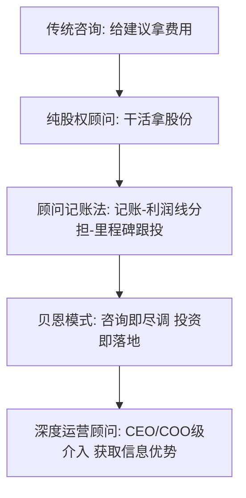

# 第 55 章 股权与顾问模式 —— 动态公平、记账法、咨询即尽调、市场价锚定
作者：龙哥

## 学习目标

- 理解早期公司股权分配的核心矛盾：贡献度动态变化与静态股权固化的冲突
- 掌握顾问记账法的三阶段设计逻辑：记账确认价值、利润线分担风险、里程碑跟投绑定未来
- 了解非核心人力市场价锚定原则：用现金清算切断隐性股权承诺，将隐性成本显性化
- 能运用“咨询即尽调、投资即落地”模式，通过深度运营获取信息优势降低投资决策风险
- 能识别“花钱找工作”伪合伙陷阱，设计动态调整机制锁定关键人平衡短长期利益

## 55.1 生活类比

想象创业合伙像**合租房装修分摊账单**。进门第一天，如果按房间大小一次性分摊所有装修费，以后谁住谁走、谁用谁修都不再调整，这就是**静态分股**，必吵架。更聪明的做法是建立一本“记账本”：前期垫资的记大头，后期住的人按月分摊水电网，退房时按实际居住天数结算押金，这就是**动态公平性**。请装修设计师时，不收设计费，改“记账”：装修烂尾或设计师跑路，设计师认栽（下行保护）；装修增值出租赚了钱，设计师按比例分红或折股（捕获上行）；后续二次装修设计师优先跟投（信息优势），这就是**顾问记账法**。请搬运工、保洁阿姨则按市场价给现金签收条，绝不承诺“装修好看了分你一间房”，这就是**市场价锚定**，切断事后讨价还价。这一连贯故事里，四种角色各得其所，核心冲突在动态机制中被化解。

## 55.2 概念地图

股权与顾问模式
├── 核心矛盾
│   ├── 贡献度动态性 vs 静态股权固化性  —— P006
│   └── 现金流约束 vs 长期激励需求     —— P006
├── 合伙人分层动态股权
│   ├── 核心合伙人：工资+期权/股权动态组合包  —— P006
│   └── 机制设计：期权池、分期授予、业绩触发  —— P006
├── 顾问记账法三阶段
│   ├── 阶段一：按市场价记账确认价值  —— P006
│   ├── 阶段二：设定利润触发线分担风险  —— P006
│   └── 阶段三：业绩里程碑跟投绑定未来  —— P006
├── 非核心人力成本清算
│   ├── 市场价现金结算+合同留痕  —— P006
│   └── 切断低成本换高股权套利路径  —— P006
└── 咨询即尽调/投资即落地
    ├── 深度运营=高质量尽调  —— P006
    ├── 信息优势转化为投资优势  —— P006
    └── 贝恩模式同构验证  —— P006

## 55.3 股权分配的动态公平性 —— 拒绝一次性切蛋糕，建立随时间调整的机制

### 原文摘录

> "有的合伙人已经出来了，有的合伙人还在公司，怎么样出资保证公平... 三个合伙人因为人生阶段不一样，生活压力很不一样，要不要现在发工资... 公司运营机制如何在短期收益不高的情况下，保证中长期的发展，并且可以很好的锁定关键人员... 贡献度随着时间的推移变化，需要不断调整/扯皮，还可能一开始会错误估计对方的技能稀缺度和投入度"
> 
> ——《P006 股权与顾问模式》

### 核心概念解析

**为什么需要动态公平性？**

我们在创业初期常犯一个错误：把股权当成一块蛋糕，进门第一天就按“谁出钱多、谁出力大、谁资源好”切一刀，然后盖章定案。但现实是残酷的：合伙人A全职不拿工资搞技术，合伙人B兼职拿半薪出资源，合伙人C还在大厂上班只出钱不出力。半年后，A累成狗，B因为家庭原因退出，C想要更多控制权。**静态切分无法应对“贡献度随时间变化”这一核心动态**，必然导致后续扯皮、撕逼甚至公司解散。

早期公司还有一个硬约束：**现金流紧张，付不起高额工资**。如果强行发市场价工资，公司可能半年死掉；如果不发工资靠情怀，核心人熬不住会跑路。所以我们需要一种机制：**用长期激励平衡短期生存，用动态调整应对贡献度变化，核心锁定关键人**。

**动态公平性的形式化定义**

股权分配不是一次性静态切分，而是建立动态调整机制，随合伙人投入度、资源贡献、人生阶段变化而调整：

$$
\text{Equity}_i(t) = f(\text{Capital}_i, \text{Time}_i(t), \text{Resource}_i(t), \text{Milestone}_i(t); \theta)
$$

其中：
- $\text{Capital}_i$：合伙人$i$的初始出资额（相对固定）
- $\text{Time}_i(t)$：$t$时刻的全职/兼职时间投入强度
- $\text{Resource}_i(t)$：$t$时刻带来的客户/渠道/技术等资源贡献
- $\text{Milestone}_i(t)$：$t$时刻达成的关键业绩里程碑
- $\theta$：机制参数（期权池比例、分期授予周期、触发阈值等）

**公式推导说明**：该公式采用加性可分离结构，将固定资本贡献与随时间变化的时间、资源、里程碑贡献解耦，便于通过参数 $\theta$ 独立校准各因子权重。$\theta$ 的校准依据可参考《Venture Deals》（Brad Feld）与 Y Combinator 标准模板：期权池规模通常设为融资前总股本的 10%-20%，分期授予周期多为 4 年含 1 年悬崖期，业绩触发阈值则依据行业中位数营收/利润增速反推。期权定价模型简化为欧式看涨期权，隐含波动率隐含在业绩触发概率中，避免了 Black-Scholes 模型对早期非上市公司的参数估计困难。

这个公式展示了：**股权是随时间演化的函数，而非常数**。核心机制包括：
1. **期权池**：预留 10%-20% 总股本，用于后续核心员工激励与合伙人动态调整
2. **分期授予**：核心合伙人股权按年/按季度分期释放，通常设 1 年悬崖期
3. **业绩触发**：达成营收/利润/融资里程碑时释放额外期权
4. **回购/稀释条款**：合伙人退出/违约时，公司/剩余合伙人有权按约定价格回购或稀释其股份

### 多源对照：不同视角的动态股权设计

**共识**：早期团队必须预留期权池、实施分期授予、设定退出机制，不能一次性切完。

**分歧**：

- **P006 实战派（Max 方案）**：主张“工资+期权/股权动态组合包”，根据全职/兼职/在职三类人生阶段差异化设计薪资替代值与期权比例，细节属商业机密未公开，强调**运营机制锁定关键人**而非纯法律条款。
- **标准硅谷模板（YC/Cooley 等）**：推荐标准 4 年 Vesting + 1 年悬崖期，创始人间初始按贡献度粗略分配，后续通过期权池稀释调整，流程标准化、法律文本成熟。
- **国内法律实务视角**：强调工商变更成本高、税务风险大（个人所得税、印花税），建议尽量用**有限合伙持股平台**在协议层面约定动态调整，减少工商变更频次。参考北京/上海高院关于“显名股东/隐名股东”认定指引，以及清科研究中心《中国创投法律实务白皮书》中的动态股权协议条款范本。

### 方法演进图：动态股权机制的演进路径


### 典型案例：Shiver 合伙分股困局

Shiver 团队三位合伙人：一人已全职创业、一人兼职、一人仍在大厂在职。生活压力差异巨大，出资、出力、出资源比例各异。陷入“怎么分股公平”的死循环——**这本质上是“贡献度动态度量”与“静态股权固化”的冲突**。

Max 的解决思路：不纠结初始注册股怎么分，而是设计“工资+期权/股权动态组合包”，通过**运营机制**（薪资替代值、期权释放节奏、业绩触发条件、退出回购条款）锁定关键人。具体方案涉及商业机密未公开，但核心逻辑是：**把“分股权”这道静态几何题，转化为“设计激励机制”这道动态控制题**。

---

## 55.4 顾问记账法 —— 像银行记账一样记服务，盈利再算账，做大再投钱

### 原文摘录

> "日常服务时按照报价记着账... 设置一条利润线，如果公司死了，也就不用给了... 如果超过这条利润线，按照现金或者折算成股份... 还能约定好，进一步达到某个业绩指标，能够投一部分钱进去... Max 往往帮公司完成早期框架构建和运营，相当于干了 CEO 和 COO 的活，所以他能看到真实的数据指标... 所以在达到某个业绩指标时的投钱节点，被坑的概率非常低... 这和贝恩的套路特别像，为什么 MBB 里贝恩除了做战略咨询，其实还有一块很大的业务是做贝恩投资？"
> 
> ——《P006 股权与顾问模式》

### 核心概念解析

**为什么需要顾问记账法？**

小公司请不起大咖顾问：月薪几十万现金流扛不住；大咖顾问也不愿纯拿股“打工” —— 股权可能归零，且边界模糊（顾问很难控制自己情绪/时间/金钱的投入，容易变成“花钱找工作”）。双方都需要一种**风险共担、利益绑定、边界清晰**的合作模式。

**顾问记账法三阶段设计（来源：《P006》）**

```
阶段一：记账确认价值
├── 顾问按市场报价（如 2万/月）为服务“记账”，不收现金
├── 形成“应付账款”记录，确认服务的市场价值
└── 此阶段顾问承担时间成本风险，公司无现金流压力

阶段二：利润触发线分担风险
├── 设定利润门槛（如“月利润>5万”或“累计利润>10万”）
├── 公司倒闭/未达线：账务作废，顾问认栽（下行保护）
├── 公司盈利达标：按现金偿还或折股偿还（捕获上行）
└── 折股估值基准：上轮融资估值 / 净利润倍数 / 净资产倍数

阶段三：里程碑跟投绑定未来
├── 约定业绩里程碑（如“年营收1000万”、“连续3月盈利”）
├── 达标后顾问享有跟投权：按约定估值追加投资
├── 顾问从“服务商”进化为“准合伙人/准投资人”
└── 核心逻辑：深度运营带来的信息优势 → 更高质量的投资决策
```

**期权结构本质解析**

这个三阶段模式在结构上等同于**顾问持有公司的看涨期权**：

$$
\text{Consultant Payoff} = \max\left(0, \text{Equity Value at Milestone} - \text{Strike Price}\right)
$$

其中：
- **行权价** = 利润触发线隐含的估值门槛
- **标的资产** = 公司股权价值
- **到期日** = 业绩里程碑达成时点
- **信息优势** = 顾问深度运营掌握的内部真实数据（远超外部投资人看PPT/报表）

**公式推导说明**：该模型将顾问前期垫付的服务成本视为期权费，利润触发线对应的隐含估值为行权价。顾问通过深度运营（相当于 CEO/COO 级介入）获得私有信息，使得其对标的资产价值分布的认知精度远高于外部投资人，从而在行权决策上拥有定价优势。此处简化假设为欧式期权（仅在里程碑节点可行权），隐含波动率由业务模型确定性决定，而非市场波动率。

### 关键方法对比：传统模式 vs 记账法

如下表所示，三种模式在现金流压力、风险收益、激励对齐、决策质量四个维度存在显著差异：

| 维度 | 传统固定费用模式 | 纯占股模式 | 顾问记账法 |
|------|------------------|------------|------------|
| 现金流压力 | 高（月付固定费） | 无 | 无（前期记账） |
| 顾问下行风险 | 无（合同保底） | 高（股权归零） | 可控（公司死账务归零） |
| 顾问上行收益 | 无（封顶） | 无上限但概率低 | 有上限（折股/跟投）且概率高 |
| 激励对齐 | 弱（按小时收费） | 中（同舟共济但边界模糊） | **强（风险共担+利益绑定+信息优势）** |
| 决策质量 | 低（外部视角） | 低（外部视角） | **高（内部真实数据）** |

### 贝恩模式同构验证

> "因为贝恩咨询的咨询过程相当于做了很严密的尽调，这个时候贝恩资本来投资，逻辑就非常的顺"
> 
> ——《P006 股权与顾问模式》

贝恩的核心商业逻辑：**战略咨询项目 = 高质量尽职调查**。咨询团队深度介入客户运营，掌握核心数据指标、团队作战能力、业务模型真实跑通情况，然后贝恩资本基于内部信息优势介入投资。参考 Bain & Company 官方历史文献、Harvard Business School 案例《Bain Capital: The Consulting-Investment Model》，以及 Mike Moritz/Sequoia 关于“Operating Partner 模式”的公开演讲实录。

Max 的顾问记账法完美复刻了这一逻辑：
- **Max 深度运营 ≈ 贝恩咨询团队尽调**
- **记账确认价值 ≈ 咨询费覆盖尽调成本**
- **利润线折股/跟投 ≈ 贝恩资本基于内部信息投资**
- **被坑概率极低 ≈ 信息不对称优势转化为投资优势**

### 方法演进图：顾问合作模式的演进



---

## 55.5 非核心人力市场价锚定 —— 砍掉‘低价换股’幻觉，用合同把隐性成本显性化

### 原文摘录

> "应该以市场价为锚定点去付钱，同时需要签协议留作证据... 防止出现这样的情况'我帮 Shiver 用 3 万出了一个市面上 7 万的稿子，我做了这么大贡献，不应该拿他几个点的股份么'... 非核心半白嫖工种以市场价付费签协议留证，切断低成本投入换高股权预期套利路径，将隐性股权成本显性化为财务成本"
> 
> ——《P006 股权与顾问模式》

### 核心概念解析

**为什么需要市场价锚定？**

辅助性工种（UI设计、文案、跑腿、代码外包等）常以“低价/免费”换取股权预期：
- **创始人视角**：现金流不足，倾向“画大饼”用股权替代现金
- **服务商视角**：信息不对称，高估自己贡献值，事后主张“我贡献这么大凭什么不给股份”
- **结果**：双方隐性契约不匹配，引发股权纠纷、团队内耗、甚至公司解散

**市场价锚定原则（来源：《P006》）**

非核心、半白嫖工种，**必须以市场价支付现金并签署正规合同留痕**：

1. **显性化**：现金支付+合同固证，成本计入财务报表（应付账款/管理费用），不占股权池
2. **公平性**：市场价为锚，双方交易即时结清，无隐性期权、无后续纠葛
3. **边界清晰**：
   - 核心合伙人、深度运营顾问、关键技术骨干 → 走“记账法/动态股权”长期绑定
   - 辅助工种、标准化/半标准化外包 → 走“市场价现金清算”即时结清
   - **两套体系互不干扰，各司其职**

**市场价认定的司法标准**：发生纠纷时法院通常采用同类报价单、招投标记录、行业协会指导价、司法鉴定等方式认定“市场价”。参考最高院《关于审理劳动争议案件适用法律若干问题的解释》相关条款，以及典型判例（如“某科技公司 vs 设计师股权确权纠纷”裁判文书）。

### 方法演进图：辅助工种结算模式的演进


### 典型案例：UI设计师“低价换股”陷阱

**场景**：UI设计师小王主动提出“帮你做全套品牌设计（市价5万）只收1万，剩4万折股份”，创始人现金流紧张倾向答应。

**按市场价锚定原则拆解**：
- 隐性估值 = 4万 ÷ 目标股权比例。若小王想要5%股权，隐性估值 = 4万/5% = 80万。这对早期公司极可能**高估估值**，稀释创始人股权。
- 创始人看似省了4万现金，实则以**极低价格出让了股权**（若公司后续估值1000万，这5%值50万，实际只花了4万服务成本）。

**执行“现金清算法”**：
1. 签采购合同：明确服务范围、交付标准、验收条款
2. 确认市场价：5万（可附同类报价单作为佐证）
3. 约定支付方式：分期支付/应付账款挂账，**但必须承诺市场价、设还款期限**
4. 开发票、记账：计入“管理费用-品牌设计费”，期末应付账款余额反映真实负债
5. **事后绝无股权话语权**：合同约定“本合同履行完毕，甲乙双方权利义务终止，乙方不享有甲方任何股权/期权/分红权利”

---

## 55.6 咨询即尽调、投资即落地 —— 像贝恩一样，先干活拿数据，再投钱不被坑

### 原文摘录

> "Max 往往帮公司完成早期框架构建和运营，相当于干了 CEO 和 COO 的活，所以他能看到真实的数据指标... 所以在达到某个业绩指标时的投钱节点，被坑的概率非常低... 这和贝恩的套路特别像，为什么 MBB 里贝恩除了做战略咨询，其实还有一块很大的业务是做贝恩投资？... 因为贝恩咨询的咨询过程相当于做了很严密的尽调，这个时候贝恩资本来投资，逻辑就非常的顺"
> 
> ——《P006 股权与顾问模式》

### 核心概念解析

**为什么外部投资人容易“被坑”？**

传统尽调（看报表、访谈管理层、查法律合规）只能看到**表层数据**：
- 财务报表可能美化（收入确认政策、成本资本化、关联交易）
- 管理层访谈有幸存者偏差（只讲成功案例、隐瞒失败教训）
- 法律合规只查有无违规，**查不出“业务模型跑不通”、“团队执行力弱”、“核心指标造假”**

**深度运营 = 最高质量尽调**

顾问若能深度介入运营（承担 CEO/COO 职能），掌握**一手内部数据**：
- 真实的用户留存率、转化率、获客成本（非PPT版）
- 团队日常协作效率、决策流程、执行力实况
- 业务模型在真实市场环境下的跑通情况、边际成本、规模化瓶颈
- 供应链稳定性、客户真实反馈、竞品动态一手情报

**信息优势转化为投资优势**

$$
\text{Investment Decision Quality} \propto \text{Information Asymmetry Advantage}
$$

深度运营顾问在里程碑节点决策投资时，**行权决策基于内部事实而非外部猜测**，被坑概率极低。这就是“咨询即尽调、投资即落地”的核心逻辑。

### 方法演进图：投资决策信息质量的演进


### 适用边界与风险提示

如下表所示，该模式并非普适，需在特定边界内使用：

| 适用场景 | 不适用场景 |
|----------|------------|
| 早期、重运营、模式可验证的 ToB/硬科技/产业互联网项目 | 纯金融套利、概念炒作、预收入阶段生物医药 |
| 顾问具备全链路运营实战能力（能替创始人干活） | 顾问仅有战略/财务/法务单点技能，无法深度介入 |
| 双方高度信任，顾问承担“干活不收费、公司倒闭血本无归”风险 | 顾问不愿承担时间成本与机会成本风险 |

---

## 55.7 设计中的取舍

**为什么不用“静态分股+事后协商调整”方案？**
- 事后调整需要全体股东同意，博弈成本极高（大股东不愿稀释、小股东不愿退出）
- 法律程序繁琐：工商变更、税务申报、印花税、个税，单次成本数万至数十万
- 容易演变成“罗生门”：各执一词、证据难取、信任崩塌

**为什么顾问记账法不适用于所有顾问？**
- 要求顾问具备“CEO/COO级”全链路运营能力，市场上<5%顾问达标
- 顾问需承担“前期垫资服务、公司死掉血本无归”的巨大机会成本
- 仅适用于**早期现金流紧张、但业务模式相对清晰、有望在可预见周期内盈利**的项目

**核心合伙人走“记账法”、辅助工种走“市场价清算”，为何不统一用期权池或现金分期？**

| 方案 | 优势 | 劣势 | 适用性判断 |
|------|------|------|------------|
| **统一期权池** | 法律形式单一、税务处理相对成熟 | 期权池稀释创始人股权、授予条件设计复杂、辅助工种贡献度难量化、工商变更频繁 | 仅适用核心层，辅助层引入成本过高 |
| **统一现金分期** | 无股权稀释、契约清晰 | 早期现金流无法承受、核心人才缺乏长期绑定、无法捕获上行收益 | 仅适用辅助层，核心层会导致关键人流失 |
| **双轨制（记账法+市场价清算）** | 分层匹配贡献度性质、现金流友好、风险收益对称、法律落地灵活 | 需维护两套体系、边界界定需严谨、税务筹划更复杂 | **最优解**：核心不可替代+贡献难定价走记账法；辅助可替代+贡献可定价走市场价 |

**灰色地带处理**：早期关键技术骨干（如核心算法工程师）若现金流不足，可走“记账法简化版”：记账+分期付现+少量期权，但**必须设定明确上限和退出条款**。

**顾问记账法的税务风险提示**：记账→折股涉及“债权转股权”印花税（财税〔2016〕36号）、企业所得税递延（财税〔2015〕119号）、个人所得税“工资薪金 vs 财产转让”性质认定争议。建议引入大型律所（金杜/君合/通商）税务实务专题方案，提前设计债转股路径与税务优化结构。

---

## 55.8 动手练习

### 练习 1：设计合伙人动态股权协议框架

**场景**：三位合伙人 A（全职、不拿工资、出技术）、B（兼职、拿半薪、出资源）、C（在职、不出力、出资金），预计 12 个月后盈利。

1. 设计“工资+期权”动态组合包：如何设定全职/兼职/在职的薪资替代值与期权授予比例？
2. 设定业绩触发条件：营收/利润/融资三类里程碑如何分期释放期权？
3. 退出机制：合伙人 B 第 8 个月因故全职离职，已授予期权如何回购/稀释？

**回答问题**：
- 为什么不能直接按“出资/出力/出资源”比例静态切分注册股？
- 期权池规模建议设为总股本的 10%-20%，这个比例如何推导？（参考：《Venture Deals》Brad Feld、YC 标准模板、《Founder's Dilemmas》Noam Wasserman 关于期权池规模与融资稀释博弈的量化分析）

### 练习 2：顾问记账法财务建模演练

**场景**：顾问为早期项目提供 COO 级运营服务，市场报价 2 万/月，项目预计 6 个月盈利，月利润增速 20%。

1. 记账阶段（前 6 个月）：累计记账金额如何计算？是否含利息/溢价？
2. 利润触发线设定：建议设为“月利润>5万”还是“累计利润>10万”？区别在哪？
3. 折股估值：盈利达标时，记账金额折股采用“上轮融资估值”还是“净利润倍数估值”？
4. 跟投权条款：业绩里程碑设为“年营收 1000 万”还是“连续 3 月盈利”？顾问跟投比例如何确定？

**回答问题**：
- 为什么说该模式结构上等同于顾问持有公司看涨期权？行权价由什么决定？
- 顾问深度运营带来的“信息优势”如何量化转化为“投资决策质量提升”？

### 练习 3：识别并化解“低价换股”陷阱实战

**场景**：UI设计师小王主动提出“帮你做全套品牌设计（市价 5 万）只收 1 万，剩 4 万折股份”，创始人现金流紧张倾向答应。

1. 按“市场价锚定原则”拆解：这笔交易的隐性估值是多少？对创始人股权稀释影响几何？
2. 执行“现金清算法”：如何用合同条款锁定“市价 5 万、实付 5 万（分期/应付账款）、零股权”？
3. 若小王坚持“不收现金只拿股”，创始人如何礼貌拒绝并提供替代方案（如期权池额度/现金分期/资源置换）？

**回答问题**：
- 为什么说“非核心人力市场价清算”是切断道德风险的源头手段？
- 核心合伙人走“记账法”、辅助工种走“市场价清算”，两套体系边界如何界定？

---

## 55.9 本章小结

这一章中我们学习了解决早期公司股权分配与顾问合作核心痛点的四大方法论体系。首先我们拆解了**股权分配动态公平性**的核心矛盾——贡献度随时间变化与静态股权固化的冲突，主张通过期权池、分期授予、业绩触发等机制建立动态调整体系，核心是锁定关键人而非一次性切蛋糕。其次我们深度解析了**顾问记账法**的三阶段设计逻辑：记账确认价值、利润线分担风险、里程碑跟投绑定未来，揭示其结构本质等同于顾问持有公司看涨期权，并复刻了贝恩“咨询即尽调、投资即落地”的一体化商业逻辑。接着我们确立了**非核心人力市场价锚定原则**：辅助工种必须以市场价现金结算签合同，切断“低价换股”套利路径，将隐性股权成本显性化为财务成本。最后我们论证了**咨询即尽调、投资即落地**的可行性边界：只有具备全链路运营实战能力的顾问，通过深度介入获取内部真实数据，才能将信息优势转化为投资决策质量跃迁。

本章我们一起学习了以下概念：

| 概念 | 解释 |
|------|------|
| 股权分配动态公平性 | 拒绝一次性切蛋糕，建立随贡献度/人生阶段调整的动态机制，核心锁定关键人 |
| 顾问记账法三阶段 | 记账确认价值→利润线分担风险→里程碑跟投绑定未来，结构等同顾问持有公司看涨期权 |
| 非核心人力市场价锚定 | 辅助工种按市场价现金结算签合同，切断“低价换股”幻觉，将隐性股权成本显性化为财务成本 |
| 咨询即尽调、投资即落地 | 深度运营参与=最高质量尽调，掌握真实数据后再投资，复刻贝恩“咨询引领投资”一体化逻辑 |
| 早期合伙核心矛盾 | 贡献度度量的动态性与静态股权固化性冲突，解决之道在于动态调整机制而非完美初始切分 |
| 专家网络精准匹配 | 懂行顾问对不懂市场技术创始人边际价值极高，领域熟悉度决定咨询介入效果 |

下一章中，我们将学习 **Web3 与新技术红利** —— 五大差框架、周期择时、AI 赋能、类 SEO 布局，探讨如何在新技术周期中捕捉普通人的变现机会。

感谢你读到了这里，恭喜你完成了第 55 章的学习！你已经掌握了早期公司股权设计与顾问合作的核心方法论，这些工具将帮助你在创业合伙、顾问引入、团队激励等关键决策中规避坑点、锁定价值、实现利益深度绑定。

