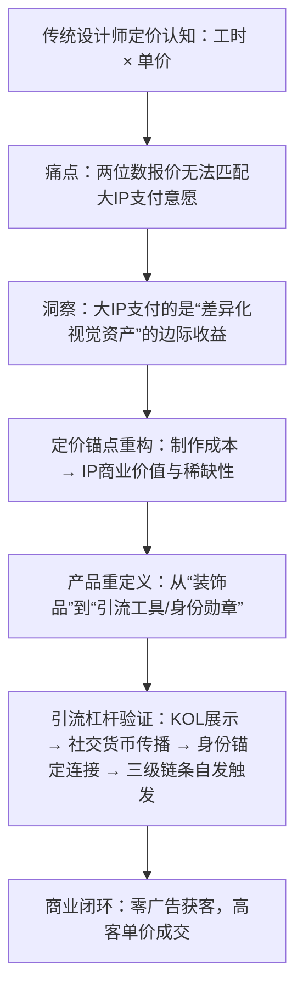
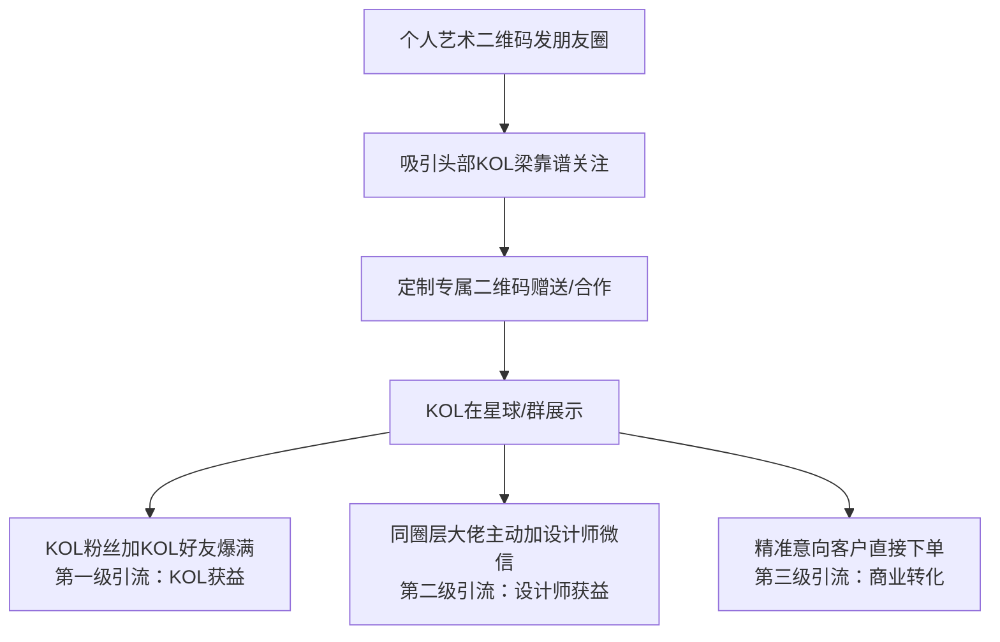
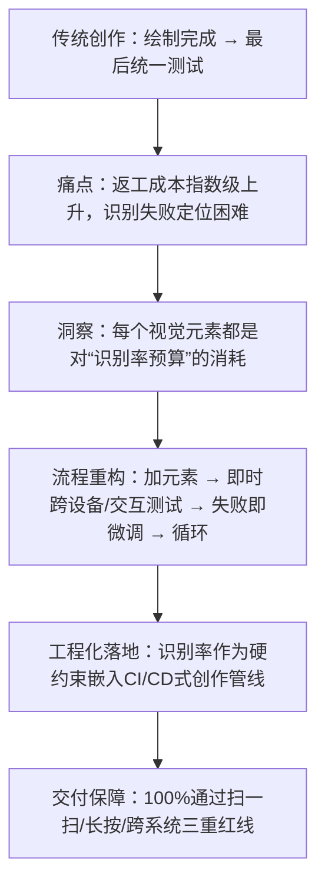
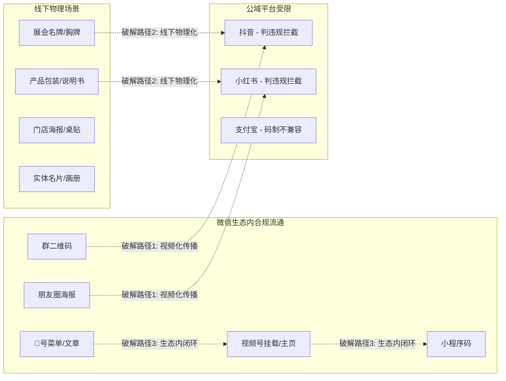
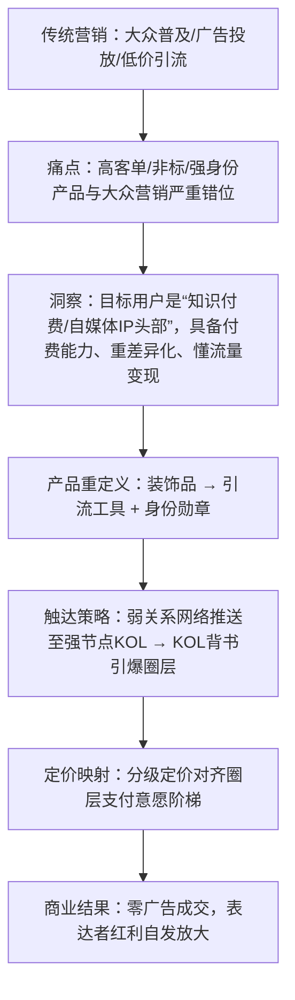
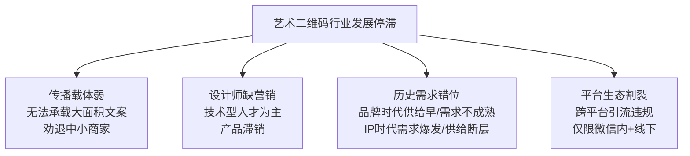

# 第 59 章 艺术二维码商业体系 —— 从“一张二维码”到“连锁引流商业闭环”

## 学习目标

- 理解IP审美溢价定理：艺术二维码的商业定价锚点在于其承载的IP商业价值而非制作成本
- 掌握艺术二维码引流杠杆定理：兼具社交货币属性与身份锚定属性，触发KOL粉丝加KOL→大佬加设计师→意向客户下单三级引流链条
- 理解跨平台生态割裂定律：微信二维码无法在抖音/小红书直接引流，仅限微信生态内及线下物理场景流通
- 掌握迭代测试保识别法：每增加一个视觉元素即跨设备/交互实测，将可识别性作为硬约束嵌入创作全程
- 了解圈层定向营销策略：精准锚定知识付费/自媒体IP圈层，将二维码重定义为引流工具与身份勋章
- 理解原创vs模板二维码优劣：模板类识别性不稳定无售后，原创类专属高识别承载IP价值

## 59.1 生活类比

想象艺术二维码是一张会发光的VIP名片。当你走进一场高端商业晚宴，普通人递出的名片只是两位数成本的铜版纸，上面印着基础联系方式；而大佬递出的，是五位数定制的钛合金镂空名片，名片本身的材料成本或许只占价格的千分之一，真正的定价锚点在于名片背后那张隐形的人脉地图与商业信用背书——这就是IP审美溢价定理的具象化：价格从不锚定在制作成本上，而锚定在承载的IP商业价值与稀缺性上。当大佬掏出这张名片的瞬间，全场目光聚焦，围观者因新奇而拍照传播（社交货币属性），同行大佬因认出专属纹章而主动搭话互换（身份锚定属性），意向客户更是借机递出微信——这便是艺术二维码引流杠杆定理在物理世界的投影：一张名片，触发“围观→互换→成交”的三级链条自动运转。然而，这张名片有一个硬伤：它无法在抖音、小红书的数字世界直接通用，平台规则会判定为违规引流拦截（跨平台生态割裂定律），只能在微信生态内部流转，或印在实体物料上线下流通。因此，印制前必须经历极其严苛的打样测试：字号在弱光下能否看清、二维码在安卓与iOS双系统能否扫出、铜版纸与哑粉纸印刷后对比度是否达标——哪怕只有一个像素点的套印偏差，都可能导致整批名片报废（迭代测试保识别法）。正因为门槛高、溢价强、非刚需，名片印刷厂不会发传单给路人推销，而是精准把名片塞进行业头部KOL、大佬的手中，靠他们的背书引爆连锁反应（圈层定向营销策略）。就像高端定制名片不靠材料取胜、靠背后的人设与圈层溢价，艺术二维码的商业本质也是：视觉锤包装IP价值，圈层渗透撬动流量。

## 59.2 概念地图

艺术二维码商业体系
├── 核心定理
│   ├── IP审美溢价定理  —— P104
│   ├── 艺术二维码引流杠杆定理  —— P104
│   ├── 跨平台生态割裂定律  —— P104
│   └── 迭代测试保识别法  —— P104
├── 商业化前提
│   ├── 功能性(识别率)>艺术性  —— P104
│   ├── 时效性约束：仅适用永久原始码  —— P104
│   └── 信息点覆盖原则  —— P104
├── 定价模型
│   ├── 分级定价：两位数至五位数(最高3万)  —— P104
│   └── 价格锚点：IP商业价值而非制作成本  —— P104
├── 营销策略
│   ├── 圈层定向：锚定知识付费/自媒体IP圈层  —— P104
│   ├── 社交货币属性+身份锚定属性  —— P104
│   └── 三级引流链条：KOL粉丝→大佬→意向客户  —— P104
└── 行业现状
    ├── 原创vs模板：原创专属/高识别/承载IP价值  —— P104
    ├── 发展停滞四大原因：传播载体弱/设计师缺营销/需求错位/生态割裂  —— P104
    └── 从业者稀缺：会制作原创艺术二维码设计师仅几千人  —— P104

## 59.3 IP审美溢价与引流杠杆 —— 艺术二维码的商业定价与三级引流链条

### 为什么需要这个概念？

普通设计师习惯按工时定价，报价往往停留在两位数区间，根本无法向头部大IP收取五位数的溢价，导致商业价值被严重低估。艺术二维码长期被市场视为单纯的“装饰品”，而非具备引流功能的“商业工具”，无法触发KOL背书与圈层裂变的连锁商业转化。更缺乏“功能性大于艺术性”的硬性约束，导致大量牺牲识别率换取艺术效果的败笔产品流入市场，损害了整个赛道的商业信誉。

> "一个小小的二维码，也能玩出花样帮助引流。"
> 
> "让我见识到了什么叫著名圈友梁靠谱的影响力，什么叫表达者红利，什么叫一键引流，什么叫圈层的重要性，什么叫我被大佬加微信的慌张。"
> 
> ——《吉果：艺术二维码引流复盘》（P104）

> "扫不出来是制作有问题。好的艺术二维码都是可扫可长按的。"
> 
> "商业价值和引流价值可能都没有发展明白吧。"
> 
> ——《吉果：艺术二维码引流复盘》（P104）

> "艺术二维码的价值来自于它承载的IP价值和创意价值。它不仅仅是一个身份识别的图案，还是一件包含设计艺术价值在内的艺术产品。"
> 
> "设计师是在有限的空间内，绘制了一幅有丰富想象力的图画。同时还要保证二维码的可识别性。所以艺术二维码是一件客单价很高的产品。"
> 
> "普通人只是为了好看和独特，一两千买个图片，他是不愿意的。但自媒体IP需要引流，尤其是那些全方位包装自己的大IP更需要引流。"
> 
> ——《吉果：艺术二维码商业化全拆解》（P104）

### 核心定义

**IP审美溢价定理**（来源：《吉果：艺术二维码商业化全拆解》，P104）

艺术二维码的商业定价锚点在于其承载的IP商业价值与稀缺性，而非制作成本。大IP愿为差异化视觉资产支付溢价（边际收益远超成本），普通用户仅付模板成本。

**艺术二维码引流杠杆定理**（来源：《吉果：艺术二维码商业化全拆解》，P104）

兼具“社交货币属性”（新奇独特引发炫耀/分享）与“身份锚定属性”（专属元素强化IP辨识），当被头部KOL在私域/社群展示时，触发“好奇-验证-连接”三级引流链条：KOL粉丝加KOL → 同圈层大佬加设计师 → 精准意向客户下单。

这个定理展示了艺术二维码如何从单纯的视觉装饰进化为商业引流工具：它不是靠广告投放，而是靠“被展示”本身自带传播动能。

### 方法演进：从“工时定价”到“IP价值定价”的商业化认知跃迁



### 关键性质

**价格阶梯** 随着设计复杂度、原创元素数量、IP专属信息密度及衍生应用范围的递增，艺术二维码呈现出五级价格阶梯：基础换色或单一元素替换仅需两位数；3-5个原创图案覆盖信息点则进入三位数区间；明确专属图案配合大量信息或海报设计达到1-5千元；毕加索风格、2.5D高难度造型或包含完整设计理念的旗舰级作品则可定价至五位数，最高纪录约3万元。这个价格体系揭示了：复杂度、原创元素数量、IP专属信息密度、衍生应用范围四个维度共同决定商业定价，而非单纯工时。

**识别性硬约束** 扫一扫、长按识别、跨系统兼容（iOS/Android/鸿蒙）构成三重识别红线。一两个信息点的绘制偏差即可导致整码识别失效。任何牺牲识别率换取艺术效果的做法，在商业定义上均属于败笔，不具备引流价值。这个约束揭示了艺术二维码的工程本质：它是“在功能性约束下的视觉重构”，而非“带二维码功能的插画”。

**时效性边界** 艺术二维码仅适用于永久有效且不得更换的原始码。临时群二维码（7天失效）、微信“换个样式”功能导致底码变更，均会使已交付的设计瞬间失效，造成甲乙双方沉没成本。这个边界条件直接决定了商业交付的风险控制：必须在合同中明确“原始码永久有效且不得更换”条款。

### 典型例子

吉果个人艺术二维码朋友圈发布 → 梁靠谱关注/转发 → 专属二维码出炉 → KOL星球/群展示 → 好友申请爆满（引流KOL） → 多位大佬主动加作者微信（引流设计师） → 2位大佬直接下单定制（商业转化）。全过程零广告投放，耗时数天。

这个案例完美演示了三级引流链条的自发触发机制：不需要设计师主动推销，KOL的“展示”行为本身就是最强营销。



### 边界条件

- 仅限微信生态内（群/朋友圈/👸号/视频号）及线下物理场景流通，抖音/小红书判定违规无法跨平台引流
- 核心价值锚点在于“可扫可长按”基础功能性，牺牲识别率换艺术效果的产品无商业引流价值
- 普通用户因无变现路径仅愿支付模板成本，自媒体IP因变现需求愿支付溢价，定价逻辑本质不同

---

## 59.4 迭代测试保识别法 —— 可识别性作为硬约束的工程化创作流程

### 核心定义

**迭代测试保识别法**（来源：《吉果：艺术二维码商业化全拆解》，P104）

艺术二维码制作的核心工程化流程：在AI矢量软件中逐层绘制元素 → 每增加一个视觉元素即进行跨设备（iOS/Android/鸿蒙）、跨交互（扫一扫/长按识别）实测 → 定位识别失败点 → 微调信息点覆盖 → 循环直至全通过。该方法将“可识别性”作为硬性约束条件嵌入创作全过程。

> "所以为了保证识别性，在绘制的过程中，要不断地测试。简单来说，我加了一个花，二维码扫的出来吗？测一下。再加个草呢？再测测。"
> 
> "一个完美的艺术二维码，必须让你扫也扫的出来，长按也能按的出来。安卓鸿蒙的能识别，IOS也得能识别。"
> 
> ——《吉果：艺术二维码商业化全拆解》（P104）

这个方法揭示了艺术二维码创作的本质：它是约束满足问题（CSP）的求解过程，而非纯粹的艺术创作。每一个视觉元素的加入都是对识别率这个单一指标的“压力测试”。

### 方法演进：从“事后验收”到“全程嵌入式测试”的工程化转型



### 关键推导：信息点覆盖原则的量化执行

**信息点覆盖原则**（来源：《吉果：艺术二维码商业化全拆解》，P104）

艺术二维码设计的核心技术原理，即通过线条、图像合理覆盖二维码的关键信息点（功能模块），在视觉重构的同时必须保证扫码识别率。

根据 ISO/IEC 18004 国标，二维码由定位图形、对齐图形、版本信息、格式信息、数据码字与纠错码字等功能模块构成。纠错等级（L/M/Q/H）提供 7%~30% 的容错冗余，这是视觉重构可利用的唯一“预算”。因此，识别率可建模为五大功能模块完整度与纠错冗余度的联合函数：

$$
\text{识别率} = f(\text{定位点完整度}, \text{对齐点完整度}, \text{版本信息完整度}, \text{数据码字完整度}, \text{纠错等级冗余度})
$$

其中：
- 定位点完整度：三大定位框（左上、右上、左下）的几何特征保持度，直接决定扫描器能否定位坐标系；
- 对齐点完整度：版本 2 以上含有的对齐图形保持度，影响大尺寸/透视畸变下的校正能力；
- 版本信息完整度：版本 7 以上的版本信息区保持度，影响解码器识别码制规格；
- 数据码字完整度：承载实际数据的模块保持度，受艺术元素覆盖冲击最大；
- 纠错等级冗余度：L/M/Q/H 四档提供的数学容错上限，是设计可覆盖信息点数量的硬天花板。

这个公式展示了：识别率取决于五大功能模块的完整度与纠错冗余度的联合作用。艺术设计只能利用纠错冗余度提供的“容错预算”。纠错等级越高（如H级30%），可供视觉重构“挪用”的信息点预度越大，但同时也要求原始码版本更高、密度更大，对印刷精度与拍摄清晰度提出更严苛要求。因此，设计师必须在“视觉表现力”与“识别鲁棒性”的帕累托前沿上寻找平衡点。

**迭代测试算法伪代码**

```
输入：原始二维码矩阵 Q, 目标视觉元素集合 E = {e1, e2, ..., en}
输出：可识别的艺术二维码 A

A ← Q 的副本
FOR 每个元素 ei ∈ E:
    A' ← 在 A 上叠加/替换 ei
    IF 测试通过(A') == FALSE:
        微调 ei 的位置/形状/透明度/描边
        重新测试直至通过
    A ← A'
RETURN A
```

上述算法展示了：创作过程实质是一个“加元素→测试→回滚/微调→再测试”的闭环迭代，识别率是唯一的硬性通过标准。每一次循环都在消耗纠错冗余度提供的“容错预算”，当预算耗尽即意味着无法再添加新元素而不破坏识别性。

### 典型例子

作者制作梁靠谱专属二维码：周期5-7天，包含明确专属图案+大量信息。毕加索风格需1-2周，2.5D风格更久。顶级定制可达3万元/一个月。

这个时间成本分布印证了：识别性测试与微调是核心耗时瓶颈，而非绘制本身。

---

## 59.5 跨平台生态割裂定律 —— 微信生态内的商业闭环与破解路径

### 核心定义

**跨平台生态割裂定律**（来源：《吉果：艺术二维码商业化全拆解》，P104）

艺术二维码的商业效用受限于平台生态壁垒：微信二维码无法在抖音/小红书直接引流（被判定违规），仅限微信生态内（群、朋友圈、👸号、视频号）及线下物理场景流通。这导致其无法成为全域流量入口，限制了商业模式的规模化复制。

> "设计一款二维码付出很多，但是无法跨平台使用。例如微信的二维码不能发到小红书或者抖音。会被判定引流。微信生态内可以使用，视频号能够发微信艺术二维码的视频。"
> 
> "当然好的艺术二维码，完全可以打印出来线下使用。"
> 
> ——《吉果：艺术二维码商业化全拆解》（P104）

这个定律揭示了私域流量工具的根本局限：它是微信生态的“内部货币”，无法直接兑换为公域流量。



### 破解策略对照表

下表基于《吉果：艺术二维码商业化全拆解》（P104）中关于跨平台受限与线下可用的论述综合整理，旨在为从业者提供可落地的组合拳参考：

| 破解路径 | 核心思路 | 典型场景 | 优势 | 局限 |
|----------|----------|----------|------|------|
| **线下物理场景** | 将二维码实体化，绕过平台数字壁垒 | 展会名牌/产品包装/门店海报/实体名片 | 真实接触、信任度高、无平台限制 | 触达范围受物理空间限制、成本较高 |
| **视频化传播** | 将制作过程/展示效果视频化发布公域，引流至私域 | 抖音/小红书发制作视频/成品展示 → 简介/评论区钩子引导加微信 | 借力公域算法分发、内容本身有传播价值 | 需规避“引流违规”判定、转化链路长 |
| **微信生态内闭环** | 深耕微信内部所有触点形成闭环 | 视频号挂载/👸号菜单/朋友圈海报/群工具/小程序码 | 链路最短、转化率最高、完全合规 | 流量上限受微信生态总量封顶 |

这个对照表展示了：单一工具无法打通全域，必须组合拳作战。

---

## 59.6 圈层定向营销策略 —— 精准锚定高客单价种子用户

### 核心方法

**圈层定向营销策略**（来源：《吉果：艺术二维码商业化全拆解》，P104）

针对艺术二维码“高客单价、审美上层需求、非刚需”的特性，放弃大众普及营销，精准锚定“知识付费/自媒体IP”圈层：该群体具备付费能力、极度在意差异化包装、深谙流量价值，将艺术二维码从“装饰品”重新定义为“引流工具”与“身份勋章”。

> "艺术二维码的原创性，导致价格并不亲民...属于最上层的需求...不是所有人都能接受。"
> 
> "在知识付费领域、自媒体IP领域，大家更注重自己的差异性和账号的审美包装。定位和圈层对了，结果也就对了。"
> 
> "自媒体时代，流量最贵。每一个独特的点，都可能成为你吸引流量的奇招。"
> 
> ——《吉果：艺术二维码商业化全拆解》（P104）

这个策略的核心洞见：**产品的属性决定了营销的对象**。高客单、非标、强身份属性的产品，天然匹配“以身份认同为核心驱动力”的圈层。

### 方法演进：从“大众撒网”到“圈层渗透”的营销范式转换



### 分级定价模型映射圈层支付意愿

下表依据《吉果：艺术二维码商业化全拆解》（P104）中的“艺术二维码分级定价模型”与“圈层定向营销策略”综合整理，展示价格梯队与目标圈层感知价值的对应关系：

| 价格梯队 | 产品形态 | 目标圈层 | 核心价值主张 |
|----------|----------|----------|--------------|
| 两位数 | 基础换色/单一元素 | 普通用户/小白测试 | 好看、便宜、满足好奇心 |
| 三位数 | 3-5原创图案 | 成长期创作者 | 差异化、识别度高、性价比 |
| 1-5千 | 专属图案+信息密度大/配海报 | 成熟IP/商业化账号 | 强IP绑定、引流工具属性、配套物料 |
| 五位数(最高3万) | 毕加索/2.5D/含设计理念/全案授权 | 头部大IP/机构 | 顶级视觉锤、品牌资产、排他性授权 |

这个映射表展示了：价格不是成本加成，而是**目标圈层感知价值的函数**。

---

## 59.7 原创vs模板二维码 —— 商业化可行性的分水岭

### 多源对照

**共识**（来源：《吉果：艺术二维码商业化全拆解》与《吉果：艺术二维码引流复盘》，P104）：艺术二维码需保证基础识别功能（扫一扫/长按识别），视觉重构不能破坏功能性。

**分歧**：

- **原创派（吉果）**：主张专属定制、逐元素测试、承载IP价值、高客单价、可作为品牌资产积累。核心观点：“设计师是在有限的空间内，绘制了一幅有丰富想象力的图画。同时还要保证二维码的可识别性。所以艺术二维码是一件客单价很高的产品。”（P104）
- **模板派（市场主流）**：主张标准化模板、一键生成、低价/免费、满足基础美化需求。核心观点：“这种二维码的优势在于便宜，甚至免费。可以用很低廉的价格，得到一个简单美化过的二维码。”（P104）

**关键差异点对照**：

下表基于《吉果：艺术二维码商业化全拆解》（P104）中对原创与模板两类产品的详细对比整理：

| 维度 | 原创艺术二维码 | 模板艺术二维码 |
|------|----------------|----------------|
| **专属性** | 100%专属，含IP专属视觉符号/信息 | 模板有限，重复率高，无专属元素 |
| **识别性保障** | 逐元素迭代测试，跨设备/交互全通过，终身售后 | 识别性不稳定，无售后，“喜欢的样式不识别只能换样式” |
| **商业价值** | 承载IP品牌资产，可作为引流工具/身份勋章 | 仅作装饰，无商业引流价值 |
| **价格区间** | 三位数至五位数（最高3万） | 两位数甚至免费 |
| **适用圈层** | 自媒体大IP、知识付费头部、品牌方 | 普通用户、预算敏感型、测试需求 |

这个对照揭示了：模板类产品本质是“工具化的装饰品”，而原创类产品是“定制化的商业资产”，两者虽长得像，但商业逻辑完全不同。

---

## 59.8 行业发展停滞四大原因与从业者稀缺性

### 行业发展停滞的四大结构性原因

基于《吉果：艺术二维码商业化全拆解》（P104）作者六年行业观察总结，艺术二维码赛道长期处于“叫好不叫座、技术成熟商业化缓慢”的停滞状态，根源在于四大结构性矛盾：

1. **传播载体弱**：艺术二维码本身无法承载大面积文案信息（受限于码制结构与识别率），无法像海报/长图那样直接展示产品卖点，导致大量急于展示产品的中小商家（甲方）在初步了解后被劝退，流失了最广泛的基础客群。
2. **设计师缺乏营销能力**：绝大多数具备原创制作能力的设计师属于技术型/艺术型人才，不具备商业化运营、销售转化、品牌推广等营销能力，导致优质产品“藏在深闺人未识”，滞销成为常态。
3. **历史需求错位（时间窗口错配）**：6年前正值大品牌霸屏👸号时代，品牌方有预算尝鲜但缺乏系统化成功案例复制；等到个人IP兴起、自媒体大佬真正具备付费意愿与变现路径时，早期批次的原创设计师已大多因商业化失败转行流失，造成供给端与需求端的时间错位。
4. **平台生态割裂**：微信二维码无法在抖音/小红书等公域平台直接引流（被判定违规），仅限微信生态内及线下物理场景流通，彻底切断了全域流量获取的路径，限制了商业模式的规模化复制与裂变。



### 从业者稀缺性

**从业者稀缺：会制作原创艺术二维码设计师仅几千人**（来源：《吉果：艺术二维码商业化全拆解》，P104）

作者基于行业调研指出，市场上真正掌握原创艺术二维码核心制作技艺（矢量绘制+信息点覆盖原则+迭代测试保识别法）的设计师数量极少，大概只有几千人。这种稀缺性构成了双重红利：一是商业服务端的高定价护城河（供不应求支撑千元至万元客单价）；二是知识付费教学端的高门槛与高潜力——教授制作艺术二维码可成为极具竞争力的高客单价课程产品。

> "市场上会制作原创艺术二维码的设计师，数量很少，大概只有几千人。如果艺术二维码的商业价值被认可，那么教授制作艺术二维码，会是非常有潜力的课程。"
> 
> ——《吉果：艺术二维码商业化全拆解》（P104）

---

## 59.9 设计中的取舍

### 为什么不用“全自动AI生成”替代“人工迭代测试”？

当前AI生成艺术二维码（如ControlNet等扩散模型+控制网）虽能在秒级出图，但识别率不可控，缺乏“逐元素微调-实测-再微调”的精细控制能力。商业交付要求100%识别通过（扫一扫/长按/跨系统全通过），AI现阶段只能作为辅助灵感源或基础底图生成器，不能替代人工工程化保障流程。核心矛盾在于：AI优化目标是视觉似然概率，而商业交付的硬约束是解码器确定性通过——二者目标函数不一致。

### 为什么不做“跨平台通用二维码”？

微信/抖音/小红书/支付宝各有独立的码制体系与识别器（微信码、抖音码、小红书码、支付宝码互不兼容），且平台策略严禁跨平台引流（抖音/小红书检测到微信二维码图片即判违规限流/封号）。试图做“万能码”会陷入与平台规则对抗的无限博弈，边际收益递减且风险不可控。不如深耕微信生态内闭环（视频号/👸号/朋友圈/群工具/小程序码全链路打通），或通过视频化传播（制作过程视频发公域引流私域）、线下物理化（实体物料嵌入）做跨平台桥接，实现“曲线救国”。

### 这种设计的 trade-off 是什么？

- **得**：高客单价（千元至万元）、强IP绑定（专属视觉资产不可复制）、圈层自传播（KOL展示即营销）、零广告获客（表达者红利）、品牌资产积累（视觉锤长期复利）。
- **失**：无法规模化标准化交付（每单非标定制、交付周期天至周级）、跨平台受限（无法直接触达抖音/小红书公域流量）、从业者极度稀缺（仅几千人、人才复制难度大）、制作周期长（识别性测试占70%+工时）、时效性风险（临时码/换样式导致底码失效）、印刷工艺敏感（材质/油墨/套印精度直接影响识别率）。

---

## 59.10 动手练习

### 练习 1：艺术二维码识别性极限测试

选择一个复杂IP形象（如含渐变、透视、精细线条），制作艺术二维码并测试：
1. 在iOS/Android/鸿蒙三系统分别测试扫一扫与长按识别
2. 在弱光/强光/反光环境下测试识别率
3. 打印不同材质（铜版纸/哑粉纸/PVC）测试物理识别
4. 记录首次识别失败时的元素覆盖位置，分析信息点冲突规律

回答问题：
- 哪类视觉元素（渐变/透视/精细线条）最易导致识别失效？
- 信息点覆盖原则在实操中如何量化执行？
- 印刷工艺对识别率的影响阈值是多少？

### 练习 2：圈层定向营销实战推演

假设你是艺术二维码设计师，目标锁定知识付费头部IP（如生财有术大佬）：
1. 分析目标圈层的核心诉求：差异化包装、流量变现、身份辨识
2. 设计专属二维码方案：包含IP专属视觉符号、引流落地页、数据埋点
3. 制定触达策略：通过弱关系网络（朋友圈/社群）将作品推送至强关系节点(KOL)
4. 设定分级定价：基础版（两位数）/专属版（三位数）/旗舰版（五位数含运营授权）

回答问题：
- 如何验证目标圈层对“身份勋章”属性的支付意愿？
- 专属二维码的“社交货币属性”如何量化转化为引流数据？
- 旗舰版包含的“运营授权”具体包含哪些商业权利？

### 练习 3：跨平台生态割裂破解方案设计

针对微信二维码无法在抖音/小红书直接引流的限制：
1. 设计线下物理场景应用方案：展会名牌/产品包装/门店海报/实体名片嵌入
2. 设计跨平台内容转化方案：将艺术二维码制作过程视频化发布至抖音/小红书，引流至微信私域
3. 设计微信生态内闭环方案：视频号挂载二维码/👸号菜单栏/朋友圈海报/群工具

回答问题：
- 哪种线下物理场景的转化率最高？如何测算？
- 视频化传播中如何规避平台“引流违规”判定？
- 微信生态内哪个入口（视频号/👸号/朋友圈/群）引流效率最高？

---

## 59.11 本章小结

这一章中我们学习了艺术二维码的完整商业体系：首先理解了IP审美溢价定理——定价锚点不在制作成本而在承载的IP商业价值；其次掌握了艺术二维码引流杠杆定理——兼具社交货币与身份锚定属性，触发三级引流链条；接着理解了跨平台生态割裂定律——微信二维码仅限微信生态及线下流通，无法直接跨平台引流；然后掌握了迭代测试保识别法——每加一元素即跨设备实测，将可识别性作为硬约束嵌入创作全程；接着了解了圈层定向营销策略——精准锚定知识付费/自媒体IP圈层，将二维码重定义为引流工具与身份勋章；随后分析了原创vs模板二维码的本质区别——原创类专属高识别承载IP价值，模板类识别性不稳定无售后；最后梳理了行业发展停滞的四大结构性原因（传播载体弱/设计师缺营销/历史需求错位/平台生态割裂）与从业者稀缺性（仅几千人）这两大行业现状洞察。

本章我们一起学习了以下概念：

| 概念 | 解释 | 来源 |
|------|------|------|
| 艺术二维码 | 将插画/设计融入二维码结构，在保持识别功能前提下实现审美升级与IP专属表达的视觉载体 | P104 |
| IP审美溢价定理 | 定价锚点不在制作成本而在承载的IP商业价值与稀缺性，大IP愿为差异化视觉资产付溢价 | P104 |
| 艺术二维码引流杠杆定理 | 兼具社交货币属性(新奇独特引发炫耀/分享)与身份锚定属性(专属元素强化IP辨识)，触发三级引流链条 | P104 |
| 跨平台生态割裂定律 | 微信二维码不可跨平台引流(抖音/小红书判违规)，仅限微信生态内及线下物理场景，限制商业模式规模化复制 | P104 |
| 迭代测试保识别法 | 制作流程中每加一元素即跨设备/交互实测，将可识别性作为硬约束嵌入创作全程 | P104 |
| 圈层定向营销策略 | 针对高客单/审美上层/非刚需特性，精准锚定知识付费/自媒体IP圈层，将二维码重定义为引流工具与身份勋章 | P104 |
| 原创vs模板二维码 | 模板类便宜但重复率高/识别性不稳定无售后；原创类专属/高识别/承载IP价值，商业化首选 | P104 |
| 行业发展四大停滞原因 | 传播载体弱/设计师缺营销/历史需求错位/平台生态割裂 | P104 |
| 从业者稀缺性 | 市场会制作原创艺术二维码的设计师仅几千人，构成知识付费教学的高门槛与高潜力 | P104 |

下一章中，我们将学习营业执照年报实操与合规避坑 —— 从“第三方收费乱象”到“零成本自主年报”，掌握个体户及小微企业自主完成年报的全流程标准化操作法，规避逾期处罚升级链条与第三方代理收费陷阱。


