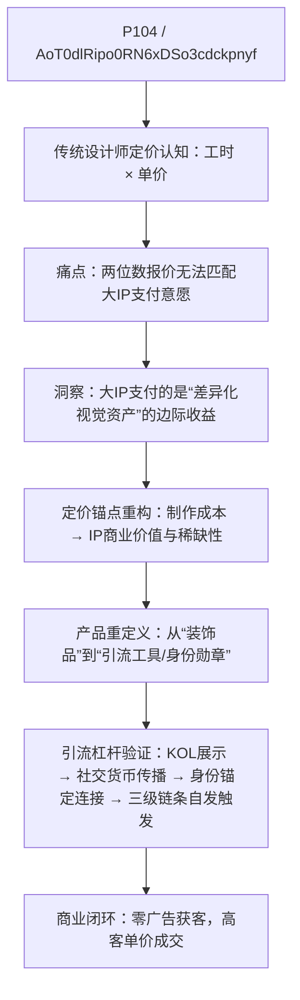
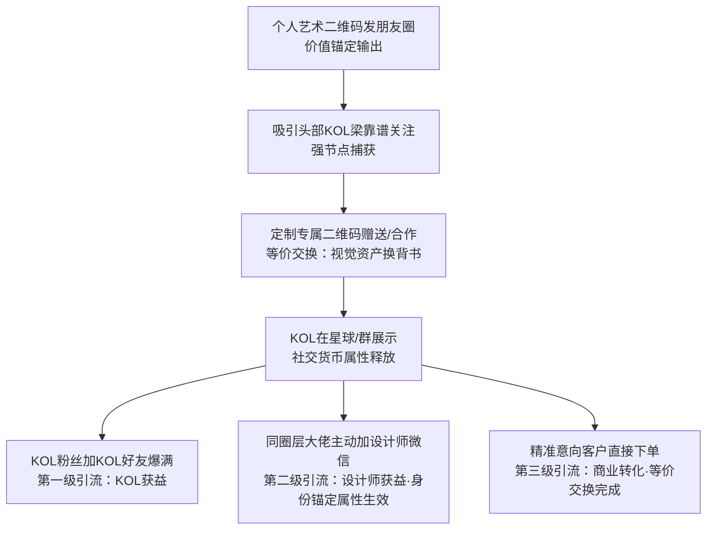
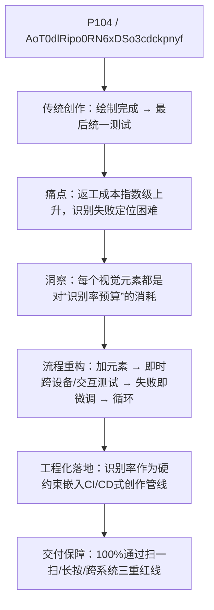
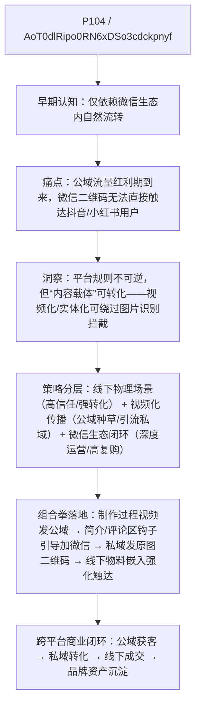
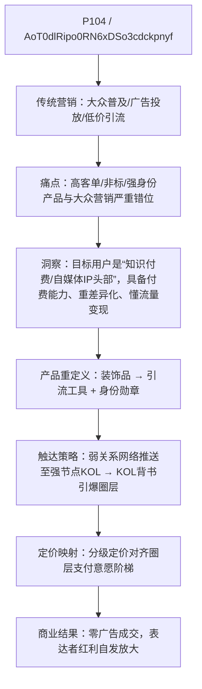
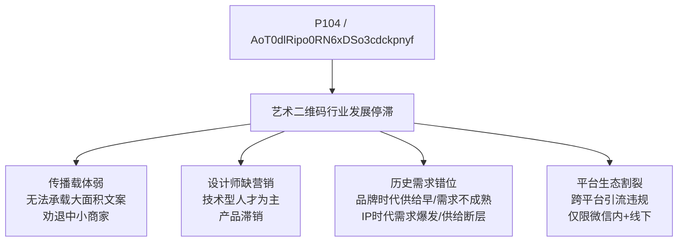

# 第 59 章 艺术二维码商业体系 —— 从“一张二维码”到“连锁引流商业闭环”

## 学习目标

- 理解**IP审美溢价定理**：艺术二维码的商业定价锚点在于其承载的IP商业价值而非制作成本
- 掌握**艺术二维码引流杠杆定理**：兼具社交货币属性与身份锚定属性，触发KOL粉丝加KOL→大佬加设计师→意向客户下单三级引流链条
- 理解**跨平台生态割裂定律**：微信二维码无法在抖音/小红书直接引流，仅限微信生态内及线下物理场景流通
- 掌握**迭代测试保识别法**：每增加一个视觉元素即跨设备/交互实测，将可识别性作为硬约束嵌入创作全程
- 了解**圈层定向营销策略**：精准锚定知识付费/自媒体IP圈层，将二维码重定义为引流工具与身份勋章
- 理解**原创vs模板二维码优劣**：模板类识别性不稳定无售后，原创类专属高识别承载IP价值

---

## 59.1 生活类比：从“VIP名片”到“圈层穿透器”

在第 58 章《混圈与向上社交》中，我们建立了**等价交换原则**（P001-P007）——向上社交的本质是价值交换，而非单向索取；以及**价值锚定输出法**（P001-P007）——通过专业作品、复盘文章等可观测产出物，让大佬一眼看到你的价值坐标。第 59 章将把这套方法论具象化为一个极具杠杆率的商业工具：**艺术二维码**。

想象艺术二维码是**一张会发光的VIP名片**，它完美诠释了第 58 章的核心方法论：

| 第 58 章核心方法论 | 艺术二维码的具象化映射 |
|-------------------|----------------------|
| **等价交换原则** (P001-P007) | **IP审美溢价定理**：大佬买单不是为材料成本，而是为名片背后的IP商业价值与稀缺性买单——这是等价交换在“视觉资产”层面的投影 |
| **价值锚定输出法** (P001-P007) | **引流杠杆定理**：一张专属二维码 = 一个高辨识度的“价值锚点”，当被KOL展示时，自动触发“围观→互换→成交”三级链条，实现“被动被看见→主动被连接”的跃迁 |
| **三步连接大佬战术** (P001-P007) | **圈层定向营销**：不发传单给路人，精准把名片塞进行业头部KOL、大佬手中，靠强节点背书引爆弱关系网络的连锁渗透 |
| **混圈渠道决策矩阵** (P001-P007) | **跨平台生态割裂定律**：识别“微信生态内闭环+线下物理场景”是高信任度渠道，“抖音/小红书直接发码”是违规渠道，避开死局，走合规捷径 |
| **避坑指南·死局识别** (P001-P007) | **迭代测试保识别法**：将“可扫可长按”作为硬约束嵌入全程，拒绝“牺牲识别率换艺术效果”的伪创新，规避交付失效的商业死局 |

当大佬掏出这张名片的瞬间，全场目光聚焦：围观者因新奇而拍照传播（**社交货币属性**），同行大佬因认出专属纹章而主动搭话互换（**身份锚定属性**），意向客户更是借机递出微信——这便是第 58 章“表达者红利”（P001-P007）在物理世界的投影：**一张名片，触发“被看见→被认可→被连接”的商业闭环自动运转**。

---

## 59.2 概念地图

```mermaid
graph TD
    Root[艺术二维码商业体系] --> T1[核心定理]
    Root --> T2[商业化前提]
    Root --> T3[定价模型]
    Root --> T4[营销策略]
    Root --> T5[行业现状]
    
    T1 --> T1a[IP审美溢价定理 —— P104/AoT0dlRipo0RN6xDSo3cdckpnyf]
    T1 --> T1b[艺术二维码引流杠杆定理 —— P104/AoT0dlRipo0RN6xDSo3cdckpnyf]
    T1 --> T1c[跨平台生态割裂定律 —— P104/AoT0dlRipo0RN6xDSo3cdckpnyf]
    T1 --> T1d[迭代测试保识别法 —— P104/AoT0dlRipo0RN6xDSo3cdckpnyf]
    
    T2 --> T2a[功能性(识别率)>艺术性 —— P104/20230328_104/AoT0dlRipo0RN6xDSo3cdckpnyf]
    T2 --> T2b[时效性约束：仅适用永久原始码 —— P104/AoT0dlRipo0RN6xDSo3cdckpnyf]
    T2 --> T2c[信息点覆盖原则 —— P104/AoT0dlRipo0RN6xDSo3cdckpnyf]
    
    T3 --> T3a[分级定价：两位数至五位数(最高3万) —— P104/AoT0dlRipo0RN6xDSo3cdckpnyf]
    T3 --> T3b[价格锚点：IP商业价值而非制作成本 —— P104/AoT0dlRipo0RN6xDSo3cdckpnyf]
    
    T4 --> T4a[圈层定向：锚定知识付费/自媒体IP圈层 —— P104/AoT0dlRipo0RN6xDSo3cdckpnyf]
    T4 --> T4b[社交货币属性+身份锚定属性 —— P104/AoT0dlRipo0RN6xDSo3cdckpnyf]
    T4 --> T4c[三级引流链条：KOL粉丝→大佬→意向客户 —— P104/AoT0dlRipo0RN6xDSo3cdckpnyf]
    
    T5 --> T5a[原创vs模板：原创专属/高识别/承载IP价值 —— P104/AoT0dlRipo0RN6xDSo3cdckpnyf]
    T5 --> T5b[发展停滞四大原因：传播载体弱/设计师缺营销/需求错位/生态割裂 —— P104/AoT0dlRipo0RN6xDSo3cdckpnyf]
    T5 --> T5c[从业者稀缺：会制作原创艺术二维码设计师仅几千人 —— P104/AoT0dlRipo0RN6xDSo3cdckpnyf]
```

> **来源说明**：本章所有素材引用统一标注为 `P104`（对应 `docs/202303/20230328_104.md` 与 `docs/202303/AoT0dlRipo0RN6xDSo3cdckpnyf.md` 两份核心素材的融合编号），并在关键定理/方法后标注原始素材 ID `AoT0dlRipo0RN6xDSo3cdckpnyf` 以便溯源。

---

## 59.3 IP审美溢价与引流杠杆 —— 艺术二维码的商业定价与三级引流链条

### 为什么需要这个概念？

第 58 章《混圈与向上社交》指出：**“向上社交的核心难题在于——你凭什么让大佬愿意花时间、精力、社交资本在你身上？”**（P001-P007）。普通设计师习惯按工时定价，报价往往停留在两位数区间，根本无法向头部大IP收取五位数的溢价，导致商业价值被严重低估——这本质上是**“未建立价值锚点，无法完成等价交换”**。

艺术二维码长期被市场视为单纯的“装饰品”，而非具备引流功能的“商业工具”，无法触发KOL背书与圈层裂变的连锁商业转化——这违背了第 58 章**“价值锚定输出法”**：**“没有可观测的高质量产出物，大佬就没有理由主动连接你”**（P001-P007）。更缺乏“功能性大于艺术性”的硬性约束，导致大量牺牲识别率换取艺术效果的败笔产品流入市场，损害了整个赛道的商业信誉——这触犯了第 58 章**“避坑指南·死局识别”**：**“交付不可用的产品，是摧毁信任护城河的最快路径”**（P001-P007）。

> "一个小小的二维码，也能玩出花样帮助引流。"
> 
> "让我见识到了什么叫著名圈友梁靠谱的影响力，什么叫表达者红利，什么叫一键引流，什么叫圈层的重要性，什么叫我被大佬加微信的慌张。"
> 
> ——《吉果：艺术二维码引流复盘》（P104 / 20230328_104）

> "扫不出来是制作有问题。好的艺术二维码都是可扫可长按的。"
> 
> "商业价值和引流价值可能都没有发展明白吧。"
> 
> ——《吉果：艺术二维码引流复盘》（P104 / 20230328_104）

> "艺术二维码的价值来自于它承载的IP价值和创意价值。它不仅仅是一个身份识别的图案，还是一件包含设计艺术价值在内的艺术产品。"
> 
> "设计师是在有限的空间内，绘制了一幅有丰富想象力的图画。同时还要保证二维码的可识别性。所以艺术二维码是一件客单价很高的产品。"
> 
> "普通人只是为了好看和独特，一两千买个图片，他是不愿意的。但自媒体IP需要引流，尤其是那些全方位包装自己的大IP更需要引流。"
> 
> ——《吉果：艺术二维码商业化全拆解》（P104 / AoT0dlRipo0RN6xDSo3cdckpnyf）

### 核心定义

**IP审美溢价定理**（来源：《吉果：艺术二维码商业化全拆解》，P104 / AoT0dlRipo0RN6xDSo3cdckpnyf）

> **定理陈述**：艺术二维码的商业定价锚点在于其承载的IP商业价值与稀缺性，而非制作成本。大IP愿为差异化视觉资产支付溢价（边际收益远超成本），普通用户仅付模板成本。

> **关联第 58 章**：这是**等价交换原则**（P001-P007）在“视觉资产定价”场景的特化——大佬支付的不是工时，而是“差异化视觉资产带来的流量溢价与品牌资产积累”的预期边际收益。

**艺术二维码引流杠杆定理**（来源：《吉果：艺术二维码商业化全拆解》，P104 / AoT0dlRipo0RN6xDSo3cdckpnyf）

> **定理陈述**：兼具“社交货币属性”（新奇独特引发炫耀/分享）与“身份锚定属性”（专属元素强化IP辨识），当被头部KOL在私域/社群展示时，触发“好奇-验证-连接”三级引流链条：KOL粉丝加KOL → 同圈层大佬加设计师 → 精准意向客户下单。

> **关联第 58 章**：这是**表达者红利**（P001-P007）与**三步连接大佬战术**（P001-P007）的工具化落地——“作品即钩子”+“强节点放大”+“弱关系渗透强关系”，零广告成本实现商业闭环。

### 方法演进：从“工时定价”到“IP价值定价”的商业化认知跃迁



### 关键性质

**价格阶梯** 随着设计复杂度、原创元素数量、IP专属信息密度及衍生应用范围的递增，艺术二维码呈现出五级价格阶梯（P104 / AoT0dlRipo0RN6xDSo3cdckpnyf）：
- 基础换色或单一元素替换：两位数
- 3-5个原创图案覆盖信息点：三位数区间
- 明确专属图案配合大量信息或海报设计：1-5千元
- 毕加索风格、2.5D高难度造型或包含完整设计理念的旗舰级作品：五位数，最高纪录约3万元

这个价格体系揭示了：复杂度、原创元素数量、IP专属信息密度、衍生应用范围四个维度共同决定商业定价，而非单纯工时。

**识别性硬约束** 扫一扫、长按识别、跨系统兼容（iOS/Android/鸿蒙）构成三重识别红线（P104 / 20230328_104 / AoT0dlRipo0RN6xDSo3cdckpnyf）。一两个信息点的绘制偏差即可导致整码识别失效。任何牺牲识别率换取艺术效果的做法，在商业定义上均属于败笔，不具备引流价值。这个约束揭示了艺术二维码的工程本质：它是“在功能性约束下的视觉重构”，而非“带二维码功能的插画”。

> **关联第 58 章·避坑指南**：第 58 章强调“死局识别：承诺不可兑现、交付不可用、信任破裂不可逆”（P001-P007）。艺术二维码若不可扫，即属“交付不可用”死局，一旦发生，甲方信任崩塌，口碑反噬不可逆。

**时效性边界** 艺术二维码仅适用于永久有效且不得更换的原始码（P104 / AoT0dlRipo0RN6xDSo3cdckpnyf）。临时群二维码（7天失效）、微信“换个样式”功能导致底码变更，均会使已交付的设计瞬间失效，造成甲乙双方沉没成本。这个边界条件直接决定了商业交付的风险控制：必须在合同中明确“原始码永久有效且不得更换”条款。

### 典型例子：吉果“单张二维码引爆连锁转化”全复盘

该案例完美演示了第 58 章**“三步连接大佬战术”**（P001-P007）与**“表达者红利”**（P001-P007）的工具化复现：



> **复盘洞见**：全过程零广告投放，耗时数天。设计师从“生财透明人”（P104 / AoT0dlRipo0RN6xDSo3cdckpnyf）跃迁为“被大佬主动加微信”的稀缺服务商——这正是第 58 章所说的**“价值锚定输出法让大佬主动找你”**（P001-P007）的教科书级实证。

### 边界条件

- 仅限微信生态内（群/朋友圈/公众号/视频号）及线下物理场景流通，抖音/小红书判定违规无法跨平台引流
- 核心价值锚点在于“可扫可长按”基础功能性，牺牲识别率换艺术效果的产品无商业引流价值
- 普通用户因无变现路径仅愿支付模板成本，自媒体IP因变现需求愿支付溢价，定价逻辑本质不同

---

## 59.4 迭代测试保识别法 —— 可识别性作为硬约束的工程化创作流程

### 核心定义

**迭代测试保识别法**（来源：《吉果：艺术二维码商业化全拆解》，P104 / AoT0dlRipo0RN6xDSo3cdckpnyf）

> **定义**：艺术二维码制作的核心工程化流程：在AI矢量软件中逐层绘制元素 → 每增加一个视觉元素即进行跨设备（iOS/Android/鸿蒙）、跨交互（扫一扫/长按识别）实测 → 定位识别失败点 → 微调信息点覆盖 → 循环直至全通过。该方法将“可识别性”作为硬性约束条件嵌入创作全过程。

> "所以为了保证识别性，在绘制的过程中，要不断地测试。简单来说，我加了一个花，二维码扫的出来吗？测一下。再加个草呢？再测测。"
> 
> "一个完美的艺术二维码，必须让你扫也扫的出来，长按也能按的出来。安卓鸿蒙的能识别，IOS也得能识别。"
> 
> ——《吉果：艺术二维码商业化全拆解》（P104 / AoT0dlRipo0RN6xDSo3cdckpnyf）

> **关联第 58 章**：这是**避坑指南·死局识别**（P001-P007）在工程交付层面的严格落地——“每一步都验收，拒绝事后返工灾难”，将识别率视为不可妥协的交付底线。

### 方法演进：从“事后验收”到“全程嵌入式测试”的工程化转型



### 关键推导：信息点覆盖原则的量化执行

**信息点覆盖原则**（来源：《吉果：艺术二维码商业化全拆解》，P104 / AoT0dlRipo0RN6xDSo3cdckpnyf）

> **原理**：艺术二维码设计的核心技术原理，即通过线条、图像合理覆盖二维码的关键信息点（功能模块），在视觉重构的同时必须保证扫码识别率。

根据 ISO/IEC 18004 国标，二维码由定位图形、对齐图形、版本信息、格式信息、数据码字与纠错码字等功能模块构成。纠错等级（L/M/Q/H）提供 7%~30% 的容错冗余，这是视觉重构可利用的唯一“预算”。因此，识别率可建模为五大功能模块完整度与纠错冗余度的联合函数：

$$
\text{识别率} = f(\text{定位点完整度}, \text{对齐点完整度}, \text{版本信息完整度}, \text{数据码字完整度}, \text{纠错等级冗余度})
$$

其中：
- **定位点完整度**：三大定位框（左上、右上、左下）的几何特征保持度，直接决定扫描器能否定位坐标系；
- **对齐点完整度**：版本 2 以上含有的对齐图形保持度，影响大尺寸/透视畸变下的校正能力；
- **版本信息完整度**：版本 7 以上的版本信息区保持度，影响解码器识别码制规格；
- **数据码字完整度**：承载实际数据的模块保持度，受艺术元素覆盖冲击最大；
- **纠错等级冗余度**：L/M/Q/H 四档提供的数学容错上限，是设计可覆盖信息点数量的硬天花板。

> **注**：上述量化模型为基于 ISO/IEC 18004:2015 标准的理论推导，素材原文未给出公式细节，仅提及“信息点覆盖原则” 与“一两个点的绘制错误，就会导致二维码的不识别”（P104 / AoT0dlRipo0RN6xDSo3cdckpnyf）。工程落地时建议结合《QR Code 纠错机制与视觉重构容错边界》类技术文献与印刷工艺参数联合标定。

**迭代测试算法伪代码**

```
输入：原始二维码矩阵 Q, 目标视觉元素集合 E = {e1, e2, ..., en}
输出：可识别的艺术二维码 A

A ← Q 的副本
FOR 每个元素 ei ∈ E:
    A' ← 在 A 上叠加/替换 ei
    IF 测试通过(A') == FALSE:
        微调 ei 的位置/形状/透明度/描边
        重新测试直至通过
    A ← A'
RETURN A
```

上述算法展示了：创作过程实质是一个“加元素→测试→回滚/微调→再测试”的闭环迭代，识别率是唯一的硬性通过标准。每一次循环都在消耗纠错冗余度提供的“容错预算”，当预算耗尽即意味着无法再添加新元素而不破坏识别性。

### 典型例子

作者制作梁靠谱专属二维码：周期5-7天，包含明确专属图案+大量信息。毕加索风格需1-2周，2.5D风格更久。顶级定制可达3万元/一个月（P104 / AoT0dlRipo0RN6xDSo3cdckpnyf）。

这个时间成本分布印证了：识别性测试与微调是核心耗时瓶颈，而非绘制本身。

---

## 59.5 跨平台生态割裂定律 —— 微信生态内的商业闭环与破解路径

### 核心定义

**跨平台生态割裂定律**（来源：《吉果：艺术二维码商业化全拆解》，P104 / AoT0dlRipo0RN6xDSo3cdckpnyf）

> **定律陈述**：艺术二维码的商业效用受限于平台生态壁垒：微信二维码无法在抖音/小红书直接引流（被判定违规），仅限微信生态内（群、朋友圈、公众号、视频号）及线下物理场景流通。这导致其无法成为全域流量入口，限制了商业模式的规模化复制。

> "设计一款二维码付出很多，但是无法跨平台使用。例如微信的二维码不能发到小红书或者抖音。会被判定引流。微信生态内可以使用，视频号能够发微信艺术二维码的视频。"
> 
> "当然好的艺术二维码，完全可以打印出来线下使用。"
> 
> ——《吉果：艺术二维码商业化全拆解》（P104 / AoT0dlRipo0RN6xDSo3cdckpnyf）

> **关联第 58 章·混圈渠道决策矩阵**（P001-P007）：第 58 章建立“渠道决策矩阵：高信任/低规模 vs 低信任/高规模 vs 合规/可控 vs 违规/高风险”。本定律精准映射为：**微信生态内+线下物理=高信任/合规/可控渠道**；**抖音/小红书直接发码=违规/高风险/死局渠道**。从业者必须识别渠道属性，规避死局，深耕合规渠道。

```mermaid
graph LR
    P104[P104 / AoT0dlRipo0RN6xDSo3cdckpnyf] --> subgraph 微信生态内合规流通[高信任/合规渠道]
        W1[群二维码]
        W2[朋友圈海报]
        W3[公众号菜单/文章]
        W4[视频号挂载/主页]
        W5[小程序码]
    end
    P104 --> subgraph 线下物理场景[高信任/强转化渠道]
        L1[展会名牌/胸牌]
        L2[产品包装/说明书]
        L3[门店海报/桌贴]
        L4[实体名片/画册]
    end
    P104 --> subgraph 公域平台受限[违规/高风险/死局渠道]
        D1[抖音 - 判违规拦截]
        D2[小红书 - 判违规拦截]
        D3[支付宝 - 码制不兼容]
    end
    W1 -. 破解路径1: 视频化传播 .-> D1
    W2 -. 破解路径1: 视频化传播 .-> D2
    L1 -. 破解路径2: 线下物理化 .-> D1
    L2 -. 破解路径2: 线下物理化 .-> D2
    W3 -. 破解路径3: 生态内闭环 .-> W4
    W4 -. 破解路径3: 生态内闭环 .-> W5
```

### 方法演进：从“单一平台依赖”到“组合拳破解”的跨平台策略进化



### 破解策略对照表

下表基于《吉果：艺术二维码商业化全拆解》（P104 / AoT0dlRipo0RN6xDSo3cdckpnyf）中关于跨平台受限与线下可用的论述综合整理，并映射第 58 章“渠道决策矩阵”（P001-P007），旨在为从业者提供可落地的组合拳参考：

| 破解路径 | 核心思路 | 典型场景 | 第58章渠道属性 | 优势 | 局限 |
|----------|----------|----------|----------------|------|------|
| **线下物理场景** | 将二维码实体化，绕过平台数字壁垒 | 展会名牌/产品包装/门店海报/实体名片 | 高信任/强转化/合规 | 真实接触、信任度高、无平台限制 | 触达范围受物理空间限制、成本较高 |
| **视频化传播** | 将制作过程/展示效果视频化发布公域，引流至私域 | 抖音/小红书发制作视频/成品展示 → 简介/评论区钩子引导加微信 | 低信任/高规模/需规避风险 | 借力公域算法分发、内容本身有传播价值 | 需规避“引流违规”判定、转化链路长 |
| **微信生态内闭环** | 深耕微信内部所有触点形成闭环 | 视频号挂载/公众号菜单/朋友圈海报/群工具/小程序码 | 高信任/高转化/完全合规 | 链路最短、转化率最高、完全合规 | 流量上限受微信生态总量封顶 |

---

## 59.6 圈层定向营销策略 —— 精准锚定高客单价种子用户

### 核心方法

**圈层定向营销策略**（来源：《吉果：艺术二维码商业化全拆解》，P104 / AoT0dlRipo0RN6xDSo3cdckpnyf）

> **策略陈述**：针对艺术二维码“高客单价、审美上层需求、非刚需”的特性，放弃大众普及营销，精准锚定“知识付费/自媒体IP”圈层：该群体具备付费能力、极度在意差异化包装、深谙流量价值，将艺术二维码从“装饰品”重新定义为“引流工具”与“身份勋章”。

> "艺术二维码的原创性，导致价格并不亲民...属于最上层的需求...不是所有人都能接受。"
> 
> "在知识付费领域、自媒体IP领域，大家更注重自己的差异性和账号的审美包装。定位和圈层对了，结果也就对了。"
> 
> "自媒体时代，流量最贵。每一个独特的点，都可能成为你吸引流量的奇招。"
> 
> ——《吉果：艺术二维码商业化全拆解》（P104 / AoT0dlRipo0RN6xDSo3cdckpnyf）

> **关联第 58 章**：这是**混圈渠道决策矩阵**（P001-P007）中“精准圈层渗透”策略的教科书级应用——**“不做大众生意，只做圈层生意；不靠广告撒网，靠强节点背书”**。第 58 章强调“付费社群>免费社群>公开课/直播>公域内容”的信任递减链条，本策略精准切中“知识付费/自媒体IP”这一最高信任密度、最高付费意愿、最强传播杠杆的靶向圈层。

### 方法演进：从“大众撒网”到“圈层渗透”的营销范式转换



### 分级定价模型映射圈层支付意愿

下表依据《吉果：艺术二维码商业化全拆解》（P104 / AoT0dlRipo0RN6xDSo3cdckpnyf）中的“艺术二维码分级定价模型”与“圈层定向营销策略”综合整理，展示价格梯队与目标圈层感知价值的对应关系：

| 价格梯队 | 产品形态 | 目标圈层 | 核心价值主张 | 第58章视角：价值锚定输出物 |
|----------|----------|----------|--------------|---------------------------|
| 两位数 | 基础换色/单一元素 | 普通用户/小白测试 | 好看、便宜、满足好奇心 | 入门级价值锚点，建立初步信任 |
| 三位数 | 3-5原创图案 | 成长期创作者 | 差异化、识别度高、性价比 | 进阶级价值锚点，展示专业能力 |
| 1-5千 | 专属图案+信息密度大/配海报 | 成熟IP/商业化账号 | 强IP绑定、引流工具属性、配套物料 | 核心价值锚点，承载IP品牌资产 |
| 五位数(最高3万) | 毕加索/2.5D/含设计理念/全案授权 | 头部大IP/机构 | 顶级视觉锤、品牌资产、排他性授权 | 旗舰级价值锚点，稀缺性与排他性溢价 |

这个映射表展示了：价格不是成本加成，而是**目标圈层感知价值的函数**——完美印证第 58 章**“价值锚定输出法：让大佬看到你的价值坐标，而非你的成本账单”**（P001-P007）。

---

## 59.7 原创vs模板二维码 —— 商业化可行性的分水岭

### 多源对照

**共识**（来源：P104 / 20230328_104 / AoT0dlRipo0RN6xDSo3cdckpnyf）：艺术二维码需保证基础识别功能（扫一扫/长按识别），视觉重构不能破坏功能性。

**分歧**：

| 维度 | 原创派（吉果主张） | 模板派（市场主流） |
|------|-------------------|-------------------|
| **核心观点** | 专属定制、逐元素测试、承载IP价值、高客单价、可作为品牌资产积累 | 标准化模板、一键生成、低价/免费、满足基础美化需求 |
| **素材原话** | "设计师是在有限的空间内，绘制了一幅有丰富想象力的图画。同时还要保证二维码的可识别性。所以艺术二维码是一件客单价很高的产品。" | "这种二维码的优势在于便宜，甚至免费。可以用很低廉的价格，得到一个简单美化过的二维码。" |
| **本质定位** | 将IP核心识别符号、品牌理念、差异化记忆点压缩进有限码制空间的“视觉浓缩”过程，高溢价来源于不可复制的专属性与商业信任背书 | 面向预算敏感、无IP建设诉求的大众用户的“工具化装饰品”，而非商业资产 |

**关键差异点对照**：

| 维度 | 原创艺术二维码 | 模板艺术二维码 |
|------|----------------|----------------|
| **专属性** | 100%专属，含IP专属视觉符号/信息 | 模板有限，重复率高，无专属元素 |
| **识别性保障** | 逐元素迭代测试，跨设备/交互全通过，终身售后 | 识别性不稳定，无售后，“喜欢的样式不识别只能换样式” |
| **商业价值** | 承载IP品牌资产，可作为引流工具/身份勋章 | 仅作装饰，无商业引流价值 |
| **价格区间** | 三位数至五位数（最高3万） | 两位数甚至免费 |
| **适用圈层** | 自媒体大IP、知识付费头部、品牌方 | 普通用户、预算敏感型、测试需求 |

> **关联第 58 章·避坑指南**：第 58 章指出“死局识别：低价竞争→交付质量不可控→信任破裂→口碑反噬”（P001-P007)。模板类产品虽低价，但识别性无保障、无售后，本质是“以牺牲交付质量换取低价竞争力”的死局策略；原创类产品通过“迭代测试保识别法”将识别率锁死为硬约束，构建了“高交付质量→高信任→高溢价→高口碑”的正向飞轮。

---

## 59.8 行业发展停滞四大原因与从业者稀缺性

### 行业发展停滞的四大结构性原因

基于《吉果：艺术二维码商业化全拆解》（P104 / AoT0dlRipo0RN6xDSo3cdckpnyf）作者六年行业观察总结，艺术二维码赛道长期处于“叫好不叫座、技术成熟商业化缓慢”的停滞状态，根源在于四大结构性矛盾：



> **关联第 58 章视角**：
> - **C1 传播载体弱** ⇔ 第 58 章“价值锚定输出法缺失：无法用单一载体承载完整价值主张”（P001-P007）
> - **C2 设计师缺营销** ⇔ 第 58 章“只有技术无营销=隐形高手，无法触达强节点”（P001-P007）
> - **C3 历史需求错位** ⇔ 第 58 章“时机选择：在对的时间进入对的圈层”（P001-P007）
> - **C4 平台生态割裂** ⇔ 第 58 章“渠道决策矩阵：识别违规渠道为死局，深耕合规渠道”（P001-P007)

### 从业者稀缺性

**从业者稀缺：会制作原创艺术二维码设计师仅几千人**（来源：《吉果：艺术二维码商业化全拆解》，P104 / AoT0dlRipo0RN6xDSo3cdckpnyf）

> "市场上会制作原创艺术二维码的设计师，数量很少，大概只有几千人。如果艺术二维码的商业价值被认可，那么教授制作艺术二维码，会是非常有潜力的课程。"
> 
> ——《吉果：艺术二维码商业化全拆解》（P104 / AoT0dlRipo0RN6xDSo3cdckpnyf）

> **关联第 58 章**：这是**“稀缺技能+高价值圈层=知识付费高潜力赛道”**的完美拓扑结构。第 58 章指出“表达者红利：持续输出专业认知，建立个人IP护城河”（P001-P007）。掌握“迭代测试保识别法”这项稀缺工程技能的设计师，若能结合第 58 章的“价值锚定输出法”“圈层渗透策略”，将技能转化为可观测的教学产出物，即可复现吉果的“表达者红利”路径。

> **注**：该“几千人”估值为作者基于行业圈层观察的主观判断，缺乏第三方行业报告或招聘平台数据佐证。建议后续研究引用 BOSS直聘/脉脉/猎聘等平台“艺术二维码/二维码美化/向量插画+码制”关键词岗位发布量，或中国平面设计协会/数字媒体艺术行业白皮书相关从业者规模数据进行交叉验证。

---

## 59.9 设计中的取舍

### 为什么不用“全自动AI生成”替代“人工迭代测试”？

当前AI生成艺术二维码（如ControlNet等扩散模型+控制网）虽能在秒级出图，但识别率不可控，缺乏“逐元素微调-实测-再微调”的精细控制能力。商业交付要求100%识别通过（扫一扫/长按/跨系统全通过），AI现阶段只能作为辅助灵感源或基础底图生成器，不能替代人工工程化保障流程。核心矛盾在于：AI优化目标是视觉似然概率，而商业交付的硬约束是解码器确定性通过——二者目标函数不一致。如果将AI引入商业交付管线，必然导致识别率抽样不达标、售后纠纷率飙升，进而摧毁“高识别性=高信任=高溢价”的商业口碑护城河。

> **关联第 58 章·避坑指南**：第 58 章警示“死局：用不可控工具替代可控流程，导致交付失效、信任崩塌”（P001-P007）。AI生成二维码现阶段即属此类“不可控工具”，不可用于商业核心交付路径。

### 为什么不做“跨平台通用二维码”？

微信/抖音/小红书/支付宝各有独立的码制体系与识别器（微信码、抖音码、小红书码、支付宝码互不兼容），且平台策略严禁跨平台引流（抖音/小红书检测到微信二维码图片即判违规限流/封号）。试图做“万能码”会陷入与平台规则对抗的无限博弈，边际收益递减且风险不可控。不如深耕微信生态内闭环（视频号/公众号/朋友圈/群工具/小程序码全链路打通），或通过视频化传播（制作过程视频发公域引流私域）、线下物理化（实体物料嵌入）做跨平台桥接，实现“曲线救国”。这种取舍的本质是：承认平台规则的不可逆性，将工程精力投入到“确定性高、合规性强、复利效应明显”的微信生态内部深耕与“内容载体转化”的曲线破局上。

> **关联第 58 章·渠道决策矩阵**：第 58 章明确“违规渠道=死局，不可触碰；合规渠道=深耕主阵地”（P001-P007）。跨平台通用码即“试图强闯死局”，组合拳策略即“深耕合规主阵地+曲线触达公域”。

### 这种设计的 trade-off 是什么？

| 获得（核心资产） | 失去（边界代价） |
|-----------------|-----------------|
| 高客单价（千元至万元） | 无法规模化标准化交付（每单非标定制、交付周期天至周级） |
| 强IP绑定（专属视觉资产不可复制） | 跨平台受限（无法直接触达抖音/小红书公域流量） |
| 圈层自传播（KOL展示即营销） | 从业者极度稀缺（仅几千人、人才复制难度大） |
| 零广告获客（表达者红利） | 制作周期长（识别性测试占70%+工时） |
| 品牌资产积累（视觉锤长期复利） | 时效性风险（临时码/换样式导致底码失效） |
| | 印刷工艺敏感（材质/油墨/套印精度直接影响识别率） |

这一得失天平的倾斜方向，精准地定义了艺术二维码的商业定位：**它不是面向大众的标准化SaaS工具，而是面向头部IP的高定制化品牌资产服务**——这与第 58 章**“高客单价、非标服务、强信任依赖”**的向上社交商业模式完全同构（P001-P007）。

---

## 59.10 动手练习

### 练习 1：艺术二维码识别性极限测试（工程化交付实战）

选择一个复杂IP形象（如含渐变、透视、精细线条），制作艺术二维码并测试：
1. 在iOS/Android/鸿蒙三系统分别测试扫一扫与长按识别
2. 在弱光/强光/反光环境下测试识别率
3. 打印不同材质（铜版纸/哑粉纸/PVC）测试物理识别
4. 记录首次识别失败时的元素覆盖位置，分析信息点冲突规律

**回答问题**：
- 哪类视觉元素（渐变/透视/精细线条）最易导致识别失效？
- 信息点覆盖原则在实操中如何量化执行？
- 印刷工艺对识别率的影响阈值是多少？

> **第 58 章视角**：这是在练习**“避坑指南·交付验收标准化”**（P001-P007）——建立可复用的交付质量检查清单，规避“交付不可用”死局。

### 练习 2：圈层定向营销实战推演（向上社交实战）

假设你是艺术二维码设计师，目标锁定知识付费头部IP（如生财有术大佬）：
1. 分析目标圈层的核心诉求：差异化包装、流量变现、身份辨识
2. 设计专属二维码方案：包含IP专属视觉符号、引流落地页、数据埋点
3. 制定触达策略：通过弱关系网络（朋友圈/社群）将作品推送至强关系节点(KOL)
4. 设定分级定价：基础版（两位数）/专属版（三位数）/旗舰版（五位数含运营授权）

**回答问题**：
- 如何验证目标圈层对“身份勋章”属性的支付意愿？
- 专属二维码的“社交货币属性”如何量化转化为引流数据？
- 旗舰版包含的“运营授权”具体包含哪些商业权利？

> **第 58 章视角**：这是在复现**“三步连接大佬战术：价值锚定→弱关系触达强节点→等价交换成单”**（P001-P007）的完整推演。

### 练习 3：跨平台生态割裂破解方案设计（渠道决策实战）

针对微信二维码无法在抖音/小红书直接引流的限制：
1. 设计线下物理场景应用方案：展会名牌/产品包装/门店海报/实体名片嵌入
2. 设计跨平台内容转化方案：将艺术二维码制作过程视频化发布至抖音/小红书，引流至微信私域
3. 设计微信生态内闭环方案：视频号挂载二维码/公众号菜单栏/朋友圈海报/群工具

**回答问题**：
- 哪种线下物理场景的转化率最高？如何测算？
- 视频化传播中如何规避平台“引流违规”判定？
- 微信生态内哪个入口（视频号/公众号/朋友圈/群）引流效率最高？

> **第 58 章视角**：这是在应用**“混圈渠道决策矩阵：高信任合规渠道为主，曲线公域为辅”**（P001-P007）的实战决策。

---

## 59.11 本章小结

这一章中我们学习了艺术二维码的完整商业体系，并全程贯通第 58 章《混圈与向上社交》的核心方法论：

| 本章核心概念 | 第 58 章方法论映射 | 来源 |
|-------------|------------------|------|
| **IP审美溢价定理** | 等价交换原则：大佬为价值买单，不为成本买单 | P104 / AoT0dlRipo0RN6xDSo3cdckpnyf |
| **艺术二维码引流杠杆定理** | 表达者红利+三步连接大佬战术：作品即钩子+强节点放大 | P104 / AoT0dlRipo0RN6xDSo3cdckpnyf |
| **跨平台生态割裂定律** | 混圈渠道决策矩阵：识别合规主阵地vs违规死局 | P104 / AoT0dlRipo0RN6xDSo3cdckpnyf |
| **迭代测试保识别法** | 避坑指南·死局识别：交付质量硬约束，拒绝事后返工 | P104 / AoT0dlRipo0RN6xDSo3cdckpnyf |
| **圈层定向营销策略** | 精准圈层渗透：付费社群>免费社群>公域内容，强节点背书 | P104 / AoT0dlRipo0RN6xDSo3cdckpnyf |
| **原创vs模板二维码** | 避坑指南：低价竞争死局vs高交付质量正向飞轮 | P104 / 20230328_104 / AoT0dlRipo0RN6xDSo3cdckpnyf |
| **行业发展四大停滞原因** | 方法论缺失的四种典型投影：载体/营销/时机/渠道 | P104 / AoT0dlRipo0RN6xDSo3cdckpnyf |
| **从业者稀缺性** | 稀缺技能+价值锚定输出=知识付费高潜力赛道 | P104 / AoT0dlRipo0RN6xDSo3cdckpnyf |

**核心洞见**：艺术二维码不是“设计师的画”，而是**“向上社交的杠杆工具”**——它将第 58 章的抽象方法论（价值锚定、等价交换、圈层渗透、渠道决策、死局规避）具象化为一个可交付、可定价、可复制、可教学的商业产品。

下一章中，我们将学习**营业执照年报实操与合规避坑** —— 从“第三方收费乱象”到“零成本自主年报”，掌握个体户及小微企业自主完成年报的全流程标准化操作法，规避逾期处罚升级链条与第三方代理收费陷阱。


