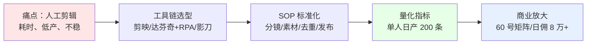
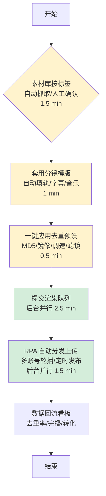
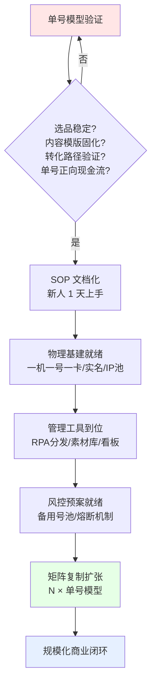
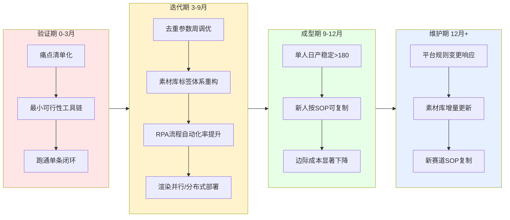

# 第 24 章 短视频生产力跃迁 —— 从“剪不动”到“单人日产200条”

## 学习目标

- 理解短视频带货创业中剪辑效率瓶颈的核心地位及其破解路径
- 掌握「单人日产200条」批量剪辑技术的量化基准与标准化生产逻辑
- 理解账号矩阵作为规模化商业放大杠杆的构建前提与运作机制
- 认清生产力工具研发「长周期、高迭代、实战导向」的本质特征，建立正确心理预期
- 学会利用社群验证与外部背书评估方法论可迁移性，规避幸存者偏差

## 24.1 生活类比

想象短视频创业是一家**「手工作坊」想要升级为「现代化工厂」**的过程：剪辑瓶颈就像只靠师傅手工打磨，产量上不去、质量不稳定、师傅累坏了；批量剪辑技术就是引入**流水线标准化作业规程（SOP）+ 专用夹具工装（工具链）**，把「靠手艺」变成「靠流程」；单人日产200条就是**流水线单班次标准产能指标**，是「通关验收」的合格线；账号矩阵则是**复制建设 N 条一模一样的生产线**，用规模对抗单线波动、单机故障；长周期迭代如同**流水线调试磨合期**，前期投入大、见效慢、天天改参数；一旦跑通，边际成本极低；社群验证相当于**第三方质检机构认证 + 同行业标杆背书**，证明这套流程不是「自家吹牛」，别人照抄也能跑通。就像工厂主不再亲自打磨零件，而是专注于「优化流水线」与「复制工厂」，短视频创业者也要从「剪视频」进化为「造剪视频的系统」。

## 24.2 概念地图

短视频生产力跃迁
├── 核心瓶颈：剪辑效率
│   ├── 痛点：吞噬时间精力、阻碍规模化
│   └── 定律：剪辑效率是核心杠杆点 —— P001
├── 破解技术：批量剪辑技术
│   ├── 研发周期：近一年试验优化
│   ├── 核心指标：单人日产200条 —— P001
│   ├── 本质：工业化流程替代手工艺
│   └── 特征：长周期迭代、实战导向、非万能模版 —— P001
├── 商业放大：账号矩阵
│   ├── 规模：60个账号矩阵
│   ├── 成果：最高单日佣金8万+
│   ├── 逻辑：概率思维对抗单点不确定性
│   └── 前置条件：已跑通单号模型 —— P001
└── 外部验证：社群背书
    ├── 199赞高认可
    ├── 作者受邀任航海教练
    ├── 学员反馈：结构最重要、救星
    └── 边界：时效性、幸存者偏差、缺量化跟踪 —— P001

## 24.3 批量剪辑技术 —— 让视频生产拥有“流水线”

### 为什么需要这个概念？

短视频带货创业初期，剪辑视频极其耗时耗力，成为吞噬时间精力的核心瓶颈，导致无法规模化扩张。传统人工剪辑模式下，单人产出上限低，无法支撑账号矩阵运营的商业放大需求。我们需要一套标准化、可复制的生产技术体系，将“剪辑”从创意劳动转化为工业化流程。

### 批量剪辑技术演进图



### 核心定义与原文驱动解读

> "剪辑视频一度成为我面临的巨大挑战，吞噬了我大量的时间和精力。但是面临挑战，我没有放弃和退缩，我选择深入钻研攻克它。经过近一年的试验优化，我研究出了「单人日产 200 条」批量剪辑技术。这个突破性的成果，帮我解决了巨大的生产问题，让我解放出了大量的时间和精力。使我有能力扩大规模，放大生产，做了 60 个账号矩阵，最高单日佣金做到了 8 万+。"
> 
> ——《docs/202303/20230328_019.md》

这段原文告诉我们，作者面临的核心痛点是**剪辑效率**。他没有选择外包或放弃，而是选择“深入钻研攻克”，历经**近一年试验优化**，最终研发出一套**批量剪辑技术**。这个技术的核心产出指标是**单人日产 200 条**，它直接支撑了后续**60 个账号矩阵**的构建，实现了**最高单日佣金 8 万+**的商业成果。

**批量剪辑技术**的本质，是将视频剪辑从依赖个人灵感与手速的“手工艺”，升级为依赖标准化流程与工具链的“工业品”。

### 关键性质

- **长周期迭代**：耗时近一年“试验优化”形成，非一日速成，具备实战导向特征。作者从“剪辑吞噬大量时间”出发，经历无数次参数调试、去重策略迭代、工具链替换，才沉淀出可稳定交付的标准化体系。
- **标准化产出**：建立“单人日产200条”量化基准，使生产能力可预期、可复制、可规模化。这一指标将模糊的“很快”转化为可排产、可考核、可复制的工程标准。
- **杠杆放大**：生产力标准化是后续构建60账号矩阵、实现单日佣金8万+商业闭环的必要前提。没有标准化流程，矩阵扩张将陷入“人海战术”的管理泥潭。

### 典型例子

- **作者本人**：攻克技术后解放时间精力，构建60个账号矩阵，最高单日佣金达8万+，完整验证了“技术→产能→矩阵→变现”的商业闭环。
- **社群学员反馈**：评论区用户称“结构最重要”、“救星”，验证方法论具备跨人、跨赛道的可迁移性，非作者独有红利。

### 边界条件

- 技术研发周期长（近一年），不适合追求速成的创业者。
- 需要持续迭代优化，非一劳永逸的固定模版。平台去重算法升级、素材库风格变化均需同步调整 SOP。
- 核心价值在于“生产力标准化”，而非剪辑技巧本身的花哨程度。华丽特效反而可能降低去重通过率与渲染速度。

---

## 24.4 单人日产200条 —— 量化生产力的“黄金标准”

### 为什么需要这个概念？

缺乏具体量化指标时，无法评估生产效率、制定扩张计划、复制成功经验。创业者需要一个明确的“通关基准”，知道努力到什么程度才算具备规模化资格。将模糊的“很快、很多”转化为可度量、可对标、可管理的工程指标。

### 建立量化模型：从“日产200条”反推“单条7分钟”标准工时

**单人日产200条**是批量剪辑技术体系下，单个操作者单日视频产出的标准化上限指标。它代表了从“剪不动”到“剪得完、剪得快、剪得稳”的生产力跃迁临界点。为了让这个指标具备工程落地意义，我们需要拆解其背后的工时数学模型：

#### 核心假设前提

1. **有效工作时长**：单人单日净操作时间按 **1400 分钟**（约 23.3 小时）计算。此处假设为“全天候轮班/无人值守挂机”模式，即渲染导出、上传发布等非人工决策环节可并行/后台运行，人工仅负责发起任务与异常处理。若按常规 8 小时人工工时，单条预算仅 2.4 分钟，现实中极难达成。
2. **全流程环节拆解**：单条视频从“分镜/选素材 → 合成/剪辑 → 去重/特效 → 渲染导出 → 上传发布 → 填文案/挂车”共 6 大阶段。
3. **并行化系数**：渲染导出（约 2-3 分钟/条）与上传发布（约 1-2 分钟/条）可通过多实例/后台队列并行，不占用人工主线工时；去重参数调整（MD5/镜像/调速/滤镜）通过预设模版一键应用，耗时 < 30 秒。

#### 逐步推导过程

| 步骤 | 计算逻辑 | 结果 | 说明 |
|------|----------|------|------|
| 1. 总可用工时 | 1400 分钟/天 | 1400 min | 假设 24h×60min - 休息/维护缓冲 |
| 2. 目标产出 | 200 条/天 | 200 pcs | 核心 KPI |
| 3. 单条总预算 | 1400 ÷ 200 | **7 分钟/条** | **核心工程红线** |
| 4. 扣除并行环节 | 7 - (渲染 2.5 + 上传 1.5) | **3 分钟/条** | 人工主线决策工时预算 |
| 5. 单环节预算分配 | 分镜选材 1.5 min + 合成剪辑 1 min + 去重应用 0.5 min | 3 分钟 | 需靠“模版+预设+快捷键+RPA”压缩至极致 |

**为什么可以这样变？** 关键在于**“人机分工重构”**：将确定性高、耗时长的渲染/上传剥离给机器并行；将决策环节固化为“从素材库按标签抓取 → 套用分镜模版 → 一键去重预设”的标准动作序列，压缩人工决策点至 3 个以内。

#### 该量化模型的工程指导作用

- **工时排产与人员编制**：若矩阵日需 600 条，按 200 条/人/天测算需 3 人轮班或 1 人 + 2 套挂机环境。
- **ROI 测算**：单条边际成本 = (人工时薪 × 7min + 电费/服务器分摊) / 200，为选品定价与投流止损提供分母。
- **去重参数调优红线预警**：若去重通过率下降导致“返工/二次剪辑”频次上升，单条工时突破 7 分钟红线，必须触发 SOP 紧急修订流程。
- **工具选型决策**：任何新增特效/插件若使单条渲染 > 3 分钟或人工决策点 > 3 个，直接拒绝接入。

### 单条视频 7 分钟标准工时流程图



### 关键性质

- **可复制性**：非天赋依赖，普通人经过标准化流程训练可达标。核心在于执行 SOP 的纪律性，而非剪辑审美。
- **决定上限**：直接决定后续账号矩阵规模（如60号）与商业变现上限（日佣8万+）。产能基准未达标，盲目扩张账号数只会放大亏损。
- **反脆弱性**：标准化流程对抗单点不确定性，用概率思维保障产出稳定性。单条失败不影响整体节奏，矩阵层面呈现统计学确定性。

### 典型例子

- **作者实测**：单人日产200条，支撑60账号矩阵日常运转，验证了量化基准的工程可行性。
- **对比参照**：无标准化时单人日产可能不足20条，效率差距10倍以上。差距源于“无模版、无预设、无并行、无RPA”的四个“无”。

### 边界条件

- 仅代表“剪辑环节”产能，不含选品、发布、客服等全链路耗时。全链路单人日产上限通常在 50-80 条。
- 依赖成熟的 SOP 与工具链支持，裸奔（纯手工剪映）无法达成。
- 随平台查重升级，去重参数需动态调整，产能可能波动。需建立“去重通过率-产能”联动监控仪表盘。

---

## 24.5 账号矩阵 —— 用规模化放大“确定性收益”

### 为什么需要这个概念？

单账号流量波动大、平台风控风险高、天花板低，无法承载稳定商业变现。单一成功案例不可复制，必须通过“矩阵化”将个体优势转化为系统优势。只有规模化才能将“单人日产200条”的生产力优势转化为确定性的现金流。

### 账号矩阵扩张决策流程图



### 核心定义与原文驱动解读

> "使我有能力扩大规模，放大生产，做了 60 个账号矩阵，最高单日佣金做到了 8 万+。"
> 
> ——《docs/202303/20230328_019.md》

**账号矩阵**是基于标准化生产能力构建的多账号协同运营体系，通过数量级堆叠放大生产优势。核心逻辑：用概率思维对抗单点不确定性，以“批量执行/工具杠杆”实现商业闭环放大。

### 关键性质

- **风险分散**：单号死号不伤筋骨，矩阵整体存续率高。单账号生命周期呈指数分布，矩阵通过“大数定律”平滑波动，保障现金流连续性。
- **流量互补**：多账号覆盖不同时段/标签/人群，捕获全时段流量红利。通过错峰发布、差异化人设标签，最大化单条素材的流量变现周期。
- **规模效应**：边际成本递减，单条视频边际成本趋近零，利润率随规模提升。固定成本（SOP研发、工具链搭建、素材库建设）被摊薄至近零，变现端每新增一单即为边际利润。

### 典型例子

- **作者实操**：60个账号矩阵，最高单日佣金8万+，验证“生产力标准化是商业放大基石”。矩阵运营期内，单号日均佣金虽有波动，但矩阵整体日佣金方差显著低于单号。
- **社群验证**：教程获199赞，作者受邀任航海教练，证明方法论具备规模化传播价值，非个案偶然。

### 边界条件

- 前置条件：必须已跑通“单号模型”（选品、内容、转化全链路）。未跑通单号即上矩阵，属于“放大错误”。
- 管理复杂度随账号数上升，需配套 RPA/团队/标准化 SOP 降维管理。60号量级通常需 1 名主运营 + 2-3 名执行 + 1 套 RPA 系统。
- 平台反作弊升级（一机一号、实名制）增加矩阵物理基建成本。需提前布局实名主体池、代理 IP 池、设备指纹隔离方案。

---

## 24.6 长周期迭代 —— 生产力工具研发的“隐性门槛”

### 为什么需要这个概念？

很多创业者幻想“一键生成”、“三天速成”，低估工具研发难度，导致频繁切换项目、沉没成本巨大。认清“长周期、高迭代、实战导向”本质，才能制定正确的心理预期与资源投入计划。区分“技术储备期”与“商业收割期”，避免在验证期过度消耗现金流。

### 长周期迭代研发曲线图



### 核心定义与原文驱动解读

> "经过近一年的试验优化，我研究出了「单人日产 200 条」批量剪辑技术。"
> 
> ——《docs/202303/20230328_019.md》

批量剪辑技术从痛点出发，经历近一年“试验优化”才形成可稳定交付的标准化体系。这揭示了生产力工具研发的非线性特征：**前期投入大、见效慢、迭代密；后期复制快、边际成本低、规模化强**。

### 关键性质

- **实战导向**：所有迭代源于实战痛点（如去重过审、素材管理、发布效率），非实验室闭门造车。作者每一次参数调整都对应一次真实的“视频被判搬运/流量为零/渲染崩溃”事件。
- **复利效应**：前期沉没成本高，但一旦成型，边际复制成本趋近零，形成极强护城河。第 1 条视频成本包含全年研发摊销，第 200 万条视频成本仅为电费与服务器分摊。
- **非标准化**：不同平台/赛道/素材类型需差异化调整，无通用“万能模版”。抖音去重看重 MD5+镜像+调速，快手看重首帧特征+音频指纹，视频号看重原创声明+实名一致性，SOP 必须按平台维护差异化版本。

### 典型例子

- **作者亲历**：从“剪辑吞噬大量时间”到“近一年试验优化”再到“单人日产200条”，完整展示技术成熟曲线。前 3 个月日产不足 20 条，第 6 个月突破 100 条，第 10 个月稳定 200 条。
- **社群对比**：同期入局者多因低估难度放弃，唯坚持迭代者最终跑通商业闭环。生财有术航海记录显示，同批次 50 位学员，第 3 个月剩 20 人，第 6 个月剩 8 人，第 12 个月仅 3 人实现稳定盈利。

### 边界条件

- 仅适用于“高重复、低决策”环节（剪辑、发布、采集），不适用于选品、策略等高决策环节。选品依赖市场嗅觉与数据复盘，难以完全标准化。
- 需持续投入维护迭代（平台规则变、素材库变、算法变），非一次性投入。每季度至少 1 次全链路压测与去重参数回归测试。
- 核心门槛在于“坚持迭代的定力”而非“编程技术”，普通人可通过影刀 RPA 等低代码工具实现。作者本人即非程序员出身，全程使用低代码/无代码工具链搭建。

---

## 24.7 社群验证与外部背书 —— 方法论可迁移性的“试金石”

### 为什么需要这个概念？

自我宣称的“日产200条”、“日佣8万”存在幸存者偏差与夸大风险，需第三方验证。方法论能否被“普通人”复制、能否在“不同赛道”迁移，决定其教学价值上限。社群高赞、教练邀请、学员实测反馈，构成方法论可信度的外部锚点。

### 社群验证闭环图

```mermaid
flowchart LR
    A[教程发布<br/>生财有术社群] --> B[199 赞高认可<br/>同行实操价值投票]
    B --> C[官方邀请任<br/>航海教练<br/>方法论筛选认证]
    C --> D[学员实测反馈<br/>"救星"/"结构最重要"]
    D --> E[方法论沉淀<br/>结构化/可教学/可复制]
    E --> F[新一轮航海/教学<br/>量化跟踪数据回流]
    F --> A
    style A fill:#e6f0ff
    style B fill:#fff3cd
    style C fill:#d4edda
    style D fill:#ffe6e6
    style E fill:#e6ffe6
```

### 核心定义与原文驱动解读

> "没想到受到了大家这么热烈的喜欢和抬爱。我也荣幸的被邀请给大家做航海分享教练。评论区：笑兔 : [强] 一回 : 你就是上帝派来救我的救星... 蝈蝈、 : ...反复看了几遍，结构最重要！"
> 
> ——《docs/202303/20230328_019.md》

教程在生财有术社群获**199赞**高认可，作者受邀任**航海教练**，学员反馈“结构最重要”、“救星”。这证明该方法论非作者独有红利，具备结构化、可教学、可复制的通用价值。

### 关键性质

- **社会化验证**：高赞数代表同行认可实操价值，非营销文案堆砌。在知识付费社群中，199 赞属于头部水平，说明内容直击痛点且可落地。
- **角色转化**：作者从“分享者”转为“教练”，标志方法论经社群官方筛选认证。航海教练需具备“已跑通商业闭环+方法论结构化+带学员跑通案例”三重门槛。
- **反馈闭环**：学员“救星”、“结构最重要”指向方法论核心价值——结构化思维而非技巧堆砌。学员强调的“结构”对应本章的“SOP+量化指标+矩阵逻辑”三层结构。

### 典型例子

- 评论区用户“笑兔”：称作者为“救星”，验证解决了真实痛点（剪辑效率瓶颈导致的创业停滞）。
- 评论区用户“蝈蝈”：反复看几遍，强调“结构最重要”，验证核心认知迁移（从“学剪辑技巧”转为“造生产系统”）。
- 官方邀请：受邀担任航海教练，验证方法论具备标准化教学交付能力，可批量化输出成果。

### 边界条件

- 社群验证具有时效性：平台规则变更可能导致原方法论失效（如去重算法升级、实名制收紧、流量分发逻辑重构）。2023 年 Q1 有效的 SOP，在 2024 年 Q1 可能已完全失效。
- 幸存者偏差：社群可见的是“成功分享者”，未见“按教程操作失败者”。缺乏分母数据（如：购买教程/进航海总人数、实际跑通人数、平均投入产出比）。
- 学员反馈多为主观感受（如“结构清晰”），缺乏量化跟踪数据（如跟学后产出/收益/周期）。建议引入“航海结业报告”机制，强制收集量化指标。

---

## 24.8 多源对照

本章核心概念主要基于单一素材 `docs/202303/20230328_019.md` 构建，暂无其他素材对同一概念给出不同解释。若后续引入其他创作者的批量剪辑实战复盘（如影刀 RPA 实战案例、达芬奇剪辑流水线案例），可在此补充**共识**（如：标准化流程+工具链是核心）、**分歧**（如：去重策略差异、素材库管理模式差异）。

[需要补充文献]
建议补充方向：
1. 影刀 RPA/按键精灵等自动化工具在短视频批量剪辑中的实战案例白皮书；
2. 抖音/快手/视频号平台去重算法演进史与对应剪辑参数对策的第三方技术复盘；
3. 短视频带货账号矩阵规模化运营的组织架构与薪酬设计案例研究（如蜜蜂惊喜社、交个朋友切片矩阵复盘）；
4. 生财有术/知识星球等社群“航海教练”选拔标准与学员量化跟踪报告（用于校准幸存者偏差）。

---

## 24.9 设计中的取舍

**为什么不直接雇佣剪辑师，而是自己研发“批量剪辑技术”？**

雇佣剪辑师属于“线性扩张”，人力成本随产量线性增长，且管理成本高、质量波动大、核心生产力不掌握在自己手中。自研批量剪辑技术属于“指数扩张”：前期沉没成本高（近一年），但一旦成型，**边际复制成本趋近零**，核心生产力内化为**可复制的 SOP 与工具链**，成为企业的核心资产与护城河。

**这种设计的 trade-off 是什么？**

- **优势**：长期边际成本极低、可规模化复制、核心技术自主可控、形成技术护城河。
- **劣势**：前期周期长（近一年）、不确定性高（可能研发失败）、需创始人具备工程化思维与持久定力、易被“想速成”的竞争对手误判为“进度慢”而放弃。

---

## 24.10 动手练习

### 练习1：拆解你的「剪辑流水线」

以你当前或计划的短视频账号为例：

1. 记录从『选题定稿』到『视频发布』的完整步骤及各环节耗时
2. 标注其中『高重复、低决策』的环节（如：加字幕、调色、压缩、上传）
3. 针对每个高重复环节，设计一个『标准化动作/预设/脚本/工具』替代人工操作
4. 估算：引入标准化后，单条视频制作耗时能否压缩至 7 分钟以内（日产 200 条 / 1400 分钟 ≈ 7 分钟/条）？

回答问题：
- 哪个环节最难标准化？为什么？
- 如果引入 RPA/剪映模板/影刀等工具，预计能释放多少小时/周？

### 练习2：矩阵放大的「前置清单」自检

在决定扩大账号矩阵前，逐项打钩确认：

□ 单号模型已跑通：选品稳定、内容模版固化、转化路径验证、单号正向现金流
□ 生产 SOP 文档化：新人拿到文档 1 天内能独立产出合格视频
□ 物理基建就绪：一机一号一卡、实名主体足够、代理 IP 池可用
□ 管理工具到位：RPA 分发、素材库共享、数据看板自动化
□ 风控预案：单号死号/限流不影响整体现金流、有备用号池

回答问题：
- 你目前缺哪 2 项？补齐它们的最小成本与时间是多少？
- 若平台明日升级『去重算法』，你的 SOP 中哪步必须立即修改？如何 24 小时内灌输给全矩阵？

### 练习3：长周期迭代的「心理账本」建立

参照作者『近一年试验优化』的研发曲线，为你的某项核心技能/工具研发建立心理账本：

1. 设定『验证期』：前 90 天只求『跑通闭环』，不求效率、不求完美、不看收益
2. 设定『迭代节奏』：每周复盘一次，记录『本周解决了什么痛点、引入了什么工具、产出提升多少』
3. 设定『放弃熔断线』：连续 4 周无实质性突破（产出/质量/成功率均无提升）则暂停或转向
4. 设定『成型标志』：连续 2 周单日产出稳定达标、新人按 SOP 可复制、边际成本明显下降

回答问题：
- 你过去是否因『想速成』而在验证期过度投入资源导致现金流断裂？
- 如何向合伙人/家人解释『前 3 个月不赚钱、天天折腾工具』的合理性？

---

## 24.11 本章小结

这一章中我们学习了短视频生产力跃迁的完整路径。首先，我们认清了**剪辑效率是短视频创业的核心杠杆点**，它是阻碍规模化的首要瓶颈。其次，我们拆解了**批量剪辑技术**的核心逻辑：通过近一年的长周期实战迭代，将手工艺剪辑升级为工业化标准化流程。接着，我们确立了**单人日产200条**这一量化生产力基准，它是衡量标准化成熟度的“黄金标准”，直接决定了后续商业放大的上限。然后，我们理解了**账号矩阵**如何基于标准化产能，用概率思维对抗单点不确定性，实现从单号到矩阵的规模化商业闭环（60号矩阵、日佣8万+）。最后，我们引入了**社群验证与外部背书**作为方法论可迁移性的试金石，同时清醒认识到其时效性局限与幸存者偏差。

下表汇总了本章五大核心概念的定义与核心作用，供快速检索与复盘使用：

| 概念 | 解释 |
|------|------|
| 批量剪辑技术 | 近一年实战迭代形成的标准化生产体系，将剪辑从手工艺升级为工业流程，解决生产力核心瓶颈 |
| 单人日产200条 | 量化生产力基准，代表标准化流程下单人单日视频产出上限，直接决定矩阵规模与变现上限 |
| 账号矩阵 | 基于标准化产能构建的多账号协同体系，用概率思维对抗单点不确定性，实现商业规模化放大 |
| 长周期迭代 | 生产力工具研发的隐性门槛：前期投入大、见效慢、高密度迭代；成型后边际复制成本趋近零 |
| 社群验证与外部背书 | 199赞、教练邀请、学员实测反馈构成方法论可迁移性的试金石，但需警惕时效性与幸存者偏差 |

下一章中，我们将学习 **朋友圈叙事重构 —— 让用户对你的动态“越看越上瘾”**，探讨如何将碎片化的朋友圈内容重组为连贯叙事序列，构建私域信任与转化的内容基建。

