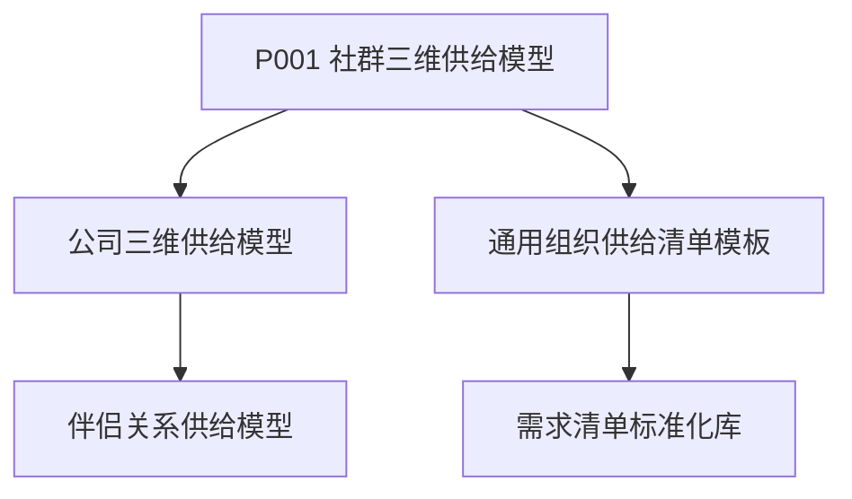
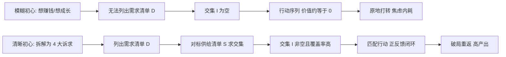

# 第 11 章 个人与组织匹配决策 —— 交集即初心，动态对齐破原地打转
作者：龙哥

## 学习目标

- 理解双向匹配决策框架的核心逻辑：通过'我要什么'与'他能提供什么'的交集运算评估契合度
- 掌握初心即交集定律：明确'我要什么'是破除'原地打转'的前置条件
- 了解付费即筛选机制：门槛成本作为上进心与执行力的信号过滤器
- 能运用实战复盘方法，对具体组织(社群/公司)进行供给清单拆解与需求清单对标
- 能识别需求清单虚幻化、供给清单失真等决策陷阱，建立动态校准机制

## 11.1 生活类比

想象**相亲/招聘双向选择是一个精准的匹配游戏**：**需求清单(我要什么)** 就是你手里的择偶/求职标准清单(如:年薪50w+、有上进心、同城、三观正)；**供给清单(他能提供什么)** 就是对方简历/自我介绍展示的硬件/软件配置(如:年薪30w、考公上岸中、异地、爱打游戏)；**交集运算** 就是你把清单拿来对折,重合的部分(如:都想搞钱、都在同城)就是交集；**初心即交集** 就是如果你连我要找个什么样的人都说不清(初心模糊),见再多对象也只是原地打转；**付费即筛选** 就是要求见面前先交3000元诚意金/会员费,能掏钱且不心疼的,大概率真想结婚/真想进大厂,而非随便看看。就像HR用学历/薪资门槛筛选简历,相亲用诚意金筛选玩咖,双向选择的本质都是在做交集运算。

## 11.2 概念地图

个人与组织匹配决策
├── 核心框架
│   ├── 双向匹配决策框架 —— 刘一笔《两年之后，失业三个月的我又回来了》
│   │   ├── 需求清单(我要什么)  —— 刘一笔《两年之后，失业三个月的我又回来了》
│   │   ├── 供给清单(他能提供什么)  —— 刘一笔《两年之后，失业三个月的我又回来了》
│   │   └── 交集运算(契合度判断)  —— 刘一笔《两年之后，失业三个月的我又回来了》
│   └── 初心即交集定律 —— 刘一笔《两年之后，失业三个月的我又回来了》
├── 关键机制
│   ├── 付费即筛选(门槛成本信号过滤)  —— 刘一笔《两年之后，失业三个月的我又回来了》
│   └── 动态校准机制(需求/供给随阶段变化)  —— 刘一笔《两年之后，失业三个月的我又回来了》
├── 供给侧拆解(以生财有术为例)
│   ├── 知识库(风向标/精华/航海日志)  —— 刘一笔《两年之后，失业三个月的我又回来了》
│   ├── 人脉库(大佬/合伙人/同路人)  —— 刘一笔《两年之后，失业三个月的我又回来了》
│   └── 行动营(航海/训练营/项目实操)  —— 刘一笔《两年之后，失业三个月的我又回来了》
├── 需求侧具象化
│   ├── 认知差/信息差(思路/早期信息)  —— 刘一笔《两年之后，失业三个月的我又回来了》
│   ├── 执行细节(落地SOP/复盘数据)  —— 刘一笔《两年后，失业三个月的我又回来了》
│   └── 导师指导(关键节点/避坑指引)  —— 刘一笔《两年之后，失业三个月的我又回来了》
└── 实战验证
    ├── 生财有术重返决策复盘  —— 刘一笔《两年之后，失业三个月的我又回来了》
    └── 评论区高赞背书验证  —— 刘一笔《两年之后，失业三个月的我又回来了》

## 11.3 双向匹配决策框架 —— 需求清单与供给清单的交集运算

> "我觉得要加入一个组织，公司也好，社群也罢。甚至找对象也是。单方面来说，最根本我觉得还是得想明白这两个问题。我要什么。 他能提供什么。"
> 
> "认真回答完之后，取这两个问题答案的交集，交集越多，就意味着两者在某种程度上是很契合的。"
> 
> —— 刘一笔《两年之后，失业三个月的我又回来了》（2023-03-28，知识星球/微信👸号）

这段话直击决策痛点：我们常因"感觉不错""大家都去""不想错过"而盲目加入组织，却从未结构化地问过"我要什么"和"他给什么"。作者提出的**双向匹配决策框架**，本质是一个**集合论的交集运算**：将模糊的直觉显性化为两份清单，再求交集。

> **双向匹配决策框架定义**（来源：刘一笔《两年之后，失业三个月的我又回来了》）
> 
> 设个人需求清单为集合 $D = \{d_1, d_2, ..., d_m\}$，组织供给清单为集合 $S = \{s_1, s_2, ..., s_n\}$。契合度 $C$ 定义为交集大小占需求清单的比例：
> 
> $$
> C = \frac{|D \cap S|}{|D|}
> $$
> 
> 其中 $D \cap S$ 为需求与供给在语义层面的匹配项。$C \ge 0.7$ 视为强匹配，$0.4 \le C < 0.7$ 为弱匹配，$C < 0.4$ 则不建议深度投入。

**公式逐步推导与直觉解释**：

1. **变量定义**：$D$ 是个人真实需要的核心要素集合（如“稳定现金流”“行业积累”“导师指导”），$S$ 是组织客观能提供的资源集合（如“薪资结构”“核心人脉”“训练营”）。两者均为离散项集合，非连续变量。
2. **假设设定**：决策的核心是“我的需求能否被满足”，因此分母选 $|D|$（需求总量）而非 $|S|$（供给总量）或并集。若分母为 $|S|$，会高估“组织很强但我不需要其大部分能力”的场景。
3. **推导步骤**：交集 $|D \cap S|$ 统计有多少需求项找到了对应供给。除以 $|D|$ 得到“需求覆盖率”——这是契合度最直观的度量：我要的 10 样东西，组织给了 8 样，覆盖率 80%。
4. **为什么可以这样变**：集合论交集天然具备“双向确认”属性——$d_i \in D \cap S$ 当且仅当 $d_i \in D$ 且 $d_i \in S$。这完美对应“既是我要的，也是他给的”。语义匹配允许表述不同但内核一致（如需求写“导师指导”，供给写“大佬带教”，经人工判定为匹配）。
5. **直觉类比**：这就像相亲时清单对折，重合行数/我方清单总行数。重合越多，越值得深入交往。

**公式作用说明**：该公式将主观决策客观化、结构化、可复盘。它强迫决策者显性化隐性需求（拒绝“想赚钱”这种模糊大词），过滤 90%+ 噪音机会，并给出可量化的决策阈值（0.7/0.4）。在“可选择”场景下，它是评估“值不值得投入时间/金钱/精力”的核心仪表盘。

> **核心方法：清单拆解与交集计算**（来源：刘一笔《两年之后，失业三个月的我又回来了》）
> 
> ```
> 步骤1：列出组织供给清单 S
>   - 知识库：风向标/精华帖/航海日志/课程体系
>   - 人脉库：大佬/合伙人/同路人/志愿者
>   - 行动营：航海训练营/项目实操营/复盘闭环
> 
> 步骤2：列出个人需求清单 D
>   - 认知差：超越思维的赚钱思路/商业模式拆解
>   - 信息差：比别人早看到的早期信号/风向标
>   - 执行细节：具体落地 SOP/复盘数据/避坑指南
>   - 导师指导：关键节点决策支持/一对一避坑指引
> 
> 步骤3：逐项语义匹配，标记 强匹配/弱匹配/不匹配
> 
> 步骤4：计算 C = 强匹配项数 / |D|，输出决策建议
> ```

这段伪代码展示了如何将抽象的"价值对齐"转化为可执行的核对清单。作者在实战中将社群模糊的"知识/人脉/行动"拆解为 9 个具体供给项，将"想赚钱"拆解为 4 个可操作诉求，逐项对标后发现**强匹配项占需求清单 100%**，从而逻辑自洽地论证了重返决策的合理性。

### 方法演进图：从社群供给拆解到通用组织供给模板



### 多源对照：供给侧拆解的不同颗粒度

不同实践者对"组织供给"的拆解颗粒度存在差异，但核心维度高度收敛。

**共识**：组织核心供给可归纳为**认知资产（知识库）**、**社交网络（人脉库）**、**执行环境（行动营）**三大类。

**分歧**：

| 维度 | 《P001》作者拆解（社群视角） | 通用企业拆解（公司视角） | 伴侣关系拆解（生活视角） |
|------|-------------------------------|---------------------------|---------------------------|
| 知识库 | 风向标、精华帖、航海日志 | 行业报告、内部文档、导师带教 | 认知对齐、共同成长规划 |
| 人脉库 | 大佬、合伙人、同路人 | 同事、校友、客户资源 | 双方家庭、共同朋友圈 |
| 行动营 | 航海、训练营、项目实操 | 项目机会、晋升通道、培训预算 | 共同执行力、家务分工 |

> **说明**：上表对比了三种典型组织形态下的供给侧拆解，旨在说明“知识库/人脉库/行动营”这一三维模型的通用性与迁移性。读者可据此为当前所在组织绘制专属供给清单。

---

## 11.4 初心即交集定律 —— 明确‘我要什么’是破除‘原地打转’的前提

> "问了我一个问题。你最开始加入生财的需求是什么。我发现我竟回答不了这个问题。也就是连初心都没有，再往前走，也只是原地打转罢了。"
> 
> —— 刘一笔《两年之后，失业三个月的我又回来了》

这是全章最震撼的一句话。作者两年前加入社群时，因"回答不了初心是什么"导致两年原地打转；三年后失业复盘，列出清单，交集明确，果断回归并高产出。**初心≠空泛愿景，初心=需求清单 D 与供给清单 S 的有效交集**。

> **初心即交集定律定义**（来源：刘一笔《两年之后，失业三个月的我又回来了》）
> 
> 设初心清单为 $I = D \cap S$。若 $I = \varnothing$（即无法清晰回答"我要什么"或"它给什么"），则后续行动序列 $\{a_1, a_2, ...\}$ 必陷入无效循环：
> 
> $$
> \forall t, \quad \text{Value}(a_t) \approx 0 \quad \text{if} \quad I = \varnothing
> $$
> 
> 反之，明确 $I \neq \varnothing$ 是有效行动的前置条件。

**公式逐步推导与直觉解释**：

1. **变量定义**：$I = D \cap S$ 即“有效交集”，代表“我要且他给”的项。$I = \varnothing$ 意味着要么 $D$ 为空（不知我要什么），要么 $S$ 为空（不知他给什么），要么两者不交集（我要的他都不给）。
2. **假设设定**：行动价值 $\text{Value}(a_t)$ 来源于“投入资源（时间/金钱/精力）解决某个需求项 $d_i$”。若 $d_i \notin S$，则该投入无供给支撑，边际产出趋近于 0。
3. **推导步骤**：若 $I = \varnothing$，则 $\forall d_i \in D, d_i \notin S$。任一时刻 $t$ 的行动 $a_t$ 必针对某 $d_i$（否则为纯随机游走）。因 $d_i \notin S$，组织无对应供给，$a_t$ 无法获得正反馈，故 $\text{Value}(a_t) \approx 0$。累积 $T$ 步后总价值仍 $\approx 0$，即“原地打转”。
3. **为什么可以这样变**：这是对“无效努力”的数学化表达。无交集时，行动与需求、供给三者脱节，形成闭环缺失。这解释了为什么“很努力但没结果”——努力的方向未在交集内。
4. **直觉类比**：在错误的地图上跑得再快，也到不了目的地。初心即交集，就是先确认地图对不对。

**公式作用说明**：该定律揭示了“前置性”——先有交集认知，再有匹配行动。它把“原地打转”从模糊的心理感受（焦虑、迷茫）定性为结构性缺陷（$I = \varnothing$）。实操中，当你发现自己陷入“很忙但无产出”时，第一动作不是“更努力”，而是“拉清单、算交集”。若交集为空，立即止损或重塑需求/寻找新供给。

### 方法演进图：从模糊初心到清晰交集的认知跃迁



### 典型反模式：模糊初心导致的原地打转

| 场景 | 模糊初心（无交集） | 具象初心（有交集） | 结果差异 |
|------|-------------------|-------------------|----------|
| 创业选赛道 | "想做抖音/小红书/视频号" | "要流量还是转化？要品牌还是销量？" | 前者三平台皆浅，后者单点突破 |
| 职场跳槽 | "想涨薪/想换环境" | "要技能成长/行业积累/工作生活平衡" | 前者三年核心竞争力不增，后者精准上位 |

### 边界条件与认知门槛

- **初心交集仅解决“方向对不对”，不解决“路怎么走”**（执行细节仍需后续方法论支撑）。
- **交集过大（需求全被满足）可能预示组织供给过度**，导致个体成长动力不足，需保留适度张力。
- **初心清晰度与认知水平强相关**。认知低维者往往只能列出表层需求（如“赚钱”），需通过**进圈子/买复盘/找导师**提升认知维度，将需求拆解到可验证层级。

---

## 11.5 付费即筛选 —— 门槛成本作为上进心与执行力的信号过滤器

> "都想搞钱，都花了几千块证明自己的上进，光交个朋友也是不错的"
> 
> —— 刘一笔《两年之后，失业三个月的我又回来了》


> **付费即筛选机制定义**（来源：刘一笔《两年之后，失业三个月的我又回来了》）
> 
> 设个体上进心/执行力为隐变量 $\theta \in [0,1]$，付费门槛为成本 $c > 0$。理性个体仅当预期收益 $E[V|\theta] > c$ 时付费。因此付费行为本身即为 $\theta > \theta^*$ 的**昂贵自证**：
> 
> $$
> \text{Pay} = 1 \implies \theta > \frac{c}{E[V|\theta=1]}
> $$
> 
> 门槛 $c$ 越高，筛选阈值 $\theta^*$ 越高，圈层纯度越高。

**公式逐步推导与直觉解释**：

1. **变量定义**：$\theta$ 代表个体内在的“上进心与执行力”水平，不可直接观测（隐变量）。$c$ 是付费门槛（金钱+时间+认知成本）。$E[V|\theta]$ 是个体预期从社群获得的价值，随 $\theta$ 单调递增——上进心越强，越能利用社群资源转化为价值。
2. **假设设定**：个体理性决策，仅当 $E[V|\theta] > c$ 时选择付费。这是标准的成本-收益分析。
3. **推导步骤**：由 $E[V|\theta] > c$ 且 $E[V|\theta]$ 单调递增，反推得 $\theta > \theta^*$，其中 $\theta^* = E^{-1}[V=c]$。为便于理解，近似写为 $\theta^* \approx c / E[V|\theta=1]$（假设线性或以最大预期价值归一化）。付费动作 Pay=1 即意味着 $\theta > \theta^*$。
3. **为什么可以这样变**：这利用了“信号传递理论”中的**昂贵信号**原理。说话不用成本（廉价信号），掏钱要成本（昂贵信号）。只有真心想搞钱、有执行力的人，预期收益才足以覆盖门槛成本，从而愿意付费。付费动作本身完成了筛选。
4. **直觉类比**：相亲诚意金、名校学历门槛、高端俱乐部会费。门槛不是为了赚钱，是为了把“不靠谱/不上进/只想白嫖”挡在外面。

**公式作用说明**：该机制将“光交个朋友”从概率博弈转化为理性预期。在通过门槛筛选的圈层内，随机抽样一个成员，其 $\theta$ 较高的概率显著大于总体。这大幅降低了社交搜寻成本，提升连接效率。决策者可据此判断：一个社群“贵不贵”不看绝对金额，看 $c$ 是否匹配目标人群的 $\theta^*$；若想进入高纯度圈层，主动承担门槛成本是必要投资。

### 方法演进图：付费筛选从信号发射到圈层形成的闭环

```mermaid
graph TD
    A[个体隐变量 θ: 上进心/执行力] --> B[设定门槛成本 c]
    B --> C[理性决策: E[V|θ] > c ?]
    C -->|是| D[付费行为 Pay=1]
    C -->|否| E[不付费 退出池]
    D --> F[圈层形成: 成员 θ > θ*]
    F --> G[圈层纯度提升 社交 ROI 优化]
    G --> H[组织声誉增强 吸引更高 θ]
    H --> A
```

### 实证：生财有术的筛选效力

- **门槛**：几千元年费 + 时间投入（航海/训练营/打卡）。
- **成员画像**：普遍有付费复盘/航海/训练营经历。
- **行为特征**：发帖提问多带复盘数据，回复多给落地建议，而非情绪输出。
- **社交 ROI**：“光交个朋友也是不错的”成为理性预期，而非概率博弈。

### 边界条件与反模式识别

| 反模式 | 表现 | 识别指标 | 应对策略 |
|--------|------|----------|----------|
| 高价收割 | 费用高但供给失真/过期 | 退款率>20% / 复购率<10% / 成员无产出 | 付费前验证：试听/退款政策/成员访谈/公开复盘 |
| 富人俱乐部 | 门槛高但筛选的是"资金"而非"上进" | 成员无执行痕迹/仅社交无产出 | 设置奖学金/分期/贡献抵扣机制兼顾公平 |
| 心理账户陷阱 | "付费即买安心/买身份"，未做交集运算 | 付费后不参与/不复盘/不执行 | 用"交集运算"替代"心理账户"做决策 |

---

## 11.6 实战复盘：生财有术社群的供需交集验证与重返决策

作者以自身**失业三个月后重返"生财有术"**为实证场，完整演示了"供给侧拆解 → 需求侧清单 → 交集计算 → 决策执行"的全链路。

### 方法演进图：实战复盘全链路标准化动作

```mermaid
graph TD
    A[触发事件: 失业/转型/焦虑] --> B[列出组织真实供给清单 S]
    B --> C[列出个人真实需求清单 D]
    C --> D[逐项语义匹配 标记强/弱/不匹配]
    D --> E[计算交集覆盖率 C = |D∩S|/|D|]
    E --> F{C ≥ 0.7?}
    F -->|是| G[强匹配 果断投入]
    F -->|否| H[弱/不匹配 止损或校准需求]
    G --> I[执行周期中 季度动态校准]
    I --> J[C(t) 变化?]
    J -->|显著下降| K[重新决策]
    J -->|稳定/上升| L[持有交集预期]
```

### 供给侧结构化拆解（来源：刘一笔《两年之后，失业三个月的我又回来了》）

**以下表格展示作者对“生财有术”社群供给侧的三维结构化拆解，每一项均为社群实有的具体产出，而非宣传口径：**

| 供给维度 | 具体供给项 | 核心价值 |
|----------|------------|----------|
| **知识库** | 风向标（高质量商机信息流）、精华帖（结构化方法论）、航海日志（实战复盘数据） | 填补认知盲区、提供早期信号、降低试错成本 |
| **人脉库** | 大佬（关键节点指导）、合伙人（资源互补）、同路人（陪跑/复盘）、志愿者（协作支持） | 关键节点避坑、资源对接、情绪支撑 |
| **行动营** | 航海（21天高强度实战）、训练营（标准化 SOP）、项目实操（真枪实弹） | 将“知道”转化为“做到”、建立执行惯性 |

### 需求侧具象化（来源：刘一笔《两年之后，失业三个月的我又回来了》）

**以下表格展示作者当前阶段（失业三个月、急需变现）的四大核心诉求，拒绝“赚钱/成长”等模糊大词：**

| 需求维度 | 具体诉求 | 对应供给项 |
|----------|----------|------------|
| **认知差** | 超越思维的赚钱思路/商业模式拆解 | 风向标、精华帖、大佬分享 |
| **信息差** | 比别人早看到早期信号/风向标 | 风向标、航海日志、群内情报 |
| **执行细节** | 具体落地 SOP/复盘数据/避坑指南 | 航海、训练营、同路人复盘 |
| **导师指导** | 关键节点决策支持/一对一避坑指引 | 大佬、合伙人、教练/志愿者 |

### 交集计算与逻辑自洽验证（来源：刘一笔《两年之后，失业三个月的我又回来了》）

**以下表格逐项对标验证，展示 100% 强匹配的逻辑自洽过程：**

| 需求项 | 匹配供给项 | 匹配强度 | 验证逻辑 |
|--------|------------|----------|----------|
| 认知差/信息差 | 知识库（风向标/精华/航海日志） | **强匹配** | 高频更新的实战案例库填补认知盲区，风向标提供早期信号 |
| 执行细节 | 行动营（航海/训练营/项目实操） | **强匹配** | 标准化 SOP + 教练陪伴 + 志愿者协作，将“知道”转化为“做到” |
| 导师指导 | 人脉库（大佬/合伙人/教练） | **强匹配** | 同频伙伴提供陪跑/复盘，大佬提供关键节点指导 |

**交集比例 $C = 4/4 = 100\%$**，决策结论：强匹配，果断重返。

> **动态校准机制**（来源：刘一笔《两年之后，失业三个月的我又回来了》）
> 
> 需求与供给随阶段变化，需定期复盘校准交集：
> 
> $$
> C(t) = \frac{|D(t) \cap S(t)|}{|D(t)|}, \quad \text{建议季度重算}
> $$
> 
> 验证周期存在滞后性：加入决策基于当前交集，但价值兑现需时间（如航海周期 21 天），需耐心持有交集预期。

**公式逐步推导与直觉解释**：

1. **变量定义**：$D(t)$ 与 $S(t)$ 强调需求清单与供给清单是时间的函数。失业时需“现金流/落地SOP”，入职半年后可能需“晋升通道/行业人脉”。社群也会迭代（新增 AI 航海、出海航海）。
2. **假设设定**：契合度随时间漂移，单次计算失效。需引入周期性重算机制。
3. **推导步骤**：第 $t$ 期契合度 $C(t)$ 仍为交集占需求比。建议季度重算（$t$ 以季度为步长），对应 OKR/绩效考核周期，成本可控。
3. **为什么可以这样变**：这是对“动态对齐”的数学化。人和组织都在变，匹配非常态。季度复盘是“低频高价值”的节奏——太频繁（周/月）陷入微观管理，太稀疏（半年/年）错过调整窗口。
4. **直觉类比**：导航软件每几分钟重新计算路线（动态校准），而非出发前算一次就不再管。人生/职业决策同理。

**公式作用说明**：该机制将“一次性决策”升级为“持续对齐过程”。它提醒决策者：加入不是终点，而是新一轮交集验证的起点。验证周期的滞后性（如航海 21 天出成果）要求决策者在 $C(t)$ 高时具备“耐心持有交集预期”的定力，避免因短期无反馈而动摇。

---

## 11.7 设计中的取舍

为什么不用"凭感觉/跟风/听宣传"做决策？因为感觉易受情绪/营销/幸存者偏差干扰，不可复制、不可复盘；宣传常溢于实（组织对外宣传 ≠ 真实供给），需通过试听/试用/旁听/找老成员打听验证真实供给。"交集运算"的 trade-off 是什么？优点是将主观决策客观化、结构化、可复盘；显性化隐性需求，过滤 90%+ 噪音机会。代价是需要投入时间列清单、求交集、验证供给（高认知负荷）；对认知维度有要求（低维者列不出深层需求）。适用边界：仅适用于"可选择"场景。生存逼迫无选项时（必须接单糊口），交集分析退化为生存妥协。

---

## 11.8 动手练习

### 练习1：为你当前的核心组织(公司/社群/伴侣)画像——双向清单交集实操

- 步骤1: 在左栏列出'组织供给清单'——该组织客观能提供的资源/机会/环境(如:薪资结构、晋升通道、核心人脉、技能训练、情绪支持等),至少10项,越具体越好
- 步骤2: 在右栏列出'个人需求清单'——你当前阶段真实需要的核心要素(如:现金流稳定、行业积累、时间自由、深度连接、专业指导等),至少8项,拒绝'赚钱/成长'等模糊大词
- 步骤3: 计算交集——逐项对标,标记'强匹配/弱匹配/不匹配';统计强匹配项占需求清单比例
- 步骤4: 决策建议——若强匹配<40%,是否需'动态校准需求'或'寻找新供给'?若>70%,为何仍有焦虑感?
- 回答问题:
  - 你的需求清单中,有多少项是'他人期望/社会标准'植入,而非'自我真实渴望'?如何剔除?
  - 组织宣传的供给中,哪些是'画饼/溢于实'?你用什么低成本方式验证过真实供给(试听/旁听/试用/找老成员打听)?
  - 若交集为空,是立即止损离场,还是调整需求清单'将就'?决策依据是什么?

### 练习2：付费筛选失效/生效复盘——门槛成本的信号识别实战

- 1. 记录门槛成本(金钱/时间/精力)、加入初心(当时需求清单)、实际获得供给
- 2. 评估'付费即筛选'是否生效:成员画像是否高纯度(上进/执行/靠谱)?讨论氛围是否高质量(干货/复盘/落地>情绪/抱怨/水贴)?
- 3. 识别失效信号:是否存在'高价收割/富人俱乐部/信息过期/组织者跑路'等反模式?
- 回答问题:
  - 什么样的门槛设计(分层会费/奖学金/贡献抵扣/分期付款)能同时兼顾'筛选力'与'公平性'?
  - 如何在付费前用'试听/退款政策/成员访谈/公开复盘'等低成本手段验证组织真实供给质量?
  - 你是否有过'付费即买安心/付费即买身份'的心理账户陷阱?如何用'交集运算'替代'心理账户'做决策?

### 练习3：初心动态校准——从'原地打转'到'破局重返'的决策复盘

- 选择一个你曾'原地打转'≥3个月的经历(如:考证未果/副业夭折/健身断更/社群潜水):
- 1. 还原当时'模糊初心'(如:想变强/想副业/想健康),拆解为具体可验证的需求清单(参考练习1步骤2标准)
- 2. 还原当时投入对象的'真实供给'(而非宣传供给),对照需求清单计算交集
- 3. 标记'原地打转'的关键节点:是需求虚幻?供给失真?还是缺乏动态校准机制?
- 4. 设计'破局动作':若重来一次,在什么时间节点(第1周/第1月/第3月)做什么动态校准动作(复盘/止损/换赛道/找导师)?
- 回答问题:
  - '初心易得,始终难守'的根因:是认知维度不足(只能列表层需求),还是执行反馈回路断裂(做了没反馈/反馈不调整)?
  - 如何建立'月度/季度初心校准仪式'?固化为哪3个标准动作(如:拉清单-算交集-改行动)?
  - 当环境剧变(失业/生病/政策变)导致需求清单剧烈变动时,如何在1周内完成'需求-供给'重新交集计算并执行调整?

---

## 11.9 本章小结

这一章中我们学习了如何用**双向匹配决策框架**破解"加入什么组织/跟谁合作/选什么赛道"的核心难题。首先我们确立了**交集即契合度**的集合论模型：将模糊直觉显性化为"我要什么"（需求清单 D）与"它给什么"（供给清单 S），再求交集 $C = |D \cap S|/|D|$ 作为决策依据。其次我们揭示了**初心即交集定律**：无法清晰回答初心意味着交集为空，后续行动必陷原地打转；明确初心是有效行动的前置条件。接着我们重构了**付费即筛选机制**：门槛成本是上进心与执行力的昂贵自证，将"光交个朋友"从概率博弈转化为理性预期。最后我们通过作者**失业三个月后重返生财有术**的实战复盘，演示了供给侧三维拆解（知识库/人脉库/行动营）与需求侧四大诉求（认知差/信息差/执行细节/导师指导）的 100% 强匹配，验证了框架在高不确定性下的实战有效性，并给出了**动态校准机制**应对阶段变化。

本章我们一起学习了以下概念：

| 概念 | 解释 |
|------|------|
| 双向匹配决策框架 | 评估个体与组织契合度的通用模型:列出需求清单与供给清单,取交集作为决策依据,交集越大越契合 |
| 初心即交集定律 | 无法清晰回答'我要什么'即交集为空,后续行动必陷'原地打转';明确初心是有效行动的前置条件 |
| 付费即筛选 | 门槛成本(会费/时间/学习成本)本身是上进心与执行力的信号过滤器,将'光交个朋友'变为理性预期 |
| 社群价值三维模型(供给侧) | 知识库(认知/信息资产)、人脉库(社交/人才网络)、行动营(执行驱动/实战环境)三大核心供给 |
| 个人核心四大诉求(需求侧) | 认知差(超越思维)、信息差(时间优势)、执行细节(落地SOP)、导师指导(避坑/关键节点) |
| 动态校准机制 | 需求与供给随阶段变化,需定期复盘校准交集,而非一次性切分;验证周期存在滞后性需耐心持有 |
| 实战复盘验证案例 | 作者失业三个月后重返生财有术:供给侧三大维度与需求侧四大诉求高度重合,逻辑自洽验证决策合理性 |

下一章中，我们将学习 **AI 工具入门与环境配置**，打通"大模型"最后一公里，解决国内用户接入 ChatGPT、Midjourney 等头部 AI 工具的网络、账号、支付三大硬性门槛，建立稳定可用的生产环境基础设施。

