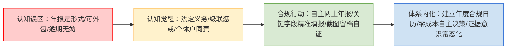
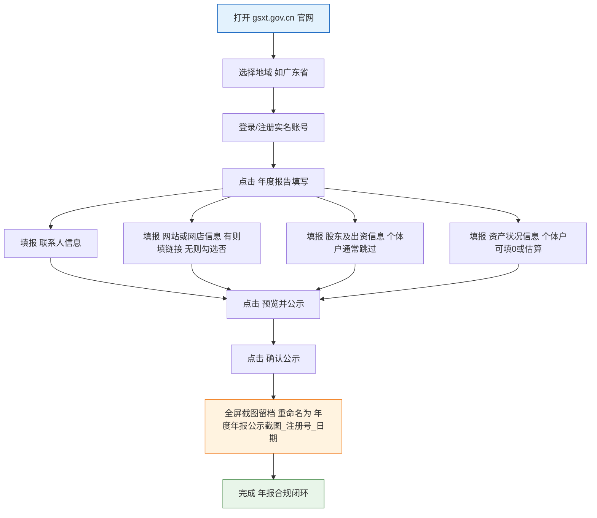
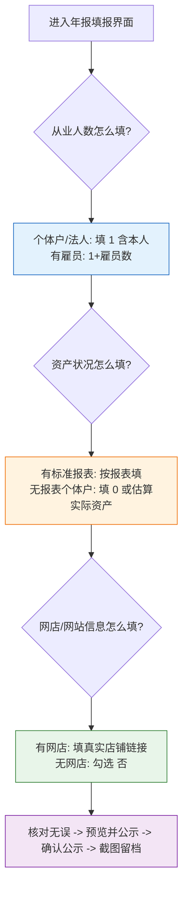

# 第 72 章 营业执照年报实操与合规避坑 —— 从“第三方收费乱象”到“零成本自主年报”
作者：龙哥

## 学习目标

- 理解营业执照年报的法律强制性与逾期处罚的级联升级机制
- 掌握国家企业信用信息公示系统网上年报的全流程自助操作标准动作包
- 能准确填报个体户/小微企业关键字段（从业人数、资产状况、网店信息）规避合规风险
- 建立年报截图留档的证据意识，应对系统故障导致的误判风险
- 识别第三方代理年报的“智商税”本质，确立零成本自主合规的商业决策

## 72.1 生活类比

想象营业执照年报是企业的“年度体检+成绩单公示”。每年 1 月 1 日至 6 月 30 日是法定体检窗口，过期不补检；经营异常名录相当于体检报告未按时交、被标记“异常”挂号；严重违法失信名单（黑名单）则是连续 3 年不交报告，直接吊销“健康证”、拉入黑名单；多部门联合惩戒更像黑名单一出，银行拒贷（查征信）、出入境拦截（查黑名单）、招投标拒标（查资格）、法人任职受限（查档案）齐发。自主网上年报 SOP 是官方提供的“免费自助体检通道”，按步骤点点鼠标 10 分钟搞定；第三方代理收费 100 元则是黄牛倒号挂号费，明明免费自助挂号却哄你花冤枉钱；截图留档好比体检完自己留存一份电子报告单，防医院系统丢数据赖你“没体检”。就像个人不按时体检、不拿报告单会耽误治疗甚至影响保单理赔，企业不年报、不留档会触发信用破产的连环核爆。

## 72.2 概念地图

营业执照年报合规体系
├── 核心概念层
│   ├── 营业执照年度报告（年报）  —— docs/202303/20230328_005.md
│   ├── 经营异常名录              —— docs/202303/20230328_005.md
│   ├── 严重违法失信企业名单（黑名单）  —— docs/202303/20230328_005.md
│   └── 地址异常（经营场所登记异常）  —— docs/202303/20230328_005.md
├── 操作方法层
│   ├── 自主网上年报SOP（零成本标准动作包）  —— docs/202303/20230328_005.md
│   ├── 年报关键填报项自查法（避坑速查表）  —— docs/202303/20230328_005.md
│   └── 系统留档截图必要性实证  —— docs/202303/20230328_005.md
├── 理论机制层
│   ├── 年报逾期处罚升级链条（从行政警告到信用死刑）  —— docs/202303/20230328_005.md
│   └── 自主年报成本优势主张（替代第三方代理）  —— docs/202303/20230328_005.md
└── 实证发现层
    ├── 第三方代理收费乱象与自主操作可行性验证  —— docs/202303/20230328_005.md
    ├── 个体户零申报年报的合规性存疑  —— docs/202303/20230328_005.md
    └── 系统故障误判与自我举证补救机制  —— docs/202303/20230328_005.md

## 72.3 营业执照年报 —— 企业生存的“年度体检单”

### 72.3.1 为什么需要这个概念？

你可能觉得年报只是个形式，甚至想着“找代理办了事”。但事实是：**国家强制要求所有市场主体（含个体户）每年公示经营状况，这是合法经营的“准生证”**。一旦逾期，会触发级联惩罚：经营异常名录 → 严重违法失信名单 → 多部门联合惩戒（贷款、出行、招投标、任职资格全受限）。个体户同属监管范围，不做等同于主动“信用破产”。

> "营业执照是每年的 6 月底之前做上一年的营业执照年检（也可以叫工商年检）... 注意：个体户也是需要年检的哦！"
> 
> ——《docs/202303/20230328_005.md》 [素材ID: P001]

### 72.3.2 核心定义

**营业执照年度报告（年报）**（来源：《docs/202303/20230328_005.md`）  
原称“年检”，指企业、个体户等市场主体在每年 6 月 30 日前向登记机关报送上一年度经营情况并向社会公示的制度。

**经营异常名录**（来源：《docs/202303/20230328_005.md`）  
企业未按时履行年报公示义务，由市场监管部门列入的异常经营状态名单，是信用惩戒的初级阶段。

**严重违法失信企业名单（黑名单）**（来源：《docs/202303/20230328_005.md`）  
列入经营异常名录满 3 年仍未履行义务，将面临信贷、投资、出行、招投标、任职资格等多维度联合惩戒。

**地址异常（经营场所登记异常）**（来源：《docs/202303/20230328_005.md`）  
因使用虚假、购买、借用地址注册，导致无法通过登记机关现场核查（下户看点），从而被列入经营异常名录的风险状态。

### 72.3.3 关键性质

| 性质 | 说明 |
|------|------|
| 强制性 | 所有市场主体（含个体户）均须履行，无豁免权 |
| 时效性 | 每年 1 月 1 日-6 月 30 日为法定报送窗口，逾期即违规 |
| 累积性 | 处罚随时间升级，3 年是从“异常”到“黑名单”的临界点 |
| 穿透性 | 企业列入黑名单，法定代表人、负责人个人注册新公司、任职资格、出入境同步受限 |

这个表格展示了年报制度的四大核心性质，帮助你建立“敬畏截止线”心理。它揭示了年报不仅是形式义务，更是一条带有时效倒计时、累积升级惩戒、穿透企业法人人格波及个人信用的“高压线”。

### 72.3.4 典型例子

- 评论区用户遭遇第三方公司电话推销年报服务，收费 100 元/次，实则官网自助操作零成本即可完成。这印证了“第三方代理收费 = 黄牛倒号挂号费”的类比。
- 个体户连续 3 年年报金额填 0，担心“影响信用”又怕“写金额要扣税”，反映小微主体对填报标准的认知盲区。这对应“体检怕查出病、又怕体检花钱”的心理纠结。

### 72.3.5 边界条件

- **地址异常风险**：使用虚假、购买、借用地址注册，遇监管现场核查（下户看点）无法通过，将直接导致地址异常并列入经营异常名录，后续需变更地址才能解除。
- **系统稳定性风险**：政府公示系统存在故障概率，必须截图留档自证，否则凭空被判定“未年报”无力回天。
- **填报口径模糊区**：个体户无标准资产负债表，资产状况可填 0 或估算；从业人数含法人自身（至少为 1）；网店信息须如实勾选（有填无否）。

> "尤其是你的地址不是自己的，是买的、借的等等，被列入异常名录后，工商管理员可能会要下户看点，假如你买的是虚假地址，后续可能还要去变更经营地址... 最后最好再截个图留档，免得因为系统问题判定你没有年检，可以拿着图找管理员"
> 
> ——《docs/202303/20230328_005.md》 [素材ID: P001]

### 72.3.6 方法演进图：年报合规认知的三阶跃迁



该流程图描绘了从“认知误区”到“体系内化”的三阶跃迁：初期经营者常将年报视为可外包的形式主义任务，低估逾期后果；中期通过学习法律强制性与级联惩戒机制，建立“敬畏截止线”心理；后期掌握自主操作 SOP、关键字段填报逻辑与截图留档技巧，形成零成本、可自证、可持续的年度合规体系。这对应“体检：从拒检→被动查→主动管→常态化健康管理”的认知升级。

## 72.4 自主网上年报 SOP —— 零成本替代第三方代理的“标准动作包”

### 72.4.1 为什么需要这个概念？

官方渠道（国家企业信用信息公示系统）提供免费自助入口，第三方代理收费 100 元/次属于“智商税”。操作流程高度标准化，无需专业财务知识，按步骤点击即可完成，门槛极低。自主操作可即时确认状态、留存证据，规避代理延误、系统故障导致的误判风险。这正如“免费自助体检通道”任你走，何必花冤枉钱找“黄牛倒号”？

### 72.4.2 核心定义

**国家企业信用信息公示系统网上年报全流程**（来源：《docs/202303/20230328_005.md`）  

```
1. 打开 https://www.gsxt.gov.cn/index.html 选择地域（如广东省）
2. 登录/注册账号（完成实名认证）
3. 点击“年度报告填写”
4. 依次填报：
   - 联系人信息（自己手机/邮箱）
   - 网站或网店信息（有则填链接，无则勾选“否”）
   - 股东及出资信息（个体户通常无需填）
   - 资产状况信息（个体户无报表可填 0 或估算）
5. 点击“预览并公示” → “确认公示”
6. 对最终公示成功页面全屏截图留档
```

### 72.4.3 关键性质

| 性质 | 说明 |
|------|------|
| 全链路可视化 | 每一步均有页面截图引导，所见即所得 |
| 关键节点可控 | 联系人、网店、资产状况等高频报错项均可自主修正 |
| 证据可自证 | 最终公示页面截图具备法律效力，可用于向监管部门申诉纠错 |

这个表格展示了自主年报 SOP 的三大核心优势，是你敢于“自己动手”的底气。它揭示了自主操作不仅省钱，更实现了“全程可视、节点可控、证据可自证”的三重风控收益。

### 72.4.4 典型例子

作者实操演示：广东省地域选择 → 账号登录 → 填报联系人信息、网站或网店信息、股东及出资信息、资产状况信息 → 提交公示 → 截图留档，全程约 10 分钟。评论区用户按教程操作后反馈：“这不就省下来了嘛”，验证了零成本自助闭环的可行性。这正如体检后自己拿到报告单、省下挂号费的直观收获。

### 72.4.5 边界条件

- **账号前置条件**：需完成实名注册/登录，无账号无法进入填报界面。
- **数据真实性底线**：网店/网站信息须如实勾选，虚假公示属违法行为。
- **系统兼容性**：建议使用电脑端浏览器操作，移动端适配可能存在交互异常。
- **个体户简化豁免**：无资产负债表的个体户，资产状况可填 0 或估算，不强制要求专业报表。

> "步骤1：选择地域（如广东省）... 步骤5：点击'预览并公示' -> '确认公示'... 最后最好再截个图留档，免得因为系统问题判定你没有年检，可以拿着图找管理员... 大成冲冲冲：这几天有第三方公司打电话给我，要我做审核，收费 100，这不就省下来了嘛~"
> 
> ——《docs/202303/20230328_005.md》 [素材ID: P002]

### 72.4.6 方法演进图：自主网上年报标准动作包流程



该流程图完整呈现了国家企业信用信息公示系统网上年报的全链路标准动作：从官网入口、地域定位、实名登录、进入填报界面，到四大核心模块（联系人、网店、股东、资产）的并行填报，最后经预览公示、确认公示、截图留档形成合规闭环。其中“截图留档”标记为关键风控节点（橙色），因政府系统存在稳定性风险，截图是事后申诉的唯一自证证据；“完成合规闭环”标记为目标状态（绿色），标志着零成本自主年报的全流程落地。这正如“自助体检机：选项目→刷身份证→测指标→出报告→自己存报告单”的标准化通道。

## 72.5 年报逾期处罚升级链条 —— 从“行政警告”到“信用死刑”的级联机制

### 72.5.1 为什么需要这个概念？

多数经营者低估逾期后果，认为只是“罚款了事”，实则是多维度生存权剥夺的起点。理解升级链条能建立“敬畏截止线”心理，倒逼按时履行义务，避免因疏忽酿成不可逆后果。揭示行政处罚的时间累积效应与跨部门穿透力，是商业合规管理的必修课。这正如“体检报告不交→挂号异常→连续三年不交→吊销健康证→全院黑名单→挂号/住院/报销全拒”的级联灾难。

### 72.5.2 核心定义

**年报逾期处罚升级链条**（来源：《docs/202303/20230328_005.md`）  


该升级链条图揭示了年报逾期从“行政警告”到“信用死刑”的四级级联机制：(1) 逾期即时入异常名录，属行政监管的初级预警；(2) 3 年临界点自动升级黑名单，无人工干预余地，体现行政处罚的时间累积效应；(3) 30+ 部门数据共享触发全维限制（融资、出行、招投标、任职资格），实现“一处失信、处处受限”的穿透性惩戒；(4) 惩戒穿透企业法人人格波及股东、高管个人权利（注册新公司、任职资格、出入境、个人征信），导致实质性的信用破产。

### 72.5.3 关键性质

| 性质 | 说明 |
|------|------|
| 阶梯性 | 分“异常名录（初级）”与“黑名单（终级）”两级，中间有 3 年缓冲期 |
| 穿透性 | 惩戒穿透企业法人人格，波及股东、高管个人信用与权利 |
| 不可逆性 | 一旦列入黑名单，移出程序复杂、周期长，实务中极难完全消除负面影响 |

这个表格揭示了处罚升级链条的三大本质特征，帮你理解为什么“拖一下”会酿大祸。它对应“体检异常：黄牌预警(可逆)→红牌黑名单(不可逆)→全系统禁入(穿透)”的三重性质。

### 72.5.4 典型例子

- 企业因年报逾期被列入异常名录，3 年后转入黑名单，法定代表人申请房贷被拒、出境旅游被拦截、参与政府采购投标被拒、注册新公司被驳回。这正如“黑名单患者：挂号被拒、住院被拒、报销被拒、家属就医受牵连”的全维度生存危机。
- 评论区用户因忽视年报，后续需花费数倍成本通过法律途径申诉恢复信用。

### 72.5.5 边界条件

- **3 年临界点**：列入异常名录后，若在 3 年内补报并申请移出，可阻断升级；超 3 年自动转入黑名单，无人工干预余地。
- **多部门联动**：发改委、法院、海关、税务、公安、外汇局等 30+ 部门共享黑名单数据，实现“一处失信、处处受限”。
- **个体户同责**：个体户经营者同样适用该链条，经营者个人信用直接受损。

> "1.企业未按时进行年报的，将被市监部门列入经营异常名录；若满 3 年企业还未移出的，将被列入严重违法失信企业名单； 2.被列入严重违法失信名单后，企业将不能贷款、投资、出入境、参与招投标、政府采购等，严重影响个人发展； 3.被列入严重违法失信名单后，企业法人等在进行注册新公司、经营、从业任职资格等将被限制； 4.被列入严重违法失信名单后，在企业与他人合作时信用将会遭到质疑，严重影响公司的长远发展。"
> 
> ——《docs/202303/20230328_005.md》 [素材ID: P003]

## 72.6 年报关键填报项自查法 —— 个体户/小微企业的“避坑速查表”

### 72.6.1 为什么需要这个概念？

官方系统无标准填报模板，个体户、小微企业面对“资产状况”、“从业人数”、“网店信息”等字段常陷入“乱填、不填、瞎填”三大误区。填报错误可能导致数据失真，引发监管预警、税务稽查关联风险，或因虚假公示承担法律责任。掌握核心字段填报逻辑，能以最低认知成本实现合规闭环。这正如“体检表怎么填：身高体重实测、病史如实勾选、无报告可写‘无’、不可瞎编”，以最低成本通过体检审核。

### 72.6.2 核心定义

**从业人数**（来源：《docs/202303/20230328_005.md`）  
包含法定代表人/经营者自身在内的实际从业总人数，个体户**至少为 1**（含本人）。

**资产状况**（来源：《docs/202303/20230328_005.md`）  
个体户无标准资产负债表时，**可填 0 或按实际经营资产估算填报**，不强制要求专业会计报表。

**网店/网站信息**（来源：《docs/202303/20230328_005.md`）  
如实勾选“否”（无网店）或填报真实店铺链接（有网店），**严禁虚假勾选或隐瞒**。

### 72.6.3 关键性质

| 性质 | 说明 |
|------|------|
| 实质过形式 | 监管关注数据真实性而非形式完美，宁可填 0/估算，不可编造虚假财务数据 |
| 自证留痕 | 填报前保留经营记账凭证、网店后台截图等佐证材料，备查时可自证合规 |
| 动态更新 | 年报为年度快照，当年发生重大变更（地址、股东、网店）需同步更新，避免新旧数据冲突 |

这个表格是你填报时的“护身符”，牢记这三条原则就能避开 90% 的坑。它揭示了“实质真实>形式完美、自证留痕>事后补救、动态更新>静态填报”的三大填报铁律。

### 72.6.4 典型例子

评论区用户提问：“个体户每年年报金额都写 0 有影响吗？连续 3 年写 0 有影响吗？写一点金额会扣税吗？”——典型的“零申报焦虑”与“纳税认知偏差”共存案例。作者隐含指导：从业人数含法人；资产状况可简化；网店信息须真实勾选。这正如“体检怕查出指标异常、又怕体检花钱、更怕被贴标签”的三重焦虑。

### 72.6.5 边界条件

- **纳税申报与年报分离**：年报填报营业收入 ≠ 纳税申报，写金额不直接触发扣税，但需与税务申报口径逻辑一致。
- **连续零申报预警**：连续 3 年营业收入填 0、无从业人员变动、无资产积累，极易被判定为“僵尸企业”触发重点监管。
- **地址异常联动**：年报填报地址与登记地址不一致，或无法联系到经营者，将直接触发地址异常核查流程。

> "个体户每年的年报，金额都写 0 有影响吗...如果写一点金额不会扣税吧（评论区提问）... 请问下是否有网站或网店？要真实勾选吗（评论区提问）... 作者隐含回复：从业人数包含法人；资产状况无明确模板可简化；网店信息须真实勾选... 最后最好再截个图留档，免得因为系统问题判定你没有年检，可以拿着图找管理员"
> 
> ——《docs/202303/20230328_005.md》 [素材ID: P004]

### 72.6.6 方法演进图：年报关键字段填报决策树



该决策树将年报三大高频困惑字段（从业人数、资产状况、网店信息）转化为可执行的填报判断路径：从业人数以“含本人≥1”为底线；资产状况区分“有报表按报表填”与“无报表填0/估算”两条路径，体现“实质过形式”原则；网店信息以“有无”为分支，强制如实勾选。最终汇聚至“核对-公示-截图”标准收尾动作，形成个体户/小微企业可直接套用的避坑速查表。这正如“体检填表决策树：身高体重→实测；既往史→如实勾；无检查报告→写无；核对签名→存底单”。

## 72.7 素材溯源与局限性说明

本章核心素材仅来自单一实操指南文档（docs/202303/20230328_005.md），暂无其他来源文献对照。细纲素材未覆盖但教学必要的缺口如下，需后续补充权威文献：

**素材共识**：年报为法定义务、逾期触发级联惩戒、个体户同责、自主操作零成本可行。  
**待补文献方向 [需要补充文献]**：

| 待补文献方向 | 具体分歧点 | 建议补充来源 |
|-------------|-----------|-------------|
| 个体户连续零申报的监管判定标准 | 连续3年营业收入填0是否必然触发“僵尸企业”认定？判定的量化阈值（从业人数、资产积累、纳税记录的权重）是什么？ | 市场监管总局《企业经营异常名录管理暂行办法》实施细则、各地市监局执法案例汇编 |
| 资产状况估算的合规边界 | 个体户“无标准资产负债表”时，估算口径如何界定（账面价值/公允价值/经营者主观判断）？估算偏差多大构成“虚假公示”？ | 税务总局《个体工商户生产经营所得核定征收管理办法》、注册会计师行业《中小企业财务报告准则》应用指南 |
| 地址异常核查的具体触发条件与申诉成功率 | “下户看点”核查的频次、抽样比例、无法联系经营者的具体认定标准？地址异常申诉移出的实务成功率与所需证据链？ | 市场监管总局《登记注册实地核查工作规范》、北京/上海/广东/深圳等地市监局行政处罚案例公开库 |
| 系统故障导致误判的法律救济路径 | 凭年报截图向市监局申诉纠错的法定时效、受理部门、举证责任分配？系统故障属政府责任还是用户责任的司法认定趋势？ | 行政诉讼法相关条款、《电子证据若干规定》、最高人民法院涉“信用修复”指导性案例 |

## 72.8 设计中的取舍

### 为什么不用第三方代理年报？

第三方代理收费 100 元/次，本质是信息不对称下的“智商税”。年报操作已标准化为“傻瓜式点击流程”，无专业判断空间。自主操作不仅省钱，更能即时掌握公示状态、留存证据链，规避代理延误操作、系统故障无人兜底的风险。代理的价值仅在于“帮你记 deadline”，这完全可以用日历提醒替代。正如“免费自助体检通道任你走，何必花冤枉钱找黄牛倒号挂号”。

### 这种设计的 trade-off 是什么？

自主年报的代价是：你需要花 10 分钟阅读教程、亲自操作、保存截图。收益是：零现金成本、全流程可控、证据自证、规避“代理跑路/填错数据/系统故障无人管”的隐性风险。对于年报这类**高频、标准化、低决策复杂度**的合规动作，**自主操作的边际收益远超委托成本**。这正如“自己花 10 分钟走自助体检通道，省下挂号费、拿到手里的报告单、避开黄牛跑路/体检单丢失/系统故障无人管”的综合收益。

## 72.9 动手练习

### 练习 1：模拟年报全流程实操演练

**场景**：你是一家“广东省”注册的个体户经营者，无实体网店，无雇员，无标准资产负债表，需完成 2023 年度年报。

**任务**：
1. 打开国家企业信用信息公示系统（gsxt.gov.cn），选择地域为广东省
2. 登录/注册账号，进入“年度报告填写”界面
3. 填报“联系人信息”（自己手机/邮箱）
4. 填报“网站或网店信息”：勾选“否”
5. 填报“从业人数”：填 1（含法人自身）
6. 填报“资产状况”：填 0 或按实际经营资产估算填报
7. 点击“预览并公示” → “确认公示”
8. 对最终公示成功页面进行全屏截图，重命名为“2023年度年报公示截图_营业执照注册号_日期”保存

**回答问题**：
- 若系统提示“该年度已年报”，但你未操作，如何凭截图向市监局申诉？
- 为什么“从业人数”至少为 1 而不能填 0？若填 0 会触发什么风控规则？
- 个体户无会计报表，资产状况填“0”与“估算金额”在监管审查中有何本质区别？

### 练习 2：年报逾期风险推演与止损决策

**案例**：某公司法人因疏忽，2020、2021、2022 连续三年未年报，2023 年 3 月发现异常。

**任务**：
1. 绘制该企业从“正常”到“信用破产”的处罚升级时间轴，标注关键节点（列入异常名录日期、转入黑名单临界点、多部门联合惩戒生效日）
2. 分析：法人此时想注册新公司、申请房贷、出境旅游、参加政府采购投标，分别会遇到什么具体阻碍？
3. 制定止损方案：当前（2023 年 3 月）还能否通过补报年报+申请移出异常名录阻断黑名单转入？具体操作路径是什么？

**回答问题**：
- 为什么“3 年”是处罚升级的硬性临界点？背后的行政法逻辑是什么？
- 若企业地址早已变更但未工商变更登记，补报年报时填新地址还是旧地址？会触发什么后果？
- 黑名单移出程序为何“复杂、周期长、极难完全消除负面影响”？

### 练习 3：年报填报避坑自测题（判断正误并说明理由）

1. 【 】个体户年报“营业收入”填 0，连续三年填 0 会直接导致营业执照被吊销。
2. 【 】年报填报的“资产状况”必须严格按照会计准则编制的资产负债表数据填写，个体户无报表则必须聘请代账会计填报。
3. 【 】“从业人数”仅指雇佣的员工数量，不包含经营者/法定代表人本人。
4. 【 】企业无网店，年报“网站或网店信息”模块可直接跳过不填。
5. 【 】年报完成后，系统跳出“公示成功”提示即可关闭页面，无需截图留档。
6. 【 】第三方代理机构收费 100 元/年代报服务，属于必要合规成本，建议小微企业购买以规避操作风险。
7. 【 】使用虚拟注册地址（地址挂靠）的企业，年报时填挂靠地址即可，无需担心“下户看点”核查。
8. 【 】年报数据（如营业收入）与税务纳税申报数据口径必须一致，但年报填报本身不直接产生纳税义务。

**回答要求**：逐条判断正误，并引用素材中的核心定义、边界条件或实证发现作为依据说明理由。

## 72.10 本章小结

这一章中我们学习了营业执照年报的全生命周期合规管理：首先理解了年报是企业生存的“年度体检单”，具有强制性、时效性、累积性、穿透性四大核心性质；其次掌握了国家企业信用信息公示系统自主网上年报的零成本标准动作包，包含地域选择、账号登录、四大模块填报、公示确认、截图留档六大步骤；接着深度剖析了年报逾期处罚升级链条，揭示了从经营异常名录到严重违法失信名单再到多部门联合惩戒的四级级联机制及其 3 年临界点、穿透性、不可逆性；然后建立了年报关键填报项自查法，明确了从业人数含法人至少为 1、资产状况可填 0 或估算、网店信息如实勾选三大核心字段的填报逻辑与边界条件；最后识别了第三方代理收费的“智商税”本质，确立了零成本自主合规的商业决策，并建立了截图留档的证据意识应对系统故障风险。

本章我们一起学习了以下概念：

| 概念 | 解释 |
|------|------|
| 营业执照年度报告（年报） | 市场主体法定年度公示义务，每年6月30日前完成，个体户同责 |
| 经营异常名录 | 年报逾期初级惩戒，信用“黄牌”预警，3年内可补报移出 |
| 严重违法失信企业名单（黑名单） | 异常名录满3年未履行义务自动转入，触发多部门联合惩戒，信用“死刑” |
| 年报逾期处罚升级链条 | 未报→异常名录→3年→黑名单→多维限制（融资/出行/招投/任职）→信用破产 |
| 自主网上年报SOP | gsxt.gov.cn官网：选地域→登录→填年度报告→填联系人/网店/股东/资产→公示→截图留档 |
| 年报关键填报项自查法 | 从业人数含本人≥1；资产状况个体户可填0/估算；网店信息如实勾选有无 |
| 地址异常风险 | 虚假/借用/购买地址遇现场核查（下户看点）失败，直接列异常需变更地址解除 |
| 系统留档截图 | 政府公示系统存稳定性风险，公示确认页截图为唯一自证证据，可找管理员纠错 |
| 自主年报成本优势 | 操作标准化门槛低，零成本自主完成，替代100元/次第三方代理“智商税” |
| 个体户零申报合规性存疑 | 连续3年零申报易被判“僵尸企业”触发重点监管，年报金额≠纳税申报，写金额不直接扣税但需口径一致 |

下一章中，我们将学习**知识管理与个人效能**，从“囤积焦虑”到“内化进化”，掌握实用主义知识管理范式与五大微操作技巧，让知识整理真正服务于解决问题与自我进化。


