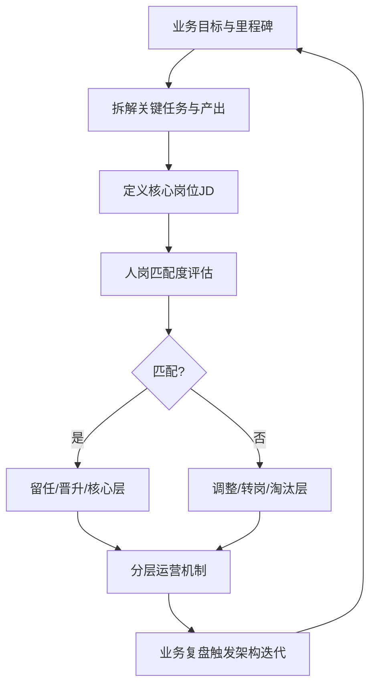
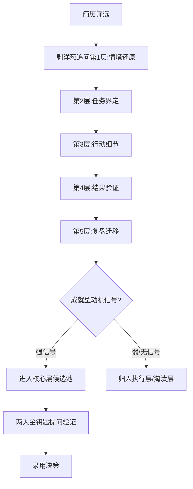
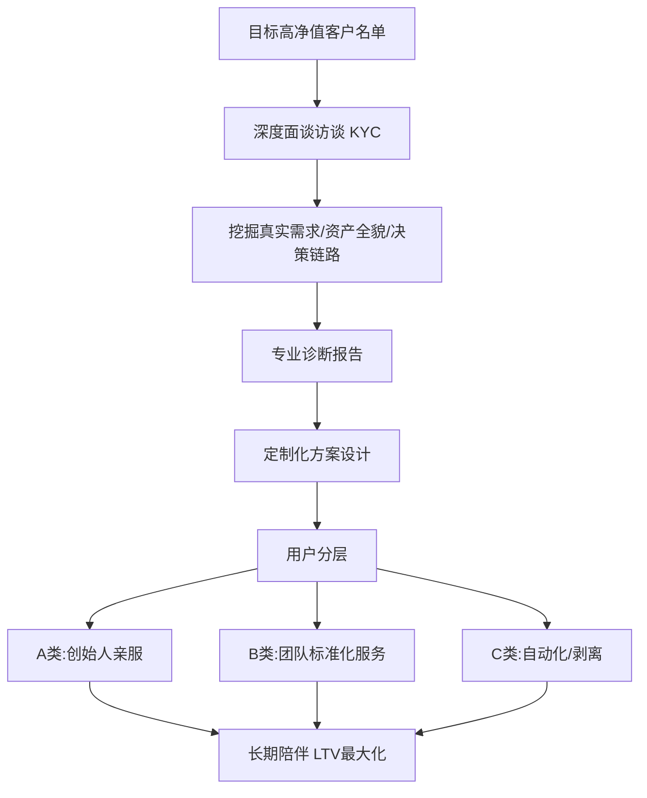
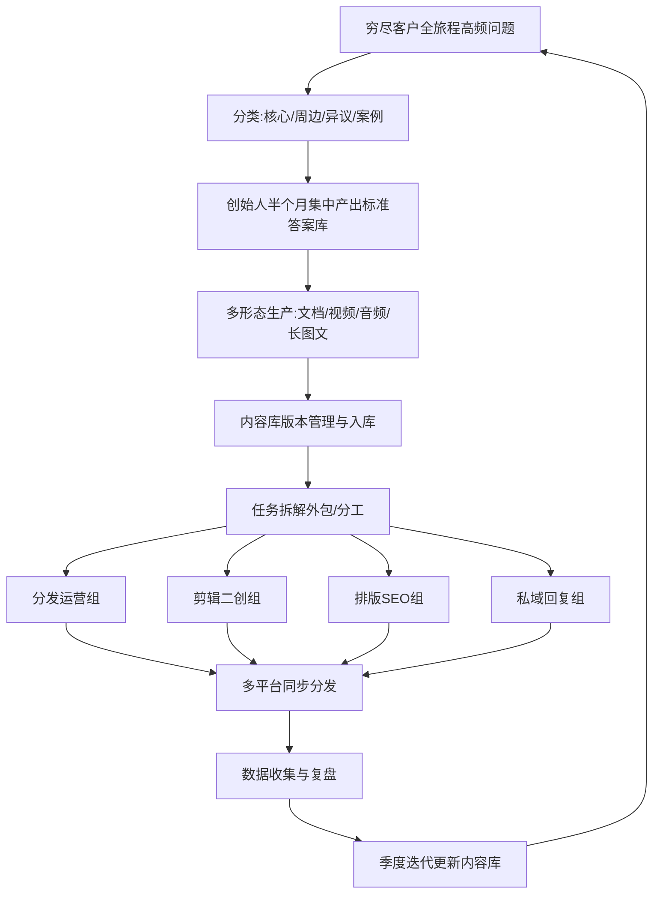
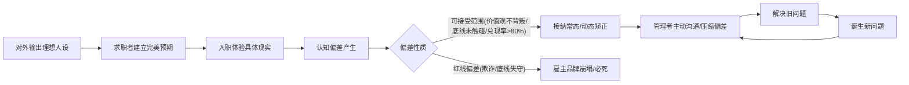
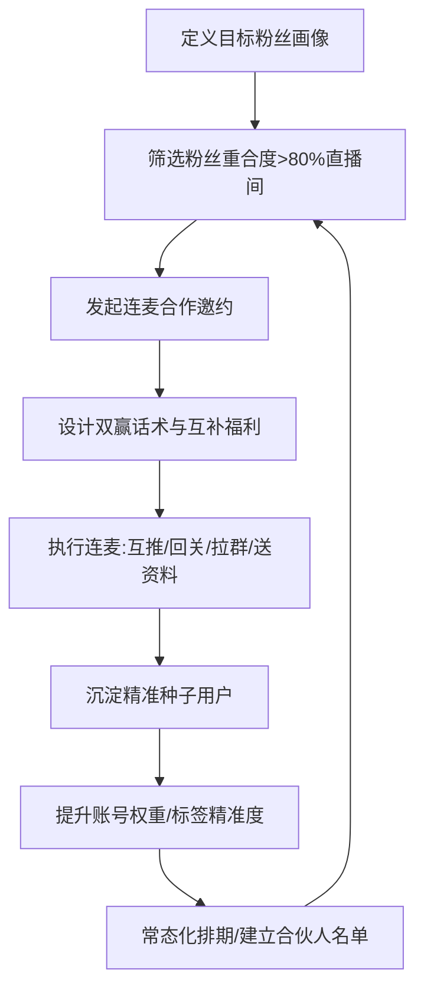
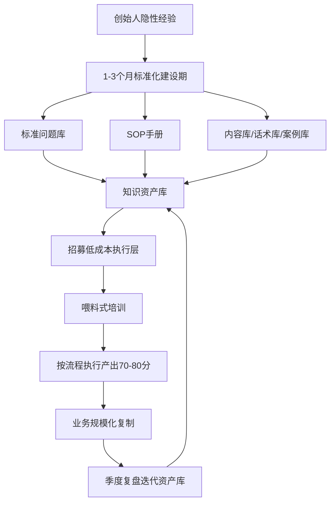

# 第 73 章 组织管理与人才体系 —— 从“圣母心留人”到“业务导向设计与流程喂养AI化员工”
作者：龙哥

## 学习目标

- 理解业务导向组织设计的核心逻辑：架构服务业务目标而非迁就人情
- 掌握流程喂养/AI化员工模型：用SOP让普通人稳定产出70-80分结果
- 熟练运用剥洋葱面试法识别成就型动机，筛选适配创业环境的核心人才
- 内化KYC思维：将高客单价销售从“推产品”转为“懂客户/做诊断”
- 建立内容库预制体系：让创始人从“内容苦力”转型为“内容架构师”
- 接纳公司人设与现实偏差的必然性，掌握动态矫正的管理范式
- 运用高客单价获客公式：刚需钩子+付费流+私域信任+KYC服务四位一体
- 落地同模型连麦引流法：低成本借力同行精准粉丝池完成冷启动
- 践行诚意即成本/高手链接协议：用真金白银与执行反馈购买认知跃迁
- 遵循服务业规模化铁律：标准化前置、人才后置，先造知识资产再招执行层
- 理解虚拟服务实体化/电商化思维：将非标服务转化为标准化实体商品

## 73.1 生活类比

想象经营公司像**开一家连锁餐厅**。**业务导向组织设计** = 先定菜单(业务目标)，再按菜单编制厨师/服务员岗位(JD)，而不是先招几个亲戚朋友(迁就人情)再决定卖什么菜；**流程喂养/AI化员工** = 编写极其详细的《标准操作手册(SOP)》：切菜多厚、炒菜多少秒、摆盘几克，让普通厨师按手册也能稳定做出70分菜品，不指望每个都是大厨(100分)；**剥洋葱面试** = 招厨师不看简历吹牛，只让现场“露一手”并层层追问：这道菜为什么这样调味？火候怎么控制？遇到食材不新鲜咋办？只有真干过、真懂行、真爱钻研(成就型动机)的能过关；**KYC思维** = 高端私房菜不卖“菜单”，卖“营养师诊断+定制食谱”：先花2小时详细问清食客体检报告/口味偏好/过敏史/预算(知你客户)，再设计专属菜单，客单价自然高；**内容库预制** = 总厨花半个月把所有招牌菜、应季菜、特色菜的标准食谱、采购清单、出品照片全整理成《总部操作手册》，分店店长拿着手册按图索骥即可复制，总厨解放去研发新菜；**高客单获客公式** = 想卖万元私宴(高客单)？先推9.9元体验套餐/送健康食谱书(刚需钩子/羊头)引流精准人群 -> 投广告买流量(付费流)只要回本就无限投 -> 全量加微信进会员群(私域) -> 群里营养师免费1v1诊断饮食问题(KYC) -> 成交万元私宴 -> 会员年年续费转介绍(复利)；**公司人设与现实偏差** = 菜单上写“米其林大厨亲掌勺，食材空运直达”(人设)，食客进店发现是学徒炒菜、菜叶有虫眼(现实) -> 接纳偏差常态，建立“食客投诉24小时整改+每周试吃调标”(动态矫正)机制，而非假装完美或摆烂。

## 73.2 概念地图

```mermaid
mindmap
  root((组织管理与人才体系))
    组织设计层
      业务导向组织设计[P001, P002]
        拒绝圣母心/人岗匹配>激励机制
        动态调整随业务阶段
      公司人设与现实偏差[P006]
        知行合一落差必然性
        动态矫正观/不存在完美公司
        管理者沟通缺位放大偏差
      服务业规模化铁律[P010]
        标准化前置/人才后置
        知识资产化(SOP/内容库)
        70分合格制/边际成本递减
    人才筛选与培养层
      剥洋葱面试法/成就型动机[P003]
        STAR深挖验证真实性
        成就型vs金钱型动机识别
        两大金钮提问(成就感/喜好)
      流程喂养/AI化员工模型[P002]
        标准问题库+SOP手册+喂料式培训
        去人依赖化/迭代友好/低成本放大
        适用边界:高重复/低决策岗位
      诚意即成本/高手链接协议[P009]
        显性成本(付费/红包)+隐性成本(研读/提问/执行反馈)
        三步走:触达->深度提问->结果反馈闭环
        筛选机制/正向飞轮/复利效应
    客户获取与深度服务层
      高客单价获客公式[P007]
        刚需钩子(羊头/电商化思维)
        付费流放大器(ROI>=1通投)
        私域信任变现池(沉淀/高频触达)
        KYC服务留存器(诊断/定制/分层/LTV)
      KYC思维/知你客户[P004]
        从推产品转为懂客户/做诊断
        大客户面谈大于一切/信任护城河
        用户分层:A类亲服/B类标准化/C类自动化
      同模型连麦引流法[P008]
        粉丝画像重合>80%寻找标准
        标准动作包:连麦/回关/拉群/送资料
        精准/低成本/可复制放大
      内容库预制/去IP依赖化运营[P005]
        穷尽题库->建大而全内容库
        多平台分发/剪辑/二创外包分工
        创始人转型:生产者->架构师
        资产化沉淀/季度迭代机制
    认知升级元方法论
      认知跃迁捷径:付费购买确定性[P011]
        向结果付费/向高手买避坑指南
        执行力放大器/时间杠杆
        边界条件:验证高手真实性/自主决策内化
      虚拟服务实体化/电商化思维[P001]
```

## 73.3 业务导向组织设计 —— 让架构服务业绩而非迁就人情

### 为什么需要这个概念？

创业初期常因“圣母心”留用不合适的人，导致组织架构畸形服务于特定员工而非业务目标。业务阶段变化快，人员能力跟不上，若不按业务重构架构，必然拖累业绩。核心矛盾在于：业务目标明确但人岗不匹配，激励机制（0）无法弥补人岗错位（人非1）的损耗。

> "不要为了团队去调整业务，而是围绕业务打造更合适的团队。"
> 
> "不要有圣母心去硬拔团队，团队人才培养也要分层运营，把适当的人放在适当的位置上。"
> 
> ——《20230328_027.md》[P001]

> "人才是一切的核心，人是 1 ，各种奖惩激励机制是 0，创业公司老板把时间要花在找到成就型人才上。"
> 
> ——《20230328_027.md》[P002]

### 核心定义

**业务导向组织设计**（来源：《20230328_027.md》[P001]、《20230328_095.md》[P006]）

组织架构必须服务于当前业务目标与里程碑，而非迁就现有人员的舒适区。拒绝“圣母心”硬留不合适的人，依据业务阶段匹配岗位，人岗不匹配果断调整。人才分层运营：核心层（信愿景、扛大旗）、执行层（按SOP拿结果）、淘汰层（不匹配快清理）。

### 关键性质

业务导向组织设计具有三大关键性质。第一，**动态性**：组织架构需随业务阶段（0-1/1-10/10-100）持续调整岗位JD与编制，不存在一劳永逸的静态结构。第二，**结果导向**：以业务产出为唯一标准检验组织设计合理性，所有岗位设置必须倒推自业务里程碑。第三，**成本敏感**：创业早期核心资源稀缺，人岗匹配是最高性价比的杠杆，激励机制（0）无法弥补人岗错位（人非1）的损耗。

### 典型例子

小冯妮儿见面会复盘：从“为了团队调整业务”转为“围绕业务打造团队”，按保险业务发展阶段重新定岗招聘。小马宋公司：因出差多导致沟通缺位，员工问题积压，最终承认“几十个员工都不能畅快沟通是我的失职”，意识到管理者必须主动适配组织沟通机制。

### 边界条件

该模型非大企业成熟期适用：大厂有完善HR体系可容忍一定冗余，创业公司容错率极低。需创始人具备“业务第一性原理”拆解能力，否则无法输出清晰JD。调整幅度过大时需注意劳动法合规与雇主品牌维护，避免陷入仲裁泥潭。

### 方法演进图



### 多源对照

**共识**：组织架构必须服务于业务目标，人岗匹配是核心，激励机制作用次之。

**分歧与互补**：

- 《20230328_027.md》[P001] 强调“拒绝圣母心、围绕业务打造团队”的决策导向，提供了“人是1、机制是0”的第一性原理判断框架；
- 《20230328_095.md》[P006] 从管理者沟通缺位导致问题积压的反思切入，揭示了“动态调整”落地的关键执行动作——管理者必须主动适配组织沟通机制，而非被动等待问题爆发。

---

## 73.4 流程喂养/AI化员工模型 —— 用SOP让普通人稳定产出70分

### 为什么需要这个概念？

创业公司招不到、留不住、养不起“100分超级员工”，高估主观能动性是典型误区。核心业务依赖少数明星员工，人一走业务瘫痪，缺乏标准化复制能力。非标服务想规模化，必须将创始人隐性知识显性化为标准问题库/SOP/内容库。

### 核心定义

**流程喂养/AI化员工模型**（来源：《20230328_027.md》[P002]）

将核心业务拆解为标准化问题库与SOP流程，像“喂养AI”一样“喂料”给员工。让普通人按流程操作即可产出70-80分稳定结果，不追求100分完美。核心公式：

$$
标准问题库 + SOP手册 + 喂料式培训 = 可复制的交付体系
$$

**公式推导说明**：
- **标准问题库**：穷尽客户全旅程高频问题（核心+周边），将隐性知识显性化为结构化FAQ，是“料”的原材料。
- **SOP手册**：将问题库转化为可执行、可验收的标准作业程序，规定“输入-处理-输出”全链路标准，是“料”的加工规范。
- **喂料式培训**：不靠员工自学，而是按节奏分批次、分模块推送标准答案与实操演练，是“料”的投喂机制。
- **可复制的交付体系**：三者组合形成闭环，使普通员工按流程即可稳定产出70-80分结果，实现去人依赖化。

### 关键性质

该模型具有三大关键性质。第一，**去人依赖化**：降低对个人天赋/经验/状态的依赖，提升组织确定性，核心能力沉淀在“库”里而非“人”里。第二，**迭代友好**：SOP是活文档，随业务复盘持续升级，而非一劳永逸的死规范，建立季度/半年复盘更新机制。第三，**低成本放大**：边际复制成本趋近零，支撑矩阵化/规模化扩张，实现服务业规模化铁律“标准化前置、人才后置”。

### 典型例子

内容工业化生产线：创始人花半个月穷尽客户全旅程高频问题，产出“大而全内容库”（文档/视频/音频），后续分发/剪辑/二创全外包，实现“降低对IP依赖”。保险销售话术库：将KYC访谈、异议处理、转化逻辑全SOP化，新人入职“按图索骥”即可开单。

### 边界条件

仅适用于“高重复、低决策、可标准化”的执行层岗位（销售/运营/客服/剪辑）。核心决策层/战略层/创新层不可套用此模型，需保留主观能动性空间。SOP若长期不迭代会变成“束缚手脚的绳索”，需建立季度/半年复盘更新机制。

### 方法演进图


### 多源对照

**共识**：服务业规模化的核心路径是“标准化前置、人才后置”，通过SOP让普通人稳定产出合格结果。

**分歧与互补**：

- 《20230328_027.md》[P002] 提供了完整的操作方法论：从“穷尽题库”到“建库”再到“外包分发/喂料培训”的全链路SOP，并给出了“半个月集中攻坚”、“单人日产200条”等具体工程化指标；
- 素材中的“内容工业化生产线”与“保险销售话术库”两个典型例子，分别验证了该模型在内容运营与高客单销售两大不同业务场景下的通用性。

---

## 73.5 剥洋葱面试法/成就型动机识别 —— 透过层层追问看透人性

### 为什么需要这个概念？

简历包装、面试背诵题库普遍化，常规面试极难辨别真实能力与动机。创业高不确定性环境下，“金钱型动机”员工抗压性差、易跳槽，“成就型动机”才是核心筛选标准。招错一人成本极高：工资沉没+管理内耗+业务延误+团队士气受损。

### 核心定义

**剥洋葱面试法/成就型动机识别**（来源：《20230328_027.md》[P003]）

面试采用“剥洋葱”层层追问（STAR原则：情境/任务/行动/结果），问得越深造假难度指数级上升。核心识别维度：成就型动机（信愿景、图成长、享受攻克难关）vs 金钱型动机（算得失、求稳重、避风险）。两大金钥匙提问：“原公司做过什么有成就感的事？” “平时喜欢干什么事？”

> "选人用剥洋葱的方式持续追问，问的越深，对方造假难度越高。"
> 
> "找成就型动机的人是创业公司的必走之路，找那些相信公司愿景和未来预期的人。金钱型动机的人创业公司用不起。"
> 
> "面试小 tips:原公司里做过什么有成就感的事情？平时喜欢干什么事？"
> 
> ——《20230328_027.md》[P003]

### 关键性质

该方法具有三大关键性质。第一，**验证真实性**：细节经得起推敲的经历才是真实战，模糊/推卸/夸大即为造假信号，STAR深挖使造假成本指数级上升。第二，**预测抗压性**：成就型动机源于内驱力，外部环境恶化时动力不衰反增，适应创业高不确定性。第三，**文化同频**：信愿景的人天然认同长期主义文化，减少管理摩擦成本，实现“人岗匹配>激励机制”。

### 典型例子

小冯妮儿招聘实操：用剥洋葱法筛选核心运营/销售岗，重点考察“复盘某次失败项目的完整思考路径”而非结果。对比案例：面试者A谈“带团队冲榜单拿第一”的过程细节闪闪发光；面试者B只谈“负责日常运营”，追问细节语焉不详 → 果断选A。

### 边界条件

面试官自身需具备业务纵深，否则无法追问到关键细节层，建议创始人亲自面核心岗。过度深挖可能冒犯高段位候选人，需把控节奏与尊重度，展现专业而非刁难。成就型动机≠不要钱，薪资仍需具备市场竞争力，动机是筛选维度而非定价依据。

### 方法演进图



### 多源对照

**共识**：创业公司招人核心看“成就型动机”而非“金钱型动机”，需通过深度追问验证真实性。

**分歧与互补**：

- 素材中“剥洋葱面试法”与“成就型动机识别”虽源自同一文档，但前者是**工具方法**（怎么问），后者是**判断标准**（看什么）。两者结合形成“工具+标准”的完整筛选体系：用剥洋葱法挖掘细节，用成就型动机维度评判内核。
- “人是1，机制是0”定理（[P002]）为该筛选体系提供了理论锚点：既然激励机制作用有限，则必须在入口关卡（招聘）就筛选出自带内驱力的人。

---

## 73.6 KYC思维/知你客户 —— 从“推产品”转为“懂客户”

### 为什么需要这个概念？

高客单价非标服务（保险/咨询/高端定制）无法靠“比参数/比价格”成交，客户买的是“被懂、被信任、被设计方案”。传统产品思维导致销售陷入“讲功能、比条款、拼价格”红海，严重依赖运气与人品。大客户决策周期长、利益相关方多，不深度诊断真实需求与资产全貌，根本无法精准击中痛点。

### 核心定义

**KYC思维/知你客户**（来源：《20230328_027.md》[P004]）

KYC（Know Your Customer）：销售从“推产品”转为“懂客户”，通过深度面谈访谈挖掘客户真实风险需求、资产全貌、决策链路。核心动作：找已投保/意向高净值客户面谈（大客户面谈大于一切），建立信任护城河，而非单纯比拼产品条款。成交逻辑：专业诊断(KYC) → 方案定制 → 长期陪伴 → LTV最大化。

> "把 KYC 思维而不是产品思维贯彻给团队，逐步打造高端团队。"
> 
> "找已经投保的潜在大客户去面谈，大客户面谈大于一切。"
> 
> ——《20230328_027.md》[P004]

### 关键性质

KYC思维具有三大关键性质。第一，**咨询式销售**：卖的不是标品而是“专业判断力”与“资源整合力”，门槛高溢价高，将销售从推销员升级为顾问。第二，**信任前置**：面谈本身即最高级营销，客户感受到“懂我”比“产品好”更具说服力，建立信任护城河。第三，**分层服务**：A类高净值创始人亲服、B类团队标准化、C类剥离自动化，资源精准匹配价值，实现服务效率最大化。

### 典型例子

保险大客户开发：不讲条款，改问“家族传承怎么规划？” “企业股权架构下一代怎么接班？” → 掘出真实痛点 → 定制方案 → 单保费百万级成交。同城相亲业务：红娘不推会员套餐，改做“情感诊断+匹配策略”，客单价从几千升至几万，复购转介绍成主流。

### 边界条件

仅适用于高客单价、长决策链路、强信任依赖的非标服务/高端消费品。销售团队需具备基础专业度（财税/法务/心理/行业知识），否则无法支撑深度诊断对话。标准化低客单产品（如9.9元课程/日用百货）不适用，成本结构不匹配。

### 方法演进图



### 多源对照

**共识**：高客单价销售本质是“诊断+设计”而非“推产品”，KYC是核心能力。

**分歧与互补**：

- 《20230328_027.md》[P004] 中“把KYC思维贯彻给团队”与“打造成长型IP”形成组合拳：KYC解决单客转化，成长型IP（要么现在买、要么未来付更高溢价）解决品牌信任锚定与溢价预期管理。
- “大客户面谈大于一切”与“用户分层”构成动态平衡：面谈是获取信息的手段，分层是基于信息的资源配置决策。

---

## 73.7 内容库预制/去IP依赖化运营 —— 让创始人从“内容苦力”变“内容架构师”

### 为什么需要这个概念？

创始人亲自写文案/拍视频/做剪辑是典型“低杠杆高耗时”，精力被低价值执行吞噬，无暇战略思考。个人IP输出不稳定（有情绪/有状态/有瓶颈），业务增长不应绑定创始人内容产出波动。多平台分发（抖音/小红书/视频号/👸号/私域）若无标准化素材库，重复造轮子效率极低。

### 核心定义

**内容库预制/去IP依赖化运营**（来源：《20230328_027.md》[P005]）

创始人前置投入半个月，穷尽客户全旅程高频问题（核心+周边），集中产出“大而全内容库”（标准答案/话术/案例/FAQ）。后续多平台分发、剪辑、排版、SEO、回复等执行层动作全拆解外包/分给初级运营，创始人只管架构与迭代。核心转变：从“内容生产者”→“内容架构师”，从“人治”→“法治/流治”。

> "客户关心的问题可以穷尽，不管是核心问题还是周边问题...都可以 SOP 化。"
> 
> "花半个月的时间自己做一个大而全的内容库，这样不同平台的分发、编辑、二创都可以由别人完成，降低对 IP 的依赖。"
> 
> ——《20230328_027.md》[P005]

### 关键性质

该体系具有三大关键性质。第一，**一次性高投入，长期低边际成本**：内容库建设期累，建成后边际复制成本趋近零，实现内容生产的规模经济。第二，**解耦人与业务**：创始人可随时抽身战略层，业务不因“人没空/状态差”停摆，降低对个人IP输出稳定性的依赖。第三，**资产化沉淀**：内容库本身是企业核心无形资产，估值计入品牌护城河，支持季度/半年迭代机制持续增值。

### 典型例子

小冯妮儿实操：半个月搭建保险咨询全知识库（几百个标准问答+话术+案例），后续抖音/小红书/视频号/知乎/私域同步分发，单条内容N次复用，团队分工明确。书单号矩阵：标准化选题库+文案库+素材库+剪辑模板，单人日产200条，完全不依赖创始人人设。

### 边界条件

仅适用于“知识可结构化、问题可穷尽、答案可标准化”的业务（教培/咨询/工具/标准化服务）。个性化强/强人设/强情感连接的业务（如个人IP课程/心理咨询/高端定制）核心环节不可全库化。内容库若缺乏“季度/半年迭代机制”，半年即过期，变成“僵尸文档库”反害业务。

### 方法演进图



### 多源对照

**共识**：内容生产工业化是降低IP依赖、实现规模化分发的必要路径。

**分歧与互补**：

- 《20230328_027.md》[P005] 强调“创始人前置造库、后续外包分发”的**组织分工重构**；
- 同一文档中的“流程喂养/AI化员工模型”[P002] 为内容库的使用端提供了配套机制：内容库是“料”，喂料式培训是“喂料动作”，两者结合才能让初级运营“按图索骥”产出合格内容。
- “服务业规模化铁律”[P010] 将内容库预制上升为战略层面的“标准化前置”第一步。

---

## 73.8 公司人设与现实偏差 —— 接纳不完美，拥抱动态矫正

### 为什么需要这个概念？

创始人爱在朋友圈/👸号秀“完美文化”，导致求职者入职后因“具体同事/上司/客户/执行偏差”与预期不符产生巨大落差。理想化人设一旦破裂，雇主品牌信任度崩塌，招聘成本飙升、核心人才流失、内部士气受挫。管理者常陷入“知行合一”自我苛责或“甩锅执行层”误区，无法客观看待偏差本质。

### 核心定义

**公司人设与现实偏差**（来源：《20230328_095.md》[P006]、《20230328_027.md》[P010]）

公司人设：对外宣传的理想化组织形象（价值观/文化/机制/愿景）。公司现实：员工入职后体验的具体执行层面（具体同事/具体上司/具体客户/具体流程/具体冲突）。偏差本质：抽象理想具象化执行时，个体差异/知行落差/管理盲区导致的结构性必然落差。

> "很多人觉得这家公司是一家完美的公司...进入公司后，可能会发现，公司和我描述的并不一样，于是会很失望。"
> 
> "就像你看武侠小说里的黄蓉，是你自己想象出来的，但一到了电视剧里，就是一个具体的人来演，那很多时候就会有偏差。"
> 
> "你来到这里，会遇到具体的同事，具体的上司，具体的客户，可能就不是我向外界呈现的小马宋的样子。"
> 
> ——《20230328_095.md》[P006]

> "公司的运营，就是不断矫枉过正的过程，公司问题是永远存在的，不是存在这种问题，就是存在那种问题，公司就是在不断解决问题和诞生新的问题中不断发展的。"
> 
> ——《20230328_027.md》[P010]

### 关键性质

该偏差具有三大关键性质。第一，**必然性**：不存在完美公司，偏差是常态而非异常，追求“零偏差”即追求“死公司”。第二，**动态性**：偏差随业务阶段/人员更替/外部环境持续演化，核心任务是“管理偏差”而非“消灭偏差”。第三，**矫正机制**：公司运营本质 = 不断矫枉过正 = 解决旧问题 → 诞生新问题 → 再解决 → 再诞生...，管理者沟通缺位会放大偏差，主动沟通是压缩偏差的关键杠杆。

### 典型例子

小马宋公司：因高频输出理想文化，应聘者入职发现“并非完美”而失望；作者因出差多导致沟通缺位，问题积压，最终释然“接纳不完美，持续迭代”。某独角兽公司：对外宣扬“扁平/透明/无KPI”，实则内部派系林立/向上汇报变形/核心指标造假，入职半年核心骨干集体出走。

### 边界条件

偏差可接受范围：核心价值观不背叛、底线红线不触碰、关键承诺兑现率>80%。红线偏差：人设宣传“从不加班”实则“强制996”；宣传“绝对公平”实则“裙带关系横行” → 此类属欺诈，必死。管理者沟通缺位会放大偏差：小马宋承认“出差多导致沟通少、问题未重视”是失职，主动沟通是压缩偏差的关键杠杆。

### 方法演进图



### 多源对照

**共识**：公司人设与现实偏差是结构性必然，管理者需接纳并建立动态矫正机制。

**分歧与互补**：

- 《20230328_095.md》[P006] 强调偏差源于“具象执行的个体差异与知行落差”，主张**管理者主动沟通压缩偏差**，并给出了“出差导致沟通缺位是失职”的具体反思案例；
- 《20230328_027.md》[P010] 强调“公司运营本质是不断矫枉过正”，主张在**解决问题与诞生新问题的循环中迭代**，不追求完美，给出了“问题永恒、动态发展”的系统论视角。

---

## 73.9 高客单价获客公式 —— 刚需钩子+付费流+私域信任+KYC服务

### 为什么需要这个概念？

高客单价非标产品（保险/高端咨询/定制服务）直接投流转化率极低、获客成本极高、信任建立周期极长。免费流量不精准、不可控、周期长，无法支撑高客单业务的现金流与规模化需求。缺乏系统化获客模型，导致要么“不敢投流”，要么“投流亏死”，要么“靠运气吃饭”。

### 核心定义

**高客单价获客公式**（来源：《20230328_027.md》[P007]）

公式四要素：刚需钩子（前端羊头引流）+ 付费流（放大器验证放大）+ 私域信任（变现池沉淀）+ KYC服务（留存器深度转化）。

$$
高客单价获客公式 = 刚需钩子(羊头) \times 付费流(ROI\geq1放大) \times 私域信任(沉淀) \times KYC服务(诊断留存)
$$

**公式推导说明**：
- **刚需钩子（羊头）**：设计/采购目标客群高频刚需实体品（如日历/体检/工具/资料包），以电商SKU逻辑做“羊头”，降低决策门槛，筛选精准人群。这是“虚拟服务实体化/电商化思维”[P001]的直接应用。
- **付费流（放大器）**：千川/DOU+测款，首单ROI≥1:1即“通投拉满”，一转私域、二转纯利。花自己钱买流量天然倒逼优化落地页/话术/转化路径。
- **私域信任（变现池）**：公域流量全量导入微信生态，通过高频触达沉淀信任，构建长期运营资产。
- **KYC服务（留存器）**：以专业诊断(KYC)而非推销成交，建立长期信任锚定LTV，实现复购/转介绍复利飞轮。

### 关键性质

该公式具有三大关键性质。第一，**非标服务标品化**：将非标服务包装为标准化前端产品，降低决策门槛，筛选精准人群，实现“科学的挂羊头卖狗肉”。第二，**付费流倒逼精细化**：花自己钱买流量，天然倒逼优化落地页/话术/转化路径，比免费流运营严谨得多。第三，**复利飞轮**：私域沉淀→高频触达→信任叠加→复购/转介绍→LTV指数级增长→反哺付费流预算，形成正向闭环。

### 典型例子

保险业务：送“家庭资产配置日历”（刚需钩子）→ 抖音投流回本（付费流）→ 企微沉淀（私域）→ KYC面谈诊断资产/传承需求 → 百万保单成交（高客单）→ 续费/转介绍（复利）。同城相亲：9.9元“脱单测评/线下局”（钩子）→ 信息流投流（付费流）→ 微信群/红娘1v1（私域）→ 情感诊断+定制方案（KYC）→ 万级会员成交。

### 边界条件

前端钩子必须与后端高客单业务“同人群、强关联”，否则引来羊毛党导致ROI崩盘。付费流需具备“首单回本”能力，纯品牌曝光/长周期品牌建设不适用此模型。私域运营需配备专业服务团队（红娘/顾问/规划师），无服务交付能力私域即“死池”。

### 方法演进图

```mermaid
flowchart TD
    A[目标客群画像分析] --> B[设计刚需钩子产品(羊头)]
    B --> C[千川/DOU+ 小额测款]
    C --> D{首单ROI >= 1:1?}
    D -- 否 --> C
    D -- 是 --> E[通投拉满]
    E --> F[公域流量全量导入私域]
    F --> G[私域分层/标签/高频触达]
    G --> H[KYC专业诊断面谈]
    H --> I[定制方案成交高客单]
    I --> J[交付/复购/转介绍]
    J --> K[LTV数据反哺]
    K --> B
    K --> C
```

### 多源对照

**共识**：高客单价非标业务必须通过“前端标品引流+付费流放大+私域深度转化”组合拳实现规模化获客。

**分歧与互补**：

- 《20230328_027.md》[P007] 将“刚需钩子选品”明确为“围绕目标人群挂钩的电商爆品”，引入**电商化选品逻辑**（科学的挂羊头卖狗肉）；
- 同一文档中“同模型连麦引流法”[P008] 为冷启动期提供了**零成本精准补流**手段，可作为付费流前的种子用户来源；
- “KYC思维”[P004] 与“成长型IP”[P004] 分别解决了私域池内的“转化率”与“信任溢价”两大核心变量。

---

## 73.10 同模型连麦引流法 —— 借同行精准池低成本涨粉

### 为什么需要这个概念？

公域流量越来越贵、越来越泛、越来越难转化，冷启动期账号权重低更难分到优质流量。寻找“粉丝画像高度重合”的同行/上下游直播间，其粉丝天然精准、信任迁移成本极低。官方投流（千川/DOU+）单次成本高且需持续投入，连麦引流边际成本趋近零且可复用。

### 核心定义

**同模型连麦引流法**（来源：《20230328_027.md》[P008]）

寻找粉丝画像重合度>80%的直播间（同行/上下游/互补品类），发起连麦合作。标准化动作包：连麦互推 → 互相回关 → 开播时拉精准粉进直播间 → 连麦中送资料/福利留人。核心逻辑：借力同行已建立的精准粉丝池，通过“社交互惠”实现低成本冷启动与权重提升。

> "有相同粉丝模型的直播间可以直播连麦引流，连麦中关注你的可以回关，再开直播时候让精准粉进入直播间，和他们连麦，或者送资料，留住他们，这样直播间的精准粉就越来越多。"
> 
> ——《20230328_027.md》[P008]

### 关键性质

该方法具有三大关键性质。第一，**精准度高**：同模型粉丝天然匹配目标客群，转化率远高于广撒网投流。第二，**成本极低**：除人力协调成本外，零现金流出，适合现金流紧张的早期创业者。第三，**可复制放大**：建立“连麦合伙人名单”，常态化排期，形成稳定的精准引流渠道。

### 典型例子

小冯妮儿实操：找“高净值家庭/企业主/财务自由”画像重合的财经/保险/家族办公室直播间连麦，单场连麦涨精准粉500+，直播间权重显著提升。知识付费赛道：同题材课程主理人连麦互推“免费领资料/听公开课”，双方私域单日增粉1000+。

### 边界条件

需对方账号权重/粉丝活跃度/合作意愿三者达标，僵尸号/刷量号/独大心态者均不可合作。连麦内容需设计“双赢话术/互补福利”，单方面索取会被拉黑、拉入黑名单、平台限流。仅作冷启动/权重辅助/种子用户来源，长期增长仍需核心内容/产品/投流体系支撑。

### 方法演进图



---

## 73.11 诚意即成本/高手链接协议 —— 用真金白银买认知跃迁

### 为什么需要这个概念？

优质隐性知识掌握在头部实战派手中，公开内容仅是冰山一角，核心心法/SOP/避坑指南只在深度交流中释放。“伸手党/白嫖党/玻璃心”被高手默认拉黑，免费提问得不到深度回应，甚至被标记为“不值得帮助的人”。个体成长最快路径非“自学摸索”，而是“付费/诚意链接已验证结果的高手”，用成本购买确定性。

### 核心定义

**诚意即成本/高手链接协议**（来源：《20230328_027.md》[P009]）

诚意=显性成本（付费咨询/购买最高价产品/发红包≥200）+ 隐性成本（深度研读公开内容/提出建设性非搜索型问题/执行反馈闭环）。三步走协议：1.付费/诚意触达 → 2.深度提问 → 3.执行建议+同步结果/成绩/感谢 → 循环N次成为“值得帮助的人”。核心心法：大佬帮你不是义务，你的执行力与反馈闭环才是大佬持续助力的动力源。

> "靠近大佬，要带有诚意，诚意=成本，愿意花钱，或者愿意花时间。"
> 
> "我的策略是，靠近有我需要了解内容的大佬，如果对方有知识付费的咨询或者产品，付最高的价格，从来不会讨价还价...实际上，生财的很多大佬都没收我的红包，但是诚意到了，别人是能感知到的。"
> 
> "当大佬帮了你以后，请积极做出反馈，表达感谢，求教后去执行，告知你的成绩，让别人知道，你是一个值得帮助的人。反复上面三步..."
> 
> ——《20230328_027.md》[P009]

### 关键性质

该协议具有三大关键性质。第一，**筛选机制**：高成本门槛天然过滤低意愿/低执行力/低认知层级人群，保护高手时间资产。第二，**正向飞轮**：执行反馈越及时/详实/惊艳，高手愿投入指导越深，引入更高阶资源/人脉/机会。第三，**复利效应**：链接1位高手→引入其圈层→链接更多高手，认知跃迁呈指数级而非线性。

### 典型例子

小冯妮儿见面会复盘：付最高价咨询波波/宋宋姐/忻忻/沐文，发200+红包提问，深度研读对方文章提建设性问题，执行后同步成绩，获多位大佬深度指导且多拒收红包。生财航海模式：付费入航海→跟着教练走→全勤打卡→公开复盘→获教练/组长/圈友高频互动→拿到风向标/项目/资源/合伙人。

### 边界条件

诚意≠盲目付费：需先验证对方“实战结果/公开输出/圈层口碑”，避免买到“割韭菜课/伪大佬咨询”。执行力是前提：不执行/不反馈/找借口者，付再多钱也链接不上高手，反而被标记“白眼狼”。适用阶段：认知跃迁期/业务卡点期/战略转型期最有效；执行熟练期/规模化期边际收益递减。

### 方法演进图

```mermaid
flowchart TD
    A[锁定目标高手(验证实战/口碑/输出)] --> B[显性成本触达:付费/红包/最高价]
    B --> C[隐性成本投入:深度研读/建设性提问]
    C --> D[执行建议并记录过程]
    D --> E[同步结果/成绩/感谢闭环]
    E --> F{高手持续响应?}
    F -- 是 --> G[引入圈层资源/更高阶指导]
    G --> H[认知跃迁指数级]
    F -- 否 --> I[复盘提问质量/执行力度]
    I --> C
    H --> J[内化为自主决策模型]
```

### 多源对照

**共识**：认知跃迁最快路径是“付费/诚意链接高手+强执行力落地”，而非自学摸索。

**分歧与互补**：

- 《20230328_027.md》[P009] 提供了**微观执行协议**：显性成本（付费/红包）、隐性成本（研读/提问/反馈）、三步走闭环，并给出“发红包≥200”、“付最高价不讨价还价”等具体战术标准；
- 《20230328/SUMMARY.md》[P011] 从**宏观认知论**切入，提出“认知变现差”定律（同一信息认知高者已变现），论证“付费购买确定性/向结果付费”是缩小认知差的核心杠杆，并用浅色喵、王永超等多位圈友的逆袭数据做实证支撑。

---

## 73.12 服务业规模化铁律：标准化前置，人才后置

### 为什么需要这个概念？

非标服务（咨询/设计/陪诊/相亲/高端定制）天然依赖人，人一走经验走、质量塌、客户跑，极难规模化。传统路径“先招高手再总结”必死：高手成本高/管理难/交付波动/单点依赖强，现金流撑不住规模化前夜。创始人隐性知识若不显性化，永远做不成“组织能力”，只能做“超级个体”。

### 核心定义

**服务业规模化铁律**（来源：《20230328_027.md》[P010]）

铁律顺序：创始人先将隐性知识显性化为“标准问题库/SOP/内容库” → 再招募低成本执行层按流程交付。核心公式：

$$
标准化知识资产(创始人造) \times 低成本执行团队(按SOP跑) = 可规模化服务业务
$$

**公式推导说明**：
- **标准化知识资产（创始人造）**：创始人前置投入1-3个月，将隐性经验显性化为标准问题库、SOP手册、内容库、话术库、案例库，这是企业核心无形资产，可估值、可转让、可复制。
- **低成本执行团队（按SOP跑）**：招募初级运营/兼职/外包，通过喂料式培训按流程执行，追求70-80分稳定可复制，不追求100分完美。
- **可规模化服务业务**：固定成本（高手/创始人）转为变动成本（执行层/外包/工具），边际成本递减，核心能力沉淀在“库”里而非“人”里，人员流动不再导致业务瘫痪。

### 关键性质

该铁律具有三大关键性质。第一，**知识资产化**：SOP/内容库/话术库/案例库 = 企业核心无形资产，可估值、可转让、可复制，是企业估值的核心支撑。第二，**成本结构重构**：固定成本（高手/创始人） → 变动成本（执行层/外包/工具），边际成本递减，实现服务业的规模经济。第三，**抗风险增强**：核心能力沉淀在“库”里而非“人”里，人员流动不再导致业务瘫痪，组织韧性显著提升。

### 典型例子

陪诊服务：头部从业者将“挂号/陪诊/取药/沟通/报告解读”全流程SOP化，招募兼职护士/医学生按流程跑，单人月入3万→团队月入30万。同城相亲：红娘将“面谈/匹配/安排/反馈/复盘”标准化为“红娘作业手册”，新人入职1周上手，从“靠大神红娘”变“靠流程红娘”。内容团队：创始人造“选题库/文案库/素材库/剪辑模板”，初级运营按模板产出，单人日产200条。

### 边界条件

仅适用于“流程可拆解、质量可界定、结果可量化”的服务环节（标准化前置）。核心诊断/核心决策/核心谈判/核心创意等“高认知、强非标、重信任”环节不可标准化，须创始人/高手亲为。标准化建设期（1-3个月）现金流为负，需创始人有“先投入后产出”的资金储备与耐心。

### 方法演进图



### 多源对照

**共识**：服务业规模化唯一可行路径是“标准化前置、人才后置”，先造知识资产再招执行层。

**分歧与互补**：

- 《20230328_027.md》[P010] 将“流程喂养模型”[P002]、“内容库预制”[P005]、“剥洋葱面试”[P003] 整合为完整的**工程化体系**：标准化建设期（造库）→ 招聘筛选期（剥洋葱选执行层）→ 培训交付期（喂料式培训）→ 规模化运营期（迭代资产库）。
- “70分合格制”贯穿始终：不追求完美，追求稳定可复制，通过量级对冲单点波动。

---

## 73.13 认知跃迁捷径：付费购买确定性/向结果付费

### 为什么需要这个概念？

普通人自学摸索试错成本极高、周期极长、失败率极大，认知盲区自我无法发现。同一信息/工具/趋势，认知高的人已变现，认知低的人还在围观，认知差即变现差。生财圈友普遍经历：看不懂→怀疑→迷茫→卸载→焦虑回流，核心卡点是“缺乏高手指引的实战闭环”。

### 核心定义

**认知跃迁捷径**（来源：《20230328_027.md》[P011]、《20230328/SUMMARY.md》[P011]）

个体成长最快路径 = 付费/诚意链接已验证结果的高手 → 购买其认知差/避坑指南/SOP/实战经验 → 强执行力落地 → 复盘迭代。核心公式：

$$
认知跃迁 = 金钱/时间成本 \times 高手确定性指引 \times 自身强执行力
$$

**公式推导说明**：
- **金钱/时间成本**：付费咨询/最高价课程/红包（显性）+ 深度研读/建设性提问/执行反馈（隐性），即“诚意=成本”。
- **高手确定性指引**：高手提供的非“理论”而是“已验证可复制的SOP/案例/心法”，大概率避坑，是购买的核心标的。
- **自身强执行力**：同等指引下，执行力强者收益呈指数级，执行力弱者仍原地踏步，执行力是放大器，也是兑现条件。
- **指数级认知跃迁**：三者相乘而非相加，形成复利飞轮，链接1位高手→引入圈层→链接更多高手。

### 关键性质

该捷径具有三大关键性质。第一，**时间杠杆**：用几千/几万块买别人几年踩坑得来的确定性路径，ROI极高。第二，**确定性源**：高手提供的非“理论”而是“已验证可复制的SOP/案例/心法”，大概率避坑，降低试错成本。第三，**执行力放大器**：同等指引下，执行力强者收益呈指数级，执行力弱者仍原地踏步，“诚意协议”中“执行反馈闭环”是核心兑现条件。

### 典型例子


### 边界条件

付费对象必须是“实战验证过、有公开案例、圈层口碑好”的真高手，警惕“只教不做/只卖课不服务/割完一茬换马甲”。自身执行力为0时，付任何费用ROI=0，诚意协议中“执行反馈闭环”是核心兑现条件。认知跃迁后需“内化为己用”，不能长期依赖高手决策，最终要建立自己的判断模型与决策体系。

### 方法演进图

```mermaid
flowchart TD
    A[认知盲区/业务卡点] --> B[锁定已验证结果的高手]
    B --> C[支付显性/隐性成本]
    C --> D[获取确定性指引(SOP/避坑/心法)]
    D --> E[强执行力落地实战]
    E --> F[复盘迭代沉淀方法论]
    F --> G[内化为自主决策模型]
    G --> H[认知跃迁指数级]
    H --> I[反哺社群/链接更多高手]
    I --> B
```

### 多源对照

**共识**：普通人逆袭核心路径是“主动社交+高强度实战+公开建立IP+复盘迭代”，付费链接高手是加速器。

**分歧与互补**：

- 《20230328_027.md》[P011] 聚焦**个体微观操作协议**：“诚意=成本”、三步走闭环、执行反馈机制，强调“执行力强”是前提；
- 《20230328/SUMMARY.md》[P011] 聚焦**群体宏观规律**：“认知变现差”定律、“普通人低门槛创富公式”、多位圈友逆袭数据实证，强调“风向标洞察+组合创新MVP×批量执行×私域复利×时间”的系统性公式。

---

## 73.14 虚拟服务实体化/电商化思维

### 核心定义

**虚拟服务实体化/电商化思维**（来源：《20230328_027.md》[P001]）

将咨询、培训等非标服务转化为标准化、可交付的实体商品（如日历、保单资料包），以电商SKU逻辑设计服务产品，降低交付依赖人、提升复购与传播效率。

> "即便是服务和培训，各家公司和各大账号都在走电商的逻辑，虚拟服务是否可以出一个实体商品，比如生财有术就出过生财日历。"
> 
> "总结：一切皆可电商化。"
> 
> ——《20230328_027.md》[P001]

### 关键性质

该思维具有三大关键性质。第一，**降维打击**：将高依赖人、难复制的服务，通过产品化包装变为可规模化分发的标品，突破服务业“天花板”。第二、**降低决策门槛**：实体商品具备直观感知、价格锚定、即时交付特性，大幅降低客户决策成本，作为“刚需钩子”引流精准人群。第三、**复购与传播杠杆**：实体商品天然具备社交货币属性（如日历送人、资料包转发），边际传播成本趋近零，反哺后端高客单服务转化。

### 典型例子

生财有术出“生财日历”，将社群服务实体化为实体日历，承载IP背书与社群入口。保险业务出“家庭资产配置日历/体检表”，作为前端羊头引流高净值人群。同城相亲出“脱单测评/线下局门票”，将情感咨询服务标品化为低价SKU。

### 边界条件

核心服务环节（深度诊断/定制方案/长期陪伴）不可实体化，必须保留人工高价值交付。实体商品设计必须“同人群、强关联”后端业务，否则引来羊毛党导致ROI崩盘。实体商品交付履约（物流/售后/库存）引入电商运营成本，需测算全链路ROI。

### 方法演进图

```mermaid
flowchart LR
    A[非标服务核心价值] --> B[拆解可标准化模块]
    B --> C[设计实体商品SKU(日历/资料包/工具/门票)]
    C --> D[电商化运营:选品/定价/详情页/投流/履约]
    D --> E[前端引流/筛选精准人群]
    E --> F[私域沉淀/KYC诊断]
    F --> G[后端高客单服务成交]
    G --> H[复购/转介绍/品牌溢价]
    H --> C
```

---

## 73.15 设计中的取舍

**为什么不用“先招高手再总结SOP”的传统路径？**

因为高手成本高、管理难、交付波动大、单点依赖强。创业公司现金流撑不住“养高手总结SOP”的周期。且高手往往带着自己的方法论，难按创始人标准执行，反而增加标准化难度。服务业规模化铁律要求：标准化前置（创始人造库），人才后置（招执行层跑流程）。

**这种设计的 trade-off 是什么？**

获得了可规模化、可复制、抗风险的组织能力，代价是前置投入大（创始人需花1-3个月造库）、对创始人业务拆解能力要求高、执行层创新空间被压缩（70分合格制）。但这是创业公司从“超级个体”进化为“可规模化组织”必须支付的认知与资源成本。

---

## 73.16 动手练习

### 练习1：为你的业务设计“业务导向组织架构图”

假设你正在运营一个‘AI绘画商业变现训练营’业务，当前处于0-1验证期，团队仅你(创始人)兼职运营助理1名。

任务：
1. 列出未来6个月业务要达成的3个关键里程碑(如：课程上线、首期招生30人、月流水10万)
2. 基于里程碑倒推，当前阶段必须设置哪3-4个核心岗位？每个岗位的核心JD(职责/产出/考核指标)是什么？
3. 现有兼职助理能力不匹配核心岗位时，你会如何处理？(参考：拒绝圣母心/人岗匹配>激励机制)
4. 画出组织架构图，标注‘业务目标→里程碑→核心岗位→JD’的逻辑链条

### 练习2：剥洋葱面试实战演练

场景：你要招聘一名‘短视频运营专员’，负责抖音/视频号矩阵账号的选题、剪辑、发布、数据复盘。候选人简历写着‘操盘过百万粉账号、单条最高播放500万’。

任务：
1. 设计5层‘剥洋葱’追问问题(遵循STAR原则)，分别对应：情境还原、任务界定、行动细节、结果验证、复盘迁移
2. 针对‘成就型动机’识别，设计2个核心提问(参考：原公司有成就感的事/平时喜欢干什么)
3. 模拟候选人两类回答：A类(细节闪光/自我驱动/享受攻克难关) vs B类(模糊推卸/强调待遇/规避风险)，你会如何判断？
4. 写出你的录用/拒绝决策理由，并说明理由依据的核心概念

### 练习3：构建你的‘高客单价获客公式’落地表

假设你在卖‘高净值家庭保险规划服务’(客单价5万+，决策周期长、强信任依赖)。

任务：
1. 设计‘刚需钩子’(前端羊头)：列出3个目标客群高频刚需、低决策门槛、强关联的实体/虚拟产品(如：家族传承日历/资产配置体检表/子女教育规划白皮书)，说明每个的成本、售价、引流逻辑
2. 制定‘付费流策略’：首单回本ROI测算(假设钩子成交利润50元，留资成本?，私域转化率?，后端成交率?)，ROI≥1:1后如何‘通投拉满’？
3. 规划‘私域信任池’运营：进群欢迎语/分层标签/高频触达内容日历(每周几条什么内容)/社群活动节奏
4. 设计‘KYC服务标准化流程’：面谈提问清单(至少10问覆盖资产/风险/传承/决策链路) -> 诊断报告模版 -> 方案定制SOP -> 分层服务交付标准(A/B/C类)
5. 画出完整漏斗转化模型，标注各节点关键指标与责任人

### 练习4：内容库预制与去IP依赖化拆解

针对上述‘保险规划服务’业务，设计‘大而全内容库’建设计划：

任务：
1. 穷尽客户全旅程高频问题：按‘认知科普/产品避坑/配置逻辑/理赔实操/增值服务/异议处理’6大类，每类列出10个核心问题(共60问)
2. 确定内容生产形态矩阵：每个问题对应产出哪些形态？(如：标准文案答/1分钟短视频/长图文/语音条/案例PPT)，填表
3. 制定‘半个月集中攻坚’执行计划：创始人负责哪些核心环节？团队/外包分工表(分发/剪辑/排版/SEO/回复)如何拆解？
4. 设计‘多平台同步分发’排期表：抖音/视频号/小红书/👸号/私域群/朋友圈，同一条内容如何N次复用？
5. 制定‘季度迭代机制’：收集新问题渠道/更新频次/版本管理/废弃标准

### 练习5：高手链接协议实战复盘

回顾你过去半年付费学习/咨询/社群经历(或模拟一个目标：想向某位‘短视频带货头部玩家’请教‘选品测款SOP’)。

任务：
1. 显性成本核算：你支付了哪些费用？(课程费/咨询费/红包/时间成本折算) 总计多少？
2. 隐性成本投入：你是否‘深度研读对方所有公开内容’？提了几个‘建设性非搜索型问题’？执行了几条建议？每条执行后是否‘同步结果/成绩/感谢’？
3. 反馈闭环完成度自测：满分10分，你给自己打几分？缺失哪一环？
4. 结果复盘：因该链接获得了什么？(具体SOP/避坑点/资源/人脉/认知跃迁) 估算ROI(收益/总成本)
5. 基于‘诚意=成本’与‘执行反馈闭环’理论，写出下一次链接高手的改进行动清单(至少3条具体动作)

---

## 73.17 本章小结

这一章中我们学习了如何构建可规模化的组织管理与人才体系。首先，我们确立了**业务导向组织设计**原则：架构服务于业务目标而非迁就人情，人岗匹配是1，激励机制是0；其次，我们掌握了**流程喂养/AI化员工模型**：将核心业务拆解为标准问题库与SOP，像喂养AI一样喂料给员工，追求70分稳定而非100分完美；接着，我们熟练运用了**剥洋葱面试法**识别成就型动机，筛选适配创业环境的核心人才；然后，我们内化了**KYC思维**，将高客单价销售从“推产品”转为“懂客户/做诊断”；之后，我们建立了**内容库预制体系**，让创始人从“内容苦力”转型为“内容架构师”；随后，我们接纳了**公司人设与现实偏差**的必然性，掌握动态矫正的管理范式；再然后，我们运用了**高客单价获客公式**：刚需钩子+付费流+私域信任+KYC服务四位一体；接着，我们落地了**同模型连麦引流法**，低成本借力同行精准粉丝池完成冷启动；然后，我们践行了**诚意即成本/高手链接协议**，用真金白银与执行反馈购买认知跃迁；最后，我们遵循了**服务业规模化铁律**：标准化前置、人才后置，先造知识资产再招执行层，并理解了**虚拟服务实体化/电商化思维**。

以下表格汇总了本章所有核心概念及其核心解释，供快速查阅与复习：

| 概念 | 解释 |
|------|------|
| 业务导向组织设计 | 组织架构服务于业务目标而非迁就人员，拒绝圣母心，人岗匹配是1，激励机制是0 |
| 流程喂养/AI化员工模型 | 将核心业务拆解为标准问题库与SOP，像喂AI一样喂料给员工，追求70分稳定而非100分完美 |
| 剥洋葱面试法/成就型动机 | 层层追问验证真实性(STAR)，核心筛选信愿景/图成长的成就型动机，而非算得失的金钱型动机 |
| KYC思维/知你客户 | 高客单销售从推产品转为懂客户，通过深度面谈挖掘真实需求与资产全貌，建立信任护城河 |
| 内容库预制/去IP依赖化 | 创始人前置造大而全内容库(FAQ/话术/案例)，后续分发/剪辑/二创外包，实现内容流水线化 |
| 公司人设与现实偏差 | 理想文化(人设)与具体执行(现实)必然有偏差，公司运营本质是不断矫枉过正的动态过程 |
| 高客单价获客公式 | 刚需钩子(羊头引流)+付费流(ROI≥1放大)+私域信任(沉淀)+KYC服务(诊断留存)=LTV最大化 |
| 同模型连麦引流法 | 寻找粉丝画像高度重合的直播间连麦互推，标准动作包：连麦/回关/拉群/送资料 |
| 诚意即成本/高手链接协议 | 付费/红包(显性成本)+深度研读提问/执行反馈(隐性成本)，三步走：触达->深度提问->结果反馈闭环 |
| 服务业规模化铁律 | 标准化前置、人才后置：创始人先显性化隐性知识为SOP/内容库，再招低成本执行层按流程跑 |
| 认知跃迁捷径 | 付费/诚意链接已验证结果的高手，购买认知差与避坑指南，强执行力落地实现指数级跃迁 |
| 虚拟服务实体化/电商化思维 | 将咨询/培训等非标服务转化为标准化实体商品(如日历/资料包)，以电商SKU逻辑设计交付 |

下一章中，我们将学习服务设计微观洞察 —— 好的服务让客户“下意识选择它”。

