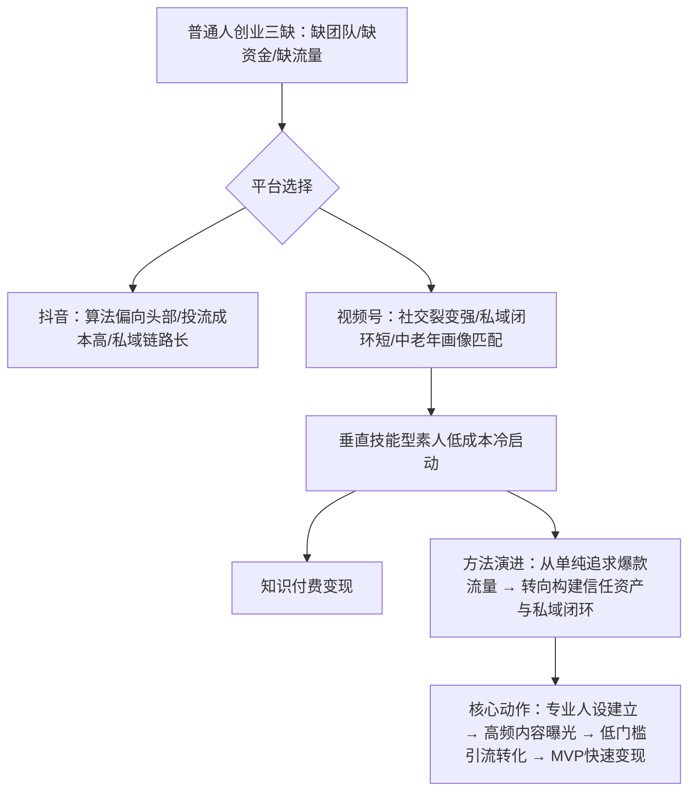
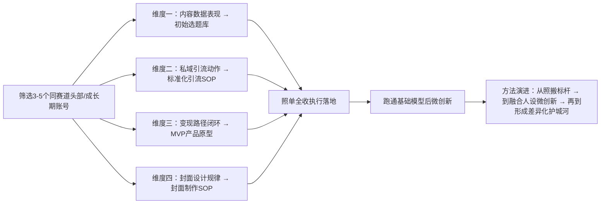
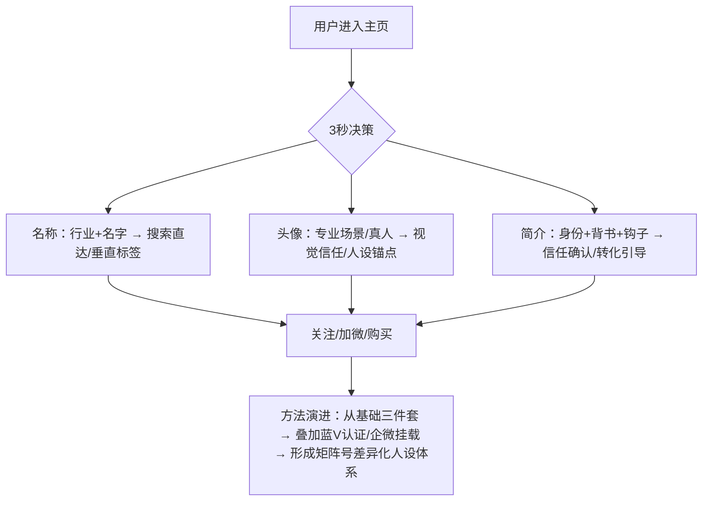
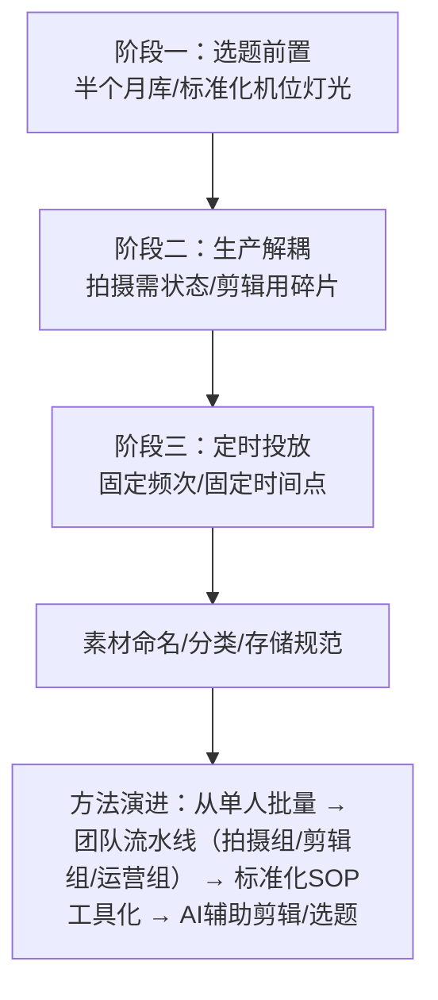
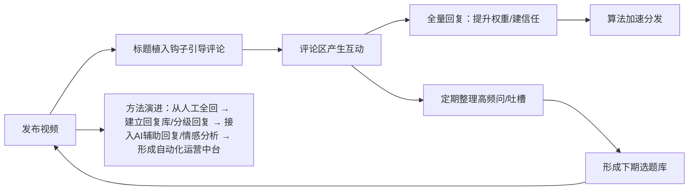
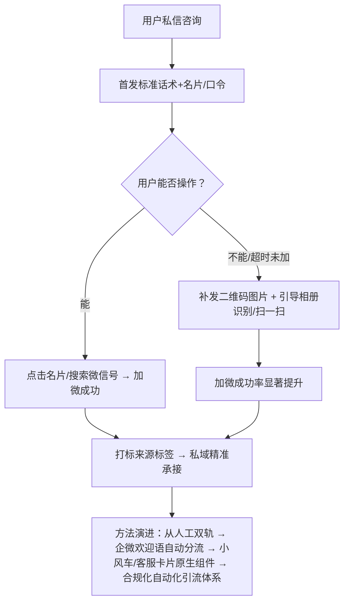
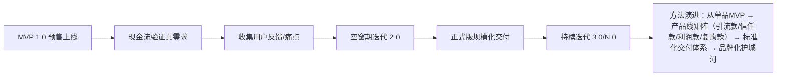
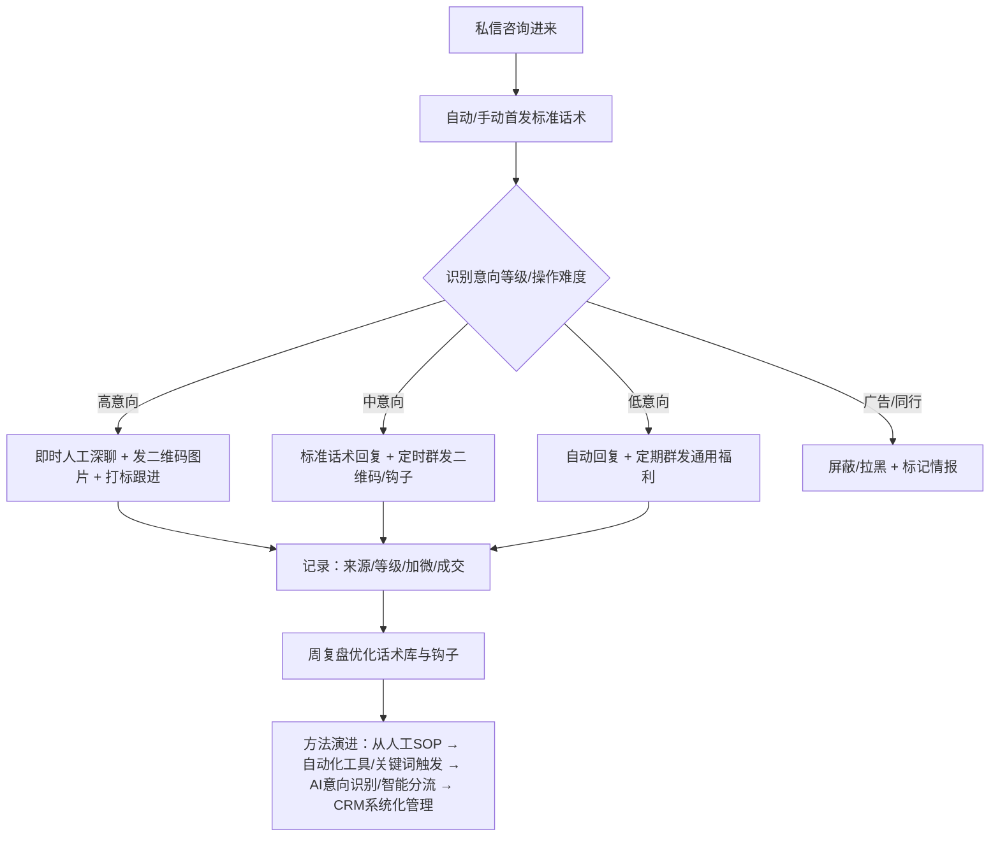
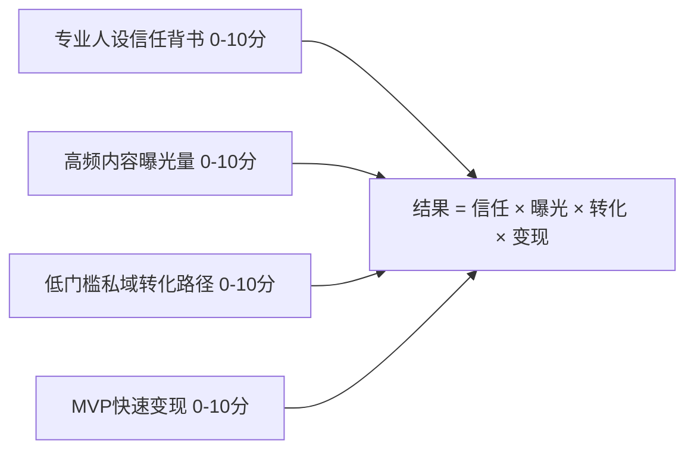

# 第 46 章 视频号垂直赛道冷启动与私域变现体系

## 学习目标

- 理解视频号平台对垂直技能型素人冷启动的独特适配性
- 掌握对标账号四维分析法快速建立选题库与封面SOP
- 熟练应用账号三件套设计公式完成信任背书与转化闭环
- 掌握批量拍摄-异步剪辑-定时发布的受限创作者生产工作流
- 掌握评论区全托管运营法实现算法加速与需求挖掘双重价值
- 理解中老年用户私域引流低门槛适配原则与双轨SOP设计
- 掌握先完成再完美的MVP迭代策略与生命周期节奏控制表
- 能运用垂直技能型素人成功公式进行全链路自检与复盘

## 46.1 生活类比

想象视频号冷启动是一场为期10天的「社区摆摊教学秀」：选址（平台选择）= 选在自家小区广场（视频号/微信生态），邻里熟人多（社交裂变）、阿姨大爷多（中老年画像）、信任成本低，而非去商业步行街（抖音）拼灯牌拼流量；招牌（三件套）= 写上「国家一级舞蹈教师·孕妈叁叁·孕期修复」（名称/头像/简介），路过阿姨3秒读懂：专业、同频、可信、能加微信；备货（批量生产）= 趁身体好一次性跳完半个月课程拍成视频（批量拍摄），后续躺床上也能天天发新课（异步剪辑定时发），不怕肚子大动不了断货；吆喝（封面反差）= 举牌子「孕妇也能跳拉丁·身材不像孕36周」（对比类封面），极致反差让围观阿姨停脚点击，比写「教拉丁舞」有效百倍；互动（评论区托管）= 有人问「孕妇能跳吗？」当众专业回（全量回复），有人骂「作秀」也微笑回（信任建设），有人要教程喊「扣1发群」（标题设钩），热闹非凡街坊邻里自动扩散；收钱（低门槛引流+MVP预售）= 阿姨不会扫码加微信？直接把微信二维码印成卡片塞她手里「阿姨扫这个」（低门槛适配）；还没生完就收定金「生完月子上2.0升级版」（先完成再完美）；复盘（生命周期表）= 按预产期倒排：生前卖1.0回本、月子期打磨2.0、出月子开直播开店，每阶段只盯一个核心指标，不焦虑、不贪多、不断更。

## 46.2 概念地图

视频号垂直赛道冷启动与私域变现体系
├── 平台适配性认知
│   ├── 视频号素人入场适配性  —— P001
│   │   ├── 社交裂变属性强（熟人链传播）
│   │   ├── 私域闭环短（一键跳微信/企微）
│   │   └── 用户画像匹配（中老年/女性/高复购）
│   └── 垂直技能型素人成功公式  —— P010
│       ├── 专业人设信任背书（头衔/证书/案例）
│       ├── 高频内容曝光量（日更/批量/互动）
│       ├── 低门槛私域转化路径（适配话术/二维码）
│       └── MVP快速变现（预售/低价/分期）
├── 前期筹备与定位
│   ├── 对标账号四维分析法  —— P002
│   │   ├── 内容数据表现（高赞/高播主题归纳）
│   │   ├── 私域引流动作（话术/钩子/路径拆解）
│   │   ├── 变现路径闭环（产品/价格/交付模式）
│   │   └── 封面设计规律（对比类/反差感/CTR优化）
│   └── 账号三件套设计公式  —— P003
│       ├── 名称=行业+名字（SEO/认知降维）
│       ├── 头像=专业场景/证书/气质（视觉信任）
│       └── 简介=身份标签+量化背书+私域钩子（落地页）
├── 内容生产与运营体系
│   ├── 批量拍摄-异步剪辑-定时发布  —— P004
│   │   ├── 选题前置（半个月库/标准化机位灯光）
│   │   ├── 生产解耦（拍摄需状态/剪辑用碎片）
│   │   └── 定时投放（固定频次/固定时间点）
│   ├── 评论区全托管运营法  —— P005
│   │   ├── 全量回复（算法权重/专业信任）
│   │   ├── 标题设钩（扣1领教程/引导动作）
│   │   └── 需求挖掘（高频问/吐槽=选题库）
│   └── 生命周期规划与变现节奏控制表  —— P009
│       ├── 生理节点倒推业务节奏（孕晚期/月子/复工）
│       ├── 阶段单一核心目标（极度聚焦）
│       └── 空窗期资产积累（认证/话术/素材库）
├── 私域引流与转化闭环
│   ├── 中老年用户私域引流低门槛适配原则  —— P006
│   │   ├── 二维码图片直发（相册识别/扫一扫）
│   │   ├── 话术+二维码双轨兜底（分级处理）
│   │   └── 来源打标精准承接（标签→产品匹配）
│   └── 私信话术+二维码双轨引流SOP  —— P008
│       ├── 话术结构（共情+专业+钩子+指令）
│       ├── 意向分级（高意向人工/低意向自动）
│       └── 数据闭环（来源/等级/加微/成交周复盘）
└── 产品迭代与变现验证
    ├── 先完成再完美的MVP迭代策略  —— P007
    │   ├── 预售/MVP验证真需求（现金流=唯一真理）
    │   ├── 交付倒逼成长（截止日期强迫产出）
    │   └── 版本迭代显性化（1.0→2.0终身免费升级）
    └── 实证验证节点  —— P001/P010
        ├── 10天涨粉1000+私域正向闭环
        ├── 对比反差封面CTR显著提升
        └── 批量模式支撑孕期高频更新稳定

## 46.3 视频号素人冷启动 —— 为什么垂直技能型个人更适合从视频号破圈

### 46.3.1 为什么需要这个概念？

普通人创业通常面临"三缺"困境：缺团队、缺资金、缺流量。抖音等传统算法平台偏向头部账号和强运营团队，素人想冷启动极难，往往陷入"投流不起、不投没流、内容没人看"的死循环。视频号依托微信生态，提供了完全不同的底层逻辑：社交裂变属性强，内容易在熟人链传播，形成"强关系背书"，信任传递成本极低；私域闭环短，一键跳转微信/企微，公私域转化路径最短，无需复杂外链引流；用户画像精准匹配，中老年/女性群体占比高，决策链路短、付费意愿强、复购率高，天然匹配育儿、怀旧、技能教学、健康等垂直赛道。

### 46.3.2 核心定义

**视频号素人入场适配性**（来源：P001，第2段）指无团队背景、有垂直技能/身份标签的个人，利用平台社交属性与用户画像红利，以低成本实现冷启动与知识付费变现的平台特性。

> "我考虑到后期也要做自己的知识付费产品，相比于抖音，视频号更适合我这样的素人入场" —— P001

### 46.3.3 关键性质

| 性质 | 说明 | 来源 |
|------|------|------|
| 社交裂变属性 | 内容易在熟人链传播，形成「强关系背书」 | P001，第2段 |
| 私域闭环短 | 一键跳转微信/企微，公私域转化路径最短 | P001，第2段 |
| 用户画像匹配 | 中老年/女性群体占比高，决策链路短、付费意愿强、复购率高 | P001，第2段 |

这个定义展示了视频号为何是普通人创业的"福地"：它不是靠算法分发流量，而是靠社交关系分发信任。

### 46.3.4 方法演进图



### 46.3.5 典型例子

**案例1：叁叁（本章核心素材作者）**
- 身份：国家一级拉丁舞教师 + 孕晚期准妈妈（双重标签）
- 成果：10天涨粉1000+，私域引流正向闭环，预售课程验证变现
- 关键动作：对标分析→三件套搭建→批量拍摄→评论区全托管→二维码引流→MVP预售

**案例2：秋海（英文育儿书单号）**
- 身份：英语启蒙赛道内容搬运+AI配音
- 成果：年累计粉120W+，月利润1-2W+
- 验证：中文爆款英文化+YouTube素材+AI工具，跨平台复用验证视频号中老年赛道高转化

### 46.3.6 边界条件

- 必须具备「垂直技能/专业身份」作为信任锚点，纯娱乐/泛知识博主难复制该模式
- 内容需高频更新（日更/双更）维持算法权重，断更会导致账号权重不可逆归零（作者实测断更20天流量归零）
- 变现路径必须清晰（课程/服务/实物），单纯涨粉不带货仅是虚荣指标

### 46.3.7 设计中的取舍

**为什么选择视频号而非抖音/小红书做冷启动？**

| 维度 | 视频号（选择） | 抖音（放弃） | 小红书（放弃） |
|------|----------------|--------------|----------------|
| 算法逻辑 | 社交裂变+兴趣推荐，弱关系+强关系双轮驱动 | 强算法分发，偏向头部/投流账号 | 去中心化算法，偏向优质图文/笔记 |
| 私域链路 | 一键跳微信/企微，原生打通 | 需外链/口令/粉丝群，链路长、易封禁 | 主页链接/粉丝群/小程序，相对繁琐 |
| 用户画像 | 中老年/女性高占比，高复购、高信任、决策短 | 泛娱乐为主，年轻化，付费决策链路长 | 年轻女性为主，种草属性强、客单价相对低 |
| 素人门槛 | 低（依靠信任+垂直技能，无需强运营/投流） | 高（需团队/投流/供应链/强运营能力） | 中（需审美/文案/图文制作能力） |
| 信任建设 | 熟人背书+专业人设，成本低 | 需大量内容沉淀/投流建立认知，成本高 | 需高质量笔记持续输出，周期较长 |

**决策逻辑**：对于「无团队、有垂直技能、需知识付费变现」的素人，视频号的「社交信任红利+私域短链路+中老年高转化」三重叠加，是概率最高、成本最低、节奏最可控的路径。抖音适合有团队/供应链/擅长投流的专业玩家；小红书适合有审美能力、做标品/低客单非标品的创作者。

---

## 46.4 对标账号四维分析法 —— 用「显微镜」拆解同行，用「复印机」复制爆款

### 46.4.1 为什么需要这个概念？

新手缺乏选题感、封面感、变现感，盲目创作极易踩坑、浪费红利期。头部账号已完成"选题-内容-封面-变现"全链路验证，拆解即得标准答案。我们要避免"造轮子"式试错，将不确定性降至最低。

### 46.4.2 核心定义

**对标账号四维分析法**（来源：P002，第3段）从「内容数据表现、私域引流动作、变现路径闭环、封面设计规律」四个维度拆解标杆账号，快速建立自身选题库、封面SOP、引流话术与变现模型。

> "我在寻找对标账号时，主要是看几个方面：每篇笔记的内容数据、是否有引流私域动作、是否有自己的变现路径...我通过对比视频数据，发现'对比类'的视频封面，普遍数据都比较好" —— P001

### 46.4.3 四维拆解清单

下表汇总了四维拆解的核心动作与产出物，用于快速建立选题库、封面SOP、引流话术与变现模型。

| 维度 | 核心动作 | 产出物 | 来源 |
|------|----------|--------|------|
| 内容数据表现 | 记录近30条视频主题，归纳高赞/高播Top 10标签 | 初始选题库 | P002，第3段 |
| 私域引流动作 | 拆解私信话术/评论区钩子/主页留微方式 | 标准化引流SOP | P002，第3段 |
| 变现路径闭环 | 分析产品形态/价格带/交付模式/复购设计 | MVP产品原型 | P002，第3段 |
| 封面设计规律 | 统计高CTR封面共性（对比/反差/数据/人设） | 封面制作SOP | P002，第3段 |

### 46.4.4 方法演进图



### 46.4.5 关键性质

- 选题去重：只收录高互动/高播放内容，天然过滤低质选题
- 封面规律显性化：发现"对比类/反差感"等高CTR封面结构，可直接套用
- 引流动作标准化：拆解同行私信/评论区/主页留钩子方式，照单全收

### 46.4.6 典型例子

**叁叁的实操**：
- 筛选同赛道3-5个头部/成长期账号
- 发现"孕妇跳舞vs大众认知"、"身材变化前后对比"封面数据普遍最好
- 确立封面SOP：必须包含极致反差视觉元素

**李诚团队的规模化复用**：
- 建立"1000+账号拆解表"工具包
- 标准化字段：赛道/账号名/内容形式/变现产品/货源佣金结构
- 作为航海教学核心资产，指导学员快速切入新赛道

### 46.4.7 边界条件

- 只对标「垂直细分赛道」头部/成长期账号，泛娱乐大V参考价值低
- 必须「照单全收」执行落地，改良创新只能在跑通基础模型后进行
- 对标账号生命周期要匹配：参考近3-6个月活跃账号，过期账号打法可能失效

### 46.4.8 设计中的取舍

**为什么坚持「四维全拆」而非只看内容/只看变现？**

| 策略 | 优点 | 缺点 | 适用场景 |
|------|------|------|----------|
| 仅拆内容选题 | 快、易上手 | 忽略变现/引流/封面，易陷入「有流量无变现」陷阱 | 纯流量变现/广告分成模式 |
| 仅拆变现产品 | 直接指向收入 | 忽略内容生产/引流路径，无法复制全链路 | 已有成熟内容团队、只缺产品 |
| **四维全拆（选择）** | **全链路复刻，最小化试错，新手最稳** | **耗时较长，需建立表格工具** | **素人冷启动、资源有限、需全链路跑通** |

**为什么要求「照单全收」先执行，再微创新？**
新手最大误区是「未跑通基础模型就急于创新」。标杆账号的每个动作都是市场验证过的，新手的「自以为是」往往是死亡陷阱。只有当选题库跑通、封面SOP稳定、引流话术转化、变现产品出单后，才具备微创新的资格与判断力。这是「守破离」的守阶段——守住标杆的正确性，才能在破与离中不偏离航向。

---

## 46.5 账号三件套设计公式 —— 让陌生人3秒读懂你、信你、加你

### 46.5.1 为什么需要这个概念？

账号主页是用户决策「关注/不关注」「信任/不信任」「加微/不加微」的唯一决策场。素人无品牌背书，必须用极简符号完成：身份确认→专业背书→转化引导。杂乱无章的主页直接劝退精准用户，浪费来之不易的公域流量。

### 46.5.2 核心定义

**账号三件套设计公式**（来源：P003，第4-6段）
- **名称** = 「行业/赛道 + 真实名字」（降低认知成本，强化垂直标签，自带SEO属性）
- **头像** = 「专业场景/证书/气质感」（视觉化信任背书，真人出镜+专业场景 > 精美风景图）
- **简介** = 「身份标签 + 量化经历背书 + 私域钩子」（前半段建信任，后半段留钩子，完成转化闭环）

> "这里有一个起名称的公式：行业+名字。" —— P001
> "头像需要具备一定的专业性，且能透露出'有气质'的感觉...适当的包装非常重要" —— P001
> "个人简介的内容说明是非常好的用户可以快速了解你的一个窗口，所以需要将自己的身份介绍+经历背书+私域钩子，通通展示" —— P001

### 46.5.3 三件套设计标准

下表给出了三件套的设计公式、核心作用与避坑指南，用于快速自检主页转化力。

| 组件 | 设计公式 | 核心作用 | 避坑指南 |
|------|----------|----------|----------|
| 名称 | 赛道关键词 + IP名/真名（≤20字符） | 搜索直达、垂直标签、认知降维 | 不可频繁修改（影响搜索权重），赛道定下来再起名 |
| 头像 | 真人专业场景实拍/证书特写/气质感 | 视觉信任、人设锚点、专业度背书 | 必须真实、清晰、有眼神交流感，PS过度/美颜过度破坏真实感 |
| 简介 | 身份标签(1句) + 量化背书(1-2句) + 私域钩子(1句) | 3秒建信任、引导转化、落地页功能 | 钩子要具体（如"领21天教程"），泛泛"交流学习"转化极低 |

### 46.5.4 方法演进图



### 46.5.5 典型例子

**叁叁的三件套**：
- 名称：「叁叁·孕期拉丁舞」（赛道+IP名）
- 头像：舞室教学实拍（专业场景+真人气质）
- 简介：「国家一级拉丁舞教师/孕36周/备孕/孕期/产后修复 领资料→」（身份+量化背书+具体钩子）

**李诚团队建议**：
- 蓝V认证 + 企业微信挂载主页，信任成本再降维
- 四大账号矩阵模板：资料卡片/活动现场/街头采访/红娘口播，针对不同平台画像部署

### 46.5.6 压力测试清单（找2-3个不认识的目标用户测试）

- 看主页3秒能说出：你是做什么的？凭什么信你？怎么联系你？
- 点击头像/名称能否联想到你的专业场景？
- 简介的钩子是否让人立刻想加微信/点击？
- 若测试者反馈"看不懂/不信/不想加"，优先修改哪一件套？为什么？

### 46.5.7 边界条件

- 名称不可频繁修改（影响搜索权重），赛道定下来再起名
- 头像必须真实、清晰、有眼神交流感，PS过度/美颜过度会破坏真实感
- 简介私域钩子要具体（如"领21天教程""进备孕群"），泛泛"交流学习"转化极低

### 46.5.8 设计中的取舍

**为什么不把「个人故事/价值观/愿景」写进简介？**

| 写法 | 转化率 | 适用阶段 | 理由 |
|------|--------|----------|------|
| 故事/愿景/价值观 | 低 | 品牌成熟期/粉丝运营期 | 情感共鸣需长期积累，冷启动期用户不认识你，不关心你的故事 |
| **身份+量化背书+具体钩子（选择）** | **高** | **冷启动期/变现期** | **3秒决策窗口内，用户只关心：你是谁？凭什么信？给我什么？** |
| 纯联系方式/二维码 | 极低 | 违规边缘/极度短视 | 平台判营销号限流，用户无信任基础不敢加 |

**为什么头像坚持「真人专业场景」而非「精美Logo/插画/生活照」？**

| 头像类型 | 信任度 | 专业度 | 识别度 | 推荐指数 |
|----------|--------|--------|--------|----------|
| 真人专业场景实拍（选择） | ★★★★★ | ★★★★★ | ★★★★★ | ✅ 首选 |
| 证书/奖杯特写 | ★★★★☆ | ★★★★★ | ★★★☆☆ | ✅ 辅助/备选 |
| 精美Logo/插画 | ★★☆☆☆ | ★★☆☆☆ | ★★★★☆ | ❌ 冷启动期禁用 |
| 生活照/自拍/风景 | ★★☆☆☆ | ★☆☆☆☆ | ★★★☆☆ | ❌ 破坏专业人设 |

**核心原则**：冷启动期，每一个像素都要为「建立信任+引导转化」服务。任何不直接贡献信任与转化的设计元素，都是噪音。

---

## 46.6 批量拍摄-异步剪辑-定时发布 —— 受限创作者的「时间折叠术」

### 46.6.1 为什么需要这个概念？

素人创业者常面临：本职工作忙、孕期/育儿/疾病行动受限、灵感不稳定，导致断更、账号死号。
关键洞察：**「拍摄」需状态好、场地、设备、连块时间；「剪辑」只需手机、碎片时间、无场地要求。**
将两者解耦，用「状态好时的产能」覆盖「状态差时的交付」，实现更新频率确定性。

### 46.6.2 核心定义

**批量化内容生产模式**（来源：P004，第7段）
提前筹备N天选题 → 统一次性进场地批量拍摄素材 → 碎片时间剪辑/配字幕/定时发布，解耦「生产」与「交付」环节。

> "因为我在孕期，不方便经常跑去舞房录制视频，所以我会提前筹备半个月左右的内容主题，统一一次性在舞房录制完成...大大提高了整体效率。" —— P001
> "提前筹备半个月左右的内容主题，统一一次性在舞房录制完成，这样到了要更新的时候，我只需要翻开手机相册把视频提前剪辑出来就可以" —— P001

### 46.6.3 工作流三阶段



下表汇总了工作流三阶段的核心动作与关键产出。

| 阶段 | 核心动作 | 关键产出 | 来源 |
|------|----------|----------|------|
| 选题前置 | 半个月选题库一次性定稿，标注核心卖点/封面反差点/引流钩子/对标参考 | 选题日历表 | P004，第7段 |
| 生产解耦 | 1天集中拍摄（固定机位/灯光/着装/话术卡），后续碎片时间剪辑 | 标准化素材库 | P004，第7段 |
| 定时投放 | 固定频次（日更/双更）+ 固定时间点（早7点/晚8点），训练用户习惯 | 稳定算法权重 | P004，第7段 |

### 46.6.4 典型例子

**叁叁孕36周实操**：
- 一天进舞房拍完半个月素材（14条视频）
- 此后每晚躺床上剪辑发布，维持日更不断更
- 支撑了10天涨粉1000+的内容量基础

**短视频带货团队标准化**：
- 专职拍摄组周一拍全周素材，剪辑组周二到周五流水线产出
- 机位/灯光/角度/着装/开头结尾话术全固定，后期剪辑像搭积木

### 46.6.5 边界条件

- 仅适用于「标准化程度高」的内容形态（口播/教学/测评/混剪），Vlog/探店/直播切片难批量
- 素材有效期受限：季节性/时效性强的选题（如热点/节日）不可提前太久拍摄
- 必须建立「素材命名/分类/存储」规范，否则素材库越大越找不到、越乱

### 46.6.6 设计中的取舍

**为什么选择「批量拍摄+异步剪辑」而非「每天现拍现剪」或「全外包」？**

| 模式 | 优点 | 缺点 | 适用对象 |
|------|------|------|----------|
| 每天现拍现剪 | 内容新鲜、可蹭热点 | 极易断更、受情绪/状态/环境干扰大、不可持续 | 全职创作者/状态稳定者 |
| 全外包（拍摄+剪辑） | 省时间、专业度高 | 成本极高、沟通成本大、人设易失真、不可控 | 有资金/有团队/成熟IP |
| **批量拍摄+异步剪辑（选择）** | **成本低、可控、解耦风险、受限期也能更** | **需自律、素材管理有门槛、时效性选题受限** | **素人/兼职/孕期/育儿/受限创作者** |

**为什么坚持「固定机位/灯光/着装/话术卡」标准化？**
因为「非标准化拍摄」的后期剪辑成本是指数级的：每条视频机位不同→剪辑逻辑不同→模板复用率为零→剪辑时间×3-5倍。标准化的本质是把「剪辑」变成「拼装」，让碎片时间也能产出合格成片。这是「用前置一次性的标准化成本，换取后续无限次的低成本复制」。

**边界判断**：若你的内容形态属于「强场景/强叙事/强即时性」（如探店/Vlog/新闻/直播切片），请放弃批量模式，转而建立「轻量化单条生产SOP」。

---

## 46.7 评论区全托管运营法 —— 把评论区变成「选题库」和「流量加速器」

### 46.7.1 为什么需要这个概念？

绝大多数创作者「只发不回」或「只回夸赞删骂」，浪费了最高性价比的用户调研渠道和算法权重入口。
评论区是算法判定内容质量的核心指标（互动率/完读率/停留时长），全量回复能显著提升冷启动分发。
用户真实痛点、吐槽、提问全在评论里，零成本获取下期选题、产品迭代方向。

### 46.7.2 核心定义

**评论区全托管运营法**（来源：P005，第8-10段）
1. **全量回复**（含质疑/科普/杠精）提升互动权重
2. **标题植入钩子**（如「评论区扣1领教程」）引导动作
3. **定期整理高频提问/吐槽**作为选题库来源，形成「内容-需求-内容」飞轮

> "不论什么样的评论，我都尽可能做到评论必回复，这样可以有效的帮助内容数据更快的跑起来。" —— P001
> "利用标题引导评论，比如想要分解版教程，评论区告诉我...增加内容的活跃度" —— P001
> "定期整理评论区内容，根据评论区内容更好的了解用户需求，为后期内容提供更新方向；用户需求都在评论里。" —— P001

### 46.7.3 运营三板斧

下表给出了评论区运营的三大核心动作、执行标准与核心价值。

| 动作 | 执行标准 | 核心价值 | 来源 |
|------|----------|----------|------|
| 全量回复 | 所有评论必回（含质疑/科普/杠精），人设化/个性化回复 | 算法权重提升、专业信任建设 | P005，第8段 |
| 标题设钩 | 标题植入「评论区扣1领教程/你的痛点是什么」等引导动作 | 制造互动假象/真互动、提升完读率 | P005，第9段 |
| 需求挖掘 | 定期整理高频提问/吐槽/求资料，作为下期选题库 | 零成本精准选题、产品迭代方向 | P005，第10段 |

### 46.7.4 方法演进图



### 46.7.5 典型例子

**叁叁**：
- 「不论什么样的评论，我都尽可能做到评论必回复...定期整理评论区内容，用户需求都在评论里」

**韩北樱（小红书教育号）**：
- 7天60%爆文率，核心动作含「评论区引导互动」「长尾标签冷启动」
- 赞藏比≥2:1.4万赞稳定，阅赞比6-8:1为超级爆款

**刘晨昊（小红书职场号）**：
- 评论区「求资料/求链接」直接转化为社群钩子与产品迭代方向
- 朋友圈IP打造：早中晚2-3条真实感悟替代硬广截图

### 46.7.6 边界条件

- 违规/广告/骂人评论需「隐藏/屏蔽」而非硬刚，避免账号违规或心态崩塌
- 回复不能用机器人模板化话术，必须「人设化/个性化」，否则被判营销号降权
- 大号日评论过百时，需建立「常见问题回复库」+「核心用户优先回」分级机制

### 46.7.7 设计中的取舍

**为什么要「全量回复」甚至回复「杠精/质疑」？**

| 策略 | 算法权重 | 信任建设 | 时间成本 | 推荐指数 |
|------|----------|----------|----------|----------|
| 只回夸赞/提问 | 低 | 低（显得傲慢/不专业） | 低 | ❌ 短视 |
| 删负面/屏蔽质疑 | 极低 | 极低（被截图曝光死得更快） | 低 | ❌ 自杀式 |
| **全量回复含质疑/杠精（选择）** | **高** | **高（展示专业度/情绪稳定/服务态度）** | **高** | **✅ 冷启动必选** |
| 机器人模板回复 | 中（易判营销号） | 低（无人设感） | 极低 | ❌ 违规风险 |

**核心洞察**：冷启动期，你没有粉丝，只有「路人」。路人判断你是否专业、是否靠谱、是否值得关注，主要看你怎么对待「刁钻提问」和「恶意质疑」。一个专业、耐心、不卑不亢的回复，比十条夸赞回复建立的信任更强。这就是「公开处刑式建信任」——在评论区公开展示你的专业度与心态，旁观用户（潜在客户）全看在眼里。

**为什么要在「标题」里设钩子而非只在正文/评论区置顶？**
标题是用户「点击前」最后看到的文案，也是「完读后」第一眼看到的文案。标题设钩（如「想要XX资料评论区扣1」）能：1）提升完读率（用户为扣1会看完）；2）制造互动假象（评论区全是扣1，新用户跟风）；3）筛选高意向用户（扣1=主动举手）。正文/置顶评论的触达率远低于标题。

---

## 46.8 中老年用户私域引流低门槛适配原则 —— 别让用户在「加微信」这件小事上卡住

### 46.8.1 为什么需要这个概念？

视频号主力用户为中老年群体，手机操作不灵活、不识二维码长按识别、不知微信号搜索、怕加错人。
标准化引流动作（发名片/发口令/引导搜索）在该人群面前转化率极低，甚至为零。
引流路径每增加一步操作，流失率指数级上升，必须把门槛降到「傻瓜式」。

### 46.8.2 核心定义

**低门槛适配原则**（来源：P006，第11段）
针对目标用户数字素养水平，将引流动作从「搜索/长按/识别」降维为「扫一扫/相册识别/点击卡片」，甚至「面对面扫码」，转化率提升源于「体验适配」而非「诱饵升级」。

> "视频号的用户主要为中老年群体居多，很多人手机操作不是很灵活，所以我在将话术发于用户后，还会额外将我的微信二维码直接发于用户，方便用户直接扫码添加，增加引流私域动作的转化率。" —— P001

### 46.8.3 双轨引流设计

下表对比了主路径与兜底路径的适用人群、操作步骤与转化率表现。

| 引流路径 | 适用人群 | 操作步骤 | 转化率 |
|----------|----------|----------|--------|
| 主路径：名片/口令 | 年轻/熟练用户 | 点击名片→添加/复制微信号→搜索添加 | 基准线 |
| 兜底路径：二维码图片 | 中老年/不灵活用户 | 收到图片→相册识别/长按扫码→直接添加 | 显著提升 |

### 46.8.4 方法演进图



### 46.8.5 关键性质

- 二维码图片直发：私信发送微信二维码图片，用户点开相册-右上角-扫一扫，或直接长按识别，成功率最高
- 话术+二维码双轨：先发标准化话术建立连接，识别用户不会操作后，补发二维码图片兜底
- 来源打标：每个加微用户打上「视频号-关键词/视频标题」标签，私域承接时精准推对应产品

### 46.8.6 典型例子

**叁叁**：
- 「视频号的用户主要为中老年群体居多...额外将我的微信二维码直接发于用户，方便用户直接扫码添加，增加引流私域动作的转化率」

**视频号航海教练李诚**：
- 配置「微信客服/企微名片/小风车」原生组件，用户一点击直接进企微，零操作成本
- 分层选型：新号/品牌号首选官方组件；成长期辅助课程钩子/客服私信

**闲鱼虚拟资料引流**：
- 1元成交后自动发货卡密/网盘链接，用户无需加微信即可获取，再引导加微信进群
- ROI远超付费广告且规避平台外链严打

### 46.8.7 边界条件

- 仅适用于「中老年/低数字素养」用户群体为主的平台/赛道（视频号/快手/闲鱼/本地生活）
- 年轻化平台（抖音/小红书/B站）用户反感发图二维码，视为硬广/骚扰，需用「粉丝群/主页链接/小程序」原生组件
- 微信风控升级，频繁发二维码图片易封号，需控制频次、配合话术、多号轮换

### 46.8.8 设计中的取舍

**为什么要用「发二维码图片」这种看似low、甚至有封号风险的方式？**

| 引流方式 | 操作步骤 | 中老年成功率 | 封号风险 | 适用平台 | 推荐指数 |
|----------|----------|--------------|----------|----------|----------|
| 发名片/口令/搜索微信号 | 3-5步 | 极低（<10%） | 无 | 所有平台 | ❌ 视频号禁用 |
| 发二维码图片+引导相册识别（选择） | 1-2步 | 高（>60%） | 中（需控频/多号） | 视频号/快手/闲鱼 | ✅ 冷启动首选 |
| 小风车/企微名片/客服卡片 | 1步 | 最高 | 无（官方组件） | 视频号（需条件） | ✅ 成长期首选 |
| 面对面扫码/地推 | 0步（他人操作） | 100% | 无 | 同城/线下业务 | ✅ 辅助手段 |

**决策逻辑**：冷启动期、单人运营、无蓝V/企微资质、用户以中老年为主 → **发二维码图片是性价比最高、门槛最低、见效最快**的兜底方案。只要控制频次（如单日单号≤20次）、配合价值型话术、多号轮换，风险可控。待账号跑通、有资质、有团队后，立即迁移至官方原生组件（小风车/企微名片/客服卡片），实现合规化、规模化。

**核心原则**：引流动作设计的上限，永远由「平台主流用户的数字素养下限」决定。别用你的操作习惯去设计引流路径，要用用户最笨拙的那双手去测试。

---

## 46.9 先完成再完美的MVP迭代策略 —— 用现金流验证需求，用空窗期打磨产品

### 46.9.1 为什么需要这个概念？

素人/小团队精力极其有限，追求「完美产品再上线」往往导致：机会窗口错过、需求假设未验证、现金流断裂、动力耗尽。
「先卖后做」倒逼自己聚焦核心价值交付，用户反馈比自我臆断靠谱100倍。
预售/MVP模式将「产品风险」转移给「时间风险」，后者可控、可迭代、可止损。

### 46.9.2 核心定义

**先完成再完美产品迭代策略**（来源：P007，第12段）
预售/上线MVP版本（核心功能/核心课程） → 收集用户真实反馈/用钱投票 → 利用交付间隙（如月子期/项目间歇期）迭代2.0版本，实现「现金流验证+低成本试错+持续迭代」。

> "预计本月底上线...既不影响我月子期间的产品变现，还能让我抓住这个空隙通过课程不断了解用户的需求，这样当我做完月子后就可以进行2.0的产品迭代，任何事情做到先完成再完美" —— P001

### 46.9.3 MVP三阶段迭代模型



下表汇总了MVP迭代三阶段的核心动作与关键指标。

| 阶段 | 核心动作 | 关键指标 | 来源 |
|------|----------|----------|------|
| MVP 1.0 | 核心交付物上线预售，明确边界（不包含什么） | 预售金额/首批用户数/反馈维度 | P007，第12段 |
| 反馈收集 | 交付过程中收集真实使用反馈/吐槽/建议 | NPS/完课率/复购意向/功能优先级 | P007，第12段 |
| 迭代 2.0 | 利用空窗期（月子期/项目间歇）打磨升级，承诺终身免费升级 | 版本交付率/用户满意度/退款率 | P007，第12段 |

### 46.9.4 关键性质

- 现金流是唯一真理：用户愿付费=真需求；用户只点赞不付费=伪需求/痛点不够
- 交付倒逼成长：承诺了就必须交付，倒逼自己在截止日期前把课程/服务做出来
- 版本迭代显性化：明确告知用户「当前1.0版，购买享终身免费升级2.0」，将不完美转化为「早鸟福利」

### 46.9.5 典型例子

**叁叁**：
- 孕晚期预售孕期舞蹈课1.0版 → 月子期被动交付+收集反馈 → 产后迭代2.0版+开直播+开小店

**小报童专栏作者**：
- 洞察机会→一夜搭框架→次日上线预售→内测6天售80单GMV1.5万→正式版迭代

**AI模特团队**：
- 7天跑通变现闭环（技术调研→快速引流→小批量付费交付→人工PS兜底）→ 复盘迭代SaaS化

### 46.9.6 边界条件

- 仅适用于「非标服务/知识付费/数字产品/可迭代软件」等边际成本低、可远程交付、可版本化的业务
- 必须有「核心交付能力」兜底，不能预售完全不会做的东西（那是诈骗）
- 需明确告知用户「当前版本状态/迭代计划/权益范围」，避免售后纠纷和信任崩塌

### 46.9.7 设计中的取舍

**为什么坚持「预售/先卖后做」而非「做完再卖」？**

| 模式 | 资金压力 | 需求验证 | 交付压力 | 迭代速度 | 死亡率 | 推荐指数 |
|------|----------|----------|----------|----------|--------|----------|
| 做完再卖（完美主义） | 高（前置投入） | 无（上线才知） | 低（已做好） | 慢（重构难） | 高（做错无法回头） | ❌ 素人禁忌 |
| **预售/MVP先卖后做（选择）** | **低（现金流为正）** | **强（用钱投票）** | **高（倒逼产出）** | **快（反馈驱动）** | **低（止损快/试错廉价）** | **✅ 素人必选** |
| 免费体验营/公开课 | 无 | 弱（免费不等于付费） | 中 | 中 | 中 | ⚠️ 辅助手段 |

**核心洞察**：「完美」是主观臆断，「付费」是客观真理。素人最稀缺的不是「产品打磨能力」，而是「真需求判断力」和「现金流生存力」。MVP不是偷懒，而是「用最小代价把『用户愿不愿付费』这个最高风险变量测出来」。

**如何向用户透明沟通「1.0版不完美」而不伤信任？**
话术模板：「这是1.0内测版，核心内容已完备，细节体验正在打磨。购买即享终身免费升级至2.0/3.0，并赠送1v1答疑/专属社群/早鸟价锁定权益。您的每条反馈都将直接塑造最终版本。」—— 将「不完美」重构为「共创特权+价格锁定+专属服务」，用户从「买成品」变成「投资成长」。

---

## 46.10 私信话术+二维码双轨引流SOP —— 从「被动等咨询」到「主动标准化收割」

### 46.10.1 为什么需要这个概念？

私信咨询是高意向线索，但素人常因：不会回、回晚了、话术烂、没留钩子、不会引流，导致线索流失。
标准化SOP能让「不擅长销售」的人也能稳定转化，将「销售天赋」降维为「执行动作」。
双轨设计（话术兜底+二维码兜底）覆盖不同操作能力用户，最大化转化率。

### 46.10.2 核心定义

**私信话术+二维码双轨引流SOP**（来源：P008，第13段）
标准话术库建立 → 私信自动/手动首发话术 → 识别用户操作难度/意向等级 → 补发微信二维码图片（引导长按/相册识别） → 标记用户来源标签/意向等级 → 私域统一承接转化

> "我会有一个统一的话术，直接发给用户...额外将我的微信二维码直接发于用户，方便用户直接扫码添加，增加引流私域动作的转化率。" —— P001

### 46.10.3 话术结构四要素

```
私信标准话术结构：
1. 破冰共情（1句）："辛苦了/恭喜您/理解您的担心"
2. 专业回答（2-3句）：展示专业度，建立信任
3. 利益钩子（1句）："我有份资料/测评/体验课送您"
4. 行动指令（1句）："加微信发您/点击下方二维码进群"
```

### 46.10.4 分级处理机制

下表给出了不同意向等级用户的识别信号与处理方式。

| 意向等级 | 识别信号 | 处理方式 | 来源 |
|----------|----------|----------|------|
| 高意向 | 问价格/问课程/问时间/求购买 | 即时人工深聊+发二维码图片+打标跟进 | P008，第13段 |
| 中意向 | 夸赞/求资料/问细节 | 标准话术回复+定时群发二维码/钩子 | P008，第13段 |
| 低意向 | 点赞/打招呼/闲聊 | 自动回复/定期群发通用福利 | P008，第13段 |
| 广告/同行 | 发广告/拉群/推竞品 | 屏蔽/拉黑/标记竞品情报 | P008，第13段 |

### 46.10.5 数据闭环设计

每条私信记录四个字段，周复盘优化：
- **来源视频/关键词**：追踪流量来源质量
- **意向等级**：分级处理依据
- **是否加微**：转化漏斗核心指标
- **是否成交**：最终ROI验证

### 46.10.6 方法演进图



### 46.10.7 典型例子

**叁叁**：
- 「我会有一个统一的话术，直接发给用户...额外将我的微信二维码直接发于用户...标记用户来源标签」

**刘晨昊（小红书职场号）**：
- 「亲近用户→打造钩子→筛选种子→验证转化」四步法，私信话术精细化运营
- 社群起盘预售：1v1建信任→小册子进度公开预热→点赞领册子+私信推销早鸟价→计算转化率

**李诚视频号团队**：
- 企微欢迎语挂载「资料包/体验课/测评表」，自动化分级承接
- 对标账号拆解模板：基础信息/流量来源/变现产品三维度标准化

### 46.10.8 边界条件

- 话术库需每周迭代：新增高频问答、剔除低转化话术、更新钩子产品
- 严禁群发广告/刷屏/诱导分享，违规必封，私域引流核心是「提供价值换联系方式」
- 团队协作时需统一「话术版本/标签体系/交接流程」，避免客户收到多条矛盾回复

### 46.10.9 设计中的取舍

**为什么要「双轨」（话术+二维码）而非单一路径？**

| 策略 | 覆盖人群 | 转化率 | 运营成本 | 推荐指数 |
|------|----------|--------|----------|----------|
| 仅发话术/名片/口令 | 仅熟练用户 | 低（中老年流失>80%） | 低 | ❌ 视频号禁用 |
| 仅发二维码图片 | 全人群（但年轻用户反感） | 中（年轻用户举报/屏蔽） | 低 | ⚠️ 有风险 |
| **话术首发+二维码兜底双轨（选择）** | **全覆盖：熟练走名片，不熟走二维码** | **最高（分级适配）** | **中（需判断/补发）** | **✅ 冷启动最优** |
| 官方组件（小风车/企微名片） | 全人群 | 最高 | 低（一次配置） | ✅ 成长期必升级 |

**为什么要「分级处理」而非「全人工」或「全自动」？**

| 策略 | 高意向体验 | 低意向成本 | 总体ROI | 推荐指数 |
|------|------------|------------|---------|----------|
| 全人工 | 好 | 极高（人力破产） | 低 | ❌ 不可持续 |
| 全自动 | 差（高意向流失） | 低 | 中 | ❌ 漏单严重 |
| **分级：高意向人工+中低意向自动/半自动（选择）** | **好** | **可控** | **最高** | **✅ 标配** |

**核心原则**：引流是「筛选+服务」的过程，而非「广撒网」。高意向用户值得你花最多时间、给最好体验；低意向用户用标准化动作低成本触达、筛选出真意向再升级服务。这就是「销售漏斗」在私域引流层面的精准落地。

---

## 46.11 生命周期规划与变现节奏控制表 —— 把业务进度表贴在生理时钟上

### 46.11.1 为什么需要这个概念？

创业者常陷入「瞎忙/盲目焦虑/节奏失控」：该选品时在剪视频、该交付时在学工具、该招人时在微操。
生理周期（孕期/产后/疾病/家庭变故）不可控，业务节奏必须「顺势而为」而非「硬抗」。
将业务里程碑锚定在「不可移动的时间节点」上，倒推每阶段核心动作，避免战略性拖延。

### 46.11.2 核心定义

**生命周期规划表**（来源：P009，第14-15段）
按生理/时间节点（孕晚期/待产/月子/复工/淡旺季/政策窗口）倒推业务节奏：当前期核心目标/核心动作/关键指标/兜底预案/下期衔接动作。

> "预计本月底上线...不影响我月子期间的产品变现...做完月子后就可以进行2.0的产品迭代" —— P001
> "开启认证舞蹈博主，增加账号的权重同时继续深入了解视频号的运营技巧，和视频号小店的入驻流程，为后期开启直播教学和带货做准备" —— P001
> "按生理节点倒推业务节奏：孕晚期→上线课程1.0(现金流+需求调研)；待产/月子期→被动交付+收集反馈；月子后→迭代2.0+开直播+开小店(规模化)" —— P001

### 46.11.3 叁叁的生命周期规划表

下表展示了叁叁按生理节点倒推的业务节奏规划，包含核心目标、核心动作、关键指标、兜底预案与下期衔接。

| 阶段 | 生理节点 | 核心目标(仅1个) | 核心动作(3-5条) | 关键指标 | 兜底预案 | 下期衔接 |
|------|----------|-----------------|-----------------|----------|----------|----------|
| 启动期 | 孕晚期(孕36周+) | 课程1.0上线+引流获种子用户 | 1.完成选题库/拍摄素材 2.账号三件套搭建 3.日更内容+评论区托管 4.私信引流SOP执行 5.课程1.0预售上线 | 预售金额≥目标/种子用户≥50人/日更完成率100% | 预售不足10单→止损调整/免费体验营转化 | 交付1.0课程+收集反馈 |
| 沉淀期 | 待产/月子期 | 被动交付+收集反馈+打磨2.0 | 1.按承诺交付1.0课程 2.每日收集用户反馈/痛点 3.整理SOP/话术/素材库 4.申请认证博主/学直播话术 5.调研视频号小店入驻 | 完课率/满意度/反馈条数/资产清单完成度 | 身体不适→延后交付/助理代管/延长售后期 | 2.0课程大纲定稿+直播预演 |
| 规模期 | 月子后/复工期 | 迭代2.0+开直播+开小店 | 1.上线2.0课程(终身免费升级) 2.开启直播教学/带货 3.入驻视频号小店/橱窗 4.组建助教/运营小团队 5.建立矩阵号/付费投流 | 月销/ROI/直播场观/团队产出/矩阵账号数 | 平台政策变→切换主阵地/调整变现模型 | 持续迭代/品牌化/多赛道 |

### 46.11.4 方法演进图

```mermaid
graph TD
    A[生理硬节点：预产期/月子结束/复工日] --> B[倒推业务里程碑]
    B --> C[阶段一：启动期(孕晚期) → 核心目标：课程1.0上线+引流]
    B --> D[阶段二：沉淀期(月子期) → 核心目标：交付+反馈+打磨2.0]
    B --> E[阶段三：规模期(复工期) → 核心目标：迭代2.0+直播+小店]
    C & D & E --> F[每阶段单一北极星指标 + 空窗期资产积累]
    F --> G[月复盘微调 → 方向不变/节奏可控]
    G --> H[方法演进：从个人周期表 → 团队版甘特图/OKR对齐 → 多项目组合管理 → 企业级战略规划体系]
```

### 46.11.5 关键性质

- 阶段性单一核心目标：孕晚期只做「课程1.0上线+引流」，不搞直播/不开店/不招人，极度聚焦
- 空窗期利用：月子期看似「不能动」，实则是「深度打磨产品/沉淀SOP/复盘体系」的黄金期
- 资产累积显性化：认证博主/学直播话术/调研小店入驻/建素材库，虽不直接变现，是规模化前提

### 46.11.6 通用化模板（适用于各类周期性业务）

下表提供了不同业务类型的生命周期规划通用模板。

| 业务类型 | 核心周期节点 | 旺季前2个月 | 旺季期 | 淡季期 |
|----------|--------------|-------------|--------|--------|
| 季节性生意（水果/服装/文具） | 淡旺季/节日/开学季 | 备货/测款/建素材/练团队 | 只管「卖/发/服务」 | 复盘/选品/迭代/团建 |
| 政策窗口期（视频号小店/抖音团购/快手磁力金牛） | 新功能上线/规则变更 | 开白名单/搭环境/练SOP | 上线首周「全员满血冲榜」 | 适配新规/优化流程/避坑 |
| 个人成长周期（考证/备孕/育儿/转行） | 关键考试/生理节点/入职离职 | 核心技能攻坚/内容库建设 | 考试/生产/交付/变现 | 复盘/休整/规划下一阶段 |

### 46.11.7 边界条件

- 需对「生理周期/行业周期/平台周期/政策周期」有基本认知，盲目规划等于瞎折腾
- 计划赶不上变化：每月必须「月复盘-调整下月计划」，保持「方向不变、节奏微调」
- 核心指标不可贪多：每阶段仅设「1个北极星指标+2个辅助指标」，指标多等于无指标

### 46.11.8 设计中的取舍

**为什么要按「生理硬节点」倒推业务，而非按「业务目标」正推时间表？**

| 规划方式 | 核心逻辑 | 抗风险性 | 执行力 | 适用对象 |
|----------|----------|----------|--------|----------|
| 正推：我想何时达成什么目标 | 愿望驱动 | 低（不可控变量多） | 易拖延/焦虑 | 资源充足/可控环境/团队作战 |
| **倒推：预产期/考试日/政策截止日已定，我必须在此之前完成什么（选择）** | **约束驱动** | **高（硬节点不可移动，倒逼聚焦）** | **高（死节点倒逼执行）** | **个人/素人/受限资源/强外部约束** |

**核心洞察**：生理周期（预产期/月子/康复期）、政策周期（新功能上线/规则变更/红利窗口）、行业周期（淡旺季/展会/开学季）是「不可移动的硬约束」。业务计划若不锚定这些硬约束，就是在「许愿」而非「规划」。倒推法的本质是「用确定性的时间约束，倒逼不确定性的业务动作聚焦」。

**为什么每阶段「仅设1个北极星指标」？**

| 指标数量 | 执行聚焦度 | 团队对齐度 | 复盘清晰度 | 典型后果 |
|----------|------------|------------|------------|----------|
| 1个北极星+2个辅助（选择） | 极高 | 极高 | 极高 | 核心目标达成，资源不分散 |
| 3-5个同权重核心指标 | 低 | 低（争资源/争优先级） | 低 | 样样通样样松，核心目标未达成 |
| 无指标/仅待办清单 | 极低 | 无 | 无 | 瞎忙、假努力、战略性拖延 |

**边界判断**：若你的业务处于「多目标并行期」（如已组建团队、多条业务线并行），可为每条业务线设独立北极星，但「个人/单业务线/早期阶段」必须极度聚焦单一指标。

---

## 46.12 垂直技能型素人成功公式 —— 四个确定性动作的乘积，任一为零结果为零

### 46.12.1 为什么需要这个概念？

素人创业易陷入「靠运气出爆款」「靠天赋做IP」「靠熬夜出成绩」的赌徒心理。
将成功拆解为可控、可复制、可检验的四个确定性动作，把「概率游戏」变成「工程建设」。
公式化思维便于复盘定位断点：不出单=信任没建立/量级不够/转化路径断/产品没验证。

### 46.12.2 核心定义

**垂直技能型素人成功公式**（来源：P010，第16段）
**成功 = 专业人设信任背书 × 高频内容曝光量 × 低门槛私域转化路径 × MVP快速变现**

> "一个账号如果无法变现，哪怕数据再漂亮，也是一堆垃圾！" —— P001
> "保持更新频率，不管之前的内容数据怎么样，都不要影响你接下来的更新节奏，用数量去对抗质量！" —— P001
> "视频号的用户主要为中老年群体居多...额外将我的微信二维码直接发于用户，增加引流私域动作的转化率。" —— P001
> "任何事情做到先完成再完美，没有人一上来就可以做到100分" —— P001

### 46.12.3 四要素拆解与量化考核

下表将成功公式的四要素拆解为可量化的考核指标，并给出断点诊断方法。

| 要素 | 核心内涵 | 量化考核指标 | 断点诊断 |
|------|----------|--------------|----------|
| 专业人设信任背书 | 头衔/证书/经历/案例/真实感，解决「凭什么信你」 | 资质证书数/真实案例数/人设一致性评分 | 无人信/不关注/不咨询 = 信任为0 |
| 高频内容曝光量 | 日更/双更/批量产/评论互动/蹭热点，解决「谁知道你」 | 日更天数/总播放量/互动率/完播率 | 断更/播放低/无互动 = 曝光为0 |
| 低门槛私域转化路径 | 适配用户画像的引流动作/话术/钩子/承接，解决「怎么加你」 | 私信回复率/加微率/成交率/人均引流成本 | 不引流/加微难/流失高 = 转化为0 |
| MVP快速变现 | 预售/低价体验/首发价/分期付，解决「为何付钱」 | 预售金额/首批用户数/复购率/LTV | 免费送/不收费/无产品 = 变现为0 |

### 46.12.4 乘法模型的工程意义



**公式推导过程**：
我们将视频号素人冷启动的成功视为一个工程系统，而非概率游戏。在工程系统中，若任一关键环节缺失（得分为0），整个系统即失效，这符合乘法模型的特性。加法模型会掩盖短板（如曝光极高但转化为0，加法仍得正分），无法定位断点。因此采用乘法模型：结果 = 信任(0-10分) × 曝光(0-10分) × 转化(0-10分) × 变现(0-10分)。

**各项量化标准设定依据**：
- 信任背书：以可验证的资质证书数、真实案例数、人设一致性评分为量表，满分10分对应行业顶级权威+大量头部案例+人设零偏差
- 曝光量：以日更天数占比、总播放量级、互动率、完播率为量表，满分10分对应连续90天日更+百万级播放+高互动率
- 转化路径：以私信回复率、加微率、成交率、人均引流成本为量表，满分10分对应秒回+加微率>30%+成交率>10%+低成本
- MVP变现：以预售金额、首批用户数、复购率、LTV为量表，满分10分对应首发破万单+高复购+高LTV

**公式作用**：该公式将模糊的「做成账号」拆解为四个可执行、可考核、可复盘的确定性动作。任一环节为0，结果必为0（如从不引流/从不更新/无专业背书/免费送）。正向飞轮为：变现收入→投流/升级设备/招助理→提升曝光/转化/交付→更高收入。复盘定位：不出单时，检查四要素哪个为0或极低，精准打补丁。

### 46.12.5 典型例子

**叁叁**：
- 教师资质+孕妈身份（信任 8分） × 10天日更+对比封面（曝光 7分） × 话术+二维码（转化 6分） × 预售课程1.0（变现 5分） = 1000+精准粉+种子用户+现金流

**刘晨昊（小红书职场号）**：
- 投行背景+赚钱案例（信任 9分） × 反差选题+标题82法则（曝光 8分） × 朋友圈IP+社群钩子（转化 7分） × 社群预售499元（变现 6分） = 单月8万+

**李诚团队（视频号航海教练）**：
- 航海教练背书+实操数据（信任 9分） × 矩阵号日更+切片分发（曝光 8分） × 企微名片+小风车（转化 8分） × 训练营/咨询/带货（变现 7分） = 月销200万+

### 46.12.6 边界条件

- 仅适用于「垂直技能/知识付费/服务型/高客单非标品」赛道，标品电商/泛娱乐/游戏/工具类模型不同
- **「专业人设」不可造假**，一旦翻车信任崩塌不可逆（如假证书/假案例/人设崩塌）
- **「高频更新」不可以「质量差」为借口偷懒**，底线是「不违规/不水贴/有完整结构」

### 46.12.7 设计中的取舍

**为什么用「乘法模型」而非「加法模型」或「桶理论」？**

| 模型 | 数学形式 | 短板表现 | 断点定位 | 适用场景 |
|------|----------|----------|----------|----------|
| 加法模型 | 结果 = A+B+C+D | 掩盖短板（一项为0仍有正分） | 难（高分项掩盖零分项） | 各环节可替代/互补的系统 |
| 桶理论 | 结果 = min(A,B,C,D) | 短板决定高度 | 易（最短板即瓶颈） | 串联流程/强依赖/无替代性系统 |
| **乘法模型（选择）** | **结果 = A×B×C×D** | **任一为0结果为0，放大短板惩罚** | **最易（哪项为0/极低立现）** | **创业系统：四环节缺一不可、强耦合、无替代** |

**为什么这四个要素「缺一不可」？**

| 缺失要素 | 后果 | 真实案例 |
|----------|------|----------|
| 无专业人设（信任=0） | 账号像骗子/野鸡机构，用户不信、不关注、不咨询、不付费 | 某无证「养生专家」日更100条，粉丝5万但0成交，用户全是看热闹 |
| 无高频内容（曝光=0） | 账号死号，算法不推，无新用户进漏斗，存量用户流失 | 某大师级教师仅发3条精品课，半年涨粉50，私域0引流 |
| 无低门槛转化（转化=0） | 公域流量无法沉淀私域，用户想加微信加不上，流量白跑 | 某爆款视频100万播放，仅留微信号/口令，中老年用户0加微，私域0沉淀 |
| 无MVP变现（变现=0） | 纯粹公益/爱好，无现金流反哺，无法规模化，最终放弃 | 某优质教学号日更1年，粉丝10万，从未卖课/带货，因无收入断更转行 |

**核心原则**：这不是「四选一」的菜单，而是「四同时」的工程结构。每天的行动清单里，必须同时包含：做一件建信任的事（如晒证书/案例）、发一条内容（维持曝光）、优化一处引流路径（话术/二维码/钩子）、推进一步产品交付/迭代（MVP）。四条腿走路，少一条就瘸。

---

## 46.13 多源对照

### 共识

多篇素材一致认为：视频号依托微信生态，私域闭环短、信任传递成本低、中老年用户画像匹配垂直技能变现，是普通人冷启动最优平台。

| 素材 | 核心观点 | 角色 |
|------|----------|------|
| P001 (叁叁) | 视频号更适合素人入场，社交裂变强、私域闭环短、中老年匹配度高 | origin |
| P003 (李诚) | 视频号四大红利：流量易起号、利润高1-3倍、人群信任高退货低、私域极易导流微信 | experiment |
| P004 (秋海) | 英文育儿书单验证中老年赛道高转化，年累计粉120W+、月入2W+ | experiment |
| P005 (蓝狐) | 同城服务私域信任闭环：专业人设朋友圈建立信任实现复购转介绍 | extension |

### 分歧

| 维度 | P001 (叁叁) | P003 (李诚) | 说明 |
|------|-------------|-------------|------|
| 内容进化路径 | 批量口播为主，强调标准化SOP与个人IP | 四阶段：搬运→混剪→仿拍→实拍原创，建议有能力者进化到原创 | 叁叁因孕期受限走标准化口播；李诚团队有团队支撑可进化 |
| 引流工具偏好 | 二维码图片直发（适配中老年）+ 私信话术 | 官方组件优先（小风车/企微名片/客服卡片）+ 课程钩子 | 叁叁单人操作用低成本兜底；李诚团队规模化用官方工具降风险 |
| 变现节奏 | MVP预售→月子期迭代→产后规模化 | 短视频测品→直播承接→私域长期运营→合规化生存 | 叁叁受生理周期驱动单品深耕；李诚团队多店铺矩阵追求规模 |

---

## 46.14 设计中的取舍（全章统筹视角）

**为什么不用抖音/小红书做冷启动？**
抖音算法偏向头部、投流成本高、私域引流链路长（需外链/口令/粉丝群）、中老年用户少、信任建设周期长，适合有团队、有供应链、擅长投流的专业玩家。小红书去中心化算法虽友好，但用户画像偏年轻女性、种草属性强、知识付费客单价相对较低、笔记制作审美要求高，适合有审美能力、做标品/低客单非标品的创作者。视频号社交裂变+私域短链+中老年高复购+低门槛引流工具，三重红利叠加，是「垂直技能+知识付费」模式的最优解。

**为什么不追求「爆款视频」而追求「高频更新」？**
爆款是概率事件，不可控、不可复制、不可持续。作者明确主张："用数量对抗质量，保持更新频率，不管之前的内容数据怎么样，都不要影响你接下来的更新节奏"。高频更新能：训练算法权重获得稳定基础流量；积累素材库沉淀SOP为规模化铺路；持续触达用户建立观看习惯提升私域转化基数；通过评论区全托管零成本获取精准选题与需求。单条视频精度可能不如精心打磨的爆款，但用「确定性的量级」换「不确定性的质量」，是资源受限者的理性选择。

**为什么要用「二维码图片」这种看似low的引流方式？**
因为平台用户画像决定引流动作设计上限。视频号中老年用户占比高、操作障碍大，标准化的「发名片/口令」失效率高。发二维码图片将用户操作从「搜索/长按识别」（3-4步）降维为「相册识别/扫一扫」（1-2步），转化率提升源于「体验适配」而非「诱饵升级」。这是对用户真实状态的尊重，而非偷懒。

**为什么不直接做直播带货/矩阵号？**
直播带货需供应链、选品、话术、场控、投流等重运营能力，素人单兵冷启动期无法支撑；矩阵号需多账号环境隔离、内容分发体系、团队协作，单人精力不足。冷启动期极度聚焦「单号+短视频+私域+课程」单一闭环，跑通后再考虑直播/矩阵，避免战略性分心。

---

## 46.15 动手练习

### 练习1：对标账号四维拆解实战
选择你所在赛道的3个头部/成长期视频号账号：
1. 建立对标表格，记录字段：账号名/粉丝量/近30条视频主题/高赞前3主题/封面类型/私域引流动作(私信/评论/主页)/变现产品/客单价
2. 归纳高频选题标签Top 10，形成你的初始选题库
3. 统计高点击封面共性（如对比/反差/数据/人设），绘制你的封面SOP草图
回答问题：
- 如果对标账号的变现产品你无法复制（如需特殊资质），如何微创新设计你的MVP产品？
- 对标账号封面风格与你的人设是否冲突？如何融合而非照搬？

### 练习2：账号三件套设计与压力测试
按公式设计你的账号三件套：
1. 名称：行业/赛道关键词 + 真实名字/IP名（≤20字符，可搜索）
2. 头像：描述你将拍摄的头像场景/着装/道具/表情（需体现专业与气质）
3. 简介：身份标签(1句) + 量化经历背书(1-2句) + 私域钩子(1句具体福利/行动指令)
压力测试（找2-3个不认识的目标用户测试）：
- 看主页3秒能说出：你是做什么的？凭什么信你？怎么联系你？
- 点击头像/名称能否联想到你的专业场景？
- 简介的钩子是否让人立刻想加微信/点击？
回答问题：
- 若测试者反馈「看不懂/不信/不想加」，你会优先修改哪一件套？为什么？

### 练习3：批量生产工作流模拟演练
模拟你未来2周的内容生产计划：
1. 选题会（30分钟）：列出14条视频主题，标注：核心卖点/封面反差点/引流钩子/对标参考链接
2. 拍摄日规划：设定1天集中拍摄，列清单：机位/灯光/着装/道具/台词提示卡/预计时长/素材命名规范
3. 剪辑发布排期：建立甘特图/日历，每天固定时段剪辑1-2条，固定时间点(如早7点/晚8点)定时发布
回答问题：
- 若拍摄日突发状况(生病/场地不可用/天气)，你的Plan B是什么？素材库能支撑多久？
- 如何建立素材命名/分类/存储规范，避免素材越存越乱找不到？

### 练习4：评论区运营与私信引流SOP设计
设计你的评论区运营与私信引流标准动作包：
1. 评论区回复话术库（至少5类）：夸赞/提问/质疑/杠精/广告/同行，每类3条差异化回复模板
2. 标题设钩模板（3套）：如「想要XX资料评论区扣1」「你的XX痛点是什么？评论区聊聊」
3. 私信标准话术结构：破冰共情(1句) + 专业回答/价值交付(2-3句) + 引流钩子(1句) + 行动指令(1句)
4. 二维码兜底话术：识别用户不会操作后的补发话术+二维码图片发送时机判断标准
5. 用户分级标签体系：高意向(问价/问课/问时)/中意向(夸赞/求资料)/低意向(点赞/打招呼)/广告/同行
回答问题：
- 当日私信超50条无法逐一手动回复时，如何分级处理？自动化工具/回复库如何配置？
- 如何通过周复盘数据（回复率/加微率/成交率）迭代话术库与钩子设计？

### 练习5：生命周期规划表与MVP预售方案设计
结合你未来3-6个月的关键时间节点(工作/考试/家庭/平台红利期/淡旺季)，绘制生命周期规划表：
阶段 | 核心目标(仅1个) | 核心动作(3-5条) | 关键指标(北极星+辅助) | 兜底预案 | 下期衔接动作
示例阶段：当前准备期/启动期/稳定期/规模期/迭代期
设计你的MVP预售方案：
1. 核心交付物：1.0版包含什么？明确边界（不包含什么？）
2. 定价策略：预售价/正式价/早鸟权益(如终身升级/1v1答疑/社群)
3. 预售目标：首批种子用户数/预售金额/反馈收集维度
4. 交付时间表：预售结束→交付开始→反馈收集→2.0迭代上线
回答问题：
- 如果预售目标未达成（如不足10单），你的止损/调整决策标准是什么？
- 如何向用户透明沟通「当前是1.0版、存在已知不完美、迭代计划」，将不完美转化为早鸟福利而非信任风险？

---

## 46.16 本章小结

这一章中我们学习/了解/讨论了视频号垂直赛道冷启动与私域变现的完整方法论。首先，我们确立了**视频号素人入场适配性**认知，理解了依托微信社交关系链与中老年用户画像，为无团队、有垂直技能的素人提供低门槛冷启动与高效私域变现土壤的平台特性。其次，我们掌握了**对标账号四维分析法**，从内容数据、引流动作、变现路径、封面规律四维拆解标杆，照单全收建立选题库与SOP，规避新手盲目试错。接着，我们熟练应用了**账号三件套设计公式**，用名称/头像/简介三件套在3秒内完成陌生人信任确认与转化引导。然后，我们掌握了**批量拍摄-异步剪辑-定时发布**的受限创作者生产工作流，将高门槛拍摄与低门槛剪辑解耦，用状态好时的产能覆盖受限期交付，保障更新频率确定性。之后，我们掌握了**评论区全托管运营法**，全量回复提权重、标题设钩引动作、整理高频问做选题，把评论区变成算法加速器与零成本需求雷达。随后，我们理解了**中老年用户私域引流低门槛适配原则**，针对用户操作障碍，将引流动作从搜索/长按降维为发二维码图片+相册识别，转化率提升源于体验适配而非诱饵升级。接着，我们掌握了**私信话术+二维码双轨引流SOP**，标准话术库+意向分级处理+二维码兜底+来源打标闭环，将销售天赋降维为可执行、可复盘的标准化动作。然后，我们掌握了**先完成再完美的MVP迭代策略**，预售1.0验证需求获现金流，利用空窗期（月子期）迭代2.0，用现金流对抗完美主义陷阱。最后，我们学会了用**生命周期规划与变现节奏控制表**按生理/时间硬节点倒推业务节奏，阶段单一核心目标，空窗期做资产积累，实现战略节奏可控。核心在于运用**垂直技能型素人成功公式**：专业人设信任背书 × 高频内容曝光量 × 低门槛私域转化路径 × MVP快速变现，四个确定性动作乘积，任一为零结果为零。

本章我们一起学习了以下概念：

| 概念 | 解释 |
|------|------|
| 视频号素人入场适配性 | 依托微信社交关系链与中老年用户画像，为无团队、有垂直技能的素人提供低门槛冷启动与高效私域变现土壤的平台特性 |
| 对标账号四维分析法 | 从内容数据、引流动作、变现路径、封面规律四维拆解标杆，照单全收建立选题库与SOP，规避新手盲目试错 |
| 账号三件套设计公式 | 名称=行业+名字、头像=专业气质、简介=身份+背书+钩子，3秒完成陌生人信任确认与转化引导 |
| 批量拍摄-异步剪辑-定时发布 | 将高门槛拍摄与低门槛剪辑解耦，用状态好时的产能覆盖受限期交付，保障更新频率确定性 |
| 评论区全托管运营法 | 全量回复提权重、标题设钩引动作、整理高频问做选题，把评论区变成算法加速器与零成本需求雷达 |
| 中老年用户私域引流低门槛适配原则 | 针对用户操作障碍，将引流动作从搜索/长按降维为发二维码图片+相册识别，转化率提升源于体验适配而非诱饵升级 |
| 私信话术+二维码双轨引流SOP | 标准话术库+意向分级处理+二维码兜底+来源打标闭环，将销售天赋降维为可执行、可复盘的标准化动作 |
| 先完成再完美的MVP迭代策略 | 预售1.0验证需求获现金流，利用空窗期（月子期）迭代2.0，用现金流对抗完美主义陷阱 |
| 生命周期规划与变现节奏控制表 | 按生理/时间硬节点倒推业务节奏，阶段单一核心目标，空窗期做资产积累，实现战略节奏可控 |
| 垂直技能型素人成功公式 | 专业人设信任背书 × 高频内容曝光量 × 低门槛私域转化路径 × MVP快速变现，四个确定性动作乘积，任一为零结果为零 |

下一章中，我们将学习 **第 47 章：怀旧赛道实战SOP —— 标准化去重、流量梯队、矩阵冷启动**，深度拆解黄岛主"80/90后童年怀旧"短视频副业项目，从账号注册环境隔离、跨平台素材搬运去重、剪映六步制作法、流量梯队爬坡模型到小号矩阵互刷，构建可复制的冷启动标准作业程序。


