# 第 68 章 AIGC商业落地与流量变现体系

## 学习目标

- 理解AIGC工具落地的核心是场景化组合而非单点技术
- 掌握流量红利本质为平台新功能与用户新认知的时差套利
- 了解认知差反向引流与「丑/笨/假」即流量的内容策略
- 熟练构建私域作为所有公域玩法终局归宿的商业闭环
- 能够设计AIGC一条龙工作流实现内容批量化生产
- 掌握AI数字人直播、AI套壳Prompt工程、虚拟资源矩阵等变现模型
- 掌握小红书零粉冷启动、抖音低门槛直播、视频号切片变现、闲鱼低价引流四大平台实操SOP
- 理解AI课程分销为确定性最高卖铲人生意
- 了解宠物+AI垂直赛道高转化潜力
- 掌握视频号语音直播+高客单课程跑通非标标品化
- 验证闲鱼低价虚拟资料引流成本极低且精准
- 掌握寺庙/玄学/情绪价值赛道结合AI工具爆发增长

## 68.1 生活类比

想象AIGC商业落地是一场**工业化造车**：**单点技术** = 只造发动机、只造轮胎、只造车身（ChatGPT/MJ/SD单独使用）；**场景化组合** = 将发动机+变速箱+底盘+车身+电子系统按**具体车型**（SUV/轿车/卡车）装配成整车（电商主图/短视频/数字人直播/代问服务）；**平台新功能** = 新修好的高速公路（小风车/切片工具/商品卡）；**用户新认知** = 还没开过车的司机（对AI充满好奇/恐惧/猎奇）；**时差套利** = 在高速公路通车初期、司机还不会开车时，第一个跑运输、收过路费、卖汽车的人；**私域** = 自己的4S店/维修站/加油站，客户进来了就是自己的资产，不受高速公路限行/收费影响。就像造车不能只造零件，做AIGC也不能只会单一工具；要组装成针对具体场景的完整产品，在新基建（平台功能）红利期，面对新司机（用户认知）收割第一波红利，最终把车主留在自己的服务体系里。

## 68.2 概念地图

AIGC商业落地与流量变现体系
├── 核心认知定律
│   ├── AIGC工具落地核心：场景化组合 > 单点技术    —— docs/202303/MZqUdSJumoQZwtxLCatcDJ1snze.md
│   ├── 流量红利本质：平台新功能与用户新认知的时差套利    —— docs/202303/MZqUdSJumoQZwtxLCatcDJ1snze.md
│   ├── 「丑/笨/假」即流量：技术缺陷早期转化为内容优势    —— docs/202303/MZqUdSJumoQZwtxLCatcDJ1snze.md
│   └── 私域为公域玩法终局归宿：高频触达+信任建立+LTV最大化    —— docs/202303/MZqUdSJumoQZwtxLCatcDJ1snze.md
├── 核心生产方法论
│   ├── AIGC一条龙工作流：脚本→图像→视频→音乐全自动化    —— docs/202303/MZqUdSJumoQZwtxLCatcDJ1snze.md
│   ├── AI内容批量化生产SOP：选赛道→训练模型→批量产出→多平台分发→变现    —— docs/202303/MZqUdSJumoQZwtxLCatcDJ1snze.md
│   └── 场景化素材库：受众共鸣 > 产品实拍    —— docs/202303/MZqUdSJumoQZwtxLCatcDJ1snze.md
├── 变现模型矩阵
│   ├── AI数字人直播：HeyGen/SadTalker/自研模型7x24无人直播    —— docs/202303/MZqUdSJumoQZwtxLCatcDJ1snze.md
│   ├── AI套壳/Prompt工程变现：垂直场景封装+指令集贩卖    —— docs/202303/MZqUdSJumoQZwtxLCatcDJ1snze.md
│   ├── 虚拟资源矩阵变现：壁纸/笔刷/模板/资料零边际成本复售    —— docs/202303/MZqUdSJumoQZwtxLCatcDJ1snze.md
│   └── 认知差反向引流：文心一言智障图吐槽获流    —— docs/202303/MZqUdSJumoQZwtxLCatcDJ1snze.md
├── 平台实操SOP
│   ├── 平台原生工具闭环：小风车/切片/原创授权/商品卡/分屏    —— docs/202303/MZqUdSJumoQZwtxLCatcDJ1snze.md
│   ├── 小红书零粉图文冷启动：标品虚拟资源+爆款标题模版    —— docs/202303/MZqUdSJumoQZwtxLCatcDJ1snze.md
│   ├── 抖音低门槛直播模型：数字人/服务型/低客单/玩偶服    —— docs/202303/MZqUdSJumoQZwtxLCatcDJ1snze.md
│   ├── 视频号直播切片+高客单知识付费：内容资产化+服务标品化    —— docs/202303/MZqUdSJumoQZwtxLCatcDJ1snze.md
│   └── 闲鱼1元虚拟资料引流私域：搜索意图精准+零成本复制    —— docs/202303/MZqUdSJumoQZwtxLCatcDJ1snze.md
└── 验证案例库
    ├── AI课程分销为确定性最高卖铲人生意    —— docs/202303/MZqUdSJumoQZwtxLCatcDJ1snze.md
    ├── 小红书宠物+AI赛道验证垂直细分高转化    —— docs/202303/MZqUdSJumoQZwtxLCatcDJ1snze.md
    ├── 视频号语音直播+高客单课程跑通非标标品化    —— docs/202303/MZqUdSJumoQZwtxLCatcDJ1snze.md
    ├── 闲鱼低价虚拟资料引流成本极低且精准    —— docs/202303/MZqUdSJumoQZwtxLCatcDJ1snze.md
    └── 寺庙/玄学/情绪价值赛道结合AI工具爆发增长    —— docs/202303/MZqUdSJumoQZwtxLCatcDJ1snze.md

## 68.3 AIGC工具落地核心是「场景化组合」而非「单点技术」

### 为什么需要这个概念？

你可能已经熟练使用ChatGPT写文案，或用Midjourney出图，但当你尝试将这些能力变现时，会发现**单一工具的商业价值天花板很低**。素材明确指出：单一AI工具（仅ChatGPT或仅SD）商业价值有限，无法形成完整交付闭环。市场需要的是可交付、可复制、可规模化的产品化能力，而非单一技能演示。商业场景复杂，涉及文本逻辑、图像视频、垂直知识、自动化流程多环节，只有将这些能力像搭积木一样组装，才能真正跑通商业闭环。

> "AI一条龙创作，从脚本到图像到视频和音乐"
> 
> "ChatGPT + Wordpress 测试站，基于关键词自动生成的行业文章"
> 
> "帮助淘宝店家用 ChatGPT 和 AI 绘画完成服饰产品的拍摄"
> 
> "AI虚拟换装，可以用 Stable Diffusion，Controlnet ，Lora 来实现"
> 
> ——《风向标精选周刊》

### 核心定义与推导

**场景化组合**定义为：将LLM(文本/逻辑)、Diffusion(图像/视频)、RAG/微调(垂直知识)、自动化脚本(工作流)针对具体商业场景组合封装。典型场景包括：电商主图生成、短视频批量制作、数字人直播、代问服务等。

这个定义展示了三个关键性质：
1. **组合性**：必须是多工具协同，而非单工具调用
2. **场景化**：针对具体业务痛点定制化封装
3. **产品化**：形成标准化可交付的商业产品/服务

### 关键方法：多工具协同工作流设计

> **场景化组合工作流设计方法**（来源：《风向标精选周刊》）

```
1. 拆解目标商业场景的完整业务流程（获客→生产→交付→转化）
2. 标注每个环节适用的AI工具类型：
   - 文本/逻辑/代码：ChatGPT / GPT-4 / Claude
   - 图像/视频生成：Midjourney / Stable Diffusion / 视频生成工具
   - 垂直知识注入：RAG检索增强 / LoRA微调 / ControlNet控制
   - 流程自动化：RPA / 自动化脚本 / API串联
3. 设计工具间的数据流转接口：
   - Prompt模板标准化（输入/输出格式固定）
   - 参数设置规范化（种子/步数/分辨率/风格权重）
   - 中间产物格式统一（JSON/Markdown/图片路径）
4. 识别必须保留人工介入的关键质检节点：
   - 核心IP形象/品牌视觉审核
   - 法律合规/版权风控把关
   - 高客单价交付前的确认环节
```

这段伪代码展示了如何将零散的AI能力工程化为可交付的商业产品：不是学会一个工具就能变现，而是要懂得**如何把多个工具按业务流程串起来，形成标准化SOP**。

### 典型例子

**案例1：AI一条龙创作流水线**
从脚本创作(ChatGPT) → 分镜设计(ChatGPT) → 图像生成(Midjourney/SD) → 视频合成(视频生成工具) → 配音/配乐(语音合成) → 多平台分发(RPA自动化)。素材记载："AIGC 做 YouTube Shorts,一天可以生产半个月的视频量"。

**案例2：虚拟换装/电商拍摄替代**
Stable Diffusion + ControlNet(姿态控制) + LoRA(服饰细节训练) 组合，实现服饰产品拍摄全流程自动化。素材记载："AI虚拟换装，可以用 Stable Diffusion，Controlnet ，Lora 来实现"、"帮助淘宝店家用 ChatGPT 和 AI 绘画完成服饰产品的拍摄"。

**案例3：垂直内容站群自动化**
ChatGPT + WordPress 自动化部署：关键词输入 → GPT生成行业文章 → 自动发布SEO优化 → 站群矩阵收割长尾流量。素材记载："ChatGPT + Wordpress 测试站，基于关键词自动生成的行业文章"。

### 方法演进图

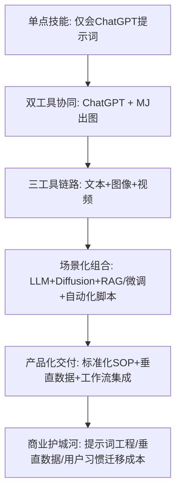

---

## 68.4 流量红利本质是「平台新功能」与「用户新认知」的时差套利

### 为什么需要这个概念？

很多创业者追逐流量红利却总是慢半拍：等教程出来再入场，红利早已被分食殆尽。素材揭示了红利窗口的核心变量——**平台侧的扶持期**与**用户侧的认知空白期**重叠。只有同时具备这两个条件，才能吃到最大红利。这要求你建立"雷达机制"：第一时间测试平台新功能，捕捉用户认知滞后的窗口期。

### 核心定义与推导

**时差套利**定义为：平台推出新功能（小风车、商品卡、切片工具、原创授权、虚拟课程）初期：流量扶持、竞争少、规则宽松；用户对新技术（AI绘画、数字人、ChatGPT）认知不全、好奇心强、支付意愿高。最先构建「功能+认知」打法的人吃到最大红利。

这个定理展示了三个关键性质：
1. **时间窗口性**：红利期通常为功能上线初期1-3个月
2. **双重条件**：需同时具备平台功能红利与用户认知红利
3. **可复制性**：每个平台新功能上线都会重演该规律

### 关键方法：平台新功能雷达与快速验证SOP

> **平台红利捕捉标准化动作**（来源：《风向标精选周刊》）

```
1. 建立平台新功能监控清单（抖音/视频号/小红书/快手/B站）
   - 关注官方公告/创作者中心/灰度测试群/头部博主内测反馈
2. 新功能上线T+0：第一时间申请内测/开通权限/搭建最小可行性测试
   - 构建MVP：单账号/单内容/单转化路径跑通闭环
   - 核心指标：曝光获取成本、引流转化率、私域沉淀率、变现ROI
3. T+1周：验证红利强度，决定资源投入规模
   - 红利强 = 矩阵号放大 + 付费流加码 + 团队标准化SOP复制
   - 红利弱 = 单账号维护 + 低成本测试新玩法
4. T+1月：红利消退信号监控，准备退出/转型预案
   - 信号：流量下滑>30%、转化成本翻倍、平台规则收紧、同质内容爆发
   - 动作：沉淀私域资产、迁移核心SOP至新平台/新功能、复盘方法论
```

这个流程展示了如何将"运气好赶上红利"转化为"系统性捕捉红利"的组织能力。

### 典型例子

**案例1：抖音小风车跳转企微**
上线初期，首批接入者无需引导用户复制微信号/加好友，一键跳转企微，转化率提升数倍，获客成本极低。素材记载："抖音小风车可以直接跳转企业微信了"。

**案例2：视频号助手切片功能**
长直播一键生成短视频分发，首批用切片分发直播内容者获公域流量暴涨，内容资产复用率极高。素材记载："在「视频号助手」后台，可以直接「选择直播片段]，生成短视频"。

**案例3：百度文心一言早期「智障图」认知套利**
利用文心一言生图质量差的认知偏差，制造吐槽/对比内容引流变现。素材记载："思路：谁能掌握让文心一言技术，将会获得很大的市场"。

### 方法演进图：时差套利捕捉流程

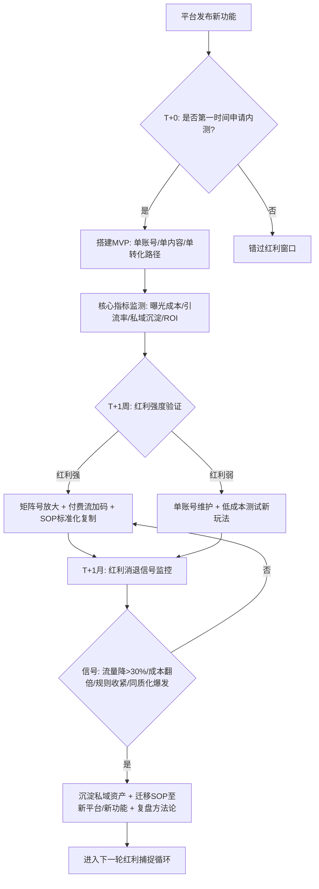

---

## 68.5 「丑/笨/假」即流量：技术缺陷在早期阶段可转化为内容优势

### 为什么需要这个概念？

创作者常陷入追求完美内容的误区，忽略早期技术缺陷的传播价值。完美内容在早期平台算法中缺乏冲突感，难以触发大规模传播。素材提出反直觉策略：重新定义早期AI生成内容的"瑕疵"为"特色"，利用反差感、喜感、猎奇感低成本获客。

### 核心定义与推导

**「丑/笨/假」即流量**定义为：早期AI生成内容（文心一言智障图、SD崩坏图、数字人僵硬动作）因不完美产生「反差感」「喜感」「猎奇感」，这些缺陷反而比完美内容更易引发传播、吐槽、互动，成为技术成熟前窗口期的低成本获客素材。

这个策略展示了三个关键性质：
1. **反直觉性**：主流审美认为丑/笨/假是劣势，实则为早期流量杠杆
2. **窗口期限**：仅在技术不成熟、大众认知未建立的早期有效
3. **低成本**：无需精细打磨，直接输出生成结果即可

### 关键方法：认知差内容制造三板斧

> **认知差反向引流内容SOP**（来源：《风向标精选周刊》）

```
1. 识别目标AI工具的主流认知偏差（如：文心一言生图崩坏/逻辑混乱/中文理解差）
2. 设计三类冲突感内容脚本：
   A. 吐槽型：直接展示生成失败案例，配文"这也太智障了/笑死我了"
   B. 对比型：同一Prompt对比GPT-4/MJ/其他工具生成结果，制造"碾压/反转"话题
   C. 整蛊型：让AI完成荒诞任务/生成违和场景，记录离谱过程
3. 发布节奏与私域钩子：
   - 首发抖音/小红书，配热门话题标签
   - 评论区/主页/置顶留私域钩子（"私信领避坑指南/更多崩坏图/对比表"）
   - 引流私域后转化：AI工具避坑课程/垂直应用教程/定制服务
4. 把控边界：
   - 不造谣/不恶意诋毁品牌方，基于真实生成结果吐槽
   - 适时转型：技术迭代后及时切换高质量内容赛道，避免人设固化
```

这个SOP展示了如何系统性利用认知差而非盲目蹭热点。

### 典型例子

**案例1：抖音吐槽百度文心「智障图」**
直接发布文心一言生成的崩坏图片/视频，配文吐槽，自带喜感引流互动。素材记载："抖音吐槽百度文心出的图，自带喜感可引流"、"逆向思维，利用百度文心一格的智障AI图引流互动"。

**案例2：小红书吐槽文心生产内容**
发布文心一言生成的低质内容截图吐槽，热度高、涨粉快。素材记载："小红书可以做吐槽文心生产的内容，热度高，涨粉快"。

**案例3：制造"GPT-3.5碾压文心一言"对比话题**
利用大众共识"GPT哪怕3.5都比文心一言强"，设计对比实验引发技术派/国货派大战互动。素材记载："逆向思维：大家的共识都是 GPT哪怕 3.5 都比文心一言强，可以制造更热的话题"。

### 方法演进图：认知差内容制造与转化流程

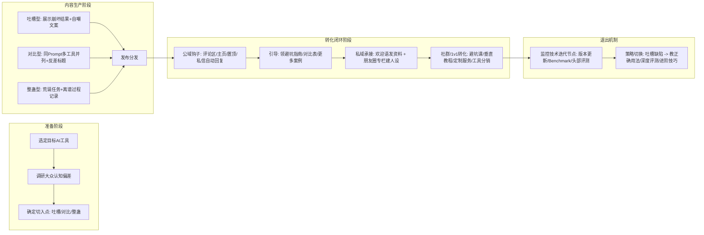

---

## 68.6 私域是所有公域玩法的终局归宿

### 为什么需要这个概念？

公域流量成本上涨、规则收紧、不可控，单纯公域变现模式不可持续。多数创作者在公域内卷，忽略私域沉淀导致流量资产流失。素材明确：所有公域玩法最终目的均为沉淀至微信生态，私域为变现后端与资产沉淀。

### 核心定义与推导

**私域终局归宿**定义为：无论小红书引流、抖音小风车、视频号切片、闲鱼低价引流、朋友圈投流，最终目的均为沉淀至微信个人号/社群/企业微信，通过高频触达、信任建立、复购转化（课程/服务/实物/会员）实现LTV最大化。公域仅为"引流前端"，私域为"变现后端"与"资产沉淀"。

这个定律展示了三个关键性质：
1. **必然性**：所有高客单价、长周期、非标服务业务必须依托私域完成信任构建与交付
2. **资产性**：私域用户为自有资产，不受平台算法波动影响
3. **复利性**：私域信任积累随时间复利，单次获客成本边际递减

### 关键方法：公私域分工标准化动作

> **公私域分工闭环设计**（来源：《风向标精选周刊》）

```
公域端（引流前端）：
- 内容分发：短视频/图文/直播切片 → 平台算法分发 → 精准人群触达
- 原生工具：小风车/商品卡/切片/原创授权/私信回复 → 降低跳转损耗
- 诱饵设计：虚拟资料/免费诊断/低价体验/社群入场券 → 激活搜索/推荐流量

私域端（变现后端）：
- 信任建立：欢迎语/朋友圈专栏/专业人设/案例库/客户见证 → 高频触达
- 分层转化：引流款(0-99元) → 信任款(199-999元) → 核心款(2999元+) → 续费/裂变
- 交付运营：标准化SOP/社群服务/1v1咨询/售后保障 → 复购与转介绍

关键连接点：
- 公域内容必须植入私域钩子（引导加微信/进群/领资料）
- 私域运营需严守合规底线（不诱导分享/不刷屏/不违规营销）
- 数据打通：公域投流数据/私域转化数据/全链路ROI归因统计
```

这个设计展示了如何将公私域从"两张皮"变为"一体化作战单元"。

### 典型例子

**案例1：小红书ChatGPT代问笔记引流私域**
发布代问笔记展示专业能力，引导私信/评论区领资料加微信，私域转化高客单定制服务。素材记载："小红书ChatGPT 代问笔记，可引流私域"。

**案例2：抖音小风车跳转企微直播间承接**
直播间挂小风车一键跳企微，承接高客单知识付费课程，转化路径极短。素材记载："抖音小风车可以直接跳转企业微信了"。

**案例3：闲鱼1元虚拟资料引流**
1元售卖车房产认证资料，精准筛选高净值人群加微信，后端转化代办/咨询/淘客返利。素材记载："闲鱼 1 元获得支付宝（车房产）六套认证资料"、"闲鱼做拼多多帮人拼团，可引流做淘客"。

### 方法演进图：公私域分工协同闭环

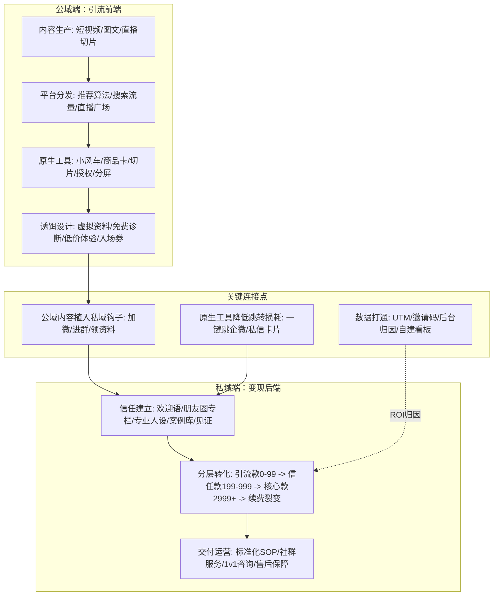

---

## 68.7 AIGC一条龙工作流

### 为什么需要这个概念？

传统内容生产流程割裂：文案、设计、视频、音频由不同工种协作，效率低、成本高、沟通损耗大。单人/小团队无法承担全链路专业人才成本。素材展示了端到端自动化内容生产流水线的可行性。

### 核心定义与推导

**AIGC一条龙工作流**定义为：将ChatGPT(文本/代码)、Midjourney/Stable Diffusion(图像)、视频生成工具、语音合成工具串联，实现从剧本创作、素材生成、视频剪辑到发布分发的全自动化或半自动化内容生产流水线。

这个工作流展示了三个关键性质：
1. **端到端**：覆盖内容生产全链路，无人工断点
2. **模块化**：各环节工具可替换、可升级（如MJ升级SD、ChatGPT升级GPT-4）
3. **标准化**：固定Prompt模板、参数设置、输出规范，保证批量产出稳定性

### 关键方法：端到端内容生产流水线搭建

> **AIGC一条龙工作流搭建SOP**（来源：《风向标精选周刊》）

```
1. 剧本/文案层（大脑）：ChatGPT / GPT-4
   - 输入：选题/关键词/大纲/风格要求
   - 输出：分镜脚本/视频文案/图片Prompt/标题/标签
   - 标准化：Prompt模板库（按内容类型分类：带货/科普/剧情/测评）

2. 素材生成层（手脚）：Midjourney / Stable Diffusion / ControlNet / LoRA
   - 输入：上层输出的图片Prompt + 参数设置
   - 输出：分镜对应图片/视频关键帧/角色一致性素材
   - 标准化：参数预设（步数/采样器/分辨率/风格权重/种子管理）

3. 视频合成层（躯干）：剪映/达芬奇/Runway/Pika/视频生成API
   - 输入：图片序列/文案/转场/特效/音乐要求
   - 输出：成品视频（竖版/横版/多规格适配）
   - 标准化：模板化剪辑（固定节奏/字幕样式/转场/调色预设）

4. 音频合成层（声音）：Azure TTS / ElevenLabs / 讯飞 / GPT-SoVITS
   - 输入：文案/情感标注/语速/音色选择
   - 输出：配音/旁白/角色语音
   - 标准化：音色库管理/语速参数/情感标记规范

5. 分发发布层（触角）：RPA / 影刀 / Automa / 平台API
   - 输入：成品视频/标题/标签/定时发布计划
   - 动作：多账号/多平台/定时/数据回收
   - 标准化：账号矩阵管理/发布日历/数据看板

6. 质检兜底节点（免疫系统）：
   - 关键节点1：剧本审核（逻辑/合规/品牌调性）
   - 关键节点2：成片抽检（画面/音画同步/水印/敏感词）
   - 关键节点3：发布确认（账号状态/链接有效/数据回传）
```

这个SOP展示了如何将内容生产从"手工作坊"升级为"工业化流水线"。

### 典型例子

**案例1：YouTube Shorts批量生产**
素材记载："AIGC 做 YouTube Shorts,一天可以生产半个月的视频量"，完整覆盖脚本→分镜→生图→合成→配音→发布全流程。

**案例2：三体角色图批量生产**
ChatGPT提炼角色特征 → Midjourney生成角色图 → 统一风格化后期。素材记载："用 ChatGPT 和 Midjourney 两个工具做了三体的角色图"。

**案例3：AI虚拟换装电商拍摄**
SD + ControlNet(姿态锁定) + LoRA(服饰细节) 组合，替代传统模特拍摄。素材记载："AI虚拟换装，可以用 Stable Diffusion，Controlnet ，Lora 来实现"、"Stable Diffusion，摄影馆用以前拍的图训练一个模型"。

### 方法演进图：AIGC一条龙工作流六层架构

```mermaid
graph TB
    subgraph L1[第1层：剧本/文案层 大脑]
        L1A[输入: 选题/关键词/大纲/风格]
        L1B[工具: ChatGPT / GPT-4 / Claude]
        L1C[输出: 分镜脚本/视频文案/图片Prompt/标题/标签]
        L1D[标准化: Prompt模板库(带货/科普/剧情/测评)]
    end
    
    subgraph L2[第2层：素材生成层 手脚]
        L2A[输入: 图片Prompt + 参数设置]
        L2B[工具: MJ / SD / ControlNet / LoRA]
        L2C[输出: 分镜图片/关键帧/角色一致性素材]
        L2D[标准化: 参数预设(步数/采样器/分辨率/风格权重/种子)]
    end
    
    subgraph L3[第3层：视频合成层 躯干]
        L3A[输入: 图片序列/文案/转场/特效/音乐]
        L3B[工具: 剪映/达芬奇/Runway/Pika/视频API]
        L3C[输出: 成品视频(竖版/横版/多规格)]
        L3D[标准化: 模板化剪辑(节奏/字幕/转场/调色预设)]
    end
    
    subgraph L4[第4层：音频合成层 声音]
        L4A[输入: 文案/情感标注/语速/音色]
        L4B[工具: Azure TTS / ElevenLabs / 讯飞 / GPT-SoVITS]
        L4C[输出: 配音/旁白/角色语音]
        L4D[标准化: 音色库/语速参数/情感标记规范]
    end
    
    subgraph L5[第5层：分发发布层 触角]
        L5A[输入: 成品视频/标题/标签/发布计划]
        L5B[工具: RPA/影刀/Automa/平台API]
        L5C[动作: 多号/多平台/定时/数据回收]
        L5D[标准化: 矩阵管理/发布日历/数据看板]
    end
    
    subgraph L6[第6层：质检兜底节点 免疫系统]
        L6A[节点1: 剧本审核(逻辑/合规/品牌调性)]
        L6B[节点2: 成片抽检(画面/音画同步/水印/敏感词)]
        L6C[节点3: 发布确认(账号状态/链接有效/数据回传)]
    end
    
    L1C --> L2A
    L2C --> L3A
    L3C --> L4A
    L4C --> L5A
    L1C -.-> L6A
    L3C -.-> L6B
    L5C -.-> L6C
```

---

## 68.8 认知差反向引流

### 为什么需要这个概念？

常规优质内容在饱和赛道中获客成本高、传播效率低。大众对新技术存在固有认知偏差，制造冲突感内容可低成本破圈。需要系统化方法利用认知差而非盲目蹭热点。

### 核心定义与推导

**认知差反向引流**定义为：利用大众对新事物（如文心一言、AI绘画）的刻板印象或认知偏差（如"生成图像质量差/智障"），制造冲突感内容（吐槽、对比、整蛊），获取高互动流量，再导入私域变现。

这个策略展示了三个关键性质：
1. **逆向思维**：主流赞美/推荐内容同质化严重，吐槽/反差内容稀缺性高
2. **低门槛**：无需专业内容制作能力，直接输出/记录AI生成缺陷即可
3. **高传播**：冲突感/喜感/猎奇感天然符合社交传播心理机制

### 关键方法：认知差内容制造与转化闭环

> **认知差反向引流实操SOP**（来源：《风向标精选周刊》）

```
1. 选定目标：处于早期阶段的AI工具/新技术（文心一言/Sora/音乐生成/3D生成/代码生成）
2. 调研认知偏差：大众主流刻板印象是什么？（如：生成视频物理规律错误/音乐无旋律感/代码有Bug）
3. 产出三类内容：
   - 吐槽型："实测XX生成的图，这物理规律也是没谁了" + 崩坏图合集
   - 对比型："同一个Prompt，GPT-4 vs 文心一言 vs MJ，结果笑死" + 并列对比图
   - 整蛊型："让XX帮我写情书/写代码/画画，结果它整了个大活" + 过程记录
4. 转化设计：
   - 公域钩子：评论区/主页/置顶/私信自动回复 → "领避坑指南/对比表/更多案例"
   - 私域承接：欢迎语发资料 → 朋友圈专栏建专业人设 → 社群/1v1转化垂直服务
   - 变现产品：AI工具避坑课/垂直应用教程/定制生成服务/工具分销佣金
5. 退出机制：
   - 技术迭代节点监控：官方版本更新/重大Benchmark发布/头部KOL评测
   - 内容策略切换：从"吐槽缺陷"转向"教正确用法/深度评测/进阶技巧"
```

这个SOP展示了认知差红利的完整生命周期管理。

### 典型例子

**案例1：抖音吐槽文心一言「智障图」**
直接发布崩坏生成结果吐槽，自带喜感引流。素材记载："抖音吐槽百度文心出的图，自带喜感可引流"、"逆向思维，利用百度文心一格的智障AI图引流互动"。

**案例2：小红书吐槽文心生产内容**
发布低质生成内容截图吐槽，热度高、涨粉快。素材记载："小红书可以做吐槽文心生产的内容，热度高，涨粉快"。

**案例3：制造GPT-3.5碾压文心一言对比话题**
利用大众共识制造对比实验引发大战互动。素材记载："逆向思维：大家的共识都是 GPT哪怕 3.5 都比文心一言强，可以制造更热的话题"。

### 方法演进图：认知差内容制造与转化闭环

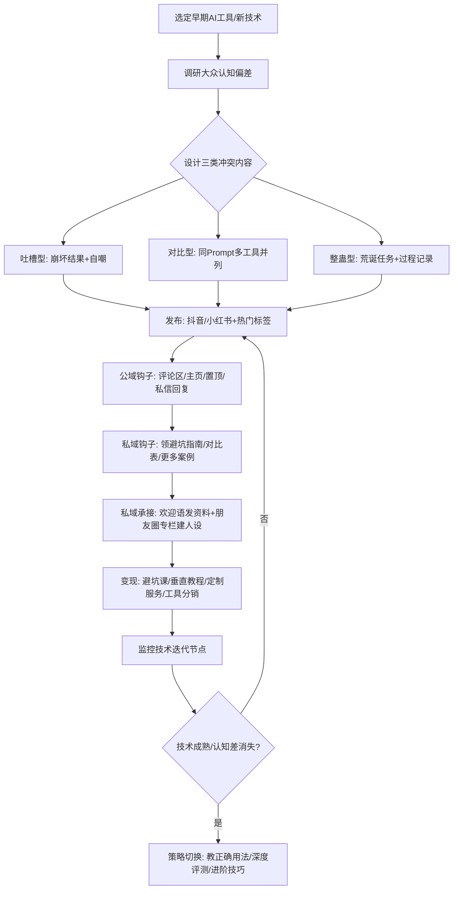

---

## 68.9 平台原生工具闭环

### 为什么需要这个概念？

第三方外链工具（链接跳转、二维码引流）面临平台严打、封号、限流风险。平台官方工具具备合规性、流量扶持、数据打通、用户体验优势。需要建立第一时间测试、接入、迭代官方工具的标准化动作。

### 核心定义与推导

**平台原生工具闭环**定义为：利用平台新上线的官方功能（小风车跳企微、视频号助手切片、原创授权、商品卡、直播分屏）构建"公域获客-私域转化-交易闭环"的标准化动作，降低外链封杀风险。

这个策略展示了三个关键性质：
1. **合规性**：官方原生功能天然合规，无封号风险
2. **效率性**：平台内部数据打通，用户路径最短（如小风车一键跳企微无需复制粘贴）
3. **扶持性**：新功能上线初期平台给予流量倾斜与功能曝光位

### 关键方法：官方工具首发测试与标准化接入

> **平台原生工具接入SOP**（来源：《风向标精选周刊》）

```
1. 持续监控：官方公告/创作者中心/开发者文档/灰度测试群/头部博主内测反馈
2. T+0接入：功能上线首日申请权限/开通/配置最小可行性测试
   - 小风车：企微认证配置 → 直播间/主页/视频挂载 → 欢迎语/自动回复设置
   - 切片工具：长直播选段 → 一键生成短视频 → 标题/标签/发布时间优化
   - 原创授权：矩阵号授权配置 → 内容分发/收益分成规则设定
   - 商品卡：小店商品同步 → 直播间/视频挂载 → 佣金/结算周期确认
   - 分屏直播：直播间布局配置 → 商品/视频同屏展示 → 话术引导点击
3. 效果归因：UTM参数/专属邀请码/平台后台数据/自建后台埋点 → 全链路ROI核算
4. 标准化复制：将跑通配置沉淀为SOP → 矩阵号批量部署 → 团队分工执行
5. 版本迭代跟踪：功能更新/规则调整/新增能力 → 第一时间测试 → SOP更新
```

这个SOP展示了如何将官方工具从"可选项"变为"标配战术动作"。

### 典型例子

**案例1：抖音小风车跳转企微**
替代主页挂链接/私信发链接，转化率提升数倍。素材记载："抖音小风车可以直接跳转企业微信了"。

**案例2：视频号助手切片**
长直播一键生成短视频分发，内容资产复用率极高。素材记载："在「视频号助手」后台，可以直接「选择直播片段]，生成短视频"。

**案例3：抖音原创授权/商品卡/直播分屏**
品牌矩阵号内容分发与带货转化标准化工具。素材记载："抖音矩阵号，上线原创作者视频授权能力"、"抖音直播视频和商品展示分屏展示，边去重边吸引用户下单"、"抖音千川官方推出了商品卡的详细使用攻略"。

### 方法演进图：平台原生工具接入标准化流程

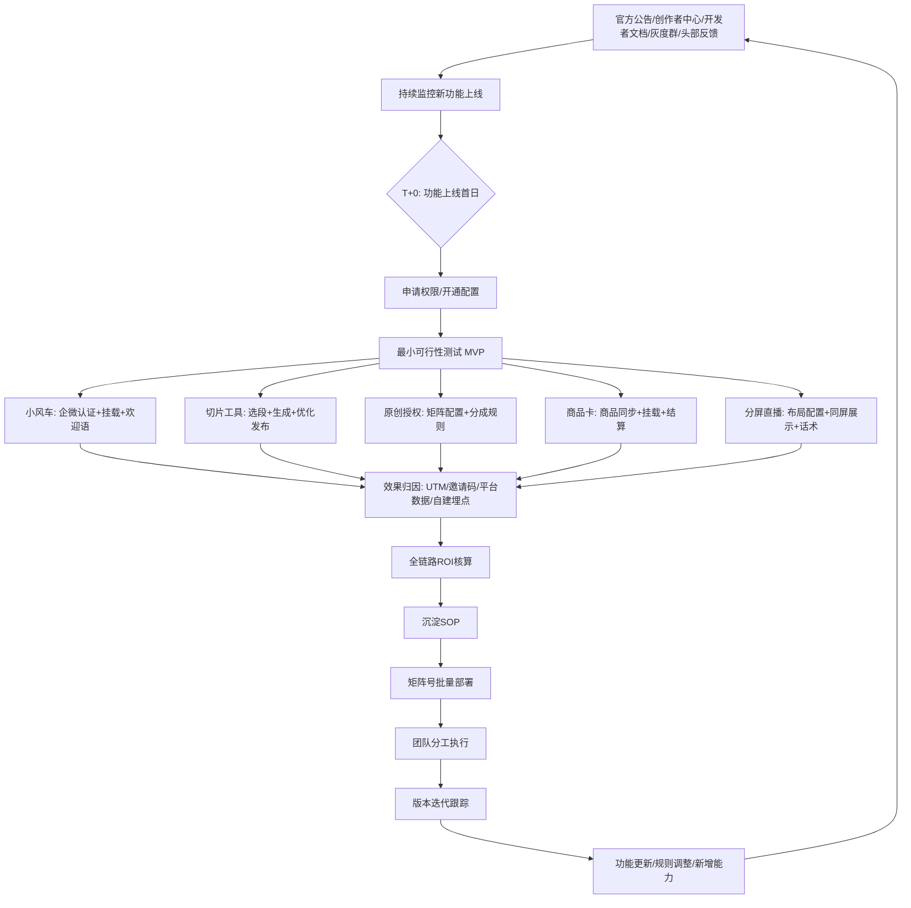

---

## 68.10 虚拟资源矩阵变现

### 为什么需要这个概念？

实物电商面临库存、物流、售后、退货率高等重资产痛点。知识付费单品交付依赖人工，难以标准化规模化。需要零边际成本、可无限复售、交付自动化的数字化产品矩阵。

### 核心定义与推导

**虚拟资源矩阵变现**定义为：将壁纸、笔刷、模板、课程、认证资料、提示词等零边际成本数字化产品，通过矩阵号分发（小红书/抖音/闲鱼/B站/视频号），引流至私域或平台交易组件完成高利润复售。

这个模型展示了三个关键性质：
1. **零边际成本**：一次制作无限售卖，利润率接近100%
2. **标品化**：产品标准化程度高，非标定制服务可拆解为标品+增值服务
3. **矩阵化**：多账号、多平台同步分发，单品流量不足用量级弥补

### 关键方法：虚拟产品矩阵化生产与分发SOP

> **虚拟资源矩阵变现SOP**（来源：《风向标精选周刊》）

```
1. 选品逻辑（高需求+低竞争+易标品化）：
   - 设计素材类：Procreate笔刷/PS动作/LUT预设/字体/模板
   - 知识资料类：认证资料/简历模板/考证资料/行业报告/提示词库
   - 生活工具类：壁纸/日历/记账表/计划表/习惯追踪器
   - AI生成类：AI壁纸/AI头像/AI提示词/AI生成模板

2. 生产标准化：
   - AI批量生成：Midjourney/SD/ChatGPT按模版Prompt量产
   - 规范整理：命名/分类/打包/加密/水印/版本管理
   - 交付自动化：网盘链接/小程序码/发卡平台/平台虚拟商品后台

3. 矩阵分发策略：
   - 小红书：图文笔记+爆款标题模版+商品链接/主页挂载
   - 抖音：短视频展示+小风车/商品卡/直播带货
   - 闲鱼：1元/低价引流+私信发网盘链接加微信
   - B站：工房集市/虚拟课程商品/视频简介引流
   - 视频号：直播切片/橱窗/私域引流

4. 后端转化设计：
   - 前端低价/免费虚拟资源 → 引流私域
   - 中端标品化课程/模板/工具（99-999元）
   - 高端定制服务/咨询/陪伴/社群（2999元+）
   - 复购/裂变：会员制/分销佣金/续费/转介绍奖励
```

这个SOP展示了如何将虚拟资源从"单品卖货"升级为"矩阵化产品线"。

### 典型例子

**案例1：小红书手机壁纸/Procreate笔刷**
按类别打包出售，单价9.9-29.9元，月销千单。设计师群体高频刚需。素材记载："小红书手机壁纸整合一下类别，可以打包出售"、"小红书画画 Procreate 笔刷销量挺高的"。

**案例2：闲鱼1元车房产认证资料**
1元成交建立信任连接，精准筛选有资产/有贷款/有办证需求的高净值人群。素材记载："闲鱼 1 元获得支付宝（车房产）六套认证资料"。

**案例3：B站虚拟课程商品/工房集市**
平台原生交易闭环，个人提升/亲子/情感类内容销量遥遥领先。素材记载："B 站开通虚拟课程商品功能"、"B 站开通了工房集市"、"小红书专栏的销量,个人提升、亲子、情感类的内容遥遥领先"。

### 方法演进图：虚拟资源矩阵变现全链路

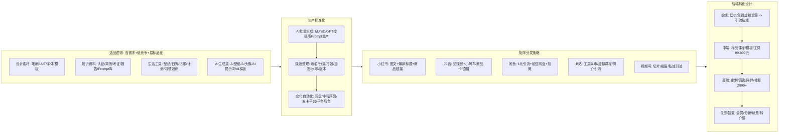

---

## 68.11 AI数字人直播

### 为什么需要这个概念？

真人直播面临主播稀缺、人力成本高、无法7x24小时在线、状态不稳定痛点。传统无人直播（录播循环）易被平台判定违规限流。需要低成本、可长时长、合规的直播替代方案。

### 核心定义与推导

**AI数字人直播**定义为：利用AI生成的虚拟形象（HeyGen、SadTalker、自研模型）替代真人进行7x24小时无人直播或辅助直播，应用于带货、答题、互动、咨询等场景，降低人力成本解决主播稀缺。

这个模式展示了三个关键性质：
1. **低成本**：单次直播成本仅为真人主播的1/10甚至更低
2. **可控性**：话术、形象、时长、排期完全可控，无情绪波动
3. **合规性**：部分配合真人值班/实时互动可规避平台"录播循环"判定

### 关键方法：数字人直播部署与运营SOP

> **AI数字人直播部署SOP**（来源：《风向标精选周刊》）

```
1. 形象生成与训练：
   - 方案A：HeyGen/D-ID等SaaS平台 → 上传实拍视频/照片 → 训练数字人形象/声音
   - 方案B：SadTalker/自研开源模型 → 本地部署/云端GPU → 训练专属形象（需算力/技术能力）
   - 方案C：AI虚拟换装（SD+ControlNet+LoRA） → 生成换装素材 → 合成数字人视频

2. 直播间搭建：
   - 场景：绿幕/虚拟背景/实景拍摄/3D虚拟场景
   - 推流：OBS/直播伴侣/自研推流端 → 推流至抖音/视频号/快手/小红书
   - 互动：关键词触发预设话术/动作/表情 → 接入LLM实时问答（进阶）

3. 合规与运营策略：
   - 纯数字人无人值守：适合低客单/标品/娱乐类（答案之书/车牌估值/认领鸡别墅）
   - 数字人+真人值班：白天真人/夜间数字人，或关键时段真人接管
   - 真人+数字人混播：真人讲解/互动 + 数字人展示/演示/轮播

4. 变现路径设计：
   - 直播间直接带货（商品卡/小黄车/小风车）
   - 引流私域高客单转化（咨询/课程/定制服务）
   - 直播打赏/礼物/会员订阅
   - 账号矩阵放大：多形象/多场景/多时段轮播
```

这个SOP展示了如何根据业务阶段与合规要求选择数字人直播形态。

### 典型例子

**案例1：抖音答案之书直播**
3个棒棒糖翻页互动，数字人7x24小时无人值守。素材记载："抖音答案之书直播，3 个棒棒糖翻页"、"抖音数字人 AI 直播开始，流量还不错"。

**案例2：抖音车牌估值/认领鸡别墅**
数字人互动引流私域转化高客单。素材记载："抖音直播认领鸡别墅，转私域能力很强"。

**案例3：视频号语音直播婚姻+人性课程**
不露脸、场景简单，配合切片分发售99元课程7000+份。素材记载："视频号语音直播婚姻 + 人性，99 块售 7000+ 份课程"、"用 AI 工具生成奶奶的虚拟数字人"。

### 方法演进图：AI数字人直播部署决策树

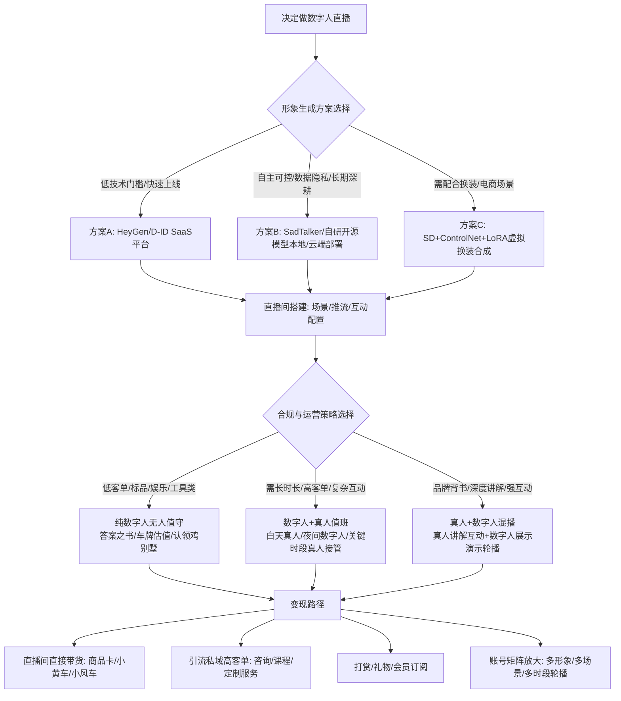

---

## 68.12 AI套壳/Prompt工程变现

### 为什么需要这个概念？

大模型能力强但通用性强、垂直场景落地弱，用户不会用/不想学提示词。开发原生AI应用门槛高、周期长、成本大。需要低门槛、快速交付、可规模化复制的中间层商业模式。

### 核心定义与推导

**AI套壳/Prompt工程变现**定义为：基于大模型API（GPT-3.5/4、Claude）封装垂直场景应用（Chrome插件、微信小程序、网站、Cursor编辑器），或贩卖高质量Prompt/指令集，通过信息差和集成优势快速变现。

这个模式展示了三个关键性质：
1. **轻量级**：无需训练模型，仅做应用层封装与Prompt工程
2. **垂直化**：针对特定场景（亚马逊选品、公众号写作、代码生成、简历优化）深度适配
3. **信息差变现**：用户为"不用学提示词/不用魔法上网/不用注册账号"付费

### 关键方法：垂直场景封装与Prompt产品化

> **AI套壳/Prompt变现SOP**（来源：《风向标精选周刊》）

```
1. 场景挖掘与验证：
   - 高频刚需+非技术用户+付费意愿强：亚马逊Listing/公众号写作/简历优化/代码生成/学术润色/跨境电商
   - 验证方式：小红书/知乎/抖音搜索相关关键词 → 看竞品/用户讨论/付费案例

2. 产品形态选择：
   A. Prompt指令集/提示词库：Notion/飞书文档/PDF/小报童专栏 → 零开发成本
   B. Chrome插件/浏览器扩展：前端注入+后端API代理 → 低开发成本
   C. 微信小程序/网站：前端+后端API+用户系统/支付 → 中等开发成本
   D. 编辑器/IDE插件：Cursor/VS Code插件 → 开发者工具赛道

3. 核心护城河建设（而非Prompt本身）：
   - 垂直数据：行业知识库/案例库/合规语料/专有数据集
   - 工作流集成：多工具串联/自动化流程/批量处理/结果校验
   - 用户习惯迁移成本：账号体系/历史数据/个性化配置/社群归属感

4. 变现模式设计：
   - 订阅制：月费/年费（持续更新Prompt/功能迭代）
   - 买断制：一次性付费（Prompt包/模板库/课程）
   - 分销制：邀请返佣/多级分销（社群/达人/联盟）
   - API计费：按调用量/Token计费（开发者/B端）

5. 合规与风控：
   - API Key安全管理/成本控制/限流熔断
   - 内容安全审核/敏感词过滤/用户隐私保护
   - 官方功能迭代监控（GPTs/插件商店/联网搜索） → 差异化定位/快速迁移
```

这个SOP展示了如何从"卖Prompt"进化为"卖垂直解决方案"。

### 典型例子

**案例1：Shulex - 亚马逊卖家Chrome插件**
集成ChatGPT做Listing优化/竞品分析/审核分析。素材记载："ChatGPT 针对亚马逊卖家开发出一个谷歌插件 Shulex"。

**案例2：ChatGPT Shortcut - 提示词指令表**
分类整理专业Prompt，帮助用户快速调用。素材记载："ChatGPT 快捷指令表 ChatGPT Shortcut"。

**案例3：Cursor编辑器 - 内置GPT-4的代码编辑器**
支持自动写代码/智能问答/代码解释。素材记载："免费试用ChatGPT，Cursor编辑器：内置GPT-4，支持自动写代码、智能问答。"。

**案例4：SteamShip - GPT-4免费接口调用平台**
开发者平台模式。素材记载："注册SteamShip账号，GPT-4 接口免费用"。

### 方法演进图：AI套壳产品形态选择矩阵

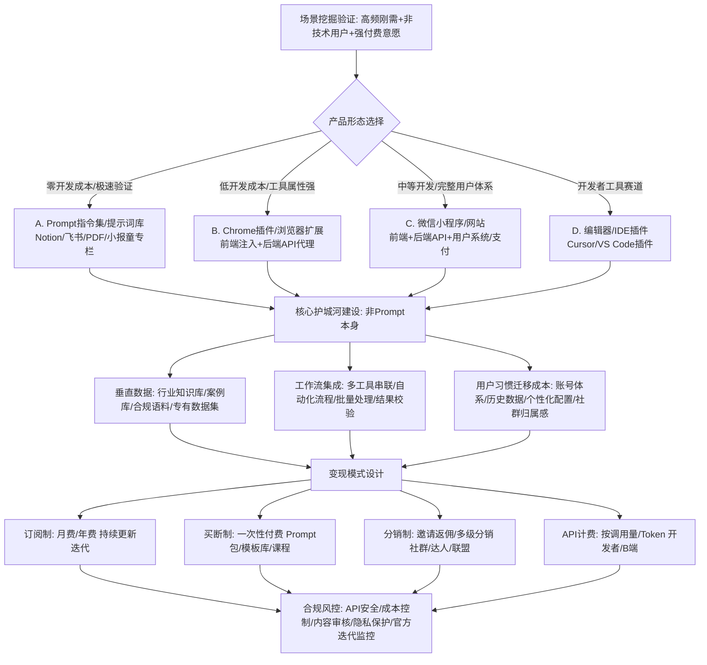

---

## 68.13 小红书「零粉图文/资料」冷启动法

### 为什么需要这个概念？

传统内容电商依赖人设IP建立，冷启动周期长、不确定性高。普通人缺乏内容创作能力/人设打造能力/长期坚持意愿。需要一套去人设化、标品化、可直接变现的冷启动SOP。

### 核心定义与推导

**小红书零粉冷启动法**定义为：不依赖人设IP，利用高需求标品化虚拟资源（壁纸/模板/笔刷/认证资料/简历/任务卡）配合爆款标题/首图模版，直接挂载商品链接或引流私域，实现0粉丝开卖。

这个方法展示了三个关键性质：
1. **去IP化**：核心资产是标品化虚拟资源而非个人IP，可批量复制账号
2. **低门槛**：仅需会基本图文编辑/素材整理，无需专业拍摄/剪辑/出镜
3. **确定性**：选品逻辑标准化（高需求+低竞争），内容模版标准化，结果可预期

### 关键方法：零粉冷启动标准化SOP

> **小红书零粉冷启动SOP**（来源：《风向标精选周刊》）

```
1. 选品标准（三维筛选）：
   - 需求验证：小红书搜索关键词 → 看笔记量/互动量/商品销量/竞品定价
   - 竞争判断：同类笔记<5000篇、头部笔记赞<1万、商品链接<50个
   - 标品化程度：可打包/可模版化/可AI批量生成/交付自动化

2. 账号基建（极简版）：
   - 账号名：关键词+资源属性（如：壁纸分享君/认证资料库/简历模版库）
   - 简介：一句话价值主张+引导语（"整理了XXX资料，主页/置顶领取"）
   - 主页布局：置顶笔记=目录/合集/领取指南 + 分类合集标签

3. 内容生产模版化（批量化核心）：
   - 120个爆款标题关键词库：[痛点/人群] + [资源名称] + [利益点] + [稀缺/限时]
   - 首图模版：统一风格/尺寸/字体/配色/水印/行动引导（"长按保存/点击领取"）
   - 正文结构：资源展示(3-9图) + 使用教程/避坑指南 + 引导语 + 标签矩阵
   - AI批量生成：ChatGPT写文案 + MJ/SD生成配图 + 美图秀秀/醒图批量套模版

4. 发布与运营节奏：
   - 新号前7天：日更3-5条，蹭热门标签/话题，建立账号标签
   - 稳定期：日更1-2条，固定时间段，数据复盘优化选题
   - 矩阵放大：单人5-10号/团队50-100号，错峰发布，交叉引流

5. 变现闭环：
   - 平台交易：开通小店/专栏 → 挂载虚拟商品链接 → 自动发货
   - 私域引流：置顶/私信/评论区引导加微信 → 朋友圈/社群转化高客单
   - 分销裂变：设置分销佣金 → 引导买家分享赚佣金 → 病毒式扩散
```

这个SOP展示了如何将"做账号"转化为"跑流水线"。

### 典型例子

**案例1：小红书手机壁纸/Procreate笔刷/认证资料**
直接挂载商品链接售卖，单价9.9-29.9元。素材记载："小红书手机壁纸整合一下类别，可以打包出售"、"小红书画画 Procreate 笔刷销量挺高的"、"小红书资料引流笔记"。

**案例2：120个爆款笔记标题关键词库**
标题模版化，替换关键词即可批量生产。素材记载："小红书 0 粉图文带货最新的 120个爆款笔记标题关键词"。

**案例3：AI绘画自动生成简历等资料引流**
工具生成内容+标准化排版→发布引流。素材记载："小红书通过 AI 绘画自动生成简历等资料，可引流"。

### 方法演进图：小红书零粉冷启动节奏与矩阵放大

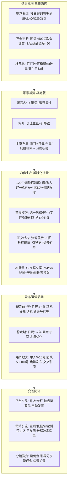

---

## 68.14 抖音直播「低门槛/无人/服务型」变现模型

### 为什么需要这个概念？

传统带货直播依赖专业主播、成熟供应链、高投流预算，门槛极高。中小商家/个人创业者无法承担真人直播的固定成本与试错风险。需要绕过核心门槛的替代性直播形态与变现路径。

### 核心定义与推导

**抖音低门槛直播模型**定义为：绕过专业主播/供应链门槛：数字人无人直播（答案之书/车牌估值/认领鸡别墅）、服务型直播（避坑选设备/调试设备/教做家务）、低客单品直播（气球/鲜花/雨衣/玩偶服），配合小风车/分屏/商品卡工具转化，实现低成本直播变现闭环。

这个模型展示了三个关键性质：
1. **产品非标/服务化**：规避标品比价竞争，售卖"服务/体验/情绪价值"
2. **低客单高转化**：客单价10-100元，决策链路短，冲动消费占比高
3. **工具依赖**：依赖平台原生转化工具（小风车跳企微/分屏展示商品/商品卡）

### 关键方法：低门槛直播形态选择与运营矩阵

> **抖音低门槛直播运营矩阵**（来源：《风向标精选周刊》）

```
直播形态选择决策树：
├── 无供应链/无主播/低预算
│   ├── 数字人无人直播
│   │   ├── 答案之书/塔罗/测算类（情绪价值+高互动+引流私域）
│   │   ├── 车牌估值/号码估值/认领鸡别墅（工具属性+精准引流）
│   │   └── 知识问答/百科类（长尾流量+广告/分销变现）
│   └── 服务型直播（真人出镜但无货）
│       ├── 避坑指导：选设备/调直播间/避雷装修/选课/选品
│       ├── 教学演示：家务技能/软件操作/手工制作/运动教学
│       └── 咨询诊断：简历诊断/店铺诊断/账号诊断/健康咨询
└── 有供应链/有货源/低客单
    ├── 批发市场直播：鲜花/气球/雨衣/玩具/日用百货（高频+低客单+冲动消费）
    ├── 玩偶服/本地团购：实体店引流/同城配送/团购核销
    └── 低价清仓/福利款：引流款+关联推荐利润款

工具标配（所有形态必挂）：
- 小风车：跳转企微/私信 → 私域沉淀
- 分屏/商品卡：直播间商品展示 → 直接下单
- 直播间福袋/红包/抽奖：提升在线时长/互动率/人气权重
```

这个矩阵展示了如何根据资源禀赋选择最适合的直播形态。

### 典型例子

**案例1：答案之书直播**
3个棒棒糖翻页互动，数字人无人值守，引流私域售卖定制服务。素材记载："抖音答案之书直播，3 个棒棒糖翻页"、"抖音数字人 AI 直播开始，流量还不错"。

**案例2：避坑选设备/调试直播间服务型直播**
按次/按时长收费，无库存压力。素材记载："抖音直播卖服务：帮避坑买设备和调直播间设备"。

**案例3：批发市场卖鲜花/气球/雨衣/玩偶服**
低客单高频次，玩偶服做本地团购。素材记载："抖音卖气球直播带货门槛很低"、"抖音批发市场直播卖鲜花热人气超高！"、"抖音穿玩偶服饰，做本地团购"。

### 方法演进图：抖音低门槛直播形态决策树

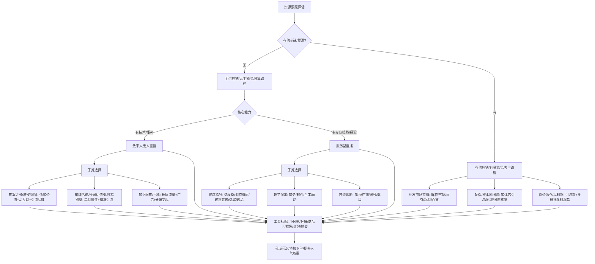

---

## 68.15 视频号「直播切片+高客单知识付费」模型

### 为什么需要这个概念？

长直播内容资产利用率低，直播结束即沉底，缺乏复用机制。高客单非标服务（咨询/诊断）信任建立难、交付依赖人、难规模化。需要将长内容碎片化获客、将非标服务标品化交付的双重转化模型。

### 核心定义与推导

**视频号切片+知识付费模型**定义为：利用视频号助手将长直播一键切片为短视频分发获取公域流量，直播间承接高客单价（如99元卖7000份）婚姻/情感/人性类课程，实现内容资产复用与高利润转化：单次咨询几百元 → 课程99元无限售。

这个模型展示了三个关键性质：
1. **内容资产化**：直播内容→切片短视频→公域分发→引流回直播间，形成飞轮
2. **服务标品化**：将非标咨询打包为标准化课程（录播/直播课），边际成本趋零
3. **算法信任背书**：视频号依托微信社交关系链，信任传递效率远高于抖音/快手

### 关键方法：直播切片内容资产化与课程标品化SOP

> **视频号切片变现SOP**（来源：《风向标精选周刊》）

```
1. 直播内容设计（可切片化设计）：
   - 单一主题/垂直领域：婚姻/情感/人性/职业/技能/认知/亲子
   - 结构化输出：开场钩子(30s) → 核心干货(3-5个知识点) → 案例拆解 → 课程锚点 → 引导转化
   - 语音直播优先：不露脸/场景简单/专注内容/降低制作门槛

2. 切片生产流水线：
   - 视频号助手：长直播 → 选取高互动/高完播/高转化片段 → 一键生成短视频
   - 批量优化：标题重写/封面制作/标签添加/定时发布/多账号分发
   - 切片分类：干货金句/案例故事/方法论/工具演示/答疑互动

3. 分发与引流闭环：
   - 公域分发：视频号/抖音/快手/小红书/B站 多平台同步
   - 引流钩子：视频简介/评论区/私信/主页 → "领完整版/进学习群/听完整直播"
   - 私域承接：企微/个人微信/社群 → 欢迎语发课程大纲/试听/案例

4. 课程标品化交付：
   - 产品结构：引流款(9.9-99元试听/资料包) → 核心款(299-999元系统课) → 陪伴款(2999元+训练营/1v1)
   - 交付标准化：录播课/直播回放/配套资料/作业打卡/社群答疑/阶段测评
   - 无限复售：一次录制/持续售卖/边际成本趋零/迭代更新

5. 数据归因与优化：
   - 切片数据：播放/完播/互动/引流率 → 优化选段/标题/封面
   - 直播数据：在线/互动/点击小风车/成交/客单价 → 优化话术/排品/转化路径
   - 私域数据：加微率/转化率/复购率/LTV → 优化分层/话术/产品矩阵
```

这个SOP展示了如何将"一次直播"变为"持续产出内容资产的流水线"。

### 典型例子

**案例1：视频号语音直播婚姻+人性课程**
99块售7000+份课程，语音直播门槛极低（不露脸/场景简单），配合切片分发。素材记载："视频号语音直播婚姻 + 人性，99 块售 7000+ 份课程"、"在「视频号助手」后台，可以直接「选择直播片段]，生成短视频"。

**案例2：视频号ChatGPT现场演示**
直播演示AI工具用法引流转化课程。素材记载："视频号做ChatGPT现场演示，引流转化课程"。

### 方法演进图：视频号切片飞轮模型

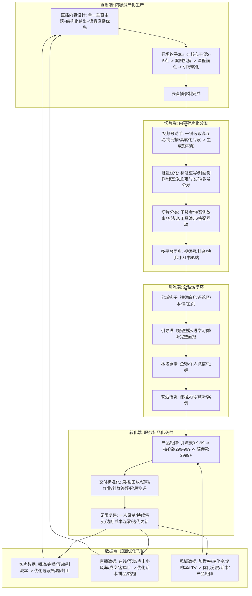

---

## 68.16 闲鱼「1元低价虚拟资料」引流私域极低成本精准

### 为什么需要这个概念？

公域付费广告成本高、转化率低、规则复杂，中小创业者难承担。传统引流需制作高质量内容/投放广告，门槛高、见效慢。需要利用平台搜索流量精准意图，以极低成本获取高信任种子用户。

### 核心定义与推导

**闲鱼1元引流法**定义为：闲鱼用户天然带"捡漏/刚需/搜索意图"，虚拟资料零成本复制，1元成交建立信任连接（加微信），后端转化高客单服务（代办/咨询/淘客返利），ROI远超付费广告且规避平台外链严打。

这个模型展示了三个关键性质：
1. **信任前置**：1元交易完成支付动作，建立"付费用户"心理标签，信任成本极低
2. **精准意图**：搜索关键词用户意图极强（如"车房产认证资料"），转化率远高于推荐流
3. **零边际成本**：虚拟资料无限复售，引流成本趋近于零

### 关键方法：闲鱼低价引流私域转化SOP

> **闲鱼1元引流SOP**（来源：《风向标精选周刊》）

```
1. 选品逻辑（高搜索意图+高客单后端+零成本复制）：
   - 认证资料类：车房产/营业执照/资质证书/学历认证/海牙认证
   - 办事指南类：落户/签证/贷款/维权/报税/社保公积金提取
   - 避坑/攻略类：装修避坑/买房避坑/留学避坑/就医攻略/旅游攻略
   - 模版/工具类：合同模版/简历模版/方案模版/计算器/查询工具

2. 发布优化（搜索流量最大化）：
   - 标题：核心关键词+长尾词+利益点+价格锚点（"1元/9.9元/免费领"）
   - 图片：实物截图/目录展示/客户反馈/权威背书/引导加微信水印
   - 描述：资料清单/适用人群/获取方式/售后承诺/引导私信/加微信
   - 标签/分类：精准选类目/添加高搜索量标签

3. 转化路径设计（规避平台风控）：
   - 自动回复："资料已发网盘/发微信，加V获取最新版/定制服务"
   - 私信话术：确认需求 → 发网盘链接 → 引导加微信（备注：闲鱼+关键词）
   - 朋友圈/社群：专业人设/案例见证/高客单产品/转化话术库

4. 后端产品矩阵（高LTV设计）：
   - 代办服务：认证代办/签证代办/落户代办/贷款协助（单价500-5000元）
   - 咨询服务：方案定制/避坑指导/资源对接/专家对接（单价299-2999元）
   - 淘客/返利：拼团/购物返利/优惠券/长尾佣金（复购高/决策链短）
   - 社群/会员：同城/行业/兴趣社群（会员费/年费/续费/裂变）

5. 账号矩阵与风控：
   - 养号：真实设备/真实网络/真实行为/完善资料/信用分维护
   - 矩阵：单人5-10号/团队50-100号，错峰发布/错峰回复/分散风险
   - 备用：账号被封/限流 → 立即换号/换IP/换设备/换资料继续跑
```

这个SOP展示了如何将闲鱼从"卖闲置"变为"精准获客引擎"。

### 典型例子

**案例1：闲鱼1元车房产六套认证资料**
精准筛选有资产/有贷款/有办证需求的高净值人群。素材记载："闲鱼 1 元获得支付宝（车房产）六套认证资料"。

**案例2：闲鱼拼多多帮拼团引流做淘客**
引流加微信做淘客返利/代办业务。素材记载："闲鱼做拼多多帮人拼团，可引流做淘客"。

### 方法演进图：闲鱼低价引流转化漏斗

```mermaid
flowchart TB
    subgraph 选品[选品逻辑: 高搜索意图+高客单后端+零成本复制]
        P1[认证资料: 车房产/执照/资质/学历/海牙]
        P2[办事指南: 落户/签证/贷款/维权/报税/公积金]
        P3[避坑攻略: 装修/买房/留学/就医/旅游]
        P4[模版工具: 合同/简历/方案/计算器/查询]
    end
    
    subgraph 发布[发布优化: 搜索流量最大化]
        F1[标题: 核心词+长尾词+利益点+价格锚点]
        F2[图片: 截图/目录/反馈/背书/加微水印]
        F3[描述: 清单/人群/获取方式/售后/引导私信加微]
        F4[标签分类: 精准类目+高搜索量标签]
    end
    
    subgraph 转化[转化路径: 规避风控]
        C1[自动回复: 资料发网盘/微信 加V领最新版/定制]
        C2[私信话术: 确认需求 -> 发网盘 -> 引导加微(备注闲鱼+词)]
        C3[私域承接: 朋友圈/社群专业人设/案例/高客单产品/话术库]
    end
    
    subgraph 后端[后端产品矩阵: 高LTV]
        B1[代办服务: 认证/签证/落户/贷款 500-5000元]
        B2[咨询服务: 定制/避坑/资源/专家 299-2999元]
        B3[淘客返利: 拼团/返利/优惠券/长尾佣金]
        B3[社群会员: 同城/行业/兴趣 会员费/年费/续费/裂变]
    end
    
    subgraph 风控[账号矩阵与风控]
        R1[养号: 真实设备/网络/行为/资料/信用分]
        R2[矩阵: 单人5-10/团队50-100 错峰发布回复 分散风险]
        R3[备用: 封号/限流 -> 换号/IP/设备/资料 继续跑]
    end
    
    选品 --> 发布 --> 转化 --> 后端
    转化 --> 风控
    后端 --> 风控
```

---

## 68.17 多源对照

本章核心概念主要基于《风向标精选周刊》单一素材构建，未发现多源对照冲突。以下为概念内部的**共识**与**延伸**梳理：

### 共识

所有变现模型、平台SOP、生产工作流均指向同一个核心逻辑：**工具组合拳 + 平台红利捕捉 + 认知套利 → 私域沉淀 → 高客单/高复购变现**。无论是AI数字人直播、虚拟资源矩阵、还是认知差引流，最终都服务于"公域获客-私域转化"这一统一商业闭环。

### 延伸与差异

| 维度 | 内容生产型（壁纸/笔刷/模板） | 服务交付型（咨询/诊断/定制） | 工具分销型（Prompt/插件/课程） |
|------|-------------------------------|-------------------------------|-------------------------------|
| **核心资产** | 标品化数字文件 | 专业人设+标准化SOP | 垂直数据/工作流集成/用户习惯 |
| **边际成本** | 接近零 | 低（标品化后） | 低（SaaS化后） |
| **规模化路径** | 矩阵号分发+平台交易组件 | 内容库预制+初级运营外包+创始人做核心 | 订阅制/分销制/开发者生态 |
| **护城河** | 版权/更新频率/品类覆盖 | 信任资产/案例库/转化话术 | 垂直数据/工作流/迁移成本 |
| **平台依赖** | 高（小红书/闲鱼/B站规则敏感） | 中（视频号/抖音/私域双轨） | 低（自有产品/私域为主） |

---

## 68.18 设计中的取舍

**为什么不用"全平台同步分发单一内容"而要"平台差异化内容矩阵"？**

单一内容同步分发看似省力，实则忽略了各平台算法偏好、用户画像、内容形态的本质差异。小红书偏好精美图文+种草笔记，抖音偏好高节奏短视频+直播切片，视频号偏好语音直播+中老年友好内容，闲鱼偏好搜索意图导向的虚拟资料。素材中所有成功案例均采用**平台差异化内容策略**：小红书发壁纸笔记、抖音做数字人直播、视频号做语音直播切片、闲鱼发1元资料。这是用"内容生产成本"换取"分发精准度与转化率"的必然取舍。

**为什么不用"打造完美AI生成内容"而要"利用技术缺陷制造反差内容"？**

早期追求完美内容需要大量人工打磨，成本高、产出慢，且在算法分发中缺乏冲突感。利用技术缺陷（文心一言智障图、SD崩坏图）制造吐槽/对比/整蛊内容，零成本产出、自带传播属性、精准筛选早期采纳者/技术敏感人群。这是用"专业人设风险"换取"极低获客成本与极高互动率"的窗口期策略。边界条件：技术迭代成熟后必须果断转型，避免人设固化。

**为什么不用"公域闭环变现"而坚持"私域为终局归宿"？**

公域闭环（如抖音小店/视频号小店/小红书专栏）看似链路短，实则受制于平台规则变更、流量分配黑箱、客户资产不归属。私域虽需长期投入（内容/运营/服务），但拥有客户资产所有权、信任复利、抗周期性。素材中所有高客单价、长周期案例（知识付费/高端咨询/定制服务/陪诊/相亲）无一例外以私域为最终变现阵地。这是用"短期ROI压力"换取"长期资产确定性"的战略取舍。

---

## 68.19 动手练习

### 练习 1：设计一个垂直场景的AIGC组合工作流

选择一个具体商业场景（如：宠物写真定制、简历优化服务、电商主图批量生产、知识付费课程制作）：
1. 拆解该场景的完整业务流程（获客、生产、交付、转化）
2. 标注每个环节适用的AI工具（LLM/Diffusion/RAG/自动化脚本/语音/视频）
3. 设计工具间的数据流转接口（Prompt模板、参数设置、输出格式标准）
4. 识别必须保留人工介入的关键质检节点

回答问题：
- 该工作流的核心护城河在于哪个环节？（提示词工程/垂直数据/工作流集成/用户习惯）
- 若平台推出原生功能替代你的某个环节，如何快速迁移/升级？

### 练习 2：捕捉一次平台红利窗口期的实战推演

假设某平台（如视频号/小红书/抖音/TikTok）刚上线一个新功能（如：AI生图工具/虚拟试衣间/本地生活团购/付费订阅）：
1. 分析该功能的平台侧红利：流量扶持力度、竞争密度、规则宽松度、数据打通程度
2. 分析用户侧认知红利：用户对该功能的认知水平、好奇心强度、支付意愿、传播动机
3. 设计「功能+认知」组合打法：内容形式、引流路径、变现产品、私域承接
4. 制定退出/转型预案：红利消退的信号指标、后续转型方向

回答问题：
- 如何在功能上线第1周完成从0到1的MVP测试？
- 团队决策链条过长如何通过「小步快跑」机制抢占窗口？

### 练习 3：策划一场「认知差反向引流」内容实验

选定一个处于早期阶段的AI工具/新技术（如：Sora视频生成/音乐生成AI/3D生成AI/代码生成AI）：
1. 调研大众对该技术的主流刻板印象/认知偏差（如：生成视频物理规律错误/音乐无旋律感/代码有Bug）
2. 设计3种冲突感内容脚本：吐槽型/对比型/整蛊型
3. 规划发布节奏：首发平台、发布时间、互动引导话术、私域钩子设计
4. 设定转化指标：完播率、互动率、引流率、私域转化率

回答问题：
- 如何把控「吐槽」的度，避免平台判定为恶意贬低/品牌方法律风险？
- 技术迭代极快，如何在认知差消失前完成私域资产的最大化沉淀？

### 练习 4：构建「公域引流-私域转化」全链路SOP设计

针对一个高客单价非标服务（如：留学咨询/家装设计/企业合规/高端陪诊）：
1. 设计公域获客钩子：刚需低价实体品/虚拟资料/免费诊断/工具体验
2. 选择公域平台与原生工具：小红书笔记/抖音小风车/视频号切片/闲鱼低价/直播间互动
3. 设计私域信任建立流程：欢迎语/朋友圈专栏/社群运营/内容库预制/1v1咨询话术
4. 设计分层转化产品矩阵：引流款(0-99元)/信任款(199-999元)/核心款(2999元+)/续费/转介绍机制

回答问题：
- 如何用「内容库预制」解决创始人IP依赖与多平台分发焦虑？
- 付费流投产比1:1即放量的前提条件是什么？如何快速验证？

### 练习 5：验证「寺庙/玄学/情绪价值」赛道的AI变现模型

1. 分析该赛道用户的核心心理需求（焦虑缓解/社交货币/打卡拍照）
2. 设计AI生成内容方案：签文/算命/攻略/数字人直播
3. 规划矩阵号分发与私域沉淀策略
4. 测算ROI模型：内容生产成本 vs 引流单价 vs 后端客单价

回答问题：
- 如何规避平台对「封建迷信」内容的风控？
- 情绪价值产品如何建立可持续的复购机制而非一次性收割？

---

## 68.20 本章小结

这一章中我们系统学习了AIGC商业落地与流量变现的完整体系。首先建立了**场景化组合**这一核心认知：单一AI工具无法形成商业闭环，必须将LLM、Diffusion、RAG/微调、自动化脚本按具体业务场景组装成可交付产品。其次揭示了**流量红利本质**是平台新功能扶持期与用户认知空白期重叠的时差套利，要求建立新功能雷达与快速验证机制。接着介绍了反直觉的**「丑/笨/假」即流量**策略：早期技术缺陷可转化为低成本获客素材。然后确立了**私域为公域玩法终局归宿**的铁律：所有高客单价、长周期业务必须沉淀至微信生态完成信任构建与复购变现。在生产层面，详细拆解了**AIGC一条龙工作流**的六层架构与质检兜底机制，实现内容生产工业化。在变现模型层面，系统讲授了**认知差反向引流**、**平台原生工具闭环**、**虚拟资源矩阵变现**、**AI数字人直播**、**AI套壳/Prompt工程变现**五大核心模型。在平台实操层面，给出了**小红书零粉冷启动**、**抖音低门槛直播**、**视频号切片知识付费**、**闲鱼1元引流**四大标准化SOP。最后通过多源对照梳理了不同变现模型的核心资产、规模化路径与护城河差异，通过设计取舍分析了平台差异化内容、技术缺陷利用、私域战略选择背后的底层逻辑。

本章我们一起学习了以下概念：

| 概念 | 解释 |
|------|------|
| 场景化组合 | AIGC落地核心：LLM+Diffusion+RAG/微调+自动化脚本针对具体场景封装 |
| 时差套利 | 流量红利本质：平台新功能扶持期与用户认知空白期重叠的窗口期 |
| 丑/笨/假即流量 | 早期AI技术缺陷产生反差感/喜感/猎奇感，比完美内容更易传播 |
| 私域终局归宿 | 所有公域玩法最终沉淀至微信生态，通过高频触达/信任建立/复购实现LTV最大化 |
| AIGC一条龙工作流 | ChatGPT+MJ/SD+视频生成+语音合成串联，实现内容生产全链路自动化 |
| AI数字人直播 | 虚拟形象替代真人7x24直播，降低人力成本解决主播稀缺 |
| AI套壳/Prompt变现 | 基于大模型API封装垂直应用或贩卖高质量指令集，赚取信息差与集成优势 |
| 虚拟资源矩阵 | 壁纸/笔刷/模板/资料零边际成本，矩阵号分发引流私域或平台交易组件复售 |
| 认知差反向引流 | 利用大众对新技术刻板印象制造冲突内容（吐槽/对比/整蛊）获高互动流量 |
| 平台原生工具闭环 | 利用小风车/切片/原创授权/商品卡/分屏等官方功能构建合规获客-转化闭环 |
| 小红书零粉冷启动 | 去IP化，用标品虚拟资源+爆款标题模版直接挂载商品链接实现0粉开卖 |
| 抖音低门槛直播 | 数字人无人直播/服务型直播/低客单品/玩偶服绕过专业主播/供应链门槛 |
| 视频号切片+知识付费 | 长直播一键切片分发获流，高客单非标服务打包为99元标准化课程无限售 |
| 闲鱼1元引流 | 利用搜索意图精准用户，虚拟资料零成本复制，1元建信任连接转化高客单后端 |
| AI课程分销 | AI焦虑+刚需技能模型下，虚拟课程极高复购率与利润率，交付成本趋近零 |
| 宠物+AI赛道 | 宠物主付费意愿强/决策链路短/复购高，AI绘画完美解决定制化痛点 |
| 视频号语音直播变现 | 语音直播门槛极低配合切片分发，将高咨询门槛非标服务标品化为99元课程 |
| 闲鱼低价引流 | 搜索意图用户+虚拟资料零成本复制，1元建信任转化高客单后端 |
| 寺庙/玄学/情绪价值赛道 | 年轻群体焦虑驱动下，低成本满足求心理安慰/社交货币需求，结合数字人直播自动化收割 |

下一章中，我们将学习**个人理财与财务自由操作指南**——从"月光焦虑"到"高产低债量化跃迁"的全流程体系，包括个人三表模型、储蓄率基准线、资产配置双模型、低阻力记账体系、月度复盘机制等实操工具，助你构建可量化、可执行、可复利的个人财务管理系统。

