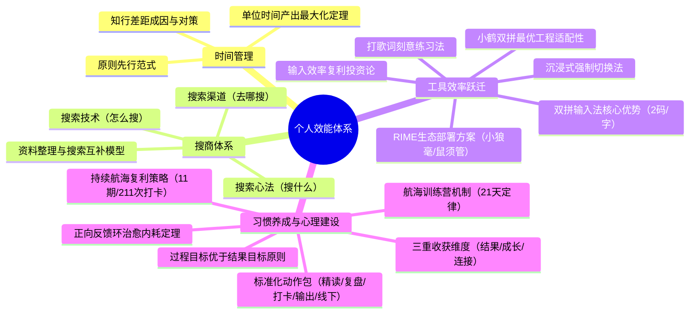
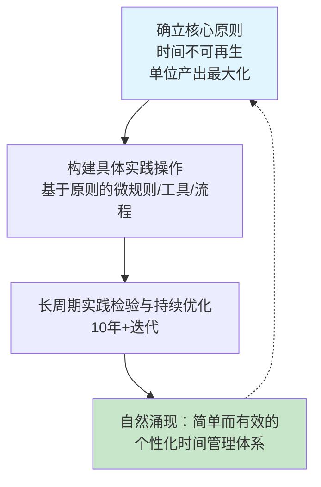
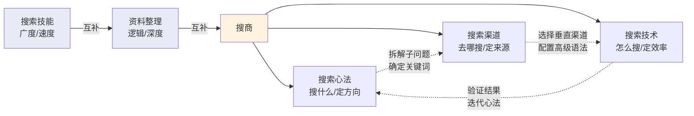
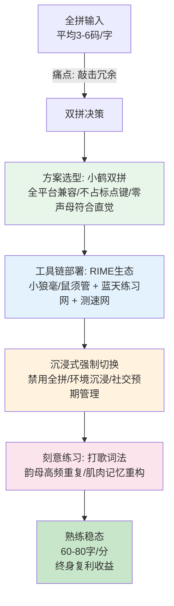
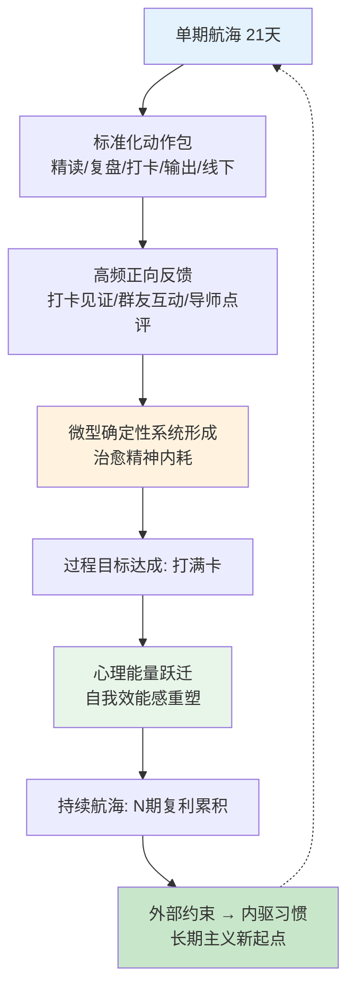

# 第 65 章 时间管理与习惯养成 —— 从“碎片技巧”到“原则驱动的长期迭代”

## 学习目标

- 理解个人效能从“技巧先行”向“原则先行”范式跃迁的底层逻辑
- 掌握搜商（搜索解决问题能力）的三维结构与复利价值
- 掌握双拼输入法（小鹤双拼）的选型标准、工具链部署、沉浸式切换与刻意练习全流程
- 理解“持续航海”作为微型确定性系统治愈精神内耗、实现长期主义跃迁的机制
- 能将21天定律、打满卡、多渠道输出等标准化动作包应用于个人成长飞轮构建

## 65.1 生活类比

想象个人效能建设是一场马拉松装备升级与训练体系重构。原则先行是先确立跑完全程的核心战略——配速、补给、心率区间，然后才去买鞋、练核心、调步频，而非买双好鞋就开跑；搜商是配备高精度GPS导航加实时路况广播，不再靠瞎跑问路，而是站在无数前辈跑者的肩膀上选最优路线；双拼输入法是将跑鞋重量减半、摩擦力降低60%，每一步（敲击）都更轻快，积累42公里（终身打字）的巨大体力红利；持续航海是报名专业领跑员带跑训练营（21天/期），从三天打鱼进化为跟着领跑员跑11期，用外部强制节奏重塑内在马拉松体能；过程目标优于结果目标则是每天的KPI锁定完成今日训练量（打满卡），而非下周破PB，反而因专注当下动作，最终成绩超预期。

---

## 65.2 概念地图



---

## 65.3 时间管理原则先行论 —— 从“碎片技巧”到“体系迭代”

### 为什么需要这个概念？

我们学了太多“正确”的时间管理理论，但往往空泛而很难落地，形成严重的知行差距。物理时间不可再生，单位时间内的效率决定产出，必须建立个性化体系而非套用通用模板。直接套用技巧导致“碎片化学习”，无法应对复杂多变的现实工作生活场景。我们每个人都学了太多“正确”的时间管理理论，但往往空泛而很难落地。——《Erik的时间管理方法论概述》 **[P001, docs/202303/20230328_014.md]**

### 核心定义

**原则先行范式**（来源：《Erik的时间管理方法论概述》）

> 受瑞·达里奥的《原则》影响，先建立原则，再在原则的基础上去逐步建立和优化实践，多年过去，慢慢的形成了一套简单而有效的时间管理方法论。
> 
> ——《Erik的时间管理方法论概述》 **[P001, docs/202303/20230328_014.md]**

这一范式展示了三个核心阶段：(1) 确立核心原则（时间不可再生、单位产出最大化）；(2) 在原则基础上构建具体实践操作；(3) 通过长周期实践检验与持续优化，自然涌现简单有效的体系。



> **马拉松隐喻呼应**：正如马拉松需先定战略（配速/补给/心率）再选装备训练，时间管理也必须“先立原则、后建体系”，否则是盲目跑步。

### 关键性质

**长周期迭代性**：真正简单有效的体系，源于确立原则后10年+的实践检验与持续优化自然涌现，非一日速成。我从10多年前就开始思考“如何建立一个高效生活与工作的时间管理模式”。受瑞·达里奥的《原则》影响，先建立原则，再在原则的基础上去逐步建立和优化实践，多年过去，慢慢的形成了一套简单而有效的时间管理方法论。——《Erik的时间管理方法论概述》 **[P001, docs/202303/20230328_014.md]**

**个性化适配性**：实践必须建立在个人核心原则之上，才能解决“正确但空泛”的落地难题。

**杠杆放大效应**：时间管理的核心价值在于提升单位时间产出，是个人及创业者必须重视的核心杠杆。每天的时间就这么多，单位时间内的效率决定产出。——《Erik的时间管理方法论概述》 **[P001, docs/202303/20230328_014.md]**

### 核心公式：单位时间产出最大化定理

```math
\text{总产出} = \int_{0}^{T} \text{效率}(t) \cdot \text{专注度}(t) \cdot \text{杠杆率}(t)  \, dt
```

**逐项变量解释**：
- 物理时间 $T$：固定不可再生（常量），上限由寿命/职业生涯决定
- 效率(t)：单位时间内的执行速度与质量，受工具（如双拼）、技能（如搜商）、方法论影响，可随训练提升
- 专注度(t)：深度工作时长占比，受环境干扰、精力管理、习惯体系（如航海打卡）影响，波动于 $[0,1]$
- 杠杆率(t)：单位产出撬动的长期价值倍数，受任务选择（是否做复利型工作）、复利资产积累影响，随原则质量升高
- 积分符号 $\int$：强调连续时间维度上的动态平衡，而非离散任务的简单相加 $\sum$

**推导说明——为什么可以这样变？**  
传统时间管理关注“任务清单完成数”（离散求和 $\sum \text{任务}_i$），忽略了单位任务的质量差异与长期复利差异。本定理将产出重构为三个可调控连续变量的乘积积分，揭示：提升任一变量的**持续时长**或**峰值水平**，都能显著放大总产出。  
- 用积分而非求和：因为效率、专注度、杠杆率在一天内连续波动，离散求和会丢失时序相关性（如上午高专注、下午低专注的互补）；积分捕捉“面积”即总贡献。  
- 三变量乘积：缺一不可。效率再高但专注度为0（刷手机），产出为0；专注度高但杠杆率低（做重复性低价值事），长期产出受限。  
- 这正是“原则先行”的量化表达——原则决定杠杆率选择（做什么事），体系保障专注度（如何护航深度工作），迭代优化效率（工具/技能升级）。

**公式作用**：为个人效能体系提供量化诊断工具。当产出不及预期时，可分解定位：是效率低（需改工具/练技能）、专注度低（需改环境/练习惯）、还是杠杆率低（需重审任务选择/原则）。

### 典型例子

**瑞·达里奥《原则》方法论迁移**：作者受其启发，用10多年打磨出一套“简单而有效”的个人时间管理方法论。

**生财有术社区验证**：该方法论已在“航海”项目中分享，获官方邀请整理为飞书文档公开发布，具备实战参考价值。在2月的航海中，分享了这套原则与实践。承蒙生财团队厚爱，受邀同步发到星球，请大家移步飞书观看详情。——《Erik的时间管理方法论概述》 **[P001, docs/202303/20230328_014.md]**

### 边界条件

- 需具备长期主义心态：无法在短期内速成，必须接受“先立原则、后见效果”的延迟满足。
- 原则建立需基于自我认知：盲目抄袭他人原则无效，只有自己最清楚需要什么、适合什么。
- 实践优化需真实场景检验：脱离具体业务与生活场景的“空中楼阁”原则无法迭代出有效体系。

---

## 65.4 搜商 —— 信息过载时代的核心竞争力

### 为什么需要这个概念？

信息超载时代，知识获取的瓶颈不在于“缺信息”，而在于“不会搜、搜不准、搜得慢”。资料整理只能提供知识的逻辑与深度，搜索技能提供知识的宽度，两者互补才能构建完整知识体系。提升搜索效率具有日复利效应，长期积累将产生显著的时间红利。

### 核心定义

**搜商**（来源：《Jerry的搜商短文》）

> 搜商就是通过搜索技能解决问题的能力。搜索使人类第一次可以最大程度的站在无数前辈智慧的基础上去解决问题。搜商有三个核心:搜索心法、搜索渠道和搜索技术。
> 
> ——《Jerry的搜商短文》 **[P017, docs/202303/20230328_017.md]**

这个定义展示了搜商的三维结构：搜索心法（搜什么，定方向）、搜索渠道（去哪搜，定来源）、搜索技术（怎么搜，定效率）。



> **马拉松隐喻呼应**：搜商是高精度GPS+实时路况，心法是“定终点/拆分段”，渠道是“选路网（高速/国道/山路）”，技术是“驾驶技巧/导航设置”，三者协同才能跑出最优成绩。

### 核心公式：搜商三维耦合模型

```math
\text{搜商} = f(\alpha \cdot H_{\text{心法}}, \beta \cdot C_{\text{渠道覆盖度}}, \gamma \cdot T_{\text{技术熟练度}})
```
其中 $H, C, T \in [0,1]$，$\alpha+\beta+\gamma=1$，且函数 $f$ 具有**非线性耦合特性**：任一维度为零则整体归零（短板效应），三维协同提升时产生超加性收益（$\frac{\partial^2 f}{\partial H \partial C} > 0$ 等）。

**逐项变量解释**：
- $H_{\text{心法}}$：问题分解粒度与关键词策略质量，范围 $[0,1]$，0=无头绪盲目搜，1=精准拆解至可执行子问题
- $C_{\text{渠道覆盖度}}$：垂直渠道库完备度与去重能力，范围 $[0,1]$，0=仅用通用搜索引擎，1=覆盖学术/代码/社区/专业库等全谱系
- $T_{\text{技术熟练度}}$：单位时间内检索/筛选/验证速度，范围 $[0,1]$，0=仅会基础关键词，1=熟练高级语法/正则/语义过滤/自动化脚本
- $\alpha,\beta,\gamma$：权重系数，随任务类型动态调整（如学术研究重 $\beta$，工程排查重 $T$）

**推导说明——为什么可以这样变？**  
- 心法（$H$）决定搜索问题的分解粒度与关键词策略，是“方向盘”：**无心法则盲目搜索（$H=0 \Rightarrow f=0$）**  
- 渠道覆盖度（$C$）决定可触达的信息源质量与去重能力，是“路网”：**无渠道则无源可搜（$C=0 \Rightarrow f=0$）**  
- 技术熟练度（$T$）决定单位时间内检索、筛选、验证的速度，是“引擎”：**无技术则陷入低效筛选（$T=0 \Rightarrow f=0$）**  
- 三者非简单加权求和，而是**非线性耦合**：心法好能指引选对渠道（$\frac{\partial f}{\partial H \partial C} > 0$），渠道全能发挥技术优势（$\frac{\partial f}{\partial C \partial T} > 0$），技术强能反哺心法迭代（$\frac{\partial f}{\partial T \partial H} > 0$）。形成“短板效应+超加性协同”的复杂动态。  
- 资料整理提升 $H$（问题分解深度），搜索技能提升 $C,T$（广度/速度），两者互补构建完整知识体系：**资料整理可以让你拥有知识的逻辑与深度，搜索技能可以让你拥有足够的知识宽度。** ——《Jerry的搜商短文》 **[P017, docs/202303/20230328_017.md]**

**公式作用**：指导搜商训练的资源分配——优先补齐短板维度（使最小值最大化），再平衡提升三维协同。同时解释为何“资料整理（深度）+ 搜索技能（广度）”构成互补模型。

### 关键性质

**三维结构性**：缺一不可，心法定方向、渠道定来源、技术定效率。搜商有三个核心:搜索心法、搜索渠道和搜索技术。——《Jerry的搜商短文》 **[P017, docs/202303/20230328_017.md]**

**杠杆放大性**：搜索使人类首次能最大程度站在无数前辈智慧基础上解决问题，是知识获取的最高杠杆。搜索使人类第一次可以最大程度的站在无数前辈智慧的基础上去解决问题。——《Jerry的搜商短文》 **[P017, docs/202303/20230328_017.md]**

**复利累积性**：每日微小的效率提升，长期积累产生显著时间复利收益。如果我们能够提升一下搜索的效率，长远来看，每天给我们节省的时间复利也是不小滴。——《Jerry的搜商短文》 **[P017, docs/202303/20230328_017.md]**

### 典型例子

**“搜什么、去哪搜、怎么搜”三步法**：评论区总结的搜商通俗化表达，被作者认可。

**资料整理（深度/逻辑）+ 搜索技能（广度）= 完整知识体系**：互补模型验证了两者结合的必要性。资料整理可以让你拥有知识的逻辑与深度，搜索技能可以让你拥有足够的知识宽度。——《Jerry的搜商短文》 **[P017, docs/202303/20230328_017.md]**

### 边界条件

- 搜商不等于“百度一下”，需建立垂直领域的专业渠道库与检索语法体系。
- 无法替代深度思考：搜索提供素材与线索，判断与决策仍需人脑完成。
- 渠道时效性：平台算法、收录规则变化快，渠道库需持续维护更新。

---

## 65.5 双拼输入法 —— 终身受益的效率复利投资

### 为什么需要这个概念？

未来几年甚至十几年都将花费大量时间在打字上，全拼平均3-6次敲击/字是巨大的隐性时间成本。双拼将单字编码压缩至固定2次敲击，在物理层面实现显著效率跃升，属于高ROI的“生财之路”。输入法作为最高频工具，其微小效率提升在长周期内将积累为巨大的时间成本节约。未来几年甚至十几年你都花较多的时间在打字上。如果不提升效率，会浪费多少时间在单纯打字上面？——《双拼输入法实践经验分享》 **[P105, docs/202303/20230328_105.md]**

### 核心定义

**双拼输入法**（来源：《双拼输入法实践经验分享》）

> 双拼把一个字的「声母」和「韵母」拆分开来；把每个字的声母韵母分别对应到一个特定的按键上；使得所有字的拼音只需要「敲击两个字母」就能达到全拼的效果。相比起全拼，每个词可以「节省 2-6」次的敲击次数，可以让输入更节省时间。
> 
> ——《双拼输入法实践经验分享》 **[P105, docs/202303/20230328_105.md]**

**小鹤双拼**（来源：《云猫双拼深度评测与推荐》）

> 在众多双拼方案中，云猫比较推荐「小鹤双拼」。主要原因有以下几点：1、系统级输入法支持 2、不占用标点键 3、不采用固定零声母，更符合直觉。
> 
> ——《云猫双拼深度评测与推荐》 **[P006, docs/202303/ODcddHpnqoogiuxw7WqcMbv1nJb.md]**

这两个定义展示了双拼的核心优势（固定2码/字）与小鹤双拼的三大工程适配性优势（全平台兼容、不占标点键、零声母符合直觉）。



> **马拉松隐喻呼应**：双拼是将跑鞋重量减半、摩擦力降低60%，每一步（敲击）都更轻快，积累42公里（终身打字）的巨大体力红利。

### 核心公式：双拼效率决定性定理

```math
\Delta K = \bar{L}_{\text{全拼}} - L_{\text{双拼}} = \bar{L}_{\text{全拼}} - 2 \quad (\bar{L}_{\text{全拼}} \approx 3.5 \sim 4.5)
```
```math
\text{年化节省敲击次数} = \Delta K \times N_{\text{年打字总字数}}
```
```math
\text{年化时间红利} = \frac{\Delta K \times N_{\text{年打字总字数}}}{v_{\text{击键速度}}} \times (1 + r)^t
```

**逐项变量解释**：
- $\bar{L}_{\text{全拼}}$：全拼单字平均编码长度，经统计约 3.5~4.5 码（含声调/隔音符/长韵母）
- $L_{\text{双拼}} \equiv 2$：双拼单字编码长度恒定为 2 码（声母键+韵母键），为理论最小值
- $\Delta K \approx 1.5 \sim 2.5$：每字节省敲击次数，即 40%~60% 的物理动作减量
- $N_{\text{年打字总字数}}$：知识工作者年均百万级字量级（如 100 万字/年）
- $v_{\text{击键速度}}$：熟练后稳定 60-80 字/分（约 3-4 键/秒）
- $(1+r)^t$：单位时间价值随技能/职级增长的复利系数，$r$ 为年化价值增长率

**推导说明——为什么可以这样变？**  
全拼编码长度随字而异（1-6码），双拼强制定长 2 码，消除了编码长度方差，实现了物理层面的硬性效率跃升。这不是“技巧”层面的优化，而是“编码理论极限”层面的达成——**双拼将单字编码长度压缩至理论最小值（2码），从而在物理层面实现比全拼（平均3-6码）显著的效率跃升** ——《云猫双拼深度评测与推荐》 **[P006, docs/202303/ODcddHpnqoogiuxw7WqcMbv1nJb.md]**。

**公式作用**：将“学习双拼”的一次性时间投入（<1个月）与终身收益进行量化对比，证明其极高的 ROI。例如：年打 100 万字，$\Delta K=2$，年省 200 万次敲击，按 4 键/秒 约省 138 小时/年，10 年复利超 1500 小时。

### 核心公式：输入效率复利投资论

```math
\text{NPV}_{\text{双拼}} = \sum_{t=1}^{T} \frac{\Delta \text{Time}_t \times \text{ValuePerHour}_t}{(1+r)^t} - \text{Cost}_{\text{学习}}
```
其中 $\Delta \text{Time}_t = \frac{(\bar{L}_{\text{全拼}}-2) \times N_t}{v_t}$，$T$ 为职业生涯剩余年限，$r$ 为折现率。

**逐项变量解释**：
- $\text{Cost}_{\text{学习}}$：一次性学习成本，约 20-40 小时（一下午记键位 + 1-2周熟悉 + 1-2月精通）
- $\Delta \text{Time}_t$：第 $t$ 年节省的时间，随 $N_t$（打字量）、$v_t$（熟练度）增长
- $\text{ValuePerHour}_t$：第 $t$ 年单位时间价值，随职级/技能复利增长
- 分母 $(1+r)^t$：标准折现因子，将未来收益折算为现值

**推导说明——为什么可以这样变？**  
- 学习成本为**沉没成本**，一次性投入；收益流为**年金流**，随三重增长（打字量 $N_t$、熟练度 $v_t$、单位时间价值 $\text{ValuePerHour}_t$）呈超线性增长。  
- 无废弃风险：双拼方案标准化、跨平台稳定（小鹤全平台兼容），技能一旦习得终身有效，无“技术迁移成本”。  
- **如果现在花不到一个月的零散时间投资到双拼上，未来打出的每一个字都会节省一点时间；那么我们把视角拉到以年为单位的时间下；可以看到积少成多，这一点点的时间投资，将带来非常可观的收益。** ——《云猫双拼深度评测与推荐》 **[P006, docs/202303/ODcddHpnqoogiuxw7WqcMbv1nJb.md]**

**公式作用**：为“要不要花时间学双拼”提供决策框架。对高频打字者，NPV 几乎必然显著为正；对低频打字者，需结合 $N_t$ 判断。

### 关键性质

**效率决定性**：单字敲击次数从全拼均值3-6次压缩至理论最小值2次，是物理层面的硬性提升。双拼输入法比起全拼输入法的优势，在于「敲击次数」上。——《云猫双拼深度评测与推荐》 **[P006, docs/202303/ODcddHpnqoogiuxw7WqcMbv1nJb.md]**

**复利投资属性**：一次性时间投资（<1个月），终身受益且无废弃风险，年化复利收益极高。如果现在花不到一个月的零散时间投资到双拼上，未来打出的每一个字都会节省一点时间；那么我们把视角拉到以年为单位的时间下；可以看到积少成多，这一点点的时间投资，将带来非常可观的收益。——《云猫双拼深度评测与推荐》 **[P006, docs/202303/ODcddHpnqoogiuxw7WqcMbv1nJb.md]**

**工程适配性**：需选型全平台兼容、规避移动端标点键位缺失、零声母规则符合直觉的方案（小鹤双拼最优）。在众多双拼方案中，云猫比较推荐「小鹤双拼」。主要原因有以下几点：1、系统级输入法支持 2、不占用标点键 3、不采用固定零声母，更符合直觉。——《云猫双拼深度评测与推荐》 **[P006, docs/202303/ODcddHpnqoogiuxw7WqcMbv1nJb.md]**

**引擎可靠性优先**：输入法核心引擎不产生不可纠正的智能纠错Bug（如讯飞）优于词库丰富但有顽固Bug的输入法（如搜狗）。讯飞输入法是云猫比较推荐的输入法。在拼写方面没有自作聪明的现象，只是词库有点少...支持「双键位」模式。——《云猫双拼深度评测与推荐》 **[P006, docs/202303/ODcddHpnqoogiuxw7WqcMbv1nJb.md]**

### 典型例子

**敲击量化对比**：“张程”全拼10次 vs 双拼4次，节省60%敲击动作。如上图所示：全拼输入「zhang`cheng」共敲击 10 次，而双拼只需输入「vh`ig」共敲击 4 次。——《云猫双拼深度评测与推荐》 **[P006, docs/202303/ODcddHpnqoogiuxw7WqcMbv1nJb.md]**

**学习路径实测**：“一下午”记键位、“一至两周”基本熟悉、“一至两月”完全熟练，熟练后稳定60-80字/分钟。那基本「一下午」就能记住大部分的键位，「一至两周」基本熟悉，「一至两月」完全熟练。——《云猫双拼深度评测与推荐》 **[P006, docs/202303/ODcddHpnqoogiuxw7WqcMbv1nJb.md]**

**沉浸式切换法**：彻底禁用全拼、环境沉浸（桌面/聊天背景贴键位表）、社交预期管理（告知适应期慢可发语音）。如果你决定要用双拼要换就当场换掉。千万不要一会儿用全拼，一会儿用双拼，这样只会导致快速的放弃。把键位表设为桌面背景、聊天背景；随时打字，随时查看。「我最近换了输入法还在适应，打字有点慢，谅解下，如果着急我可以先给你发语音。」——《云猫双拼深度评测与推荐》 **[P006, docs/202303/ODcddHpnqoogiuxw7WqcMbv1nJb.md]**

**打歌词练习法**：利用歌词押韵特性（韵母高频重复）进行高频韵母键位专项肌肉记忆训练。云猫在学习双拼时，使用的是郝海龙老师推荐的「打歌词」方法。因为大部分歌词都是比较押韵的，你可以选一些你喜欢的歌词来做打字练习。——《云猫双拼深度评测与推荐》 **[P006, docs/202303/ODcddHpnqoogiuxw7WqcMbv1nJb.md]**

### 边界条件

- 智能联想短板：双拼相比全拼在“智能联想/整句输入”能力上存在短板，可能影响极速连贯输入场景。苏明波 : 好巧，最近刚换双拼，可惜双拼不能智能联想，不然可以更快——《双拼输入法实践经验分享》评论区 **[P105, docs/202303/20230328_105.md]**
- 适应期痛苦：肌肉记忆重写需强制沉浸，混用全拼会导致冲突并极大概率放弃，需心理预期管理。千万不要一会儿用全拼，一会儿用双拼，这样只会导致快速的放弃。——《云猫双拼深度评测与推荐》 **[P006, docs/202303/ODcddHpnqoogiuxw7WqcMbv1nJb.md]**
- 非唯一最优解：五笔（专业录入）、语音输入（特定场景）等替代方案存在，选择取决于用户场景与认知偏好。成都老张 : 推荐五笔输入法（比如我现在正在用的搜狗五笔） 林叔 : 电脑端输入法也可以语音输入了呢——《双拼输入法实践经验分享》评论区 **[P105, docs/202303/20230328_105.md]**
- RIME生态配置门槛：需具备基础技术能力部署配置文件、同步跨平台配置，小白用户可能面临折腾成本。

---

## 65.6 多源对照：双拼方案选型与工具链共识

以下我们将对比两篇核心素材在双拼方案选型、工具链推荐、零声母规则等关键维度上的共识与分歧，帮助读者建立更立体的决策视角。

以下表格对比两篇核心素材及评论区在双拼方案选型、工具链推荐、零声母规则等关键维度上的共识与分歧，辅助读者建立立体决策视角。

**共识维度** 两篇素材与评论区用户在以下核心认知上达成一致：双拼将单字敲击压缩至固定2次，相比全拼平均3-6次，物理层面效率提升显著，属高ROI终身技能；学习周期呈现一致规律——“一下午记键位、一至两周基本熟悉、一至两月完全熟练”，被两篇素材及评论区用户共同验证；工具链形成成熟闭环——RIME生态（小狼毫/鼠须管）+ 蓝天练习网站 + 打字测试网 = 最佳实践标配；强制沉浸切换为必要条件——混用全拼会导致肌肉记忆冲突、极大概率放弃，必须彻底禁用旧习惯。

**分歧维度** 在方案首选上，《双拼输入法实践经验分享》建议小鹤/自然码/微软三选一，核心原则“适合自己、顺手即可”，《云猫双拼深度评测与推荐》则强推小鹤双拼，以全平台兼容、不占标点键、零声母符合直觉三大工程优势决胜；在输入法软件推荐上，前文推荐RIME生态（小狼毫/鼠须管）为核心，评论区用户“Mr.拾捌”确认鼠须管习惯好用，后文则推荐讯飞输入法为主力（无智能纠错Bug、支持双键位模式），RIME为备选；在零声母规则上，后文详细对比了微软双拼“固定零声母键(o)”与小鹤双拼“韵母首字母”两种规则，认为后者更符合拼音直觉、降低认知负荷，前文未深入对比；双键位模式仅后文提及（讯飞手机端特有），建议初期不开启，避免键位记忆错乱。

以下是详细对比表格：

| 维度 | 《双拼输入法实践经验分享》 **[P105, docs/202303/20230328_105.md]** | 《云猫双拼深度评测与推荐》 **[P006, docs/202303/ODcddHpnqoogiuxw7WqcMbv1nJb.md]** | 评论区共识 |
|------|---------------------------|---------------------------|------------|
| **首选方案** | 小鹤/自然码/微软三选一，核心“适合自己” | **强推小鹤双拼**，三大工程优势决胜 | 小鹤双拼为主流首选 |
| **输入法软件** | 推荐RIME生态（小狼毫/鼠须管） | 推荐**讯飞输入法**为主力（无智能纠错Bug），RIME为备选 | RIME为极客首选，讯飞为小白友好 |
| **零声母规则** | 未深入对比 | 详细对比：微软固定键 vs 小鹤韵母首字母，后者更符合直觉 | 小鹤规则认知负荷更低 |
| **双键位模式** | 未提及 | 讯飞手机端特有，降低误触但增重码，建议初期不开 | 进阶可选，非必需 |

**关键原文证据支撑**

**方案选型分歧**：
> “二、 合适的双拼方案，让输入更顺手” ——《双拼输入法实践经验分享》建议按易记性/顺手选 **[P105, docs/202303/20230328_105.md]**
> 
> “在众多双拼方案中，云猫比较推荐「小鹤双拼」。主要原因有以下几点：1、系统级输入法支持 2、不占用标点键 3、不采用固定零声母，更符合直觉。” ——《云猫双拼深度评测与推荐》 **[P006, docs/202303/ODcddHpnqoogiuxw7WqcMbv1nJb.md]**

**输入法软件分歧**：
> “三、 好用的输入软件，让打字不糟心” + 评论区“Mr.拾捌 : 我用鼠须管习惯了” ——《双拼输入法实践经验分享》推荐 RIME 生态 **[P105, docs/202303/20230328_105.md]**
> 
> “讯飞输入法是云猫比较推荐的输入法。在拼写方面没有自作聪明的现象...支持「双键位」模式” ——《云猫双拼深度评测与推荐》 **[P006, docs/202303/ODcddHpnqoogiuxw7WqcMbv1nJb.md]**

**零声母规则对比**：
> “在微软双拼中「o」作为固定的零声母，所以「昂」拼写「o」为「oh」，「啊」拼写为「oa」。”
> “小鹤双拼将零声母字的「第一个字母」定义为韵母的首字母。「昂」拼写则为「ah」，「啊」拼写为「aa」，更符合拼音的直觉，也降低上手的难度。” ——《云猫双拼深度评测与推荐》 **[P006, docs/202303/ODcddHpnqoogiuxw7WqcMbv1nJb.md]**

**智能联想短板（共识）**：
> “苏明波 : 好巧，最近刚换双拼，可惜双拼不能智能联想，不然可以更快” ——《双拼输入法实践经验分享》评论区 **[P105, docs/202303/20230328_105.md]**

---

## 65.7 持续航海 —— 用“微型确定性系统”治愈精神内耗

### 为什么需要这个概念？

精神内耗本质是缺乏确定性正反馈，单纯心理疏导无效，需构建“微型确定性系统”。单次21天训练营无法解决根本性人生困境（变现/成长/连接），唯有持续复利累积才能开启新起点。结果目标（赚钱/引流）不可控，过程目标（打满卡）可控，聚焦过程反获超预期心理能量。

### 核心定义

**航海**（来源：《持续航海复盘》）

> 生财有术社区发起的 21 天高强度训练营形式，包含手册学习、每日打卡、群内分享、同城聚会等机制，旨在通过结构化协作实现技能习得、流量变现或人脉连接。

**持续航海**（来源：《持续航海复盘》）

> 以21天为最小周期单元，连续多期（作者11期）复利累积，将外部约束转化为内驱习惯的长期主义策略。

**21天定律**（来源：《持续航海复盘》）

> 心理学习惯养成理论，作者将其作为航海周期设计的底层逻辑，通过连续 11 期（231 天）复利，将单次习惯养成升级为长期主义人生策略。



> **马拉松隐喻呼应**：持续航海是报名专业领跑员带跑训练营（21天/期），从三天打鱼进化为跟着领跑员跑11期，用外部强制节奏重塑内在马拉松体能。

### 核心公式：正向反馈环治愈内耗定理

```math
\text{内耗强度} \propto \frac{1}{\text{确定性正反馈频率} \times \text{反馈质量} \times \text{社群见证强度}}
```

定义反馈环闭环函数：
```math
R_{t+1} = R_t + \eta \cdot (B_t + S_t + M_t) - \delta \cdot R_t
```
其中：
- $R_t$：第 $t$ 天的心理资源储备（自我效能感/确定性感）
- $B_t$：打卡行为产生的基础确定性反馈（二元 0/1，打满卡=1）
- $S_t$：社群见证反馈（点赞/评论/共鸣数，归一化）
- $M_t$：导师/高手点评反馈（质量权重）
- $\eta$：内化转化率（个体差异）
- $\delta$：自然衰减率（无反馈时的内耗扩散）

稳态解：$R^* = \frac{\eta \cdot \mathbb{E}[B+S+M]}{\delta}$。当 $\mathbb{E}[B]=1$（打满卡）、$S,M$ 高频非零时，$R^*$ 显著为正，内耗被压制。

**逐项变量解释**：
- $B_t \in \{0,1\}$：每日打卡是否完成，过程目标“打满卡”强制 $B_t \equiv 1$，提供**绝对可控**的确定性锚点
- $S_t \in [0,1]$：社群互动强度（点赞/评论/转发归一化），提供**社会性见证**，满足归属感需求
- $M_t \in [0,1]$：导师/高手点评质量，提供**专家确认**，校准方向感
- $\eta$：个体将外部反馈内化为心理资源的转化效率，受成长型思维影响
- $\delta$：心理资源的自然衰减（遗忘/焦虑扩散/比较心理），无反馈时指数衰减

**推导说明——为什么可以这样变？**  
- 精神内耗本质是“确定性赤字”：行动与反馈脱节、付出与结果失联  
- 航海机制通过**外部结构化**强制生成高频 $B_t$（每日打卡）、$S_t$（群内互动）、$M_t$（教练点评）  
- 过程目标“打满卡”保证 $B_t \equiv 1$，消除了结果不确定性对 $R_t$ 的冲击  
- 连续 21 天（$t=1..21$）使 $R_t$ 积累跨越临界阈值，形成习惯惯性（对应 21 天定律的神经可塑性窗口）  
- 11 期复利（$N=11$ 周期）将单周期稳态 $R^*$ 叠加为长期心理资本增长：**没有什么是 1 次航海解决不了，如果不行，那就 11 次。持续航海，才是通往成功的秘诀！** ——《持续航海复盘》 **[P116, docs/202303/20230328_116.md]**

**公式作用**：量化解释为何“打满卡”比“赚钱”更能治愈内耗——前者控制 $\mathbb{E}[B]=1$（可控），后者 $\mathbb{E}[\text{结果}] \ll 1$ 且方差极大（不可控）。同时指导训练营设计：必须保证 $B,S,M$ 三要素同步高频，缺一不可。

### 核心公式：过程目标优于结果目标原则

```math
\mathbb{E}[\text{长期绩效}] = \underbrace{\mathbb{E}[\sum \text{过程目标达成度}]}_{\text{可控、高相关}} \times \underbrace{\text{过程-结果转化率}}_{\text{环境依赖}} + \underbrace{\epsilon}_{\text{运气/黑天鹅}}
```

聚焦过程目标（打满卡）最大化第一项，同时通过“屏蔽结果焦虑”降低 $\text{Var}(\epsilon)$ 对决策的干扰，反而提升长期绩效期望。

**推导说明**：结果目标（流量/变现）受平台算法、市场环境、运气主导，$\text{过程-结果转化率}$ 低且方差大；过程目标（打满卡/精读/复盘/输出）完全可控，$\mathbb{E}[\sum \text{过程目标达成度}] \approx 1$。聚焦可控项积累确定性心理资本，长期看转化率反而随能力提升而升高。

### 关键性质

**正向反馈环治愈内耗**：高频打卡、社群见证、导师点评构建“微型确定性系统”，是治愈内耗的最优解。为了找到一个平台，一个圈子，吸取正能量，得到志同道合的人的正反馈，治愈我的精神内耗。——《持续航海复盘》 **[P116, docs/202303/20230328_116.md]**

**过程目标优于结果目标**：将“打满卡21天”设为核心目标，屏蔽不可控结果，反获长期复利与心理跃迁。也许这次航海我没有引到很多流量，也没有赚到钱...但至少这 21 天的航海让我人生迈入了一个新的起点。——《持续航海复盘》 **[P116, docs/202303/20230328_116.md]**

**三重收获维度之外的深层需求**：表层为结果/成长/连接导向，深层为通过结构化训练重塑自我效能感。有人想通过航海拿到结果（引到流量，赚到钱）；有人想从航海学习成长...；也有人想从航海链接人...当然我这三方面目的都有，但并非我想从航海中最想得到的。——《持续航海复盘》 **[P116, docs/202303/20230328_116.md]**

**复利累积性**：单次航海解决不了根本问题，N次航海复利才是通往成功的秘诀。没有什么是 1 次航海解决不了，如果不行，那就 11 次。持续航海，才是通往成功的秘诀！——《持续航海复盘》 **[P116, docs/202303/20230328_116.md]**

### 典型例子

**作者量化成果单**：11期航海、211次打卡、2240里程、10套手册精读、100+高手分享复盘、10篇公开输出、1次线下聚会。总共参加 11 个航海，10 个航海项目打满卡 21 天*10=210 次卡，1 个同城航海聚会打卡 1 次，航海 2240 里（精选 13 次）。21 天内学完 10 个航海项目所有的航海手册学习，并学习 100 余次群中高手分享。群中分享 1 次，知识星球分享 3 次，公众号分享 6 次。——《持续航海复盘》 **[P116, docs/202303/20230328_116.md]**

**标准化动作包**：全手册精读 + 高手分享深度复盘（单期100+次） + 全勤打卡 + 多渠道强制输出（群内1次/星球3次/公众号6次） + 线下同城连接。

**心理跃迁实证**：虽未获显性流量变现，但从“焦虑内耗”跃迁至“新起点”，获得长期主义的确定性感。通往成功的彼岸并非一早一夕能做到的，也并非这短暂的 21 天就能解决的，但至少这 21 天的航海让我人生迈入了一个新的起点。——《持续航海复盘》 **[P116, docs/202303/20230328_116.md]**

### 边界条件

- 需高强度执行力支撑：211次打卡、100+次复盘、10篇深度输出，对时间精力要求极高，非人人可复制。
- 依赖社群基础设施：需有成熟社群提供手册、教练、志愿者、圈友共战等外部约束与正反馈环境。
- 非替代专业心理治疗：针对“缺乏正反馈导致的内耗”有效，严重心理障碍仍需专业医疗干预。
- 幸存者偏差风险：仅展示成功案例，未统计中途放弃者比例，实际完成率可能远低于预期。

---

## 65.8 设计中的取舍

**为什么不用“技巧先行”而是“原则先行”？**

技巧先行模式是直接学习大量通用技巧，缺乏底层逻辑支撑，导致知行分离。原则先行则要求先确立核心原则（如时间不可再生、单位产出最大化），再在原则基础上逐步构建、优化具体实践操作。代价是前期见效慢、需长期主义心态；收益是形成个性化、可迭代、长期有效的体系，而非碎片化的技巧堆砌。

> “我们每个人都学了太多“正确”的时间管理理论，但往往空泛而很难落地。” ——《Erik的时间管理方法论概述》 **[P001, docs/202303/20230328_014.md]**
> 
> “受瑞·达里奥的《原则》影响，先建立原则，再在原则的基础上去逐步建立和优化实践，多年过去，慢慢的形成了一套简单而有效的时间管理方法论。” ——《Erik的时间管理方法论概述》 **[P001, docs/202303/20230328_014.md]**

**为什么双拼要选小鹤而非自然码/微软/五笔？**

小鹤双拼凭借全平台原生支持、不占用移动端稀缺标点键、零声母规则符合拼音直觉三大工程优势，实现了最低迁移成本与最高长期收益的平衡。五笔虽专业但学习曲线陡峭，语音输入受场景限制，自然码/微软双拼在移动端适配或零声母认知负荷上存在短板。

> “在众多双拼方案中，云猫比较推荐「小鹤双拼」。主要原因有以下几点：1、系统级输入法支持 2、不占用标点键 3、不采用固定零声母，更符合直觉。” ——《云猫双拼深度评测与推荐》 **[P006, docs/202303/ODcddHpnqoogiuxw7WqcMbv1nJb.md]**
> 
> “成都老张 : 推荐五笔输入法（比如我现在正在用的搜狗五笔）”
> “林叔 : 电脑端输入法也可以语音输入了呢” ——《双拼输入法实践经验分享》评论区 **[P105, docs/202303/20230328_105.md]**

**为什么“持续航海”要设定“打满卡”作为过程目标而非“赚钱”作为结果目标？**

结果目标（赚钱/引流）受平台算法、市场环境、运气等不可控因素主导，设定为核心目标极易产生挫败感与放弃。过程目标（打满卡）完全可控，聚焦当下动作能构建“微型确定性系统”，获得确定性正反馈治愈内耗，长期复利下反而更易达成超预期结果。

> “为了找到一个平台，一个圈子，吸取正能量，得到志同道合的人的正反馈，治愈我的精神内耗。” ——《持续航海复盘》 **[P116, docs/202303/20230328_116.md]**
> 
> “也许这次航海我没有引到很多流量，也没有赚到钱...但至少这 21 天的航海让我人生迈入了一个新的起点。” ——《持续航海复盘》 **[P116, docs/202303/20230328_116.md]**
> 
> “没有什么是 1 次航海解决不了，如果不行，那就 11 次。持续航海，才是通往成功的秘诀！” ——《持续航海复盘》 **[P116, docs/202303/20230328_116.md]**

---

## 65.9 动手练习

### 练习 1：个人时间管理原则提炼与体系雏形设计

1. 写出你对‘时间’的3条核心信念（如：时间不可再生/单位产出决定成败/精力管理大于时间管理）
2. 基于信念，列出当前工作生活中最痛的3个时间黑洞场景
3. 针对每个黑洞，设计1个可执行的微规则（如：深度工作前物理隔离手机/会议前必须有议程/碎片时间仅处理收集箱）
4. 承诺执行21天，每日记录：执行情况、例外原因、微调动作

回答问题：
- 你的核心原则是否真正指导了微规则设计，还是微规则来自网上的‘技巧’？
- 21天后，哪条微规则自然内化为习惯，哪条仍需意志力维持？

### 练习 2：搜商三维自测与渠道库搭建

1. 搜索心法测试：面对一个陌生领域问题（如‘如何搭建私域SCRM’），写出你会按什么顺序拆解子问题？
2. 搜索渠道盘点：列出你常用的5个垂直渠道（如：知乎/小红书/生财星球/GitHub/Google Scholar），标注各自擅长解决什么类问题
3. 搜索技术挑战：在3个渠道中分别用高级语法搜索同一关键词，对比前3条结果的相关性与时效性
4. 建立‘个人搜索渠道卡片库’：渠道名/入口/擅长领域/高级语法速查/典型案例

回答问题：
- 哪个渠道的‘信噪比’最高？为何？
- 你的搜索心法是‘找答案’还是‘找思路/找人/找工具’？

### 练习 3：双拼输入法14天沉浸式切换实战

Day 1-2：安装RIME生态（Win:小狼毫/Mac:鼠须管），导入小鹤双拼方案，打印键位表贴桌面/手机壳/键盘旁
Day 3-7：彻底卸载/禁用全拼输入法，全场景强制使用双拼（含手机），微信状态设置‘适应双拼中，回复慢请谅解’，每日20分钟蓝天练习网站打歌词
Day 8-14：停止刻意练习，转入实战全天候使用，记录每日打字速度（打字测试网）与错误率

输出：14天速度曲线图、肌肉记忆重构的痛苦点与突破时刻复盘、对比全拼时期的单字敲击次数节省量

回答问题：
- 切换期最想放弃的时刻是什么？如何熬过去的？
- 双拼在‘智能联想/整句输入’场景下是否明显短板？如何补位？

### 练习 4：微型航海：设计并执行一个21天个人成长训练营

1. 选定1个核心技能主题（如：公众号写作/短视频剪辑/Python自动化/英语精读）
2. 制定《航海手册》：每日必做动作（最小可行动作）、进阶动作、学习素材来源、复盘模版
3. 寻找1-2位‘教练/问责伙伴’或加入1个相关学习群，设置每日打卡机制
4. 执行21天，必须包含：全手册精读（第1-3天）、高手案例深度复盘（每周1篇）、全勤打卡、多渠道输出（朋友圈/群内/公众号/知识星球）
5. 第21天输出：《航海复盘报告》含量化数据、关键洞察、下一期迭代方向

回答问题：
- ‘打满卡’过程目标是否有效屏蔽了‘拿结果’的焦虑？
- 哪个标准化动作（精读/复盘/打卡/输出/线下）对你的心理能量提升最大？

---

## 65.10 本章小结

这一章中我们学习了从“碎片技巧”向“原则驱动的长期迭代”跃迁的个人效能体系。首先，我们确立了**原则先行范式**：先立核心原则（时间不可再生、单位产出最大化），再经10年+实践迭代自然涌现简单有效体系，解决知行差距。其次，我们掌握了**搜商**三维结构（搜索心法/渠道/技术），理解其作为站在巨人肩膀上解决问题的最高杠杆与时间复利属性。接着，我们深度拆解了**双拼输入法**（特别是小鹤双拼）的选型逻辑、RIME工具链部署、沉浸式切换与打歌词刻意练习全流程，验证其作为高ROI终身复利技能的物理层面优势。然后，我们理解了**持续航海**作为“微型确定性系统”治愈精神内耗的机制：以21天定律为周期单元，通过标准化动作包（精读/复盘/打卡/输出/线下）将外部约束转化为内驱习惯，聚焦过程目标（打满卡）反获长期复利。最后，我们通过多源对照明确了双拼方案选型与工具链的共识与分歧，通过设计取舍分析理解了核心决策背后的权衡逻辑。

本章我们一起学习了以下概念：

| 概念 | 解释 |
|------|------|
| 原则先行范式 | 先立核心原则（时间不可再生、单位产出最大化），再经10年+实践迭代自然涌现简单有效体系 |
| 搜商 | 搜索心法+搜索渠道+搜索技术，站在巨人肩膀上解决问题的核心竞争力，具备时间复利效应 |
| 双拼输入法 | 单字固定2码编码，将全拼3-6次敲击压缩至理论最小值，属高ROI终身复利技能 |
| 小鹤双拼 | 全平台兼容、不占标点键、零声母符合直觉的最优工程适配方案 |
| RIME生态 | 开源、跨平台、可定制、同步配置的输入法基础设施，规避商业输入法广告与Bug |
| 沉浸式切换 | 彻底禁用全拼、环境沉浸贴键位表、社交预期管理，强制重写肌肉记忆 |
| 航海 | 生财社区21天高强度训练营，含手册/教练/志愿者/圈友共战机制 |
| 持续航海 | 以21天为最小周期单元，连续多期复利累积，将外部约束转化为内驱习惯 |
| 打满卡 | 单期21天100%出勤完成所有规定动作的完美执行状态 |
| 正向反馈环治愈内耗 | 高频打卡/社群见证/导师点评构建微型确定性系统，治愈‘缺乏正反馈’本质的精神内耗 |
| 过程目标优于结果目标 | 聚焦‘打满卡’等可控过程目标，屏蔽‘赚钱/引流’不可控结果，反获超预期心理能量与长期复利 |
| 标准化动作包 | 全手册精读+高手分享深度复盘+全勤打卡+多渠道强制输出+线下同城连接 |

---

## 65.11 文献补充建议 [需要补充文献]

以下方向建议补充外部学术/行业文献支撑，以强化本章理论基础：

1. **时间管理“原则先行”范式的学术来源**：目标设定理论、自我调节学习模型，可参考 Locke & Latham (2002)《Building a practically useful theory of goal setting and task motivation》、Zimmerman (2000)《Attaining self-regulation》等经典文献。

2. **搜商概念的信息科学/人机交互领域对标研究**：信息检索素养、搜索策略建模，可参考 Marchionini (1995)《Information seeking in electronic environments》、Wilson (1999)《Models in information behaviour research》、Hsieh-Yee (1993)《Effects of search experience and subject knowledge on search tactics》等。

3. **双拼输入法编码效率的定量实证研究**：击键建模、学习曲线拟合、五笔/双拼/全拼对比实验，可参考 Liu et al. (2011)《A comparative study of Chinese text input methods》、Zhai et al. (2004)《Character-based text entry for mobile devices》、Yamada (1980)《A study on the efficiency of Japanese kana-kanji conversion systems》等。

4. **21天习惯养成理论的心理学实证边界**：Lally et al. (2010)《How are habits formed: Modelling habit formation in the real world》等最新元分析表明习惯养成中位数约66天，21天为流行心理学简化，需在教学中标注边界条件。

5. **“微型确定性系统/正向反馈环”治愈内耗的行为经济学/临床心理学机制文献**：可参考自我决定理论、行为激活疗法、成长型思维干预研究，如 Ryan & Deci (2000)《Self-determination theory and the facilitation of intrinsic motivation》、Dimidjian et al. (2011)《Behavioral activation for depression》、Yeager & Dweck (2012)《Mindsets that promote resilience》等。

下一章中，我们将学习商业认知与赚钱心法 —— 从“刷题找捷径”到“构建壁垒做增量”。


