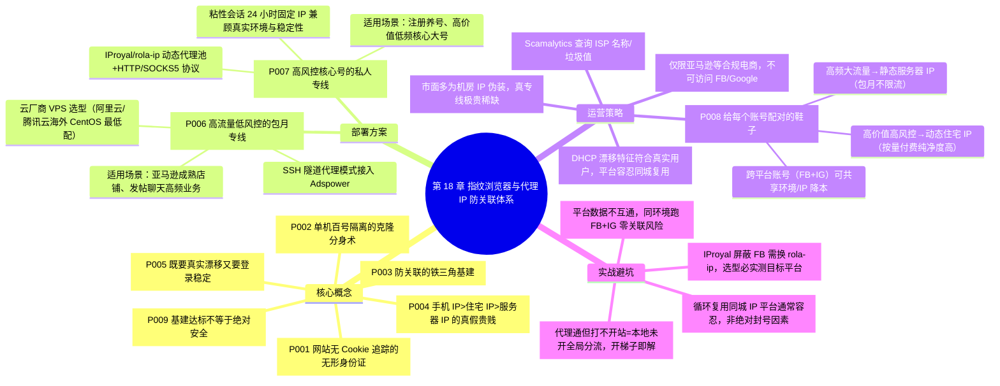
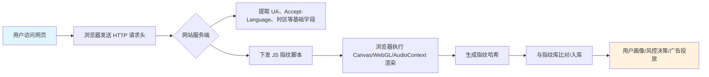
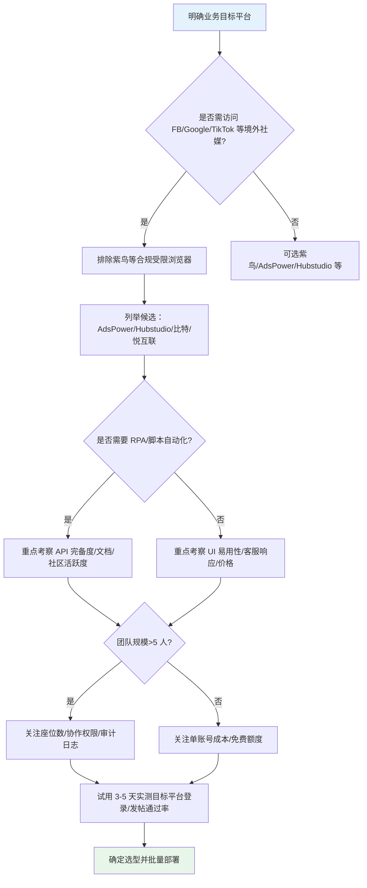
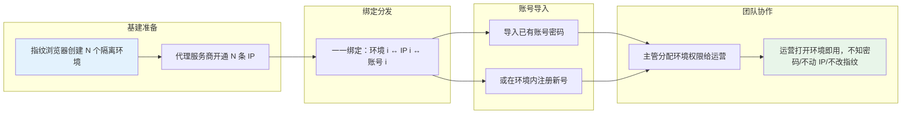
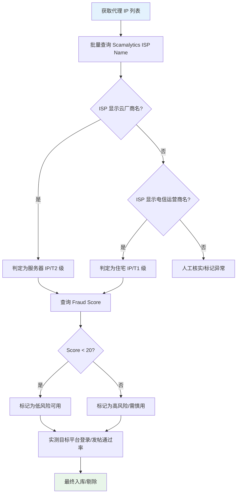
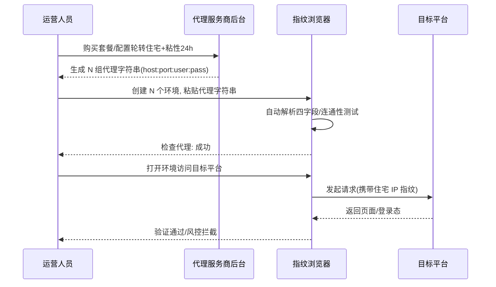
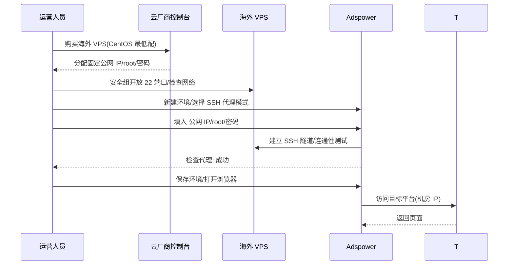
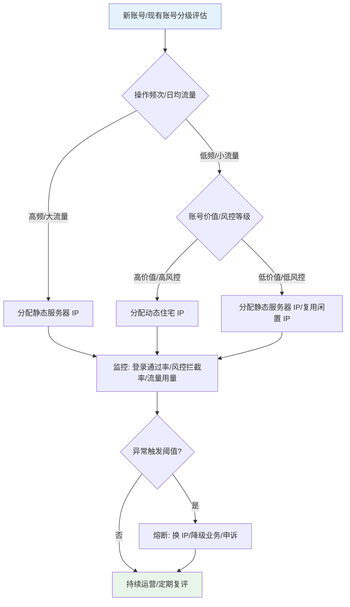

# 第 18 章 指纹浏览器与代理 IP 防关联体系 —— 矩阵账号运营的基础设施

## 学习目标

- 理解浏览器指纹识别原理及其在反欺诈/多账号运营中的核心地位
- 掌握指纹浏览器的核心功能、主流工具横向对比与选型决策逻辑
- 建立账号隔离三要素（独立环境、独立 IP、独立凭据）的标准化基建认知
- 熟练部署静态服务器 IP（VPS+SSH 隧道）与动态住宅 IP（粘性会话）两套差异化方案
- 建立 IP 质量分级体系（手机 IP>住宅 IP>服务器 IP）与 Scamalytics 实战甄别能力
- 能根据账号价值/频次/风控等级制定业务分层 IP 配置策略，实现成本与安全最优平衡
- 认清防关联必要非充分定理，建立基建达标≠绝对安全的动态对抗心智

## 18.1 生活类比

想象账号防关联是**给每个间谍配发一套完美的“伪装身份”**：**浏览器指纹** = 间谍的**长相、指纹、声纹、步态**等生物特征（设备维度唯一标识）；**指纹浏览器** = **整容手术室+化妆间**，能按需生成任意数量互不相同的“替身人设”；**独立 IP** = 间谍每次出任务用的**专用车牌/出租车/地铁卡**（网络维度唯一出口）；**静态服务器 IP** = **长期包月的专车司机**，车牌固定、跑得多不贵，但车牌底色是“公务车”（机房 IP），只适合低调跑腿（发帖/养号）；**动态住宅 IP** = **真实市民的私家车牌**，每天换车但同城换（粘性会话），贵但像真老百姓，适合高危潜入（注册/核心大号）；**账号凭据** = 间谍的**通行证/钥匙/暗号**，必须专人专用，不能混用；**防关联必要非充分定理** = **有了假身份证、假车牌、假通行证（三要素），还得演好戏（行为模拟）、藏好装备（硬件指纹）、别留指纹，否则依然会被反间谍机关（平台风控）识破**。

## 18.2 概念地图



## 18.3 浏览器指纹 —— 网站识别用户的“无形身份证”

### 为什么需要这个概念？

当你在网页上冲浪时，网站怎么知道“你是谁”？传统手段是 **Cookie**，但用户可以随时清理、禁用，甚至开启无痕模式。为了在“无状态”下依然能精准追踪设备，广告联盟、反欺诈系统、平台风控引入了 **浏览器指纹** 技术。

> "浏览器指纹是一项技术，它能够通过浏览器的各种配置和设置（浏览器指纹辨识的信息可以是 UA、时区、地理位置、IP 或者是使用的语言）来识别用户的浏览器，从而区分不同的用户。"
> 
> "就像我们手上的指纹一样，浏览器指纹也具有辨识度，只不过它只能辨别浏览器。"
> 
> ——《docs/202303/20230328_016.md》

这就好比每个人都有独特的指纹，浏览器也有独特的“长相”。网站通过收集 **User-Agent、时区、语言、分辨率、Canvas 绘图指纹、WebGL 渲染器** 等几十项配置，拼凑出一个唯一的标识串。单一属性重复率很高（比如同分辨率的人很多），但组合在一起，**极大概率是唯一的**。

### 浏览器指纹识别的数据流演进



图 18.3‑1 浏览器指纹采集与识别数据流

**浏览器指纹的三大关键性质**：

- **无状态性**：不依赖本地存储，你清理缓存、换无痕模式也消除不了，它藏在浏览器的“骨子里”。
- **组合唯一性**：单一属性不够，组合后才能做到“唯一”。
- **跨会话稳定**：同一设备、同一浏览器版本下，指纹短期内基本不变。

**典型例子**：你用同一个 Chrome 登录两个淘宝号，平台通过 Canvas 指纹秒判关联；广告联盟无 Cookie 精准投放；反欺诈系统识别刷单机、风控拦截批量注册。

**边界条件**：

- **无头浏览器/自动化工具指纹特征显著**：Selenium、Puppeteer、Playwright 等自动化框架默认会暴露 `navigator.webdriver=true` 标志位，且通过 Chrome DevTools Protocol (CDP) 命令特征、缺失的 Chrome Runtime 特性、以及行为建模差异（如鼠标轨迹完美线性、点击间隔极度规律）被反爬虫系统（如 Cloudflare Bot Management、DataDome、PerimeterX）精准识别为机器流量。相关技术原理可参考 *W3C WebDriver 标准* 及 *Bot Detection via Browser Fingerprinting* (Acar et al., 2013; Laperdrix et al., 2016) 等学术文献与安全厂商白皮书。
- **浏览器版本/驱动更新导致指纹漂移**：Chrome/Firefox 大版本更新（约 4-6 周一周期）会重置 Canvas/WebGL 渲染管线，导致指纹哈希发生突变；显卡驱动更新（尤其是 WebGL 渲染器字符串变更）亦会引发指纹漂移。工程对抗策略：① 指纹浏览器内核版本锁定（如 Adspower/Hubstudio 内核延迟 1-2 周跟随上游），② 启用 Canvas/WebGL 噪声随机化而非固定伪装，③ 定期（建议月度）批量重采指纹基线并对比通过率，④ 核心号采用独立物理设备规避内核级漂移关联。
- 纯指纹隔离无法对抗行为建模、硬件指纹（MAC/电池/蓝牙）等深层风控。

---

## 18.4 指纹浏览器 —— 单机跑百号的“克隆分身术”

### 为什么需要这个概念？

既然指纹是设备的“唯一身份证”，那多账号运营怎么办？买 100 台电脑？成本太高、管理混乱、团队无法协作。**指纹浏览器** 就是为此而生：在单台物理机上，创建多个**相互隔离、指纹可自定义**的虚拟浏览器环境。

> "指纹浏览器是能够同时开出多个浏览器环境，并且自定义修改浏览器的指纹信息，这样就可以在同一设备上使用多个账号，而不用担心被账号的关联问题了。"
> 
> "同时指纹浏览器还有个很大的用处就是能用来做团队协作：一个浏览器环境是可以多人在不同电脑上同时打开，而账号信息可以直接保存在浏览器环境内。"
> 
> ——《docs/202303/20230328_016.md》

### 核心定义与关键性质

**指纹浏览器** = 能在单机同时运行多个相互隔离、指纹可自定义的虚拟浏览器实例 + 账号凭据保存在环境内 + 支持跨设备/跨人员同步协作。

指纹浏览器的核心能力体现在三个维度：

1. **环境级隔离**：进程、缓存、指纹、存储全链路物理分离，实现设备维度的“物理隔离”效果。  
2. **指纹可定制**：UA、分辨率、时区、WebGL、Canvas 噪声等全维度可改，支持按需生成差异化人设。  
3. **团队协作性**：环境配置云端同步，成员无需共享密码即可登录操作，解决“人员流动不泄密、协作无障碍”的工程问题。

### 主流工具横向对比与选型决策逻辑

主流四大指纹浏览器：**Adspower / Hubstudio / 比特 / 悦互联**。对于个人/小规模使用，**核心体验差异极小**，核心差异在于：

- **自动化 API 的完善程度** 决定了能否接入 RPA/脚本实现规模化自动化运营。  
- **内核类型（Chromium/Firefox 双内核）** 决定了对目标平台兼容性的广度。  
- **团队协作人数限制（座位数）** 决定了组织规模的上限。  
- **增值服务（内置 IP 集成、代理商合作）** 决定了采购与部署的便捷度。  
- **易用性（UI、文档、客服响应）** 决定了团队上手与运维的隐形成本。

> "如果你是个人使用且账号不多的情况下，这些软件的使用体验都差不多。这些软件之间比较明显的差异是表现在自动化的功能，API，增值服务（比如 ip 服务等），浏览器的内核类型，团队协作的成员数量和易用性上面会有一些差异。"
> 
> ——《docs/202303/20230328_016.md》

### 指纹浏览器选型决策流程



图 18.4‑1 指纹浏览器选型决策流程

### 特殊边界：紫鸟浏览器的合规限制

> "但是紫鸟浏览器也有个很明显的问题，因为政策原因，是不能上 Facebook、谷歌等国内禁止的平台。"
> 
> "如果是运营 facebook，tiktok 这种社媒账号，那么只能用 hubstudio+IP 服务商这种方式。"
> 
> ——《docs/202303/20230328_016.md》

**紫鸟浏览器仅适配亚马逊等合规跨境电商平台**，无法访问 FB/Google/TikTok 等境外社媒，选型时务必确认目标平台兼容性。紫鸟浏览器官方《用户服务协议》与《隐私政策》明确约定“仅提供合规跨境电商运营环境”，且客户端内置 DNS/路由层面拦截非白名单域名（含 facebook.com、google.com、tiktok.com 等），第三方评测（如《跨境电商工具横评 2023》及 2024 年度“紫鸟浏览器深度测评”文章）实测确认其无法访问上述平台，仅支持亚马逊、eBay、Shopify、沃尔玛等合规电商站点。

---

## 18.5 账号隔离三要素 —— 防关联的“铁三角”基建

### 核心定义

> "解决方案就是我们要把同个平台的不同账号做好隔离，用不同的浏览器+不同的 IP（IP 可以简单理解为一条宽带网络）来实现账号隔离。"
> 
> "每一个账号分配在一个单独的浏览器环境下，每一个浏览器环境再分配一个单独使用的 IP，那么简单来说，这些账号就是互相隔离的了"
> 
> ——《docs/202303/20230328_016.md》

**账号隔离三要素** = **独立浏览器指纹环境** + **独立 IP 地址** + **独立账号凭据**，三者缺一不可。

账号隔离三要素对应的风控维度与实现工具对应关系：

| 要素 | 对应解决的风控维度 | 实现工具 |
|------|------------------|----------|
| 独立指纹环境 | 设备指纹识别 | 指纹浏览器 |
| 独立 IP | 网络层身份关联 | 代理 IP 服务商 |
| 独立凭据 | Cookie/LocalStorage/账号密码泄露关联 | 严格的账号管理规范 |

### 关键性质

- **必要性**：三要素是防关联的“入场券”，不具备任一项直接裸奔。
- **非充分性**：具备三要素 ≠ 绝对安全，仍需对抗行为建模/硬件指纹/业务逻辑关联（详见 18.11 节）。
- **正交性**：三要素相互独立，指纹浏览器管环境，代理 IP 管网络，账号管凭据。

### 标准化 SOP 数据流



图 18.5‑1 账号隔离三要素标准化部署数据流

---

## 18.6 IP 质量分级体系 —— 手机 IP > 住宅 IP > 服务器 IP 的“真假贵贱”

### 为什么需要这个概念？

IP 是账号的“网络身份证”，质量直接决定存活率。市面 IP 服务商鱼龙混杂，“静态住宅”多为机房 IP 伪装。必须建立量化甄别标准，避免花高价买到“毒 IP”烧号。

### 核心定义与分级

**按真实性与抗风控能力分级**：

IP 质量分级对照表：

| 等级 | IP 类型 | 来源 | 典型 ISP 显示 | 成本 | 适用场景 |
|------|---------|------|--------------|------|----------|
| **T0** | **手机 IP** | 4G/5G 基站 | 中国移动/联通/电信/Verizon/AT&T | 极高/稀缺 | 核心核心大号、极高风控注册 |
| **T1** | **住宅 IP** | 家庭宽带 | 地区宽带运营商（如“香港某宽带网络公司”） | 高 | 核心大号、养号、高风控注册 |
| **T2** | **服务器 IP** | 机房/数据中心 | 云厂商名（如“Amazon Technologies Inc.”、“深圳市腾讯电脑系统有限公司”） | 低（包月几十元） | 发帖聊天、成熟店铺运营、低风控高频业务 |

> "简单总结，IP 的安全性（就是不容易引起风控的可能性）排行是：手机 IP>住宅 IP>服务器 IP"
> 
> "动态住宅 IP 的安全可靠性是要高于静态住宅 IP 的。因为动态住宅 IP 就是家庭宽带 IP。在实际的使用中，更加的安全。"
> 
> ——《docs/202303/20230328_016.md》

### 实战甄别方法：Scamalytics 查询

访问 `https://scamalytics.com/IP`，输入 IP，核心看两个指标：

1. **ISP Name（归属运营商）**：
   - 显示云厂商名（AWS、阿里云、腾讯云、Google Cloud 等）→ **服务器 IP（机房 IP）**
   - 显示电信运营商名（中国电信、China Unicom、Comcast、英国电信等）→ **住宅 IP（真实家庭宽带）**

2. **Fraud Score（垃圾值/欺诈分）**：评估 IP 历史污染度（代理概率/黑名单记录），值越高风险越大。通常 **<20 较安全，>50 高风险，>80 极毒**。

**典型例子**：
- 某 IP 查询显示 ISP 为“深圳市腾讯电脑系统有限公司” → 判定为 **服务器 IP（机房）**
- 某 IP 查询显示 ISP 为香港某宽带网络公司 → 判定为 **住宅 IP（真实家庭宽带）**

### IP 质量甄别决策流程



图 18.6‑1 IP 质量甄别决策流程

### 边界条件

- **真正的静态住宅 IP** 需向运营商申请专线（如中国电信“静态住宅专线”、美国 Verizon Business Dedicated Internet Access），价格极高（通常 **1000-3000 元/月/条** 起步）且极度稀缺，**市面 99% “静态住宅”都是机房 IP 伪装**（参考：IP 纯净度检测机构 *IPQualityScore* 与 *Proxyway* 2023-2024 年度代理服务商横评报告，抽测 50 家主流服务商“静态住宅”产品，仅 2 家通过住宅 ASN 验证，其余均为数据中心 ASN 伪装；真专线采购案例可见阿里云/腾讯云“企业专线接入”官方报价单及运营商专线申请流程文档）。
- 网站数据仅作辅助参考，最终以**实测目标平台登录/发帖/养号通过率为准**。
- 同一服务商不同 IP 段质量差异巨大，需**批量抽样测试而非盲信品牌**。

---

## 18.7 动态住宅 IP 粘性会话 —— 既要“真实漂移”又要“登录稳定”

### 为什么需要这个概念？

- 纯动态 IP：每请求换 IP → 触发平台异地登录风控/验证码轰炸。
- 纯静态 IP：易被标记为机房/代理，且单 IP 成本高。
- 需要一种 **“短期固定、长期漂移”** 的折中方案。

### 核心定义

**动态住宅 IP 粘性会话** = 动态 IP 服务商提供的会话保持机制：**设定时长（如 24h）内分配固定 IP，过期自动更换**。兼顾真实住宅环境（IP 会变）与账号登录稳定性（单次会话 IP 不变）。

> "这里我们一般选粘性 IP。意思是一个 IP 分配给我们之后，一般在 24h 之内，这个 IP 是不会变动的。"
> 
> "默认是帮我们生成了十组的信息，这十组的信息就可以分别用在十个浏览器环境里面。"
> 
> ——《docs/202303/20230328_016.md》

### 关键性质

动态住宅 IP 粘性会话的核心特性：

| 特性 | 说明 |
|------|------|
| **单环境专属** | 一组代理信息仅对应一个浏览器环境，生成 N 组供 N 环境用 |
| **地理位置锁定** | IP 仅在固定城市/州范围内漂移，符合真实用户移动轨迹 |
| **按量付费** | 流量计费，不用不收费，单 G 流量可供 10 环境轮换，边际成本极低 |

### 典型部署流程

动态住宅 IP 接入指纹浏览器的标准化操作流程包含以下步骤：首先在代理服务商后台购买动态住宅代理套餐并配置轮转住宅代理模式与粘性会话时长（通常设为 24 小时）；随后生成 N 组代理字符串（包含 host、port、user、pass 四字段），每组对应一个浏览器环境；在指纹浏览器（如 Hubstudio/Adspower）的环境代理设置中粘贴代理字符串，系统会自动解析四字段；点击“检查代理”验证连通性，显示成功后保存；最后打开环境访问目标平台完成验证。

### 动态住宅 IP 接入数据流



图 18.7‑1 动态住宅 IP 接入指纹浏览器时序图

### 边界条件

- **IP 池有限循环复用**：不同环境存在概率复用同一 IP，但平台通常容忍同城 IP 复用（详见 18.12 节）。
- **服务商屏蔽差异**：如 IProyal 无法访问 FB，需换 rola-ip，**选型必实测目标平台可达性**。
- **本地网络干扰**：代理检测通过但浏览器打不开站点 → 本地未开全局代理分流，开启本地“梯子”即解。

---

## 18.8 静态服务器 IP 部署方案 —— 高流量低风控的“包月专线”

### 为什么需要这个概念？

发帖/聊天/成熟店铺运营流量巨大，动态住宅 IP 按流量计费成本不可控。云服务器固定公网 IP 月付几十元不限流量，性价比极高。

### 核心定义

**静态服务器 IP 方案** = 基于阿里云/腾讯云海外 VPS（CentOS 最低配）固定公网 IP + **SSH 隧道代理模式**接入指纹浏览器。

> "最简单的方式就是购买一个云服务器，然后给每个浏览器环境配一个云服务器的 ip 就行。"
> 
> "下面我们以 adspower 这个指纹浏览器软件和阿里云的美国服务器来具体实操怎么使用。"
> 
> "选择 SSH 的代理模式。我们刚才搜集的三个数据按照下面的方式填写：公网 ip、服务器账号、服务器密码。"
> 
> "点击右侧的“检查代理”。如果显示测试成功，那么点击保存即可。"
> 
> ——《docs/202303/20230328_016.md》

### 关键性质

静态服务器 IP 方案的核心特性：

| 特性 | 说明 |
|------|------|
| **成本固定** | 包月不限流量，边际成本趋近零 |
| **部署极简** | 购买服务器→开放端口→指纹浏览器配置 SSH→连通测试→保存，全程 <10 分钟 |
| **纯净度中等** | ISP 显示云厂商名，平台识别为机房 IP，**仅适合低风控业务** |

### 典型配置参数

静态服务器 IP 部署的典型配置参数：

- **云厂商**：阿里云/腾讯云/华为云/海外厂商  
- **地域**：目标业务所在地区（如美西、新加坡、香港）  
- **规格**：1C1G / 1M 带宽 起步即可（最低配）  
- **系统**：CentOS 7/8/Stream（兼容性最好）  
- **月成本**：~50 元/台（阿里云美西 1C1G 1M 为例）  
- **承载量**：单台支撑 50 个 Adspower 环境跑亚马逊店铺日常运营  

### 静态服务器 IP 部署时序



图 18.8‑1 静态服务器 IP 部署时序图

### 适用场景与禁用场景对照

静态服务器 IP 方案的适用与禁用场景对照：

| ✅ 适用 | ❌ 禁用 |
|---------|---------|
| 亚马逊成熟店铺日常运营 | 高风控平台注册/养号/核心大号 |
| 社媒矩阵发帖/聊天号（单号日发 50 条） | 任何需要“住宅 IP 纯净度”的场景 |
| 爬虫/采集/SEO 监控等高流量低敏感业务 | 广告投放/支付/实名认证等强风控环节 |

---

## 18.9 动态住宅 IP 部署方案 —— 高风控核心号的“私人专线”

### 为什么需要这个概念？

注册/养号/核心大号风控极严，服务器 IP 直接秒挂。手机 IP 成本太高，动态住宅 IP 成本可控且纯净度高。粘性会话解决“频繁换 IP 触发验证”的稳定性痛点。

### 核心定义

**动态住宅 IP 方案** = 基于流量计费动态住宅代理池 + 指纹浏览器原生代理设置 + **粘性会话 24h**。适合高风控注册、养号、低频高价值账号，按量付费极致降本。

> "进入代理设置这里...选择“按动态 IP 规则使用”...我们需要先进入 IProyal，选择轮转住宅代理（就是动态住宅 IP 的意思）。"
> 
> "这里我们一般选粘性 IP...然后这里选 24 时。意思就是一个 IP 分配给我们之后，一般在 24h 之内，这个 IP 是不会变动的。"
> 
> "直接粘贴在代理主机那一栏里面，系统会帮我们自动填写到四个空格里面...点击检查代理。这样就成功了。"
> 
> ——《docs/202303/20230328_016.md》

### 关键性质

动态住宅 IP 方案的核心特性：

| 特性 | 说明 |
|------|------|
| **真实性强** | ISP 显示家宽运营商，Scamalytics 判定为住宅 IP，通过率极高 |
| **配置自动化** | 粘贴代理字符串自动解析主机/端口/账号/密码，零手工录入 |
| **资源弹性** | 按需生成 N 组代理，单 G 流量支撑 10 环境轮换，闲置零成本 |

### 典型成本测算

动态住宅 IP 方案的典型成本测算：

- **IProyal/rola-ip**：~8 元/GB  
- **单 G 支撑**：10 环境 × 24h 粘性会话  
- **核心号日均耗量**：~0.1 GB/天 → **月成本 ~24 元/号**  
- **对比**：静态服务器 IP 单号分摊 ~1 元/月，但安全性低两个等级  

### 适用场景与禁用场景对照

动态住宅 IP 方案的适用与禁用场景对照：

| ✅ 适用 | ❌ 禁用 |
|---------|---------|
| FB/TikTok/Google 高风控注册 | 高频发帖/直播/爬虫（流量费爆炸） |
| 核心大号/客户代运营账号养号 | 任何日均流量 >500MB 的业务 |
| 低频高价值操作（改资料、绑卡、申诉） | 批量自动化脚本跑数 |

---

## 18.10 业务分层 IP 配置策略 —— 给每个账号配对的“鞋子”

### 核心定义

> "发帖，聊天的社交账号用服务器 IP，因为发帖聊天会消耗比较多的流量，用动态 IP 太贵，服务器 IP 是包月付费不限流量的，会比较划算。"
> 
> "那些不常用的账号，或者特别重要的账号用动态住宅 IP，因为是按流量付费，不用就不收费，更划算也更安全。"
> 
> "我有一个 facebook 账号，一个 Instagram 账号，我可以用同一个浏览器环境，同一个 IP 同时登陆吗？当然可以，因为平台不一样。"
> 
> ——《docs/202303/20230328_016.md》

**业务分层 IP 配置策略** = 根据账号价值、操作频次、平台风控等级动态分配 IP 资源：

业务分层 IP 配置策略对照表：

| 账号分层 | 典型业务 | 推荐 IP 类型 | 成本模式 | 核心逻辑 |
|----------|----------|--------------|----------|----------|
| **流量层** | 发帖、聊天、成熟电商店铺日常运营 | 静态服务器 IP | 包月不限流 | 流量大、风控低、成本敏感 |
| **核心层** | 注册、养号、核心大号、客户代运营号 | 动态住宅 IP | 按量付费 | 纯净度高、安全第一、低频 |
| **跨平台复用** | FB+IG、TikTok+抖音国际版等 | 共享环境+共享 IP | 降本 | 平台数据不互通，零关联风险 |

### 关键性质

- **成本效率最优**：将 IP 成本从“固定成本”转为“边际成本随业务价值波动”。
- **安全隔离性**：不同层级 IP 池物理隔离，避免低价值账号污染高价值账号 IP 信誉。
- **运维标准化**：建立“账号分级→IP 派单→监控通过率→异常熔断”全流程 SOP。

### 业务分层 IP 配置决策流程



图 18.10‑1 业务分层 IP 配置决策流程

### 实战案例：100 号矩阵成本拆解

100 号矩阵月度成本拆解：

| 分层 | 数量 | IP 方案 | 月成本估算 |
|------|------|---------|------------|
| 流量号 | 80 | 2 台阿里云美西 VPS（各 50 环境） | 2 × 50 = **100 元** |
| 核心号 | 20 | IProyal 动态住宅 IP（20 × 0.1 GB/天） | 20 × 0.1 × 30 × 8 = **480 元** |
| **总计** | **100** | | **~580 元/月** |

> **对比极端方案**：
> - 全量动态住宅：100 × 0.1 × 30 × 8 = **2400 元/月**（成本 4 倍）
> - 全量静态服务器：4 台 VPS = **200 元/月**，但核心号极大概率死号（风控成本不可控）

---

## 18.11 防关联必要非充分定理 —— 基建达标 ≠ 绝对安全

### 核心定义

> "在进行下一步的前，有必要说明一下：不同的平台对于安全风控的强弱是不一样的，不是说做好环境和 ip 隔离就一定能防止账号关联，只是说如果想实现账号隔离的目的，那么这就是最基本的要求。"
> 
> ——《docs/202303/20230328_016.md》

**防关联必要非充分定理**：**指纹隔离 + IP 隔离是防关联的必要非充分条件**。还需结合：

防关联需结合的对抗维度：

| 维度 | 对抗手段 | 典型失效案例 |
|------|----------|--------------|
| **行为模拟** | 操作节奏随机化、间隔抖动、人设差异化 | 5 个账号同一分钟发相似内容 → 行为关联封号 |
| **硬件指纹** | MAC 地址/电池/蓝牙/音频指纹伪装 | 宿主机同一台 Win 服务器，硬件指纹完全一致 → 硬件关联封号 |
| **Cookie/缓存管理** | 环境级隔离、定期清理、不跨环境拖拽 | 账号关联同一手机号/邮箱/收款码 → 凭据关联封号 |
| **业务逻辑差异化** | 选品/文案/素材/发布时间/互动策略全链路差异化 | 同素材去重版本 MD5 相同 → 内容关联封号 |

### 关键性质

- **动态博弈性**：平台风控策略周级迭代（据安全厂商 *DataDome 2023 Bot Report* 与 *HUMAN Security 季度威胁情报* 披露，TikTok/Facebook/Google 等头部平台风控模型平均 **每 1-2 周** 推送一次特征库更新，重大版本迭代约 **月度** 发布，覆盖 Canvas 指纹特征库、行为建模阈值、硬件指纹采集字段等），静态配置必然滞后失效。
- **系统工程性**：防关联 = 基建(三要素) + 行为(人设/节奏) + 内容(差异化) + 应急(熔断/申诉)。
- **归因模糊性**：账号挂了往往不知是指纹/IP/行为/内容哪个维度触发，需全链路排查。
- **硬件指纹检测覆盖率**：据 *FingerprintJS Pro 2024 技术白皮书* 及逆向分析社区（如 GitHub `browser-fingerprinting` 专题）实测，**TikTok Web 端已部署 Battery Status API、Bluetooth API、AudioContext 指纹采集**；**Facebook/Meta 业务链路强制采集 WebGL/Canvas/WebRTC ICE 候选地址（泄露本地 MAC 网段）**；**Google reCAPTCHA v3/Enterprise 集成 Client Rects、Font Enum、Media Devices 等硬件级特征**；覆盖率在核心登录/注册/支付/广投链路达 **90%+**，非核心页面采样采集。

### 分层防御策略

账号价值分层与防御等级对应策略：

| 账号价值 | 防御等级 | 执行标准 |
|----------|----------|----------|
| **小规模/低价值** | 必要条件达标即上 | 三要素配齐 + 基础行为差异化，成本收益比最高 |
| **核心高价值** | 部署充分条件集合 | 独立物理设备/独立家宽/独立人设/独立内容/独立收款，成本不计 |
| **全矩阵兜底** | 分散化布局 + 快速复活 | 单点失效不波及全盘，SOP 包含：环境备份、账号申诉话术、备用注册渠道 |

### 防关联纵深防御模型

```mermaid
graph TD
    subgraph L1[基建层: 必要条件]
        L1A[独立指纹环境]
        L1B[独立 IP]
        L1C[独立凭据]
    end
    subgraph L2[行为层: 充分条件-上]
        L2A[操作节奏随机化]
        L2B[人设差异化(语言/时区/兴趣)]
        L2C[登录/发布间隔抖动]
    end
    subgraph L3[硬件/指纹层: 充分条件-中]
        L3A[MAC/电池/蓝牙/音频指纹伪装]
        L3B[Canvas/WebGL/ClientRects 噪声随机化]
        L3C[独立物理设备/独立家宽(核心号)]
    end
    subgraph L4[业务/内容层: 充分条件-下]
        L4A[选品/文案/素材去重差异化]
        L4B[发布时间/互动策略差异化]
        L4C[收款/联系方式/实名主体隔离]
    end
    subgraph L5[应急/兜底层]
        L5A[环境/账号备份与快速复活]
        L5B[熔断机制/风控预警监控]
        L5C[申诉话术库/备用注册渠道]
    end
    L1 --> L2 --> L3 --> L4 --> L5
    style L1 fill:#fff3e0
    style L5 fill:#fce4ec
```

图 18.11‑1 防关联纵深防御模型

---

## 18.12 多源对照与实战避坑指南

### 18.12.1 共识：动态 IP 自然性原则

> "一般来说，老美家的宽带也是会变 IP 的，所以不影响。只要 IP 在一个固定的地方（比如只在某个城市）内变动，那么影响就不大。"
> 
> ——《docs/202303/20230328_016.md》

**共识**：动态住宅 IP 频繁更换符合真实家庭宽带 DHCP 拨号特征，**只要 IP 地理位置锁定在固定城市/州范围内漂移，不会触发平台异常登录风控**。平台容忍同城 IP 复用，非绝对封号因素。

### 18.12.2 分歧/避坑点汇总

实战避坑点汇总表：

| 避坑点 | 现象描述 | 根因分析 | 应对措施 |
|--------|----------|----------|----------|
| **静态住宅 IP 欺诈** | 市面 99% “静态住宅”实为机房 IP | 服务商以次充好，真专线需运营商申请极贵 | **只信动态住宅+粘性会话**，或实测 ISP 名称+通过率验证 |
| **IP 服务商屏蔽差异** | IProyal 无法访问 FB，需换 rola-ip | 服务商差异化站点屏蔽策略 | **选型必实测目标平台可达性**，备选 ≥2 家服务商 |
| **本地网络干扰** | 代理检测通过但浏览器打不开站 | 本地未开全局代理分流，流量走明网 | **开启本地“梯子”全局模式**，或配置系统级代理 |
| **Canvas 噪声配置不当** | 相似度 98% 触发关联 | 指纹浏览器默认噪声模式固定，未开启随机化 | **开启 Canvas/WebGL/音频指纹噪声随机化**，每环境唯一 |
| **硬件指纹暴露** | 宿主机同一台，MAC/电池/蓝牙完全一致 | 指纹浏览器默认不伪装硬件指纹 | **开启硬件指纹伪装**，或核心号用独立物理机 |
| **跨平台共享环境** | FB+IG 同环境同 IP 登录 | 平台数据不互通，风控维度独立 | **安全可行，降低环境/IP 成本**，但同平台多号严禁 |

---

## 18.13 设计中的取舍

**为什么不用“静态住宅 IP”而是“动态住宅 IP + 粘性会话”？**

静态住宅 IP 理论上最完美（固定+真实），但**市面极度稀缺、价格极高（千元/月）、服务商多为机房 IP 伪装**。动态住宅 IP + 24h 粘性会话，以**极低成本（几元/月/号）** 获得**极高纯净度（真实家宽 ISP）**，且符合真实用户“IP 偶尔变动”的行为模式，是**性价比最优**的工程选择。

**为什么不全量用一种 IP？**

- 全量动态住宅：高频业务流量费爆炸（成本 4-10 倍）。
- 全量静态服务器：核心号死号率极高（风控成本不可控）。
- **分层配置 = 成本最优 + 风控分层隔离**，是工程上的帕累托最优解。

**这种设计的 trade-off 是什么？**

权衡分析对照表：

| 维度 | 获得 | 牺牲 |
|------|------|------|
| **成本** | 总成本降低 60%+ | 需建立分层运维 SOP，管理复杂度上升 |
| **安全** | 核心号获得 T1 级防护 | 流量号仅 T2 级，若平台风控升级需紧急迁移 |
| **效率** | 环境/IP 复用降低创建成本 | 跨层级迁移（如养号成功转核心号）需换 IP 不换环境，需工具支持 |

---

## 18.14 动手练习

### 练习 1：指纹浏览器环境创建与 IP 绑定实操

**任务**：在指纹浏览器（Adspower/Hubstudio）中完成以下部署：

1. 创建 3 个浏览器环境：分别命名为 `Amazon_Store_01`、`FB_Reg_01`、`IG_Main_01`
2. 为 `Amazon_Store_01` 配置静态服务器 IP（阿里云美西 CentOS VPS，SSH 隧道模式）
3. 为 `FB_Reg_01` 和 `IG_Main_01` 配置动态住宅 IP（IProyal 粘性会话 24h，HTTP 协议）
4. 使用 Scamalytics 检测三个 IP 的 ISP 类型与垃圾值，记录结果
5. 分别打开浏览器环境访问对应平台，验证登录注册流程是否触发验证码/风控

**回答问题**：
- 为什么 `Amazon_Store_01` 不适合用动态住宅 IP？`FB_Reg_01` 为什么不能用静态服务器 IP？
- 若 `FB_Reg_01` 和 `IG_Main_01` 共用同一个动态住宅 IP（同一粘性会话组），是否会关联？为什么？
- Scamalytics 显示某 IP 的 ISP 为 “Amazon Technologies Inc.”，垃圾值 85，该 IP 属于哪一级？适合做核心大号养号吗？

---

### 练习 2：百号矩阵 IP 成本与风控收益测算模型

**场景**：需运营 100 个社媒账号矩阵，包含 80 个高频发帖号、15 个核心养号/大号、5 个客户代运营核心号。

**已知成本参数**：
- 阿里云海外 1C1G 1M 带宽 VPS：50 元/月/台，不限流量，单台支撑 50 环境
- IProyal 动态住宅 IP：8 元/GB，单 GB 支撑 10 环境 24h 粘性会话，核心号日均耗 0.1 GB

**计算任务**：
1. 设计分层 IP 配置方案（几台 VPS？多少 GB 动态流量？），计算月度总成本
2. 对比“全量用动态住宅 IP”与“全量用静态服务器 IP”两种极端方案的月成本与风控风险
3. 若平台升级风控新增“硬件指纹检测”（电池/蓝牙/MAC），现有三要素基建是否失效？应如何应对？

**回答问题**：
- 业务分层策略相比极端方案，核心优势体现在哪两个维度的最优平衡？
- 当核心大号从养号期（低频）转入运营期（高频发帖），IP 策略应如何平滑迁移？环境需不需要重建？

---

### 练习 3：防关联故障复盘与根因定位演练

**案例**：运营某团队 5 个 TikTok 账号，均使用 Hubstudio 独立环境 + 动态住宅 IP（粘性 24h）+ 独立手机号注册。

**现象**：第 3 天，5 个账号同时收到“设备异常”提示，要求验证手机号/邮箱，验证后仍被限流（0 播放）。

**排查日志**：
- 环境指纹：Canvas 噪声模式相似度 98%，WebGL 渲染器字符串完全一致
- IP 记录：5 个环境在第 2 天下午 14:00-16:00 复用了同一组动态 IP（同城不同区）
- 行为日志：5 个账号在第 2 天 15:00 同一分钟内发布首条视频，视频 MD5 相同（同一素材去重版本）
- 硬件信息：运行指纹浏览器的宿主机为同一台 Windows 服务器，未开启硬件指纹伪装

**分析任务**：
1. 从指纹/IP/行为/硬件四个维度，判定最可能触发风控的核心根因（单选或多选并排序）
2. 针对根因，给出整改 SOP（含工具配置、操作规范、巡检指标）
3. 事后复盘：该团队此前认为“做好环境+IP隔离就绝对安全”，该认知违背了本章哪一定律？

**回答问题**：
- 为什么 Canvas 噪声相似度 98% 会成为致命特征？指纹浏览器应如何配置对抗？
- 同城动态 IP 复用通常被容忍，为何本案成为关联铁证？关键放大因素是什么？
- 若引入 RPA 自动化发视频，如何设置“发布时间抖动”与“素材差异化”参数规避行为建模？

---

## 18.15 本章小结

这一章中我们系统构建了**指纹浏览器与代理 IP 防关联体系**的全景认知。首先，我们拆解了**浏览器指纹**作为网站无 Cookie 追踪的“无形身份证”原理；其次，讲解了**指纹浏览器**如何实现单机百号隔离的“克隆分身术”并对比了主流工具选型逻辑；接着，确立了**账号隔离三要素**（独立环境、独立 IP、独立凭据）作为防关联的“铁三角”基建标准；然后，建立了**IP 质量分级体系**（手机 IP > 住宅 IP > 服务器 IP）与 Scamalytics 实战甄别方法；随后，详细演示了**静态服务器 IP（VPS+SSH 隧道）**与**动态住宅 IP（粘性会话）**两套差异化部署方案的实操细节与适用边界；随后，提出了**业务分层 IP 配置策略**，实现成本与安全的最优平衡；最后，揭示了**防关联必要非充分定理**，建立动态对抗心智，并汇总了 IP 服务商屏蔽差异、本地网络干扰、动态 IP 池重复容忍度、跨平台共享环境安全性等实战避坑指南。

本章我们一起学习了以下概念：

| 概念 | 解释 |
|------|------|
| 浏览器指纹 | 网站通过 UA/Canvas/WebGL 等配置生成的设备唯一标识，无状态、组合唯一、跨会话稳定 |
| 指纹浏览器 | 单机创建多隔离可定制虚拟环境，支持团队协作同步，是矩阵运营核心基建 |
| 账号隔离三要素 | 独立指纹环境+独立IP+独立凭据，缺一不可，对应设备/网络/凭据三大风控维度 |
| IP 质量分级 | 手机IP>住宅IP>服务器IP，ISP名称与垃圾值是甄别核心指标 |
| 静态服务器 IP 方案 | VPS 固定 IP+SSH 隧道，包月不限流，适合亚马逊店铺/发帖聊天等高流量低风控业务 |
| 动态住宅 IP 方案 | 流量计费+粘性会话 24h，真实家宽 ISP，适合注册/养号/核心大号等高风控低频业务 |
| 业务分层 IP 配置 | 按账号价值/频次/风控分层匹配 IP 资源：流量号用便宜服务器 IP，核心号用贵动态住宅 IP |
| 防关联必要非充分定理 | 三要素仅是入场券，还需行为模拟/硬件指纹/Cookie 管理/业务差异化综合对抗 |
| 紫鸟浏览器边界 | 合规限制无法访问 FB/Google 等境外平台，仅适配亚马逊等合规电商运营 |
| 动态 IP 自然性 | 频繁换 IP 符合家宽 DHCP 特征，固定城市范围内漂移不触发异地登录风控 |
| 静态住宅 IP 真相 | 市面 99% 为机房 IP 伪装，真专线需运营商申请极贵稀缺，选购需警惕欺诈 |
| IP 服务商屏蔽差异 | 不同服务商屏蔽站点不同（如 IProyal 屏蔽 FB），选型必实测目标平台可达性 |
| 本地网络干扰 | 代理检测通过但打不开站=本地未开全局分流，开启本地代理工具即解决 |
| 跨平台共享环境 | FB/IG 等不同平台账号可共享同一环境/IP，因平台数据不互通零关联风险 |

下一章中，我们将学习 **知乎好物推荐自动化变现**——ChatGPT+RPA 的最小闭环，看如何用“草稿箱+RPA+人工把关”三位一体的模式，跑通选品、生产、发布、转化的全链路变现模型。


