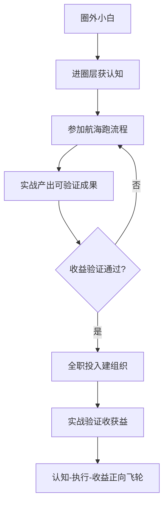
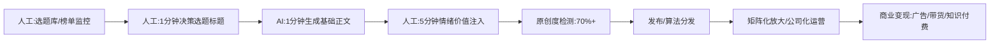
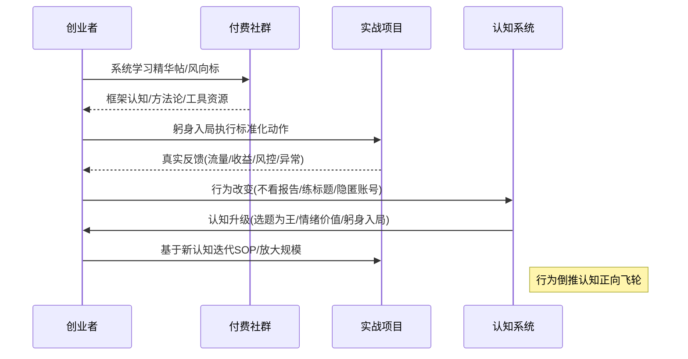
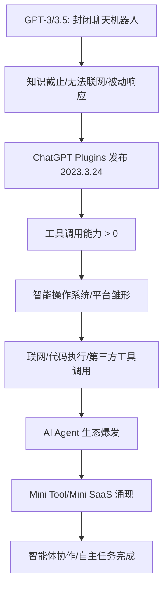
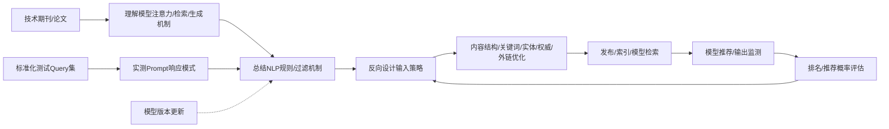
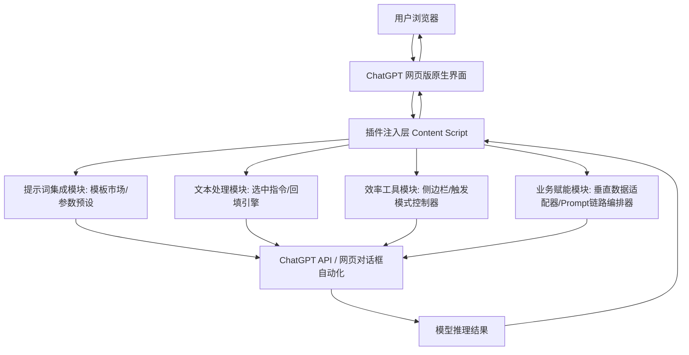
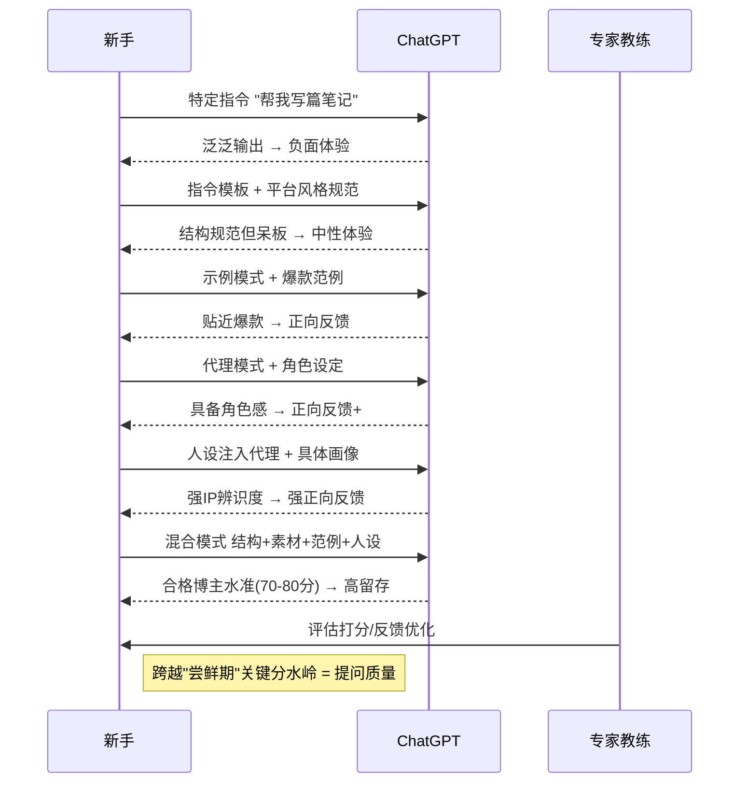

# 第 22 章 认知升级与 AI 内容生产核心范式

## 学习目标

- 理解社群赋能在新赛道切入中的加速器作用
- 掌握认知闭塞与信息差红利的本质及其变现路径
- 掌握“人工+智能”爆文生产框架的三步法与核心分工逻辑
- 理解躬身入局与认知迭代闭环的行为倒推认知机制
- 了解 ChatGPT 插件生态爆发带来的范式跃迁与先发红利
- 理解 ChatGPT SEO 与类 SEO 的商业机会本质：搜索即精准、精准即高转化
- 掌握浏览器插件增强范式与 Prompt 即产品的零门槛开发模型
- 掌握 Prompt 分级体系与混合模式的进阶路径，能根据任务复杂度选择合适模式

## 22.1 生活类比

想象 AI 内容生产是一家**高级定制西装店**。**社群赋能**如顶级裁缝学徒制：师傅传授纸样（框架）、带你实操（航海）、介绍贵客（人脉），但裁剪缝制仍需你自己练针线。**认知闭塞与信息差**恰似时尚前沿（巴黎秀场）与大众衣橱的时间差：你知道明年流行“宽肩”，现在就能卖“宽肩版型”的纸样给跟不上潮流的裁缝铺。**人工+智能爆文框架**对应设计总监（人工决策选题/风格）+ 智能裁剪机（AI 生成面料/结构）+ 手工刺绣师（人工注入情绪价值/细节），缺一不可出高定。**躬身入局**要求设计师必须亲自上手做第一版样衣，跑通版型工艺，才能交给车间量产；光看杂志（报告）永远学不会做衣服。**插件生态/类 SEO**相当于给顾客（大模型）装上“智能导购插件”：顾客不再只能试穿店里库存，能通过插件调用全城面料库、刺绣坊、物流车，甚至反向告诉顾客“这领型配你脸型更合适”。**Prompt 分级与混合模式**则是从“口头说要件衣服”（特定指令）→ “给张款式图”（指令模板）→ “给件成品让照着做”（示例模式）→ “扮演香奈儿首席设计师”（代理模式）→ “按香奈儿风格+客人身材数据+本季流行元素+指定面料库”（混合模式）出图纸。

## 22.2 概念地图

第 22 章 认知升级与 AI 内容生产核心范式
├── 社群赋能加速成长
│   ├── 前辈指引+结构化实战+人脉网络三位一体  —— P041/P126
│   ├── 路径：进圈层获认知 → 航海跑流程 → 全职投入 → 实战验证  —— P041/P126
│   └── 边界：赋能仅提供杠杆，执行力与复盘仍为个人核心变量  —— P041/P126
├── 认知闭塞与信息差红利
│   ├── 核心圈层幸存者偏差导致下沉市场认知鸿沟被忽视  —— P046
│   ├── GPT反向诱导人类协作/三年干掉程序员/文心一言本土化价值  —— P046
│   └── AI普及教育在下沉市场存在巨大信息差生意  —— P046
├── 人工+智能爆文框架
│   ├── 三步法：选题标题(50%权重/人工) → AI生成正文 → 情绪价值注入(人工)  —— P126
│   ├── 原创度跃升：60% → 70%+，效率≤10分钟/篇  —— P126
│   └── 边界：选题为上限/合规风险高/非万能公式  —— P126
├── 躬身入局与认知迭代闭环
│   ├── 拒绝雇佣军模式，项目必亲自跑通  —— P126
│   ├── 行为改变(不看报告/练标题/隐匿账号)倒推认知升级  —— P126
│   └── 长期主义：👸号需持续100天-1年穿越周期获复利  —— P126
├── ChatGPT插件生态爆发
│   ├── 范式跃迁：从聊天机器人到智能操作系统/平台  —— P130/A27M
│   ├── 先发红利：首批入驻获流量/品牌/数据复利  —— P130/A27M
│   └── 能力质变：联网后具备反向诱导人类协作的主动性智能  —— P130/A27M
├── ChatGPT SEO与类SEO机会
│   ├── 核心交互：搜索/对话 → 精准流量 → 高转化  —— P132/IkKO
│   ├── 定位：升级版抖音，更强个性化推荐与信任基础  —— P132/IkKO
│   └── 类SEO：黑盒逆向工程，研读期刊/实测Prompt总结NLP规则  —— P132/IkKO
├── 浏览器插件增强范式与Prompt即产品
│   ├── 最佳早期载体：零迁移成本，贴合使用场景  —— P133/A27M
│   ├── 四大形态：提示词集成/文本处理/效率工具/业务赋能  —— P133/A27M
│   ├── Prompt即产品：单Prompt=Mini Tool，组Prompts=Mini SaaS  —— P133/A27M
│   └── 交互创新：触发模式/场景原生嵌入/NLP能力平权  —— P133/A27M
└── Prompt分级体系与混合模式
    ├── 四基础模式：特定指令/指令模板/示例模式/代理模式  —— TQMk
    ├── 进阶混合模式：结构+范例+人设+素材四位一体  —— TQMk
    ├── 小红书标准化结构：开头/中间/结尾/标签四段式  —— TQMk
    ├── 核心价值：非标转标，将不及格内容提升至合格线  —— TQMk
    └── 竞争力模型：工作流嵌入深度 × 领域专业度  —— TQMk

## 22.3 社群赋能加速成长 —— 从“圈外小白”到“全职Builder”的跃迁路径

**为什么需要这个概念？**  
普通人切入 Web3 等新赛道面临认知门槛高、信息杂乱、试错成本大的困境。单打独斗易陷入“伪认知”陷阱，缺乏系统性框架与实战验证。我们需要一个低门槛、高杠杆的路径，快速建立行业认知并变现。

**核心定义**  
优质付费社群提供的“前辈指引+结构化实战训练+人脉网络”三位一体赋能体系。核心路径：进圈层获认知 → 参加航海跑流程 → 全职投入建组织 → 实战验证收获益。

**关键性质**  
社群赋能是认知建立的“加速器”，将分散的碎片信息整合为系统认知框架；是试错成本的“缓冲器”，通过前辈经验规避坑点，缩短探索周期；是商业变现的“放大器”，提供项目线索、合伙人、流量渠道等稀缺资源。

**典型例子**  
作者 KangKang：入圈 3 年 → 参加 Web3 入门｜2 月航海 → 全职 Web3 建立 Crypto Alpha → 3 周内团队实现 7 位数收益（ARB 空投）。评论区验证：成员普遍认同“生财是捷径”“航海是实战闭环”。

**边界条件**  
社群质量参差不齐，需筛选具备“头部前辈+结构化课程+实战导向”三要素的高质量社群；赋能仅提供杠杆，执行力与复盘迭代能力仍为个人核心变量，无法外包；过度依赖社群易形成“巨婴心态”，需保持“自我为最高信用资产”的主体性。

### 22.3.1 原文摘录

> "没有生财，我也很难在生财 Web3 前辈的指引下，快速的建立对行业的框架、系统认知、以及未来全职进入 Web3... 参加了 Web3 入门｜2 月航海... 目前全职 Web3，Crypto Alpha 创始人... 月底，3 月 22、3 月 23，就收获了期待的本年度的团队 7 位数的收益... 刘嘉仁 : 撸到了 arb 的空投吧，遗憾错过了 8 位数的收益... 每年累计超过十万元...回报是显而易见的，除了极大地弥补了自己在认知差、信息差上面的差距"
> 
> ——《P041/P126 社群赋能实战复盘》 素材ID：P041、P126 | 出处：docs/202303/20230328_041.md、docs/202303/20230328_126.md

这段原文直观展示了“社群赋能”的完整路径：从入圈、航海实战、全职创业到团队级收益验证。关键点在于**“前辈指引”建立框架认知，“航海实战”跑通标准化流程，“全职投入”完成身份转型**，最终通过 ARB 空投等实战项目实现收益兑现。评论区印证了收益主要来自 ARB 空投，且存在因时机错过更大收益（8 位数）的遗憾，这也侧面说明了**实战验证的确定性**与**时机把握**的重要性。

### 22.3.2 核心定义与推导

> **社群赋能加速成长论**（来源：《P041》《P126》）

**【推导说明】** 该公式为作者基于素材定性描述构建的概念框架，非素材原有量化公式。素材表明成长依赖三个独立杠杆（前辈指引、结构化航海、人脉网络）的叠加作用，故采用乘法结构表征“三者缺一不可、叠加放大”的特性；各变量为定性概念的量化代理，系数非实测值。

$$
\text{成长速度} = \text{基础认知获取效率} \times \text{实战验证闭环率} \times \text{资源连接杠杆}
$$

$$
\text{其中：基础认知获取效率} \uparrow \text{依赖前辈指引}；\text{实战验证闭环率} \uparrow \text{依赖结构化航海}；\text{资源连接杠杆} \uparrow \text{依赖人脉网络}
$$

**【公式作用】** 该公式将社群赋能的三个核心变量显性化：**前辈指引**压缩认知建立周期，**结构化航海**提升实战闭环成功率，**人脉网络**放大资源获取杠杆。乘法结构揭示了三者“缺一不可、叠加放大”的杠杆逻辑，三者共同构成了普通人低门槛切入新赛道的“加速器”。

### 22.3.3 关键方法：航海实战闭环法

> **航海实战闭环法**（来源：《P041》《P126》）

```
1. 圈层筛选：锁定具备“头部前辈+结构化课程+实战导向”三要素的高质量付费社群
2. 认知对齐：系统学习精华帖/风向标，建立行业框架认知（如Web3赛道全景图/商业模式拆解）
3. 实战训练：参加“航海”实战训练营，按手册执行标准化动作（如搭建节点/跑空投/做投研），产出可验证成果
4. 全职跃迁：基于实战验证结果，决策全职投入，组建团队/注册实体，完成身份从“学习者”到“Builder”的转型
5. 持续复利：在实战中积累项目经验/人脉/品牌，形成“认知-执行-收益”正向飞轮
```

**【方法作用】** 该伪代码展示了从圈外小白到全职 Builder 的标准化跃迁路径。关键在于第 3 步“实战训练”必须产出**可验证成果**（如 ARB 空投收益），这是认知转化为能力的唯一试金石；第 4 步“全职跃迁”需基于实战数据决策，而非主观冲动。适用于可标准化、可复制的新赛道切入场景。

### 22.3.4 方法演进图

下图展示了从“圈外小白”到“正向飞轮”的完整跃迁路径，核心看点为“实战产出可验证成果”作为决策全职的前置条件，形成闭环。



---

## 22.4 认知闭塞与信息差红利 —— 核心圈层与大众认知的“时间差套利”

**为什么需要这个概念？**  
核心圈层（北上广/头部创业者）普遍高估大众对前沿技术（如大模型）的认知普及度。这种“幸存者偏差”导致下沉市场巨大的认知鸿沟被忽视，实则是巨大的商业蓝海。认知时间差是普通人通过普及教育、工具教学实现变现的核心机会窗口。

**核心定义**  
国内认知闭塞：核心圈层误判大众普及度，忽视下沉市场认知鸿沟。信息差红利：利用“国外科技圈共识 → 国内核心圈认知 → 大众普及”的时间窗口，提供基础认知、工具使用、提示词教学等服务。

**关键性质**  
核心圈层已达成共识（如 GPT-3 年干掉程序员、GPT 联网反向诱导人类），大众仍处认知空白期，呈现非对称性；GPT-4 级能力 2022 年 10 月已小圈层内测，公众认知爆发滞后 5 个月，呈现滞后性；基础普及教育在下沉市场存在极大信息差生意，门槛低、需求大、复购强，呈现可变现性。

**典型例子**  
“三年干掉程序员”海外共识 vs 国内仍在争论 AI 能否写代码；GPT 联网后“反向诱导人类协作”被低估，实为智能体雏形；文心一言被舆论嘲讽“低能”，实则针对中文语境/合规深度优化，本土化价值被低估。

**边界条件**  
信息差具有时效性，随技术普及（如提示工程师职业化）红利窗口会关闭；仅传递信息不够，需结合“实战验证”将信息转化为确定性方法论；核心圈层认知也会滞后（如低估应用层风向切变风险），不可盲目跟随。

### 22.4.1 原文摘录

> "国内信息太闭塞，国外科技圈早就全面跟上... 我们生活在北上广，有信息的幸存者偏差... Gpt 的聪明被大多数人低估了，尤其是国内的人，举例：联网后，gpt 已经会自己从社交媒体诱导人类帮他干活了... 号称三年要干掉程序员行业，自己很多基础的岗位被取代就是分分钟... 文心一言不低能，被大众低估了，大家都只知道吃瓜，但其实它能做的事情也很多，而且我们在国内的人反而更需要关注文心一言... 一些基础的普及教育，在下沉市场仍然存在很大的信息差生意... Vicent : gpt-4 是去年出来了... 刘晨昊 : 不是，意思是去年就有它的低阶版本了"
> 
> ——《P046 认知闭塞与信息差深度对话》 素材ID：P046 | 出处：docs/202303/20230328_046.md

这段对话揭示了三层认知鸿沟：**时间鸿沟**（GPT-4 级能力 2022 年 10 月内测，公众 2023 年 3 月才知）、**认知鸿沟**（核心圈已共识“三年干掉程序员”，大众还在争论能否写代码）、**价值鸿沟**（文心一言本土化价值被低估，下沉市场普及教育需求被忽视）。评论区印证了 GPT-4 早期内测时间线，佐证了“认知暗区”约 5 个月的存在。

### 22.4.2 核心定义与推导

> **信息差红利窗口期模型**（来源：《P046》）

**【概念模型】** 该模型为作者基于素材定性描述构建的概念框架，非素材原有量化公式。素材描述了“核心圈共识 → 大众普及”的时间差、实战验证周期、下沉市场需求规模与认知门槛、竞争者进入速度等要素，故构建时间窗口公式与变现上限比例关系。

$$
\text{可操作红利窗口} \approx T_{\text{大众普及}} - T_{\text{核心圈共识}} - T_{\text{实战验证周期}}
$$

$$
\text{变现上限} \propto \frac{\text{下沉市场需求规模} \times \text{认知门槛}}{\text{竞争者进入速度}}
$$

**【公式作用】** 该模型展示了信息差红利的**时间窗口本质**：核心圈达成共识到大众普及之间的时间差，减去实战验证所需周期，即为可操作的红利窗口。变现上限正比于下沉市场需求规模与认知门槛，反比于竞争者进入速度。需注意：所有变量均为定性概念的量化代理，非实测数值。

### 22.4.3 多源对照：GPT 反向诱导人类协作 vs 传统提示工程

> **说明**：以下对照包含基于素材的推演扩展，标注为“推演”的行属于作者基于素材趋势的前瞻性判断。

| 维度 | 传统提示工程 (Prompt Engineering) | GPT 反向诱导人类协作 |
|------|----------------------------------|---------------------|
| **核心逻辑** | 人类设计 Prompt → 模型输出 | 模型联网后主动调用外部工具 → 反向引导人类完成任务 |
| **主体性** | 人类主导，模型被动响应 | 模型具备主动性，成为任务发起者 |
| **交互模式** | 单向：人 → 模型 | 双向闭环：模型 ↔ 人类 ↔ 外部工具 |
| **智能层级** | 工具级（L1-L2） | 智能体雏形（L3，推演） |
| **商业启示** | 教人写 Prompt | 设计“人机协作流程”，让模型管理人类执行 |

**共识**：大模型能力释放高度依赖高质量 Prompt，Prompt 工程是当前核心技能。  
**分歧**：传统观点认为人类永远是主导者；前沿观点（P046）指出联网后 GPT 已具备**反向诱导人类协作**的主动性智能，标志着从“工具”向“智能体/合作者”跃迁，这将重塑未来的工作流设计范式。

---

## 22.5 人工+智能爆文框架 —— 10 分钟产出 10W+ 的标准化 SOP

**为什么需要这个概念？**  
传统内容创作面临“原创度低、效率不高、情绪价值缺失”三大痛点。纯 AI 生成内容程式化、缺乏人情味，原创度仅 60% 难过平台风控；纯人工创作效率低、不稳定，难以支撑矩阵化、规模化运营。

**核心定义**  
三步协作流：1. 人工决策选题标题（占 50% 权重，1 分钟）→ 2. ChatGPT 生成正文（执行层，1 分钟）→ 3. 人工注入情绪价值（打磨层，5 分钟：加引文、衔接、升华）。核心公式：选题决策权重（50%）+ AI 执行效率 + 情绪价值注入 = 高原创度（70%+）爆文。

**关键性质**  
分工明确：人类负责“选择大于努力”的决策与“人性洞察”的情绪，AI 负责标准化执行；原创度跃升：从基础 60% 提升至 70%+，轻松通过平台原创校验；效率极致：单篇耗时 ≤ 10 分钟，支撑矩阵化、公司化放大。

**典型例子**  
作者袁永兵：新号 5 篇 10W+，单篇广告收益数千元，10 分钟/篇。情绪价值注入前后对比：AI 生成“首先、其次、最后”程式化结构 → 人工优化后具备起承转合、引文金句、结尾升华。

**边界条件**  
选题标题质量是上限：AI 无法替代“选择大于努力”的决策层，需建立爆文库/榜单监控机制；合规风险高：AI 生成情感类故事易触发“网络清朗行动”风控（编造故事/失真内容），需隐匿账号信息、优化真实性；非万能公式：适用于知识分享、干货类内容，强叙事/深度报道类仍需人类主导。

### 22.5.1 原文摘录

> "搭了一个人工+智能爆文框架，总共 3 步：1、选题+标题，占 50%，做内容就是做选题，所谓选择大于努力 2、正文 3、情绪价值 这就是我这边的人工+智能（ChatGPT）爆文框架，人工来做 1 和 3；ChatGPT 写 2... 选题、标题用时 1 分钟左右... 经过 ChatGPT 1 分钟左右输出... 再用 5 分钟，也就是经过第 3 步的优化... 总共用时不超过 10 分钟... 这时候原创度大概在 60%左右... 再测原创度，已经高达 70%以上，主流平台都能轻松过关... 现在这个号的文章篇篇都是 ChatGPT 写的，目前有 5 篇文章的阅读量到达 10w+了，也有了一定的变现... 总感觉，这样编出来的故事，容易让人举报... 网信办再次开展网络清朗行动，打击的就是失真内容"
> 
> ——《P126 👸号爆文实战复盘》 素材ID：P126 | 出处：docs/202303/20230328_126.md

这段原文完整呈现了“人工+智能”爆文框架的**三步法**、**分工逻辑**、**时间成本**、**原创度跃升**与**商业验证**。关键洞见：选题标题占 50% 权重（选择大于努力），AI 仅负责执行层；情绪价值注入是原创度从 60%→70%+ 的关键；合规风险提示了 AI 内容商业化的政策边界。

### 22.5.2 核心定义与推导

> **人工+智能爆文框架**（来源：《P126》）

**【模型推演】** 以下公式中的权重 $w_2=0.2, w_3=0.3$ 及缓冲时间 $T_{\text{缓冲}}$ 为作者基于素材“1分钟/5分钟”时间投入比推演的经验值，原文未直接给出具体数值。$w_1=0.5$ 直接源自素材“占 50%”。原创度跃升值（+10%+）源自素材“60%→70%+”。

$$
\text{爆文质量} = w_1 \cdot \text{选题标题质量} + w_2 \cdot \text{AI执行质量} + w_3 \cdot \text{情绪价值密度}
$$

$$
\text{其中：} w_1 = 0.5, w_2 = 0.2, w_3 = 0.3
$$

$$
\text{原创度} = \text{基础AI原创度}(60\%) + \Delta_{\text{情绪价值}}(10\%+) = 70\%+
$$

$$
\text{单篇耗时} = T_{\text{选题}}(1\text{min}) + T_{\text{AI生成}}(1\text{min}) + T_{\text{情绪注入}}(5\text{min}) + T_{\text{缓冲}}(3\text{min}) \le 10\text{min}
$$

**【公式作用】** 该公式展示了**选题决策权重论**（$w_1=0.5$）的核心地位：**选题标题是内容上限**，AI 执行与情绪注入只是兑现选题价值的手段。原创度跃升公式揭示了**情绪价值注入机制**的量化贡献（+10%+）。时间成本公式验证了**极致效率**的可行性（≤10 分钟/篇）。$w_2, w_3$ 为经验推演值，实际操作中需根据素材复杂度动态调整。

### 22.5.3 关键方法：情绪价值注入工程

> **情绪价值注入工程**（来源：《P126》）

```
输入：AI生成的基础正文（结构程式化、语言机械、缺乏人情味）
步骤：
1. 植入金句/引文：在关键论点前植入1-2句行业名言/个人金句，建立权威感
2. 优化段落衔接：将"首先/其次/最后"替换为逻辑自然的过渡语，实现起承转合
3. 结尾升华：从"总结"升级为"洞察/行动号召/情感共鸣"，留存读者情绪余味
4. 真实性增强：补充个人真实经历/数据/案例，替换AI通用论述，规避"编造故事"风控
5. 排版美化：加粗关键句、插入分隔符、配置封面图，提升阅读体验
输出：原创度≥70%、具备社交传播属性、符合平台调性的终稿
```

**【方法作用】** 该伪代码展示了**情绪价值注入**的 5 个标准化动作。每个动作针对 AI 生成内容的具体缺陷：程式化结构→衔接优化、缺乏权威→金句植入、结尾平淡→升华、风控风险→真实性增强、阅读体验差→排版美化。这也是将 AI 内容从“不及格”提升至“合格博主水准”的核心工程。适用于知识分享、干货类👸号/小红书内容生产。

### 22.5.4 数据流图：人工+智能协作流

下图展示了从“选题库”到“商业变现”的完整数据流向，核心看点为“人工决策→AI执行→人工打磨”的三层分工与“矩阵化放大”的规模化路径。



---

## 22.6 躬身入局与认知迭代闭环 —— 行为倒推认知的长期主义生存法则

**为什么需要这个概念？**  
创业者易陷入“雇佣军模式”：花钱雇人做未亲自跑通的项目，导致失控亏损。认知调整极难（作者 40 岁仍在调整），单纯“学知识/看报告”形成“伪认知”（一说都会，一做都错）。需要一套通过“行动→反馈→认知升级”的正向飞轮机制。

**核心定义**  
躬身入局：项目必须亲自跑通才能交付团队，拒绝雇佣军模式。认知迭代闭环：通过“如果我是对的早就不是现在这样”自我对话打破伪认知 → 行为改变（不看报告/刻意练标题/隐匿账号） → 倒推认知升级 → 形成正向飞轮。

**关键性质**  
认知滞后于行为：直接调整认知极难，但行为改变可倒推认知跃迁；实战是唯一试金石：付费社群、航海实战提供“弄脏手”的机会，将隐性知识显性化；长期主义前提：👸号爆文需持续执行 100 天-1 年，穿越周期获复利，急功近利是放弃主因。

**典型例子**  
作者：前三次起号铩羽而归 → 付费社群系统学习+航海实战 → 行为改变（每日抄标题/隐匿账号/搭建私有 API） → 认知重构（选题为王/情绪价值/躬身入局） → 单号跑通 → 公司化矩阵化放大。付费社群 ROI 验证：年投 10 万+，获 ChatGPT 稳定接口、刀姐调教提示词、精华帖方法论，认知套利极高。

**边界条件**  
需具备“空杯心态”与“100%照单全收”的执行力，抗拒/打折执行将失效；仅适用于可标准化、可复制的项目模式，非标高认知服务仍依赖个人核心能力；平台规则变化（如推荐算法收敛/风控收紧）可能失效，需持续迭代 SOP。

### 22.6.1 原文摘录

> "凡是没有经过自己手亲自跑通的项目，再也不敢放手去让所谓的“雇佣军”去做主了... 这里最难的是思维的调整，太难了... 以至于我在 40 岁的当下，我仍然在调整... 你看，随着我的行为的改变，也能倒推出认知上的提高，都是相互作用的... 👸号爆文写作... 先从持续做这件事一百天开始，一年开始... 每年累计超过十万元... 回报是显而易见的，除了极大地弥补了自己在认知差、信息差上面的差距"
> 
> ——《P126 认知迭代与躬身入局实战》 素材ID：P126 | 出处：docs/202303/20230328_126.md

这段原文揭示了**认知调整的极端困难性**（40 岁仍在调整）与**行为倒推认知**的实操路径：不看报告、刻意练标题、隐匿账号信息等具体行为改变，倒推出“选题为王”“情绪价值”“躬身入局”等认知升级。付费社群的高 ROI（年投 10 万+，弥补认知差/信息差）验证了“花钱买时间/认知”在创业初期的杠杆价值。

### 22.6.2 核心定义与推导

> **认知迭代闭环模型**（来源：《P126》）

**【概念模型】** 该模型为作者基于素材“行为倒推认知”机制构建的概念框架，非素材原有数学公式。素材描述了“认知调整难、行为改变倒推认知、需实战验证触发、伪认知表现为实际产出远低于认知预期”，故构建递推公式与指示函数。

$$
\text{认知}_{t+1} \approx \text{认知}_t + \alpha \cdot \Delta\text{行为}_t \cdot \mathbb{1}_{\text{实战验证通过}}
$$

$$
\text{其中：}\alpha \text{为行为转化系数，}\mathbb{1}_{\text{实战验证通过}} \text{为指示函数（实战验证通过则为1，否则为0）。}
$$

$$
\text{伪认知识别：实际产出} \ll \text{认知预期} \Rightarrow \text{触发"如果我是对的早就不是现在这样"自我对话}
$$

**【公式作用】** 该模型展示了**行为倒推认知**的逻辑机制：认知升级取决于**行为改变量**与**实战验证结果**的乘积。无实战验证的行为改变不产生认知跃迁。伪认知识别公式给出了打破“伪认知”的触发条件：实际结果远低于认知预期时，启动深度自我对话。$\alpha$ 为经验系数，非实测值。

### 22.6.3 关键方法：认知重构清单

> **认知重构清单**（来源：《P126》）

```
必须亲自跑通的 3 个动作：
1. 搭建稳定可用的生产环境（如私有API/指纹浏览器/RPA流程），不依赖外包
2. 执行"人工+智能"三步框架产出首篇合格内容，实测原创度/流量/变现全链路
3. 建立每日复盘机制：记录关键决策/异常数据/心理轨迹，形成个人案例库

必须打破的 2 个伪认知：
1. "看懂/听懂/买了工具 = 我会了" → 替换为"一做就错，只认实战结果"
2. "找人/买课/买资源 = 解决问题" → 替换为"核心节点必须自我把控，外包仅限执行层"

长期主义执行承诺：
- 👸号/内容赛道：承诺持续执行 100 天-1 年，不因前期数据波动放弃
- 复盘频次：每日 10 分钟复盘，每周 1 小时深度复盘，每月 1 次战略复盘
```

**【方法作用】** 该清单将“躬身入局”与“认知迭代”转化为可执行的**最小可行性动作集**。关键设计：亲自跑通 3 个动作覆盖“环境/内容/复盘”全链路；打破 2 个伪认知针对“知行差距”与“责任外包”；长期主义承诺设定了穿越周期的最小时间单位（100 天-1 年）。适用于内容创业、AI 应用开发等可标准化验证的项目。

### 22.6.4 时序图：认知迭代闭环

下图展示了“创业者-社群-实战-认知”四方交互的时序，核心看点为“行为改变”触发“认知升级”进而反哺“实战迭代”的正向飞轮。



---

## 22.7 ChatGPT 插件生态爆发 —— 从“聊天机器人”到“智能操作系统”的范式跃迁

**为什么需要这个概念？**  
ChatGPT 原有“知识截止+无法联网+被动响应”三大硬伤，限制商业化落地。开发者缺乏标准化接入外部工具/数据的通道，应用开发处于原始阶段。需要一个开放生态机制，将大模型推向平台化拐点。

**核心定义**  
ChatGPT Plugins：OpenAI 开放的标准化扩展机制，赋予模型联网、代码执行、第三方工具调用能力。AI Agent 生态雏形：大模型作为“智能操作系统”，通过插件连接万物，完成复杂任务。

**关键性质**  
范式跃迁：从封闭“聊天机器人”转向开放“智能操作系统/平台”；先发红利：首批入驻开发者将获流量/品牌/数据复利，社群开发者即时动员抢占；能力质变：联网后 GPT 具备“反向诱导人类协作”主动性智能，标志智能体雏形出现（详见 22.4.3 多源对照）。

**典型例子**  
2023.3.24 OpenAI 发布插件功能，星球社群程序员即时列队集合（8 人极速响应）。成员行为：抢先申请内测资质、寻求带队协作（“出发，带我一个”）、组队开发。

**边界条件**  
初期为邀请制/申请制，获取开发者资质是前置门槛；官方 Plugins 与第三方浏览器插件完全不同，后者面临被原生能力替代风险；插件生态早期尚未爆发，API 全面开放后将涌现海量 Mini Tool/Mini SaaS。

### 22.7.1 原文摘录

> "ChatGPT 王炸更新宣布推出插件功能，赋予 ChatGPT 联网的功能... 请星球的程序员评论区列队集合，准备出发... 大白白 : 出发, shijinzhan : 来了, Charliex : 来啦, Holly 软件开发 : 出发... 有霸夫 : 先申请, 学长刚蝈 : 出发，带我一个... 新的插件 Plugins 波澜壮阔，我后续再写下一篇"
> 
> ——《P130 ChatGPT Plugins 发布即时动员》 素材ID：P130 | 出处：docs/202303/20230328_130.md

这段原文记录了**范式跃迁时刻**（2023.3.24）与**开发者社群的即时动员**。关键信号：“列队集合”“出发”“先申请”“带我一个”展现了技术社群对重大平台能力开放的极高敏感度与执行力。作者预判“波澜壮阔”的生态爆发，暗示了**先发红利**的时间紧迫性。

### 22.7.2 核心定义与推导

> **插件功能为 AI 应用开发的拐点**（来源：《P130》《A27M》）

**【作者推演模型】** 以下公式为作者基于素材“范式跃迁”定性判断构建的推演模型，素材未涉及量化生态增长模型。素材确立了“工具调用能力从 0 变 >0”触发本质属性质变、“开发者数量/工具丰富度/用户粘性”驱动生态爆发三要素，故构建分段函数与指数增长模型。

$$
\text{大模型能力} = f(\text{参数量}, \text{训练数据}, \text{工具调用能力})
$$

$$
\text{Plugins 引入前：} \text{工具调用能力} = 0 \Rightarrow \text{大模型} = \text{封闭聊天机器人}
$$

$$
\text{Plugins 引入后：} \text{工具调用能力} > 0 \Rightarrow \text{大模型} = \text{智能操作系统/平台}
$$

$$
\text{生态爆发度} \propto \text{开发者数量} \times \text{工具丰富度} \times \text{用户粘性} \times e^{t/\tau} \quad (\text{推演项，}\tau\text{为时间常数})
$$

**【公式作用】** 该公式展示了 **Plugins 引入前后大模型本质属性的质变**：工具调用能力从 0 变为 >0，直接触发了从“封闭聊天机器人”到“智能操作系统/平台”的范式跃迁。生态爆发度公式揭示了**指数级增长**的驱动变量：开发者数量、工具丰富度、用户粘性与时间常数 $\tau$。指数项为作者推演，素材仅定性描述“波澜壮阔”。

### 22.7.3 方法演进图：从聊天机器人到智能操作系统

下图展示了大模型从“封闭聊天机器人”向“智能操作系统”演进的关键节点，核心看点为“Plugins 发布”作为拐点触发“工具调用能力 > 0”进而引发生态爆发。



### 22.7.4 多源对照：官方 Plugins vs 第三方浏览器插件

> **说明**：此表格含基于素材趋势的前瞻性判断，标注为“【前瞻分析】”的行属于作者基于 P130“新的插件 Plugins 波澜壮阔”及 A27M 素材的推演，非素材直接支撑。

| 维度 | OpenAI 官方 Plugins | 第三方浏览器插件 |
|------|---------------------|------------------|
| **技术层级** | 模型原生能力扩展（API 层） | 网页端体验增强（前端注入层） |
| **能力边界** | 联网/代码执行/任意API调用/状态持久化 | 仅能操作网页 DOM/注入 Prompt/辅助交互 |
| **生态位置** | 平台层（操作系统内核） | 应用层（外挂工具） |
| **替代风险** | 无（是基础设施，【前瞻分析】） | 高（官方原生能力上线即替代，【前瞻分析】） |
| **开发门槛** | 需申请资质/遵循 OpenAI 规范/部署服务端 | 仅需前端技能/Chrome Extension API |
| **商业模式** | 平台分成/流量分发/品牌背书 | 订阅制/免费增值/流量变现 |
| **先发红利** | 极高（首批入驻=平台标杆） | 中等（验证需求/积累用户/跑通商业） |

**共识**：两者均旨在弥补 ChatGPT 原生体验不足，延伸应用边界。  
**分歧**：官方 Plugins 是**平台层基础设施**，决定生态上限；第三方浏览器插件是**应用层过渡形态**，面临被原生能力替代的结构性风险。P130 明确区分两者：“这里的插件不是 Plugins，而是指 Chrome 浏览器插件。新的插件 Plugins 波澜壮阔”，暗示第三方插件生态将被官方生态重塑。

---

## 22.8 ChatGPT SEO 与类 SEO 机会 —— 搜索即精准、精准即高转化

**为什么需要这个概念？**  
传统 SEO 依赖关键词匹配，流量精准度受限于搜索引擎算法。抖音“兴趣推荐+搜索”模式虽强但意图不如搜索/对话显性。ChatGPT 插件开放后，“搜索/对话”成为核心交互，蕴含极高商业转化潜力。

**核心定义**  
ChatGPT SEO：基于 ChatGPT“搜索/对话”核心交互模式产生的精准流量获取与商业转化红利。升级版抖音：ChatGPT 凭借纯搜索/对话交互，具备更强个性化推荐能力与用户信任基础。类 SEO：黑盒逆向工程，研读期刊/实测 Prompt 总结 NLP 规则，反向设计输入策略影响模型输出（品牌露出/推荐）。

**关键性质**  
搜索即精准：显性意图交互天然带来精准流量，转化率远超兴趣推荐；信任是商业起点：长期依赖/使用产生的信任感，是后续商业变现（SEO/推荐/交易）基础设施；传统 SEO 可迁移：联网爬虫兼容策略下，传统 SEO 体系（内容质量/关键词/外链）可直接迁移生效。

**典型例子**  
作者云飞：本地部署 GPT-3.5，将工作流拆解为 Prompt 逐个训练，已成个人助理。交互模式对标：抖音（滑动/点赞/评论/搜索+兴趣推荐）vs ChatGPT（纯搜索/对话+高意图精准度）。

**边界条件**  
隐私与商业化矛盾：个性化推荐需访问隐私数据（购物历史等），将引发信任危机；黑盒不确定性：模型参数/训练数据不公开，需持续研读期刊/实测 Prompt 逆向推导 NLP 规则；插件生态重构渠道：从“人找货”变“货找人”，商家可获深度用户数据制定策略。

### 22.8.1 原文摘录

> "ChatGPT 和用户的交互行为目前主要就是？搜索！搜索！搜索！！！... 搜索意味着精准，精准意味着高转化，顺着互联网流量的逻辑，大家就知道后续了... 相比而言，我认为它是升级版的抖音/TikTok，具有更强的个性化推荐能力... 依赖的结果就是对平台产生信任，而信任是商业的开始... 就是把我工作中常需要跟文字打交道的一些工作梳理出来，然后逐个梳理出流程，转化成 prompt 格式，逐个就训练啊"
> 
> ——《P132 ChatGPT SEO 机会与升级版抖音定位》 素材ID：P132 | 出处：docs/202303/20230328_132.md

这段原文提出了 **“搜索即精准，精准即高转化”** 的核心商业主张，并将 ChatGPT 定位为**“升级版抖音”**：抖音靠“兴趣推荐+搜索”双引擎，ChatGPT 靠“纯搜索/对话”单引擎但意图更显性、信任更深度。作者亲测“本地部署 GPT-3.5 + Prompt 工程化训练”已成个人助理，验证了**工作流 Prompt 化**的可行路径。

### 22.8.2 核心定义与推导

> **搜索即精准，精准即高转化**（来源：《P132》）

**【概念阐述】** 素材仅定性描述“黑盒逆向工程”，以下为文字逻辑阐述，非数学建模。

**商业转化价值的三大驱动因子**：
1. **流量精准度**：搜索/对话交互的显性意图天然过滤无效流量
2. **用户意图显性度**：对话式查询比兴趣推荐更直接暴露商业需求
3. **信任基础**：长期依赖模型产生的信任感，是后续商业变现的基础设施

**类 SEO 优化目标**：
在模型参数/训练数据不公开（黑盒约束）的前提下，通过 Prompt 策略设计，使模型在相关 Query 下倾向推荐自家品牌/产品。

**实施路径**：持续研读技术期刊（Transformer/RLHF/RAG/Tool Use 等，【作者补充，需补充文献】）→ 构建标准化测试 Query 集实测响应模式 → 总结 NLP 处理规则与过滤机制 → 反向设计输入策略（内容结构/关键词/实体/权威背书/外链） → 定期复测并随模型版本迭代动态调整。

### 22.8.3 关键方法：类 SEO 黑盒逆向工程法

> **类 SEO 黑盒逆向工程法**（来源：《P132》）

```
1. 研读底层技术期刊：跟踪Transformer/RLHF/RAG/Tool Use等核心技术论文，理解模型注意力机制/检索融合/生成约束（素材原文“研读期刊”，具体技术方向为作者补充，【需补充文献】）
2. 实测 Prompt 响应模式：构建标准化测试集(数百Query)，系统记录模型输出模式(引用来源/推荐逻辑/拒答边界/格式偏好)
3. 总结 NLP 处理规则与过滤机制：归纳模型对关键词权重/语义匹配/实体识别/情感倾向/权威性判断的隐性规则
4. 反向设计输入策略：针对目标Query类别，优化内容结构/关键词布局/实体标注/权威背书/外链建设，使其符合模型偏好
5. 持续迭代验证：定期复测核心Query排名/推荐情况，根据模型版本更新(如GPT-3.5→4→4o)动态调整策略
```

**【方法作用】** 该伪代码展示了**类 SEO**的 5 步标准化流程。区别于传统 SEO“迎合爬虫算法”，类 SEO 是“迎合大模型推理偏好”。核心难点在于**黑盒约束**：模型参数/训练数据不公开，只能通过“研读期刊+实测 Prompt”持续逆向推导 NLP 规则。适用于需在大模型生态中获取品牌曝光/推荐流量的商家。

### 22.8.4 数据流图：类 SEO 优化闭环

下图展示了类 SEO 从“技术期刊”到“策略迭代”的闭环数据流，核心看点为“模型版本更新”作为外部扰动驱动规则库持续更新。



---

## 22.9 浏览器插件增强范式与 Prompt 即产品 —— 零门槛构建 Mini Tool/Mini SaaS

**为什么需要这个概念？**  
ChatGPT 官方仅提供网页版，原生体验存在不足（无模板市场、无搜索同步、无场景原生嵌入）。非技术用户无法直接调用 API，开发者面临“面向 Google 编程”低效痛点。需要一个零迁移成本、贴合用户习惯的产品形态快速验证需求。

**核心定义**  
浏览器插件增强范式：利用插件对网页版 ChatGPT 做体验升级，站在巨人肩膀上做增量创新。四大产品形态：提示词集成类（AIPRM）、文本处理类、效率工具类、业务赋能类。Prompt 即产品范式：单条 Prompt = Mini Tool，一组 Prompts = Mini SaaS，核心竞争力从代码转移至 Prompt 工程。

**关键性质**  
最佳早期载体：网页增强能力天然贴合使用场景，零迁移成本，验证需求/积累用户/跑通商业最优；交互创新：触发模式（始终/问号/手动）平衡响应速度与成本/干扰，将控制权交还用户；场景原生嵌入：切入 Gmail/Notion/Amazon 原生输入框，实现“选中-指令-回填”闭环，无需上下文切换；NLP 能力平权：大模型消解垂直 SaaS 长尾建模瓶颈，实现全品类覆盖、秒出结果、体验跃迁。

**典型例子**  
AIPRM：Prompt 模板市场嵌入原生界面，精选 Prompt 限付费版（$20/月），60 万+安装量验证付费意愿；ChatGPT for Google：搜索侧边栏同步答案，触发模式控制调用，开源策略获 100 万+用户；ChatGPT Writer：贴合 Gmail 写信框，场景原生嵌入驱动 30 万用户增长；Shulex VOC：电商评论分析+ChatGPT → 全品类覆盖/秒出 Listing 优化/多维分析，营销借势增长迅猛。

**边界条件**  
模型版本决定上限：Monica 交互精美但内容质量弱，推测调用 GPT-3 而非 3.5/4，底层能力是硬约束；官方 Plugins 开放后将引爆生态，第三方插件面临被原生能力重塑/替代风险；国内环境制约（网络/合规/支付），建议创业者优先出海，面向英文市场复刻 SEO/产品主导增长。

### 22.9.1 原文摘录

> "因为 ChatGPT 官方是一个网页版，浏览器插件是对网页的 Enhance，在用户熟悉的场景下做的体验升级，贴合用户习惯，乐于使用... ChatGPT 是魔法百宝箱，密码就是 Prompts，这是流量密码，也是财富密码... 一句 Prompt 等于一个 Mini tool，一套 Prompts 等于一个 Mini SAAS... 从面向 Google 编程，到面向 ChatGPT 编程... Trigger Mode（触发模式） * Always：每次谷歌搜索都查询响应 * Question Mark：当带上问号 ？时，才响应 * Manually：默认不响应，需要的时候再点击一下... 在 ChatGPT 出现以前...比较难覆盖全品类。而 ChatGPT 横空出世后，NLP 不存在了…，可以面向更多商家服务了"
> 
> ——《P133/A27M 浏览器插件生态观察与产品范式重构》 素材ID：P133、A27M | 出处：docs/202303/20230328_133.md、docs/202303/A27Md68WVox13FxPZFeczOVgnKc.md

这段原文系统阐述了**浏览器插件增强范式**的合理性（网页版增强、零迁移成本）、**Prompt 即产品范式**（Mini Tool/Mini SaaS 定律）、**开发者范式迁移**（面向 Google→面向 ChatGPT 编程）、**交互创新**（触发模式三档）、**技术赋能逻辑**（NLP 能力平权/全品类覆盖）与**出海必要性**。A27M 素材进一步用 AIPRM/ChatGPT for Google/ChatGPT Writer/Shulex VOC 等案例验证了四大产品形态的商业化可行性。

### 22.9.2 核心定义与价值逻辑

> **Prompt 即产品范式**（来源：《P133》《A27M》）

**【定性结论】** 素材定性陈述“NLP 不存在了…可以面向更多商家服务了”、“一句 Prompt 等于一个 Mini tool”，以下保留核心定性逻辑，不做量化推演。

**产品价值驱动因子**：
- **Prompt 工程质量**：高质量 Prompt 直接决定输出上限
- **场景嵌入深度**：原生输入框嵌入 vs 独立侧边栏，前者留存显著更高
- **用户粘性**：高频场景+低切换成本=高留存
- **开发维护成本**：零后端/零模型训练/零基建，极低边际成本

**Mini Tool**：单 Prompt 封装单一功能（如 YouTube Summary：字幕提取+总结）  
**Mini SaaS**：系统化 Prompt 组合（如 AIPRM：分类模板市场+参数预设+输出风格控制）

**NLP 能力平权收益**：大模型通用能力覆盖长尾场景，消解了传统垂直 NLP 长尾建模成本高企的瓶颈，实现全品类覆盖、秒出结果、体验跃迁。

### 22.9.3 关键方法：浏览器插件四大形态构建法

> **浏览器插件四大形态构建法**（来源：《P133》《A27M》）

| 形态 | 核心价值 | 典型交互 | 变现路径 | 代表案例 |
|------|----------|----------|----------|----------|
| **提示词集成类** | 降低提问门槛，提升输出质量 | 原生界面嵌入模板市场/参数预设/一键应用 | 免费增值（精选模板付费） | AIPRM（60万+装/$20月） |
| **文本处理类** | 场景原生嵌入，消除上下文切换 | 选中文本→右键/快捷键→指令处理→结果回填 | 订阅制/按量付费 | ChatGPT Writer（30万用户/Gmail嵌入） |
| **效率工具类** | 搜索/阅读/编码双轨并行 | 侧边栏同步答案/触发模式控制调用 | 开源+捐赠/企业版 | ChatGPT for Google（100万+装/开源） |
| **业务赋能类** | 垂直数据+大模型=生成式洞察 | 后台数据同步→Prompt工程链路→报告/内容生成 | SaaS订阅/咨询服务 | Shulex VOC（电商全品类覆盖/秒出Listing） |

**【方法作用】** 该表格展示了四大形态的**核心价值、交互模式、变现路径与代表案例**。关键洞见：提示词集成类靠“模板市场”做流量入口，文本处理类靠“场景原生嵌入”做留存，效率工具类靠“触发模式”做成本控制，业务赋能类靠“垂直数据+大模型”做护城河。适用于 AI 原生应用早期产品形态选择与商业化路径设计。

### 22.9.4 架构分层图：浏览器插件增强体系

【作者抽象建模】此图为基于素材四大形态功能的架构抽象建模，非素材原文直接呈现。D1 对应 AIPRM（提示词集成），D2 对应 ChatGPT Writer（文本处理），D3 对应 ChatGPT for Google（效率工具），D4 对应 Shulex VOC（业务赋能）。



---

## 22.10 Prompt 分级体系与混合模式 —— 从“特定指令”到“结构化混合”的进阶路径

**为什么需要这个概念？**  
新手直接用“特定指令”聊天，输出泛泛无结构，体验差易放弃工具。单一模式（指令/示例/代理）均有短板：指令呆板、示例依赖范例质量、代理缺乏人设细节。需要一套结构化的进阶路径，将 Prompt 工程从“玄学”变为“可复制的工程”。

**核心定义**  
四大基础模式：1. 特定指令（确认知晓） 2. 指令模板（平台风格规范） 3. 示例模式（Few-shot 模仿爆款） 4. 代理模式（Role-Play 角色扮演）。进阶混合模式：指令模板（结构）+ 特定指令（素材）+ 示例模式（范例）+ 代理模式（人设）四位一体。小红书标准化结构：开头（痛点/情景/人设/方法/诱导）+ 中间（1-5 知识点重点讲 1-2）+ 结尾（提关注/强人设/引主页）+ 标签（热门标签自打）。

**关键性质**  
质量阶梯显著：同主题“推荐 ChatGPT 写简历”对比，混合模式输出质量碾压单一模式（结构规范+内容详实+人设鲜明+可读性最强）；学习即模仿：示例模式（提供高质量范例）优于指令模板（编写详尽规则），模仿隐性知识习得效果优于显性规则遵循；核心价值非标转标：ChatGPT 最大价值在于将非结构化素材转化为平台规范的标准化输出，指令模板是最直接体现。

**典型例子**  
专家评估验证：匿名教练对混合模式生成内容给 70-80 分（合格博主水准）；LinkedIn+ChatGPT 求职实战：JD→生成简历/CL→搜在职员工简历参考，单份简历压缩至半小时，海投效率提升 1 倍+；人设注入代理：普通代理“站在博主角度” vs 升级版“扮演积极活泼 22 岁小姐姐，有趣/积极/活泼语气”。

**边界条件**  
提问质量决定留存：好提问获正向反馈持续探索，差提问得负面体验弃工具，是跨越“尝鲜期”关键分水岭；思考不可外包：AI 定位为“脚手架”助跨越不及格→合格鸿沟，选题/逻辑/人设等核心思考必须人类保留；工作流嵌入深度 × 领域专业度 = 核心竞争力：HR 筛选简历/求职者模拟面试等场景深度融入 AI，形成独家 SOP 护城河。

### 22.10.1 原文摘录

> "输入的 Prompt 提示关键词，可以归类为 4 种常见的基础模式：分别是：特定指令、指令模板、示例模式、代理模式... 混合模式通常是为了完成一个复杂任务，同时使用多种基础模式的组合... 一篇小红书笔记主要包括 4 个部分：开头：痛点引入+情景描述+人设+方法介绍+点赞诱导... 中间：讲知识点，范围控制在 1~5 个... 结尾提高关注率... 最后，给笔记打上热门标签... 使用 ChatGPT 创作的小红书爆款笔记不一定能爆，但是最关键的是它能帮助你把自身原来不及格的小红书笔记，快速提升到一个合格博主的创作水平... 内容可以外包，思考终究还是自己的... 如果你有意识地把 AI 工具应用到自己的工作流程中... 让自己在某个工作流程中，成为最会使用 AI 的那个人，你就不用担心会有被 AI 替代的那些天... 指令模板很好用，但是 ChatGPT 给出的结果... 标准不会错，但也代表着呆板没有创新... 真正的学习，绝不是坐在那里听 PPT，而是看看周围的人在做什么，然后你去模仿他"
> 
> ——《TQMk 小红书 Prompt 分级体系与混合模式实战》 素材ID：TQMk | 出处：docs/202303/TQMkd13LIos5sexxqWZcBHMUnif.md

这段原文完整呈现了 **Prompt 分级体系**（四大基础模式+混合模式）、**小红书标准化结构**（四段式）、**AI 核心价值定位**（非标转标/脚手架）、**工作流 AI 化生存法则**、**指令模板局限**（呆板无创新）、**学习即模仿定理**（示例优于指令）。专家评估验证了混合模式达“合格博主水准”（70-80 分），LinkedIn 求职实战验证了工作流嵌入深度 × 领域专业度的护城河模型。

### 22.10.2 核心定义与推导

> **Prompt 分级体系质量阶梯**（来源：《TQMk》）

**【说明】** 以下为基于素材定性评价构建的半量化质量对比表，便于教学对比，非精确量化依据。【作者基于素材定性评价构建的半量化对比表，非精确量化依据】评分维度含结构约束/内容素材/范例对齐/人设注入四维，权重均等。

| 模式 | 结构约束 | 内容素材 | 范例对齐 | 人设注入 | 输出特征 | 质量评级 |
|------|---------|---------|---------|---------|---------|---------|
| 特定指令 | ✗ | ✓ | ✗ | ✗ | 泛泛而谈 | ★☆☆☆☆ |
| 指令模板 | ✓ | ✓ | ✗ | ✗ | 结构规范但呆板 | ★★☆☆☆ |
| 示例模式 | ✓ | ✓ | ✓ | ✗ | 贴近爆款结构/语气 | ★★★☆☆ |
| 代理模式 | ✓ | ✓ | ✗ | ✓ | 具备角色感但泛化 | ★★★☆☆ |
| 人设注入代理 | ✓ | ✓ | ✗ | ✓⁺ | 强 IP 辨识度 | ★★★★☆ |
| **混合模式** | ✓ | ✓ | ✓ | ✓⁺ | 结构规范+内容详实+人设鲜明+可读性最强 | **★★★★★** |

**核心结论**：混合模式四维满配，质量碾压所有单一模式。  
**AI 核心价值**：$\Delta Q = Q_{\text{AI辅助}} - Q_{\text{纯人工(不及格)}} > 0$ —— 精准定位了 AI 的**“脚手架”作用**：不负责从 0 到 1 的“爆款创造”，负责从 -1 到 0 的“及格线跨越”。

### 22.10.3 关键方法：小红书混合模式构建 SOP

> **小红书混合模式构建 SOP**（来源：《TQMk》）

```
输入：非结构化素材（如：程序员转产品经理经验碎片 500 字）
步骤：
1. [指令模板-结构] 定义小红书四段式结构规范：
   "一篇小红书笔记主要包括4个部分：
   开头：痛点引入+情景描述+人设+方法介绍+点赞诱导
   中间：讲知识点，范围控制在1~5个，如果是5个重点讲其中的两个...
   结尾：提高关注率，说明我是常常...欢迎点击主页
   标签：热门标签自打"
2. [特定指令-素材] 注入原始素材与核心要求：
   "请以上面的内容结构，按照开头、中间、结尾、最后四个部分创作，
   将下面的内容（素材）优化成一篇小红书笔记。
   要求：标题吸睛含关键词/每段带Emoji/语气干货/标签精准"
3. [示例模式-范例] 附上 1 篇同赛道爆款笔记作为 Few-shot：
   "参考范例：[粘贴爆款笔记全文]，请模仿其结构节奏/语气风格/人设调性"
4. [代理模式-人设] 注入具体人设画像（升级版）：
   "请你扮演积极活泼、喜欢推荐物品的 22 岁小姐姐，
   以有趣、积极、活泼的语气，用小红书的写作风格创作"
5. 组合发送上述 4 部分为单一复合 Prompt，获取终稿
输出：结构规范、内容详实、人设鲜明、可读性强的合格+笔记
```

**【方法作用】** 该伪代码展示了**混合模式**的标准化构建 SOP：四个模块（结构/素材/范例/人设）对应四大基础模式，组合为单一复合 Prompt。关键设计：**指令模板提供骨架，特定指令注入血肉，示例模式对齐神韵，代理模式赋予灵魂**。这也是将“非标素材”转化为“平台标准化输出”的工程化范式。适用于小红书、👸号等结构化内容平台的批量化创作。

### 22.10.4 多源对照：示例模式 vs 指令模板

| 维度 | 指令模板模式 | 示例模式 |
|------|-------------|---------|
| **核心机制** | 显性规则约束 | 隐性知识模仿 |
| **Prompt 结构** | 详细规则列表 | 少量规则 + 高质量范例 |
| **模型行为** | 遵循显性指令 | 模仿范例隐性模式 |
| **输出特征** | 标准、合规、呆板 | 自然、有神韵、个性化 |
| **适用场景** | 标准化程度高、合规要求严 | 创意写作、风格模仿、软性偏好 |
| **认知科学依据** | 显性知识传递 | 隐性知识习得/镜像神经元机制 |
| **素材要求** | 编写规则能力 | 寻找/筛选高质量范例能力 |

**共识**：两者均能显著提升输出结构化程度，优于特定指令。  
**分歧**：素材明确指出**“示例模式效果更好，相对来说效果更好”**，并引用“学习即模仿”定理解释：**模仿隐性知识习得效果优于显性规则遵循**。这揭示了大模型学习机制的本质：**Few-shot 模仿 > Zero-shot 规则遵循**，是 Prompt 工程从“写规则”向“给范例”进化的核心驱动力。

### 22.10.5 时序图：Prompt 进阶学习路径

下图展示了用户从“特定指令”到“混合模式”的进阶交互轨迹，核心看点为“提问质量”作为跨越“尝鲜期”的关键分水岭。



---

## 22.11 设计中的取舍

**问：为什么不直接用“全自动 AI 生成”而要“人工+智能”三步法？**  
答：纯 AI 生成虽快但存在三大硬伤：① 原创度仅 60%，难过平台风控；② 内容程式化，缺乏情绪价值，传播系数低；③ 合规风险高，情感类易被判“编造故事/失真内容”限流封号。引入人工决策选题（50%权重）锚定内容上限，人工注入情绪价值（打磨层）解决原创度与传播属性，**人工仅投入 6 分钟（1+5），AI 负责 1 分钟执行**，实现了“质量上限由人守、效率下限由 AI 托”的最优分工。这种设计的 trade-off 是：得到了原创度 60%→70%+、通过风控、具备社交传播属性、单篇 ≤10 分钟支撑矩阵化；失去了无法做到全自动化、选题决策层高度依赖人类经验/直觉难以标准化复制、情绪价值注入依赖人类审美/同理心边际成本随规模线性增长。核心权衡是用**极小的人工边际成本**（6 分钟/篇）换取**质量跃迁**（原创度+传播力+合规性），这是当前技术边界下的**帕累托最优解**（【作者推演】）。

**问：为何早期载体选浏览器插件而非独立应用/官方 Plugins？**  
答：素材 P133/A27M 明确阐述了浏览器插件的优势：零迁移成本、贴合使用场景、开发门槛低、验证需求最快，并指出**官方 Plugins 与第三方浏览器插件完全不同，后者面临被原生能力替代风险**（P133 注：“新的插件 Plugins 波澜壮阔”）。这种设计的 trade-off 是：得到了最快验证速度（天级）、零用户迁移成本、天然贴合 ChatGPT 网页版使用习惯；失去了受限于网页版 DOM 结构变更风险、无法访问模型底层能力（如流式输出控制/Token 级干预）、面临官方 Plugins 原生替代的结构性风险。核心权衡是用**最快验证速度**（天级）换取**产品天花板受限**，适合“Mini Tool/Mini SaaS”早期验证阶段，不适合重度应用长期护城河构建（【作者推演】）。

---

## 22.12 动手练习

1. **设计你的“人工+智能”内容生产 SOP**  
   假设你要运营一个“职场技能提升”主题的👸号/小红书账号：  
   1. 建立你的选题库：列出 3 个渠道来源（如爆文榜单/竞品账号/用户提问）与 1 个筛选标准（如：近 30 天高赞、可拆解复用、符合人设）  
   2. 拆解标题生产动作：你用 1 分钟如何产出 3 个备选标题？（提示：三段式结构/关键词植入/情绪钩子）  
   3. 设计 AI 生成 Prompt 模板：包含平台风格规范、结构框架、输出约束（字数/语气/Emoji）  
   4. 列出“情绪价值注入”的 5 个具体动作清单（如：植入 1 句金句/增加 1 个个人故事/优化段落衔接/结尾升华/排版美化）  
   回答问题：  
   - 如果 AI 生成内容原创度仅 50%，你会在哪个环节、用什么手段提升至 70%+？  
   - 当平台算法收敛导致推荐流量下降 50% 时，你的 SOP 中哪个环节优先调整？为什么？  

2. **实战 Prompt 分级进阶：从特定指令到混合模式**  
   任务：为“30 岁程序员转行产品经理”写一篇小红书笔记，素材为一份非结构化的经验碎片（约 500 字，含痛点/方法/工具/心态）。  
   请依次完成并对比输出质量：  
   1. 特定指令模式：仅输入“帮我写篇小红书笔记推荐程序员转产品”  
   2. 指令模板模式：加入小红书四段式结构要求+风格规范（标题/Emoji/标签）  
   3. 示例模式：附上 1 篇同赛道爆款笔记（结构/语气/人设）作为 Few-shot 范例  
   4. 代理模式升级版：指定人设“35 岁前大厂 P7 现产品总监，语气干练温暖，擅长用对比表格讲干货”  
   5. 混合模式：融合以上所有要素（结构模板+素材+爆款范例+具体人设+输出约束）  
   回答问题：  
   - 对比 5 个版本输出，哪个版本首次达到“可直接发布只需微调”？关键差异在哪？  
   - 若素材换成“宝妈居家创业避坑指南”（情感赛道），混合模式中哪个要素需重新设计？如何设计？  
   - 为什么“示例模式”效果常优于“指令模板”？结合“学习即模仿”定理解释。  

3. **设计一个基于 ChatGPT 插件/类 SEO 思路的 Mini Tool 商业雏形**  
   场景：你发现某垂直领域（如：跨境电商选品/心理咨询师获客/考研党资料整理）存在高频、结构化、需实时数据的查询需求。  
   1. 定义用户核心 Query（搜索/对话意图）的 3 个典型模板  
   2. 设计 Prompt 工程链路：预处理（意图识别/参数抽取）→ 核心 Prompt（含角色/约束/输出格式）→ 后处理（校验/排版/加链接）  
   3. 规划插件交互形态：触发模式选择理由？场景原生嵌入点在哪？（如：亚马逊后台/知乎编辑器/Notion 页面）  
   4. 列出该 Mini Tool 的 3 个核心护城河：Prompt 工程壁垒/垂直数据壁垒/工作流嵌入壁垒  
   回答问题：  
   - 当官方 ChatGPT Plugins 全面开放、原生支持该垂类功能时，你的第三方插件如何差异化生存？  
   - 类 SEO 视角下：你如何通过“黑盒逆向工程”持续优化 Prompt，使模型倾向推荐你的品牌/产品？  
   - 隐私与商业化矛盾：该工具需调用用户何种隐私数据？如何设计“信任前置”机制化解用户顾虑？  

4. **复盘你的“躬身入局-认知迭代”飞轮**  
   回顾你过去半年一个曾投入精力但最终搁置/失败的副业/项目：  
   1. 画出时间轴：关键节点（启动/投入资源/遭遇挫折/决策放弃或转型）  
   2. 识别“伪认知”节点：你曾因“看了教程/听了课/买了工具”而误以为“我会了”，实则“一做就错”的具体时刻  
   3. 找到“行为倒推认知”的转折点（若有）：何时因何种具体行为改变（如：每日复盘/隐匿账号/刻意练标题/搭建私有 API）导致认知实质性跃迁？  
   4. 依据“认知迭代闭环论”，为该项目重写一份“最小可行性认知重构清单”（含 3 个必须亲自跑通的动作、2 个必须打破的伪认知、1 个长期主义执行承诺）  
   回答问题：  
   - 为什么“花钱买课/工具”容易产生“伪认知”？而“躬身入局”却能打破？  
   - 若无外部社群/导师，你如何建立“如果我是对的早就不是现在这样”的自我对话机制？  

---

## 22.13 本章小结

这一章中我们学习了认知升级与 AI 内容生产的核心范式体系。首先，我们拆解了**社群赋能加速成长**的三位一体机制（前辈指引+结构化实战+人脉网络），验证了从圈外小白到全职 Builder 的标准化跃迁路径；其次，我们揭示了**认知闭塞与信息差红利**的本质——核心圈层幸存者偏差导致下沉市场认知鸿沟，利用时间差做普及教育是巨大蓝海；接着，我们掌握了**人工+智能爆文框架**的三步法（选题标题 50%人工决策 + AI 生成正文 + 情绪价值人工注入），实现 10 分钟产出 70%+ 原创度爆文的标准化 SOP；然后，我们理解了**躬身入局与认知迭代闭环**的行为倒推认知机制，打破“伪认知”必须靠实战验证驱动的行为改变；之后，我们看到了 **ChatGPT 插件生态爆发**带来的范式跃迁（聊天机器人→智能操作系统）与先发红利；随后，我们理解了 **ChatGPT SEO 与类 SEO** 的商业机会本质——搜索即精准、精准即高转化，类 SEO 通过黑盒逆向工程影响模型输出；再然后，我们掌握了**浏览器插件增强范式与 Prompt 即产品**的零门槛开发模型，四大形态与 Mini Tool/Mini SaaS 定律；最后，我们掌握了 **Prompt 分级体系与混合模式**的进阶路径，从特定指令到结构化混合，核心价值在于非标转标、将不及格内容提升至合格线。

本章我们一起学习了以下概念：

| 概念 | 解释 | 对应小节 |
|------|------|----------|
| 社群赋能 | 前辈指引+结构化实战+人脉网络三位一体，是普通人低门槛切入新赛道的核心杠杆 | 22.3 |
| 认知闭塞与信息差红利 | 核心圈层幸存者偏差导致下沉市场认知鸿沟，利用时间差做普及教育是巨大蓝海 | 22.4 |
| GPT反向诱导人类协作 | 联网后大模型具备主动性智能，能利用外部工具反向引导人类完成任务，标志智能体雏形 | 22.4.3 / 22.7 |
| 人工+智能爆文框架 | 选题标题(50%人工决策)+AI生成正文+情绪价值注入(人工打磨)，10分钟产出70%+原创度爆文 | 22.5 |
| 选题决策权重论 | 选题与标题决定内容上限，占成功因素50%以上，执行层仅是兑现选题价值的手段 | 22.5.2 |
| 情绪价值注入机制 | 人工添加引文/衔接/升华等情绪价值，解决AI内容程式化缺陷，使内容符合社交传播属性 | 22.5.3 |
| 躬身入局原则 | 项目必须亲自跑通才能交付团队，拒绝雇佣军模式；认知调整靠行为倒推而非单纯学习 | 22.6 |
| 认知迭代闭环 | 通过“如果我是对的早就不是现在这样”自我对话打破伪认知，行为改变倒推认知升级形成正向飞轮 | 22.6.2 |
| ChatGPT插件生态 | 赋予模型联网/代码执行/工具调用能力，推动大模型从聊天机器人向智能操作系统范式跃迁 | 22.7 |
| ChatGPT SEO/类SEO | 基于搜索/对话核心交互的精准流量红利；类SEO通过黑盒逆向工程影响模型输出 | 22.8 |
| 浏览器插件增强范式 | 依托网页版增强体验，零迁移成本，四大形态：提示词集成/文本处理/效率工具/业务赋能 | 22.9 |
| Prompt即产品范式 | 单Prompt=Mini Tool，组Prompts=Mini SaaS，核心竞争力从代码转移至Prompt工程 | 22.9.2 |
| Prompt分级体系 | 特定指令→指令模板→示例模式→代理模式→混合模式，对应新手到专家熟练度阶梯 | 22.10 |
| 小红书标准化结构 | 开头(痛点/情景/人设/方法/诱导)+中间(1-5知识点重讲核心)+结尾(提关注/强人设/引主页)+标签 | 22.10 |
| AI内容创作及格线理论 | AI核心价值在于将非结构化素材转化为平台规范标准化输出，帮助创作者跨越不及格到合格鸿沟 | 22.10.2 |
| 工作流AI化生存法则 | 将AI工具深度融入特定工作流节点，成为“某工作流最会用AI的人”，构建不可替代护城河 | 22.10.2 |

下一章中，我们将学习**实战复盘与风控应对**——在高不确定性环境下的生存哲学：承认难题常态化与平台风控不可控，建立零内耗心智模型，通过极限压力测试式复盘提炼底层逻辑，在挫折中保持行动力持续前进。


