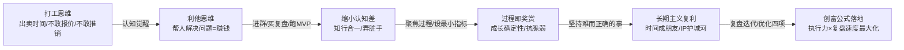
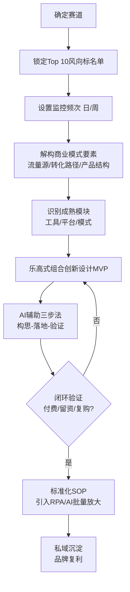
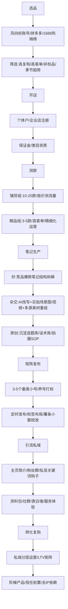
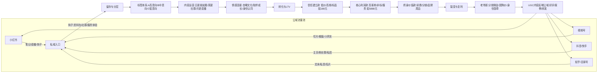
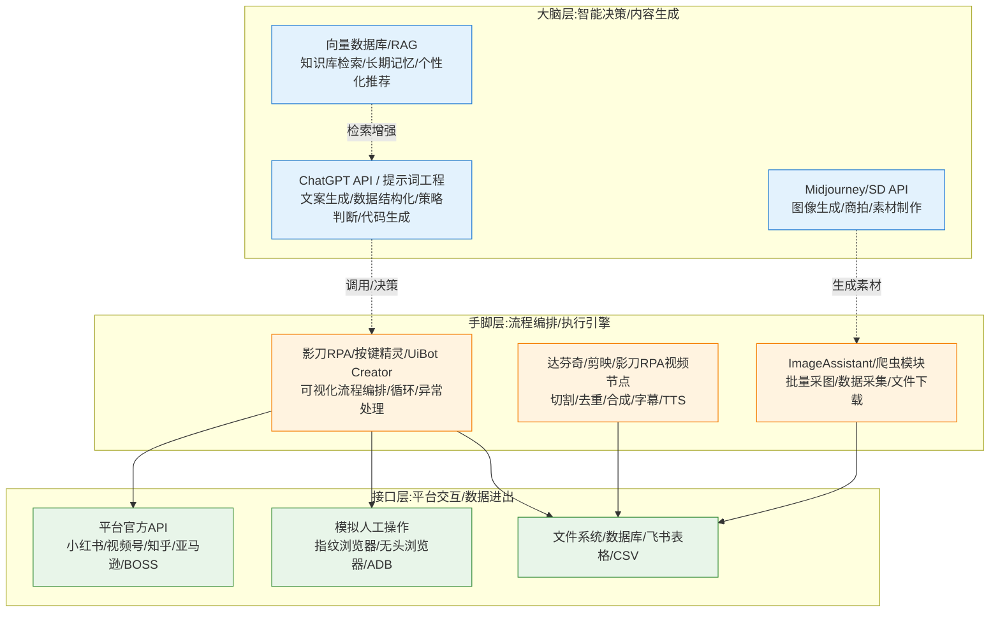
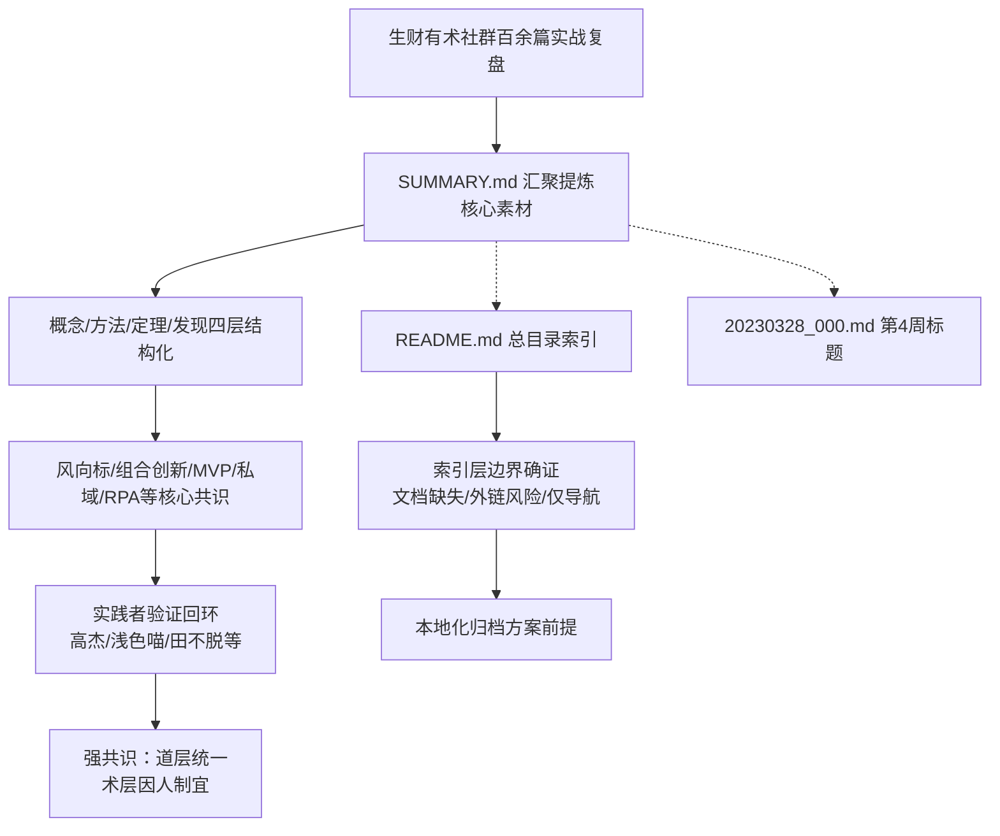
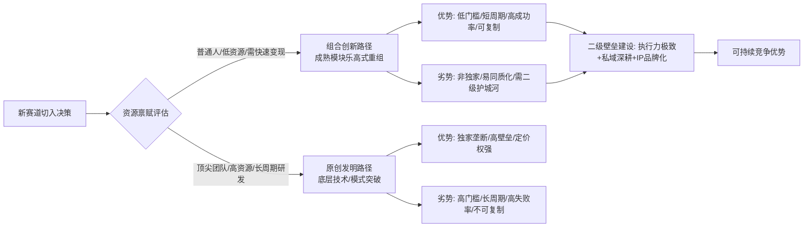
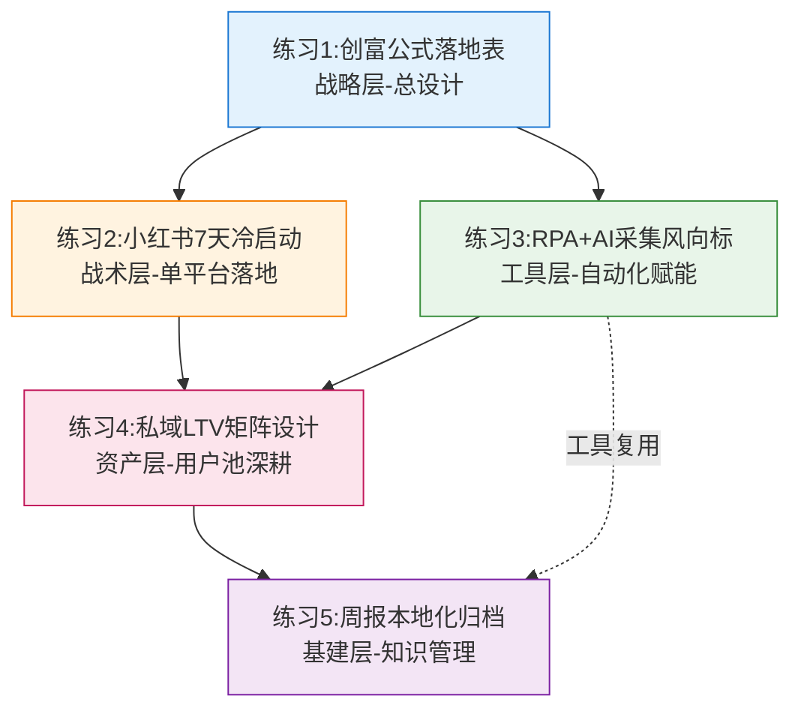
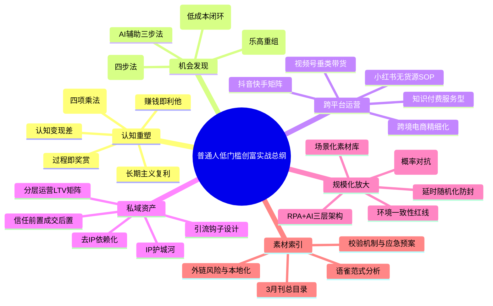

# 第 86 章 普通人低门槛创富实战总纲

## 学习目标

- 理解普通人低门槛创富的底层逻辑：赚钱即利他、认知变现差、过程即奖赏、长期主义复利
- 掌握风向标追踪法与组合创新MVP设计方法，能在新赛道快速跑通最小可行性闭环
- 熟悉小红书、视频号、抖音/快手、百家号、知乎五大平台的内容运营SOP与变现模式差异
- 建立私域流量“引、留、转、裂”全链路认知，掌握高信任、高复购用户池构建实操
- 掌握批量思维与RPA/AI自动化生产线搭建，实现从“手工作坊”到“超级个体”的生产力跃迁
- 能利用周报导航与元数据索引高效检索素材库，规避外部链接失效风险

## 86.1 生活类比

想象普通人创富是一场“种竹子”的游戏。认知重塑如同选对竹种（利他定律）、施好底肥（缩小认知差）、不催苗助长（过程即奖赏）、耐得住寂寞（长期主义复利）；风向标追踪好比看隔壁老王种哪棵活得好、长得快，照着学（组合创新）、先种一小片试试（MVP思维）、活了再扩种；跨平台运营恰似竹子既能卖笋（小红书快速变现）、又能卖竹材（视频号高客单）、还能造园林景观（抖音矩阵规模化）、根系还能固土护坡（私域沉淀复利）；私域资产仿佛竹林里的“老主顾”：信任你笋甜（高信任）、年年回购（高复购）、还帮你拉新邻居（裂变），比路边卖笋（公域流量）稳赚百倍；批量思维/RPA犹如别自己挥锄头（人工），造台“自动锄草机”（RPA）、装上“智能施肥脑”（AI）、铺好“标准化水管”（流水线），单人管百亩竹林不费劲；周报索引好似竹农手里的“种植日历”：记清啥时播种（目录）、啥时收成（标题）、哪招最灵（社交背书），防止忘了自家地在哪（外链失效风险）。

## 86.2 概念地图

认知重塑与商业底层逻辑
├── 赚钱即利他定律  —— SUMMARY
├── 认知变现差与缩小路径  —— SUMMARY
├── 过程即奖赏原则  —— SUMMARY
├── 长期主义复利论  —— SUMMARY
└── 普通人低门槛创富公式  —— SUMMARY
机会发现与MVP验证
├── 风向标追踪法（四步标准化流程）  —— SUMMARY
├── 组合创新（乐高式重组成熟模块）  —— SUMMARY
├── MVP思维（最低成本跑通闭环）  —— SUMMARY
└── AI辅助MVP三步法（构思-落地-验证）  —— SUMMARY
跨平台流量获取与变现实战
├── 小红书无货源电商SOP  —— SUMMARY
├── 视频号带货/涨粉实操法  —— SUMMARY
├── 抖音/快手矩阵与无人直播规模化  —— SUMMARY
├── 知识付费/社群/服务型项目高利润验证  —— SUMMARY
├── 线下实体/同城业务数字化破局  —— SUMMARY
└── 跨境电商/亚马逊精细化运营与套利  —— SUMMARY
私域资产构建与高LTV运营
├── 私域沉淀：公域流量最终归宿  —— SUMMARY
├── 私域引流实战案例库  —— SUMMARY
├── 信任前置成交后置/分层运营/去IP依赖化  —— SUMMARY
└── IP不可复制性护城河/长期主义护城河  —— SUMMARY
规模化放大：批量思维与自动化生产线
├── 批量思维：概率对抗单点不确定性  —— SUMMARY
├── RPA自动化：非程序员的‘数字员工’  —— SUMMARY
├── RPA+AI自动化生产线（手脚-大脑-接口）  —— SUMMARY
├── UIBot Creator可视化流程/ ImageAssistant批量采图  —— SUMMARY
├── 场景化素材库/延时随机化防封/RPA降维打击成本  —— SUMMARY
└── Posts免费流量入口/素材场景化定律/RPA落地环境敏感性  —— SUMMARY
周报导航与元数据索引体系
├── 2023年3月刊总目录（五大板块结构化检索）  —— README
└── 文档结构缺失/外链依赖风险/索引仅作导航  —— 20230328_001

## 86.3 认知重塑 —— 普通人低门槛创富的底层逻辑

### 为什么需要这个概念？

打工思维将“赚钱”等同于“出卖时间”，导致不敢报价、不敢推销、不敢规模化，成为商业变现的核心拦路虎 [SUMMARY, 定理:赚钱即利他定律]。面对 AI、短视频、跨境电商等新机遇，认知低的人还在围观焦虑，认知高的人已跑通 MVP 并规模化变现，认知差即变现差 [SUMMARY, 定理:认知变现差]。过度关注结果（赚多少钱）会导致焦虑与放弃，唯有聚焦过程（学技能、做内容、搭系统、解难题）本身带来的成长确定性，结果才会作为副产品自然到来 [SUMMARY, 定理:过程即奖赏原则]。在不确定环境下，唯有坚持做难但正确的事（建立IP、沉淀私域、练硬技能、做资源整合），时间才会成为朋友，实现复利跃迁 [SUMMARY, 定理:长期主义复利论]。

### 核心定义

> "赚钱就是在帮别人，就是在利他。"
> 
> ——《SUMMARY.md》[SUMMARY, 定理:赚钱即利他定律, excerpt:《赚钱就是在帮别人，就是在利他》]

**赚钱即利他定律**：商业本质是价值交换，赚钱的核心路径是帮别人解决问题（省钱、省时、赚钱、爽感、安全感）。利他越深、覆盖人群越广、频次越高，赚钱越容易、越持久 [SUMMARY, 定理:赚钱即利他定律]。

**认知变现差**：同一信息/工具/趋势，认知高的人已变现，认知低的人还在围观。缩小认知差的路径：进高质量社群、付费买时间的复盘/教程、实战跑通MVP、复盘沉淀方法论 [SUMMARY, 定理:认知变现差]。

**过程即奖赏**：聚焦过程本身带来的成长确定性（技能习得、系统搭建、难题攻克），结果反而作为副产品自然到来，是长期主义者的核心心法 [SUMMARY, 定理:过程即奖赏原则]。

**长期主义复利**：在不确定环境下，坚持做难但正确的事，时间会成为朋友。核心注脚：“人们真正注意到你时，是发现过了这么久你居然还在那里” [SUMMARY, 定理:长期主义复利论]。

**普通人低门槛创富公式**：
$$ \text{创富结果} = (\text{风向标洞察} + \text{组合创新MVP}) \times (\text{批量执行/工具杠杆}) \times (\text{私域沉淀/品牌复利}) \times \text{时间} $$
核心变量是“执行力”与“复盘迭代速度”，而非初始资源 [SUMMARY, 定理:普通人低门槛创富公式]。

**公式指导作用**：此公式将创富拆解为四个可独立优化的杠杆，帮助学习者诊断卡点（如：有方向无杠杆、有杠杆无资产、有资产无时间积累）、分配资源优先级（冷启动期聚焦前两项，成长期补齐第三项，成熟期交给时间）、规避“加法思维”陷阱（误以为多加一个动作就能增收，实则需四项同步为正）。

### 关键性质

利他定律具有普适性：适用于电商选品、内容创作、服务设计、工具开发等所有商业场景。无论卖实体货、卖虚拟课、做SaaS工具、接广告变现，底层逻辑均是“帮用户解决什么问题、解决到什么程度、覆盖多少人” [SUMMARY, 定理:赚钱即利他定律]。

认知变现差具有时间窗口期：新工具/新平台/新趋势出现早期，认知差最大，红利最肥，后期认知趋同，红利消失。例如ChatGPT发布初期，懂提示词+会搭RPA的人已跑通“AI写爆文/自动发知乎/批量做视频”变现闭环，半年后同质化严重，单纯“会用ChatGPT”不再构成优势 [SUMMARY, 定理:认知变现差]。

过程即奖赏具有抗脆弱性：将不确定性转化为确定性的成长输入，心态不随外部结果波动。当把“写出10万+”作为目标，数据不好就焦虑；把“打磨选题库、练标题、搭协作流”作为目标，每天完成既得正反馈，长期必出爆款 [SUMMARY, 定理:过程即奖赏原则]。

创富公式为乘法模型：任一环节为零则结果为零。风向标洞察决定方向，组合创新决定路径，批量执行决定规模，私域沉淀决定复利，时间决定厚度。若只刷风向标不跑MVP（第一项为零）、只跑通MVP不标准化不放大（第二项为零）、只放大流量不沉淀私域（第三项为零）、三项均做但三个月放弃（时间项归零），最终结果皆为零 [SUMMARY, 定理:普通人低门槛创富公式]。

### 典型例子

**失业危机自救**：AI模特项目7天跑通变现闭环，从零认知到商业交付的极速跨越 [SUMMARY, 发现:个人成长路径, excerpt:失业危机自救:AI模特项目7天跑通变现闭环的复盘实录]。

**体制内教师副业**：从0-1突破舒适圈，副业年赚20W+，验证“主动社交+高强度实战+公开建立IP+复盘迭代”路径 [SUMMARY, 发现:个人成长路径, excerpt:体制内从 0-1 突破舒适圈，副业年赚 20W+ 的心得]。

**社恐女生参加见面会**：无负担社交触发认知跃迁，打破“有资源才配去”的自我设限 [SUMMARY, 发现:个人成长路径, excerpt:最普通社恐女生如何无负担参加生财见面会]。

**11个航海打卡211次**：以“打满卡”为过程目标屏蔽结果焦虑，反获超预期心理能量与贵人跃迁 [SUMMARY, 发现:个人成长路径, excerpt:11 个航海，打满卡 211 次，让我开启了人生新的起点]。

### 边界条件

利他 ≠ 无偿：必须建立商业闭环（定价、收款、交付、售后），免费的利他只能止于公益，无法构建可持续商业模型 [SUMMARY, 定理:赚钱即利他定律]。认知变现需“知行合一”：仅买课/进群/围观不执行，认知差不会自动缩小，必须“弄脏手”跑通MVP [SUMMARY, 定理:认知变现差]。过程即奖赏 ≠ 忽视结果：需设定“最小可行性指标”（如首单、首粉、首个正反馈）作为过程推进的锚点，避免陷入无效努力 [SUMMARY, 定理:过程即奖赏原则]。创富公式中“时间”变量不可控：只能控制前三项的乘积最大化，时间维度的复利效应需建立在前三项持续为正的基础上 [SUMMARY, 定理:普通人低门槛创富公式]。

### 方法演进图：认知重塑四阶段跃迁



*图 86-1：认知重塑四阶段跃迁路径，展示从打工思维到创富公式落地的完整进化链条。*

## 86.4 机会发现 —— 风向标追踪与组合创新

### 为什么需要这个概念？

面对海量信息与机会，普通人无法判断方向，盲目跟风导致高试错成本、低成功率 [SUMMARY, 概念:风向标]。头部玩家（风向标）的动作（选品、内容形式、推广渠道）已替市场验证了需求真实性与商业模式可行性，监控其动作可大幅降低决策不确定性 [SUMMARY, 方法:风向标追踪法]。从零原创发明门槛极高、周期极长、失败率极高；成熟工具/平台/模式的“组合创新”门槛低、周期短、成功率高，是普通人切入新赛道的最优范式 [SUMMARY, 概念:组合创新]。完美主义导致“准备到死”，MVP思维要求最低成本跑通“获客-转化-交付”闭环，验证需求真实性后再投入资源迭代 [SUMMARY, 概念:MVP思维]。

### 核心定义

> "通过组合创新，在小红书做研报账号，3周达到5000粉，引流私域600+"
> 
> ——《SUMMARY.md》[SUMMARY, 概念:组合创新, excerpt:通过组合创新，在小红书做研报账号，3周达到5000粉，引流私域600+]

**风向标**：指代行业头部玩家、头部账号、头部产品或新兴平台功能发布等能够预示趋势方向的标杆对象。通过监控风向标的动作降低决策不确定性 [SUMMARY, 概念:风向标]。

**组合创新**：非原创式发明，而是将成熟的技术工具（ChatGPT、Midjourney、RPA）、成熟的流量平台（小红书、视频号、抖音）与成熟的商业模式（无货源电商、知识付费、CPS分佣）重新组装，快速生成新变现路径 [SUMMARY, 概念:组合创新]。

**MVP思维**：最小可行性产品思维在赚钱项目中的实践，不追求完美，先用最低成本（时间、金钱）跑通“获客-转化-交付”的完整闭环，验证需求真实性后再投入资源迭代 [SUMMARY, 概念:MVP思维]。

### 关键性质

风向标具有“降维打击”属性：头部玩家已完成市场教育、模式验证、供应链搭建，跟随者只需微创新即可切入。例如小红书无货源赛道，头部已跑通“选品-开店-测款-笔记-矩阵-私域”全链路，跟随者只需在选品细分、钩子设计、转化话术上微创新即可 [SUMMARY, 概念:风向标]。

组合创新具有“乐高积木”特性：模块化、标准化、可替换、可迁移，如“ChatGPT+公众号爆文”、“AI绘画+小红书壁纸”、“RPA+知乎好物”。每个模块独立成熟，组装风险可控 [SUMMARY, 概念:组合创新]。

MVP思维具有“非对称收益”结构：试错成本可控（低成本），成功收益无上限（规模化放大），是普通人低风险创业的核心策略。素材中“3天跑出MVP”案例：仅投入3天时间+GPT API成本，即获1300+粉、50私域、10单成交，验证了需求后再决定是否投入RPA/团队 [SUMMARY, 概念:MVP思维]。

AI辅助MVP三步法：1. 构思：用ChatGPT进行市场调研、痛点挖掘、方案生成（如“帮我分析小红书宠物赛道Top10账号选品逻辑并生成5个切入点”）。2. 落地：用GPT API/插件/代码解释器快速产出原型（爬虫采集竞品数据、生成落地页文案、批量产出首批内容矩阵、制作数字人视频）。3. 验证：小额投流/发布内容测试转化，跑通“有人付费/留资/复购”闭环后，再决定是否投入RPA/团队放大 [SUMMARY, 方法:AI辅助MVP三步法]。

### 典型例子

**3天跑出MVP**：整合风向标信息+GPT辅助，3天涨粉1300+、引流私域50人、成交10单 [SUMMARY, 概念:风向标, excerpt:我是如何通过整合风向标信息 3 天跑出 MVP 并实现变现]。

**组合创新研报号**：付费研报内容源+稿定设计模板+群聊引流渠道+ArtStation素材库，3周5000粉、引流私域600+ [SUMMARY, 概念:组合创新, excerpt:通过组合创新，在小红书做研报账号，3周达到5000粉，引流私域600+]。

**AI模特7天变现**：ControlNet/OpenPose/LoRA+PS混合流水线，7天引流100+商家、15%付费率 [SUMMARY, 概念:MVP思维, excerpt:失业危机自救:AI模特项目7天跑通变现闭环的复盘实录]。

**ChatGPT写公众号爆文**：GPT-4驱动6步协作写作流程，7天产出10W+爆文 [SUMMARY, 概念:组合创新, excerpt:ChatGPT + 公众号爆文写作，从 0 开始 7 天达成阅读 10W+]。

### 边界条件

风向标不可盲目照搬：需结合自身资源禀赋（技能/时间/资金/认知）做“微创新”，单纯抄袭极易陷入同质化红海 [SUMMARY, 概念:风向标]。组合创新依赖“成熟度”：所用工具/平台/模式必须已跑通商业闭环，处于“成熟期”而非“实验期”，否则组合风险不可控 [SUMMARY, 概念:组合创新]。MVP验证需“真金白银”测试：仅看点赞/收藏/播放等虚荣指标无效，必须以“有人付费/留资/复购”为唯一验证标准 [SUMMARY, 概念:MVP思维]。AI辅助不能替代商业判断：GPT只能提供方案/代码/文案，能否跑通取决于人对业务模式的理解、资源整合能力与执行力 [SUMMARY, 方法:AI辅助MVP三步法]。

### 方法演进图：风向标追踪→组合创新→MVP验证链路



*图 86-2：从风向标监控到MVP验证的标准化作业链路，体现“监控-解构-组装-验证-放大”的完整闭环。*

## 86.5 流量获取与变现 —— 跨平台内容运营实战

### 为什么需要这个概念？

流量是商业闭环的启动钥匙，无流量则无转化、无交付、无复购，一切商业模式皆为空谈 [SUMMARY, 方法:小红书无货源电商SOP]。不同平台（小红书/视频号/抖音/快手/百家号/知乎）用户画像、算法逻辑、变现模式差异巨大，需掌握各平台标准化SOP才能因地制宜、精准收割 [SUMMARY, 方法:视频号带货/涨粉实操法]。单一平台依赖风险极高（限流、封号、算法变更），必须构建“公域矩阵获客 → 私域统一承接 → 多元变现”的抗风险流量体系 [SUMMARY, 方法:抖音/快手矩阵与无人直播规模化]。内容生产效率是规模化上限：从“手工单条”进化到“AI批量/RPA矩阵/工业化流水线”，是从月入千元到月入十万的必经跃迁 [SUMMARY, 方法:RPA+AI自动化生产线搭建]。

### 核心定义

> "地表最强的小红书无货源电商保姆级教程"
> 
> ——《SUMMARY.md》[SUMMARY, 方法:小红书无货源电商SOP, excerpt:地表最强的小红书无货源电商保姆级教程]

**小红书无货源电商SOP**：选品（风向标/拼多多/1688热销）→ 开店（个体户/企业店）→ 测款（铺货/精品）→ 笔记生产（AI批量改写/真实拍摄/伪原创）→ 矩阵发布（多账号/定时/标签）→ 引流私域（主页/粉丝群/私信钩子）→ 转化复购 [SUMMARY, 方法:小红书无货源电商SOP]。

**视频号带货/涨粉实操法**：针对中老年/女性/育儿等精准人群，内容端选爆款对标 → 剪映/达芬奇/影刀RPA批量混剪去重 → 账号矩阵发布 → 直播/橱窗/私域承接 → 高客单/高复购变现 [SUMMARY, 方法:视频号带货/涨粉实操法]。

**抖音/快手矩阵与无人直播**：重内容生产（混剪/原创）、重投流/重运营的团队化玩法，通过矩阵账号放大单一成功经验 [SUMMARY, 方法:抖音/快手矩阵与无人直播规模化]。

**知识付费/社群/服务型项目**：轻资产、高毛利、强私域、可复制，适合普通人突围（家庭教育/陪诊/资源整合/同城相亲/百家号口播） [SUMMARY, 发现:知识付费/社群/服务型项目高利润率验证]。

### 关键性质

平台共生论：摒弃“薅羊毛”，思考如何帮平台商业变现（投流/高客单转化）获长期扶持，第一时间测试平台新功能构建原生工具闭环。例如视频号早期测试“小风车”组件、小红书测试“粉丝群/专业号”功能，均获得算法额外分发红利 [SUMMARY, 方法:视频号带货/涨粉实操法]。

选品定生死、内容定流量、私域定利润：选品需匹配平台人群画像与季节趋势，做极致垂直细分；内容生产遵循“抄-杂交-原创”三阶跃迁；私域沉淀是高客单/长周期项目的最终归宿。小红书研报账号案例：选品锁定“付费研报”垂类，内容用“稿定模板+ArtStation图”杂交，私域用“群聊+资料包”承接，三环扣一环 [SUMMARY, 方法:小红书无货源电商SOP]。

视频号信任红利：依托微信生态信任背书，中老年/育儿/怀旧/书单赛道表现极强，私域转化率远超公域。素材中“孕晚期妈妈10天涨粉1000+引流私域”“英文育儿书单年累计粉120W+月入2W+”均印证此规律 [SUMMARY, 发现:视频号中老年垂类高转化]。

跨境电商精细化运营：核心矛盾从“流量获取难”转移为“流量识别与匹配难”，关键词五维分级、竞品蹭流、产品-流量渠道匹配度是核心方法论。素材中“精细化运营拯救亏损产品”“RPA自动发POST降本增效”体现精细化与自动化结合 [SUMMARY, 发现:跨境电商/亚马逊精细化运营与套利案例]。

### 典型例子

**小红书无货源**：普通人0元建社群单月变现8W+；研报账号3周5000粉引流私域600+；25条运营细节标准化可复制 [SUMMARY, 发现:小红书无货源可复制性强, excerpt:普通人做小红书，从 0 到 1，起盘我 0 元成立一个社群，单月变现 8w+的经验]。

**视频号垂类赛道**：孕晚期妈妈10天涨粉1000+引流私域；英文育儿书单年累计粉120W+、月入2W+；ChatGPT教程类10天做头部账号 [SUMMARY, 发现:视频号中老年垂类高转化, excerpt:孕晚期准妈妈通过视频号 10 天涨粉 1000+，成功引流私域的案例复盘]。

**抖音矩阵团队**：小团队矩阵短视频卖汽车用品单月变现10W+；鸡血石直播变现百万；短剧CPS团队月GMV破20W；创业1年流水7000W [SUMMARY, 发现:抖音快手矩阵规模化证据, excerpt:小团队通过做矩阵短视频，卖汽车用品单月直接变现 10W+]。

**知识付费/服务型**：家庭教育累计私域2000+纯利25W+；陪诊服务/资源整合两个月纯利30W+；同城相亲五年深耕；百家号口播月入5000-1W [SUMMARY, 发现:知识付费服务型高利润验证, excerpt:从 0 开始做家庭教育赛道，累计私域好友 2000+，课程营收纯利润 25W+]。

### 边界条件

平台规则敬畏机制：成熟平台存量博弈阶段严守规则，暴力玩法（批量铺货/软件采集）必封号，笨功夫（手动精细化运营）优于技术流 [SUMMARY, 方法:小红书无货源电商SOP]。内容生产三阶跃迁不可跨越：初期直接抄袭爆款，中期杂交重组多源素材，后期沉淀原创方法论；跳阶段必导致账号权重受损或封号 [SUMMARY, 方法:视频号带货/涨粉实操法]。私域引流需“钩子”设计：单纯留微信号/二维码极易违规，需设计“资料包/社群/表白墙/服务体验”等合规钩子，降低用户决策门槛 [SUMMARY, 概念:私域沉淀]。跨境/套利项目风险隐性高：银行大额存单拆借日赚10W隐含风险提示，Etsy注册需海外真实人脉否则预期收益为负，四大行套利窗口期随政策收紧而关闭 [SUMMARY, 发现:跨境电商/亚马逊精细化运营与套利案例]。

### 方法流程图：小红书无货源电商SOP全链路



*图 86-3：小红书无货源电商标准化作业程序，覆盖选品到复购的完整商业闭环。*

## 86.6 私域资产 —— 高信任、高复购、可复利的用户池构建

### 为什么需要这个概念？

公域流量成本递增、留存率低、规则不可控、用户资产不归属自己，是“租来的流量” [SUMMARY, 概念:私域沉淀]。高客单价、长决策周期、非标服务类项目，公域直接转化极其困难，必须通过私域建立信任、沉淀需求、完成成交 [SUMMARY, 概念:私域沉淀]。复购与裂变是利润主源：获取新客成本是维护老客的5-25倍，私域通过高频触达、情感连接、利益绑定实现LTV最大化 [SUMMARY, 概念:私域沉淀]。所有高客单价或长周期项目的最终归宿皆为私域，构建私域资产是商业模式从“一次性生意”进化为“可持续资产”的关键跃迁 [SUMMARY, 概念:私域沉淀]。

### 核心定义

> "普通人做小红书，从 0 到 1，起盘我 0 元成立一个社群，单月变现 8w+的经验"
> 
> ——《SUMMARY.md》[SUMMARY, 概念:私域沉淀, excerpt:普通人做小红书，从 0 到 1，起盘我 0 元成立一个社群，单月变现 8w+的经验]

**私域沉淀**：将公域流量（视频号、小红书、抖音、知乎、百家号等）通过钩子（资料包、社群、表白墙、陪诊服务等）引入微信个人号/社群/企微，构建高信任、高复购、可长期运营的用户资产 [SUMMARY, 概念:私域沉淀]。

**私域引流实战案例库**：孕晚期准妈妈视频号10天涨粉1000+引流私域；普通人做小红书0元建社群单月变现8W+；抖音直播引流私域6个方法；小红书研报账号3周引流私域600+ [SUMMARY, 概念:私域沉淀]。

### 关键性质

信任前置、成交后置：内容营销先建立专业真实信任资产，让客户主动询价，实现“吸引询价成交”高效闭环。素材中“视频号孕妈引流”案例：专业人设+批量内容输出建立信任，评论区全托管+二维码低门槛引流，用户进私域后已高度信任，成交极快 [SUMMARY, 概念:私域沉淀]。

分层运营与LTV矩阵：学生私域“韭菜大队”自嘲文化+阶梯定价（188-5888元）信任阶梯，覆盖知识付费/流量卡/潮牌/分销全生命周期LTV。低价标品（188元）建立信任 → 高客单服务（5888元）核心利润 → 续费/分销/周边终身价值，用产品矩阵匹配用户不同生命周期阶段 [SUMMARY, 概念:私域沉淀]。

去IP依赖化运营：创始人前置构建核心内容库（FAQ/话术/案例），后续多平台分发/剪辑/二创外包分工，实现内容生产流水线化。素材中“同模型连麦引流与内容库预制”案例：创始人先产出标准问题库/话术库/案例库，再招募低成本执行层分发，实现“创始人不出镜也能持续产出70-80分内容” [SUMMARY, 概念:私域沉淀]。

IP不可复制性护城河：时间积累的个人IP信任资产、陪伴用户成长的情感连接不可复制，是知识付费核心壁垒，深耕5-10年构建“十年无竞争”。素材强调“IP不可复制性护城河与长期主义护城河”并存 [SUMMARY, 概念:私域沉淀]。

### 典型例子

**视频号孕妈引流**：专业人设+批量内容+评论区全托管+二维码低门槛引流，10天涨粉1000+完成私域种子用户积累 [SUMMARY, 概念:私域沉淀, excerpt:孕晚期准妈妈通过视频号 10 天涨粉 1000+，成功引流私域的案例复盘]。

**小红书社群变现**：0元建群→亲近用户→打造钩子→筛选种子→验证转化，首期50%转化率、稳态20%、单月变现8W+ [SUMMARY, 概念:私域沉淀, excerpt:普通人做小红书，从 0 到 1，起盘我 0 元成立一个社群，单月变现 8w+的经验]。

**学生私域LTV矩阵**：自嘲“韭菜大队”化解割韭菜刻板印象，阶梯定价建立信任阶梯，多业务覆盖全周期（副业/通讯/身份认同/分销） [SUMMARY, 概念:私域沉淀, excerpt:学生私域全生命周期LTV矩阵：韭菜大队+阶梯定价+多元刚需]。

**同模型连麦引流**：寻找粉丝画像重合直播间连麦互推，回关→开播拉精准粉→连麦送资料，低成本批量获精准种子用户 [SUMMARY, 概念:私域沉淀, excerpt:同模型连麦引流与内容库预制去IP依赖化运营]。

### 边界条件

私域非“建群即运营”：无价值输出、无情感连接、无服务体验的死群/广告群仅是“流量垃圾桶”，真正私域需“高频触达+分层标签+精细化服务” [SUMMARY, 概念:私域沉淀]。微信生态规则红线：严禁诱导分享、刷屏营销、违规外链，引流动作必须合规（小风车/企微客服/视频号切片/私信钩子），违规必封号且不可逆 [SUMMARY, 概念:私域沉淀]。信任资产不可速成：需长期累积（线下服务信任/社群分享信任/朋友圈持续输出信任），一旦形成支撑高客单快速成交（最快20分钟）且抗周期性强 [SUMMARY, 概念:私域沉淀]。去IP依赖化需创始人“先显性化”：必须由创始人先将隐性知识显性化为标准问题库/SOP/内容库，再招募低成本执行层，反向操作必死于成本失控与交付波动 [SUMMARY, 概念:私域沉淀]。

### 数据流图：私域“引、留、转、裂”全链路



*图 86-4：私域流量全生命周期数据流向，展示从公域引流到裂变复利的完整商业飞轮。*

## 86.7 规模化放大 —— 批量思维与RPA/AI自动化生产线

### 为什么需要这个概念？

单一成功经验无法规模化，受限于人力时间上限，必须标准化为SOP，通过矩阵/自动化/团队放大收益 [SUMMARY, 概念:批量思维]。高重复、低决策的运营动作（发帖、回复、采集、剪辑、选品）若靠人工，边际成本高、效率低、易出错，是规模化的核心瓶颈 [SUMMARY, 概念:RPA自动化]。代码、软件、程序是“时间复制器”，核心价值在于解放双手、复制时间，而非单纯的技术实现（君子性非异也，善假于物也） [SUMMARY, 方法:RPA+AI自动化生产线搭建]。非技术人员若不会搭建RPA+AI自动化生产线，将永远停留在“手工作坊”阶段，无法跨越“超级个体”门槛 [SUMMARY, 概念:批量思维]。

### 核心定义

> "单人日产 200 条之批量思维"
> 
> ——《SUMMARY.md》[SUMMARY, 概念:批量思维, excerpt:单人日产 200 条之批量思维]

**批量思维**：用概率思维对抗单点不确定性，将单一成功经验标准化为SOP，通过多账号矩阵、多平台分发、RPA自动化、团队化复制放大收益。核心指标：单人日产200条内容、开18个闲鱼店铺店群规模 [SUMMARY, 概念:批量思维]。

**RPA自动化**：机器人流程自动化在跨境电商、社媒运营、招聘挖掘、内容分发等场景的落地应用，配合ChatGPT API实现“非程序员也能自动化”的生产力跃迁，是批量思维落地的关键技术杠杆 [SUMMARY, 概念:RPA自动化]。

**RPA+AI自动化生产线**：影刀RPA/按键精灵/指纹浏览器做“手脚”，ChatGPT API/提示词工程做“大脑”，对接平台API/模拟人工操作做“接口”。应用场景：亚马逊发帖、知乎自动推广、BOSS直聘挖项目、社媒矩阵分发、爬虫采集风向标数据 [SUMMARY, 方法:RPA+AI自动化生产线搭建]。

**UIBot Creator可视化流程搭建**：通过导入源代码、配置图片上传文件夹路径、串联流程块形成闭环循环，实现Posts发布流程自动化编排 [SUMMARY, 方法:RPA+AI自动化生产线搭建]。

**ImageAssistant批量采图**：Chrome插件“提取本页图片→筛选类型/大小→全选→自动下载”标准化动作，快速建立场景化素材库 [SUMMARY, 方法:RPA+AI自动化生产线搭建]。

### 关键性质

场景化素材库：受众场景共鸣 > 产品实拍。利用无版权图库按人群标签（教师/司机/护士/父母等）检索通用场景图，比自行拍摄产品图更高效且转化相关性强。素材指出“素材来源场景化 > 产品实拍定律” [SUMMARY, 方法:RPA+AI自动化生产线搭建]。

延时随机化防封：RPA循环中设置固定延时（如200,000毫秒≈2分钟/条），模拟人工发布频率，规避平台风控，替代复杂定时发布策略。素材实测“固定延时2分钟/条”比复杂随机延时更稳定且易维护 [SUMMARY, 方法:RPA+AI自动化生产线搭建]。

RPA降维打击人工成本：高重复/低决策动作，RPA边际成本趋近零，远低于人工/外包成本，是中小卖家应对内卷的核心竞争力。素材对比：人工日产<10条，RPA+达芬奇+剪映+影刀串联后日产能稳定批量 [SUMMARY, 发现:AI模型应用层红利, excerpt:零基础也能批量产出高质量带货视频，超强视频批量剪辑软件]。

Posts是亚马逊当前最优免费流量入口：品牌注册卖家专属免费内容分发工具，在站内免费流量入口收敛（评论关闭、Vine贵）现状下性价比最高。素材中“壹，店铺批量自动发POST | AMZ与RPA”验证万帖仅几百点击但转化率稳定，作为长尾免费流量补充 [SUMMARY, 方法:RPA+AI自动化生产线搭建]。

RPA落地环境敏感性：浏览器缩放、分辨率、文件路径、紫鸟浏览器不兼容第三方RPA等环境差异是落地最大变数，必须人工跑通一次并调试。素材强调“RPA落地实测数据与环境变数” [SUMMARY, 方法:RPA+AI自动化生产线搭建]。

### 典型例子

**亚马逊POST批量自动发布**：RPA构建全流程，万帖仅几百点击但转化率稳定，作为长尾免费流量补充 [SUMMARY, 方法:RPA+AI自动化生产线搭建, excerpt:壹，店铺批量自动发POST | AMZ与RPA]。

**知乎好物自动卖货**：草稿箱+RPA+人工把关三位一体，ChatGPT生成草稿→人工复核润色发布，平衡效率与账号安全/内容质量 [SUMMARY, 方法:RPA+AI自动化生产线搭建, excerpt:通过 ChatGPT+RPA，帮我在知乎上自动卖货]。

**BOSS直聘挖项目**：RPA负责数据采集/账号管理/批量发布沟通；ChatGPT负责招聘文案/简历优化/面试话术/行业知识速查 [SUMMARY, 方法:RPA+AI自动化生产线搭建, excerpt:通过 ChatGPT+RPA，帮我在 BOSS 直聘 + RPA 来挖掘适合普通人赚钱的项目]。

**闲鱼18家店铺**：注册6张执照开18个二手书店铺，社区工作室模式（小区低租金+兼职大学生按件结算）规模化复制 [SUMMARY, 概念:批量思维, excerpt:《2023年，为了让亦仁认识我，我一口气注册了6张执照，开了18个二手书闲鱼店铺》]。

**影刀RPA串联全链路**：达芬奇切割→几何变换去重→文件夹流转→影刀RPA串联剪映/达芬奇/下载/TTS/GPT，日产能从<10条提升至稳定批量 [SUMMARY, 发现:AI模型应用层红利, excerpt:零基础也能批量产出高质量带货视频，超强视频批量剪辑软件]。

### 边界条件

RPA非“万能药”：仅适用于高重复、低决策、流程固化的标准化动作；涉及复杂判断、创意生产、非标沟通的环节仍需人工介入 [SUMMARY, 方法:RPA+AI自动化生产线搭建]。环境一致性是前提：开发环境与运行环境（分辨率/缩放/路径/浏览器版本）必须严格一致，微小差异即导致流程报错中断 [SUMMARY, 方法:RPA+AI自动化生产线搭建]。平台风控红线：延时随机化仅缓解频率风控，若内容质量差/同质化严重/违规词触发，RPA反而加速批量封号，内容合规是生存底线 [SUMMARY, 方法:RPA+AI自动化生产线搭建]。自动化生产线需“先人工跑通”：业务流程必须先人工跑通验证盈利模型，再引入RPA替代标准化环节；未跑通前搭自动化是“自动化失败” [SUMMARY, 方法:RPA+AI自动化生产线搭建]。场景化素材需版权合规：无版权图库/CC0协议/自有拍摄为安全来源，随意盗用网图商用面临侵权赔偿与账号封禁风险 [SUMMARY, 方法:RPA+AI自动化生产线搭建]。

### 架构图：RPA+AI“手脚-大脑-接口”三层自动化生产线



*图 86-5：RPA+AI自动化生产线三层架构，展示“手脚-大脑-接口”分层协作的工程化实现路径。*

## 86.8 周报导航与元数据索引

### 为什么需要这个概念？

素材库庞大（百余篇实战复盘），缺乏总目录与单期索引将导致读者无法快速定位所需知识点，降低教材查阅效率 [README, excerpt:汇总2023年3月四周所有精华帖标题与分类，覆盖AI工具、跨平台运营、私域流量、电商变现、个人成长五大板块]。周报作为社群核心交付物，其编排逻辑（分类标签、社交互动数据背书、版权声明控制传播）本身即是付费社群内容运营的标准化范式，需显性化呈现 [README, excerpt:固定链接归档、分类标签(中括号)结构化组织、引用社交互动数据(点赞/精华/评论图)增强可信度、版权声明控制传播范围]。素材存在“文档结构完整性缺失”与“核心内容依赖外部链接”的隐患，需通过索引标注风险提示，引导读者回溯原文 [20230328_000, excerpt:核心内容寄宿于语雀外部链接，存在链接失效导致内容永久不可获取的风险]。

### 核心定义

> "汇总2023年3月四周所有精华帖标题与分类，覆盖AI工具、跨平台运营、私域流量、电商变现、个人成长五大板块"
> 
> ——《README.md》[README, excerpt:汇总2023年3月四周所有精华帖标题与分类，覆盖AI工具、跨平台运营、私域流量、电商变现、个人成长五大板块]

**2023年3月刊总目录**：汇总2023年3月四周（3.6-3.12、3.13-3.19、3.20-3.26、3.27-4.2）所有精华帖标题与分类，覆盖AI工具、跨平台运营、私域流量、电商变现、个人成长五大板块，作为本教材素材库的总检索入口 [README, excerpt:汇总2023年3月四周所有精华帖标题与分类，覆盖AI工具、跨平台运营、私域流量、电商变现、个人成长五大板块]。

**第4周周报标题记录**：记录第4期周报《龙哥赚钱周报 20230328-20230404》的文档标题与来源链接，为后续深度研读该期全文提供定位锚点 [20230328_000, excerpt:记录第4期周报《龙哥赚钱周报 20230328-20230404》的文档标题与来源链接]。

### 关键性质

语雀平台运营范式：固定链接归档、分类标签（中括号）结构化组织、引用社交互动数据（点赞/精华/评论图）增强可信度、版权声明控制传播范围 [README, excerpt:固定链接归档、分类标签(中括号)结构化组织、引用社交互动数据(点赞/精华/评论图)增强可信度、版权声明控制传播范围]。

稀缺性驱动价值主张：通过“请勿外流、防止失效”版权控制构建内容稀缺性，强化付费价值感知 [README, excerpt:通过'请勿外流、防止失效'版权控制构建内容稀缺性，强化付费价值感知]。

社交背书增强可信度：显式标注点赞数、精华帖标识及评论图片，利用群体社交信号作为内容质量外部背书，降低新成员信任决策成本 [README, excerpt:显式标注点赞数、精华帖标识及评论图片，利用群体社交信号作为内容质量外部背书]。

### 典型例子

周报封面/目录页作为索引入口，正文内容寄宿于语雀外部文档 [README, excerpt:素材仅为周报封面/目录页，正文内容(具体帖子、案例、方法论)缺失]。

分类标签如[AI工具][跨平台运营][私域流量][电商变现][个人成长]结构化组织内容 [README, excerpt:分类标签(中括号)结构化组织]。

评论区截图、点赞数标注、精华帖标识作为社交背书嵌入目录 [README, excerpt:引用社交互动数据(点赞/精华/评论图)增强可信度]。

### 边界条件

文档结构完整性缺失：素材仅为周报封面/目录页，正文内容（具体帖子、案例、方法论）缺失，无法提取实质商业洞察 [README, excerpt:素材仅为周报封面/目录页，正文内容(具体帖子、案例、方法论)缺失]。

外部链接依赖风险：核心内容寄宿于语雀外部链接，存在链接失效导致内容永久不可获取的风险，建议本地归档备份 [20230328_000, excerpt:核心内容寄宿于语雀外部链接，存在链接失效导致内容永久不可获取的风险]。

索引仅作导航：本单元不包含具体方法论细节，仅提供结构性检索入口，深度学习需跳转原文语雀文档 [README, excerpt:素材仅为周报封面/目录页，正文内容(具体帖子、案例、方法论)缺失]。

### 检索流程图：周报索引导航与本地化归档路径

```mermaid
flowchart TD
    A[学习者需求] --> B{是否明确知晓\n目标板块/关键词?}
    B -- 是 --> C[查阅2023年3月刊总目录 README.md]
    C --> D[按分类标签定位\nAI工具/跨平台/私域/电商/成长]
    D --> E[获取精华帖标题/作者/互动数据]
    E --> F[跳转语雀原文链接\n深度研读]
    F --> G{链接是否有效?}
    G -- 是 --> H[获取完整方法论/案例/数据]
    G -- 否 --> I[启用本地归档备选方案]
    B -- 否 --> J[浏览第4周周报标题记录 20230328_000.md]
    J --> K[确认周报时间范围/主题]
    K --> C

    I --> I1[本地文件系统\n年/月/周/板块/标签 五级目录]
    I1 --> I2[文件命名: YYYYMMDD_[板块]_[标签]_标题.md]
    I2 --> I3[元数据JSON: 来源链接/作者/互动/版权]
    I3 --> I4[全文检索/知识图谱/教材再版]
    I4 --> H

    subgraph 风控机制
        W1[周校验脚本: 本地文件数 vs 目录条数]
        W2[外链可达性/内容哈希一致性检查]
        W3[异常报告推送企微]
    end
    I1 -.触发.-> W1
    I1 -.触发.-> W2
    W1 --> W3
    W2 --> W3
```

*图 86-6：周报素材库检索导航与本地化归档风控路径，解决外链失效风险的系统性方案。*

## 86.9 多源对照

本章核心概念均源自单一核心素材 `SUMMARY.md`，该素材已汇聚生财有术社群百余篇实战复盘，具有高度共识性。对于“风向标”、“组合创新”、“MVP思维”等概念，社群内不同实践者（如高杰、浅色喵、田不脱等）通过各自实战验证了方法论的可复制性，形成了强共识。

**共识**：风向标追踪+组合创新+MVP验证是普通人低成本试错的标准范式；私域沉淀是高客单长周期项目的必经归宿；RPA+AI自动化是规模化放大的核心杠杆。

**分歧**：不同实践者在具体平台选择（小红书vs视频号vs抖音）、内容形态偏好（图文vs视频vs直播）、变现模式侧重（电商vs知识付费vs服务）上存在差异，但这属于“术”层面的因人制宜，不违背“道”层面的共识。

**索引层补充**：`README.md`与 `20230328_000.md`提供了周报导航索引的元数据结构与风险边界，确证了“文档结构缺失/外链依赖/索引仅作导航”三大边界条件，为本地化归档方案提供了必要的风险前提。

### 素材溯源与共识形成流程图



*图 86-7：素材溯源与共识形成流程，展示从社群原始复盘到教材核心概念的提炼验证链路。*

## 86.10 设计中的取舍

**为什么不用“原创发明”而用“组合创新”？**

原创发明需要极高的技术门槛、长周期研发和巨额资金，失败率极高，不适合资源有限的普通人 [SUMMARY, 概念:组合创新]。组合创新利用已验证的成熟模块（工具、平台、模式）重组，将不确定性压缩在“微创新”环节，大幅降低试错成本，提高成功概率 [SUMMARY, 概念:组合创新]。

**这种设计的 trade-off 是什么？**

组合创新的代价是“非独家性”——竞争对手也能组装相似模块，进入壁垒相对较低。因此必须通过“执行力极致化”、“私域资产深护城河”、“个人IP品牌化”建立二级壁垒，将“易复制的模式”转化为“难复制的资产” [SUMMARY, 概念:批量思维]。

### 组合创新vs原创发明决策权衡图



*图 86-8：组合创新与原创发明的决策权衡框架，明确普通人资源禀赋下的最优策略选择。*

## 86.11 动手练习

### 练习1：设计你的‘创富公式’落地执行表

基于公式 = (风向标洞察 + 组合创新MVP) × (批量执行/工具杠杆) × (私域沉淀/品牌复利) × 时间，完成以下填空：

1. 风向标洞察：列出你关注赛道的 Top 3 头部账号/产品，记录其最近一周的选品/内容/投放动作
2. 组合创新MVP：结合你现有技能/资源，设计一个“成熟工具+成熟平台+成熟模式”的组合创新方案，写出“获客-转化-交付”最小闭环
3. 批量执行杠杆：该MVP中哪些环节可标准化为SOP？哪些可引入RPA/AI工具？预估单人日产能
4. 私域沉淀路径：设计一个合规“钩子”(资料包/社群/服务体验)，规划从公域引流到私域分层运营的动作清单
5. 时间复利锚点：设定未来 30/90/180 天的“最小可行性指标”(如首单/首粉/首个正反馈)，避免无效努力

### 练习2：小红书无货源电商 7 天冷启动实战推演

假设你决定在小红书做“宠物智能用品”无货源电商，请按SOP推演前 7 天关键动作：

Day 1 选品：用拼多多/1688/风向标账号筛选 5 款“高复购/高客单/非标品”潜力单品，记录关键词/价格/利润率
Day 2 开店：完成个体户/企业店注册、保证金缴纳、类目资质准备，截图关键节点
Day 3 测款：上架 10 款商品(含 5 款测款+5 款长尾)，设置“铺货组”与“精品组”不同定价/主图策略
Day 4 笔记生产：用 ChatGPT 批量改写 3 篇竞品爆款笔记 + 实拍 2 条“场景共鸣”视频/图文，完成“抄-杂交”阶段
Day 5 矩阵发布：注册 3 个垂类小号(养号打标)，定时发布 5 篇笔记，每篇植入私域钩子(粉丝群/主页链接/私信关键词)
Day 6 数据复盘：记录曝光/点击/互动/引流私域人数，筛选“低粉高互动”爆款模版，废弃无数据条目
Day 7 迭代放大：对爆款笔记做“杂交-原创”升级，追投薯条/投放小眼，同步上架关联商品，完成首单验证

回答问题：
- 为何“选品定生死、内容定流量、私域定利润”在该赛道表现为铁律？
- 若 Day 3 测款全部无流量，是换品、换图、换号，还是换赛道？决策依据是什么？

### 练习3：搭建一个‘RPA+AI 自动化采集风向标’的最小原型

目标：每天自动抓取某垂类平台(如小红书/知乎/BOSS直聘)Top 20 风向标账号的最新发布内容，经 ChatGPT 提炼“选品/钩子/话术/转化路径”四要素，输出结构化 CSV 供人工复盘。

1. 选型：对比影刀RPA/按键精灵/指纹浏览器+自写爬虫，在“环境一致性/反爬对抗/维护成本/非程序员上手度”四维打分，选定方案
2. 流程设计：画出“打开APP/网页 → 登录/验证 → 遍历账号列表 → 翻页/下拉加载 → 提取文案/图片/链接 → 调用GPT API结构化 → 写入CSV/飞书表格”的完整流程图
3. 关键参数：设置“延时随机化(180-250秒/条)”、“异常重试3次/切换IP”、“关键词过滤/去重逻辑”、“Token成本控制(单次<0.01元)”
4. 验收标准：连续运行 7 天 0 报错，覆盖率>95%，GPT输出结构化准确率>90%，人工复盘耗时<15分钟/天

回答问题：
- 若平台升级前端结构导致选择器失效，你的维护策略是什么？
- 如何用“先人工跑通再自动化”原则规避“自动化失败”风险？
- 该原型的边际成本与人工采集成本对比如何？规模化至 100 个风向标账号时，架构需如何演进？

### 练习4：私域用户全生命周期 LTV 矩阵设计

参考“学生私域：韭菜大队自嘲+阶梯定价188-5888元+多业务覆盖全周期”模型，为你的项目设计 LTV 矩阵：

1. 用户画像分层：按“决策链路长短/付费意愿/复购频次/传播意愿”四维，将私域用户分为 A/B/C 三类，定义各类标签与运营目标
2. 阶梯产品体系：设计“信任建立款(低价/高频/标品)”→“核心利润款(高客单/非标/服务)”→“终身价值款(续费/分销/品牌周边)”三档产品，标定价格/毛利/交付SOP
3. 信任前置动作：列出“内容营销建信任→主动询价→吸引成交”的具体内容模版(FAQ/案例/话术/工具)与发布节奏(日/周/月)
4. 去IP依赖化检查：核心内容库(FAQ/话术/案例)是否已由创始人显性化？若创始人明天离岗，团队能否按SOP持续产出70-80分内容？
5. 风控红线清单：列出微信生态违规红线(诱导分享/刷屏/外链/敏感词)，设计合规引流动作替代方案(小风车/企微客服/视频号切片/私信钩子)

回答问题：
- 为何“信任资产不可速成”却能“支撑高客单快速成交(最快20分钟)”？如何在冷启动期解决这个矛盾？
- 若私域用户流失率>20%/月，优先排查“内容价值/情感连接/服务体验/利益绑定”哪个维度？如何用数据定位？

### 练习5：周报素材库本地化归档与风控演练

针对“核心内容寄宿语雀外链、存在失效风险”的隐患，设计本地化归档方案：

1. 工具选型：对比“语雀导出/浏览器插件批量保存/自写爬虫/API同步”在“格式保真度/图片资源本地化/更新增量同步/检索便利性”四维优劣
2. 目录结构：按“年/月/周/板块/标签”五级目录落盘，文件命名规范：`YYYYMMDD_[板块]_[标签]_标题.md`，附带元数据 JSON(来源链接/作者/互动数据/版权声明)
3. 校验机制：编写脚本每周自动校验“本地文件数 vs 周报目录条数”、“外链可达性/内容哈希一致性”，生成异常报告推送至企微
4. 应急预案：当语雀链接批量失效时，本地归档能否支撑“全文检索/知识图谱构建/教材再版”三大核心场景？演练恢复耗时

回答问题：
- 如何用“稀缺性驱动价值主张”反向设计归档权限分级(公开/内部/核心/绝密)？
- 社交背书数据(点赞/精华/评论图)如何在本地化时保留证据力？需同步抓取哪些字段？

### 五大练习依赖与进阶关系图



*图 86-9：五大实战练习的依赖与进阶关系，体现从战略设计到基建落地的完整学习闭环。*

## 86.12 本章小结

这一章中我们系统梳理了普通人低门槛创富的完整认知与实操体系。首先我们确立了四大底层心法：赚钱即利他（商业本质是价值交换）、认知变现差（同一信息认知高者先变现）、过程即奖赏（聚焦成长确定性而非结果焦虑）、长期主义复利（时间是朋友，坚持难但正确的事）。其次我们掌握了机会发现的标准范式：风向标追踪（监控头部动作降维打击）、组合创新（乐高式重组成熟模块）、MVP思维（最低成本跑通闭环）、AI辅助三步法（构思-落地-验证）。接着我们深入五大主流平台的实操SOP：小红书无货源电商、视频号垂类带货、抖音快手矩阵直播、知识付费服务型项目、跨境电商精细化运营。然后我们构建了私域资产全链路：公域引流钩子设计、信任前置成交后置、分层运营LTV矩阵、去IP依赖化流水线、IP不可复制性护城河。随后我们攻克了规模化核心杠杆：批量思维（概率对抗不确定性）、RPA+AI自动化生产线（手脚-大脑-接口三层架构）、场景化素材库、延时随机化防封、环境一致性落地红线。最后我们建立了素材库导航索引体系，识别外链依赖风险，制定本地化归档方案。

本章我们一起学习了以下概念：

以下表格汇总了本章核心概念及其要点解释，供快速回顾与检索：

| 概念 | 解释 |
|------|------|
| 赚钱即利他定律 | 商业本质是价值交换，帮别人解决问题（省钱/省时/赚钱/爽感/安全感）越深越广，赚钱越容易越持久 |
| 认知变现差 | 同一信息/工具/趋势，认知高者已变现，认知低者还在围观；缩小差距靠进群、买复盘、跑MVP、沉淀方法论 |
| 过程即奖赏 | 聚焦过程（学技能/做内容/搭系统/解难题）带来的成长确定性，结果作为副产品自然到来，是长期主义核心心法 |
| 长期主义复利 | 坚持做难但正确的事（建IP/沉淀私域/练硬技能/做资源整合），时间会成为朋友；核心注脚：过了这么久你居然还在那里 |
| 创富公式 | = (风向标洞察+组合创新MVP) × (批量执行/工具杠杆) × (私域沉淀/品牌复利) × 时间；核心变量是执行力与复盘迭代速度 |
| 风向标 | 行业头部玩家/账号/产品/平台功能等预示趋势的标杆；监控其动作降低决策不确定性，四步法：定名单、设频次、解构模式、微创新测试 |
| 组合创新 | 非原创发明，将成熟工具(ChatGPT/MJ/RPA)+成熟平台(小红书/视频号/抖音)+成熟模式(无货源/知识付费/CPS)重组装，快速生成新变现路径 |
| MVP思维 | 最低成本跑通‘获客-转化-交付’闭环验证需求真实性，再投入资源迭代；AI辅助三步法：构思(调研/痛点/方案)→落地(API/插件/原型)→验证(小额投流/测转化) |
| 小红书无货源SOP | 选品(风向标/拼多多/1688)→开店→测款(铺货/精品)→笔记生产(AI改写/真实拍摄/伪原创)→矩阵发布→引流私域→转化复购 |
| 视频号实操法 | 针对中老年/女性/育儿：选爆款对标→剪映/达芬奇/影刀RPA批量混剪去重→矩阵发布→直播/橱窗/私域承接→高客单高复购 |
| 私域沉淀 | 公域流量通过钩子(资料包/社群/表白墙/服务)引入微信个人号/社群/企微，构建高信任/高复购/可长期运营的用户资产，是高客单长周期项目最终归宿 |
| 批量思维 | 用概率思维对抗单点不确定性，将成功经验标准化为SOP，通过多账号矩阵/多平台分发/RPA自动化/团队化复制放大收益；核心指标：单人日产200条、开18个店铺 |
| RPA自动化 | 非程序员的‘数字员工’，影刀/按键精灵/指纹浏览器做‘手脚’，ChatGPT API做‘大脑’，平台API/模拟操作做‘接口’，应用于亚马逊发帖/知乎推广/BOSS挖项目/社媒分发/爬虫采集 |
| 周报导航索引 | 2023年3月四周总目录覆盖五大板块；语雀平台范式：固定链接/分类标签/社交互动背书/版权控制；风险：正文缺失/外链依赖/仅作导航 |

下一章中，我们将学习如何将这些通用方法论落地到具体的细分赛道实战中，包括AI工具开发、跨境电商选品、本地生活服务整合、游戏虚拟经济变现等垂直领域的标准化作业程序与避坑指南。

### 全章知识体系全景回顾图



*图 86-10：全章知识体系全景回顾，以思维导图形式呈现六大核心模块与关键知识点的层级关系。*


