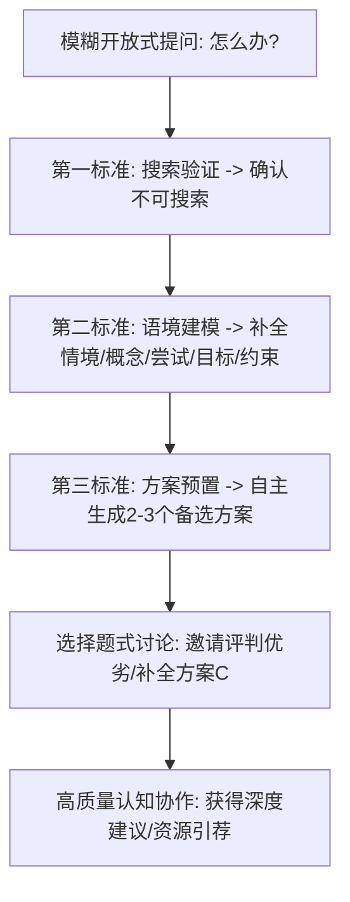
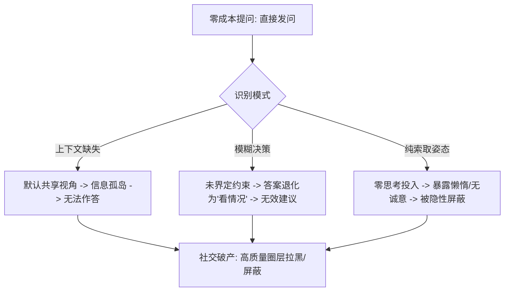
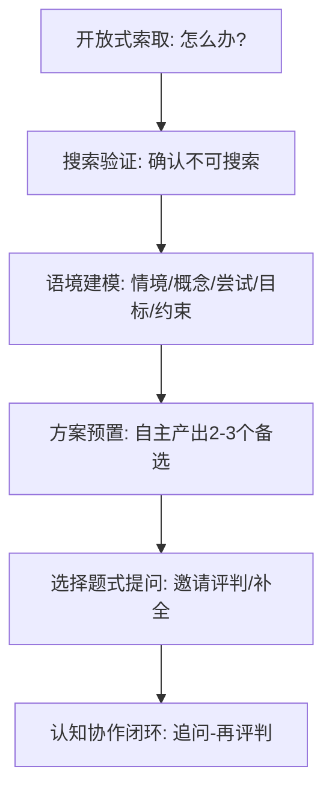
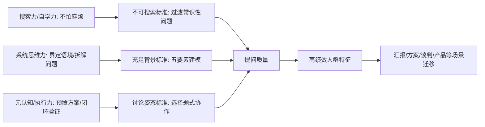

# 第 2 章 提问与沟通技术 —— 让他人愿意为你思考
作者：龙哥

## 学习目标

- 理解好问题的三大核心标准：不可搜索、充足背景、讨论姿态
- 识别低质量提问的典型模式（上下文缺失型、模糊决策型）及其暴露的深层心理特征
- 掌握选择题式提问法的三步标准化流程：搜索验证 -> 语境建模 -> 方案预置
- 理解提问质量与个人核心能力（搜索力、系统思维、元认知、执行力）的同构映射关系
- 能将模糊开放式问题转化为结构化选择题，降低回答者认知负荷，提升回应质量与社交互惠效率

## 2.1 生活类比

想象提问是一场去专科医生那里“精准挂号+自带病历+预设方案”的就诊过程。不可搜索，就像你的症状百度查不出确切病因（非常识性发烧感冒），必须靠医生经验判断；充足背景，就像你自带完整病历：发病情境（情境）、既往史/过敏原（概念）、自行服药记录（尝试）、想达到的康复标准（目标）、不能打针/不能请假（约束）；讨论姿态/选择题，就像你不问“医生我怎么办？”，而说：“医生，我查了资料觉得可能是A方案（吃药观察）或B方案（做微创），考虑到我下周要考试（约束），您觉得哪个更稳妥？还有没有方案C？”医生（回答者）只需评判你的A/B方案利弊或补充C方案，认知负荷极低，极愿意配合，甚至主动帮你挂最好的专家号。就像聪明的病人懂得“帮医生帮自己”，高质量提问者懂得“帮回答者帮提问者”。

## 2.2 概念地图

提问与沟通技术
├── 核心标准：好问题的三大定律
│   ├── 不可搜索性  —— P002 答案无法通过检索引擎直接获得，需经人类经验与判断
│   ├── 充足背景性  —— P002 包含情境、概念、尝试、目标、约束五要素，界定可决策的具体问题
│   └── 讨论姿态/选择题式  —— P002, P003 提问者预置方案，邀请评判优劣，而非单向索取
├── 反面教材：低质量提问模式
│   ├── 上下文缺失型  —— P002 默认对方共享视角，实则信息孤岛（如'这个在哪买'）
│   ├── 模糊决策型  —— P002 未界定约束条件，答案退化为'看情况'（如'大城市还是小城市'）
│   └── 纯索取姿态  —— P002 零思考成本投入，暴露懒惰、缺乏诚意、系统思维缺失
├── 核心方法：选择题式提问法
│   ├── 搜索验证  —— P003 确认问题不可搜索，前置自学成本
│   ├── 语境建模  —— P003 情境/概念/尝试/目标/约束五要素结构化界定问题全貌
│   ├── 方案预置  —— P003 自主产出≥2个经思考的备选方案，转化为选择题抛出
│   └── 邀请评判  —— P003 请教优劣或补充新思路，形成认知协作闭环
└── 底层逻辑：提问质量-能力同构定律
    ├── 搜索力/自学力 ≡ 不可搜索标准  —— P004
    ├── 系统思维力 ≡ 充足背景标准  —— P004
    ├── 元认知/执行力 ≡ 讨论姿态标准  —— P004
    └── 互惠原则：提问者前置思考成本 ⇄ 回答者投入认知资源  —— P002, P003

## 2.3 好问题的三大标准 —— 让提问从“索取”进化为“讨论”

### 为什么需要这个概念？

绝大多数提问者陷入“纯索取”陷阱：不搜索、不提供背景、不思考方案，导致零回应或无效回应。提问质量直接折射一个人的搜索力、系统思维、元认知与执行力，是高绩效人群的核心特征。掌握“好问题”标准，能将提问从消耗社交信用的“索取”，转化为积累社交资本的“讨论”。

### 核心定义

> "李笑来总结过，好问题的三个标准：第一，这个问题一定无法通过简单的搜索就得到答案；第二，这个问题有充足的背景信息支撑；第三，一个好问题不会是纯粹的索取。一个好的提问者所秉持的姿态更接近与“讨论”，而非“索取”。"
> 
> ——《docs/202303/20230328_009.md》

好问题 = **不可搜索** + **充足背景** + **讨论姿态（选择题式）**。

**不可搜索**是指答案无法通过检索引擎直接获得，需经人类经验与判断。**充足背景**是指包含情境、概念、尝试方案、目标、约束五要素，将模糊问题界定为可决策的具体问题。**讨论姿态**是指提问者预置两个以上备选方案，邀请回答者评判优劣或补充新思路，而非单向索取。

### 关键性质

**同构性**体现为提问质量与提问者核心能力（搜索力 × 系统思维 × 元认知 × 执行力）之间的等价映射关系。**互惠性**表明提问者前置的思考成本（搜索/建模/预置方案）决定了回答者愿意投入的认知资源多寡。**筛选性**则显示高质量提问天然筛选出高意愿、高能力的回答者，从而过滤无效社交噪音。

### 典型例子

蠢问题：“这个在哪里买？多少钱？”（默认对方知晓上下文，实则信息严重不对称）；模糊决策：“去大城市还是小城市？”（未界定个人条件，唯一答案只能是“看情况”）；好问题：“我想在杭州做新媒体运营，已对比过方案A（入职大厂）和方案B（跟博主做副业），受限于家庭需周末双休，老师觉得哪个更可行？有没有方案C？”

### 边界条件

事实性检索类问题（如“今天汇率多少”）不适用，直接搜索效率最高。极度紧急/生死攸关场景下，允许跳过“预置方案”直接求救。回答者若缺乏领域知识，即使好问题也难获高质量回答，需匹配“懂行的人”。

### 方法演进图

### 设计中的取舍

**为什么不把“充足背景”简化为“提供更多细节”？** 因为“细节”往往无关痛痒，而“情境/概念/尝试/目标/约束”五要素是将问题从“不可决策”转化为“可决策”的最小必要集。缺一不可，多一累赘。**这种设计的 trade-off 是什么？** 收益是前置20-30分钟思考成本，换取回答者高质量、高优先级、甚至主动引荐资源的回应（ROI极高）；代价是对简单事实类问题（如“今天汇率”）过度设计反而降效；对极度紧急场景（如生产故障）需退化为“只报问题+后果”，事后补全闭环。

---

## 2.4 低质量提问的典型模式与代价 —— 识别“蠢问题”避免社交破产

### 为什么需要这个概念？

识别低质量提问模式，是避免自己成为“懒人/怕麻烦者”标签的前置条件。理解“蠢问题”暴露的深层心理（懒惰、缺乏诚意、系统思维缺失），可反向审视自身思维盲区。明白“零成本提问”导致“零回应”的社交铁律，停止无效社交消耗。

### 核心定义

低质量提问 = **可搜索** + **缺背景** + **纯索取**。

**典型模式一：上下文缺失型**（如“这个在哪里/怎么买”），提问者默认对方共享其视角，实则信息孤岛。**典型模式二：模糊决策型**（如“大城市还是小城市”），未界定约束条件，答案退化为“看情况”。

### 关键性质

**暴露性**表明此类问题本质是提问者“怕麻烦、不诚意、缺乏系统思维”的行为投射。**排斥性**揭示回答者天然排斥“蠢问题”，因为这显得提问者毫无诚意，消耗回答者善意。**传染性**警示长期提问低质量问题者，会被高质量圈层隐性屏蔽，陷入信息获取恶性循环。

### 典型例子

> "这个在哪里？这个怎么买？这个多少钱？……我能猜到这人为什么会有这样的问题，可能是他看了我的一条视频……但他问问题就只从自己的角度发问，以为他心里想的，别人都知道，其实我根本不知道他在问什么"
> 
> ——《docs/202303/20230328_009.md》

> "比如“应该去大城市工作？还是去小城市工作？”这种问题的答案只能有一个，那就是看情况"
> 
> ——《docs/202303/20230328_009.md》

> "能够提出这种问题的人，一定是个怕麻烦的懒人"
> 
> ——《docs/202303/20230328_009.md》

> "大家只不过讨厌被问到蠢问题，因为这显得提问者毫无诚意"
> 
> ——《docs/202303/20230328_009.md》

抖音后台高频私信：“这个在哪里？这个怎么买？这个多少钱？”（作者根本不知道对方看了哪条视频）；职业咨询：“我该不该辞职创业？”（未提供行业、积蓄、家庭支持、风险偏好等任何背景）；考研咨询案例：大四女生询问考研科目分数线，被建议自行百度后拉黑建议者，印证“怕麻烦者”抗拒前置成本。

### 边界条件

新手期允许存在“笨问题”，但必须通过“被教导后改进”完成迭代，固化为模式则是能力缺陷。情感宣泄/寻求陪伴类提问不适用此标准，需区分“解决问题提问”与“情感连接提问”。

### 方法演进图

### 设计中的取舍

**为什么不宽容“笨问题”而是严厉定性为“蠢问题”？** 因为“笨”是认知水平暂时不够（可教、可改），而“蠢”是拒绝投入思考成本的态度问题（不怕麻烦、怕动脑）。混淆二者会纵容懒惰，稀释社交互惠规则。**这种设计的 trade-off 是什么？** 收益是建立高标准筛选机制，保护高认知者时间资产，倒逼提问者成长；代价是可能误伤真实新手（需配套“新手引导/模版”机制），以及在情感支持场景下显得过于功利冷酷（需明确区分提问类型）。

---

## 2.5 选择题式提问法 —— 降低回答者认知负荷的“社交杠杆”

### 为什么需要这个概念？

开放式提问（如“怎么办？”）让回答者承担全部认知负荷（界定问题、生成方案、评判优劣），极易被拒答或敷衍。选择题式提问将“生成方案”环节前置给提问者，回答者只需“评判优劣”，认知负荷降维，回应意愿显著提升。该方法传递“诚意+努力+尊重”三重强信号，是普通人链接高认知者的最高性价比动作。

### 核心定义

> "首先，这个问题一定无法通过简单的搜索就得到答案"
> 
> "其次，这个问题有充足的背景信息支撑……把问题定义的非常清楚，问题发生在什么样的情境下，涉及到什么样的概念，尝试过的解决方法等等"
> 
> "最后，一个好问题不会是纯粹的索取……他会用选择题的方式提问，而非简单的开放式"
> 
> ——《docs/202303/20230328_009.md》

选择题式提问 = **搜索验证 → 语境建模（情境/概念/尝试/目标/约束） → 方案预置（≥2个备选） → 邀请评判**。

三步法标准动作：
1. 确认不可搜索；
2. 投入时间界定问题全貌；
3. 自主产出备选方案，转化为选择题抛出。

### 关键性质

**认知分工**体现为提问者负责“发散/生成”，回答者负责“收敛/评判”，符合人类认知协作规律。**信任锚定**表明预置方案即“定金”，证明提问者已投入沉没成本，回答者安全感大增。**迭代性**显示回答者给出评判后，提问者可追问细节，形成“提问-评判-追问-再评判”的螺旋上升闭环。

### 典型例子

标准话术：“老师，我想在XX方向做项目，目前想到两条路：一是XXX（优缺点），二是XXX（优缺点），受限于预算/时间XXX，老师觉得哪条更可行？还有没有我没想到的第三条路？”对比：问“Python怎么学？” vs 问“已刷完《自动化》前5章、每天仅1小时、目标做爬虫，老师建议接着刷书还是直接找项目练手？还有没有更合适的路线？”

### 方法演进图

### 边界条件

备选方案必须是“经思考的”，而非随意编造的“伪选项”，否则暴露更严重的不诚意。方案数量建议2-3个，过多反增认知负荷，过少（仅1个）退化为确认题。仅适用于“寻求建议/决策/方案”类问题，不适用于“事实核查/情感倾诉/闲聊”场景。

### 设计中的取舍

**为什么不直接给“万能提问模版”让用户填空？** 因为提问的本质是“定义具体问题”，模版只能解决“格式”不能解决“内容”。每个问题的情境、约束、目标唯一，套用模版反而稀释背景信息密度，暴露“不想动脑”的懒惰。**这种设计的 trade-off 是什么？** 收益是强制提问者完成“问题建模”与“方案生成”两个核心认知动作，内化为能力；代价是门槛较高，新手初期需花费30-60分钟准备一个提问，易产生挫败感（需配套“微练习/脚手架”降低启动阻力）。

---

## 2.6 提问质量-能力同构定律 —— 你的提问水平，就是你的能力水平

### 为什么需要这个概念？

打破“提问是软技能、能力是硬实力”的割裂认知，确立提问质量是核心能力的“外在投射/试金石”。为个人成长提供可观测、可练习、可量化的抓手：练提问 = 练搜索力 + 练系统思维 + 练元认知 + 练执行力。解释为什么高绩效人群（学霸、优秀员工、大佬）天然擅长提问，而非“聪明才提问”。

### 核心定义

提问质量 ≡ **搜索/自学能力（不怕麻烦）** × **系统思维能力（界定语境/拆解问题）** × **元认知与执行力（预置方案/闭环验证）**。

四大能力映射：
- 搜索力 → 不可搜索标准
- 系统思维 → 充足背景标准  
- 元认知/执行力 → 讨论姿态/选择题标准

### 关键性质

**单向推导**表明高质量提问必然意味着高绩效人群（必要条件）。**反向不成立**说明高绩效人群偶尔也会问烂问题（如跨领域、极度疲劳时），但概率极低且能快速纠偏。**可迁移性**揭示提问训练可迁移至汇报工作、写方案、谈判、做产品等一切“定义问题-给方案”场景。

### 典型例子

> "提问本身就能看出你的能力"
> 
> "成为学霸的第一步就是不怕麻烦"
> 
> "如果你碰到一个能提出高质量问题的学生，基本上可以判定他的成绩一定不会差"
> 
> "做足功课的学霸会把问题定义的非常清楚，问题发生在什么样的情境下，涉及到什么样的概念，尝试过的解决方法等等"
> 
> "连提问者自己都不重视的事情，还怎么能要求其他人重视呢？"
> 
> ——《docs/202303/20230328_009.md》

学霸提问：“这道题我用A法算到第三步卡住了，B法觉得循环论证，目标是求极值，约束是不等式，老师看哪步错了？还是该换思路？”优秀员工汇报：“项目延期风险，方案一砍需求保工期（影响收入），方案二申请资源（需跨部门协调），方案三分期交付（需客户同意），建议走方案三，已预沟通客户倾向同意，请领导拍板”。

### 多源对照：提问质量与能力的关联机制

**共识**：提问质量是核心认知能力（搜索、系统思维、元认知、执行）的外在投射。高质量提问者必然具备高绩效潜质（必要条件）。

**分歧**：素材侧重“提问质量→能力”的单向推导，未展开“刻意练提问→反推能力提升”的训练闭环（需结合第3章习惯养成原则）。素材未量化“提问前置思考成本”与“回答质量”的剂量-反应关系，仅给出定性结论。

### 方法演进图

### 边界条件

该定律适用于“知识工作/认知协作”场景，不适用于纯体力/标准化流程执行岗位。文化语境差异：高权力距离文化中，选择题式提问可能被解读为“越俎代庖”，需调整为“请示+备选”话术。认知负荷极高时（如危机时刻），允许退化为“只报问题+后果”，事后必须补全复盘闭环。

### 设计中的取舍

**为什么不直接说“提问能力=智商”？** 因为智商是先天/难量化构念，而“搜索力/系统思维/元认知/执行力”均为可训练、可观测、可拆解的后天技能。将提问质量锚定到可训练技能组合，而非不可变天赋，才具有教学指导意义。**这种设计的 trade-off 是什么？** 收益是提供“练提问=练核心能力”的可执行增长路径，打破“能力不可练”的宿命论；代价是忽略了先天认知差异对提问上限的制约，且未给出不同基数者的分级训练大纲（需后续章节补充分级训练体系）。

---

## 2.7 设计中的取舍

**为什么不用“万能模版”套用所有提问？**
因为提问的本质是“定义具体问题”，模版只能解决“格式”不能解决“内容”。每个问题的情境、约束、目标唯一，套用模版反而稀释背景信息密度，暴露“不想动脑”的懒惰。

**这种设计的 trade-off 是什么？**
- **收益**：前置20-30分钟思考成本，换取回答者高质量、高优先级、甚至主动引荐资源的回应（ROI极高）。
- **代价**：对简单事实类问题（如“今天汇率”）过度设计反而降效；对极度紧急场景（如生产故障）需退化为“只报问题+后果”，事后补全闭环。

---

## 2.8 动手练习

### 练习 1：蠢问题改造实战：从“索取”到“讨论”

以下是三个典型的低质量提问，请分别应用“选择题式提问法”三步法（搜索验证 -> 语境建模 -> 方案预置）将其重写为高质量提问：

1. 场景：想做抖音带货，问大佬：‘抖音带货怎么选品？’
2. 场景：职场三年想转行，问前辈：‘我该不该辞职考公/考证/创业？’
3. 场景：学习Python入门，问群里：‘Python怎么学？有什么书推荐吗？’

回答要求：
- 每个重写版必须包含：核心约束条件、已尝试/排除的方案、2-3个自主思考的备选方案、邀请评判的话术
- 标注每个版本中对应的‘情境、概念、尝试、目标、约束’五要素

### 练习 2：提问质量自诊断：你的提问暴露了什么能力短板？

回顾近期你在社群、工作群、向导师请教的 3 个真实提问（或模拟即将要问的问题），按以下维度打分（1-5分）：

1. 不可搜索性：答案是否真无法通过百度/ChatGPT/知乎在 5 分钟内获得？
2. 背景充足度：是否包含了情境、概念、尝试、目标、约束五要素？
3. 讨论姿态：是否预置了 ≥2 个备选方案并邀请评判，而非单向问‘怎么办’？

自我复盘问题：
- 哪个维度得分最低？该维度对应的核心能力（搜索力/系统思维/元认知/执行力）是否为你的长期短板？
- 若把最低分维度提升 1 分，需要你在提问前多投入多少分钟的‘前置思考成本’？
- 设计一个‘提问前置清单’便签，贴在显示器边，强制下次提问前打卡

### 练习 3：实战演练：向高认知者发起一次高质量连接

目标：在本周内，向一位你敬佩的行业前辈/大佬（微信好友、星球大咖、博主等）发起一次真实的高质量提问/请教。

执行步骤：
1. 选定一个真实困扰你的、不可搜索的具体决策/难题。
2. 花 20 分钟完成‘背景信息界定清单’（情境/概念/尝试/目标/约束）。
3. 自主构思 2-3 个可行性不同的备选方案，分析各自优劣。
4. 按选择题式话术发送：【背景】+【困境】+【方案A优劣】+【方案B优劣】+【约束】+【请教：倾向哪个？有无方案C？】。
5. 记录对方回应时间、回应长度、建议质量、是否引发后续深度对话。

复盘记录：
- 对比以往‘随意提问’的回应差异，量化‘前置思考成本’与‘回应质量’的正相关性。
- 若对方未回应，复盘：是方案伪思考？背景仍模糊？还是对方匹配度不够（非领域专家）？
- 将此次提问全文存档，作为你‘提问能力作品集’的第一件展品。

---

## 2.9 本章小结

这一章中我们学习了如何将提问从“索取”进化为“讨论”，构建高效的认知协作与社交杠杆。首先，我们定义了好问题的三大标准：不可搜索、充足背景、讨论姿态。其次，我们识别了低质量提问的典型模式——上下文缺失型和模糊决策型，并揭示其暴露的懒惰、缺乏诚意、系统思维缺失等深层心理特征。接着，我们掌握了选择题式提问法的三步标准化流程：搜索验证、语境建模、方案预置，理解了该方法如何降低回答者认知负荷、传递诚意信号。然后，我们确立了提问质量-能力同构定律，论证了提问质量直接折射搜索力、系统思维、元认知与执行力四大核心能力。最后，我们通过动手练习将理论内化为可操作的提问肌肉。

本章我们一起学习了以下概念：

| 概念 | 解释 |
|------|------|
| 好问题三大标准 | 不可搜索 + 充足背景 + 讨论姿态（选择题式），是提问者思考深度与诚意的外在投射 |
| 低质量提问/蠢问题 | 可搜索 + 缺背景 + 纯索取，暴露提问者懒惰、怕麻烦、缺乏系统思维，导致零回应或被隐性屏蔽 |
| 选择题式提问法 | 搜索验证 -> 语境建模（情境/概念/尝试/目标/约束） -> 方案预置（≥2个备选） -> 邀请评判，降低回答者认知负荷的社交杠杆 |
| 提问质量-能力同构定律 | 提问质量 ≡ 搜索力 × 系统思维 × 元认知 × 执行力，高质量提问是高绩效人群的必要特征 |
| 提问诚信互惠原则 | 提问者前置思考成本（定金）决定回答者投入认知资源，纯索取零成本必然零回应 |
| 背景信息界定清单 | 问题发生情境、涉及核心概念、已尝试方法、期望目标、关键约束——将模糊问题转化为可决策具体问题的实操工具 |

下一章中，我们将学习长期主义与复利思维，理解为什么“坚持即稀缺”，以及如何从被动专注转向主动专注，让时间成为你的朋友。

