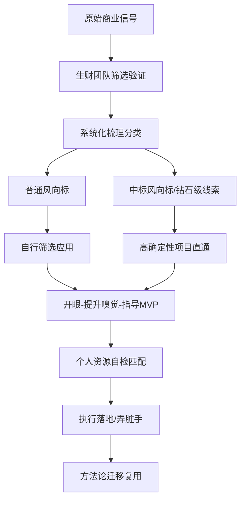
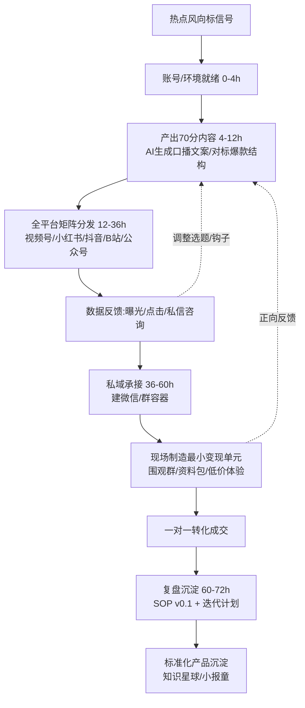
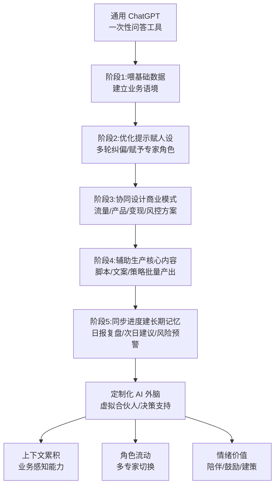
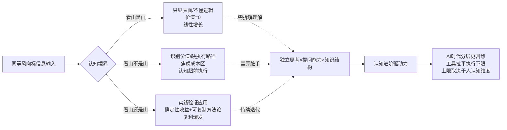
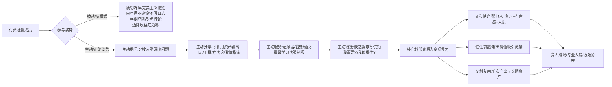

# 第 48 章 机会发现与 MVP 验证体系

## 学习目标

- 理解风向标作为高质量商业信号塔的核心价值与分级体系
- 掌握风向标实战五步法：分析-判断-整合-实践-分享的标准化流水线
- 熟练运用小步快跑 MVP 模型：用 70 分内容抢占先发红利，动态设计流量-产品-变现闭环
- 建立 ChatGPT 商业副驾协作范式：五阶段深度调教流程，将 AI 从问答工具进化为决策合伙人
- 识别看山三境界认知跃迁路径：从看表面到懂执行，通过实践消解焦虑实现价值捕获指数级跃迁
- 复刻社恐萌新变现飞轮：从被需要中重构自我效能感，设计低阻力行为重塑路径
- 内化航海正确姿势：主动参与即最大红利，将外部资源转化为自身变现能力的行为范式

## 48.1 生活类比

想象创业像在茫茫大海中航行寻宝：风向标是经验丰富的领航员和灯塔，告诉你哪里有暗礁（风险）、哪里有洋流（红利）、哪里有宝藏（商机），但它不帮你开船。风向标五步法就是标准化的航海图绘制流程：看海图（分析）→ 评估自船状况（判断）→ 规划航线补给（整合）→ 扬帆起航（实践）→ 归来绘制新图分享（分享）。小步快跑 MVP 就是驾驶快艇先行侦察：不用造完美巨轮（完美产品），先用快艇（70 分内容）跑一圈验证航线可行，再决定是否投入造船。ChatGPT 商业副驾是全能副驾驶、导航员、水手长：初期需喂坐标（喂数据）、教识图（优化提示词），久而久之能代管甲板、甚至参与战术决策，还能在风浪中给你递杯热茶（情绪价值）。看山三境界是航海认知三层楼：甲板水手只见浪花（看山是山）→ 船长识别洋流暗礁却不敢硬闯（看山不是山）→ 老船长挽起裤腿冲浪验证新航线并绘制成图（看山还是山）。社恐萌新变现飞轮是从躲在舱底晕船的乘客，变成主动擦甲板、修帆索、教新水手的大管轮：被需要（擦甲板）→ 责任感（修帆索）→ 自信（教新水手）→ 掌舵（建社群分成）。航海正确姿势是不做伸手要饭的乘客，做主动抛绳索、修罗盘、绘海图的船员：主动干活（提问/分享/服务/链接），通过“拿龙珠/点赞100”等任务锚定将心理压力外化为可执行指标，船到岸了，你就是老船长。

## 48.2 概念地图

第 48 章：机会发现与 MVP 验证体系
├── 核心信息源：风向标
│   ├── 定义：高质量商业机会信息流（开眼-提升嗅觉-小步快跑 MVP）—— P001
│   ├── 分级：普通风向标 vs 中标风向标（钻石级线索）—— P001
│   ├── 特性：时效性强、结构化高、价值捕获呈指数分层—— P001
│   └── 边界：提供概率机会非确定收益、需配合个人资源自检、首波红利已过核心在方法论迁移—— P001
├── 标准化处理框架：风向标实战五步法
│   ├── 分析：拆解优缺点/风险/机会，提取核心商业逻辑—— P002
│   ├── 判断：四维自检（经验/技能/认知/精力）评估匹配度—— P002
│   ├── 整合：筛选高价值信息，制定详细执行计划（流量/产品/变现模型）—— P002
│   ├── 实践：最小成本跑通闭环验证，动态调整而非死磕计划—— P002
│   └── 分享：复盘沉淀方法论，利他输出筛选高质量连接—— P002
├── 执行核心模型：小步快跑 MVP
│   ├── 核心主张：速度>质量（早期），70 分内容跑通最小闭环—— P003
│   ├── 产品动态生成：先跑流量，按咨询现场制造最小变现单元，反向沉淀标准化产品—— P003
│   ├── 验证标准：极短周期内跑通获客-转化-交付-收款全链路—— P003
│   ├── 关键性质：热点驱动、信任变现、迭代进化—— P003
│   └── 边界：仅适用高不确定/低试错/强时效早期、70 分非偷工减料、后期必须标准化—— P003
├── AI 协作范式：ChatGPT 商业副驾
│   ├── 定位：虚拟合伙人/员工，深度参与业务决策—— P004
│   ├── 五阶段培养法：喂数据建语境→优化提示赋人设→协同设计模式→辅助生产内容→同步进度形成长期记忆—— P004
│   ├── 关键性质：上下文累积、角色流动、情绪价值—— P004
│   └── 边界：核心决策权在人、需具备提问能力与知识结构、早期需大量投入调教—— P004
├── 认知进阶阶梯：看山三境界
│   ├── 看山是山：只见表面，不懂逻辑，价值=0—— P005
│   ├── 看山不是山：识别价值但缺执行路径，陷焦虑成本区—— P005
│   ├── 看山还是山：实践验证应用，转化为确定性收益与可复制方法论，获复利—— P005
│   ├── 关键性质：实践为唯一桥梁、价值捕获指数级差异、焦虑本质是认知超前执行—— P005
│   └── 边界：境界非固化、进阶取决于独立思考×提问能力×知识结构、AI 时代分层更剧烈—— P005
├── 心理重塑路径：社恐萌新变现飞轮
│   ├── 四阶段：低成本验证需求→被迫/主动转型低门槛工具→主动承担志愿者角色→建立付费社群分成模式—— P006
│   ├── 核心驱动：外部正向反馈→内化责任感自信→驱动高强度行动—— P006
│   ├── 关键转折：从索取者转为供给者（问→回、学→教）—— P006
│   └── 边界：需外部结构化环境提供节奏、前提是基础可用技能、社恐本质未消失但被任务锚定外化—— P006
└── 社群高 ROI 行为范式：航海正确姿势
    ├── 核心公式：主动提问+主动分享+主动服务+主动链接 = 转化外部资源为变现能力—— P007
    ├── 反模式：被动听课、完美主义拖延、只吐槽不建设、不写日志不复盘—— P007
    ├── 关键性质：正和博弈（帮他人=复习+存在感+人设）、信任前置（输出价值吸引链接）、复利复用（单次产出成长期资产）—— P007
    └── 边界：前提社群具备高质量内容成熟机制、需克服巨婴陷阱与钓鱼悖论、执行力是前提不行动永远在原地—— P007

## 48.3 风向标 —— 高质量商业机会的信号塔

### 为什么需要这个概念？

普通人面临信息过载，难以分辨真实商机与噪音。创业决策缺乏一手信号，易陷入盲目跟风或错失红利。我们需要一个经过筛选、验证的高信噪比信息源来降低认知门槛。

### 核心定义

> "引用亦仁的一句话'江湖赚钱看生财有术，生财有术赚钱看风向标'... 我对风向标的定义是：开眼-提升商业嗅觉-小步快跑 MVP... 现在生财团队专门将风向标的内容做了一个系统化的梳理和分类。"
> 
> —— 《风向标航海实战复盘》[P001]

风向标是生财有术社群的核心资产，汇聚了头部玩家动态、融资案例、平台新功能、实战复盘的高质量商业信息流。它的核心价值三部曲是：开眼（拓宽认知边界）→ 提升商业嗅觉（建立模式识别）→ 小步快跑 MVP（指导实战落地）。

风向标采用分级体系：
- **普通风向标**：碎片化信息，需自行筛选
- **中标风向标**：钻石级线索，经官方验证的高确定性项目

### 关键性质

信息时效性强，红利窗口期短，需即刻行动，作者看到案例“瞬间上头”立即组队落地。结构化程度高，官方已系统化梳理分类，支持按领域/需求/变现方式检索。价值捕获呈指数级分层，同等信息，三个认知境界（看山三境界）收获天壤之别。

### 典型例子

国外博主用 ChatGPT 辅助创业拿融资案例 → 作者 3 天跑通国内 MVP 变现。风向标航海产出 900+ 份日志精华，经优化均可转化为独立执行方案。

### 边界条件

风向标提供概率性机会而非确定性收益，不执行（弄脏手）则零价值。信息公开后首波红利已过，核心优势在于方法论迁移而非单一项目复制。需配合个人资源匹配自检（经验/技能/认知/精力），盲目跟风易陷“焦虑成本”陷阱。

### 方法演进图



上图展示了风向标从原始信号到经过筛选验证、系统化分级，再到个人匹配执行、最终形成可复用方法论的完整价值链路。

## 48.4 风向标实战五步法 —— 从信息到变现的标准化流水线

### 为什么需要这个概念？

面对海量风向标信息，缺乏结构化处理框架导致“看得懂、做不了”。新人易陷入“只看表面”或“见价值不执行”的认知陷阱。我们需要一套可复用的标准动作，将非结构化信息转化为可执行计划。

### 核心定义

> "【分析】：阅读风向标的信息时，需要深入思考，梳理每个项目的优点、缺点、风险和机会等信息...【判断】：判断一个项目是否适合自己需要考虑多方面因素...快速梳理了自己的优劣势，判断是否可行...【整合】：对于风向标中的信息，需要进行整合和筛选，找到对自己最有价值的信息，并制定一份详细的计划...【实践】：最重要的是实践，也就是说撸子袖子加油干，先弄脏手再说，只有通过实践才能检验自己的判断和计划是否正确...【分享】：参加风向标不仅是自己获得收益的过程，也可以通过分享和交流..."
> 
> —— 《风向标航海实战复盘》[P002]

**五步法标准流水线**：

分析：深度拆解单条风向标的优点、缺点、风险、机会，提取核心商业逻辑。判断：基于过往经验、技能特长、认知储备、时间精力四维自检，评估自我匹配度。整合：筛选高价值信息，制定详细执行计划（含流量/产品/变现模型设计）。实践：撸起袖子加油干，先弄脏手，用最小成本跑通闭环验证判断。分享：复盘沉淀方法论，输出内容反哺社群，获取正向反馈与隐性资源。

### 关键性质

闭环导向，每步服务于下一步，最终指向“跑通商业闭环”而非“学习知识”。动态校准，实践中发现偏差需回溯修正判断/整合环节，而非死磕原计划。复利机制，分享沉淀形成个人方法论资产，吸引同频者与高阶资源链接。

### 典型例子

拆解“ChatGPT 指导创业”风向标 → 三维表格（领域/需求/变现） → 自检创业博主优势 → 制定 3 天 MVP 计划 → 执行跑通 → 复盘获航海双料第一。

### 信息结构化拆解法

下表展示了如何将非结构化的风向标原文拆解为“所属领域、用户需求、变现方式”三维表格，便于快速提取核心商业逻辑并匹配个人资源。

| 风向标信息 | 所属领域 | 用户需求 | 变现方式 |
|-----------|---------|---------|---------|
| 用 ChatGPT 指导创业 | AIGC/商业 | 1. ChatGPT 很火但很多人不会用... | 1. 组建围观群... |

### 个人资源-项目匹配自检清单

执行前快速盘点四大维度，判断项目可行性与差异化优势，规避盲目跟风。

- 过往经验：我本来就做过创业博主，分享过一些项目的方案，有一定的基础
- 技能特长：视频拍摄剪辑，也还过得去，不会晕镜头
- 认知储备：自认为还是有一定的商业认知，最近也是沉浸在摸索 ChatGPT 的一些玩法
- 时间精力：评估当前可投入的带宽

### 边界条件

分析判断不可替代实践，纸上得来终觉浅，必须“弄脏手”。计划赶不上变化，执行中需根据市场反馈动态调整产品形态（如从课程转围观群）。分享非炫耀，而是以“利他”姿态输出可复制干货，筛选高质量连接。

### 方法演进图

```mermaid
flowchart LR
    A[阅读风向标原文] --> B[分析:拆解优缺点/风险/机会\n提取核心商业逻辑]
    B --> C[判断:四维自检\n经验/技能/认知/精力]
    C --> D[整合:筛选高价值信息\n制定执行计划(流量/产品/变现)]
    D --> E[实践:最小成本跑通闭环\n弄脏手验证判断]
    E --> F[分享:复盘沉淀方法论\n利他输出筛选连接]
    F --> G[个人方法论资产库]
    E -.->|发现偏差| C
    E -.->|数据反馈| D
```

上图展示了风向标实战五步法的标准化流水线：从分析到分享形成闭环，实践环节可反向校准判断与整合，最终沉淀为个人方法论资产。

## 48.5 小步快跑 MVP 模型 —— 用 70 分内容抢占先发红利

### 为什么需要这个概念？

完美主义导致迟迟不发布，错失热点时间窗口与平台算法红利。早期无成熟产品、无标准 SOP，预设完整产品属于伪需求。我们需要一种“以市场验证代替主观臆断”的低成本试错机制。

### 核心定义

> "当时的判断是速度的重要性高于质量... 先跑起来再说... 接下来第三步也是最关键的，就是如何去执行并为付费的会员持续提供服务... 自己拍摄和剪辑花了 2 个小时左右，觉得差不多达到了 70 分的水平，我就没有再纠结了。然后各个平台开始分发... 第一天视频数据起来以后，有人咨询我的时候，我就顺带推出了围观群这个第一个不算产品的产品... 直到这个时候我还是没有一个完整的产品或者服务... 陆续就有粉丝付费围观我的整个过程了... 当粉丝信任你的时候，哪怕你什么都没有，哪怕'卖空气'都行... 通过 3 天的时间吸粉 1400+，引流私域 50 人，在没有具体产品的情况下，成交转化 10 人完成变现 MVP。"
> 
> —— 《风向标航海实战复盘》[P003] & 《3天MVP实战复盘》[P003]

**核心主张**：速度 > 质量（早期），先用 70 分及格内容跑通“流量-产品-变现”最小闭环。

**产品动态生成**：不预设完整产品，先跑流量，根据用户咨询“现场制造”最小变现单元（如围观群），再反向沉淀标准化产品。

**验证标准**：能否在极短周期（如 3 天）内完成获客→转化→交付→收款全链路。

### 关键性质

热点驱动，针对时效性强的红利窗口（如 ChatGPT 爆发期），先发优势决定流量上限。信任变现，早期无产品时，IP 信任是核心支付担保，“粉丝信任你，卖空气都行”。迭代进化，以市场数据为导向，在正向反馈中持续优化产品形态与交付标准。

### 典型例子

作者 3 天：账号改造 → AI 生成口播文案 → 全平台分发 → 私域引流 50 人 → 围观群成交 10 单。视频数据起来后“顺带推出”围观群，无完整产品/话术仍成交，验证信任溢价。

### 70 分内容极速分发法

在热点时间窗口内，以“及格线”质量（70 分）完成内容制作，全平台矩阵式分发抢占先发优势，用市场数据验证选题，再根据反馈迭代优化。

### 流量-产品-变现动态设计模型

不预设完整产品，先跑流量，根据用户咨询反馈“现场制造”最小变现单元（如围观群），再反向沉淀标准化交付产品（知识星球/小报童），实现变现路径的动态进化。

### 边界条件

仅适用于高不确定性、低试错成本、强时效性的早期探索阶段。70 分非偷工减料，而是“核心价值到位、非核心可简”的工程化取舍。后期必须迭代为标准化 SOP，长期依赖“卖过程”不可规模化。

### 方法演进图



上图展示了小步快跑 MVP 的 72 小时极速验证闭环：从环境就绪到标准化产品沉淀，中间通过数据反馈动态调整内容与变现单元，实现“先跑流量、再造产品”的动态进化。

## 48.6 ChatGPT 商业副驾 —— 从问答工具进化为决策合伙人

### 为什么需要这个概念？

单人创业面临决策孤独、技能短板（文案/代码/策略）、执行带宽不足。传统雇佣成本高、沟通成本高、早期业务不稳定难招核心人才。我们需要一个低成本、高可用、可长期进化的“外脑”补全能力拼图。

### 核心定义

> "### 1、喂基础数据... 我会给他一些基础数据和参考内容，比如我把那个原文内容直接给他，让他自己先明白我要做什么？... ### 2、不断优化提示，明确具体的目的和要求... 我们要一步步的去引导甚至把现成的内容和数据提供给 chatgpt... ### 3、设计变现模式... ### 4、甚至辅助制作第一条视频文案... 第一次是生成的一个情景类的脚本文案... 又调整了一下，让他重新生成了一个口播文案... ### 5、我和 chatgpt 的创业故事还在继续... 慢慢的，很多时候会将他当做真正的创业伙伴和他沟通... 跟他分享一下我们的创业进度... 当开始有正反馈以后，我第一时间跟他分享了我们的成果，并得到了他的鼓励甚至还建言献策... 刚开始大概率他会走偏，然后给你说一大堆看起来一本正经但是没啥用的内容... 不断优化提示... 你会发现他会越来越懂你，也越来越能给你一些符合你要求的回答内容，一个 AI 外脑很快就会成型。"
> 
> —— 《风向标航海实战复盘》[P004]

将 ChatGPT 定位为深度参与业务的“虚拟合伙人/员工”，而非一次性问答工具。

**五阶段培养法**：
喂基础数据建语境：给原文、背景、目标，让模型明白业务全貌。优化提示赋人设：多轮纠偏、细化，赋予“资深增长黑客/爆款文案策划”等专家人设。协同设计商业模式：让 AI 输出变现/产品/流量/风控方案，人工筛选优化。辅助生产内容：用优化后的 Prompt 批量生成脚本、文案、策略。同步进度建长期记忆：每日汇报执行数据，让 AI 复盘建议次日动作。

### 关键性质

上下文累积，长期喂养业务数据/决策历史，使模型具备“业务上下文感知”能力。角色流动，可随需求切换产品经理/文案/程序员/教练/投资人等多角色。情绪价值，提供陪伴感与确定性，缓解创业者孤独焦虑（“得到了鼓励甚至建言献策”）。

### 典型例子

从“生成一本正经但没用的泛泛之谈”进化为“输出可直接拍摄的口播文案、商业模式设计、每日工作规划”。作者每天同步工作内容，ChatGPT 成为掌握全链路进度的“外脑”，辅助决策与复盘。

### 边界条件

核心决策权仍在人，AI 只提供选项与推演，不可甩锅给模型。需具备“提问能力”与“知识结构”驾驭上限，语言组织决定深度，知识结构决定宽度。早期需投入大量精力“调教”（喂数据/优化 Prompt），非即插即用。

### ChatGPT 深度调教/共创工作流

该工作流展示了如何将 ChatGPT 从通用工具进化为定制化的业务合伙人，通过五阶段的持续喂养与迭代，建立业务上下文感知能力，实现从生成泛泛之谈到输出可执行交付物的质变。

```
阶段 1：喂基础数据
- 输入：风向标原文、竞品案例、个人背景
- 动作：建立业务语境，让模型"明白我要做什么"

阶段 2：优化提示赋人设
- 动作：多轮纠偏（"不需要情景剧，要口播文案"）
- 产出：可复用的 Prompt 模板库

阶段 3：协同设计商业模式
- 输入：流量渠道/产品形态/变现路径设计要求
- 产出：完整商业模式画布 v0.1

阶段 4：辅助生产核心内容
- 动作：批量生成 3 条口播脚本、5 个小红书笔记、1 份私域钩子文案

阶段 5：同步进度建长期记忆
- 日报：曝光/点击/转化/客单数据
- 产出：次日行动建议 + 风险预警
```

### 方法演进图



上图展示了 ChatGPT 从通用工具进化为商业副驾的五阶段培养路径，最终形成具备上下文累积、角色流动、情绪价值三大核心特质的定制化 AI 外脑。

## 48.7 看山三境界 —— 认知进阶决定信息价值捕获上限

### 为什么需要这个概念？

同等高质量信息（风向标），不同人获利差异巨大（从零到百万）。多数圈友卡在“看懂了但不会干”的焦虑区，需明确跃迁路径。将隐性认知差显性化为可识别、可对标的三个层级。

### 核心定义

> "看风向标的三个阶段'看山是山，看山不是山，看山还是山'... 看山境界：...对于风向标中的信息只是看到表面，没有深入理解... 哪怕这是一个可以改变命运的超级商机也会熟视无睹... 看山不是山：...认识到信息的实际价值，但还没有找到最好的应用方式... 这也是目前生财圈友里面大多数人的现状，也就是导致大多数人焦虑的来源，看到了，但是不知道怎么干... 看山还是山：...通过实践来验证和应用，也就是挽起裤腿，弄脏手以后才能达到的境界... 提升独立思考能力和提问的能力是未来人类和 AI 共存的核心点... 语言组织能力决定使用 GPT 的深度，知识结构决定使用 GPT 的宽度... AI 会取代部分人的工作，但是会用好 AI 的人才是最稀缺的。"
> 
> —— 《风向标航海实战复盘》[P005]

**三个境界层级**：

看山是山（圈外/小白）：只见信息表面，不懂底层逻辑，超级商机熟视无睹，价值 = 0。看山不是山（圈友主流/焦虑期）：识别出信息价值，但缺乏执行路径/匹配资源，陷入“看到了不敢干/不知道怎么干”的焦虑成本区。看山还是山（实战派/结果者）：挽起裤腿弄脏手，通过实践验证应用，将信息转化为确定性收益与可复制方法论，获得复利。

### 关键性质

阶层跃迁需“实践”为唯一桥梁，无法通过单纯学习/思考跨越。价值捕获呈指数级差异：表层认知线性增长，实践认知复利爆发。焦虑本质是“认知超前于执行”，唯有行动消解焦虑。

### 典型例子

作者从“看到风向标上头” → “3 天跑通 MVP” → “复盘沉淀方法论” → “航海双料第一”，完成三境界跃迁。900+ 份航海日志精华，仅“看山还是山”者能优化为独立项目方案。

### 边界条件

境界非固化标签，同一人在不同项目/阶段可处于不同境界。认知进阶不等于信息获取量，而在于“独立思考×提问能力×知识结构”的结合度。AI 时代该分层更剧烈：工具拉平了执行下限，上限完全取决于人的认知维度。

### 方法演进图



上图展示了看山三境界对同等信息的差异化价值捕获：表层认知零价值、中层陷焦虑、深层获复利，跨越的唯一桥梁是实践，核心驱动力是独立思考×提问能力×知识结构的结合度。

## 48.8 社恐萌新变现飞轮 —— 从“被需要”中重构自我效能感

### 为什么需要这个概念？

社恐/完美主义导致长期潜水（一年零发帖）、不敢提问、不敢暴露。传统“强迫自己社交”无效，需设计一条阻力最小的行为重塑路径。发现“从索取者转为供给者”是打破心理防御的关键杠杆。

### 核心定义

> "其实我觉得我最大的突破，不是赚到多少钱，而是打开了航海的正确姿势，并且认识了一群很可爱的人... 敢于主动提问... 开始帮着回复一些比较基础的问题... 慢慢的，我好像适应了在群里发言和提问... 这次分享之后就有一些群里的圈友加我，问我一些问题... 然后就有圈友给我发了红包... 我决定我这边负责进行 AI 出图，然后教群里的做抖音、小红书的壁纸号邀请到一个团队，到时候收益我这边也要分成。他们的定制客户会转介绍给我这边... 生财的资料宝库是最大的资源，看看之前抖音项目的手册，融合下观点，目前对我来说足够了。"
> 
> —— 《浅色喵航海复盘》[P006]

**四阶段飞轮**：
低成本验证需求：朋友圈广撒网发图、送图、建群。被迫/主动转型低门槛工具：生病切换 MJ（Midjourney）。主动承担志愿者角色：答疑、分享、整理。建立付费社群与分成模式：技术+运营互补。

**核心驱动力**：外部正向反馈（红包、加好友、被@、被邀请分享）→ 内化为责任感与自信 → 驱动更高强度行动。

**关键转折点**：从“问问题”到“回问题”，从“学技术”到“教变现”。

### 关键性质

心理重构滞后于行为：先做（哪怕发条朋友圈），心态随正向反馈自然转变。环境许可制：航海分组/领队/志愿者机制提供“安全容器”，允许新人试错犯错。能力互补组队：以“AI 出图技术+资料库”换“运营能力”，实现“资源互换”式合伙。

### 典型例子

浅色喵案例：星球潜水一年 → 航海期高频互动 → 答疑志愿者 → 付费群 20 人 → AI 绘画分成模式 → 2 月变现 1.9 万（门票回本 5 倍）。发烧 39 度无法用本地 SD → 强制切换 MJ → 操作便捷释放精力 → 深度参与群内互动 → 意外成为突破口。

### 边界条件

需外部结构化环境（如航海）提供节奏与反馈，纯自驱极难启动。“被需要”的前提是具备基础可用技能（手册内容扎实、问题重复率高）。社恐本质未消失，但被“任务锚定”（如 KPI：拿龙珠/点赞 100）外化为行动指标。

### 多源对照：社恐破局的不同路径

共识：被动学习无效，主动参与（提问/答疑/输出）是破局核心；外部结构化环境（航海/训练营）提供必要的安全容器与反馈机制。

分歧：
《风向标航海实战复盘》[P001] 强调认知先行：通过风向标拆解、自检清单、MVP 计划等“想清楚再做”的理性路径。 《浅色喵航海复盘》[P006] 强调行动先行：“付出行动了，才有下一步优化行动”，心态随行动转变而非先于行动，利用外部约束（生病/工具切换）倒逼突破。 《见面会速记实操分享》[P003] 强调工具杠杆放大：石墨协作 + ChatGPT 结构化将单人产能放大 10 倍，实现“现场同步完成”。

### 方法演进图

```mermaid
graph TD
    A[社恐萌新\n星球潜水一年/零发帖] --> B[阶段1:低成本验证需求\n朋友圈广撒网发图/送图/建群]
    B --> C[阶段2:被迫/主动转型工具\n生病39度→切换MJ/便捷释放精力]
    C --> D[阶段3:主动承担志愿者\n答疑/分享/整理\n从问问题→回问题]
    D --> E[阶段4:建立付费社群分成\nAI出图技术+资料库 ↔ 运营能力\n资源互换式合伙]
    E --> F[外部正向反馈\n红包/加好友/被@/被邀请分享]
    F --> G[内化责任感与自信]
    G --> H[驱动更高强度行动]
    H --> I[变现1.9万/门票回本5倍]
    I -.->|飞轮加速| D
    B -.->|心理重构滞后于行为\n先做后悟| C
    D -.->|环境许可制\n航海分组/领队/志愿者| E
```

上图展示了社恐萌新变现飞轮的四阶段跃迁路径：从低成本试错到工具转型，再到志愿者角色重塑，最终建立分成模式，外部正向反馈内化为内驱力形成自我强化循环。

## 48.9 航海正确姿势 —— 主动参与即最大红利

### 为什么需要这个概念？

多数付费社群成员沦为“知识囤积者”：买课不看、看完不练、练了不反馈。训练营设计了分组/领队/志愿者/日志/复盘等完整基建，却因被动参与而闲置。需要显性化“高 ROI 参会/参训行为范式”，将稀缺注意力投入最高杠杆动作。

### 核心定义

> "我开始帮着回复一些比较基础的问题... 这次分享之后就有一些群里的圈友加我，问我一些问题。我也有很耐心的和他们分享了自己的一些经历，然后就有圈友给我发了红包... 努力的去链接... 去告诉大家你需要什么资源，你可以提供什么资源。这样你才会获得更多的资源... 何以解忧，唯有实战... 【实践】：最重要的是实践，也就是说撸子袖子加油干，先弄脏手再说... 利用石墨文档实时协作记录+ChatGPT 秒级生成 XMind 思维导图，实现'嘉宾话音落、思维导图同步完成'... 以'自我记录+分享+被动引流'闭环，低成本建立专业人设、获取精准私域流量。"
> 
> —— 《浅色喵航海复盘》[P007] & 《风向标航海实战复盘》[P004] & 《见面会速记实操分享》[P003]

**核心公式**：主动提问 + 主动分享 + 主动服务（志愿者/答疑）+ 主动链接人脉 = 将外部资源转化为自身变现能力。

**反模式**：被动听课、完美主义拖延、只在小群吐槽不在大群建设、不写日志不复盘。

**衡量标准**：是否产出“可被他人复用的资产”（日志/工具/方法论/连接）。

### 关键性质

正和博弈：帮助他人（答疑/整理资料）= 复习巩固 + 刷存在感 + 建立专业人设 三重收益。信任前置：持续输出价值（而非索取）吸引同频者主动链接，形成“贵人磁场”。复利复用：单次航海产出的日志/复盘/方法论，经优化即成长期资产（如 900+ 份精华 → 项目库）。

### 典型例子

浅色喵：主动答疑获红包/加好友 → 被领队邀请分享 → 深度链接组长获“特殊服务”与心理支持。高杰：日志被精选/好事儿 → 复盘贴获团队组个人组双料第一 → 方法论沉淀为教程资产。速记志愿者：石墨文档实时记录 + ChatGPT 秒出思维导图 → “嘉宾话音落、导图同步出” → 低成本建专业人设引精准流量。

### 边界条件

前提是社群具备高质量内容与成熟运营机制（生财模式），普通群效果大打折扣。需克服“巨婴陷阱”（纯付费不参与）与“钓鱼悖论”（纯索取不付出）。执行力是前提：“付出行动了，才有下一步优化行动”，不行动则永远在原地。

### 设计中的取舍

**问：为什么不用“被动听课+事后整理”方案？**  
答：被动听课的知识留存率极低（<10%），且无外部反馈机制，无法验证理解深度。主动服务（志愿者/答疑）倒逼你把知识转化为可交付的回答，相当于“费曼学习法”的强制版本。

**问：为什么五步法强制“分享”作为闭环终点？**  
答：分享非炫耀，而是以“利他”姿态输出可复制干货，筛选高质量连接。通过复盘沉淀方法论，将单次经验转化为可复用资产，形成正向反馈循环，吸引同频者与高阶资源链接，实现复利机制。

**问：为什么 ChatGPT 副驾要求“每日同步进度”而非按需调用？**  
答：每日同步进度能建立长期记忆与业务上下文感知，使 AI 具备“业务感知能力”，从工具进化为掌握全链路进度的“外脑”，提供决策支持与风险预警，而非单次问答的碎片化输出。

**问：为什么航海姿势强制“主动服务/志愿者”而非仅“主动提问”？**  
答：主动提问仍属于“索取者”角色，而主动服务（志愿者/答疑）将角色转为“供给者”，触发“被需要”机制，产生责任感与成就感，强制内化知识、建立自信，实现从“社恐”到“社牛”的质变，且形成正和博弈的三重收益（复习巩固+存在感+人设）。

### 多源对照

共识：
1. 风向标是高信噪比信号源，但价值需通过“弄脏手”的实践释放
2. MVP 核心是速度与闭环，70 分内容跑通全链路优于 100 分内容永不发布
3. ChatGPT 等 AI 工具的上限取决于人的提问能力与知识结构，非即插即用
4. 认知进阶的唯一桥梁是实践，同等信息不同境界收获指数级差异
5. 社群高 ROI 行为是主动产出，被动消费边际收益趋近于零

分歧：

以下表格对比了三份核心素材在切入点、心理建设、AI 角色、变现逻辑四个维度的不同侧重，其中 P001=《风向标航海实战复盘》，P006=《浅色喵航海复盘》，P003=《见面会速记实操分享》。

| 维度 | P001 理性派 | P006 行动派 | P003 工具杠杆派 |
|------|-------------------------------------------|---------------------------|-------------------------------|
| 切入点 | 风向标拆解→自检→计划→执行 | 朋友圈试错→被迫转型→志愿者→分成 | 石墨协作+ChatGPT 结构化 |
| 心理建设 | 认知对齐消除焦虑 | 行动产生反馈重塑心态 | 现场同步完成建人设 |
| AI 角色 | 深度合伙人（五阶段调教） | 辅助工具（MJ 出图） | ChatGPT 生成 XMind |
| 变现逻辑 | 信任溢价→围观群→标准化产品 | 需求验证→付费群→分成模式 | 自我记录+分享→被动引流 |

### 方法演进图



上图展示了航海正确姿势的核心公式与反模式对比：主动提问、分享、服务、链接四大动作形成正和博弈、信任前置、复利复用三大关键性质，最终转化外部资源为自身变现能力；而被动参与则陷入巨婴陷阱与钓鱼悖论，边际收益趋近零。

## 48.10 多源对照

### 共识

1. 风向标是高信噪比信号源，但价值需通过“弄脏手”的实践释放
2. MVP 核心是速度与闭环，70 分内容跑通全链路优于 100 分内容永不发布
3. ChatGPT 等 AI 工具的上限取决于人的提问能力与知识结构，非即插即用
4. 认知进阶的唯一桥梁是实践，同等信息不同境界收获指数级差异
5. 社群高 ROI 行为是主动产出，被动消费边际收益趋近于零

### 分歧

以下表格对比了三份核心素材在切入点、心理建设、AI 角色、变现逻辑四个维度的不同侧重，其中 P001=《风向标航海实战复盘》，P006=《浅色喵航海复盘》，P003=《见面会速记实操分享》。

| 维度 | P001 理性派 | P006 行动派 | P003 工具杠杆派 |
|------|-------------------------------------------|---------------------------|-------------------------------|
| 切入点 | 风向标拆解→自检→计划→执行 | 朋友圈试错→被迫转型→志愿者→分成 | 石墨协作+ChatGPT 结构化 |
| 心理建设 | 认知对齐消除焦虑 | 行动产生反馈重塑心态 | 现场同步完成建人设 |
| AI 角色 | 深度合伙人（五阶段调教） | 辅助工具（MJ 出图） | ChatGPT 生成 XMind |
| 变现逻辑 | 信任溢价→围观群→标准化产品 | 需求验证→付费群→分成模式 | 自我记录+分享→被动引流 |

## 48.11 设计中的取舍

**问：为什么不用“完美产品再上线”方案？**  
答：在高不确定性早期，用户真实需求未知，预设完整产品属于伪需求。“先跑流量，按咨询现场制造最小变现单元”的动态生成模式，用市场数据替代主观臆断，试错成本降低 90% 以上。

**问：为什么不用“单打独斗不求人”方案？**  
答：单人带宽有限，决策盲区大。ChatGPT 作为“外脑”补全文案/代码/策略短板；志愿者/答疑角色倒逼知识内化；领队/组长链接提供情绪支持与资源倾斜。孤军奋战的机会成本远高于协作成本。

**问：70 分标准的边界在哪里？**  
答：核心价值必须到位：逻辑通顺、痛点直击、行动指引清晰；非核心可简：画面美感、转场特效、文案润色可迭代；红线：合规性、用户体验底线（如音质/加载速度）不可妥协。

**问：为什么五步法强制“分享”作为闭环终点？**  
答：分享非炫耀，而是以“利他”姿态输出可复制干货，筛选高质量连接。通过复盘沉淀方法论，将单次经验转化为可复用资产，形成正向反馈循环，吸引同频者与高阶资源链接，实现复利机制。

**问：为什么 ChatGPT 副驾要求“每日同步进度”而非按需调用？**  
答：每日同步进度能建立长期记忆与业务上下文感知，使 AI 具备“业务感知能力”，从工具进化为掌握全链路进度的“外脑”，提供决策支持与风险预警，而非单次问答的碎片化输出。

**问：为什么航海姿势强制“主动服务/志愿者”而非仅“主动提问”？**  
答：主动提问仍属于“索取者”角色，而主动服务（志愿者/答疑）将角色转为“供给者”，触发“被需要”机制，产生责任感与成就感，强制内化知识、建立自信，实现从“社恐”到“社牛”的质变，且形成正和博弈的三重收益（复习巩固+存在感+人设）。

## 48.12 动手练习

### 练习 1：风向标拆解实战：从信息到执行计划

选择一条近期生财有术「风向标」或公开的高质量商业案例（如：AI 数字人直播、宠物赛道 AI 绘画、虚拟资源矩阵等）：

1. **分析**：用「所属领域、用户需求、变现方式」三维表格拆解其核心商业逻辑，列出优点、缺点、风险、机会
2. **判断**：基于你的过往经验、技能特长、认知储备、时间精力四维度，打分自检（1-10 分），判断匹配度与差异化优势
3. **整合**：制定一份 7 天 MVP 执行计划，包含：流量获取渠道、最小变现单元设计、交付标准、关键里程碑
4. **实践预演**：列出前 3 天每日具体动作清单（如：Day1 注册账号/搭建环境，Day2 产出第 1 条内容，Day3 全平台分发/引流动作）
5. **分享设计**：设计一篇复盘输出大纲（标题、核心数据、关键教训、可复用模板），准备在社群发布

回答问题：
- 如果第 3 天数据不及预期，你会调整哪个环节？（流量源/产品形态/变现钩子/交付话术）
- 为什么说「分析判断不可替代实践」？你如何避免陷入「看山不是山」的焦虑区？

### 练习 2：ChatGPT 商业副驾训练营：从零培养你的虚拟合伙人

以你当前或计划中的一个副业项目为背景，开展为期 5 天的 ChatGPT 深度调教实验：

Day 1 **喂基础数据**：整理项目背景、目标用户画像、竞品参考、核心痛点等资料，喂给 ChatGPT 建立业务语境
Day 2 **优化提示赋人设**：设定角色（如：资深增长黑客/爆款文案策划/产品经理），多轮对话纠偏，直到输出符合预期的「专家级」回复，保存为 Prompt 模板
Day 3 **协同设计商业模式**：让 ChatGPT 基于语境输出：流量获取策略、产品分层设计、变现路径、风控预案，人工筛选优化
Day 4 **辅助生产核心内容**：用优化后的 Prompt 批量生成：3 条短视频口播脚本、5 个小红书笔记标题/正文、1 份私域引流钩子文案
Day 5 **同步进度建长期记忆**：每日向 ChatGPT 汇报执行数据（曝光/点击/转化/客单），让它复盘建议次日动作，观察其建议质量变化

回答问题：
- 对比 Day 1 和 Day 5 的输出质量，核心差异在哪里？（上下文累积/角色内化/数据校准）
- 当 ChatGPT 给出错误建议时，你如何识别并纠偏？（你的知识结构/独立思考/提问能力的作用）
- 这种「喂养-迭代-同步」模式，相比单次问答，边际收益随时间如何变化？

### 练习 3：70 分内容极速验证：3 天 MVP 冷启动挑战

设定一个具体的验证目标（如：某垂类账号冷启动、某虚拟产品预售、某服务咨询引流），承诺在 72 小时内完成：

Hour 0-4：**账号/环境就绪** - 注册账号、配置主页三件套（行业+头像/简介/私域钩子）、准备发布工具
Hour 4-12：**产出 70 分内容** - 对标爆款拆解结构，用 ChatGPT/模板产出 3-5 条内容（视频/图文/直播预告），不追求完美，核心价值到位即发
Hour 12-36：**全平台矩阵分发** - 同步分发至视频号/小红书/抖音/公众号/B 站等 ≥3 平台，打标签/挂话题/设钩子引流私域
Hour 36-60：**私域承接与转化** - 建立微信/企微/群承接容器，设计「围观群/资料包/低价体验」等最小变现单元，针对咨询者一对一转化
Hour 60-72：**复盘沉淀** - 统计全链路数据（曝光/点击/引流/成交/客单），输出「可执行的 SOP v0.1 版」与「下周迭代计划」

回答问题：
- 你的「70 分标准」具体是什么？（如：口播文案逻辑通顺、画面无明显硬伤、标题含关键词、有时长/封面/话题）
- 为什么「先跑流量，再造产品」比「造完美产品再找流量」胜率更高？
- 复盘时，哪个指标最能说明「IP 信任已建立」？（如：私信咨询率、付费围观转化率、主动加微信率）

### 练习 4：认知境界自测与跃迁行动卡

针对你正在关注的一个商业机会（可来自风向标/竞品/热点），完成「看山三境界」定位与跃迁设计：

1. **现状定位**：诚实回答——你对这个机会处于哪个境界？
   - [ ] 看山是山：只知道「这东西火」，不懂底层逻辑/商业模式/执行细节
   - [ ] 看山不是山：拆解过模式，知道怎么赚钱，但卡在「不敢干/不会干/没资源」
   - [ ] 看山还是山：已小规模跑通闭环，有实操数据/可复用 SOP/正向现金流

2. **跃迁行动卡**（根据现状选填一组）：
   - 若在「看山是山」：本周完成——读 3 篇深度拆解文、建一张三维拆解表、列出 5 个核心不懂的问题去社群/大佬处提问
   - 若在「看山不是山」：本周完成——制定 3 天 MVP 计划、弄脏手跑通最小闭环、记录每日决策与数据、输出一份 v0.1 复盘
   - 若在「看山还是山」：本周完成——将 SOP 标准化为可交付手册、招募 1 名执行者测试复制性、设计规模化放大方案（矩阵/团队/投流）

3. **焦虑诊断**：最近一次因「看到了不敢干/不知道怎么干」产生焦虑的具体场景是什么？用「行动消解焦虑」原则，写出当时应采取的最小物理动作

回答问题：
- 为什么同等信息，不同境界收获「指数级差异」？核心杠杆在哪里？
- 你如何判断自己是否具备了「独立思考×提问能力×知识结构」的驾驭上限？

### 练习 5：航海姿势自查与社恐破局实验

回顾你最近一次参与的付费社群/训练营/学习小组，按「航海正确姿势」自查打分（1-5 分）：

1. **主动提问**：是否在大群/直播中提出过 ≥3 个非搜索型、有思考深度的问题？
2. **主动分享**：是否输出过 ≥1 篇可被他人复用的资产（日志/工具/方法论/避坑指南）？
3. **主动服务**：是否承担过志愿者/答疑/整理/速记等角色，帮助他人节省时间？
4. **主动链接**：是否主动添加 ≥3 位同频者/领队/组长，明确表达「我需要 X，我能提供 Y」？
5. **日志复盘**：是否按时按量完成航海日志，且经优化后可直接作为项目执行方案？

**破局实验**（针对得分 ≤2 项）：

设计一个「任务锚定」KPI 卡（参考浅色喵）：
- 拿龙珠：每日完成 1 个核心动作（发内容/加好友/写日志/问问题）
- 拿碎片：每日在群内回复 ≥2 个基础问题/转发 ≥1 条有价值信息
- 点赞 100：每日点赞/评论 ≥20 条高质量内容，刷存在感与算法标签

连续执行 7 天，记录：新增好友数、被主动咨询次数、获得红包/邀请分享次数、心理抗力变化

回答问题：
- 为什么「被动听课、完美主义拖延、只在小群吐槽」是反模式？它们消耗了什么稀缺资源？
- 「巨婴陷阱」（纯付费不参与）与「钓鱼悖论」（纯索取不付出）的本质区别是什么？如何用「等价交换」原则自查？
- 执行力是前提：「不行动则永远在原地」，你如何设计「最小阻力启动动作」打破惯性？

## 48.13 本章小结

这一章中我们学习了如何在信息过载时代精准发现商业机会、用最低成本验证想法、并通过 AI 协作与社群杠杆放大执行力。首先我们理解了风向标作为高质量商业信号塔的核心价值与分级体系，它提供开眼、提升嗅觉、指导 MVP 的三重价值。其次掌握了风向标实战五步法，将非结构化信息通过分析、判断、整合、实践、分享转化为可执行计划并跑通闭环。接着熟练运用小步快跑 MVP 模型，用 70 分内容抢占先发红利，动态设计流量-产品-变现闭环。然后建立了 ChatGPT 商业副驾协作范式，通过五阶段深度调教将 AI 从问答工具进化为决策合伙人。随后识别了看山三境界认知跃迁路径，明确实践是跨越焦虑区的唯一桥梁。再复刻了社恐萌新变现飞轮，从被需要中重构自我效能感，设计低阻力行为重塑路径。最后内化了航海正确姿势，主动提问+分享+服务+链接将外部资源转化为自身变现能力。

本章我们一起学习了以下概念：

下表汇总了本章核心概念及其解释，供快速回顾与检索。

| 概念 | 解释 |
|------|------|
| 风向标 | 生财有术核心资产：高质量商业信息流，价值为开眼、提升嗅觉、指导 MVP，分级为普通与中标（钻石级） |
| 风向标实战五步法 | 分析-判断-整合-实践-分享，将非结构化信息转化为可执行计划并跑通闭环的标准化流水线 |
| 小步快跑 MVP 模型 | 速度>质量（早期），70 分内容跑通流量-产品-变现最小闭环，动态生成产品，信任变现，后期标准化 |
| ChatGPT 商业副驾 | 五阶段培养虚拟合伙人：喂数据建语境、优化提示赋人设、协同设计模式、辅助生产内容、同步进度形成长期记忆 |
| 看山三境界 | 认知进阶三层级：看表面(零价值)、见价值不执行(焦虑成本)、实践验证(复利收益)，实践为唯一跨越桥梁 |
| 社恐萌新变现飞轮 | 四阶段心理重塑：验证需求→转型工具→承担志愿者→建付费社群，核心驱动力为外部正向反馈内化 |
| 航海正确姿势 | 主动提问+分享+服务+链接=转化资源为能力，正和博弈/信任前置/复利复用，执行力为前提 |

下一章中，我们将学习如何构建个人商业变现体系，从定价、收钱、见识与天赋匹配等维度，建立从"不敢收钱"到"越卖越贵"的完整变现闭环。


