# 第 28 章 汽车垂类矩阵变现 —— 产品反向选题、全网铺量筛选、自动化三件套

## 学习目标

- 掌握“产品反向内容选题法”，实现内容与变现的天然对齐
- 理解“全网铺量筛选法”，能用数据跑出流量主阵地
- 掌握“流量自动供给”机制，建立内容资产换长期免费精准流量的被动获客飞轮
- 熟练应用“低成本内容生产模式（混剪为主、实拍为辅、切片兜底）”，实现小团队高频产出
- 掌握“直播连麦免费诊断转化法”，用专业服务建立信任实现高转化
- 理解“自动化变现三件套（无人直播+短视频混剪+付费投流）”的构建条件与边界
- 掌握“被动式私域运营”与“自用省钱分享赚钱分销裂变模型”，实现高LTV与低成本获客
- 识别“汽车后市场疑难杂症细分赛道”的选品逻辑与商业模式特征
- 分析“规模化突破三要素（选品可投流、达人矩阵化、本地生活服务化）”的必要性与实操难点
- 能根据自身资源禀赋，判断是否适合切入“非标服务+标品销售”的垂类矩阵模式

## 28.1 生活类比

想象你是一位“社区神医”开药房。  
选品（药方）只配治“疑难杂症”（烧机油、抖动）的特效药（燃油宝），不卖维生素（泛知识），病人（车主）一吃就见效，自然高复购。  

内容（坐堂/讲座）不讲《本草纲目》（行业大道理），只在门口挂牌：“治烧机油、治抖动、治油耗高”（症状话题库），路过受苦的病人主动排队（流量自动供给）。  

全网铺量（多地行医/发传单）先在周边十里八乡（20+平台）都贴告示/送药方，发现哪村病人最多、最信（抖音/快手），就在那村盖诊所（深耕）。  

直播连麦（免费问诊）病人来了不直接卖药，先免费把脉问诊（连麦诊断），确诊是“烧机油”才开药（推单），病人感激信任，转化极高。  

自动化三件套（徒弟/药方/广告）徒弟按方抓药（无人直播/混剪切片）24小时卖；核心药方在县城电视台打广告（付费投流）保底；师父只管坐堂把关。  

私域运营（老病号档案/口碑）不上门推销（零骚扰），只在诊所墙上贴满“康复锦旗/感谢信”（朋友圈真实订单/评价），病人看了自己回来复诊/带邻居来（高LTV/裂变）。  

规模化（开分号/收徒/办医院）核心药方能进医保/能电视购物（选品可投流）；收徒授业开分号（达人矩阵）；自建/合作实体医院做手术/住院（本地生活服务化），从“卖药”进化为“卖医疗服务/卖模式”。

## 28.2 概念地图

汽车垂类矩阵变现体系
├── 核心选品逻辑
│   ├── 避红海、找症状、重复购、高利润          —— P001
│   └── 产品反向内容选题法：内容即广告、广告即内容  —— P001
├── 流量获取体系
│   ├── 全网铺量筛选法：20+平台测试锁定抖音/快手  —— P002
│   └── 流量自动供给：垂直内容+算法标签=被动精准获客  —— P003
├── 内容生产体系
│   ├── 低成本生产模式：混剪为主/实拍为辅/切片兜底  —— P004
│   └── 标准化SOP：固定参数/时长/模板/多形态复用  —— P004
├── 变现闭环体系
│   ├── 直播连麦免费诊断转化法：专家人设+症状筛选+标品推荐  —— P005
│   ├── 自动化变现三件套：无人直播/短视频混剪/付费投流  —— P006
│   ├── 知识付费组合拳：培训/付费问答/免费引流分层  —— P006
│   └── 广告/平台福利/分销佣金等辅助变现  —— P006
├── 私域运营体系
│   ├── 被动式运营：零骚扰+真实社会化证明+产品即时体验  —— P007
│   └── 分销裂变模型：自用省钱/分享赚钱/有赞分销工具  —— P008
└── 规模化突破路径
    ├── 选品可投流：资质合规是付费流量准入硬门槛  —— P010
    ├── 达人矩阵化：孵化/合作达人破解内容与信任产能上限  —— P010
    └── 本地生活服务化：线下实体+到店服务=高客单信任闭环  —— P010

## 28.3 产品反向内容选题法 —— 让内容天然带货属性

### 为什么需要这个概念？

垂直电商账号常陷入“涨粉不带货”的假繁荣，泛行业知识内容吸引的流量无转化属性。小团队资源有限，内容生产必须直接服务于变现，避免无效产出。传统选题靠蹭热点、讲大道理，难以精准筛选目标付费用户。

### 核心定义

以自营/代理产品为中心，梳理产品能解决的具体用户痛点症状建立话题库。采用“专家解疑答惑”人设，围绕症状关键词（如油耗高、抖动、烧机油）生产内容。实现内容选题与产品卖点强绑定，内容即广告、广告即内容。

### 关键性质

该方法能天然筛选精准流量：进入直播间或私域的用户均为带具体症状的高意向客户。内容复用率极高：固定话题库支撑全年高频产出，素材可横向多平台分发、纵向多形态复用。同时降低选题决策成本：不再追问“今天拍什么”，话题库即生产指令单。

### 典型例子

燃油宝账号：围绕“油耗高、抖动、烧机油、尾气超标”四大症状建立话题库，全年循环生产专家答疑视频。同行电喷账号：常年围绕“烧机油、镗缸、电喷维修”招生培训+卖设备，月营收百万级。

### 边界条件

仅适用于产品卖点明确、能对应具体用户痛点症状的标品/准标品类目。要求创作者具备垂直领域专业知识储备，能胜任“专家人设”内容输出。若产品无具体解决症状场景（如纯品牌形象类），该法失效。

> "这里就用了一招：围绕产品做内容！咱就卖燃油宝的，重点就围绕燃油宝能解决啥问题来做内容，把燃油宝能解决的车辆症状，也是车主普遍关心的。比如油耗高、抖动、烧机油、尾气超标等，全部整理成话题，以汽修专家解疑答惑的方式拍摄视频，全年不断围绕这些话题生产内容。"
> 
> —— P001《docs/202303/20230328_059.md》

这个原文摘录展示了“产品反向内容选题法”的核心动作：先有产品（燃油宝），再梳理产品能解决的症状（油耗高、抖动、烧机油、尾气超标），建立话题库，以专家人设生产内容。这是一个从“供给侧”倒推“内容侧”的闭环逻辑。

**小团队创业切入定律：避红海、找症状、重复购、高利润**（来源：P001《docs/202303/20230328_059.md》）

资源有限的小团队切入成熟红海市场（如卖车），必须下沉到“售后症状解决”细分环节，选择保修期外车主刚需强、决策快、高毛利、高复购的标品，才能跑通商业闭环并建立护城河。

> "我卖汽车卖不过人家，那我就转成卖燃油宝、轮胎，卖能够解决汽车疑难杂症的用品...过了保修期呢？是不是得购买这些产品替换？我就发现这些产品利润非常高,，也很容易让用户多次复购，是一个很不错的市场"

这个论断揭示了选品的底层逻辑：避开整车销售红海，切入保修期外车主的高频刚需症状（烧机油、抖动、油耗高），用标品（燃油宝、清洗剂）解决非标问题，实现高毛利、高复购。

**内容即广告、广告即内容：围绕产品做内容是精准获客的唯一捷径**（来源：P001《docs/202303/20230328_059.md》）

垂直电商类账号，内容选题必须强绑定产品卖点（解决症状），而非泛行业知识。只有“带货属性”的内容，引来的流量才具备天然转化属性，避免“涨粉不带货”的假繁荣。

> "前期围绕产品已经铺了足够的内容，车子有问题的车友，看到视频进入直播间，开播就会有流量，客户精准度也有保证"

这段话验证了内容与变现对齐的效果：内容铺垫到位后，流量自带精准标签，直播间“开播就有流量”，且“客户精准度有保证”。

### 28.3.1 话题库建设实操步骤

**方法：内容生产SOP：话题库建设与混剪复用**（来源：P001《docs/202303/20230328_059.md》）

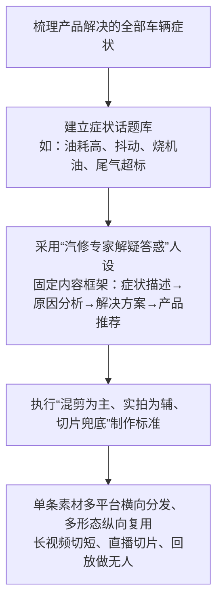

**方法：产品反向内容选题法演进图**（来源：P001《docs/202303/20230328_059.md》）

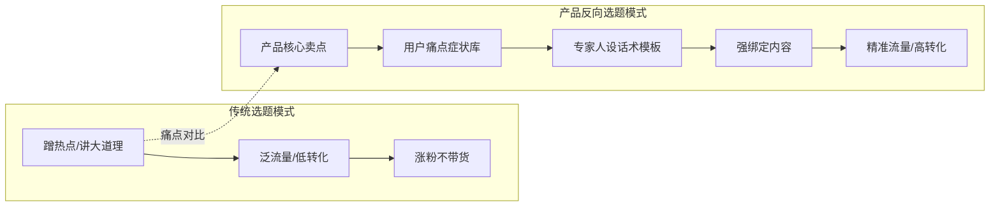

这套 SOP 将选题从“每天想什么拍什么”的随机决策，转化为“按话题库轮播”的标准化流水线。你只需要维护话题库，生产端就能持续输出。

**公式：产品反向内容选题法**

$$ \text{内容选题} = f(\text{产品核心卖点}, \text{用户痛点症状库}, \text{专家人设话术模板}) $$

**逐式解释：**
- **产品核心卖点**：自营/代理产品能解决的具体车辆故障（如燃油宝解决烧机油、抖动、油耗高、尾气超标）。
- **用户痛点症状库**：将产品卖点转化为用户可感知、可搜索的症状关键词，建立结构化话题库。
- **专家人设话术模板**：固定“症状描述 → 原因分析 → 解决方案 → 产品推荐”四段式结构，标准化内容输出。
- **函数 f 含义**：不是简单拼接，而是“强绑定”逻辑——每个话题必须直指一个产品卖点，每个视频必须植入一条转化路径。

**作用**：该公式将“选题决策”从主观创作转化为确定性工程流程，保证内容生产的每一分钟都直接服务于变现，消除“无效产出”。

## 28.4 全网铺量筛选法 —— 用数据跑出流量主阵地

### 为什么需要这个概念？

新入局者易主观臆断主战平台，导致资源投入错配、流量获取效率极低。不同平台用户画像、算法推荐机制、商业化成熟度差异巨大，无通用最优解。小团队精力有限，必须快速聚焦单一/双平台深耕，避免多线作战稀释产能。

### 核心定义

冷启动期：内容一次性分发至 20+ 主流内容平台（垂直/泛资讯/短视频/长视频/自媒体全覆盖）。数据复盘期：对比各平台流量质量（精准度、停留、互动）、转化率（私域引流/直接成单）。资源聚焦期：锁定 ROI 最高的 1-2 个平台（实测为抖音、快手），收缩战线深度运营。

### 关键性质

该方法实现去主观化决策：用实测数据替代经验主义判断平台价值。具有低成本试错特性：内容复用分发边际成本极低，单次投入换全景认知。同时具备动态调整机制：平台算法/政策变化时，可重启铺量筛选流程。

### 典型例子

米戈团队：覆盖懂车帝、汽车之家、抖音、快手、头条、B站、知乎等 30+ 平台，累计发布 10000+ 作品，最终锁定抖音/快手双平台。头条系矩阵号“山水重庆”：全平台分发文章/视频，日更 7-8 条，年变现超千万，验证泛资讯赛道全网铺量可行性。

### 边界条件

要求内容具备极强复用属性（横屏/竖屏/图文/视频多形态适配），纯定制化内容无法铺量。前期需承受“广撒网、少收割”的心理落差与资源消耗。平台规则红利期有限，筛选结果具有时效性，需定期复盘。

> "能发布的地方都先试试，哪里引流效果好，最后就重点运营哪里。懂车帝、汽车之家、易车、爱卡、太平洋、车友头条、汽车头条、今日头条、抖音、火山、快手、秒拍、腾讯、优酷、UC 大鱼号、爱奇艺、凤凰网、一点资讯、趣头条、知乎、百度、搜狐、新浪、搜狗、网易、A 站、B 站、公众号、视频号等渠道都发布下，量大出奇迹。至今各个平台累计发布了 10000+ 部作品，对比来看还是抖音和快手流量最香。"
> 
> —— P002《docs/202303/20230328_059.md》

这段原文完整记录了“全网铺量筛选法”的实操清单：覆盖 30+ 平台、发布 10000+ 作品、最终锁定抖音/快手。这就是“量大出奇迹”背后的数据验证过程。

**全网分发验证：抖音/快手为汽车垂类流量主阵地**（来源：P002《docs/202303/20230328_059.md》）

[evidence] 实测 20+ 平台发布 10000+ 作品后，抖音和快手流量质量（精准度、转化率）显著优于懂车帝、汽车之家、B站、头条等垂直/泛平台，成为双平台聚焦深耕的依据。

> "至今各个平台累计发布了 10000+ 部作品，对比来看还是抖音和快手流量最香。"

### 28.4.1 平台筛选与聚焦策略

**方法：平台筛选与聚焦策略**（来源：P002《docs/202303/20230328_059.md》）

```mermaid
flowchart LR
    subgraph 第一阶段：全量分发
        A1[覆盖 30+ 主流平台<br/>懂车帝/汽车之家/抖音/快手/头条/B站/知乎/公众号/视频号等]
    end
    subgraph 第二阶段：数据复盘
        B1[对比核心指标<br/>播放量/完播率/互动率/主页访问/加微数/直接成单]
    end
    subgraph 第三阶段：资源倾斜
        C1[仅深耕抖音、快手双平台<br/>收缩战线实现运营效率最大化]
    end
    A1 --> B1 --> C1
```

**方法：全网铺量筛选法演进图**（来源：P002《docs/202303/20230328_059.md》）

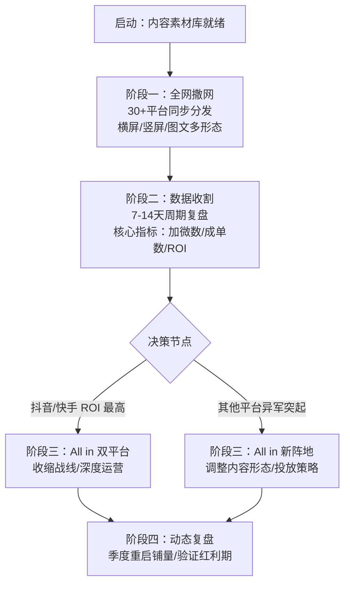

这三阶段构成了一个标准化的“市场验证-资源聚焦”闭环。你不需要在开始就押注某个平台，而是用最低成本跑完一遍数据，再 All in。

## 28.5 流量自动供给 —— 让算法持续送精准客户上门

### 为什么需要这个概念？

付费流量成本持续走高、规则收紧，中小团队难以长期承担高额获客成本。主动出击式引流（私信、评论区截流）效率低、风控高、不可规模化。需要建立“内容资产”换“长期免费精准流量”的被动获客飞轮。

### 核心定义

在筛选出的最优平台，持续高频发布强绑定产品痛点的垂直内容。利用平台推荐算法“标签匹配”机制，使有具体症状需求的用户被动涌入。形成“内容铺垫 -> 算法分发 -> 精准用户进直播间/加私域 -> 成交 -> 产生新素材 -> 继续铺垫”的正向循环。

### 关键性质

该模式具有零边际成本获客特性：内容发布后无需额外投入即可持续获得曝光。流量极高精准度：进来的均为主动搜索/被算法推荐症状关键词内容的用户。具备抗周期性：内容资产沉淀后，即使停更一段时间，历史作品仍持续带来长尾流量。

### 典型例子

米戈团队：前期铺设海量症状类视频，后期开播即有流量，无需投 DOU+，客户精准度有保证。书单/怀旧/英语启蒙等视频号赛道：依托微信生态信任背书，历史内容长尾流量极强。

### 边界条件

依赖平台算法推荐机制稳定，若平台流量分发逻辑剧变（如从推荐转分发），需重建模型。内容必须强垂直、强标签，泛娱乐/宽泛内容无法获得精准标签匹配。需要前期大量内容沉淀作为“燃料”，冷启动期无自动供给效果。

> "找到适合内容的最优平台，就重点运营这些平台，持续不断的发布内容，就能够逐步实现流量自动供给。"
> 
> "前期围绕产品已经铺了足够的内容，车子有问题的车友，看到视频进入直播间，开播就会有流量，客户精准度也有保证"
> 
> —— P003《docs/202303/20230328_059.md》

这两段原文揭示了“流量自动供给”的因果链条：前期大量垂直内容沉淀（燃料）+ 算法标签匹配（引擎）= 后期开播即有精准流量（结果）。注意“前期”和“后期”的时间差——这是一个延迟满足的复利模型。

### 28.5.1 流量自动供给飞轮模型

**方法：流量自动供给飞轮模型**（来源：P003《docs/202303/20230328_059.md》）

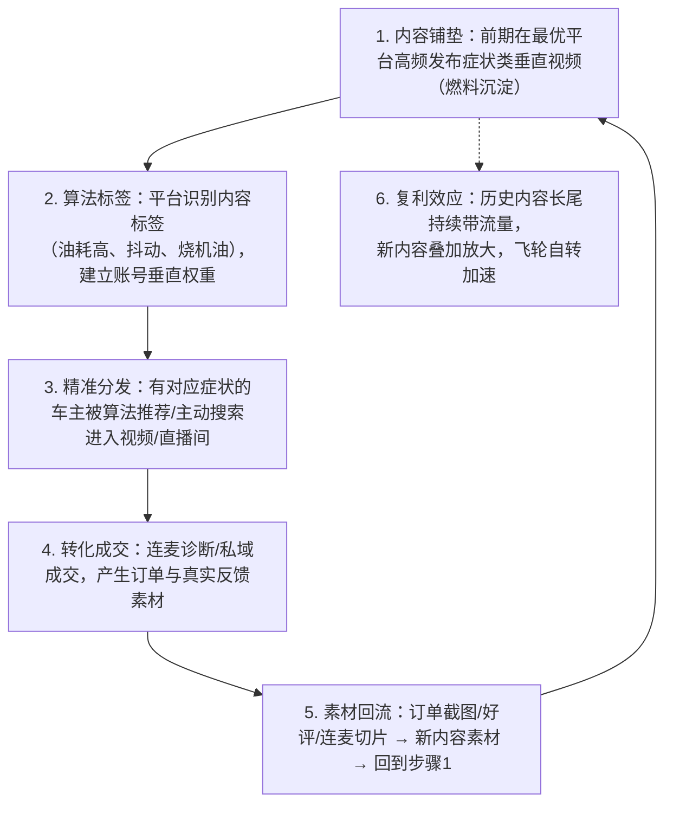

**方法：流量自动供给演进图**（来源：P003《docs/202303/20230328_059.md》）

```mermaid
flowchart LR
    subgraph 冷启动期（0-3个月）
        C1[大量垂直内容投喂<br/>建立账号标签] --> C2[算法探索期<br/>流量波动大/不可控]
    end
    subgraph 成长期（3-12个月）
        G1[标签固化/权重提升<br/>精准流量稳定增长] --> G2[素材回流加速<br/>切片/好评/订单→新内容]
    end
    subgraph 成熟期（12个月+）
        M1[历史内容长尾复利<br/>停更仍有基础流量] --> M2[新品/新话题快速冷启<br/>老账号权重加持]
    end
    C2 --> G1 --> M1
```

**公式：流量自动供给飞轮**

$$ \text{精准流量}_{t} = \sum_{i=1}^{t} \alpha^{t-i} \cdot \text{垂直内容资产}_i \cdot \text{算法权重}_i \cdot \text{转化素材回流}_i $$

**逐式解释：**
- **垂直内容资产$_i$**：第 $i$ 期投入的症状类垂直视频数量与质量，构成算法识别的“标签燃料”。
- **算法权重$_i$**：平台对该账号垂直度的信任分，随持续垂直输出单调递增，随泛内容发布衰减。
- **转化素材回流$_i$**：第 $i$ 期成交产生的真实订单截图、好评、连麦切片，再造为新内容注入飞轮。
- **衰减系数 $\alpha$ ($0<\alpha<1$)**：历史内容随时间流量衰减率，垂直赛道 $\alpha$ 接近 1（长尾极强）。
- **求和符号 $\sum$**：飞轮效应的本质是所有历史资产的加权叠加，而非单期产出。

**作用**：该公式量化了“内容资产复利”机制，揭示为何必须坚持“前期大量铺垫、后期躺赚流量”——每一条垂直视频都是永续产生现金流的资产，而非一次性消耗品。

## 28.6 低成本内容生产模式 —— 混剪为主、实拍为辅、切片兜底

### 为什么需要这个概念？

小团队（3-5人）无专业摄制组，高质量原创实拍产能极低（日更 1-2 条），无法支撑矩阵化分发。单一平台单账号流量上限低，必须通过多账号、多平台、高频次（日更 10-20 条）以量换质。专业实拍成本高、周期长、不可复制，不符合“快速验证-规模化放大”节奏。

### 核心定义

混剪为主：下载同行/平台高互动素材，经剪辑、调速、镜像、滤镜、特效、调色六步去重，产出“伪原创”。实拍为辅：仅对核心转化环节（如连麦诊断现场、产品实物展示）进行真实拍摄建立信任。切片兜底：将长直播回放切片为短视频，一条素材多形态复用，补足数量缺口。

### 关键性质

该模式标准化 SOP 可复制：固定剪辑参数（调速 0.9/1.1、镜像、黑白滤镜、噪点、对比度+10 等）、固定时长（36 秒）、固定音频模板（3 套轮换）。边际成本趋近零：单条视频制作耗时压缩至分钟级，单人可支撑全网矩阵日更。规避风控核心：去重处理需过平台原创度检测（MD5 修改、画面结构微调），核心是“过审”而非“原创”。

### 典型例子

怀旧赛道（黄岛主）：抖音搬运至视频号，剪映六步法（调速/镜像/滤镜/特效/调色/剪辑）批量去重，单月跑通变现。米戈团队：混剪为主、实拍为辅、直播切片补量，3-5 人维持全网日更 10-20 条。

### 边界条件

平台原创度算法升级（如视频号上线去重算法）会直接导致该模式失效，需及时迭代去重手段。混剪素材版权风险客观存在，商业化规模大后需转向自有版权素材库。纯混剪账号权重上限低、难建立深度 IP 信任，长期需进化向“仿拍/实拍原创”。

> "小团队运作，内容形式咱就秉承一切从简，数量大于质量的原则，把内容复用做到最大化，混剪为主，实拍为辅，内容不够，直播切片来凑。"
> 
> "自营产品的，把直播回放，稍加处理，每天发布用来带货；合作产品的，哪个视频带货数据好，就参考哪个，1:1 复制拍摄，一次拍摄，反复混剪。"
> 
> —— P004《docs/202303/20230328_059.md》

这段原文展示了三层内容生产策略的分工逻辑：自营产品用直播回放“稍加处理”即可带货（成本最低）；合作产品参考爆款“1:1 复制拍摄，一次拍摄，反复混剪”（验证过转化率）；内容缺口用“直播切片来凑”（零边际成本）。

### 28.6.1 低成本内容生产流水线

**方法：低成本内容生产流水线**（来源：P004《docs/202303/20230328_059.md》）

```mermaid
flowchart TD
    subgraph 原料端：素材来源分层
        R1[自营产品素材 → 直播回放稍加处理 → 每日发布带货]
        R2[合作产品素材 → 爆款视频 1:1 复制拍摄 → 一次拍摄反复混剪]
        R3[通用补量素材 → 直播切片 → 零边际成本补量]
    end
    subgraph 加工端：标准化混剪 SOP（剪映六步去重法）
        P1[调速（0.9x/1.1x 交替） → 镜像（水平翻转） → 滤镜（黑白/复古/电影感轮换）]
        P2[特效（噪点/颗粒感/轻微光效） → 调色（对比度+10、饱和度+10、锐化+20）]
        P3[时长固定 36 秒 → 音频 3 套固定模板轮换 → MD5 修改]
    end
    subgraph 产出端：多形态复用矩阵
        O1[横屏长视频 → 竖屏短视频（36秒） → 图文笔记]
        O2[直播回放 → 无人直播素材（2h循环） → 精华切片（15-60秒）]
        O3[单条素材 → 20+ 平台横向分发 → 多账号矩阵轮播]
    end
    subgraph 质检端：发布前自检清单
        Q1[原创度检测通过 → 敏感词过滤 → 标签/话题/挂车设置 → 定时发布]
    end
    R1 & R2 & R3 --> P1 & P2 & P3 --> O1 & O2 & O3 --> Q1
```

**方法：低成本内容生产模式演进图**（来源：P004《docs/202303/20230328_059.md》）

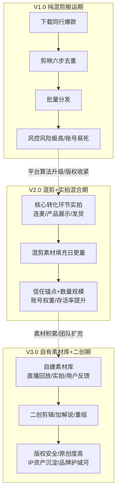

### 28.6.2 标准化混剪 SOP 参数表

以下是米戈团队实测可跑通的剪映六步去重参数（来源：P004《docs/202303/20230328_059.md》，同类怀旧赛道验证）：

| 参数项 | 设定值 | 作用 |
|--------|--------|------|
| 调速 | 0.9x / 1.1x 交替 | 破坏原视频节奏指纹 |
| 镜像 | 开启 | 水平翻转画面结构 |
| 滤镜 | 黑白/复古/电影感轮换 | 改变色彩直方图特征 |
| 特效 | 噪点/颗粒感/轻微光效 | 增加高频细节干扰 |
| 调色 | 对比度+10、饱和度+10、锐化+20 | 统一视觉风格同时修改像素分布 |
| 时长 | 固定 36 秒 | 规避特定时长指纹匹配 |
| 音频 | 3 套固定模板轮换 | 破坏音频指纹 |

> **这个参数表展示了**：去重不是“随便剪剪”，而是一套可量化、可复制、可验证的工业化标准。每一条参数都对应平台查重算法的一个检测维度（视频指纹、音频指纹、MD5、时长特征）。

## 28.7 直播连麦免费诊断转化法 —— 用专业服务换高转化信任

### 为什么需要这个概念？

传统直播带货“讲参数、比价格、催下单”在非标/高客单/专业门槛高品类严重失效。用户对硬广推销天然免疫，但对“免费专业建议”零防御且极度稀缺。非标品（每车症状不同）无法标准化陈列，必须通过一对一互动完成“诊断-开方-成交”闭环。

### 核心定义

流量入口：短视频精准引流（症状关键词标签）。留人/建信：主播以“汽修专家”人设，一对一连麦为车主免费诊断故障。筛客/成单：识别“油耗高、抖动、烧机油”等精准症状用户，针对性推荐小黄车自营产品。非标品标准化交付：通过连麦将非标服务（诊断）标准化为标品销售（燃油宝/清洗剂）。

### 关键性质

该方法信任建立极快：免费专业建议的互惠心理，极大降低成交阻力。转化率极高：进直播间即为带症状来的，连麦确诊后推单成交率远超货架陈列。素材自产自销：连麦过程即优质切片素材，直接复用于无人直播/短视频带货。

### 典型例子

米戈团队：直播间连麦诊断“油耗高/抖动”车主，针对性推燃油宝/清洗剂，单场直播销售额数万元级。同城相亲赛道：线下活动解决信任（不盈利）→ 互动群筛选 → 一对一红娘服务（核心利润），同构模式。

### 边界条件

主播必须具备真实专业硬核能力（或有专家团队远程支持），否则连麦翻车信任崩塌。仅适用于高决策复杂度、高专业门槛、非标品属性强的类目（汽修、医疗、法律、家装等）。连麦效率受限于主播单位时间接待上限，规模化需引入“助理分诊+专家会诊”分级体系。

> "目前我们的做法就是，直播间一对一连麦，为咨询问题的车友，提供免费诊断；遇到咱上面说的，车子如果出现了油耗高、抖动等症状的，这类客户就是我们的精准客户，需要做重点做转化，针对性的推荐小黄车里面的自营产品。"
> 
> "前期围绕产品已经铺了足够的内容，车子有问题的车友，看到视频进入直播间，开播就会有流量..."
> 
> —— P005《docs/202303/20230328_059.md》

这段原文揭示了直播间的分层转化漏斗：内容精准引流 → 连麦免费诊断（建信/筛客） → 症状匹配推单（成单）。注意“精准客户”的定义——**只有出现特定症状（油耗高、抖动、烧机油）的用户才是精准客户**，其他闲聊/咨询不相关问题的用户不在重点转化名单内。

### 28.7.1 直播间分层转化操作手册

**方法：直播间分层转化操作手册**（来源：P005《docs/202303/20230328_059.md》）

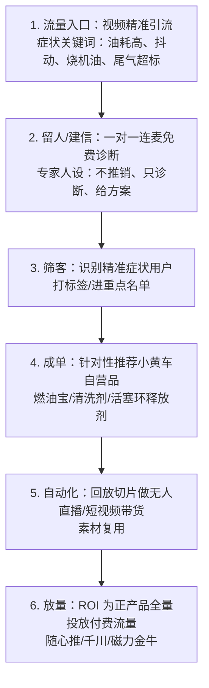

**方法：直播连麦免费诊断转化法演进图**（来源：P005《docs/202303/20230328_059.md》）

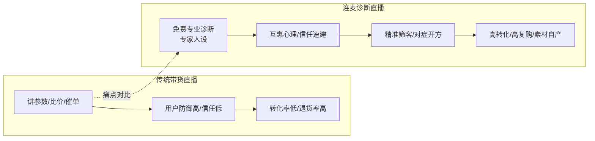

这个手册把直播间从“卖货场”重构为“诊所”，核心动作是**“连麦诊断”**——它同时完成了建立信任、筛选意向、生成素材三个功能，是整个变现体系的枢纽。

## 28.8 自动化变现三件套 —— 无人直播+短视频混剪+付费投流

### 为什么需要这个概念？

真人直播受限于人力/精力/时间，无法覆盖 24 小时流量高峰，且单场上限锁死收入天花板。短视频自然流量波动大、不可控，无法作为稳定收入基石。需要构建“非工作时间也能赚钱、非核心人力也能跑量”的自动化变现体系。

### 核心定义

无人直播：真人直播回放素材 -> 关闭连麦 -> 循环播放 2 小时+ -> 达真人播带货效果 -> 无违规风险（实测）。短视频混剪带货：爆款视频/直播切片 -> 1:1 复拍/混剪 -> 矩阵号高频分发 -> 小黄车挂载自动成交。付费投流放大：ROI 为正的核心 SKU -> 全量开启随心推/千川/磁力金牛 -> 即使不爆单也能稳定产出收益。

### 关键性质

素材资产化是前提：必须积累高转化的真人直播回放、爆款切片作为“燃料”。标准化 SOP 是引擎：混剪参数固化、发布定时自动化、投放模型标准化。付费流量托底是保障：自然流量上限后，付费流量突破天花板，实现确定性规模化增长。

### 典型例子

米戈团队：真人直播回放做无人播（日播 2 小时）、爆款视频 1:1 混剪发短视频、核心品全量投随心推/千川/磁力金牛。短剧 CPS 团队：授权素材 -> 二创去重 -> 矩阵号分发 -> 小程序挂载 -> 自动化分成，月 GMV 破 20 万。

### 边界条件

核心 SKU 必须支持平台付费推广（有资质、通过审核），否则无法接入“付费流量托底”环节。无人直播政策风险高：平台随时可能严打“录播循环/无实时互动”，需备真人兜底方案。短视频混剪原创度门槛持续提高，单纯“1:1 复制/去重”生命周期短，需进化向“二创/实拍”。

> "做无人直播和短视频带货，实现自动赚钱。无人直播：我们每天基本都会真人直播，素材不缺，把直播回放作为无人直播的视频素材，播放 2 个小时左右也能达到正常直播的效果...短视频带货：自营产品的，把直播回放，稍加处理，每天发布用来带货；合作产品的，哪个视频带货数据好，就参考哪个，1:1 复制拍摄，一次拍摄，反复混剪。能付费推广的产品就重点做，小店随心推、千川、磁力金牛都用上，持续付费推广，即使打不爆，也能持续带来收益。"
> 
> "自动化变现前提：素材资产化 + 标准化SOP + 付费流量托底"
> 
> —— P006《docs/202303/20230328_059.md》

这段原文完整记录了“自动化变现三件套”的落地细节和前提条件。注意三个组件的依赖关系：**无人直播依赖真人直播回放素材，短视频混剪依赖爆款切片素材，付费投流依赖 SKU 资质合规**。三者缺一不可。

**自动化变现前提：素材资产化 + 标准化SOP + 付费流量托底**（来源：P006《docs/202303/20230328_059.md》）

实现“半自动赚钱”需满足三个条件：1. 积累可复用的高转化素材资产（直播回放、爆款切片）；2. 建立低成本内容生产与分发 SOP（混剪、切片、无人播）；3. 核心 SKU 需支持付费推广（随心推/千川）以突破自然流量上限。缺一不可。

> "做无人直播和短视频带货，实现自动赚钱...但依然还是没有逐步放大到想要的水平...有些平台难以付费推广，就很难快速放大。"

这个发现极其关键：**即使前两条（素材、SOP）都具备，只要核心 SKU 无法付费推广（如机油、清洗剂因危化品资质受限），规模化就卡死**。这是硬性政策红线，非运营能力可突破。

### 28.8.1 自动化三件套协同工作流

**方法：自动化三件套协同工作流**（来源：P006《docs/202303/20230328_059.md》）

```mermaid
flowchart TD
    subgraph 燃料层：素材资产化
        F1[真人直播回放（日产 1 场 × 2h = 无人播素材库）]
        F2[爆款切片库（精选连麦诊断/成单片段 ≥50 条）]
        F3[素材分级标记：S级(高转化)/A级(高完播)/B级(填充量)]
    end
    subgraph 引擎层：标准化 SOP
        E1[无人直播 SOP：回放切片 → 去重处理 → 关闭连麦 → 定时任务(2h循环) → 数据复盘]
        E2[短视频混剪 SOP：爆款素材 → 标准化去重参数 → 批量产出 → 矩阵号定时分发]
        E3[付费投流 SOP：ROI>1 计划复制 → 新建计划测素材 → 优胜劣汰 → 预算倾斜]
    end
    subgraph 底座层：付费流量托底
        B1[资质准入：核心 SKU 逐项自查平台推广资质（危化品/车用易耗品白名单）]
        B2[账户建模：随心推/千川/磁力金牛 三端同步开户建模]
        B3[日预算/目标 ROI 设定 → 自动化规则（亏损停、盈利加） → 7×24h 无人值守]
        B4[兜底机制：自然流量波动时，付费流量自动补仓，保证 GMV 下限]
    end
    F1 & F2 & F3 --> E1 & E2 & E3 --> B1 & B2 & B3 & B4
```

**方法：自动化变现三件套演进图**（来源：P006《docs/202303/20230328_059.md》）

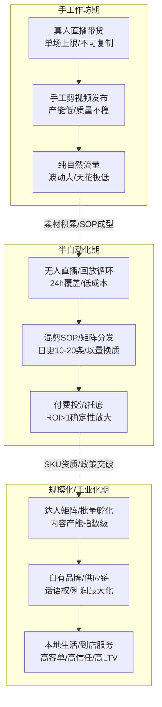

### 28.8.2 自动化三件套落地清单

下表汇总了自动化三件套的核心动作、关键参数与前置条件，便于团队对照执行与自检。

| 组件 | 核心动作 | 关键参数/前置条件 |
|------|----------|-------------------|
| 无人直播 | 真人回放 -> 关闭连麦 -> 定时循环播放 2h+ | 素材：高转化真人直播回放；风控：规避“录播循环”判定，需真人兜底预案 |
| 短视频混剪 | 爆款/切片 -> 标准化去重 SOP -> 矩阵号定时分发 | 参数：见 28.6.2 表；前置：爆款素材库（≥50 条验证过转化的切片） |
| 付费投流 | 核心 SKU -> 资质自查 -> 开户/建模 -> 日预算/目标 ROI -> 持续投放 | 硬门槛：SKU 必须通过平台资质审核（危化品/车用易耗品类目常受限） |

## 28.9 知识付费组合拳 —— 培训/付费问答/免费引流分层

### 为什么需要这个概念？

汽车后市场“疑难杂症”赛道具有极强的专业门槛与知识溢价空间。单一卖货模式天花板低，将“诊断能力”产品化为分层知识付费产品（高客单培训、中客单问答、零门槛引流），可最大化挖掘用户终身价值，且边际成本趋近零。

### 核心定义

针对不同支付门槛提供分层产品矩阵：高客单线下实操培训（电喷/镗缸/解码器销售）、中客单付费问答诊断（入驻大家车问/汽车大师平台）、低门槛免费直播诊断（引流前端）。三层产品协同：免费引流蓄水池 → 付费问答筛选高意向 → 培训/设备销售高客单收割。

### 关键性质

知识付费边际成本为零：同一套诊断能力可无限复制销售，利润率极高。产品分层覆盖全漏斗：免费直播解决“信任获取”，付费问答解决“精准筛选”，线下培训解决“高客单收割”。同行验证可复制：电喷账号常年招生+卖设备，月营收百万级。

### 典型例子

电喷账号：常年围绕“烧机油、镗缸、电喷维修”招生线下培训，同时销售解码器等维修设备，月营收百万级。大家车问/汽车大师平台：专家入驻提供付费问答诊断，单次百元级，边际成本为零。

### 边界条件

要求创作者/团队具备真实硬核专业能力（或独家诊断模型/软件），否则无法支撑高客单培训与付费问答的交付质量。线下培训涉及场地/设备/讲师成本，规模化需标准化课程包与考核体系。平台付费问答分成比例/规则变动风险需纳入考量。

**知识付费变现组合拳**（来源：P006《docs/202303/20230328_059.md》）

| 产品层级 | 形态 | 客单价 | 典型案例 |
|----------|------|--------|----------|
| 高客单 | 线下实操培训（电喷/镗缸/解码器销售） | 数千-数万 | 电喷账号常年招生+卖设备，月营收 100W+ |
| 中客单 | 付费问答诊断（入驻大家车问/汽车大师平台） | 百元级 | 单次诊断收费，边际成本为零 |
| 低门槛 | 免费直播诊断（引流前端） | 0 | 直播间连麦诊断，转化标品销售 |

> **这个组合拳展示了**：同一套“诊断能力”，可以通过不同交付形态（培训/问答/直播）切分不同价格带用户，实现价值最大化变现。

**方法：知识付费组合拳分层转化模型**（来源：P006《docs/202303/20230328_059.md》）

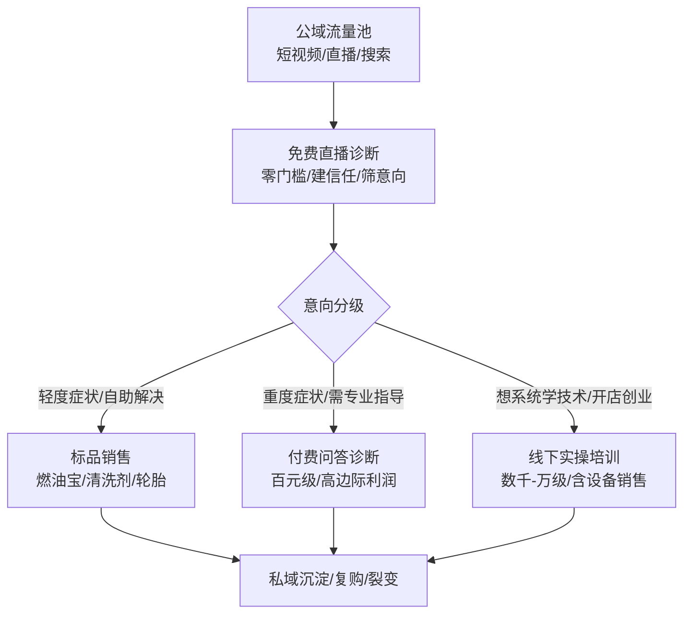

## 28.10 被动式私域运营 —— 零骚扰、真实社会化证明、高 LTV

### 为什么需要这个概念？

主动私聊推销（发链接、要订单）极易引发用户反感、拉黑、投诉，私域资产快速贬值。高频刚需消耗品（燃油宝、轮胎）用户决策周期短、复购率高，无需强推自会回购。信任建立成本高，维护成本低；被动展示比主动推销更能建立长期信任资产。

### 核心定义

零主动推销：引流进微信后，绝不主动私聊发链接/要单/催单。朋友圈高频价值勾引：早到晚发布真实订单截图、用户好评反馈、产品活动、发货现场。利用“社会化证明”触发从众心理：大家都在买、都在好评 -> 我买不亏/我也要买。产品即时体验兜底：产品用后立竿见影（油耗降、抖动停），体验即最强留存钩子。

### 关键性质

该模式极低运营成本：无需专业销售团队、无话术培训、无 CRM 系统，老板/合伙人发圈即可。高抗投诉/封号能力：零骚扰操作天然规避微信营销风控红线。复购率/客单价/LTV 三高：信任基础上自发决策，客单价不压、复购周期短、生命周期长。

### 典型例子

米戈团队：朋友圈早晚发真实订单/评价，零推销，用户自发复购，单月利润 10W+。成人用品即时配送：外卖平台引流私域，朋友圈发真实好评/发货图，夜场/酒店场景高复购。

### 边界条件

仅适用于高频刚需、标品化程度高、使用效果立竿见影、决策链路短的消耗品类目。需要前期公域内容/直播建立专家人设背书，纯裸号加微信发圈无信任基础无法转化。产品力必须过硬（体验差则社会化证明变负面证明），产品是私域变现的最终护城河。

> "重点做好朋友圈的运营；通过短视频和直播，吸引车友关注加微信之后，通过朋友圈从早到晚地宣传产品和活动；用其它车友的订单评价和真实反馈，做好价值勾引。不做主动推销，让用户自己决定买不买。一旦买了体验了，都是老司机，立马试车感觉不错，大多都会成为高粘性高复购用户。"
> 
> "私域高复购转化公式：零骚扰 + 真实社会化证明 + 产品即时体验 = 高LTV"
> 
> —— P007《docs/202303/20230328_059.md》

这段原文给出了私域运营的“反直觉”公式：**不推销反而卖得更好**。核心机制是“社会化证明”（真实订单/评价）+ “产品即时体验”（油耗降、抖动停）双重锁定。对于高频刚需消耗品，用户自己会算账、自己会复购，你的任务只是**“在朋友圈把证据摆出来”**。

### 28.10.1 被动式私域运营飞轮

**方法：被动式私域运营飞轮**（来源：P007《docs/202303/20230328_059.md》）

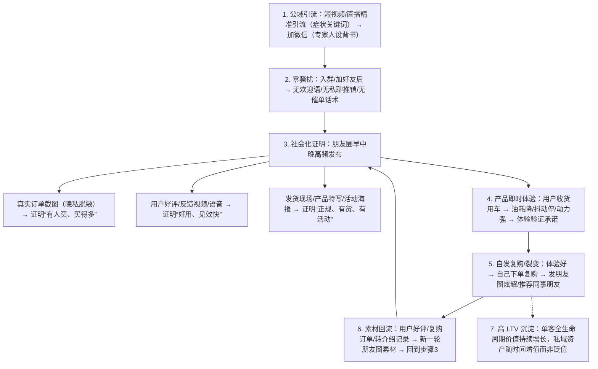

**方法：被动式私域运营演进图**（来源：P007《docs/202303/20230328_059.md》）

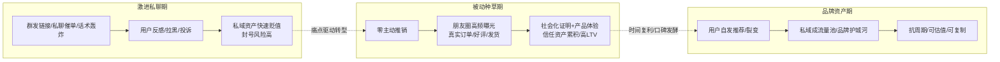

**公式：私域高复购转化公式**

$$ \text{高 LTV} = \text{零骚扰} + \text{真实社会化证明} + \text{产品即时体验} $$

**逐式解释：**
- **零骚扰**：不发私信推销链接、不催单、不群发广告，消除用户防御心理，保持私域环境纯净度。
- **真实社会化证明**：朋友圈高频曝光真实订单截图（隐私脱敏）、用户好评视频/语音、发货现场，利用“从众心理”降低陌生人决策门槛。
- **产品即时体验**：燃油宝加油后百公里油耗下降 1-2L、抖动消失、动力提升，用户“立马试车感觉不错”，体验即最强留存钩子与复购理由。
- **加法含义**：三者缺一不可。有骚扰则信任崩塌；无社会化证明则无从众压力；无即时体验则复购断链。

**作用**：该公式将私域运营从“销售驱动”重构为“信任资产积累”，解释了为何“零推销”反而能跑出单月 10W+ 利润——用户终身价值（LTV）由产品力与信任资产共同锚定，而非话术强推。

## 28.11 自用省钱分享赚钱分销裂变模型 —— 让用户变销售

### 为什么需要这个概念？

私域流量池有限，单靠公域引流获客成本高、增速慢，需激活存量用户裂变增量。高复购、高利润、高信任产品，用户自发推荐意愿强，只需提供低门槛分销工具。传统招代理门槛高（囤货/交保证金），利用有赞分销“零成本、零囤货、一键分享”破解。

### 核心定义

核心钩子：“自用省钱、分享赚钱”，将消费者身份一键转化为分销员/分销商。工具支撑：有赞分销功能，用户扫码即得专属推广海报/链接，后台自动结算佣金。利益分配：产品利润足（高毛利） -> 让利给分销商（高佣金） -> 激活推广动力 -> 低成本获客。

### 关键性质

病毒式裂变：老客带新客，信任传递链路短（熟人推荐），转化率远超陌生流量。服务网络下沉：分销商天然承担售前咨询/售后服务/物流对接，品牌方仅负责供货/结算。品牌资产沉淀：分销商朋友圈/社群传播 = 免费品牌广告位，边际成本为零。

### 典型例子

米戈团队：借助有赞分销员/分销商功能，构建汽车用品代理分销体系，和更多人一起做服务和变现。同城水果团购（新发地小李哥）：快团团团长模式，宝妈群体利用碎片时间分销，月复购率 38%。

### 边界条件

产品必须具备：高复购率（月复购>30%）、高毛利（>30%）、标品化（非标服务难标准化分销）、强信任背书。分销佣金结算规则需透明、及时（T+1/T+3 到账），延迟结算会瞬间击碎分销商信心。需建立分销商分级管理/培训/激励体系，防止“野蛮生长”导致品牌形象受损/售后纠纷。

> "用好一招：自用省钱，分享赚钱！产品好、利润足，借助有赞分销员和分销商功能，构建代理分销体系，和更多人一起做好服务和变现。"
> 
> —— P008《docs/202303/20230328_059.md》

这个模型的核心在于**“零门槛分销”**：用户扫码即可获得专属推广链接，无需囤货、无需垫资、无需售后。对于高毛利、高复购的标品，这是边际成本最低的获客方式。

### 28.11.1 分销裂变落地流程

**方法：分销裂变落地流程**（来源：P008《docs/202303/20230328_059.md》）

```mermaid
flowchart TD
    A[1. 工具搭建：有赞微小店/有赞分销后台 → 配置分销员/分销商两级体系 → 设置佣金比例(建议 20-30%毛利让利)] --> B[2. 身份转化：老客扫码/点击海报 → 一键成为分销员 → 获得专属推广码/海报/小程序卡片]
    B --> C[3. 传播动作：分销商发朋友圈/社群/私聊 → 文案模板化（自用省钱/分享赚钱/真实好评） → 素材包统一下发]
    C --> D[4. 成交归因：新客通过专属链接下单 → 系统自动归因记录 → 订单完成后 T+1/T+3 自动结算佣金]
    D --> E[5. 分级激励：分销员(自购/推荐 3 单) → 升级分销商(更高佣金/专属客服/选品权) → 团队长(管理奖/差价分红)]
    E --> F[6. 服务下沉：分销商承接售前咨询/物流催单/售后协调 → 品牌方仅管供货/发货/结算/产品迭代]
    F --> G[7. 风控红线：禁刷单/禁虚假宣传/禁私自改价 → 违规即时冻结佣金/清退身份 → 维护品牌长期信誉]
```

**方法：分销裂变模型演进图**（来源：P008《docs/202303/20230328_059.md》）

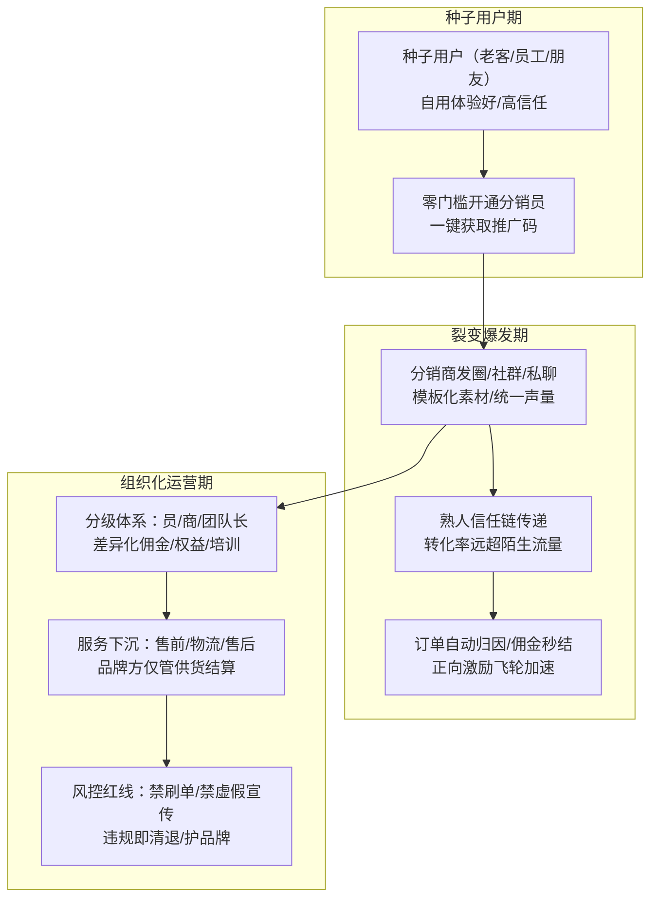

## 28.12 汽车后市场‘疑难杂症’细分赛道 —— 避红海、找症状、重复购、高利润

### 为什么需要这个概念？

整车销售/大保养等传统汽车后市场红海竞争激烈，头部垄断、中小团队无生存空间。保修期内车主进 4S 店，保修期外（3-5年+）车主自主决策、自费维修，刚需爆发。小团队必须寻找“决策链路短、非标品牌化、高毛利、高复购”的细分切口。

### 核心定义

赛道定位：保修期外车辆高发症状（烧机油、抖动、油耗高、尾气超标）的针对性解决方案。产品形态：燃油宝、清洗剂、活塞环释放剂、轮胎等标准化消耗品/准标品。商业模式：内容引流（症状关键词） -> 专家诊断（连麦/问答） -> 标品销售/知识付费/分销裂变。

### 关键性质

该赛道刚需伪装成“想需”：车主为解决痛苦症状主动搜索、主动下单、主动复购，价格不敏感。存在非标品牌化红利：无绝对头部品牌垄断（如可口可乐级），中小品牌/白牌/自有品牌均有机会。知识付费高溢价：将“诊断能力”产品化（培训/付费问答/诊断软件），边际成本为零、利润率极高。

### 典型例子

燃油宝/清洗剂：解决“烧机油、抖动、油耗高”，客单价百元级、月复购、利润率 50%+。电喷培训+解码器销售：同行账号线下培训招生+卖设备，月营收百万级。轮胎：高客单、高频刚需、标品化程度极高、适合本地生活到店服务闭环。

### 边界条件

受限于平台危化品/车用易耗品资质政策，核心 SKU（机油/清洗剂/燃油宝）付费推广受限，规模化天花板低。依赖专业技术壁垒（诊断能力/配方研发），纯销售团队无法跨越“专业信任”护城河。物流/售后成本高（液体重/易漏/易碎），需源头现采/分级包装/极致售后控制亏损率。

> "我卖汽车卖不过人家，那我就转成卖燃油宝、轮胎，卖能够解决汽车疑难杂症的用品，是不是就更有机会。过了保修期呢？是不是得购买这些产品替换？我就发现这些产品利润非常高,，也很容易让用户多次复购，是一个很不错的市场"
> 
> "小团队创业切入定律：避红海、找症状、重复购、高利润"
> 
> —— P009《docs/202303/20230328_059.md》

这段原文是整个赛道选择逻辑的源头。注意“过保修期”这个时间节点——它划分了 4S 垄断期和自主决策期，**只有过保车主才是你的精准目标用户**。

### 28.12.1 赛道选品决策矩阵

**方法：赛道选品决策矩阵**（来源：P009《docs/202303/20230328_059.md》）

```mermaid
flowchart TD
    subgraph 赛道选品决策矩阵（四维评分制，单项满分10分，总分≥30分可切入）
        D1[避红海：是否避开头部垄断/价格战核心赛道？<br/>是=10，否=0]
        D2[找症状：产品是否对应具体、高频、痛感强的车辆症状？<br/>强=10，弱=3，无=0]
        D3[重复购：是否为高频消耗品（月复购率>30%）？<br/>高=10，中=5，低=0]
        D4[高利润：毛利率是否≥30%？<br/>≥50%=10，30-50%=7，<30%=3]
        D5[资质通：核心 SKU 是否支持平台付费推广资质？<br/>全通=10，部分=5，全不通=0]
        D6[标品化：是否易标准化生产/分销/售后？<br/>高=10，中=5，低=0]
        D7[信任壁垒：是否需要专业技术背书才能成交？<br/>需=10，不需=3，无门槛=0]
    end
```

**方法：汽车后市场疑难杂症赛道演进图**（来源：P009《docs/202303/20230328_059.md》）

```mermaid
flowchart LR
    subgraph 红海层：整车/大保养/4S垄断
        R1[头部垄断/价格战/低毛利] --> R2[小团队无生存空间]
    end
    subgraph 切入层：保修期外症状型消耗品
        C1[烧机油/抖动/油耗高/尾气超标] --> C2[燃油宝/清洗剂/活塞环释放剂] --> C3[高毛利/高复购/决策链短]
    end
    subgraph 进化层：非标服务+标品销售+知识付费
        E1[专家诊断/连麦问诊] --> E2[标品销售/分销裂变] --> E3[培训/设备/软件/诊断模型]
    end
    subgraph 终局层：品牌/平台/生态
        T1[自有品牌/独家供应链] --> T2[达人矩阵/加盟模式] --> T3[数据资产/智能诊断/金融衍生]
    end
    R2 -.->|避红海/下沉切入| C1
    C3 --> E1 --> T1
```

## 28.13 广告/平台福利/分销佣金等辅助变现

### 为什么需要这个概念？

主营业务（标品销售/知识付费）之外，利用账号影响力与流量资产接入平台广告分成、中视频计划、全民任务、星图商单、分销佣金等辅助收入，可显著提升单账号 ROI，平滑主营业务波动，为团队现金流提供安全垫。

### 核心定义

广告变现：入驻星图/磁力聚星等平台，承接汽车后市场品牌商单（机油/轮胎/保养/导航等），按阅读/播放/转化结算。平台福利：参与中视频伙伴计划、全民任务、新人激励等官方补贴，按播放量/完播率/互动领取现金奖励。分销佣金：除自营品外，精选高佣优质第三方商品（车载用品/洗护/电子狗等）挂车带货，赚取佣金差价。

### 关键性质

边际成本极低：无需自建供应链/售后/物流，内容复用即可变现。抗周期性强：主营业务淡季/波动期，辅助变现提供现金流缓冲。品牌背书反哺：接大品牌广告/高佣好物，反向增强账号专业度与用户信任。

### 典型例子

头条系矩阵号“山水重庆”：全平台分发文章/视频，日更 7-8 条，年变现超千万，核心收入源包含中视频收益、广告分成、问答分成、带货佣金多元组合。汽车垂类头部账号：常年接机油/轮胎/导航品牌星图商单，单条视频商单报价数千至数万。

### 边界条件

广告/商单选择需严守“专家人设”底线：拒接劣质/虚假/与专业建议冲突产品，否则信任崩塌得不偿失。平台福利政策变动频繁（如中视频收益下调/全民任务下线），不可作为核心确定性收入依赖。分销佣金商品需自测/严选，售后纠纷由品牌方承担但信任成本由账号承担。

**方法：辅助变现收入拆解与组合策略**（来源：P006《docs/202303/20230328_059.md》）

```mermaid
flowchart TD
    subgraph 主营变现（核心确定性）
        M1[标品销售：燃油宝/清洗剂/轮胎]
        M2[知识付费：培训/付费问答/诊断]
        M3[分销裂变：自用省钱/分享赚钱]
    end
    subgraph 辅助变现（增量/缓冲/背书）
        A1[广告商单：星图/磁力聚星<br/>汽车后市场品牌定向投放]
        A2[平台福利：中视频/全民任务/新人激励<br/>官方现金补贴]
        A3[分销佣金：精选第三方好物<br/>车载/洗护/电子狗等]
    end
    subgraph 组合策略
        S1[主营占比≥70%：现金流支柱/品牌核心]
        S2[辅助占比≤30%：利润增厚/现金流缓冲/信任背书]
        S3[红线：拒接冲突/劣质/虚假商单<br/>护核心人设/信任资产]
    end
    M1 & M2 & M3 --> S1
    A1 & A2 & A3 --> S2
    S1 & S2 --> S3
```

## 28.14 规模化突破三要素 —— 选品可投流、达人矩阵化、本地生活服务化

### 为什么需要这个概念？

单账号/单品类/单模式天花板极低（米戈团队单月卡在 10W+ 利润无法突破）。自然流量有上限，免费流量不可控，必须接入付费流量实现确定性放大。单人/小团队内容产能、信任背书、服务半径均有物理上限，需外部杠杆放大。

### 核心定义

要素一：选品可投流 —— 核心 SKU 必须通过平台资质审核，支持随心推/千川/磁力金牛付费推广。要素二：达人矩阵化 —— 孵化/合作更多垂类达人带播，解决内容产能与信任背书规模化。要素三：本地生活服务化 —— 结合线下汽修厂/汽美店落地团购/到店服务，解决高客单信任与服务变现。

### 关键性质

三位一体缺一不可：无投流资质=流量封顶；无达人矩阵=内容产能封顶；无线下服务=高客单信任封顶。标杆账号“小阿兰修车”验证：实体汽修厂背书 + 真人IP内容 + 极强带货 + 本地生活到店 = 最强闭环。从“卖货”进化为“卖服务/卖模式”：单品利润有限，模式复制/品牌加盟/供应链赋能才是规模化终局。

### 典型例子

小阿兰修车：邻家修车小妹人设 + 实体厂背书 + 直播带货 + 本地生活大保养团购，三维度最优解。头条系矩阵号：全平台分发 + 多元变现（中视频/问答/广告/带货）年入千万，验证矩阵化上限。

### 边界条件

选品投流资质为硬性政策红线，非运营能力可突破，选品阶段必须预判合规可行性。达人孵化/合作管理成本高，需标准化 SOP（话术/选品/切片/结算）降低管理熵增。本地生活服务重运营、重服务、重合规，轻资产中介模式易失控，需自建/强控标准化门店。

> "最后还是回到了选品的重要性，选择高粘性、高复购、高利润产品，自播的同时，发展更多达人带播，借助付费流量来放大，线下有汽修厂的，结合本地生活服务，会达到更高的收益水平。"
> 
> "机油、清洗剂这类汽车产品有一定的特殊性，虽然利润高，复购率也高，但是有些平台难以付费推广，就很难快速放大。"
> 
> "标杆账号‘小阿兰修车’验证：实体汽修厂+真人IP+本地生活=最强变现闭环"
> 
> —— P010《docs/202303/20230328_059.md》

这三段原文构成了规模化突破的完整逻辑链：**现状（卡在 10W+） -> 瓶颈（核心 SKU 无法投流） -> 破局三要素（投流资质+达人矩阵+本地生活） -> 标杆验证（小阿兰修车）**。

**规模化突破三要素：选品可投流 + 达人矩阵化 + 线下服务本地化**（来源：P010《docs/202303/20230328_059.md》）

单账号/单品类天花板低，突破规模需：1. 核心品类支持平台付费投流（解决流量上限）；2. 孵化/合作更多达人建立带货矩阵（解决内容产能与信任背书）；3. 结合汽修厂/汽美店落地本地生活团购/服务（解决信任与高客单价服务变现）。

> "机油、清洗剂这类汽车产品有一定的特殊性，虽然利润高，复购率也高，但是有些平台难以付费推广，就很难快速放大。"

这个发现是**规模化天花板的根因**：平台政策（危化品/车用易耗品资质）锁死了核心高利润 SKU 的付费流量通道。这就是为什么必须寻找“可投流”品类或转向“本地生活服务化”（到店服务不受此限制）。

**标杆账号‘小阿兰修车’验证：实体汽修厂+真人IP+本地生活=最强变现闭环**（来源：P010《docs/202303/20230328_059.md**）

[evidence] 素材推荐参考账号‘小阿兰修车’（邻家修车小妹），其模式为：实体汽修厂背书+高频真人内容输出+极强带货能力+本地生活到店服务，验证了‘线下实体+线上IP+本地生活’模式在流量获取、信任转化、高客单服务变现三维度的最优解。

> "最后给大家来个参考账号：小阿兰修车，邻家修车小妹，贴心微笑服务；内容产出形式流量好，内容复用持续爆款，带货能力十分强悍，不愁流量和变现；每天一群老爷们，夜夜围着直播间，有事没事跑到小妹汽修厂，给车子来个大保养~~"

这个案例展示了**“非标服务+标品销售”垂类矩阵模式的终局形态**：线下实体提供信任锚点和服务交付能力，线上 IP 提供流量获取和品牌溢价，本地生活团购提供高客单价服务变现通道。三位一体，缺一不可。

### 28.14.1 规模化突破路径图

**方法：规模化突破路径图**（来源：P010《docs/202303/20230328_059.md》）

```mermaid
flowchart TD
    subgraph 现状层：单账号+单品类(燃油宝/清洗剂)+自然流量+真人直播
        S1[天花板：单月利润 10W+、无法付费投流、内容产能单人上限]
        S2[痛点：流量不可控、规模不可复制、品类受政策限制]
    end
    subgraph 突破层：三要素并行（缺一不可）
        B1[要素1：选品可投流]
        B1 --> B11[审计现有 SKU 平台推广资质 → 剔除不可投品类]
        B1 --> B12[引入/开发可投流高利润 SKU（轮胎/保养套餐/本地生活团购券）]
        B1 --> B13[建立付费投流模型：千川/随心推/磁力金牛 三端同步跑量]
        
        B2[要素2：达人矩阵化]
        B2 --> B21[孵化内部达人：话术/选品/切片 SOP 标准化 → 员工转主播]
        B2 --> B22[合作外部达人：分成/买断/联营模式 → 输出 SOP+素材库+供应链]
        B2 --> B23[矩阵管理：中台系统统一排期/分发/结算/复盘]
        
        B3[要素3：本地生活服务化]
        B3 --> B31[自建/合作汽修厂/快保店 → 抖音/快手本地生活开通团购]
        B3 --> B32[产品化服务：大保养套餐/轮胎换装/深度养护 → 标准化 SKU 上架]
        B3 --> B33[线上引流到线下：直播/短视频/私域 → 团购核销到店 → 信任升级]
        B3 --> B34[服务变现：工时费/配件毛利/会员储值 → 高客单价+高复购+高粘性]
    end
    subgraph 终局层：品牌化/平台化/生态化
        T1[自有品牌/独家供应链 → 话语权从平台/工厂回归品牌方]
        T2[达人孵化体系输出/加盟模式复制 → 卖模式/收加盟费/供应链分润]
        T3[数据资产沉淀：用户画像/症状库/诊断模型 → 智能化诊断/精准营销/金融衍生]
    end
    S1 & S2 --> B1 & B2 & B3 --> T1 & T2 & T3
```

## 28.15 多源对照

本章核心方法论主要基于单一核心素材（米戈团队实战复盘 P001-P010），但在以下维度有素材内部其他发现的侧写佐证：

### 共识

垂直内容+矩阵分发是中小团队标配：头条系矩阵号“山水重庆”（P009 finding）、汽车垂类（P002）均采用“全平台分发+高频更新”模式。私域沉淀是变现终局：汽车垂类（P007）、知识付费电喷账号（P009 finding）最终都指向微信私域/线下服务完成高客单转化。标准化 SOP 是规模化前提：无论混剪参数（P004）、直播话术（P005）、投放模型（P006），必须固化为可复制的操作手册。

### 分歧

对“混剪去重”生命周期的判断不同：米戈团队（P004）认为去重手段可持续迭代，长期可用；同素材内“怀旧赛道”参照隐含认知：视频号上线去重算法后，纯搬运混剪模式失效，必须进化向“仿拍/实拍”；同素材内“短剧 CPS”参照隐含认知：AI 自动剪辑无法通过原创检测，迫使团队回归人工二创，大幅推高成本。对“付费投流”必要性的权重不同：米戈团队（P006）视为规模化核心突破口（受限于 SKU 资质未能完全跑通）；同素材内“本地生活”参照隐含认知：毛利极高（~100%），付费投流具备降维打击优势，主动 All in。

## 28.16 设计中的取舍

**问：为什么不用“泛汽车知识内容”而是“症状话题库”？**  
答：泛知识内容（如“发动机原理”、“变速箱结构”）受众宽泛但购买意图模糊，引流进来的用户多为学习/围观者，转化率极低；症状话题库（如“烧机油怎么办”）受众精准、决策链路短、价格不敏感，直接对应产品卖点。取舍核心：用流量精准度换流量广度，用转化率换粉丝量。

**问：为什么“混剪为主”而非“全实拍”？**  
答：3-5 人小团队，全实拍日产能上限 1-2 条，无法支撑 20+ 平台、日更 10-20 条的矩阵化分发需求。混剪单条耗时压缩至分钟级，边际成本趋近零。取舍核心：用“过审率”换“原创度”，用“数量概率”换“单条质量”，以概率论制胜。

**问：为什么“不主动推销”反而能成交？**  
答：主动私聊推销触发用户防御心理，转化率低、投诉率高、私域资产贬值快；被动朋友圈展示真实订单/评价，利用社会化证明降低决策门槛，配合产品即时体验（油耗降、抖动停）锁定复购。取舍核心：用“信任资产积累速度”换“短期成交速度”，用“长期 LTV”换“单次 ROI”。

**问：为什么“自动化三件套”缺一不可？**  
答：无素材资产化 = 无燃料（无人播没素材、混剪没爆款）；无标准化 SOP = 无引擎（人工操作不可规模化、参数漂移导致违规/低转化）；无付费流量托底 = 无保障（自然流量有上限、波动大，付费流量提供确定性增长底座）。取舍核心：三者构成“燃料-引擎-底座”三角稳定结构，缺一即坍塌。

**问：为什么“达人矩阵化”优于“单账号深耕”？**  
答：单账号受限于人设单一、时间精力、平台流量分配上限，GMV 天花板低；达人矩阵通过“标准化 SOP 复制人设”，实现内容产能指数级扩张，同时分散单账号封禁/限流风险。取舍核心：用“管理复杂度”换“规模化上限”，用“SOP 沉淀成本”换“复制边际成本趋零”。

**问：为什么“本地生活服务化”是终局而非过渡？**  
答：汽车后市场本质是“非标服务+标品销售”，线下实体提供不可替代的信任锚点（看得见摸得着）、服务交付能力（装得上修得好）和高客单价变现通道（工时费/配件/会员）。纯线上卖货模式终将遭遇流量见顶、信任天花板、同质化价格战。取舍核心：用“重资产/重运营门槛”换“护城河深度”，用“服务利润”换“货品薄利”。

## 28.17 动手练习

### 练习1：为自营产品建立‘症状话题库’

假设你经营一款‘汽车内饰翻新剂’，核心卖点是：去污、增亮、防裂、除异味。请完成：

1. 列出该产品能解决的 5 个具体‘用户痛点症状’（如：方向盘发粘发黑、座椅褪色开裂、车内有异味等）
2. 针对每个症状，拟定 1 个‘专家答疑’短视频标题（格式：症状关键词+解决方案/避坑指南）
3. 判断：这些话题是否具备‘强垂直、强标签、决策链路短’特征？若否，如何调整？

### 练习2：设计‘全网铺量筛选’执行表

你准备用 10 条同款视频（竖屏/横屏/图文三形态）测试平台流量。请设计一个数据追踪表，包含字段：

1. 平台名称 | 2. 发布形态 | 3. 7天播放量 | 4. 完播率 | 5. 互动量(赞/评/藏/转) | 6. 主页访问/私信/加微数 | 7. 直接成单/线索数 | 8. 综合 ROI 评分(1-10)

问题：若抖音播放量第 1 但加微数第 3，快手播放量第 2 但加微数第 1，你会选谁做主阵地？为什么？
进阶：测试期结束后，如何判断‘平台红利期’是否已过，需不需要重启铺量？

### 练习3：推演‘自动化变现三件套’落地清单

你的账号已有 20 场真人直播回放、50 条爆款切片、3 款核心 SKU。请列出开启‘无人直播+短视频混剪+付费投流’的完整落地清单：

1. 无人直播：素材去重处理清单（如：切片时长、添加水印、关闭连麦、定时任务设置）
2. 短视频混剪：标准化去重 SOP 参数表（调速/镜像/滤镜/特效/调色/MD5 修改/时长控制）
3. 付费投流：3 款 SKU 的投放资质自查表（品类资质/资质审核状态/账户余额/日预算/目标 ROI）

问题：若核心 SKU ‘燃油宝’因危化品资质无法开通千川，你的‘自动化三件套’会缺哪条腿？如何用‘达人矩阵化’补位？

### 练习4：诊断‘私域运营与分销裂变’可行性

某团队卖‘汽车镀晶剂’（客单价 298 元，毛利 60%，施工周期长、效果需专业评判、月复购率<5%）。请分析：

1. ‘被动式私域运营（朋友圈发订单/评价、零推销）’对该产品是否有效？为什么？
2. ‘自用省钱分享赚钱分销裂变’能否跑通？核心阻力点在哪里？
3. 若要强行上述模式，必须对产品/服务/工具做哪三项最小化改造？

## 28.18 本章小结

这一章中我们学习了如何构建一个从选品、获流、生产、变现、私域到规模化的汽车垂类矩阵变现完整体系。首先，我们确立了“避红海、找症状、重复购、高利润”的选品定律，锁定保修期外车主的疑难杂症赛道；其次，我们掌握了“产品反向内容选题法”，建立症状话题库实现内容与变现天然对齐；接着，我们通过“全网铺量筛选法”用数据跑出抖音/快手双主阵地，建立“流量自动供给”的被动获客飞轮；然后，我们采用“混剪为主、实拍为辅、切片兜底”的低成本生产模式，配合标准化 SOP 支撑小团队高频产出；之后，我们设计了“直播连麦免费诊断转化法”用专业服务建立信任实现高转化，并构建了“无人直播+短视频混剪+付费投流”的自动化变现三件套；随后，我们实施“被动式私域运营”和“分销裂变模型”实现高 LTV 与低成本获客；最后，我们识别了规模化突破的三要素——选品可投流、达人矩阵化、本地生活服务化，并以“小阿兰修车”为标杆验证了线下实体+线上 IP+本地生活的最强闭环。

本章我们一起学习了以下概念：

| 概念 | 解释 |
|------|------|
| 产品反向内容选题法 | 以产品为中心梳理症状话题库，用专家答疑形式生产内容，实现内容即广告、广告即内容，天然筛选精准流量 |
| 全网铺量筛选法 | 冷启动期内容一次性分发 20+ 平台，数据复盘锁定 ROI 最高平台（抖音/快手）集中资源深耕 |
| 流量自动供给 | 在最优平台持续高频发布垂直内容，利用算法标签匹配机制，使精准需求用户被动持续涌入 |
| 低成本内容生产模式 | 混剪为主（去重）、实拍为辅（建信）、切片兜底（补量），标准化 SOP 支撑小团队全网日更 10-20 条 |
| 直播连麦免费诊断转化法 | 直播间一对一连麦免费诊断故障，精准识别高意向症状用户，针对性推荐自营标品，实现高信任高转化 |
| 自动化变现三件套 | 无人直播（回放循环）+ 短视频混剪带货（1:1 复制/切片）+ 付费投流（随心推/千川/磁力金牛），实现半自动赚钱 |
| 自动化变现前提 | 素材资产化（高转化回放/切片）+ 标准化 SOP（混剪/分发/投放流程）+ 付费流量托底（核心 SKU 可投流） |
| 被动式私域运营 | 零主动推销，朋友圈高频曝光真实订单/评价，利用社会化证明与产品即时体验建立信任，实现高复购高 LTV |
| 分销裂变模型 | 以‘自用省钱、分享赚钱’为钩子，利用有赞分销工具将高复购高利润消费者转化为分销商，构建低成本获客服务网络 |
| 汽车后市场疑难杂症赛道 | 切入保修期外车主刚需：高毛利、高复购、决策链路短的症状型消耗品（燃油宝/清洗剂/轮胎），避开整车红海 |
| 规模化突破三要素 | 选品可投流（解决流量上限）+ 达人矩阵化（解决内容/信任产能）+ 本地生活服务化（解决高客单信任/服务变现），缺一不可 |
| 标杆账号‘小阿兰修车’ | 实体汽修厂背书 + 真人 IP 内容 + 极强带货 + 本地生活到店服务 = 线下实体+线上 IP+本地生活三维最优解 |
| 知识付费组合拳 | 培训/付费问答/免费引流分层，同一诊断能力多形态交付，最大化挖掘用户终身价值 |
| 辅助变现组合 | 广告商单/平台福利/分销佣金，边际成本低、抗周期、背书主营，占比≤30%为宜 |

下一章中，我们将学习抖音直播引流私域六法图谱，系统梳理从官方组件到灰度技巧的分层选型策略，为你提供基于账号阶段与风控承受力的标准化动作清单。


