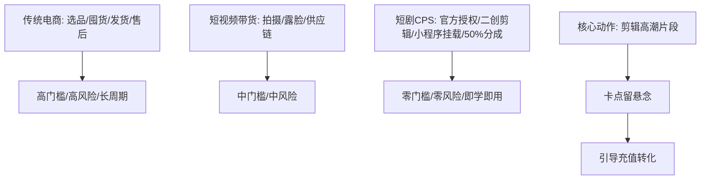
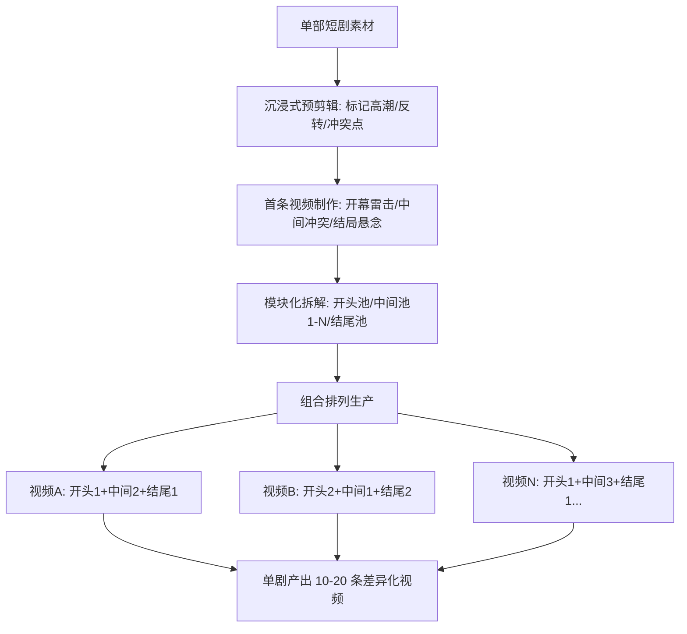
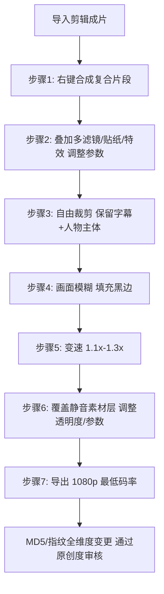
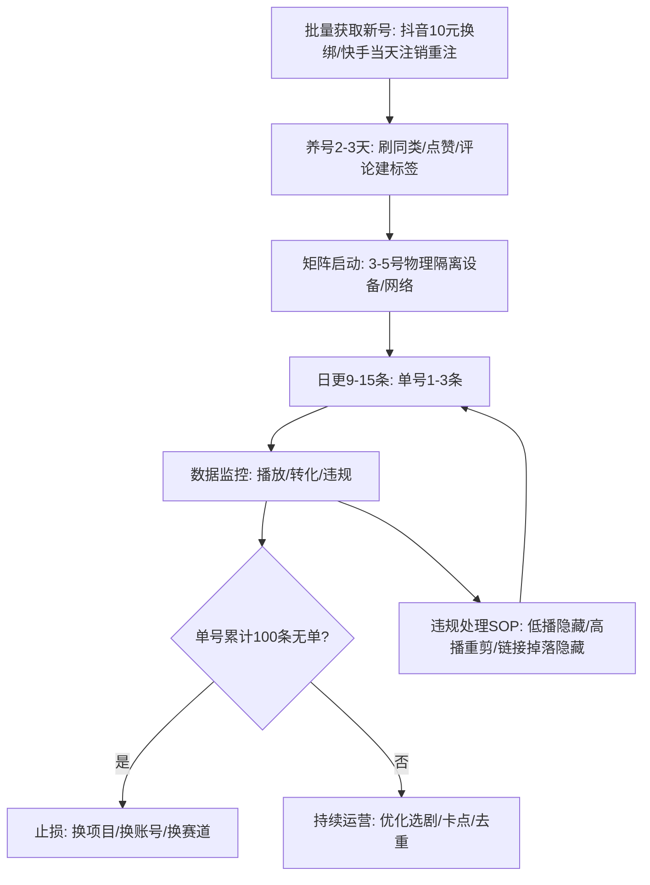

# 第 39 章 短剧CPS矩阵实战 —— 搬运去重+矩阵号批量、爆款产出比2:1、止损试错机制

## 学习目标

- 理解短剧CPS推广的商业模式与分成机制（版权授权+二创剪辑+小程序挂载+50%佣金）
- 掌握沉浸式预剪辑法：通看剧情建立心智模型，精准定位情绪点是高爆款率核心
- 掌握卡点式剧情结构与模块化复用法：开幕雷击→中间冲突→结局悬念，单剧产出10-20条差异化视频
- 掌握标准化去重流水线SOP：7步动作序列以最低成本通过原创度审核（合成→滤镜/贴纸/特效→裁剪→模糊→变速→覆盖静音层→导出）
- 理解低播放高转化蓝海判断逻辑：内容分低、搜索分高、供不应求、持续增长（巨量算数四维验证）
- 掌握矩阵号运营与止损机制：3-5号矩阵日更9-15条、概率放大收益、单号100条无单果断止损换项目
- 了解账号注册成本规避、素材下载加速、高转化时长区间（4-8分钟）、解说非必要等实操避坑细节

## 39.1 生活类比

想象短剧CPS推广是**在电影院门口发“精彩预告片传单”赚分成**：

**版权授权 = 影院官方授权你合法发传单**  
正如短剧CPS必须获得平台官方授权渠道（《MwIYdeZNio8bWUxAEGCcOhO2nlc.md》），私自剪辑发布极大概率侵权封号，正如无授权发传单会被保安赶走。授权是合法经营的入场券。

**短剧素材 = 完整电影胶片**  
平台提供成熟的100集×1-3分钟/集短剧库（《MwIYdeZNio8bWUxAEGCcOhO2nlc.md》），正如影院拥有完整电影母带。推广者不拍片，只负责从胶片里截取最精彩片段。

**沉浸式预剪辑 = 你先通看全片，记住哪里最刺激、哪里反转、哪里让人想尖叫**  
作者强调“视频导入剪映后我们先花1-2个小时大致看一下剧情，磨刀不误砍柴工”（《MwIYdeZNio8bWUxAEGCcOhO2nlc.md》）。不通看全片，就无法精准定位“愤怒、吃惊、暧昧、争执、雷人、狗血、误会”等情绪点，剪辑出来的传单没人看。

**卡点式结构 = 传单只印最炸裂的3个镜头：开头打架(雷击)、中间连环反转(冲突)、结尾刀架脖子(悬念)**  
作者总结的核心公式：“重点：开幕雷击，结局悬念，中间矛盾冲突。开头：5-10秒 暗示性的台词，暴力冲突的画面... 结尾：留悬念，在剧情「高潮、反转、紧张氛围」处掐断，引导充值”（《MwIYdeZNio8bWUxAEGCcOhO2nlc.md》）。

**模块化复用 = 同一堆素材，换个顺序、换个开头结尾，印成10版不同传单发不同路口**  
作者发明的“方法2：第一次剪辑完成一个视频后，直接把视频分开头，中间1，中间2，中间n ...结尾...后面再剪辑基本上不用再添加新的剧情了，可以通过，增加，减少，调整，调换不同剧情的视频片段或者顺序等，做到快速产出”（《MwIYdeZNio8bWUxAEGCcOhO2nlc.md》）。单部剧可产出10-20条差异化视频。

**去重流水线 = 给传单加水印、剪圆角、调色调、盖层透明膜，让查重机器认不出是同一版**  
作者固化的7步SOP：“鼠标右键选择复合片段，将视频合成一段...添加多个滤镜，贴纸和特效，并调整参数...对画面进行自由剪裁...选择画面模糊...调整视频速度，加速1.1x-1.3x...在视频上方再覆盖一层新的视频，静音并调整参数...导出参数：分辨率1080p, 码率选择最低”（《MwIYdeZNio8bWUxAEGCcOhO2nlc.md》）。

**矩阵号分发 = 雇3个兼职生，每天每人发900张，覆盖全城写字楼**  
作者实操：“我目前做了 3 个号...一个号一天发三个作品，三个号就是 9 个作品。一天顶多三个小时，肯定能做完”（《20230328_146.md》）。单人操作3-5号，日更9-15条，用概率对抗单账号流量波动。

**低播放高转化 = 虽然每版传单只发几百张(低播放)，但拿着传单来买票的比例极高(高转化)，因为大家都是冲着‘想看后续’来的(搜索意图强)**  
作者亲测：“视频发布第二天，看收益后台竟然已经充值了49元，但是当时我的视频播放量才600多！...很多一起做短剧的小伙伴也大多都是几千播基本就能出单”（《MwIYdeZNio8bWUxAEGCcOhO2nlc.md》）。巨量算数验证：“内容分低，搜索分高，供不应求，并持续增长，说明了什么，说明了这是妥妥的蓝海期啊！”（《MwIYdeZNio8bWUxAEGCcOhO2nlc.md》）。

**止损机制 = 某路口发了100版传单没人来买票，果断换路口，不死磕**  
作者设定铁律：“如果我发够 100 个作品之后，还一单都没有出。就换新项目。」（《20230328_146.md》）。单账号累计100条无单，判定赛道/账号/执行失效，避免沉没成本陷阱。

## 39.2 概念地图

短剧CPS推广实战体系
├── 核心商业模式
│   ├── 版权授权获取          —— 20230328_146, MwIYdeZN
│   ├── 二创剪辑与去重        —— MwIYdeZN
│   ├── 小程序挂载分成(50%)   —— 20230328_146, MwIYdeZN
│   └── 低门槛/零实名/高杠杆  —— 20230328_146
├── 内容生产核心方法论
│   ├── 沉浸式预剪辑法        —— MwIYdeZN (核心竞争力)
│   ├── 卡点式剧情结构        —— 20230328_146, MwIYdeZN (开幕雷击/中间冲突/结局悬念)
│   ├── 模块化剪辑复用法      —— MwIYdeZN (开头池/结尾池/中间片段池组合)
│   └── 标准化去重流水线SOP   —— MwIYdeZN (7步固化动作序列)
├── 运营放大与风控体系
│   ├── 矩阵号运营模式        —— 20230328_146 (3号/日更9条/概率放大)
│   ├── 止损试错机制          —— 20230328_146 (100条无单换项目)
│   ├── 账号注册成本规避      —— MwIYdeZN (抖音10元换绑/快手当天注销)
│   └── 素材下载加速方案      —— MwIYdeZN (拼多多短期会员)
└── 赛道判断与实证验证
    ├── 低播放高转化蓝海论 —— MwIYdeZN (巨量算数四维验证)
    ├── 爆款产出比近2:1     —— 20230328_146, MwIYdeZN
    ├── 矩阵放大确定性收益  —— MwIYdeZN (3号20天充值2w+)
    └── 悬念驱动付费转化律  —— MwIYdeZN (卡点留悬念/评论区引导)

## 39.3 短剧CPS推广 —— 版权授权+二创剪辑的低门槛分成变现

### 为什么需要这个概念？

普通人想做短视频带货，但苦于不会拍摄、不敢露脸、没货源、没供应链。传统电商需要选品、囤货、发货、售后，门槛高、风险大、周期长。我们需要一种无需实名、无需原创拍摄、无需发货售后、即学即用的变现路径。

> "最近在做短剧 cps 项目，目前做了将近 1 个月，变现 1w＋。"
> 
> ——《20230328_146.md》

> "短剧就是有专门的团队，把一些热门小说拍成电视剧...一部剧大概100集左右，每集1-3分钟左右，一般10集后开始收费观看，我们赚的就是付费佣金。我们找平台拿授权渠道后，就可以开始剪辑剧情，然后在抖音，快手上发视频，挂载短剧小程序...有人通过我们的视频链接下单，充值看后续，我们就能获得相应的佣金收益。佣金在50%左右"
> 
> ——《MwIYdeZNio8bWUxAEGCcOhO2nlc.md》

### 核心定义

**短剧CPS推广**  
定义（来源：《20230328_146.md》《MwIYdeZNio8bWUxAEGCcOhO2nlc.md》）

获得短剧平台官方授权，将长剧剪辑成短视频发布抖音/快手，挂载小程序链接。用户点击链接充值看后续剧集，推广者按单次销售获取约50%佣金分成。属于内容分发变现赛道，核心动作是“剪辑高潮片段+卡点留悬念+引导充值”。

> **作用/原理解释**：该定义确立了“内容分发而非内容生产”的商业定位——平台提供成熟高质量素材库（100集×1-3分钟/集），推广者的增值环节仅为“筛选高潮→剪辑卡点→分发触达→转化闭环”，将单条制作成本从原创的2-3小时压缩至20分钟以内（《20230328_146.md》），实现了极低门槛的高杠杆变现。

### 关键性质

- **零门槛**：不需实名认证、不需原创能力、不需囤货发货、仅需会剪映电脑（来源：《20230328_146.md》《MwIYdeZNio8bWUxAEGCcOhO2nlc.md》）
- **高杠杆**：单条视频制作≤20分钟，单号日更1-3条，矩阵号可线性放大收益（来源：《20230328_146.md》《MwIYdeZNio8bWUxAEGCcOhO2nlc.md》）
- **确定性强**：爆款产出比近2:1（发2-3条出1个爆款），几百播放即可出单（来源：《20230328_146.md》《MwIYdeZNio8bWUxAEGCcOhO2nlc.md》）
- **蓝海期特征**：巨量算数显示“内容分低、搜索分高、供不应求、持续增长”（来源：《MwIYdeZNio8bWUxAEGCcOhO2nlc.md》）

### 典型例子

- 作者清欢：近1个月发40余条视频，爆款十几个，变现1万+，日均投入3小时（来源：《20230328_146.md》）
- 作者实操：3个账号矩阵，20天充值2万+，单账号日更1条即稳定产出爆款（来源：《MwIYdeZNio8bWUxAEGCcOhO2nlc.md》）
- 团队验证：坚持执行的小伙伴基本都拿到结果，适合零基础小白兼职操作（来源：《MwIYdeZNio8bWUxAEGCcOhO2nlc.md》）

### 边界条件

- 必须获得官方授权渠道，私自剪辑发布极大概率侵权封号（来源：《MwIYdeZNio8bWUxAEGCcOhO2nlc.md》）
- 视频剧情不能连贯完整，必须在高潮处掐断留悬念，否则用户无充值动力（来源：《MwIYdeZNio8bWUxAEGCcOhO2nlc.md》）
- 单账号累计发100条无单需止损换项目，避免沉没成本陷阱（来源：《20230328_146.md》）
- 平台风控收紧期（原创度算法升级）可能导致搬运去重失效，需动态调整去重参数（来源：《MwIYdeZNio8bWUxAEGCcOhO2nlc.md》）

### 文献补充说明

以下6个标记为[需要补充文献]的方向，需在后续版本中引入权威来源：

1. **巨量算数四维指标官方定义文档** —— 验证“内容分/搜索分/供需指数/增长趋势”的官方计算口径与阈值判定标准，建议引用字节跳动《巨量算数使用手册》或抖音开放平台技术文档。
2. **抖音星图短剧原创保护计划公告** —— 确认平台对短剧二创内容的版权保护政策演进时间线（如独家授权、原创标识、侵权打击），建议引用抖音安全中心/星图官网历史公告。
3. **行业短剧版权授权政策变迁白皮书** —— 梳理2022-2024年短剧平台授权模式变化（从开放授权→邀请制→头部MCN独家），建议引用艾瑞/QuestMobile/克劳锐等行业研报。
4. **AI视频理解能力替代人工预剪辑的技术成熟度时间表** —— 跟踪GPT-4V、Gemini、Sora等多模态大模型在长视频理解、高潮片段自动检测、剪辑脚本生成方面的Benchmark进展，建议引用CVPR/ICCV顶会论文或HuggingFace排行榜。
5. **平台原创度算法升级历程（光流/动作轨迹/语义检测上线时间）** —— 整理抖音/快手内容识别技术迭代节点（如2022年光流检测上线、2023年语义去重上线），建议引用平台算法工程师技术博客或极客公园/InfoQ深度报道。
6. **同主体关联账号限流风险的平台公告/行业白皮书引用** —— 验证“同一身份证名下多号限流”是否为官方策略，建议引用抖音创作者服务平台《账号管理规范》或蝉妈妈/飞瓜数据实测报告。

### 方法演进图

## 39.4 沉浸式预剪辑法 —— 通看剧情建立心智模型是高爆款率核心

### 为什么需要这个概念？

很多新手剪辑只会机械拼接片段，导致剧情零碎、逻辑不通、用户看不懂。不懂剧情走向，就无法精准定位“愤怒、吃惊、暧昧、争执、雷人、狗血、误会”等情绪点。剪辑技术再好，不懂内容逻辑，产出的视频也是“废片”，转化率极低。

> "视频导入剪映后我们先花1-2个小时大致看一下剧情，磨刀不误砍柴工，如果自己都不知道剧情发生了什么，很难剪辑出吸引人的视频，因为剧情会很零碎，这个应该也是我虽然剪辑视频技术不太好，但爆款率却相对较高的原因之一了。"
> 
> ——《MwIYdeZNio8bWUxAEGCcOhO2nlc.md》

### 核心定义

**沉浸式预剪辑法**  
定义（来源：《MwIYdeZNio8bWUxAEGCcOhO2nlc.md》）

视频导入剪映前，先花1-2小时完整通看短剧梗概，建立全局剧情心智模型。在脑海中预演：哪里是高潮？哪里适合卡点？哪里能引发强烈情绪共鸣？剪辑时按预设情绪点精准切片，保证叙事连贯性与情绪张力。

> **作用/原理解释**：该方法将“剪辑前认知投入”显性化为核心生产要素。通过前置1-2小时建立剧情全景图（心智模型），将剪辑从“机械拼接素材”升级为“按情绪曲线精准取材”，解决了“技术好但不懂内容→废片量产”的核心矛盾。作者亲测：剪辑技术一般但爆款率高，核心归因即此。

### 关键性质

- **磨刀不误砍柴工**：前置1-2小时投入，换取后续剪辑效率与质量的指数级提升（来源：《MwIYdeZNio8bWUxAEGCcOhO2nlc.md》）
- **核心竞争力**：作者认为这是其“剪辑技术不太好，但爆款率却相对较高”的核心原因（来源：《MwIYdeZNio8bWUxAEGCcOhO2nlc.md》）
- **可迁移性**：该方法适用于所有影视解说、短剧推广、小说推文等内容赛道（来源：《MwIYdeZNio8bWUxAEGCcOhO2nlc.md》）

### 典型例子

- 作者实操：每部剧剪辑前必看1-2小时剧情，精准拿捏“高潮/反转/紧张氛围”卡点位置（来源：《MwIYdeZNio8bWUxAEGCcOhO2nlc.md》）
- 对比：不看剧情直接剪辑者，视频逻辑混乱，完播率低、转化差、易被判搬运（来源：《MwIYdeZNio8bWUxAEGCcOhO2nlc.md》）

### 边界条件

- 仅适用于有完整剧情脉络的短剧/影视素材，不适用于纯素材混剪类视频（来源：《MwIYdeZNio8bWUxAEGCcOhO2nlc.md》）
- 需要投入前置时间成本，不适合“完全不想动脑子、只想机械操作”的执行者（来源：《MwIYdeZNio8bWUxAEGCcOhO2nlc.md》）
- 随AI视频理解能力提升，未来可能被“AI通看剧情+自动生成剪辑脚本”替代（来源：《MwIYdeZNio8bWUxAEGCcOhO2nlc.md》）

### 方法演进图

## 39.5 卡点式剧情结构与模块化复用 —— 开幕雷击+中间冲突+结局悬念的爆款公式

### 为什么需要这个概念？

短剧用户付费动力源于“好奇心缺口”，完整剧情会杀死付费欲望。随意剪辑无结构，要么开头无钩子留不住人，要么结尾无悬念不转化。单部剧素材有限，如何从1部剧高效产出10-20条差异化视频是效率核心。

> "重点：开幕雷击，结局悬念，中间矛盾冲突。开头：5-10秒 暗示性的台词，暴力冲突的画面... 中间：矛盾冲突 N个故事合并...去除多余画面...节奏紧凑... 结尾：留悬念，在剧情「高潮、反转、紧张氛围」处掐断，引导充值"
> 
> ——《MwIYdeZNio8bWUxAEGCcOhO2nlc.md》

> "方法2：第一次剪辑完成一个视频后，直接把视频分开头，中间1，中间2，中间n ...结尾，利用快捷键i,o导出...后面再剪辑基本上不用再添加新的剧情了，可以通过，增加，减少，调整，调换不同剧情的视频片段或者顺序等，做到快速产出"
> 
> ——《MwIYdeZNio8bWUxAEGCcOhO2nlc.md》

### 核心定义

**卡点式剧情结构**  
定义（来源：《MwIYdeZNio8bWUxAEGCcOhO2nlc.md》《20230328_146.md》）

视频三段式结构：开幕雷击（前5-10秒暴力冲突/暗示台词） → 中间矛盾冲突（N个高潮片段非连贯拼接，节奏紧凑） → 结局悬念（高潮/反转处强行掐断，引导充值）。

**模块化剪辑复用法**  
定义（来源：《MwIYdeZNio8bWUxAEGCcOhO2nlc.md》）

将1个爆款视频拆解为“固定开头池、固定结尾池、N个中间片段池”，组合排列快速生产差异化视频。

> **作用/原理解释**：卡点式结构利用“好奇心缺口”心理学机制——开头制造冲突钩子（完播率）、中间堆叠高潮片段（停留时长）、结尾强行掐断高潮（转化率）。模块化复用将“单视频制作”转化为“组件装配线”，单部剧素材经组合排列可产出10-20条差异化视频，边际成本趋近零，支撑矩阵号高频运转。

### 关键性质

- **开头决定完播**：前3秒必须有冲突画面或暗示台词，暴力、争吵、背叛等强刺激优先（来源：《MwIYdeZNio8bWUxAEGCcOhO2nlc.md》）
- **中间决定节奏**：去除废话铺垫，只保留矛盾冲突核心段落，多故事并行拼接（来源：《MwIYdeZNio8bWUxAEGCcOhO2nlc.md》）
- **结尾决定转化**：必须在“最想知道后续”的瞬间戛然而止，配合评论区图片引导（来源：《MwIYdeZNio8bWUxAEGCcOhO2nlc.md》《20230328_146.md》）
- **复用倍增**：单部剧可产出10-20条视频，剧情不连贯避免用户看完就不充值（来源：《MwIYdeZNio8bWUxAEGCcOhO2nlc.md》）

### 典型例子

- 作者操作：参考点赞成千上万的爆款视频开头结尾，1:1模仿结构套用新素材（来源：《MwIYdeZNio8bWUxAEGCcOhO2nlc.md》）
- 实测：爆款视频开头多为“暴力冲突/出轨对峙/身份反转”，结尾多为“刀架脖子上/离婚协议甩脸上/真相即将揭开”（来源：《MwIYdeZNio8bWUxAEGCcOhO2nlc.md》）

### 边界条件

- 仅适用于短剧/小说推文等强剧情类内容，不适用于知识付费、口播、带货等赛道（来源：《MwIYdeZNio8bWUxAEGCcOhO2nlc.md》）
- 过度使用同一开头/结尾模板会被平台判定“低质量内容”限流，需定期更新素材库（来源：《MwIYdeZNio8bWUxAEGCcOhO2nlc.md》）
- 中间片段池需保持一定数量（建议≥5个），否则组合出的视频重复度过高触发查重（来源：《MwIYdeZNio8bWUxAEGCcOhO2nlc.md》）

### 方法演进图

## 39.6 标准化去重流水线SOP —— 以最低成本通过原创度审核的动作序列

### 为什么需要这个概念？

平台原创度查重越来越严，直接搬运必被限流/封号。复杂的后期特效耗时长、门槛高，新手不会AE/PR只会剪映。我们需要一套“仅用剪映、可标准化、可批量、过审率高”的去重最小动作集。

> "去重步骤：...鼠标右键选择复合片段，将视频合成一段...添加多个滤镜，贴纸和特效，并调整参数...对画面进行自由剪裁，保留带字幕和人物主题部分...选择画面模糊...调整视频速度，加速1.1x-1.3x...在视频上方再覆盖一层新的视频，静音并调整参数...导出参数：分辨率1080p, 码率选择最低。"
> 
> ——《MwIYdeZNio8bWUxAEGCcOhO2nlc.md》

### 核心定义

**标准化去重流水线SOP**  
定义（来源：《MwIYdeZNio8bWUxAEGCcOhO2nlc.md》）

7步去重标准动作序列：
1. 合成复合片段
2. 叠加多滤镜/贴纸/特效调参
3. 自由裁剪保留主体
4. 画面模糊填充黑边
5. 变速1.1x-1.3x
6. 覆盖静音素材层
7. 导出1080p最低码率

核心原理：通过画面结构微调（裁剪/模糊/变速）+ 像素级干扰（滤镜/贴纸/覆盖层）+ 编码参数变化（最低码率），改变视频MD5与特征指纹。

> **作用/原理解释**：该SOP将去重从“经验性试错”固化为“标准化工业流程”。每一步针对平台查重维度：合成消除片段边界特征、滤镜/贴纸/特效改变像素分布、裁剪改变画面构图比例、模糊引入高斯噪声干扰指纹、变速改变帧时间戳序列、覆盖静音层注入不可见像素扰动、最低码率重编码改变文件MD5。全流程仅需剪映免费版，单条≤5分钟，可做成草稿模板/RPA脚本批量复用。

### 关键性质

- **工具极简**：全流程仅需剪映专业版（免费），零代码、零插件、零外部软件（来源：《MwIYdeZNio8bWUxAEGCcOhO2nlc.md》）
- **参数固化**：变速范围1.1-1.3x、码率最低、分辨率1080p，无需每次纠结调参（来源：《MwIYdeZNio8bWUxAEGCcOhO2nlc.md》）
- **批量友好**：动作序列固定，极易制作成剪映“草稿模板”或RPA自动化脚本（来源：《MwIYdeZNio8bWUxAEGCcOhO2nlc.md》）
- **成本极低**：单条视频去重处理耗时≤5分钟，配合预剪辑总耗时≤20分钟（来源：《MwIYdeZNio8bWUxAEGCcOhO2nlc.md》《20230328_146.md》）

### 典型例子

- 作者实测：该流水线稳定通过抖音/快手原创度审核，支撑矩阵号日更9条高频运转（来源：《MwIYdeZNio8bWUxAEGCcOhO2nlc.md》）
- 避坑指南：画面模糊强度不可过高（影响观感）、覆盖层视频必须静音（避免音频指纹查重）（来源：《MwIYdeZNio8bWUxAEGCcOhO2nlc.md》）

### 边界条件

- 仅对抗“画面指纹/MD5”层面的查重，无法对抗“语义/剧情/音频”层面的深度查重（来源：《MwIYdeZNio8bWUxAEGCcOhO2nlc.md》）
- 素材源若为平台热门爆款（已被千人去重），去重难度指数级上升，建议选“近期上升期/长尾流量”素材（来源：《MwIYdeZNio8bWUxAEGCcOhO2nlc.md》）
- 算法迭代后可能新增“动作轨迹/光流”检测，需持续测试调整参数（如变速范围扩大到0.9-1.5x）（来源：《MwIYdeZNio8bWUxAEGCcOhO2nlc.md》）

### 方法演进图

## 39.7 低播放高转化蓝海论 —— 几百播放即出单的供需错配红利

### 为什么需要这个概念？

传统认知：播放量=流量=变现，播放低就赚不到钱。短剧CPS打破认知：播放600即充值49元，几千播基本出单，转化率极其惊人。我们需要理论工具判断：这是昙花一现的漏洞，还是可持续的赛道红利？

> "视频发布第二天，看收益后台竟然已经充值了49元，但是当时我的视频播放量才600多！...很多一起做短剧的小伙伴也大多都是几千播基本就能出单。去巨量算数搜索验证，数据如下：内容分低，搜索分高，供不应求，并持续增长，说明了什么，说明了这是妥妥的蓝海期啊！"
> 
> ——《MwIYdeZNio8bWUxAEGCcOhO2nlc.md》

### 核心定义

**低播放高转化蓝海论**  
定义（来源：《MwIYdeZNio8bWUxAEGCcOhO2nlc.md》《20230328_146.md》）

核心判断依据：内容分低、搜索分高、供不应求、持续增长（巨量算数四维验证）。
本质：用户主动搜索剧名/关键词观看，意图极强（搜索分高）；优质剪辑内容稀缺（内容分低/供不应求），平台被迫分发低粉/低播账号。
结论：处于红利期的蓝海项目，适合小白低成本切入。

> **作用/原理解释**：该理论提供了“反直觉红利识别框架”。传统指标（播放量/粉丝数/完播率）在短剧CPS失效，因为流量来源是“搜索”而非“推荐”：用户主动搜剧名→点击高意向视频→直接充值，转化链路极短。巨量算数四维指标量化了供需错配：内容分低=优质剪辑稀缺，搜索分高=用户主动需求强，供不应求=内容缺口大，持续增长=红利窗口未关。这解释了“播放600出单49元”的异常现象。

### 关键性质

- **反直觉指标**：不看播放量看搜索量，不看粉丝看转化率，不看完播率看充值率（来源：《MwIYdeZNio8bWUxAEGCcOhO2nlc.md》）
- **红利窗口**：随入局者增多，内容分上升、搜索分下降、供需平衡，红利必然消退（来源：《MwIYdeZNio8bWUxAEGCcOhO2nlc.md》）
- **核心护城河**：不是剪辑技术，而是“选剧眼光+卡点能力+矩阵执行力”的组合（来源：《MwIYdeZNio8bWUxAEGCcOhO2nlc.md》）

### 典型例子

- 作者验证：视频播放600即出单，巨量算数数据印证蓝海判断（来源：《MwIYdeZNio8bWUxAEGCcOhO2nlc.md》）
- 同行印证：很多小伙伴“大多都是几千播基本就能出单”（来源：《MwIYdeZNio8bWUxAEGCcOhO2nlc.md》）

### 边界条件

- 仅限短剧CPS等“强搜索意图+高付费转化”的特殊品类，不可推广至带货/广告等依赖推荐流的赛道（来源：《MwIYdeZNio8bWUxAEGCcOhO2nlc.md》）
- 平台若上线“短剧专区/原创保护/付费预览”功能，将彻底改变流量分发逻辑，红利瞬间终结（来源：《MwIYdeZNio8bWUxAEGCcOhO2nlc.md》）
- 素材源若版权收紧（平台回收授权/独家签约头部MCN），小白将失去合法素材来源（来源：《MwIYdeZNio8bWUxAEGCcOhO2nlc.md》）

### 方法演进图

## 39.8 矩阵号运营与止损机制 —— 用概率对抗不确定性的规模化生存法则

### 为什么需要这个概念？

单账号流量极不稳定：前3-5个视频通常不高，易劝退新手；单账号封号/限流风险不可控。单账号产能有上限：日更1-3条，无法通过单号规模化放大收益。我们需要一套“批量注册/养号 → 同步分发 → 数据监控 → 动态止损”的标准化运营体系。

> "我目前做了 3 个号...一个号一天发三个作品，三个号就是 9 个作品。一天顶多三个小时，肯定能做完。如果我发够 100 个作品之后，还一单都没有出。就换新项目。没有新抖音账号的，可以在淘宝搜抖音换绑，10元左右能搞定，老号被释放出来后，重新注册抖音，这样可以节约注销要等7天的时间成本。快手最好也用新号，快手旧号可以直接注销，当天就能重新注册，不用像抖音账号注销一样需要等待7天。"
> 
> ——《20230328_146.md》

> "由于精力问题，我一个号每天基本就发一个视频，如果精力多的人用来做矩阵，效果可想而知。3个账号同时启动，目前发了20多天，充值2w＋"
> 
> ——《MwIYdeZNio8bWUxAEGCcOhO2nlc.md》

### 核心定义

**矩阵号运营模式**  
定义（来源：《20230328_146.md》《MwIYdeZNio8bWUxAEGCcOhO2nlc.md》）

单人操作3-5个账号，单号日更1-3条，总日产9-15条，物理隔离设备/网络/账号。

**止损试错机制**  
定义（来源：《20230328_146.md》）

单账号累计发100条作品无任何订单，判定赛道/账号/执行失效，果断换项目。

**账号注册成本规避**  
定义（来源：《MwIYdeZNio8bWUxAEGCcOhO2nlc.md》）

抖音旧号淘宝10元换绑解绑重注册（规避7天注销期）；快手旧号注销当天重注。

> **作用/原理解释**：矩阵号将“单账号流量方差大”转化为“组合收益期望稳”。单号爆款率2:1（33%），3号矩阵日产9条，月产270条，数学期望月产90+爆款，收益确定性大增。止损线100条基于“负二项分布”统计学设定：在单条出单概率p>0前提下，100次独立试验全失败的概率极低（<0.001），若发生则判定p≈0（赛道/账号/执行失效）。账号成本规避解决“授权需新号vs注销周期7天”的死结，单号成本≤10元。

### 关键性质

- **概率放大**：单号爆款率2:1，3号矩阵日产9条，月产270条，数学期望月产90+爆款，收益确定性大增（来源：《20230328_146.md》《MwIYdeZNio8bWUxAEGCcOhO2nlc.md》）
- **成本控制**：账号获取成本≤10元/个，时间成本日均3小时，边际成本趋近零（来源：《20230328_146.md》《MwIYdeZNio8bWUxAEGCcOhO2nlc.md》）
- **风险隔离**：单号违规/封号不波及其他号，单号止损不影响整体项目推进（来源：《20230328_146.md》《MwIYdeZNio8bWUxAEGCcOhO2nlc.md》）

### 典型例子

- 作者实操：3个号矩阵，日更9条，20天充值2万+，单号日更1条即稳定产出（来源：《MwIYdeZNio8bWUxAEGCcOhO2nlc.md》）
- 规避注销期：淘宝10元解绑旧号重注册，快手当天注销重注，解决“授权需新号vs注销周期长”矛盾（来源：《20230328_146.md》）

### 边界条件

- 矩阵规模受限于“实名额度/设备数量/人力精力”，单人极限约5-10号，再大需组建团队分工（来源：《MwIYdeZNio8bWUxAEGCcOhO2nlc.md》）
- 平台若推出“同主体关联账号限流”策略（如同一身份证名下多号限流），矩阵模式将失效（来源：《MwIYdeZNio8bWUxAEGCcOhO2nlc.md》）
- 止损线100条需根据赛道周期调整：周期短的赛道可降至50条，周期长的可宽至200条（来源：《MwIYdeZNio8bWUxAEGCcOhO2nlc.md》）

### 方法演进图

## 39.9 多源对照

以下为两篇核心素材在核心维度上的共识与分歧对照：

### 共识

两篇核心素材在以下核心观点上达成完全一致：

1. **商业模式确定性**：短剧CPS = 官方授权 + 二创剪辑 + 小程序挂载 + 50%佣金分成，属低门槛高杠杆变现路径
2. **搬运去重为主流**：放弃原创拍摄，采用“竞品爆款下载 → 去水印 → 去重处理 → 发布”流水线，单条≤20分钟
3. **卡点结构是核心**：开幕雷击 → 中间冲突 → 结局悬念，必须在高潮处掐断留悬念引导充值
4. **矩阵放大收益**：单号日更1条稳定出爆款，多号矩阵线性放大收益（3号20天充值2w+）
5. **止损线量化**：单账号累计100条无单果断换项目，避免沉没成本
6. **蓝海期判断标准**：巨量算数“内容分低、搜索分高、供不应求、持续增长”四维验证

### 分歧

下表汇总了两份素材在实操细节、归因逻辑、策略深度上的关键差异：

| 维度 | 《20230328_146》 (清欢) | 《MwIYdeZNio8bWUxAEGCcOhO2nlc》 (详细实操版) |
|------|------------------------|-----------------------------------------------|
| **核心竞争力归因** | 强调“搬运去重+矩阵号”操作模式的低门槛与高性价比 | 强调“沉浸式预剪辑（通看剧情）”是爆款率高的核心原因，技术非核心 |
| **选剧策略** | 未详细展开，侧重执行层面 | 系统化：询问同行转化好的剧集 / 抖音搜剧名看点赞量验证 / 参考爆款开头结尾模仿 |
| **去重参数细节** | 仅提及“去重处理（裁剪/调色/特效/改MD5）” | 给出7步固化SOP：合成→滤镜/贴纸/特效→自由裁剪→画面模糊→变速1.1-1.3x→覆盖静音层→最低码率导出 |
| **模块化复用法** | 未提及 | 详细拆解：首条视频拆解为“开头池/中间1-N池/结尾池”，后续通过组合排列快速产出10-20条 |
| **账号养号细节** | 仅提“矩阵号运营” | 明确：新号养号2-3天（刷同类/点赞/评论建标签），黄金发布时段17:00后/21:00-22:00/23:00 |
| **违规处理SOP** | 未提及 | 完整动作：低播隐藏、高播违规重剪重发、小程序链接掉落直接隐藏作品 |
| **视频时长建议** | 未提及 | 4-8分钟为最佳区间，过短承载不了冲突，过长影响完播率与制作效率 |
| **解说必要性** | 未提及 | 非必要：账号权重正常时，仅靠原声+字幕也能跑高播放；加解说可提原创度但非必选 |
| **目标用户画像** | 未提及 | 精准画像：女性/31-40岁/偏好虐文爽文/付费能力强/决策链路短/小程序充值丝滑 |
| **素材下载加速** | 未提及 | 百度网盘下载配合拼多多短期会员提速，极低成本节约时间 |

## 39.10 设计取舍分析

### 为什么不用原创拍摄/真人出镜而是搬运去重？

原创拍摄需要演员、场地、设备、编剧、导演，单条成本高、周期长、试错成本大。短剧CPS本质是内容分发而非内容生产，平台已提供成熟的高质量短剧素材库，我们的增值是“剪辑筛选+卡点留悬念+分发触达”，而非重新生产内容。搬运去重将单条制作从2-3小时压缩至20分钟，支撑矩阵号高频运转，是概率放大收益的物理基础。

### 这种设计的 trade-off 是什么？

| 维度 | 收益 | 代价/风险 |
|------|------|-----------|
| **门槛** | 极低：仅需剪映+电脑，零基础可入 | 依赖平台授权政策（随时可能收紧/回收） |
| **杠杆** | 极高：单条20min，矩阵日产9-15条 | 面临原创度算法升级风险（去重手段可能失效） |
| **验证** | 快速：发2-3条见爆款，30天验证模式 | 无内容版权护城河（易被同质化竞争） |
| **复制** | 可批量：SOP标准化，团队可复制 | 账号资产归属风险（平台封号不可逆） |

**应对策略**：必须建立“快速试错 → 跨平台分发（抖音+快手+视频号） → 私域沉淀（评论区引导/粉丝群） → 多项目并行（短剧CPS+小说推文+游戏推广）”的抗风险组合拳，而非单一押注。

## 39.11 动手练习

### 练习 1：短剧CPS项目可行性自测清单

请根据自身情况，判断是否满足短剧CPS项目的‘四大入场条件’：

1. 是否愿意花1-2天学习剪映基础操作（裁剪、变速、滤镜、贴纸、导出设置）？
2. 是否能保证每天固定2-3小时不间断时间用于养号、剪辑、发布、数据复盘？
3. 是否有一台可流畅运行剪映专业版电脑版的电脑（建议16G内存以上）？
4. 是否具备‘发前5条视频流量低也不放弃、连续执行30天不断更’的心理预期与毅力？

回答问题：
- 若第1条不满足，建议先完成剪映官方基础教程再考虑入场，原因是什么？
- 若第4条不满足，单账号前3-5条视频流量通常不高的心理机制是什么？如何用‘概率思维’对抗这种焦虑？

### 练习 2：爆款短剧卡点结构拆解实操

任务：在抖音/快手搜索任意热门短剧关键词（如‘豪门恩怨’、‘重生复仇’），找到点赞量>1万的爆款推广视频3条。

拆解步骤：
1. 记录视频前5-10秒画面/台词：是什么冲突？（暴力/出轨/身份反转/羞辱/离婚等）
2. 记录视频中间段落：保留了几个故事线？是否去除了铺垫废话？节奏是否紧凑？
3. 记录视频最后10秒：在什么剧情节点掐断？（刀架脖子/离婚协议甩脸/真相即将揭露/孩子认亲等）
4. 查看评论区置顶：是否放了‘点击左下角小程序看全集’类引导图片？

回答问题：
- 为什么‘把观众想看的全部剪进去’会导致转化率低？（提示：好奇心缺口理论）
- 如果将这3条爆款的开头、结尾分别提取，套用到新素材上，需要注意什么版权与去重风险？

### 练习 3：去重流水线参数压力测试

准备：下载同一段1分钟短剧素材，在剪映中制作5个版本，仅调整单一去重参数：

版本A：变速1.0x（不变速）+ 无覆盖层
版本B：变速1.1x + 覆盖静音素材层
版本C：变速1.3x + 覆盖静音素材层 + 画面模糊5%
版本D：变速1.5x + 覆盖静音素材层 + 自由裁剪10% + 3个滤镜叠加
版本E：变速0.9x + 覆盖静音素材层 + 镜像翻转 + 贴纸遮挡角落

测试：分别发布至5个新养号（同标签、同发布时段），观察24小时后：
1. 哪些版本通过了原创度审核（无‘可优化’提示）？
2. 哪些版本播放量最高？是否存在‘变速过快导致观感差、完播率低’的反向情况？
3. 版本E镜像翻转是否会导致字幕反向、车标反向等逻辑硬伤？

回答问题：
- 为什么‘最低码率导出’能改变MD5但不明显影响画质？原理是什么？
- 若平台升级‘光流/动作轨迹’查重，当前7步流水线哪步最可能失效？如何升级？

### 练习 4：矩阵号收益模型推演与止损决策

假设：单账号日更1条，爆款率2:1（即33%），单爆款视频平均带来充值收益50元，非爆款收益约0。

推演任务：
1. 单账号30天预期产出视频30条，预期爆款10条，预期收益多少元？
2. 若操作3账号矩阵（日更9条），30天预期收益多少？方差如何变化？
3. 实际操作中，单账号前5条视频通常无爆款（冷启动期）。若第1-30天累计收益为0，第31-100天才开始出单，止损线‘100条无单’是否合理？如何动态调整？
4. 若平台推出‘同主体关联账号限流’策略，矩阵模式失效，单账号日更3条能否维持同等收益预期？为什么？

回答问题：
- 为什么作者主张‘单号日更1条即稳定产出’而非‘单号日更3条’？（提示：沉浸式预剪辑时间成本、素材库深度、账号权重稀释）
- 止损线设为‘累计100条’而非‘连续7天无单’的统计学依据是什么？

### 练习 5：蓝海期判断与红利窗口预测

场景：你在巨量算数查询‘短剧推广’相关关键词，得到以下四组不同时期的数据：

时期1：内容分 20，搜索分 80，供需指数 0.3（供不应求），增长趋势 +15%
时期2：内容分 45，搜索分 60，供需指数 0.8，增长趋势 +5%
时期3：内容分 70，搜索分 40，供需指数 1.2（供过于求），增长趋势 -10%
时期4：内容分 85，搜索分 20，供需指数 2.0，增长趋势 -30%

判断任务：
1. 哪个时期属于‘妥妥的蓝海期’？核心判断依据是哪两个指标？
2. 哪个时期属于‘红利消退期’？此时入场主要面临什么风险？
3. 若你在时期2入场，制定‘3个月退出或转型’的策略，关键监控指标是什么？

回答问题：
- 为什么‘搜索分高’比‘推荐分高’更能说明用户付费意图强、转化率高？
- 平台若上线‘短剧原创保护计划’（如抖音星图短剧独家授权），会如何改变‘供不应求’的供需结构？对小白入场门槛有何影响？

## 39.12 本章小结

这一章中我们系统学习了短剧CPS推广的完整实战体系。首先我们拆解了短剧CPS的核心商业模式：版权授权+二创剪辑+小程序挂载+50%佣金分成，这是一个零门槛、高杠杆、强确定性的蓝海项目。其次我们深入掌握了沉浸式预剪辑法：剪辑前通看剧情1-2小时建立心智模型，精准拿捏情绪点是高爆款率的核心竞争力。接着我们学习了卡点式剧情结构与模块化复用：开幕雷击→中间冲突→结局悬念三段式结构，配合开头池/中间池/结尾池组合排列，单部剧可高效产出10-20条差异化视频。然后我们掌握了标准化去重流水线SOP：合成→滤镜/贴纸/特效→裁剪→模糊→变速→覆盖静音层→最低码率导出，7步固化动作以最低成本通过原创度审核。随后我们理解了低播放高转化蓝海判断逻辑：巨量算数四维验证（内容分低/搜索分高/供不应求/持续增长）揭示了几百播放即出单的供需错配红利本质。最后我们建立了矩阵号运营与止损机制：3-5号矩阵日更9-15条用概率对抗不确定性，单号100条无单果断止损，配合账号注册成本规避与素材下载加速等实操细节。

本章我们一起学习了以下概念：

| 概念 | 解释 |
|------|------|
| 短剧CPS推广 | 版权授权+二创剪辑+小程序挂载+50%佣金的低门槛分成变现模式 |
| 沉浸式预剪辑法 | 剪辑前通看剧情1-2小时建立心智模型，精准拿捏情绪点是高爆款率核心原因 |
| 卡点式剧情结构 | 开幕雷击(5-10秒冲突)→中间矛盾冲突(N故事并行)→结局悬念(高潮处掐断引导充值) |
| 模块化剪辑复用 | 爆款视频拆解为开头池/结尾池/中间片段池，组合排列单剧产出10-20条差异化视频 |
| 标准化去重流水线 | 合成→多滤镜/贴纸/特效→自由裁剪→画面模糊→变速1.1-1.3x→覆盖静音层→1080p最低码率导出 |
| 低播放高转化蓝海 | 巨量算数验证：内容分低/搜索分高/供不应求/持续增长，几百播放即出单的供需错配红利期 |
| 矩阵号运营 | 单人3-5号日更9-15条，概率放大收益，单号100条无单止损换项目 |
| 悬念驱动付费转化 | 利用好奇心缺口：剧情必须卡在高潮/反转处戛然而止，配合评论区图片引导完成闭环 |

下一章中，我们将学习自我迭代底层思维与组合创新起号法 —— 改变>思考>学习、向有结果的人学习、微循环迭代。

