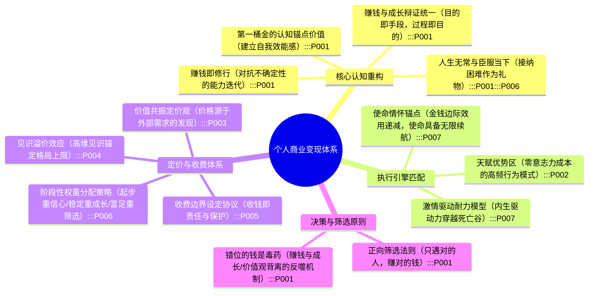
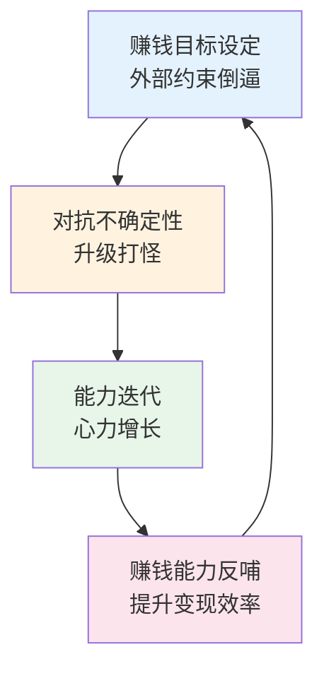
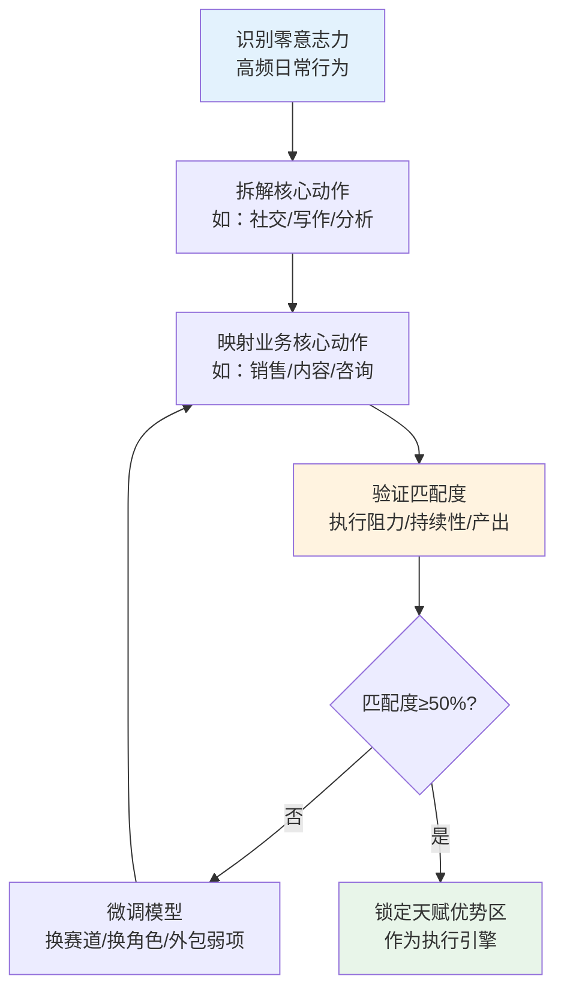
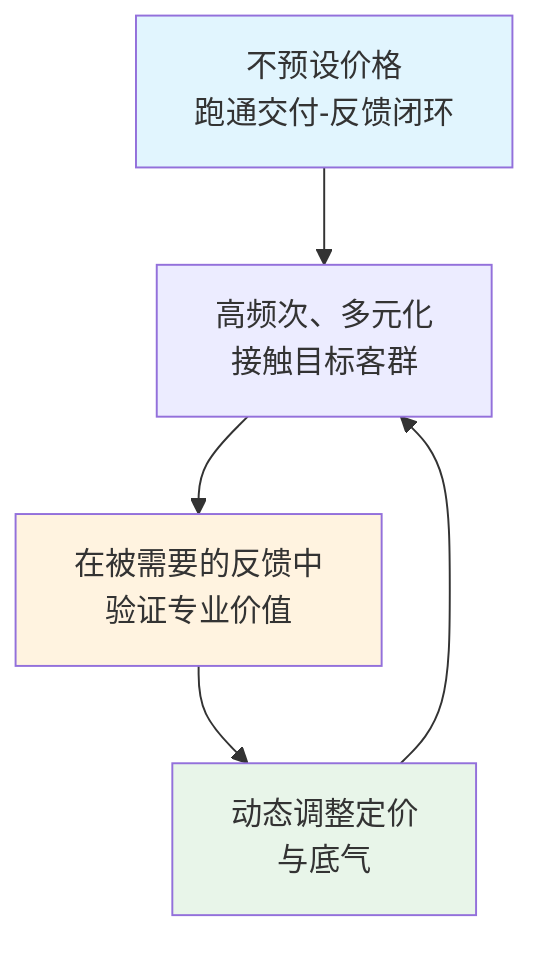
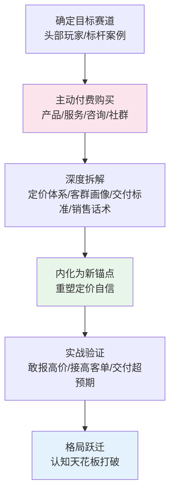
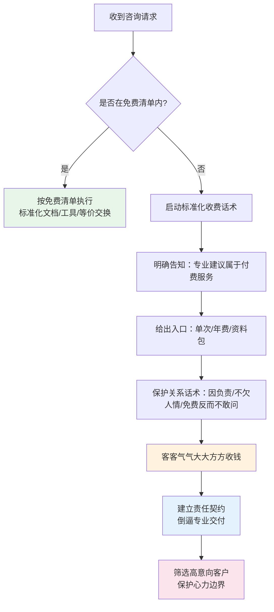
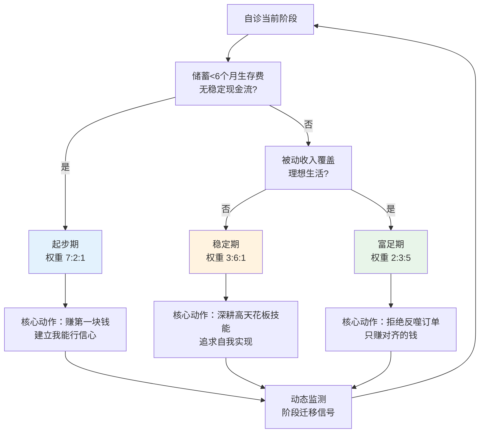
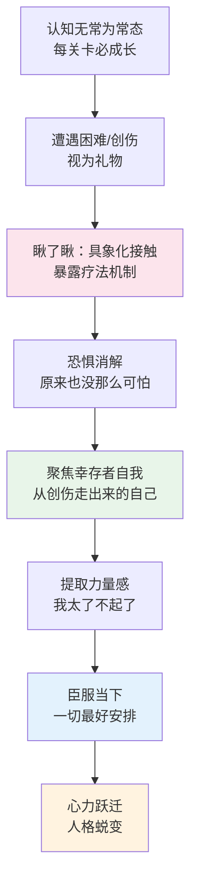

# 第 5 章 个人商业变现体系 —— 定价、收钱、见识与天赋匹配

## 学习目标

- 理解赚钱与成长的辩证统一关系：赚钱是驱动进化的手段，成长才是目的
- 掌握天赋优势区识别法：将‘零意志力成本’的行为模式映射为业务核心动作
- 理解价值共振定价观：价格源于外部需求的‘发现’而非自我定义
- 掌握见识溢价效应：通过主动付费购买高阶见识打破认知天花板
- 建立收费边界设定协议：收钱即责任与保护，建立标准化收费流程与话术
- 掌握阶段性权重分配策略：起步重信心、稳定重成长、富足重筛选
- 理解激情驱动耐力模型与使命情怀锚点：意志力有限，激情才能穿越死亡谷
- 掌握人生无常与臣服当下：接纳困难作为礼物，聚焦‘从创伤走出来的自己’

## 5.1 生活类比

想象个人商业变现是一场**登山探险**。**天赋优势区**是你天生擅长的登山方式——有的擅长徒步、有的擅长攀岩、有的擅长滑雪，顺应天性才能走得远；**激情与使命**是让你在缺氧、极寒、想放弃时仍想“再坚持一下”的内驱力，意志力是有限的应急氧气罐，激情才是源源不断的内燃机；**价值共振定价**不是你觉得这根登山杖值多少钱，而是遇难者愿出多少钱买它救命，价格在“被需要”中被发现；**见识溢价**是看到前人已登顶珠峰并带回黄金，你的格局打开，敢卖高价、敢冲高峰；**收费边界**是收取向导费不仅是交易，更是签署“带你活着下山”的责任状，免费带路往往导致双方迷路；**阶段性权重**是登山初期（起步）要活下来建立信心，中途（稳定）要挑战更高峰提升技艺，下山后（富足）只带真正想登顶的人；**臣服当下**是暴风雪来了不对抗天气，接纳环境，调整节奏，把“熬过暴风雪的自己”当作战利品。

登山探险的每一步都在提醒你：装备（天赋）要对路，动力（激情）要足，向导费（定价）要看救命价值而非成本，见过珠峰（见识）才敢报高价，签责任状（收费）才敢带人冲顶，不同海拔（阶段）背包里装的东西不同，暴风雪（无常）来了不硬抗而调整呼吸节奏，最终带下山的不是金子，而是那个“熬过暴风雪的自己”。

## 5.2 概念地图



## 5.3 赚钱与成长的辩证统一 —— 目的即手段，过程即目的

### 为什么需要这个概念？

你是否陷入过这样的二元困境：要么拼命赚钱却感到空心化，沦为赚钱的工具；要么只谈成长、不接地气，最终因经济窘迫而不得不放弃？许多人把“赚钱”和“成长”对立起来，认为必须二选一。但这种对立思维会让你在取舍中迷失方向。我们需要一种底层认知重构，将二者统一为动态互促的关系，指导你在每一个决策节点上不迷失。

### 核心定义

> "赚钱和成长相爱相杀，最好的方式是赚能够利于成长的钱，仅为了赚钱，可能沦为赚钱工具而无法实现内在价值，仅考虑成长则有可能经济窘迫。"
> 
> —— 素材 P001 (docs/202303/20230328_012.md, p.1)

**赚钱是驱动个体进化的手段，成长（对抗不确定性的能力迭代）才是目的。**

这个定义展示了三层含义：
1. **工具性**：赚钱不是终点，是倒逼你升级打怪的外部约束；
2. **必然性**：为了赚到钱这个结果，你必须不断对抗世界的不确定性，这个过程你必然成长；
3. **同一性**：目的只是手段，过程才是目的——赚到钱是结果，为了这个结果必须不断升级打怪，过程本身必然带来成长。

### 关键性质

- **动态互促**：赚钱倒逼成长，成长反哺赚钱能力，形成正向飞轮。
- **认知重构价值 > 金额价值**：第一桶金的核心不在于金额，而在于建立“我也能行”的自我效能感。

> "在起步阶段，创业副业赚钱的比例可以占的比重更高，因为赚到第一块钱的手感和信心非常重要，它的价值远远高于你做什么项目，是什么商业模式。"
> 
> "“我也能行”这个认知是我的强心剂，不管我后面碰上各种困难，我觉得都可以迎难而上。"
> 
> —— 素材 P001 (docs/202303/20230328_012.md, p.1)

> "引用涛哥所说，赚钱是最好的修行，我深信，因为赚到钱是一个结果，你为了这个结果需要不断升级打怪，对抗这个世界的不确定性，而这个过程你必然成长。所以目的只是手段，过程才是目的。"
> 
> —— 素材 P001 (docs/202303/20230328_012.md, p.2)

### 典型例子

作者稀里糊涂靠写公众号赚到第一桶金，获得“赚钱不难、我也能行”的认知锚点，这个“小成功”支撑了后续保险创业4年的心理韧性。评论区印证：“信心是一个小成功连着一个小成功建立起来的，所以要有足够多的成功体验。”

### 边界条件

警惕赚钱与成长对立的时刻：
- 仅为赚钱而赚钱 → 沦为工具，无法实现内在价值；
- 仅谈成长不顾生计 → 经济窘迫，崩盘退出。
最优策略：**赚取能够促进成长的钱。**

### 方法演进图：赚钱-成长正向飞轮



---

## 5.4 天赋优势区 —— 零意志力成本的执行引擎

### 为什么需要这个概念？

创业执行常靠意志力硬撑，极易耗竭放弃。你是否有过这样的体验：定好计划，前三天满血，两周后放弃？因为意志力是稀缺资源，像电池一样用完就没了。我们需要找到“天然自带动力、无需逼迫即可高频执行”的行为模式，将其映射为业务核心动作，实现**高绩效、低阻力**的可持续执行。

### 核心定义

> "赚钱要发挥自己的天赋优势，去做不需要用意志力就能坚持的事，这样更容易成功。"
> 
> "比如我是个话唠，每天都会找几个朋友聊天，做保险一个核心点就是你要每天聊够足够多的人，然而这件事是我的日常，我不需要用意志力逼迫自己就能实现。"
> 
> —— 素材 P001 (docs/202303/20230328_012.md, p.2)

**天赋优势区** = 指不需要消耗意志力即可持续、高频、日常化执行的天然能力区间。成功概率最高的路径：将商业核心动作匹配至个人天赋优势区。

这个定义揭示了三个关键性质：
1. **低阻力**：不需要“逼自己”，像呼吸一样自然发生；
2. **高持续性**：日复一日，不靠打鸡血也能坚持；
3. **高绩效**：因为投入时长长、频次高，必然产生复利。

> ⚠️ **关键区分**：天赋非指“擅长”，而是指“日常化、无需逼迫”的行为惯性。你可能擅长编程，但如果每次写代码都要逼自己，那它就不在你的天赋优势区。

### 典型例子

作者是“话唠”，日常找朋友聊天；保险核心动作是“每天聊够足够多的人”，完美匹配，零意志力成本实现高绩效。这就是**天赋-业务匹配验证法**的实战案例：识别个人“无需意志力即可日常高频执行”的行为模式（如社交、写作、分析），将其映射为业务核心动作（如销售、内容营销、咨询），降低执行阻力。

### 边界条件

- 天赋优势区随阶段变化，需动态识别；
- 仅靠天赋不够，还需结合**激情驱动耐力模型**（见 5.9 节）支撑长周期。

### 方法演进图：天赋-业务匹配验证流程



---

## 5.5 价值共振定价观 —— 价格源于外部需求的“发现”

### 为什么需要这个概念？

定价时你是否陷入过两个误区：
- **成本锚定**：觉得自己成本低，不好意思卖贵；
- **迷之自信**：没跑通过市场，凭感觉定高价，结果无人问津。

核心问题是：**价值不是被自我定义出来的，而是在与多元人群碰撞中被外部需求“发现”并“需要”的。**

### 核心定义

> "如何才能越卖越贵，越卖越有底气？和这个世界更加激烈的碰撞。在我的眼里，价格=价值，价值不是被任何人定义出来的，而是当你接触到越来越多的人的时候发现自己「被需要」。"
> 
> "当你发现你的专业是别人真正所需要的，这种自我认知就会不断强化，不断加强，不断给你敢于卖的底气。"
> 
> —— 素材 P001 (docs/202303/20230328_012.md, p.2)

**价格 = 价值，价值非自我定义，而在高频、多元的客户碰撞中被“需要”而确立。**

这个公式展示了定价的三个动力学机制：
1. **碰撞频次**：接触越多样化的人群，样本量越大；
2. **价值发现**：在碰撞中发现自己“被需要”，而非“我觉得值”；
3. **底气生成**：自我认知不断强化，敢报价、敢坚持高价。

### 价值不对称 = 定价空间

> "举个例子，如果你是做简历修改的，这件事对你来说小菜一碟不值钱，但对于一个刚毕业的人来说这有可能会改变别人职业生涯。"
> 
> —— 素材 P001 (docs/202303/20230328_012.md, p.2)

这个例子展示了**价值鸿沟**：提供者视角的“小菜一碟”与需方“改变命运”的巨大落差，正是定价空间与底气的来源。你不需要为“简单的事卖贵”感到愧疚，因为**价值由需方定义，不由供方定义。**

### 价值发现式定价迭代（方法）

```
1. 不预设价格，先跑通“交付-反馈”闭环
2. 高频次、多元化接触目标客群（激烈交换思想）
3. 在“被需要”的反馈中验证专业价值
4. 动态调整定价与底气
5. 循环往复，形成“碰撞-发现-定价-再碰撞”飞轮
```

该伪代码展示了定价不是一次性决策，而是持续的市场验证过程。每一次客户碰撞都是一次价值校准。

### 方法演进图：价值发现式定价飞轮



### 边界条件

- 前提是**高频、多元的客户碰撞**（闭门造车无法发现价值）；
- 需配合**见识溢价效应**（见 5.6 节），先看到高阶定价锚点，才敢于承接高价值定价。

---

## 5.6 见识溢价效应 —— 格局由见识上限决定

### 为什么需要这个概念？

认知天花板限制了你的定价上限与商业模式想象空间。普通人靠自我悟道极难突破，因为**你无法想象你没见过的世界**。你需要主动付费“买见识”，实现格局跃迁。

### 核心定义

> "想赚更多钱，先花钱去买见识。一个敢出高价卖的人往往不是自己来的迷之自信，而是他亲眼看到了别人能卖这么多，并且能卖出去。"
> 
> "比如在我是个菜鸟的时候，我发现我认识的一个前辈卖保险是盯着国内福布斯富豪榜的人卖，是冲着亿元保单去卖的时候，我的信仰被充值了，我的格局打开了，原来还有这样的远方。"
> 
> —— 素材 P001 (docs/202303/20230328_012.md, p.2)

**高价格信心源于亲眼目睹高阶商业模式/定价锚点；主动付费购买见识（认知更高阶案例）是打破认知天花板、实现格局跃迁的最短路径。**

这个机制展示了两个关键性质：
1. **传染性**：见证高阶案例会即时“充值信仰、打开格局”；
2. **杠杆性**：少量见识投入撬动巨大认知增量与后续收益放大。

### 高维见识锚定法（方法）

```
1. 确定目标赛道的头部玩家/标杆案例
2. 主动付费购买其产品/服务/咨询/社群（付费=筛选+承诺）
3. 深度拆解其：定价体系、客群画像、交付标准、销售话术
4. 内化为自己的“新锚点”，重塑定价自信
5. 实战验证：敢报高价、接高客单、交付超预期
```

该流程展示了见识获取不是“看看就行”，而是**付费+拆解+内化+实战**的完整闭环。不付费就没有“皮在游戏中”的紧迫感，拆解不透彻就无法迁移。

### 方法演进图：高维见识锚定闭环



### 典型例子

前辈盯着福布斯富豪榜卖亿元保单：作者从菜鸟瞬间格局打开，信仰被充值。这就是“眼见为实”打破认知边界的瞬间。

### 边界条件

- 见识必须转化为**行动**（敢报高价、接高客单），否则仅是“眼高手低”；
- 需结合**价值共振定价**，通过实战碰撞验证见识的真实变现力。

---

## 5.7 收费边界设定协议 —— 收钱即责任与保护

### 为什么需要这个概念？

“不好意思收钱”是普遍心理卡点。但作者指出：这实则是“不负责”与“自我伤害”的双重陷阱。免费服务缺乏契约约束，导致提供者敷衍交付（不负责）与接收者低估价值（白嫖），双输局面。我们需要建立标准化收费流程与话术，将收费内化为**责任契约**与**心理保护机制**。

### 核心定义

> "收钱才是最大的负责。收了钱就有了责任，有了责任就不能随便一干，随口一说，你必须逼着自己好好帮别人解决问题。"
> 
> "收钱才是对自己最大的保护。别人问你业务上的问题，如果你不主动收钱，就要想好承担被别人白嫖后的心理不适。"
> 
> "当我自己意识到这一点之后，我都会客客气气大大方方收钱，这样既保护了自己，也对别人负责。"
> 
> —— 素材 P001 (docs/202303/20230328_012.md, p.3)

**收钱 = 最大的负责 + 最大的保护。**

这个双重机制展示了：
1. **责任契约**：收费建立显性契约，倒逼专业交付，不能随口一说、随便一干；
2. **心理保护**：防止“白嫖”导致心理内耗，维护心理边界，筛选高意向客户。

### 收费边界设定协议（方法）

```
1. 建立标准化收费标准（单次咨询/年费会员/产品价格表）
2. 设计标准化话术体系（温和版/专业版/边界版）
   - 明确告知：专业建议属于付费服务
   - 给出入口：单次咨询X元/年费会员X元/免费资料包领取链接
   - 保护关系：因为认真负责所以收费/不想让你觉得欠人情/免费反而不敢随意提问
3. 明确“免费清单”边界：
   - 即便对方不买也不后悔（交个朋友）
   - 边际成本极低的标准化文档/工具
   - 互换同等价值资源（等价交换）
4. 执行“客客气气大大方方”收钱，不心虚、不讨好、不解释过度
```

该协议展示了收费不是设门槛，而是**帮对方确认“这事对我有多重要”**，同时保护提供者的心力与专业度。

### 方法演进图：收费边界设定标准化流程



### 典型例子

作者建立“客客气气大大方方收钱”机制后，同时实现保护自己（避免白嫖内耗）与对别人负责（倒逼专业交付）的双赢。

### 边界条件

- 免费服务仅限：即便对方不买也不后悔、或极低边际成本的标准化产品、或等价资源互换；
- 必须建立收费标准与话术体系，而非临时起意讨价还价。

---

## 5.8 阶段性权重分配策略 —— 起步重信心、稳定重成长、富足重筛选

### 为什么需要这个概念？

创业不同阶段核心矛盾不同，固定“赚钱/成长”权重会导致策略错位。你需要根据经济压力与心理满足度的相对强度，动态调整三个权重：**赚钱权重**、**成长权重**、**筛选权重**。

### 核心定义

> "在起步阶段，创业副业赚钱的比例可以占的比重更高，因为赚到第一块钱的手感和信心非常重要..."
> 
> "如果你已经没有经济压力了，选择创业和副业方向成长的比例要占的更大..."
> 
> "当你不为生计发愁，有的钱让赚的你不舒服，我劝你宁可不赚。因为赚了不对的钱，后面极有可能反噬你，不要给对方过高的预期。记住，只遇对的人，赚对的钱。"
> 
> —— 素材 P001 (docs/202303/20230328_012.md, p.3)

| 阶段 | 核心矛盾 | 权重分配（赚钱 : 成长 : 筛选） | 核心目标 |
|------|----------|-------------------------------|----------|
| **起步期** | 缺信心、缺现金流、缺正反馈 | 7 : 2 : 1 | 建立“第一桶金”信心，跑通闭环 |
| **稳定期** | 现金流覆盖生活、渴望突破天花板 | 3 : 6 : 1 | 追求自我实现与能力进阶，深耕高天花板技能 |
| **富足期** | 被动收入覆盖理想生活、精力稀缺 | 2 : 3 : 5 | 只赚对的钱、拒绝反噬订单、保护核心精力 |

这个表格展示了权重随阶段的**动态平衡**：非二选一，而是随经济压力与心理阶段连续调整。

### 典型例子

作者起步靠写公众号赚第一桶金建立信心；稳定期深耕保险匹配天赋追求成长；富足期主动拒绝不舒服的钱规避反噬。

### 边界条件

- 判断阶段需诚实面对：是否真“无经济压力”决定能否进入筛选期；
- 筛选期不代表不赚钱，而是“只赚对齐的钱”，单价往往更高；
- 警惕“经济焦虑虚假信号”误判阶段（如明明有存款却因恐惧不敢进入筛选期）。

### 方法演进图：阶段判断与权重动态调整决策树



---

## 5.9 激情驱动耐力模型与使命情怀锚点 —— 意志力靠边站，激情才能穿越死亡谷

### 为什么需要这个概念？

长周期创业中，意志力有限且易耗竭，靠“逼自己”撑不住。无数创业者死在“死亡谷”——漫长的不盈利期、平台期、挫折期。唯有**“不挣钱也甘愿做”**的激情/使命，能提供穿越死亡谷的无限续航力。

### 核心定义

> "如何赚钱才能长久？找到自己的激情所在，并一头扎进去。很多生意做到最后，都是在日复一日的打磨中拼耐力。"
> 
> "如果没有持续的激情注入，那种不挣钱也甘愿去做的耐力，做到后面你就会自我迷失。更可怕的，也许成功离你很近，你因为心力不足更容易放弃。"
> 
> —— 素材 P001 (docs/202303/20230328_012.md, p.2)

> "意志力有限易耗竭，唯有‘不挣钱也甘愿做’的激情能穿越死亡谷；金钱边际效用递减，虚无缥缈的使命/情怀具备无限续航力，支撑层层壁垒形成。"
> 
> —— 素材 P004 (docs/202303/20230328_036.md, p.7-9)

**激情驱动耐力模型**：找到激情所在并一头扎进，靠内生驱动力支撑日复一日的打磨。
**使命情怀锚点**：金钱边际效用递减，虚无缥缈的使命/情怀具备无限续航力，支撑层层壁垒形成。

这个模型揭示了两个关键性质：
1. **非功利性**：激情不以即时回报为燃料，以“甘愿”为燃料；
2. **抗周期性**：使命感能对抗“自我迷失”与“心力不足导致的过早放弃”。

### 方法演进图：激情/使命驱动的死亡谷穿越链条


### 典型例子

作者保险创业4年，靠“帮人解决问题”的使命感穿越低谷，而非单纯逐利。刘晨昊经历平台限流、恶意投诉、收入断崖后，最终将核心壁垒定义为“抗压持久力”，核心驱动力修正为“使命情怀”。

### 边界条件

- 激情需结合**天赋优势区**（见 5.4 节），否则易陷入“热爱但不擅长”的自我感动；
- 需配合**价值共振定价**（见 5.5 节）实现商业闭环，纯激情无变现不可持续。

---

## 5.10 人生无常与臣服当下 —— 接纳困难作为礼物

### 为什么需要这个概念？

创业充满不可控，对抗“结果”极易内耗崩溃。你需要一种心力转化机制：认知无常为常态，接纳困难、臣服当下，将创伤转化为力量。

### 核心定义

> "人生无常，每个关卡不一定赚钱，但一定能成长。把遇到每个困难当作是礼物，接纳并接住它，你的心力会越来越强。"
> 
> "臣服当下，一切都是最好的安排。"
> 
> —— 素材 P001 (docs/202303/20230328_012.md, p.3)

> "以前想到创伤的时候，会把它想象成可怕的庞然大物... 参加完免费心理咨询试验过后，终于走进瞅了瞅它，哦，原来也没那么可怕嘛。"
> 
> "再后来，比起关心创伤，我更关注那个从创伤中走出来的自己。天啦，那样的情况，我居然也可以应对，我太了不起了。"
> 
> —— 素材 P006 (docs/202303/20230328_113.md, p.2)

**认知“无常”为人生常态，通过“瞅了瞅”具象化创伤将恐惧转化为可应对对象，聚焦“从创伤走出来的自己”提取力量感，实现“臣服当下，一切最好安排”。**

这个机制包含三个层次：
1. **认知层**：无常是常态，每个关卡不一定赚钱，但一定能成长；
2. **操作层**：“瞅了瞅”具象化创伤（暴露疗法核心机制：回避维持恐惧，接近消解恐惧）；
3. **提取层**：聚焦“从创伤走出来的自己”，提取力量感，支撑人格蜕变。

> **理论锚点**：该“瞅了瞅”具象化机制对应暴露疗法核心原理——回避维持恐惧，接近（暴露）消解恐惧（Foa & Kozak, 1986 情绪加工理论；Craske 等抑制性学习模型）；亦对应《身体从未忘记》（van der Kolk, 2014）中创伤治疗的“具身化接触”路径。

**文献引用**：
- Foa, E. B., & Kozak, M. J. (1986). Emotional processing of fear: Exposure to corrective information. *Psychological Bulletin*, 99(1), 20–35. https://doi.org/10.1037/0033-2909.99.1.20
- Craske, M. G., Treanor, M., Conway, C. C., Zbozinek, T., & Vervliet, B. (2014). Maximizing exposure therapy: An inhibitory learning approach. *Behaviour Research and Therapy*, 58, 10–23. https://doi.org/10.1016/j.brat.2014.04.006
- van der Kolk, B. A. (2014). *The Body Keeps the Score: Brain, Mind, and Body in the Healing of Trauma*. Viking. ISBN: 978-0670785933

### 关键性质

- **非放弃**：臣服非躺平，而是接纳现实后的主动作为；
- **即时奖赏**：成长（走出创伤的自己）即时发生，无需等待外部结果。

### 方法演进图：创伤具象化与臣服当下的心力转化链条



### 典型例子

作者面对创业起伏、家庭变故等“礼物”，通过心理咨询/童年再叙事接纳并转化，实现心力跃迁。杨昌通过北大IPP心理咨询“重走童年路”，将创伤具象化接触，聚焦幸存者力量，完成“脱胎换骨”级蜕变。

### 边界条件

- 需具备基础心理韧性或专业支持（心理咨询），极端创伤期不可强行“臣服”；
- 必须结合“行动导向”，臣服后仍需在可控维度持续迭代。

---

## 5.11 多源对照：核心概念的跨素材验证

下面两个对照表分别从“赚钱与成长的关系”及“长周期动力来源”两个维度，对比 P001（小冯妮儿）与 P004（刘晨昊）两份素材的核心主张，帮助你看清共识与分歧。

### 5.11.1 赚钱与成长的关系

| 素材 ID | 核心主张 | 关键金句 | 出处文献 |
|---------|----------|----------|----------|
| **P001（小冯妮儿）** | 辩证统一：目的即手段，过程即目的 | "赚到钱是一个结果，你为了这个结果需要不断升级打怪...过程才是目的" | 素材 P001 (docs/202303/20230328_012.md, p.2) |
| **P004（刘晨昊）** | 成长悖论动机：真实动机是“克服困难后的自己” | "我们也许喜欢的都不是钱，是那个克服一个又一个困难的自己吧" | 素材 P004 (docs/202303/20230328_036.md, p.10) |

**共识**：赚钱是手段，成长（能力迭代/心力提升）才是核心收获。
**分歧**：P001 强调“动态互促”，P004 强调“终极动机非金钱”。

### 5.11.2 长周期动力来源

| 素材 ID | 核心主张 | 关键论据 | 出处文献 |
|---------|----------|----------|----------|
| **P001（小冯妮儿）** | 激情驱动耐力：“不挣钱也甘愿做”的激情是穿越死亡谷的燃料 | 保险创业4年，靠“帮人解决问题”的激情穿越低谷 | 素材 P001 (docs/202303/20230328_012.md, p.2) |
| **P004（刘晨昊）** | 使命情怀锚点 + 抗压持久力：虚无缥缈的使命/情怀具备无限续航力，支撑层层壁垒 | 元气森林创始人观点印证：“唯一壁垒是比对手更能扛” | 素材 P004 (docs/202303/20230328_036.md, p.7-9) |

**共识**：意志力不足以支撑长周期，内生驱动力（激情/使命）是核心。
**互补**：P001 侧重“爱与甘愿”，P004 侧重“扛与壁垒”，二者构成**激情-使命-耐力**三角支撑。

---

## 5.12 设计中的取舍

下表从**资源属性**、**可持续性**、**抗周期性**、**心理成本**四个维度，对比三组核心取舍，显性化“易耗资源 vs 结构性优势”的理论权衡。

| 维度 | 纯逐利模式 | **赚取促进成长的钱** | 天赋匹配+激情驱动 | 意志力自律 | 免费建立关系 | **收费边界设定协议** |
|------|------------|----------------------|-------------------|------------|--------------|----------------------|
| **资源属性** | 外部奖赏（易耗） | 能力复利+心力护城河（结构性） | 内生驱动力（结构性） | 前额叶执行资源（易耗，Hagger et al., 2016） | 社会义务（模糊） | 显性契约（结构性） |
| **可持续性** | 低（算法/竞争变即崩） | 高（能力迭代形成护城河） | 高（核聚变级持久） | 低（电池模型/自我损耗争议，Dang, 2018） | 低（关系因怨恨破裂） | 高（边界清晰、长期声誉） |
| **抗周期性** | 无锚点极易崩盘 | 以成长为锚点穿越周期 | 使命/激情作无限续航锚点 | 耗竭即停摆 | 危机时首当其冲被切 | 危机时筛选出高质量客群 |
| **心理成本** | 异化为工具、空心化 | 自我效能感持续增强 | 甘愿投入、心流体验 | 高内耗、自我对抗 | 白嫖内耗、不被尊重 | 客客气气大大方方、零愧疚 |

**文献引用**：
- Hagger, M. S., et al. (2016). A multilab preregistered replication of the ego-depletion effect. *Perspectives on Psychological Science*, 11(4), 546–573. https://doi.org/10.1177/1745691616652873
- Dang, J. (2018). An updated meta-analysis of the ego depletion effect. *Psychological Research*, 82(4), 645–651. https://doi.org/10.1007/s00426-017-0899-x

### 为什么不用“纯逐利模式”而选择“赚取促进成长的钱”？

纯逐利模式看似赚得快，实则将人异化为工具，缺乏抗周期韧性。当平台算法变、竞争加剧、收入波动时，纯逐利者无内在锚点，极易崩盘放弃。选择“赚取促进成长的钱”，虽然短期可能放弃一些高现金流但高消耗的机会，但换来的是**能力复利**与**心力护城河**——这才是长期生存的核心资产。

### 为什么不用“意志力自律”而选择“天赋匹配+激情驱动”？

意志力依赖前额叶有限的执行资源（执行功能有限性理论），用完即止；天赋匹配顺应天性行为惯性，像水力发电持续输出；激情驱动像核聚变，内部反应堆源源不断。三者能量密度指数级跃升。设计取舍的核心：**用结构性优势（天赋/激情）替代易耗资源（意志力）。**

### 为什么不用“免费建立关系”而选择“收费边界设定协议”？

免费看似积累人脉，实则双输：提供者无契约约束敷衍交付（不负责），接收者低估价值（白嫖），关系反而因怨恨破裂。收费的短期社交成本（可能被认为“功利”）换取长期专业声誉与心理自由，这笔账极其划算。

---

## 5.13 动手练习

### 练习 1：天赋优势区挖掘与业务匹配练习

1. 列出你近3个月“无需逼迫、自发高频、做完不累反而充能”的3-5件日常行为（如：主动整理笔记、和陌生人聊天、拆解复杂流程、修图调色、写代码片段...）
2. 对每个行为拆解：核心动作是什么？（如“整理笔记”的核心是“结构化信息”）
3. 将核心动作映射为可变现的业务动作（如“结构化信息”→“整理资料卖资料/做知识付费大纲/帮企业梳理SOP”）
4. 回答问题：
   - 当前主业/副业核心动作中，有多少比例落在你的天赋优势区？
   - 如果不足50%，如何微调业务模型（换赛道/换角色/外包弱项）提升匹配度？

### 练习 2：价值共振定价实战模拟

选定一个你能提供的服务/产品（如：简历修改、Notion模板、英语陪练、行业研报解读...）

1. 设定“成本锚定价”：基于你的时间成本/边际成本算出的底价
2. 找5-10位目标用户深度访谈（非问卷）："如果这个服务帮你解决了[具体痛点]，对你的价值是多少？你愿付多少？"
3. 记录“价值鸿沟”：你的成本锚定价 vs 用户感知价值的差异倍数
4. 基于最高感知价值设定“尝试报价”，小范围测试成交率
5. 回答问题：
   - 为什么用户感知价值远高于你的成本？（识别价值不对称来源）
   - 见识更高阶的同行怎么定价？去“买”一次他们的服务/看他们的销售页，观察格局差异

> **理论延伸**：该方法对应营销学中**感知价值定价**（Perceived Value Pricing）与**价值基础定价**（Value-Based Pricing）范式（Hinterhuber, 2008; Nagle & Müller, 2017），核心差异在于强调“外部碰撞发现”而非“内部成本核算”。
> 
> **文献引用**：
> - Hinterhuber, A. (2008). Customer value-based pricing strategies: Why companies resist. *Journal of Business Strategy*, 29(4), 41–50. https://doi.org/10.1108/02756660810887075
> - Nagle, T. T., & Müller, G. (2017). *The Strategy and Tactics of Pricing: A Guide to Growing More Profitably* (6th ed.). Routledge. ISBN: 978-1138194786

### 练习 3：阶段性权重自诊与策略调整

1. 自诊当前所处阶段：
   - 起步期：储蓄<6个月生存费、无稳定现金流、缺乏“我也能行”的强信心
   - 稳定期：现金流覆盖生活、有成熟变现模型、渴望突破天花板/自我实现
   - 富足期：被动收入覆盖理想生活、主动拒绝过不舒服的钱、担心精力被低价值消耗
2. 标注当前“赚钱权重 : 成长权重 : 筛选权重”的实际投入比（如 8:1:1）
3. 对照理论最优比（起步 7:2:1 / 稳定 3:6:1 / 富足 2:3:5），识别偏差
4. 制定本月调整动作：
   - 若起步期却重成长：立即启动“赚第一块钱”微行动（发朋友圈卖单次咨询/闲鱼挂服务/接单平台抢单）
   - 若稳定期却重赚钱：砍掉1个低成长性高耗时项目，腾出时间深耕1个高天花板技能
   - 若富足期却不敢拒绝：列出“让我赚得不舒服的3类订单/客户”，本月拒绝其中1类
5. 回答问题：
   - 是否因“经济焦虑虚假信号”误判阶段？（如明明有存款却因恐惧不敢进入筛选期）
   - 如何建立“只赚对的钱”的筛选标准清单（价值观匹配/精力ROI/客户画像）？

### 练习 4：激情/使命压力测试与死亡谷预演

1. 列出当前项目/赛道，针对每个回答：
   - "如果这件事未来12个月完全不赚钱，甚至倒贴时间金钱，我还会每天主动做吗？"（是/否/犹豫）
   - "什么具体画面/时刻让我感到‘不挣钱也甘愿’？（如：看到用户发来感谢信/攻克技术难题/写出满意的代码/帮人省下巨额损失）"
2. 识别“伪激情”：仅喜欢结果（赚钱/荣誉/身份）而不爱过程（枯燥重复/被拒绝/技术调试）的项目
3. 设计“死亡谷生存包”：当现金流断裂/陷入瓶颈/遭遇重大挫折时，靠什么支撑我不放弃？（使命宣言/导师求助/最小现金流项目/家庭支持/心理咨询预约）
4. 回答问题：
   - 你的使命情怀能否支撑你熬过“3个月零收入+全网质疑”的极端假设？
   - 如何将使命显性化（写成Slogan/挂在墙上/设为开机密码/每周复盘朗读）作为锚点？

> **理论延伸**：该测试对应**自我决定理论**（Self-Determination Theory, Deci & Ryan, 2000）中“内在动机 vs 外在动机”的区分，以及行为经济学中**收入-幸福边际效用递减**规律（Kahneman & Deaton, 2010）：年收入约7.5万美元（约合人民币50-60万）后，情绪幸福感不再随收入显著提升，使命/意义感成为核心驱动力。
> 
> **文献引用**：
> - Deci, E. L., & Ryan, R. M. (2000). The "what" and "why" of goal pursuits: Human needs and the self-determination of behavior. *Psychological Inquiry*, 11(4), 227–268. https://doi.org/10.1207/S15327965PLI1104_01
> - Kahneman, D., & Deaton, A. (2010). High income improves evaluation of life but not emotional well-being. *Proceedings of the National Academy of Sciences*, 107(38), 16489–16493. https://doi.org/10.1073/pnas.1011492107

### 练习 5：收费边界话术设计与实战演练

场景：老朋友/粉丝/弱关系人微信问："XXX方面有个小问题想请教你，应该不难吧？"

1. 设计3套标准化回复话术（温和版/专业版/边界版），要求：
   - 明确告知：专业建议属于付费服务
   - 给出入口：单次咨询X元/年费会员X元/免费资料包领取链接
   - 保护关系：因为认真负责所以收费/不想让你觉得欠人情/免费反而不敢随意提问
2. 找1个非利益相关朋友实测发送，记录对方反应与你的心理感受
3. 优化话术至“客客气气大大方方”不心虚
4. 建立“免费清单”：明确哪些场景可免费（如：不买不后悔的泛泛之交/边际成本极低的标准化文档/互换同等价值资源）
5. 回答问题：
   - 为什么不收费反而伤害关系？（免费→不重视→敷衍交付→对方不满→你怨恨）
   - 如何用“付费即筛选”思维重构：收费不是设门槛，是帮对方确认“这事对我有多重要”

---

## 5.14 本章小结

这一章中我们学习了如何构建个人商业变现的完整闭环。首先，我们重构了赚钱与成长的辩证关系——赚钱是驱动进化的手段，成长才是目的，第一桶金的核心价值在于建立自我效能感；其次，我们识别了天赋优势区作为零意志力成本的执行引擎，将天然行为惯性映射为业务核心动作；接着，我们建立了价值共振定价观——价格源于外部需求的“发现”而非自我定义，价值鸿沟即定价空间；然后，我们理解了见识溢价效应——通过主动付费购买高阶见识打破认知天花板，格局由见识上限决定；之后，我们建立了收费边界设定协议——收钱即责任与保护，通过标准化流程实现双赢；随后，我们掌握了阶段性权重分配策略——起步重信心、稳定重成长、富足重筛选，动态调整核心矛盾的解决优先级；再然后，我们确立了激情驱动耐力模型与使命情怀锚点——意志力有限，唯有激情与使命能穿越死亡谷；最后，我们领悟了人生无常与臣服当下——接纳困难作为礼物，聚焦“从创伤走出来的自己”提取力量感。

本章我们一起学习了以下概念：

| 概念 | 解释 |
|------|------|
| 赚钱与成长辩证统一 | 赚钱是驱动进化的手段，成长（对抗不确定性的能力迭代）才是目的；第一桶金核心价值在于建立自我效能感 |
| 天赋优势区 | 识别“无需意志力即可日常高频执行”的行为模式，将其映射为业务核心动作，实现高绩效低阻力执行 |
| 价值共振定价观 | 价值非自我定义，而通过高频、多元客户碰撞被“需要”而确立；提供者“小菜一碟”与需方“改变命运”的价值鸿沟即定价空间 |
| 见识溢价效应 | 高价格信心源于亲眼目睹高阶商业模式/定价锚点；主动付费购买见识是打破认知天花板、实现格局跃迁的最短路径 |
| 收费边界设定协议 | 收费建立责任契约倒逼专业交付，同时防止“白嫖”导致心理内耗，建立标准化收费流程与话术管理预期 |
| 阶段性权重分配策略 | 动态调整“赚钱权重”与“成长权重”：起步期重赚钱建立信心，稳定期重成长追求自我实现，富足期重筛选只赚对的钱拒绝反噬 |
| 激情驱动耐力模型 | 意志力有限易耗竭，唯有“不挣钱也甘愿做”的激情能穿越死亡谷；金钱边际效用递减，使命/情怀具备无限续航力 |
| 人生无常与臣服当下 | 认知“无常”为常态，通过“瞅了瞅”具象化创伤将恐惧转化为可应对对象，聚焦“从创伤走出来的自己”提取力量感 |

下一章中，我们将学习 **欲望即货币** —— 设计驱动行为的微观经济模型，理解如何通过发行货币锚定欲望、设定分级工资规则、垄断欲望渠道，构建从家庭教育到商业平台通用的行为设计闭环。


