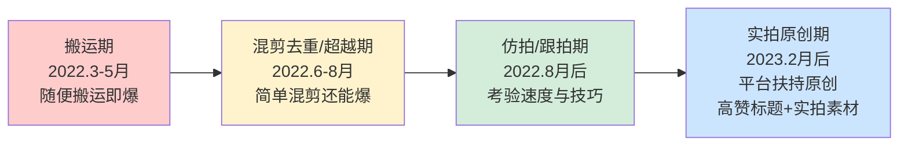
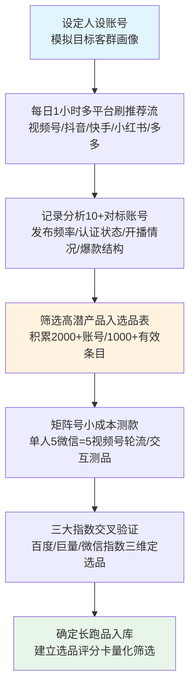
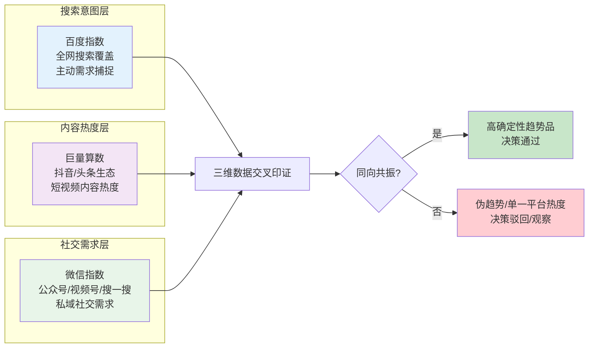
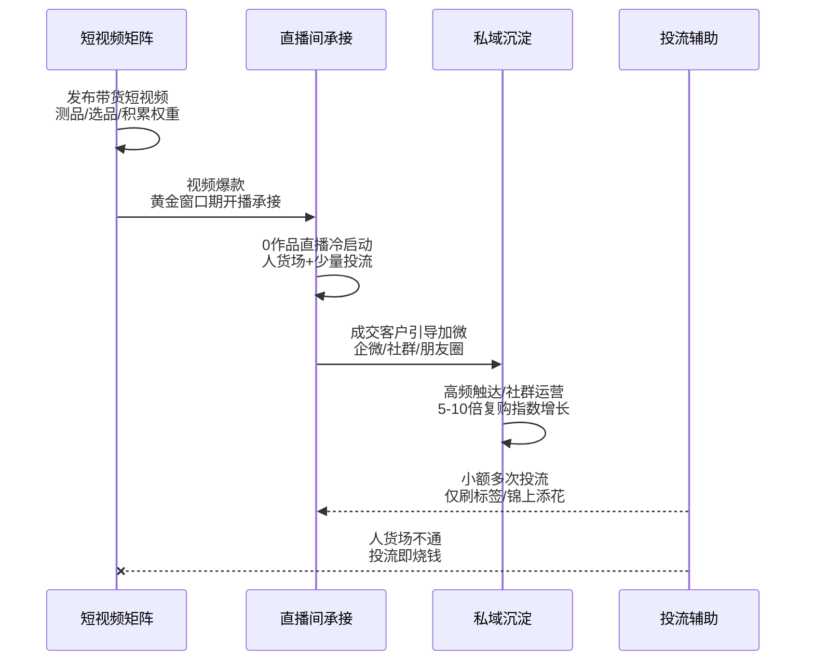
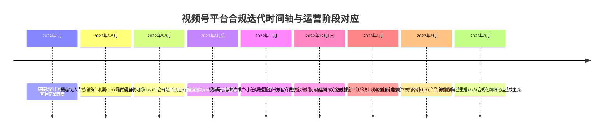
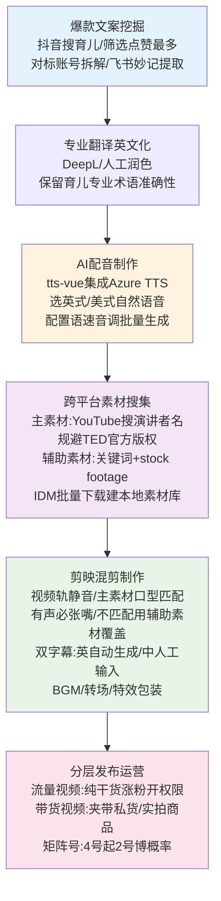
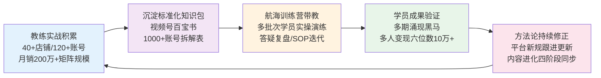

# 第 43 章 视频号带货全链路实操 —— 三大红利、选品侦察、直播承接、合规生存

## 学习目标

- 理解视频号带货的三大核心红利（流量、利润、私域）及其底层逻辑
- 掌握跨平台选品侦察法与三大指数交叉验证的标准化选品流程
- 掌握视频引流直播承接模型与小额多次投流策略的实操要点
- 理解视频号定价锚定理论与合规化生存底线的平台规则边界
- 能识别英文育儿书单号等跨平台语言转换蓝海模式的核心打法
- 能基于航海教练体系建立标准化账号拆解与复盘机制

## 43.1 生活类比

想象视频号带货经营是一场**开在微信楼下的社区生鲜店**经营：  
- **流量红利** = 楼下住户天然路过（微信生态自带流量），不用像去商场（抖音）花大价钱买广告牌引流；  
- **利润红利** = 邻居阿姨大叔对比的是楼下实体菜市场价（线下店锚定），不是拼多多批发价，所以你卖溢价 30%-50% 他们还觉得划算；  
- **人群红利** = 主力客群是不爱跑远路、信熟人、不爱退货的阿姨大叔（三四线中老年），服务好一次就能回头十次；  
- **私域红利** = 把常客拉进业主微信群（私域），每天发个今日鲜果朋友圈，复购率指数级爆涨，比陌生人生意强 5-10 倍；  
- **合规底线** = 物业（平台）突然严查：无证经营（个体户）、地摊货（搬运/无人直播）直接封店清退，唯有正规营业执照（企业店）、自产自销（原创实拍）能长久立足；  
- **选品侦察** = 每天花 1 小时蹲在小区门口（人设账号刷推荐），看邻居买啥、竞品卖啥、记本本上（选品表），再进货测款；  
- **视频引流直播** = 门口摆个试吃台（短视频爆款）引人停留 → 店里现切现卖（直播承接）成交 → 拉进群留住人（私域长跑）。  

就像社区生鲜店：选址在流量入口（视频号）、定价对标菜市场（定价锚定）、主打熟客生意（私域红利）、守规矩不走捷径（合规底线），这门生意才能越做越稳、越做越大。

## 43.2 概念地图

视频号带货全链路实操  
├── 核心红利体系  
│   ├── 流量红利：起号相对容易、标签虽不如抖音准但冷启动门槛低  —— [P001]  
│   ├── 利润红利：同品价格比抖音高 1-3 倍、用户对标线下店而非电商平台  —— [P001, P006]  
│   ├── 人群红利：三四线/中老年为主、信任度高、退换货率极低  —— [P001]  
│   └── 私域红利：极易导流微信、私域复购带来 5-10 倍指数级利润增长  —— [P001, P004]  
├── 选品决策体系  
│   ├── 跨平台选品侦察法：每日 1 小时+人设账号+多平台刷推荐+记录 10+ 对标账号  —— [P002]  
│   ├── 三大指数交叉验证法：百度指数+巨量算数+微信指数三维数据定选品  —— [P003]  
│   ├── 多账号矩阵交互测品：单人实名 5 微信=5 视频号轮流/交互测品  —— [P001]  
│   └── 亘古不变四大选品需求：男人要成功/女人要美/老人要健康/孩子要聪明  —— [P001]  
├── 内容与转化模型  
│   ├── 内容进化四阶段：搬运→混剪去重/超越→仿拍/跟拍→实拍原创  —— [P005]  
│   ├── 视频引流直播承接模型：短视频测品引流→爆款开播收割→0 作品直播冷启动  —— [P004]  
│   ├── 小额多次投流策略：投流仅锦上添花/刷标签、人货场不通投流即烧钱  —— [P004]  
│   └── 英文育儿书单号蓝海模式：中文文案英文化+YouTube 素材+AI 配音+Stock Footage  —— [P007]  
├── 合规与定价锚点  
│   ├── 视频号小店/优选联盟合规化：仅支持企业店、高保证金、对公账户、严格品退考核  —— [P005]  
│   ├── 违规不可逆机制：限流后权重永久受损、仅能注销重来、严打无人直播/搬运  —— [P005]  
│   ├── 平台功能迭代时间轴：2022 年各阶段功能上线与运营策略演变对应关系  —— [P005]  
│   └── 视频号定价锚定理论：用户对标线下实体店、同品可定价抖音 1-3 倍仍具性价比  —— [P006]  
├── 案例验证与标杆复盘  
│   ├── 蓝V 账号“好物推荐丽姐”：混剪引流+企微/微信引导私域+3D 墙纸高佣  —— [P001]  
│   ├── 护肤品高客单复购：成本 20 定价 99、单客拍 50 份近 5000 元  —— [P001, P006]  
│   ├── 定制化产品双利润长跑品：成本 10-20 售价 50-120、前后端双利润+复购  —— [P001, P006]  
│   ├── 英文育儿书单号实证：1 年累计粉 120W+、月利 1-2W、佣金率 40-60%  —— [P007]  
│   └── 团队矩阵规模验证：40+ 店铺/120+ 账号/月销 200 万+ 支撑方法论可复制性  —— [P008]  
└── 标准化知识沉淀体系  
    ├── 视频号百宝书/账号拆解表：1000+ 样本标准化拆解工具包  —— [P008]  
    ├── 对标账号拆解模板：基础信息/流量来源/变现产品三维度标准化  —— [P001]  
    └── 航海教练实战体系：教学相长迭代 SOP、多批次学员六位数变现背书  —— [P008]

---

## 43.3 视频号三大红利 —— 流量易起、利润高、私域强

### 为什么需要这个概念？

你在抖音做带货，可能面临三个痛点：流量标签虽精准但竞争极度内卷，客单价被同行压低；私域导流受限，用户资产留不住；合规成本高，稍不留神就违规。视频号依托微信生态，天然具备社交信任背书，能把“信任-转化-复购”链路打通。我们这一节把视频号的三大红利拆解给你看，帮你判断它是否适合你的业务。

### 核心定义

> "1.流量红利，没有抖音标签准和稳，但起号起流量还是相对容易。  
> 2.利润红利，抖音大部分行业比较卷，视频号普遍价格比抖音高 1-3 倍。  
> 3.人群红利，三四线城市和中老年触网少，信任度高，退换货较少。  
> 4.最重要的一点，私域。视频号非常非常非常容易引私域，私域为王...如果你能把私域做起来，那么你的利润是 5 倍 10 倍的指数型增长。"  
> ——《视频号带货实战分享》 [P001, p.1-2]

**流量红利**：起号、起流量相对容易，虽标签不如抖音精准稳定，但冷启动门槛低。  
**利润红利**：同品类商品普遍比抖音高 1-3 倍，用户价格锚定对象是线下实体店而非全网比价。  
**人群红利**：核心用户为三四线城市及中老年群体，触网少、信任度高、退换货率极低。  
**私域红利**：极易导流微信（个人号/企微/社群），私域复购可带来 5-10 倍指数级利润增长，是长期生存核心。

### 方法演进图：内容进化四阶段



> 上图展示了从搬运到实拍原创的四阶段强制进化路径，对应平台审核迭代时间节点，任何试图停留在早期捷径的行为都将面临生存危机。

### 关键性质

平台治理呈现持续趋严态势：2022 年 12 月 1 日，视频号强制清退所有第三方店铺，仅支持视频号小店接入优选联盟，合规化成为生存底线。违规处罚具有不可逆性：一旦触犯无人直播、搬运混剪等红线，明面虽为 3-7 天限流，实则处罚期过后账号权重永久受损、流量大幅衰减，无法像抖音快手通过养号恢复，仅能换绑或注销重来。内容生产必须跟随平台审核升级迭代，遵循“搬运→混剪去重/超越→仿拍/跟拍→实拍原创”的四阶段进化路径，任何试图停留在早期捷径的行为都将面临生存危机。

### 典型例子

以下案例验证了视频号红利的真实性与可操作性，数据均来源于作者团队实操复盘 [P001] 与航海教练验证 [P008]：

| 案例 | 关键数据 | 说明 |
|------|----------|------|
| 护肤品案例 | 成本 20 元定价 99 元，单客一次拍 50 份近 5000 元 | 验证中老年高客单接受度与复购潜力 [P001, P006] |
| 定制化产品 | 成本 10-20 元，售价 50-120 元 | 前端佣金+后端供应链双利润，且具备复购属性，为长跑优质品型 [P001, P006] |
| 蓝V账号“好物推荐丽姐” | 河南企业认证，混剪引流自然流量，挂企微/加微引导私域，3D 墙纸客单 30-59.9 元，佣金 30%+ | 验证蓝V+混剪+私域引导+高佣选品的跑通模型 [P001] |

### 边界条件

个体户无法入驻优选联盟，需企业执照、高额保证金、对公账户，记账报税成本高。品退投诉率门槛提高，低于标准当天清退，供应链与售后必须过硬。投放系统不稳定、标签不精准、易跑飞、赔付弱，投流仅适合冷启动刷标签，不能指望投流救命。无成熟供应链/原创内容能力的团队，后期将面临合规生存危机。

---

## 43.4 跨平台选品侦察法 —— 每天 1 小时刷视频当选品

### 为什么需要这个概念？

选品是比运营更重要的核心，定人群、定需求、定利润是选品三大核心点。单一平台数据有偏差，主观判断易陷入“觉得好卖”误区。我们需要一套低成本、可标准化、数据支撑的选品验证流程。

### 核心定义

> "建议大家每天一定要有 1 小时的选品（刷视频），把你的账号设置为你的目标客户...持续的刷，看系统推荐什么内容给你，觉得不错的就记录下来，我是要求团队小伙伴每天浏览记录 10 个以上的账号做分析。"  
> ——《视频号带货实战分享》 [P001, p.3]

将账号人设设置为目标客群（如设 50 岁模拟中老年），每日 1 小时在视频号/抖音/快手/小红书/多多视频多平台刷推荐流。记录分析日均 10+ 对标账号：发布频率、认证状态、开播情况、爆款视频结构。筛选高潜产品入选品表（累积 2000+ 账号、1000+ 有效条目），再以矩阵号小成本测款。

### 方法演进图：选品验证流程



> 上图展示了从人设账号养号到建立选品评分卡的标准化闭环流程，核心在于“算法反推需求”与“矩阵测品去风险”的双重保险机制。

### 关键性质

算法反推需求：平台推荐给目标人设的内容，即代表该人群的真实需求与高转化素材。多平台交叉验证：同一产品在多平台均有优质对标账号跑出数据，可信度显著提升。矩阵测品去风险：单人实名 5 微信=5 视频号，轮流测品、交互测品，避免单账号单品风险。

### 典型例子

作者团队已积累 2000+ 对标账号库、1000+ 有效选品条目，支撑 40+ 店铺、120+ 账号、月销 200 万+ 规模。实操中要求团队每天浏览记录 10 个以上账号分析，形成标准化选品 SOP [P001]。

### 边界条件

需投入持续人力成本（每日 1 小时/人），团队规模小初期可由老板亲自执行。仅适用于标品/半标品品类，非标定制类需结合私域需求反向定制。平台算法推荐机制变化会影响人设账号推荐内容质量，需定期重置养号。

---

## 43.5 三大指数交叉验证法 —— 百度/巨量/微信指数三维定选品

### 为什么需要这个概念？

单一平台指数（如仅看抖音热度）存在生态偏差，无法反映全网真实需求。选品决策需数据支撑，规避“拍脑袋”决定上品导致的库存积压。官方数据工具免费、权威、维度互补，是低成本决策杠杆。

### 核心定义

> "另外建议大家善用数据工具：百度指数、巨量算数、微信指数，这三个工具基本上覆盖了全网的指数，可以查看产品每天的活跃度、搜索量等数据，值得同步参考和借鉴。"  
> ——《视频号带货实战分享》 [P001, p.4]

**百度指数**：覆盖全网搜索需求，反映大众主动搜索意图。  
**巨量算数**：覆盖抖音/今日头条生态，反映短视频/信息流内容热度。  
**微信指数**：覆盖微信生态（公众号/视频号/搜一搜），反映私域/社交端需求。  
同步参考三大指数的产品日活跃度、搜索量趋势，交叉验证辅助选品决策。

### 方法演进图：三大指数交叉验证数据流



> 上图展示了三大指数覆盖的三大流量入口与交叉验证决策逻辑：仅当搜索意图、内容热度、社交需求三层数据同向共振时，才判定为高确定性趋势品。

### 关键性质

全网覆盖：三大工具基本覆盖搜索、短视频、社交三大流量入口，数据盲区最小。趋势>绝对值：观察指数走势增减变化判断需求周期，而非纠结绝对数值大小。交叉印证：三平台数据呈同向共振（如均上升）时，选品确定性最高。

### 典型例子

选品会议中同步打开三工具搜核心词，若百度指数稳步上升、巨量算数视频热度高、微信指数搜一搜量大，则判定为高确定性趋势品。规避了仅在抖音火但微信/搜索无声的“伪趋势”品类 [P001]。

### 边界条件

仅适用于有一定搜索量/讨论度的成熟品类，极新概念/极冷门品类指数为 0 无法判断。指数反映的是“关注/搜索”而非直接“购买转化”，需结合对标账号带货数据综合判断。微信指数更新频次较低，部分长尾词无数据。

---

## 43.6 视频引流直播承接模型 —— 短视频测品、直播收割、私域长跑

### 为什么需要这个概念？

单纯短视频带货受限于橱窗转化率低、客单价低、售后压力大；单纯直播带货冷启动难、人货场要求高、投流风险大。我们需要一套“视频测品引流 → 直播承接转化 → 私域沉淀复购”的组合拳模型。

### 核心定义

> "我的团队更多的是后端店群+带货矩阵号，一开始视频带货为主，视频爆了开播引导成交。这种模式是比较好的一种转化形式，同步也在启动 0 作品直播，靠人货场和少量投流起号。  
> 我们更多是视频测品，通过视频导入直播间的流量是转化率目前最高的。"  
> ——《视频号带货实战分享》 [P001, p.5-6]

前端：发布带货短视频 → 爆款获得自然流量 → 及时开播引导成交（话术简单）。  
后端：同步启动“0 作品直播”靠人货场 + 少量投流起号，不依赖历史作品权重。  
核心判断：视频导流直播流量转化率最高，投流仅作锦上添花，不能雪中送炭。

### 方法演进图：视频引流直播承接数据流



> 上图展示了“视频测品→爆款承接→0作品冷启动→私域沉淀”的完整转化链路，投流仅作标签优化与锦上添花，人货场不通时投流即为烧钱。

### 关键性质

人货场先行：必须本身人货场能承接转化，投流才能倍增；人货场不通，投流即烧钱。小额多次投流：视频号投放不稳定/易跑飞/赔付弱，采用少量多次优化模型，仅适合起号冷启动及刷标签。私域为王：直播/视频成交后必须沉淀微信私域，通过高频触达实现 5-10 倍指数级复购利润。

### 典型例子

作者团队模式：前端矩阵跑爆款季品视频 → 视频爆了开播引导成交 → 同步启动 0 作品直播靠人货场+少量投流起号。圈友口罩期间单日引流私域 1 万人，验证视频号为全网私域获客效率最高平台 [P001]。

### 边界条件

直播间承接能力弱（话术/供应链/售后）时，视频引流流量将被浪费，ROI 为负。仅适用于具备一定供应链把控力、能承接突发大单的团队/个人。平台严打无人直播/录播循环，0 作品直播必须真人/半真人实操，规避违规风险。

---

## 43.7 合规化生存底线 —— 无捷径、重原创、守规则

### 为什么需要这个概念？

早期红利期（搬运/无人直播/铺货）已结束，平台治理趋严，捷径必死。违规处罚不可逆（权重永久受损），合规是长期生存的唯一门槛。需建立“内容合规+后端合规+服务合规”三位一体的生存体系。

### 核心定义

> "2022 年 12 月 1 日，视频号仅支持带货优选联盟（视频号小店）的产品，第三方店铺退出历史舞台。  
> 建议不要走什么捷径...视频号管理的非常非常非常严格...一旦违规...大概率过了处罚期，流量都会减少。"  
> ——《视频号带货实战分享》 [P001, p.7-8]

内容合规：从搬运进化到实拍原创，配合高赞标题模式，通过原创度审核与扶持。  
后端合规：仅支持视频号小店/优选联盟，企业执照入驻、对公账户、高保证金、严格品退考核。  
服务合规：低品退率、低投诉率、真实发货、履约到位，避免触发清退机制。

### 方法演进图：平台合规迭代时间轴



> 上图梳理了 2022 年 1 月至 2023 年 3 月平台关键功能上线节点与运营阶段演变的对应关系，清晰呈现“搬运红利期→混剪过渡期→实拍合规期”的强制迭代路径。

### 关键性质

平台功能迭代时间轴决定运营阶段：2022 年 3-5 月搬运/无人直播红利期 → 6-8 月混剪/严打无人直播 → 8 月后考验速度技巧 → 11 月清退三方店倒计时 → 12 月 1 日仅支持优选联盟 → 2023 年评分机制/原创扶持。店铺评分系统、达人橱窗评分系统上线，评分将直接影响带货流量与选品权限。任何捷径（无人直播、搬运混剪、刷单、买粉）均面临不可逆封杀风险。

### 典型例子

2022.12.1 清退有赞/魔筷/微信小商店等所有三方店铺，仅保留视频号小店接入优选联盟。2023.1 店铺评分/达人评分上线，低分限流清退；2023.2 对产品/视频原创度审核更严、扶持原创。作者团队从店群铺货转型精细化运营，前端矩阵跑爆款季品、后端合规化精细运营 [P001]。

### 边界条件

个体商户无法入驻，门槛将大量中小卖家挡在门外，利好有供应链/资质实力的团队。对公账户提现、记账报税成本高，现金流管理要求提升。无原创内容生产能力（实拍/深度混剪/仿拍）的账号将无法获得流量扶持。

---

## 43.8 视频号定价锚定理论 —— 对标线下店而非电商平台

### 为什么需要这个概念？

传统电商思维习惯对标淘宝/拼多多/抖音全网最低价，导致利润微薄。视频号核心用户（三四线中老年）认知模式不同，价格感知锚定在线下实体店。理解该理论可大胆定价获取 1-3 倍溢价空间，实现利润红利最大化。

### 核心定义

> "相对其他平台视频号的价格基本上都要再翻一倍，因为客户的接受度够高。他们对比的并不是抖音淘宝拼多多，他们对比的是线下的店铺，所以仍然有很大的利润空间。"  
> ——《视频号带货实战分享》 [P001, p.9]

视频号用户对比对象是线下实体店而非淘宝/拼多多/抖音。  
同品商品可定价为抖音 1-3 倍，用户仍感知极高性价比，商家获利润空间。  
客单价 30-120 元区间为视频号高频成交带，定制化产品可达更高客单。

### 公式模型：定价锚定与溢价空间量化

```mermaid
graph TD
    A[线下零售价<br/>Price_offline] --> B[视频号定价上限<br/>Price_vn_max = Price_offline × 0.8-0.9]
    C[抖音同款价格<br/>Price_douyin] --> D[视频号定价下限<br/>Price_vn_min = Price_douyin × 1.0-1.5]
    B --> E[视频号定价区间<br/>[Price_vn_min, Price_vn_max]]
    D --> E
    E --> F[溢价倍数<br/>Multiple = Price_vn / Price_douyin<br/>目标: 1.0-3.0x]
    F --> G[利润空间<br/>Profit = Price_vn - Cost<br/>ROI = Profit / Cost]
```

### 逐步推导与数学/心理学依据

**步骤 1：确立用户心理锚点**  
视频号核心用户（三四线中老年/女性）缺乏全网比价习惯，其价格认知主要来自线下实体店（菜市场、商场专柜、药店）。心理学上，这是“锚定效应”的典型表现——首个接触的价格信息成为后续判断的基准。因此，**线下零售价 = 用户心理锚点**。

**步骤 2：推导视频号定价上限**  
用户感知“高性价比”的条件是：视频号价格 < 线下零售价。实战经验表明，定价在线下零售价的 80%-90%（即打 8-9 折）时，用户感知最强，既觉得“比实体店便宜”，又不因过低价格怀疑质量。  
∴ **Price_vn_max = Price_offline × 0.8-0.9**

**步骤 3：推导视频号定价下限**  
抖音同款价格代表全网电商比价基准。若视频号定价 ≤ 抖音价，则陷入红海价格战，放弃利润红利；若定价 ≥ 抖音价 1.5 倍以上，虽利润高但转化率骤降。实战健康区间为抖音价的 1.0-1.5 倍，既保证溢价，又不触发“比抖音贵很多”的心理阻力。  
∴ **Price_vn_min = Price_douyin × 1.0-1.5**

**步骤 4：确定视频号定价区间**  
取上下限交集：**[Price_vn_min, Price_vn_max]**。若 Price_vn_min > Price_vn_max，说明该品类线下溢价空间不足，不适合视频号高客单模式。

**步骤 5：量化溢价倍数与利润空间**  
溢价倍数 = 视频号定价 ÷ 抖音同款价格。实战中 **1.0-3.0x** 为健康区间，>3.0x 易触发平台“价格欺诈”判定。  
最终利润 = 定价 - 成本 - 佣金 - 流量成本。私域复购可将 LTV 提升 5-10 倍，摊薄首单获客成本。

### 模型在实战决策中的作用

该模型为新品定价提供了“双锚定”决策框架：上限锚定线下零售价（用户心理接受度），下限锚定抖音同款价（避免价格战底线）。操作时，先查线下零售价与抖音同款价，计算区间是否存在交集；若存在，取区间中位数或偏上限定价以最大化利润；若不存在，则该品类不适合视频号高溢价模式。同时，模型可用于**校验溢价空间合规性**：溢价倍数若超 3 倍，需警惕平台“价格欺诈”风险；若低于 1 倍，则放弃核心利润红利。

### 关键性质

信任溢价：微信社交关系链背书降低决策成本，用户愿为“信任”支付溢价。认知差异：中老年/下沉市场用户缺乏全网比价习惯，线下价格认知锚定强。非标品溢价更高：定制化/服务类/非标品无直接比价参照，定价权完全掌握在商家手中。

### 典型例子

以下案例展示了定价锚定理论在实战中的威力，数据来源于作者团队实操复盘 [P001] 与航海学员验证 [P008]：

| 案例 | 成本 | 定价 | 溢价倍数 | 关键指标 |
|------|------|------|----------|----------|
| 护肤品 | 20 元 | 99 元 | ~5 倍 | 单客一次拍 50 份近 5000 元 [P001, P006] |
| 定制化产品 | 10-20 元 | 50-120 元 | 5-6 倍 | 前后端双利润且有复购 [P001, P006] |
| 3D 墙纸 | - | 30-59.9 元 | - | 佣金 30%+，定制品佣金 40%+ [P001] |

### 边界条件

仅适用于视频号核心人群（三四线/中老年/女性）匹配度高的品类。标品/高透明度品类（如 3C 数码/标准化日化）仍受全网比价约束，溢价空间有限。过高定价触发平台“价格欺诈”判定风险，需在用户心理接受度与平台规则红线间平衡。

---

## 43.9 英文育儿书单号 —— 跨平台素材+语言转换打造蓝海

### 为什么需要这个概念？

中文育儿赛道极度内卷，同质化严重，原创度低、侵权风险高、账号存活周期短。普通人缺乏专业育儿知识输出能力，难以制作高质量原创内容。我们需要一个低门槛、高原创度、长周期、可规模化的内容电商模型。

### 核心定义

> "简单来说，就是中文育儿书单号的英文化。将像李玫瑾老师这样的育儿专家视频英文化，把人物换成外国人，语音换成英文，就变成了英文育儿书单号。  
> 由于这种方式与搬运混剪不同，素材不是从其他短视频平台获取的，相当于伪原创。因此账号不容易违规，存活周期长，适合作为一个长期项目来做。"  
> ——《英文育儿书单号实战复盘》 [P007, p.1-2]

将中文育儿专家（如李玫瑾）爆款视频文案英文化、人物外国化、语言英文化。  
素材源自 YouTube（TED 演讲/非官方演讲视频）+ Stock Footage 无版权辅助素材。  
AI 配音（tts-vue/微软 Azure）替代真人录音，剪映混剪口型匹配+双字幕。  
运营分层：流量视频（纯干货涨粉）与带货视频（夹带私货转化）分离运营。

### 方法演进图：英文育儿书单号制作全流程



> 上图展示了从中文爆款文案挖掘到英文混剪成片再到分层运营的标准化全链路，核心在于“跨平台素材+语言转换+AI重制”三重原创性保障。

### 关键性质

跨平台搬运+语言转换=平台判定原创：素材非国内短视频平台来源+中译英+AI 重配音+重剪辑，有效规避搬运/混剪算法判定。英文包装降维打击：利用“外来和尚好念经”心理提升信任度，语言维度稀缺性开辟蓝海。图书品类高变现：父母不惜成本投入、佣金率 40%-60%、SKU 丰富，支撑内容电商闭环。矩阵起号博概率：批量注册账号（4 个起 2 个）对抗运气成分，建立流量衰减预期心理模型。

### 典型例子

作者秋海实操 1 年，2 个账号累计粉丝 120W+，月利润稳定 1-2 万，纯自然流无投流 [P007]。  
起号数据：测试 4 号成功 2 个（50%），最快首日爆款，最慢 1 个月起号，2 个完全不起。  
爆款周期：普通爆款维持 1-2 周，大爆款 1-2 个月；衰减后日均流量回落至几万级。  
制作效率：初期数小时/条，素材库建立后压缩至 30 分钟/条，验证素材库资产化价值。  
平台差异：同一内容视频号 120W 粉 vs 抖音 10W vs 快手 8W，验证平台算法代差 [P007]。

### 边界条件

依赖 YouTube 等海外素材源，需稳定网络环境与下载工具（IDM）。AI 配音虽解决口语标准问题，但情感表达丰富度不如真人，部分情感类内容感染力较弱。视频号为主战场，同步分发抖音/快手长尾流量差异巨大，平台算法代差明显。选品依赖对标账号拆解+考古加等第三方销量榜单，需持续跟踪竞品动态。

---

## 43.10 视频号航海教练体系 —— 实战验证方法论的标准化输出

### 为什么需要这个概念？

单一账号成功不可复制，幸存者偏差误导新人。需要标准化、可迁移、经大规模实战验证的方法论体系。教练制通过“带教-复盘-迭代”形成正向飞轮，降低新人试错成本。

### 核心定义

> "航海家俱乐部圈友，视频号航海教练... 作为几次视频号航海的教练之一，和圈友们教学相长，收获满满... 视频号账号拆解表一份（目前统计 1000+）... 如何在视频号高效做带货，微信视频号如何快速落地，出单赚钱"  
> ——《视频号航海教练分享导读》 [P008, p.1]

视频号航海：生财有术社区组织的实战训练营，教练带领学员实操带货、答疑复盘。  
百宝书/账号拆解表：教练沉淀的标准化知识库与工具包（1000+ 账号统计样本）。  
教学相长：教练通过带教多批次学员，持续验证修正方法论，形成可复制的 SOP。

### 方法演进图：航海教练迭代飞轮



> 上图展示了“实战积累→知识沉淀→教学验证→成果背书→方法论迭代”的正向飞轮，教练团队通过多批次学员实战持续修正 SOP，实现方法论的自我进化。

### 关键性质

规模化验证：作者本人 40+ 店铺、120+ 账号、月销 200 万+ 矩阵规模，佐证方法论适用于规模化运营。学员成果背书：多期航海均涌现“黑马”，最近一期多位圈友变现超六位数（10 万+）。标准化拆解驱动出单：主张通过结构化“账号拆解表”对标优秀案例，快速落地出单。

### 典型例子

作者连续多期担任视频号航海教练，沉淀《视频号百宝书》及《账号拆解表》核心交付物。航海学员中出现多位变现六位数案例，验证方法论可迁移性与教学有效性。配套工具包含 1000+ 账号拆解表，覆盖基础信息/流量来源/变现产品三维标准化拆解维度 [P008]。

### 边界条件

航海训练营需付费入场，存在筛选门槛，非全量公开教学。方法论时效性受平台规则迭代影响，需持续更新（如 2023 年评分机制/原创扶持新政）。学员执行力/资源禀赋差异大，同等教学下出单结果仍有显著方差。

---

## 43.11 多源对照

### 共识

所有素材在核心观点上高度趋同：视频号的核心竞争优势在于“私域红利”与“利润红利”的强力组合。用户群体以三四线城市中老年为主，其价格认知锚定在线下实体店而非全网比价，这为商家创造了 1-3 倍的溢价空间；同时，视频号依托微信生态，极易将公域流量导流至私域（个人号、企微、社群），通过高频触达实现 5-10 倍的指数级复购增长。此外，所有素材一致强调合规化是生存底线：2022 年 12 月 1 日清退三方店、仅支持优选联盟企业店的政策节点，彻底终结了搬运、无人直播、店群铺货等捷径玩法，违规处罚具有不可逆性（权重永久受损、仅能注销重来），唯有“实拍原创内容+企业店合规后端+低品退优质服务”三位一体才能长期生存。

### 分歧

在选品策略层面，P001 主张“跨平台刷视频+三大指数”侦察法，强调通过算法反推目标人群真实需求，以“每日 1 小时人设账号刷推荐、记录 10+ 对标账号”为标准化动作；P007 则以“中文爆款文案英文化+对标账号拆解”定选品，强调内容维度的蓝海挖掘，通过语言转换制造稀缺性。在起号策略上，P001 推崇“矩阵号轮流/交互测品”降低风险，利用单人实名 5 微信规则构建测品矩阵；P007 推崇“多号矩阵博概率”对抗运气成分，两者核心逻辑一致但操作颗粒度不同。在投流态度上，P001 认为“投流仅锦上添花，不能雪中送炭”，主张人货场先行、小额多次优化模型；P007 明确“无投流，纯自然流”，反映不同阶段与玩法对付费流量的依赖度差异。

---

## 43.12 设计中的取舍

### 核心 Trade-off 矩阵

| 维度 | 选项 A（激进/捷径） | 选项 B（稳健/长跑） | 本章主张 | 取舍理由 |
|------|---------------------|---------------------|----------|----------|
| **内容生产** | 搬运/混剪/无人直播（低成本、快速出量） | 实拍原创/深度混剪/仿拍跟拍（高成本、需积累） | **选项 B** | 平台 2022.12.1 清退三方店、2023.2 原创扶持，捷径不可逆封杀；实拍原创虽前期慢，但账号生命周期长、抗风险强 [P001, P005] |
| **选品策略** | 单号深耕单品（专注度高、供应链可控） | 矩阵号轮流/交互测品（分散风险、概率博弈） | **选项 B** | 单人实名 5 微信=5 视频号规则允许低成本矩阵；视频号流量不稳定，单号单品风险极大，矩阵测品是“必选项”而非“可选项” [P001] |
| **流量获取** | 重投流买量（规模化、可控） | 重自然流+小额投流刷标签（低成本、依赖内容） | **选项 B** | 视频号投放系统不稳定/易跑飞/赔付弱，人货场不通投流即烧钱；自然流+私域复购 ROI 远超付费流量 [P001, P007] |
| **赛道选择** | 中文红海赛道（需求大、竞争激烈） | 英文/小语种蓝海赛道（需求细分、原创度高、存活长） | **选项 B** | 中文育儿/好物赛道同质化严重，英文包装+跨平台素材可规避版权、提升原创度、延长账号生命周期 [P007] |
| **后端形态** | 个体户/三方店铺（门槛低、灵活） | 企业店/优选联盟（门槛高、合规、可规模） | **选项 B** | 平台强制清退三方店，个体户无法入驻优选联盟；企业店虽成本高（保证金/对公/报税），但拿到核心流量入口与长期生存权 [P001] |
| **定价策略** | 对标全网最低价（拼多多/抖音价、走量） | 对标线下实体店价（溢价 1-3 倍、高利润） | **选项 B** | 视频号核心人群价格锚定在线下店，同品定抖音 1-3 倍仍具性价比；低价策略放弃核心利润红利，陷入红海厮杀 [P001, P006] |

### 为什么不用抖音/快手做同类带货？

抖音流量标签虽精准，但竞争极度内卷，客单价被压低，且私域导流受限（链接屏蔽、私信限制），用户资产留存难。视频号依托微信生态，天然打通“视频号→企微/个人号/社群”链路，私域沉淀成本极低。这种设计的 trade-off 是：视频号流量标签不如抖音精准稳定，冷启动虽易但流量上限、爆发力弱于抖音；后端合规门槛高（企业店、保证金、对公账户），现金流压力大；投放系统不稳定、赔付弱，无法像抖音千川那样规模化、确定性地买量。你用“高利润+易私域”换取了“流量精准度+付费流量确定性”。

---

## 43.13 动手练习

### 练习 1：视频号选品实战推演
假设你要在视频号切入“中老年养生茶”赛道，请完成以下操作：
1. 设定人设账号：将一个微信视频号设置为 55 岁男性/退休/关注养生，连续 3 天每日刷取推荐流 1 小时，记录系统推荐的前 5 个高互动竞品账号及其爆款视频结构。
2. 三大指数验证：分别在百度指数、巨量算数、微信指数搜索“养生茶/中老年茶/黑茶/普洱茶”核心词，对比过去 90 天三平台搜索热度/视频热度/社交热度走势，判断是否呈同向共振上升趋势。
3. 矩阵测品方案：基于单人实名 5 微信=5 视频号规则，设计“轮流测品+交互测品”的 7 天测品排期表（含每日发布数量/测品 SKU/投流预算/预期指标）。

**回答问题**：
- 若三大指数中仅抖音(巨量)热度高但百度/微信指数平平，该品类是否值得深度投入？为什么？
- 测品期单条视频播放量仅 200-500，但评论区高频出现“怎么买/链接/价格”，是否应判定为“低播放高转化蓝海品”并加大投入？
- 选品表积累至 2000+ 账号时，如何建立“选品评分卡”量化筛选 Top 20% 长跑品？

### 练习 2：视频引流直播承接模型压力测试
某团队运营 5 个视频号带货账号，近期某条短视频意外爆款（播放 50 万、点赞 2 万、评论 500 条），团队临时决定开播承接。请分析：
1. 从“视频爆款”到“开播承接”的黄金时间窗口是多久？话术脚本需包含哪 3 个核心钩子？
2. 同步启动“0 作品直播”冷启动，人货场最低配置标准是什么？（主播/场景/品/福利/话术/投流）
3. 投流预算日限 500 元，如何执行“少量多次、优化模型”策略避免跑飞？

**回答问题**：
- 直播间承接转化率低于 1% 时，是继续加大投流还是停播复盘人货场？决策依据是什么？
- 视频爆款流量衰减期（第 3-5 天）如何通过“排品/话术/福利”延长直播承接周期？
- 私域沉淀环节：直播间成交客户引导加微信/企微的“钩子”设计（如资料包/社群/福利）如何做到转化率>30%？

### 练习 3：英文育儿书单号蓝海模式拆解与迁移
参考秋海案例（1 年 120W 粉/月利 1-2W），请完成以下迁移推演：
1. 赛道筛选：在抖音/视频号搜索“育儿/英语启蒙/绘本/蒙特梭利”，筛选出“对标账号<10 个、点赞>10 万、佣金率>30%”的 3 个细分蓝海赛道。
2. 素材库建设：针对某一赛道（如“英文绘本深度解读”），制定 YouTube 主素材搜索关键词组合（演讲者名+Stock Footage）、辅助素材关键词组合，并规划 IDM 批量下载→本地分类命名→剪映草稿箱预导入的标准化流程。
3. AI 配音与剪辑 SOP：tts-vue/Azure 语音角色选择标准（英式/美式/语速/情感）、剪映口型匹配“有声必张嘴”操作规范、双字幕（英自动生成/中人工输入）制作时长预估。

**回答问题**：
- 同一套视频内容视频号 120W 粉 vs 抖音 10W vs 快手 8W，平台算法代差对“首发平台选择”与“多平台同步分发策略”有何启示？
- 爆款视频流量衰减期（1-2 周普通/1-2 月大爆）如何通过“流量视频引流+带货视频转化”分离运营模式最大化长尾变现？
- 矩阵起号“做 4 个起 2 个”50% 成功率背后，如何建立“流量衰减预期心理模型”避免情绪过山车影响执行力？

### 练习 4：合规化生存底线与定价锚定实战博弈
某新入局团队准备做视频号“定制化银饰”品类（成本 80-150 元，非标品），请制定：
1. 合规准入清单：企业执照/对公账户/保证金/品退率承诺/供应链资质/售后团队配置，逐项核对通过标准。
2. 定价策略模型：基于“用户对标线下实体店”理论，某款银手镯线下零售价 580 元、抖音同款 298 元，视频号定价区间如何设定？（含前端佣金/后端供应链双利润测算）
3. 内容进化路径规划：第 1-2 周搬运/混剪同行爆款→第 3-4 周仿拍/跟拍热门选题→第 5 周起实拍原创（工厂实拍/设计师访谈/客户见证），每阶段产出量/原创度/投流配比标准。

**回答问题**：
- 定制化非标品无直接比价参照，如何利用“定价锚定理论”设置“高客单锚点 SKU”（如 999 元臻藏款）拉升主推款（398 元）转化率？
- 违规不可逆机制下，内容审核未通过/店铺评分低于门槛的“熔断机制”与“备用账号/备用店铺”预案如何设计？
- 私域复购飞轮：银饰非高频刚需，如何设计“以旧换新/定制改款/家族传承故事”等私域运营玩法将 LTV 从单次提升至 3 次以上？

---

## 43.14 本章小结

这一章中我们系统学习了视频号带货的全链路实操方法论。首先我们拆解了视频号的三大核心红利——流量易起、利润高 1-3 倍、人群信任度高退货低、私域极易导流微信复购指数级增长，确立了“私域为王、利润优先”的底层逻辑。其次我们掌握了跨平台选品侦察法（每日 1 小时人设账号刷推荐、记录 10+ 对标账号）与三大指数交叉验证法（百度/巨量/微信指数三维数据定选品）的标准化选品流程，建立了“算法反推需求、多平台交叉验证、矩阵测品去风险”的选品决策体系。接着我们深入讲解了视频引流直播承接模型（短视频测品引流→爆款开播收割→0 作品直播冷启动）与小额多次投流策略（投流仅锦上添花/刷标签、人货场不通投流即烧钱），明确了“人货场先行、视频导流转化率最高”的转化铁律。然后我们梳理了合规化生存底线（2022.12.1 清退三方店仅支持优选联盟企业店、违规权重永久受损仅能重来、内容进化四阶段搬运→混剪→仿拍→实拍）与视频号定价锚定理论（用户对标线下实体店而非电商平台、同品可定价抖音 1-3 倍仍具性价比），划定了平台规则边界与利润最大化空间。最后我们剖析了英文育儿书单号等跨平台语言转换蓝海模式（中文文案英文化+YouTube 素材+AI 配音+Stock Footage 规避版权）的核心打法，以及基于航海教练体系建立的标准化账号拆解与复盘机制（1000+ 样本拆解表、教学相长迭代 SOP、多批次学员六位数变现验证），完成了从认知、选品、转化、合规、定价到方法论沉淀的完整闭环。

本章我们一起学习了以下概念：

| 概念 | 解释 |
|------|------|
| 视频号三大红利 | 流量易起、利润高 1-3 倍、人群信任度高退货低、私域极易导流微信复购指数级增长 |
| 跨平台选品侦察法 | 每日 1 小时设人设账号多平台刷推荐，记录分析 10+ 对标账号，筛选高潜产品入选品表矩阵测款 |
| 三大指数交叉验证法 | 百度指数(搜索)+巨量算数(短视频)+微信指数(社交)三维数据交叉印证，规避单一平台偏差 |
| 内容进化四阶段 | 搬运→混剪去重/超越→仿拍/跟拍→实拍原创，必须跟随平台审核升级迭代，捷径必死 |
| 视频引流直播承接模型 | 短视频测品引流自然流→爆款及时开播收割→同步 0 作品直播靠人货场+少量投流冷启动 |
| 小额多次投流策略 | 视频号投放不稳定/易跑飞/赔付弱，仅适合冷启动刷标签，人货场不通投流即烧钱 |
| 合规化生存底线 | 2022.12.1 清退三方店仅支持优选联盟企业店，违规(无人直播/搬运)权重永久受损仅能重来 |
| 视频号定价锚定理论 | 用户对比对象是线下实体店而非电商平台，同品可定价抖音 1-3 倍仍具高性价比感知 |
| 英文育儿书单号蓝海模式 | 中文爆款文案英文化+YouTube 外国人素材+AI 配音+Stock Footage 规避版权，构建伪原创长周期账号 |
| 账号拆解复盘模板 | 基础信息/流量来源/变现产品三维度标准化拆解，建立 1000+ 案例库持续复盘同行 |
| 航海教练实战体系 | 40+ 店铺/120+ 账号/月销 200 万+ 规模支撑，教学相长迭代 SOP，多批次学员六位数变现验证可复制性 |

下一章中，我们将学习 **指纹浏览器与代理 IP 防关联体系**，探讨矩阵账号运营的基础设施建设，包括指纹浏览器原理、主流工具对比、静态/动态 IP 部署方案、IP 质量分级体系与业务分层配置策略，帮助你构建“独立指纹环境+独立 IP+独立凭据”的账号隔离三要素，为多账号矩阵化运营筑牢底座。  


