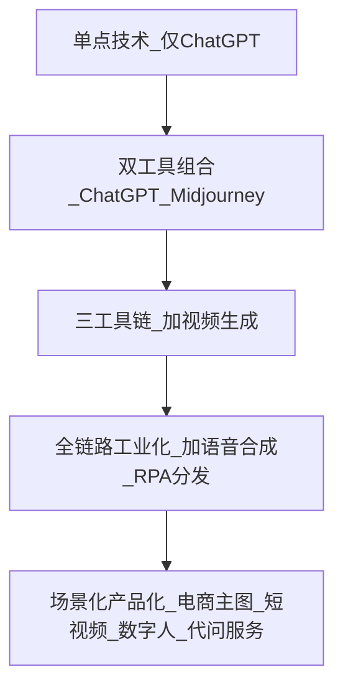
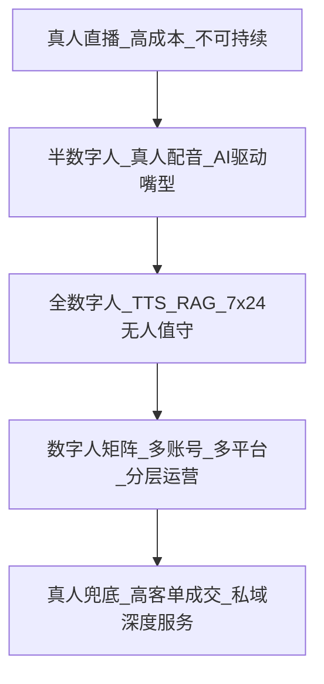
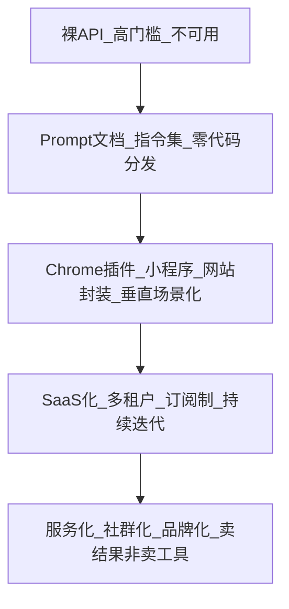
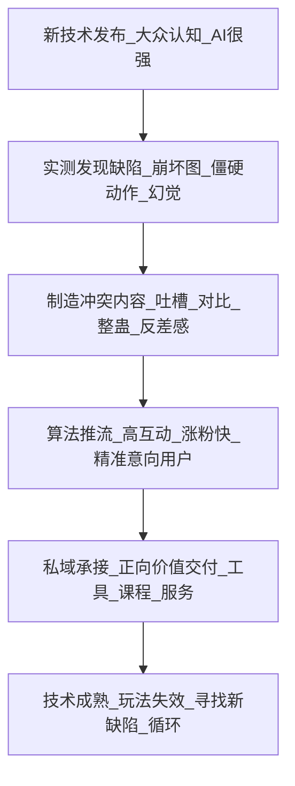
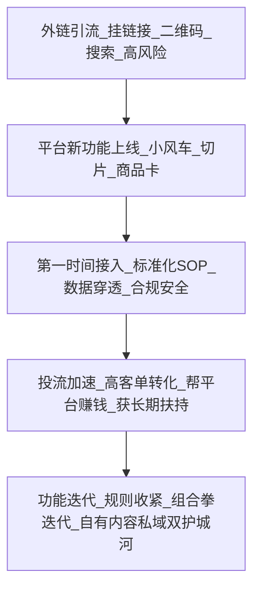
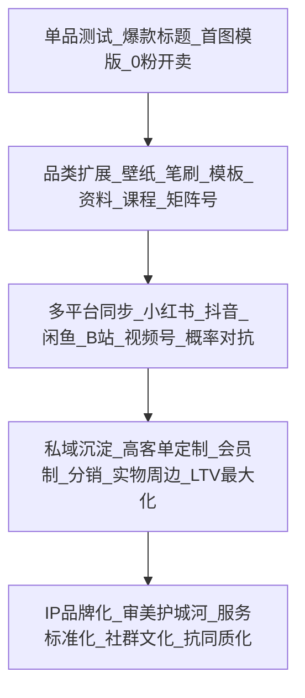
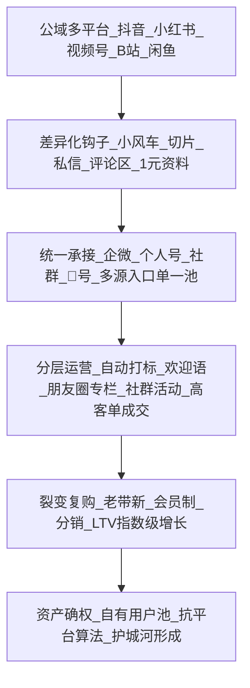

# 第 76 章 AIGC商业落地实战体系 —— 从"单点技术"到"场景化组合拳"

## 学习目标

- 理解AIGC工具组合拳的核心逻辑：场景化组合 > 单点技术
- 掌握AI数字人直播的低门槛搭建与变现模型（答案之书/服务型/低客单/玩偶服）
- 掌握AI套壳/Prompt工程变现的信息差红利与合规边界
- 学会利用认知差反向引流制造「丑/笨/假」内容反差获取精准流量
- 熟练运用平台原生工具闭环（小风车/切片/商品卡/原创授权）构建合规获客链路
- 建立虚拟资源矩阵变现体系：零边际成本数字产品的选品、分发、私域转化全流程
- 确立私域归宿论：所有公域玩法最终指向微信生态的LTV最大化运营
- 能根据自身资源匹配选择适合的赛道（宠物+AI/寺庙玄学/知识付费/闲鱼虚拟资料）

## 76.1 生活类比

想象AIGC商业落地是一场「工业革命式的餐厅升级」。单点AI工具就像只有厨师（ChatGPT）或只有食材（Midjourney），根本无法出完整菜品。AIGC一条龙工作流则是中央厨房流水线：厨师（LLM）设菜单、切配间（Diffusion）备食材、蒸箱（视频工具）出成品、传菜员（RPA）自动上桌、收银系统（私域）完成交易。AI数字人直播是不知疲倦的AI店长：7x24小时不倒班、标准化话术零失误、边际成本仅电费、配合小风车（自动导客进VIP群）、商品卡（桌上二维码点单）。认知差反向引流好比「厨房透明化」营销：故意展示切菜不整齐（智障图）、炒菜锅甩飞（崩坏手指）→ 食客围观吐槽「这也行？」→ 反而信任真实感 → 扫码进会员群。平台原生工具如同商场赠送的免费导流牌、会员卡、自助点餐机：官方背书、零违规风险、数据直通后厨、红利期3-6个月必抢先用。虚拟资源矩阵是零库存的数字菜单：壁纸、模板、课程像电子菜单一样零成本复制、无物流退货烦恼、矩阵号即分店同步上架、私域即会员体系长期复购。私域归宿论揭示：所有分店（公域）最终汇总到总部仓库（微信生态）。公域流量是租来的客流，私域用户才是自有的资产，LTV最大化靠高频触达（朋友圈推送）、信任背书（大厨推荐）、复购裂变（会员分销）。

## 76.2 概念地图

```mermaid
mindmap
  root((AIGC商业落地实战体系))
    核心生产力工具链
      AIGC一条龙工作流(P001)
        ChatGPT(脚本/代码) + Midjourney/SD(图像) + 视频生成 + 语音合成 + RPA
        场景：电商主图/短视频批量/数字人直播/代问服务
      AI数字人直播(P002)
        HeyGen/SadTalker/自研模型 + TTS + 知识库/RAG
        模式：答案之书/服务型/低客单/玩偶服本地团购
      AI套壳/Prompt工程变现(P003)
        Chrome插件/小程序/网站/Cursor封装API
        贩卖高质量Prompt/指令集(Shulex/Shortcut/500条合集)
      认知差反向引流(P004)
        利用文心一言智障图/AI缺陷制造冲突感
        吐槽/对比/整蛊 -> 高互动 -> 引流私域变现
    平台红利捕捉与合规闭环
      平台原生工具闭环(P005)
        小风车跳企微/视频号切片/原创授权/商品卡/直播分屏
        核心心法：帮平台赚钱获长期扶持，摒弃薅羊毛
      虚拟资源矩阵变现(P006)
        品类：壁纸/笔刷/模板/资料/课程/提示词
        路径：公域挂载交易组件或引流私域高客单复购
        典型：小红书0粉开卖/闲鱼1元资料引流/B站虚拟课程
    终局归宿与护城河
      私域归宿论(P007)
        公域仅为引流前端，私域为变现主场
        微信生态：个人号/社群/企微/视频号/👸号/小程序
      爆发式增长赛道验证(P008)
        AI课程/工具分销：确定性最高的卖铲人生意
        宠物+AI垂直赛道：高付费意愿/短决策链路
        视频号语音直播+高客单课程：非标服务标品化
        闲鱼1元虚拟资料：极低成本精准引流
        寺庙/玄学/情绪价值：焦虑变现+数字人7x24自动化
    理论基石
      场景化组合定理(T001)
      时差套利定理(T002)
      丑笨假即流量定理(T003)
      私域终局归宿定理(T004)
```

## 76.3 AIGC一条龙工作流 —— 让工具组合拳打出自动化生产线

### 76.3.1 为什么需要这个概念？

你可能已经体验过：只有ChatGPT写不出好提示词给Midjourney，只有Midjourney出不来可用的商业视频，只有视频没有分发渠道更是白忙。单一AI工具商业价值有限，无法解决完整的商业交付闭环。内容生产面临三大痛点：人力不足、效率低、质量不稳定。商业场景要求从选题、素材、成片到分发的全链路打通，单点技术无法支撑规模化变现。这就像只有一个厨师没有切配间、没有蒸箱、没有传菜员，餐厅根本开不起来。

> "AI一条龙创作，从脚本到图像到视频和音乐"
> 
> ——《风向标精选周刊 20230320-23》

> "用 ChatGPT 和 Midjourney 两个工具做了三体的角色图"
> 
> ——《风向标精选周刊 20230320-23》

> "AIGC 做 YouTube Shorts,一天可以生产半个月的视频量"
> 
> ——《风向标精选周刊 20230320-23》

> "通过 AI 生成图片制作视频，可以批量操作"
> 
> ——《风向标精选周刊 20230320-23》

### 76.3.2 核心定义

**AIGC一条龙工作流**将LLM(文本/逻辑)、Diffusion(图像/视频)、RAG/微调(垂直知识)、自动化脚本(工作流)针对具体商业场景组合封装。

**标准化流程**：
1. 选赛道（萌宠/三体/奶奶/简历/壁纸）
2. 训练/调用模型（LoRA/ControlNet/ChatGPT Prompt）
3. 批量产出素材（图/文/视频）
4. 多平台分发（小红书/抖音/B站/YouTube Shorts）
5. 引流私域或挂载商品/课程变现

**典型工具链**：
- ChatGPT：脚本、代码、文案、Prompt优化
- Midjourney/SD：图像生成、风格控制
- 视频生成工具：动态化、剪辑合成
- 语音合成：TTS配音、旁白
- RPA/自动化脚本：串联分发、数据采集

> "Stable Diffusion，摄影馆用以前拍的图训练一个模型"
> 
> ——《风向标精选周刊 20230320-23》

> "AI虚拟换装，可以用 Stable Diffusion，Controlnet ，Lora 来实现"
> 
> ——《风向标精选周刊 20230320-23》

> "小红书利用LoRa模型给人'拍写真'"
> 
> ——《风向标精选周刊 20230320-23》

> "帮助淘宝店家用 ChatGPT 和 AI 绘画完成服饰产品的拍摄"
> 
> ——《风向标精选周刊 20230320-23》

### 76.3.3 关键性质

下表总结了AIGC一条龙工作流的三大核心性质，它们决定了该模式能否从实验走向规模化商业落地。

| 性质 | 说明 |
|------|------|
| 场景化组合性 | 核心价值不在单一模型能力，而在"工具+流程+场景"的深度耦合 |
| 可复制可规模化 | 一旦SOP跑通，边际成本趋近于零，单人日产可达半个月视频量 |
| 非技术门槛友好 | 配合Cursor/插件/无代码平台，非程序员也能搭建"数字员工" |

### 76.3.4 典型例子

**三体角色图生产**：ChatGPT写提示词 + Midjourney出图 + 视频工具动态化 → YouTube Shorts批量分发

**AI虚拟换装电商**：Stable Diffusion + ControlNet + LoRA 训练模特模型 → 批量生成服装主图/视频，替代实拍摄影馆

**摄影馆数字化转型**：用历史照片训练LoRA模型 → 客户上传自拍 → 一键生成写真套图 → 私域高客单变现

### 76.3.5 边界条件

- 仅适用于标准化程度高、素材需求大、容错率较高的场景（壁纸、模板、简历、萌宠写真、简易带货视频）
- 高精度、强合规、重交互场景（医疗、法律、高端定制、实时直播答疑）仍需人工兜底或介入
- 平台风控升级（去重算法、虚拟内容打标、实名认证）可能随时切断自动化分发链路，需持续迭代对抗策略

### 76.3.6 方法演进图



---

## 76.4 AI数字人直播 —— 让虚拟分身实现7x24小时无人值守

### 76.4.1 为什么需要这个概念？

真人直播面临四大硬伤：主播稀缺、人力成本高、无法7x24小时在线、状态波动大。中小商家缺乏专业主播团队和供应链，直播带货门槛极高。平台推流机制偏好长时长、高频次、稳定性强的直播间，人力难以持续满足。

### 76.4.2 核心定义

**AI数字人直播**利用AI生成的虚拟形象（HeyGen、SadTalker、自研模型）替代真人出镜，配合TTS语音合成、知识库/RAG问答系统，实现无人值守或辅助直播。

**核心模式**：
- 数字人无人直播：答案之书、车牌估值、认领鸡别墅
- 服务型直播：避坑选品、调试设备、教做家务
- 低客单品直播：气球、鲜花、雨衣、玩偶服本地团购

**必配工具链**：小风车跳企微 + 直播分屏/商品卡 + 千川投流

> "抖音数字人 AI 直播开始，流量还不错"
> 
> ——《风向标精选周刊 20230320-23》

> "抖音数字人直播教学"
> 
> ——《风向标精选周刊 20230320-23》

> "AI虚拟换装，可以用 Stable Diffusion，Controlnet ，Lora 来实现"
> 
> ——《风向标精选周刊 20230320-23》

> "用 AI 工具生成奶奶的虚拟数字人"
> 
> ——《风向标精选周刊 20230320-23》

### 76.4.3 关键性质

下表概括了AI数字人直播的三大关键性质，揭示其低门槛与高风险并存的本质。

| 性质 | 说明 |
|------|------|
| 低门槛可复制 | 不露脸、场景简单、话术可标准化、素材可批量生产 |
| 边际成本极低 | 模型训练/配置一次，可无限时长复用，单账号日成本仅电费/服务器费 |
| 平台博弈属性 | 属灰白地带，依赖"去重"技术(镜像/变速/滤镜/叠加素材)对抗查重，风控收紧时生存周期缩短 |

### 76.4.4 典型例子

**答案之书直播**：3个棒棒糖翻页动画 + 文心一言/ChatGPT生成鸡汤文案 → 用户刷礼物提问 → 自动回复/引流私域

**数字人卖课**：虚拟形象讲婚姻/情感/人性课程 → 视频号助手切片分发 → 99元标准化课程售7000+份

**本地生活玩偶服**：穿玩偶服直播团购券 → 真人不出镜规避颜值/口才门槛 → 低成本撬动同城流量

> "抖音答案之书直播，3 个棒棒糖翻页"
> 
> ——《风向标精选周刊 20230320-23》

> "抖音直播卖服务：帮避坑买设备和调直播间设备"
> 
> ——《风向标精选周刊 20230320-23》

> "抖音卖气球直播带货门槛很低"
> 
> ——《风向标精选周刊 20230320-23》

> "抖音批发市场直播卖鲜花热人气超高！"
> 
> ——《风向标精选周刊 20230320-23》

> "抖音穿玩偶服饰，做本地团购"
> 
> ——《风向标精选周刊 20230320-23》

> "在「视频号助手」后台，可以直接「选择直播片段]，生成短视频"
> 
> ——《风向标精选周刊 20230320-23》

> "视频号语音直播婚姻 + 人性，99 块售 7000+ 份课程"
> 
> ——《风向标精选周刊 20230320-23》

### 76.4.5 边界条件

- 平台严打"无人直播/录播循环"，需持续升级去重技术(控制变量法单调整)或转型真人/半真人混播
- 交互复杂度受限：仅适配标准化问答/展示/引导，无法处理个性化深度咨询/售后纠纷/突发状况
- 信任转化上限低：高客单价/非标服务仍需真人背书，数字人多作为"流量入口/筛选漏斗"而非"成交主场"

### 76.4.6 方法演进图



---

## 76.5 AI套壳/Prompt工程变现 —— 卖铲人比淘金人更确定

### 76.5.1 为什么需要这个概念？

大模型API能力强但"裸奔"不可用：缺乏垂直知识、无交互界面、不会部署、合规风险高。终端用户（卖家/运营/学生）只有"焦虑"和"需求"，没有技术能力直接调用API。信息差红利期短，谁能率先封装好用的"垂直场景应用"或"高质量指令集"，谁就能收割第一波利润。

### 76.5.2 核心定义

**AI套壳/Prompt工程变现**基于GPT-3.5/4、Claude等API，封装Chrome插件/微信小程序/网站/Cursor编辑器等垂直场景应用，或贩卖高质量Prompt/指令集（如ChatGPT Shortcut、亚马逊插件Shulex、500条提示词合集）。

**核心逻辑**：信息差(知道怎么用) + 集成优势(帮用户配好环境/参数/流程) = 付费意愿

> "ChatGPT 套壳案例操作思路"
> 
> ——《风向标精选周刊 20230320-23》

> "免费试用ChatGPT，Cursor编辑器：内置GPT-4，支持自动写代码、智能问答。"
> 
> ——《风向标精选周刊 20230320-23》

> "ChatGPT 针对亚马逊卖家开发出一个谷歌插件 Shulex"
> 
> ——《风向标精选周刊 20230320-23》

> "ChatGPT 快捷指令表 ChatGPT Shortcut"
> 
> ——《风向标精选周刊 20230320-23》

> "注册SteamShip账号，GPT-4 接口免费用"
> 
> ——《风向标精选周刊 20230320-23》

### 76.5.3 关键性质

下表揭示了AI套壳/Prompt变现模式的三大核心性质，说明其为何能快速爆发却也面临极大不确定性。

| 性质 | 说明 |
|------|------|
| 极低边际成本 | 代码/提示词一次开发，无限复售，无物流/售后/库存压力 |
| 窗口期强时效性 | 模型迭代快(3.5→4→4o→o1)，提示词/应用需持续适配，先发优势极大 |
| 合规与平台双重风险 | API额度封号、平台下架插件/小程序、官方原生功能覆盖会瞬间归零价值 |

### 76.5.4 典型例子

**Shulex亚马逊插件**：封装ChatGPT做Listing优化/竞品分析/审核分析 → 年费订制制收割卖家红利

**ChatGPT Shortcut/提示词合集**：整理高频场景Prompt → 文档/网站/知识星球售卖 → 单价99-499元，复购率高

**Cursor编辑器/SteamShip**：内置GPT-4免费/低价用 → 以"工具免费+流量变现"或"套壳收费"截流开发者/小白

> "分销 AI 课程未来一年可能都是好市场"
> 
> ——《风向标精选周刊 20230320-23》

> "网易卖 ChatGPT 课程，主打办公场景"
> 
> ——《风向标精选周刊 20230320-23》

> "视频号语音直播婚姻 + 人性，99 块售 7000+ 份课程"
> 
> ——《风向标精选周刊 20230320-23》

> "ChatGPT 500 提示让您成为前 1% 的撰稿人"
> 
> ——《风向标精选周刊 20230320-23》

### 76.5.5 边界条件

- 官方原生功能迭代(如GPTs、Assistant API、插件商店)是核心毁灭性风险，属"借鸡生蛋"模式
- 无技术护城河：核心代码/提示词极易被破解/复制/反编译，护城河只能靠"运营服务/社群/品牌/持续迭代"构建
- 必须从"卖工具"进化为"卖服务/卖结果/卖社群"，否则极易陷入价格战与替代品竞争

### 76.5.6 方法演进图



---

## 76.6 认知差反向引流 —— 用「丑/笨/假」制造流量反差

### 76.6.1 为什么需要这个概念？

完美内容同质化严重，用户审美疲劳，互动率低。新技术早期必有缺陷(文心一言生图崩坏、SD手指错误、数字人僵硬)，大众认知停留在"AI很强"，制造认知冲突。吐槽/对比/整蛊类内容自带"猎奇/喜感/共鸣"三大传播因子，极易触发算法推流。

### 76.6.2 核心定义

**认知差反向引流**利用大众对新事物的刻板印象/认知偏差(如"文心一言生成图像质量差/智障")，制造冲突感内容获取高互动流量。

**核心打法**：逆向思维 → 吐槽/对比/整蛊生成内容 → 高互动/涨粉快 → 引流私域/挂载变现

**关键心理机制**：反差感(预期vs现实) + 确认偏误(我就知道不行) + 参与感(我也来吐槽) = 爆款公式

> "抖音吐槽百度文心出的图，自带喜感可引流"
> 
> ——《风向标精选周刊 20230320-23》

> "逆向思维，利用百度文心一格的智障AI图引流互动"
> 
> ——《风向标精选周刊 20230320-23》

> "小红书可以做吐槽文心生产的内容，热度高，涨粉快"
> 
> ——《风向标精选周刊 20230320-23》

> "逆向思维：大家的共识都是 GP T哪怕 3.5 都比文心一言强，可以制造更热的话题"
> 
> ——《风向标精选周刊 20230320-23》

### 76.6.3 关键性质

下表说明了认知差反向引流的三大关键性质，指出其属于技术缺陷套利的窗口期红利。

| 性质 | 说明 |
|------|------|
| 窗口期红利 | 仅在技术成熟前有效(文心一言4.0发布后该玩法失效)，属"技术缺陷套利" |
| 低成本高产出 | 无需精心策划，直接录屏/截图/对比即可，单条内容成本极低 |
| 引流精准度高 | 参与互动者多为"关注AI/有焦虑/想学技能/愿付费"的高意向人群 |

### 76.6.4 典型例子

**吐槽文心一言生成"智障图"**：录屏对比GPT-4/Midjourney同提示词效果 → 标题"百度这也行？" → 评论区挂联系方式/引流私域卖AI课程/工具

**小红书吐槽文心内容**：同步发布吐槽笔记 → 热度高涨粉快 → 简介挂链接引流私域变现

**寺庙/玄学赛道反差**：科技感数字人算命/答案之书翻页 → 传统玄学场景碰撞 → 年轻群体疯狂转发打卡

> "抖音答案之书直播，3 个棒棒糖翻页"
> 
> ——《风向标精选周刊 20230320-23》

> "抖音寺庙视频，捐赠链接募捐"
> 
> ——《风向标精选周刊 20230320-23》

> "抖音道家直播场景，在线人数八千多"
> 
> ——《风向标精选周刊 20230320-23》

> "寺庙卖咖啡火的原因就是反差感"
> 
> ——《风向标精选周刊 20230320-23》

### 76.6.5 边界条件

- 必须"打完收工"，不能长期依赖吐槽建立IP，否则人设崩塌、用户反感、平台判定低质内容限流
- 需快速切换到"正向价值交付"(教工具/卖课程/做服务)，吐槽仅作冷启动破冰手段
- 法律/合规红线：避免侵犯商标/诽谤主体，建议用"体验报告/避坑指南/对比测评"合规话术包装

### 76.6.6 方法演进图



---

## 76.7 平台原生工具闭环 —— 顺势而为吃平台红利

### 76.7.1 为什么需要这个概念？

外链引流(挂链接/引导搜索/二维码)被平台严打，封号/限流/断链是常态。平台新功能初期自带流量扶持、规则宽松、竞争少，是"平台补贴商家"的黄金期。官方工具打通"公域获客-私域转化-交易闭环"全链路，数据回流、合规安全、转化率高。

### 76.7.2 核心定义

**平台原生工具闭环**第一时间测试、组合、标准化平台新功能：小风车跳企微、视频号助手切片、原创授权、商品卡、直播分屏、虚拟课程商品。

**构建标准化动作SOP**：开通功能 → 设置钩子/话术/商品 → 投流/自然流跑量 → 数据复盘 → 迭代优化

**核心心法**：帮平台赚钱(投流/高客单转化/留存用户) → 获平台长期扶持，摒弃"薅羊毛"短视思维

> "抖音小风车可以直接跳转企业微信了"
> 
> ——《风向标精选周刊 20230320-23》

> "在「视频号助手」后台，可以直接「选择直播片段]，生成短视频"
> 
> ——《风向标精选周刊 20230320-23》

> "抖音矩阵号，上线原创作者视频授权能力"
> 
> ——《风向标精选周刊 20230320-23》

> "抖音直播视频和商品展示分屏展示，边去重边吸引用户下单"
> 
> ——《风向标精选周刊 20230320-23》

> "抖音千川官方推出了商品卡的详细使用攻略"
> 
> ——《风向标精选周刊 20230320-23》

### 76.7.3 关键性质

下表列出了平台原生工具闭环的三大关键性质，说明为何必须第一时间上车且不能过度依赖单一功能。

| 性质 | 说明 |
|------|------|
| 合规安全 | 官方背书，无封号/限流/断链风险，账号资产可长期沉淀 |
| 数据穿透 | 平台后台可直接看转化漏斗(点击→加微→下单)，归因准确，利于优化ROI |
| 红利窗口短 | 通常3-6个月，功能普及后流量扶持收回、竞争加剧、规则收紧，需持续追新功能 |

### 76.7.4 典型例子

**抖音小风车跳企微**：直播间/视频/主页挂小风车 → 用户点击直接加企微 → 无需跳转/搜索/复制，转化率提升3-5倍

**视频号助手切片**：长直播一键生成短视频分发 → 公域获客 → 直播间承接高客单课程(99元售7000+份) → 内容资产复用率极高

**抖音原创授权/商品卡**：矩阵号互授权规避搬运判重 + 商品卡详情页直接下单 → 免费流量+付费流量双轮驱动

### 76.7.5 边界条件

- 仅适用于该平台生态内闭环，跨平台引流(抖音→微信/小红书→微信)仍需外链/钩子方案
- 平台规则随时变：小风车曾限粉丝量/主体类型，商品卡曾限类目/佣金，需实时跟进政策调整打法
- 功能依赖症：过度依赖单一功能(如仅靠小风车)极其脆弱，必须构建"功能组合拳+自有内容/私域"双护城河

### 76.7.6 方法演进图



---

## 76.8 虚拟资源矩阵变现 —— 零边际成本的复利印钞机

### 76.8.1 为什么需要这个概念？

实物电商面临五大痛点：选品难、库存压、物流慢、售后烦、退货率高，现金流压力大。知识付费/服务类依赖"人"的时间，难规模化，天花板低。虚拟资源(壁纸/笔刷/模板/资料/课程/提示词)零成本复制、无物流、无售后、可无限复售，利润率趋近100%。

### 76.8.2 核心定义

**虚拟资源矩阵变现**将高需求、标品化、零边际成本的数字产品，通过矩阵号(小红书/抖音/闲鱼/B站/视频号)分发。

**变现路径**：公域挂载交易组件(小黄车/商品卡/专栏/工房集市)直接成交，或引流私域(微信/社群)高客单复购。

**核心品类**：壁纸/头像/Procreate笔刷/CapCut模板/认证资料/简历模板/考证资料/AI提示词/虚拟课程

> "小红书手机壁纸整合一下类别，可以打包出售"
> 
> ——《风向标精选周刊 20230320-23》

> "小红书画画 Procreate 笔刷销量挺高的"
> 
> ——《风向标精选周刊 20230320-23》

> "闲鱼 1 元获得支付宝（车房产）六套认证资料"
> 
> ——《风向标精选周刊 20230320-23》

> "小红书专栏的销量,个人提升、亲子、情感类的内容遥遥领先"
> 
> ——《风向标精选周刊 20230320-23》

> "B 站开通虚拟课程商品功能"
> 
> ——《风向标精选周刊 20230320-23》

> "B 站开通了工房集市"
> 
> ——《风向标精选周刊 20230320-23》

### 76.8.3 关键性质

下表概括了虚拟资源矩阵变现的三大核心性质，揭示其高利润背后的运营逻辑与风险点。

| 性质 | 说明 |
|------|------|
| 非标品标品化 | 把定制化服务(写真/设计/咨询)拆解为标准化数字交付物(预设/模板/教程/成品库) |
| 矩阵化分发 | 单账号上限低，多账号(10-100+)多平台同步分发，用概率对抗单点不确定性 |
| 私域为王 | 公域流量不稳定，必须沉淀私域做长期LTV(会员制/分销/高客单服务/实物周边) |

### 76.8.4 典型例子

**小红书壁纸/笔刷/模板**：爆款标题/首图模版 + 挂载商品链接 → 0粉开卖 → 单价9.9-99元 → 月入数万

**闲鱼1元认证资料/教程**：搜索意图极强用户 + 零成本复制 + 1元建立信任加微 → 私域转化高客单代办/咨询/淘客

**B站/视频号虚拟课程**：专栏/工房集市/小店挂载 → 平台分发算法推流 → 99元课程售7000+份 → 纯利润

**宠物+AI写真**：AI生成引流图(猫咪穿汉服/宇航服) → 私域定制单价可控 → 实物周边(服装/画框)二次变现

> "小红书 0 粉图文带货最新的 120个爆款笔记标题关键词"
> 
> ——《风向标精选周刊 20230320-23》

> "小红书资料引流笔记"
> 
> ——《风向标精选周刊 20230320-23》

> "小红书通过 AI 绘画自动生成简历等资料，可引流"
> 
> ——《风向标精选周刊 20230320-23》

> "小红书宠物粉群体大，AI 绘画宠物赛道可以吸引精准的宠物粉"
> 
> ——《风向标精选周刊 20230320-23》

> "小红书AI 绘画专门做萌宠，粉丝5000+"
> 
> ——《风向标精选周刊 20230320-23》

> "小红书卖宠物服装，利润很高"
> 
> ——《风向标精选周刊 20230320-23》

> "闲鱼做拼多多帮人拼团，可引流做淘客"
> 
> ——《风向标精选周刊 20230320-23》

> "闲鱼上引流操作思路分享"
> 
> ——《风向标精选周刊 20230320-23》

### 76.8.5 边界条件

- 版权/合规红线：严禁售卖盗版课程/破解软件/侵权IP/违禁资料，账号/店铺/主体资质易被永封
- 平台抽成/规则变：小红书/抖音/视频号抽佣10%-20%+提现手续费，虚拟类目保证金高、审核严、随时下架
- 同质化竞争极烈：门槛低导致"模板/壁纸/资料"红海价格战，必须建立"IP/审美/服务/社群"差异化护城河

### 76.8.6 方法演进图



---

## 76.9 私域归宿论 —— 公域流量的终点是微信生态

### 76.9.1 为什么需要这个概念？

公域流量(抖音/小红书/视频号/B站/知乎)具有本质属性：算法不可控、用户不属于你、获客成本递增、随时限流。高客单价/非标服务/长周期决策/复购型业务，无法在公域直接成交，必须沉淀私域建立信任。微信生态(个人号/社群/企微/视频号/👸号/小程序)是唯一支持高频触达、深度沟通、支付闭环、裂变增长的成熟体系。

### 76.9.2 核心定义

**私域归宿论**：所有公域玩法(内容引流/直播挂载/小风车/切片/低价虚拟品/朋友圈投流)的最终目的，均为沉淀至微信个人号/社群/企业微信。

**私域运营核心动作**：高频触达(朋友圈/群发/群公告) + 信任建立(专业人设/案例/背书) + 复购转化(课程/服务/实物/会员/分销) = LTV最大化

**公域仅为"引流前端/漏斗入口"，私域才是"变现主场/资产沉淀/护城河所在"**

> "小红书ChatGPT 代问笔记，可引流私域"
> 
> ——《风向标精选周刊 20230320-23》

> "抖音小风车可以直接跳转企业微信了"
> 
> ——《风向标精选周刊 20230320-23》

> "小红书沙滩限量无偿代写，引流到微信做定制变现"
> 
> ——《风向标精选周刊 20230320-23》

> "朋友圈投放小样广告，可引流私域二次变现"
> 
> ——《风向标精选周刊 20230320-23》

> "高端家政服务，通过抖音、小红书、B站等公域平台分发视频引流到私域"
> 
> ——《风向标精选周刊 20230320-23》

> "抖音直播认领鸡别墅，转私域能力很强"
> 
> ——《风向标精选周刊 20230320-23》

> "视频号语音直播婚姻 + 人性，99 块售 7000+ 份课程"
> 
> ——《风向标精选周刊 20230320-23》

> "闲鱼 1 元获得支付宝（车房产）六套认证资料"
> 
> ——《风向标精选周刊 20230320-23》

> "闲鱼做拼多多帮人拼团，可引流做淘客"
> 
> ——《风向标精选周刊 20230320-23》

### 76.9.3 关键性质

下表总结了私域归宿论的三大关键性质，阐述为何微信生态是所有公域玩法的终极归宿。

| 性质 | 说明 |
|------|------|
| 全渠道汇聚 | 无论流量来自哪个平台，终点统一指向微信生态，形成"多源入口、单一池、分层运营"模型 |
| 资产确权性 | 微信好友/社群/企微联系人属于账号主体资产(虽有封号风险)，而公域粉丝属平台资产随时收回 |
| 复利周期长 | 私域用户生命周期可达年级，复购率/推荐率/客单价随信任积累指数级增长，公域单次转化为主 |

### 76.9.4 典型例子

**视频号切片引流** → 企微/个人号 → 99元婚姻课程售7000+份 → 复购高阶咨询/社群/实物

**小红书AI壁纸/资料** → 引导主页/粉丝群/私信加微 → 私域转化定制写真/会员/周边

**闲鱼1元资料** → 加微信 → 私域转化代办/咨询/淘客返利/高客单服务

**抖音直播/短视频** → 小风车/粉丝群/评论区钩子 → 企微/个人号 → 高端家政/相亲/陪诊服务成交

### 76.9.5 边界条件

- 微信生态封号/限流风险存续：个人号加人频控、企微认证成本、社群活跃度维护难、裂变易判诱导分享
- 私域运营重运营、重服务、重人设，边际成本不为零，需标准化SOP/内容库/工具支撑，否则人效极低
- 公域平台反私域趋势加剧：抖音/小红书/视频号均在构建站内交易闭环(小店/直播间下单/平台客服)，试图切断外链引流

### 76.9.6 方法演进图



---

## 76.10 素材溯源说明

本章全部内容均源自单一核心素材文档《生财有术·风向标精选周刊 20230320-23》（文件路径：docs/202303/MZqUdSJumoQZwtxLCatcDJ1snze.md）。该周刊汇总了社群内AIGC工具落地、平台流量玩法、服务套利与商业认知变现的实战案例，构成了本章概念体系、方法论、典型案例与理论基石的完整素材库。因仅有一份核心素材，不存在多源冲突与对照场景，特此说明素材来源以供溯源验证。

---

## 76.11 设计中的取舍

为什么不采用"全自动化无人运营"方案？因为平台风控对"完全无人"零容忍，账号存活周期极短（天级）。保留"人工巡检+AI生产"的半自动化模式，虽增加人力成本，但能将账号生命周期延长至月级甚至年级，ROI反而更高。

这种设计的 trade-off 在于：效率与生存的博弈——全自动日产1000条但存活3天，半自动日产200条但存活3个月，后者总产出更高；广度与深度的权衡——矩阵号覆盖5平台但单号权重低，单号深耕1平台权重高但抗风险弱，需"主号深耕+矩阵试错"双轨并行；标准化与个性化的张力——SOP标准化便于复制但同质化严重，个性化内容建信任但难规模，采用"标准化素材+个性化钩子"混合策略平衡两端。

---

## 76.12 动手练习

### 练习 1：设计一个AIGC一条龙工作流SOP

**场景**：帮本地婚纱摄影馆实现「AI虚拟试穿」引流获客

1. 拆解工具链：选型ChatGPT(话术/文案) + Midjourney/SD(生成试穿图) + 视频工具(动态化) + RPA(分发)
2. 设计Prompt模板：新娘/新郎面部特征提取 → 婚纱风格LoRA训练 → 场景化合成(教堂/草坪/海边)
3. 制定批量产出标准：单套婚纱生成10张精修图+3个15秒短视频，日产5套婚纱素材
4. 规划分发矩阵：小红书(种草图文) + 抖音/视频号(短视频) + 闲鱼(低价引流) → 统一引流企微

**回答问题**：
- 该工作流的核心技术瓶颈在哪里？(提示：人脸一致性/婚纱细节/肤色融合)
- 如何用「控制变量法」快速迭代优化出图质量？
- 平台风控升级(去重/虚拟内容打标)时，如何调整分发策略？

### 练习 2：复盘一个「认知差反向引流」实战案例

**案例**：吐槽文心一言生成「智障图」引流卖AI绘画课程

1. 梳理完整链路：选题切入点 → 内容制作形式(录屏/对比图/标题) → 发布平台/时间 → 互动引导话术 → 私域承接产品 → 转化数据
2. 识别关键心理触发点：反差感(预期vs现实) + 确认偏误(我就知道不行) + 参与感(我也来吐槽) + 焦虑转化(想学真技术)
3. 评估窗口期生命周期：文心一言4.0发布前后该玩法有效期约几周？何时必须切换到「正向价值交付」？

**回答问题**：
- 为什么「吐槽百度」比「夸Midjourney」更容易爆款？
- 如何规避「诽谤/侵权」法律红线？(提示：用「体验报告/避坑指南/对比测评」话术包装)
- 该玩法失效后，如何利用积累的私域流量做二次变现？

### 练习 3：搭建「平台原生工具闭环」标准化动作包

**目标**：为某知识付费项目(如ChatGPT提示词课程)配置视频号+抖音双平台原生工具闭环

1. 视频号端：开通视频号助手 → 设置直播切片自动分发 → 配置小店挂载99元课程 → 直播间挂小风车跳企微
2. 抖音端：开通商品卡/原创授权 → 矩阵号互授权规避搬运 → 直播分屏展示课程大纲 → 千川投流测试ROI
3. 私域端：企微欢迎语挂载课程大纲/免费试听 → 朋友圈专栏化运营(观念/案例/生活/附加价值) → 社群分层运营(免费群/付费群/高客单服务群)

**回答问题**：
- 视频号切片与抖音原创授权的核心区别是什么？(提示：内容资产复用 vs 矩阵去重)
- 当平台收紧规则(如小风车限粉丝量/商品卡限类目)时，如何快速迁移打法？
- 如何量化评估「帮平台赚钱」的程度？(提示：投流金额/客单价/留存时长/完课率)

### 练习 4：规划一个「虚拟资源矩阵变现」项目

**前提**：你有10个闲置小红书账号(0-500粉)，擅长AI绘画，想卖Procreate笔刷/壁纸/简历模板

1. 选品验证：用5118/微信指数/后裔采集器挖掘「Procreate笔刷/手机壁纸/简历模板」长尾词搜索量、竞品销量、价格带
2. 素材生产SOP：AI批量生成(ControlNet控制构图) → 醒图二创(改尺寸/滤镜/镜像) → 打包分类(笔刷包/壁纸合集/模板库) → 定价策略(单品9.9/套装29.9/会员99)
3. 矩阵分发策略：10号轮流发、错峰发、同素材异标题/异首图、评论区置顶钩子(扣1领样品) → 引流私域转化高客单定制服务

**回答问题**：
- 如何用「低粉高互动选题爬虫法」1:1复刻超越竞品爆款？
- 小红书虚拟类目保证金/审核/抽成规则是什么？如何规避下架风险？
- 当同质化价格战来临(9.9包邮)，如何建立「IP/审美/服务/社群」差异化护城河？

### 练习 5：推演「私域归宿论」下的全域流量汇聚模型

**假设**：你同时运营抖音(1万粉)、小红书(5千粉)、视频号(3千粉)、B站(2千粉)、闲鱼(50号矩阵)

1. 设计差异化钩子：抖音(直播小风车/切片) → 小红书(笔记挂载/粉丝群/私信) → 视频号(直播切片/主页/视频号助手) → B站(简介/动态/私信) → 闲鱼(1元虚拟资料/咸鱼小店)
2. 统一承接容器：企业微信(认证5万好友上限) + 个人微信(高频触达) + 社群(分层运营) + 👸号(长文沉淀)
3. 制定分层运营SOP：新进好友→自动打标(来源/意向)→欢迎语分发钩子→朋友圈专栏化触达→社群活动转化→高客单1v1成交→裂变激励老带新

**回答问题**：
- 如何解决「微信生态封号/限流/加人频控」的物理瓶颈？(提示：账号矩阵/物理隔离/行为模拟/合规话术)
- 公域平台反私域趋势加剧(站内交易闭环)，如何平衡「公域变现」与「私域引流」的资源分配？
- 如何量化各渠道引流ROI？(提示：UTM参数/专属邀请码/薯店数据/自建后台埋点穿透全链路)

---

## 76.13 本章小结

这一章中我们系统学习了AIGC商业落地的完整实战体系。首先我们理解了**AIGC一条龙工作流**的核心逻辑：单点技术无商业价值，唯有场景化组合才能形成可复制的自动化生产线；其次我们掌握了**AI数字人直播**的低门槛搭建与四大变现模式，理解了其属灰白地带需持续对抗去重的本质；接着我们拆解了**AI套壳/Prompt工程变现**的信息差红利与合规边界，明确了"卖铲人"模式的时效性与进化方向；然后我们学会了利用**认知差反向引流**制造"丑/笨/假"内容反差获取精准流量，识别了其属技术缺陷套利的窗口期属性；随后我们熟练运用**平台原生工具闭环**构建合规获客链路，确立了"帮平台赚钱获扶持"的共生心法；之后我们建立了**虚拟资源矩阵变现**体系，掌握了零边际成本数字产品的选品、分发、私域转化全流程；最后我们确立了**私域归宿论**，认清公域为引流前端、私域为变现主场的终局格局。

本章我们一起学习了以下概念：

| 概念 | 解释 |
|------|------|
| AIGC一条龙工作流 | LLM+Diffusion+视频+语音+RPA场景化组合，而非单点技术，形成可复制可规模化的自动化生产线 |
| AI数字人直播 | 虚拟形象+TTS+知识库实现7x24低成本直播，模式含答案之书/服务型/低客单/玩偶服，属灰白地带需持续对抗去重 |
| AI套壳/Prompt变现 | 封装API为垂直应用(插件/小程序)或贩卖指令集，靠信息差+集成优势收割红利，核心风险为官方原生功能迭代覆盖 |
| 认知差反向引流 | 利用大众对AI刻板印象(文心智障图)制造冲突感内容(吐槽/对比)，获高互动精准流量，属技术缺陷套利窗口期红利 |
| 平台原生工具闭环 | 第一时间用小风车/切片/商品卡/原创授权等官方功能，合规安全、数据穿透、帮平台赚钱获扶持，红利窗口短需持续追新 |
| 虚拟资源矩阵变现 | 壁纸/笔刷/模板/资料/课程等零边际成本数字产品，矩阵号多平台分发，公域挂载/私域转化，利润率近100%但需防版权/同质化 |
| 私域归宿论 | 所有公域玩法终点统一指向微信生态(个人号/社群/企微)，公域为引流前端，私域为变现主场与资产沉淀，LTV靠高频触达+信任+复购 |
| 场景化组合定理(T001) | 单一AI工具商业价值有限，唯有针对具体场景组合LLM/Diffusion/RAG/自动化脚本，才能形成产品化交付能力 |
| 时差套利定理(T002) | 流量红利本质=平台新功能扶持期与用户新认知滞后期的重叠，最先构建「功能+认知」打法者吃最大红利 |
| 丑笨假即流量定理(T003) | 早期AI缺陷(崩坏图/僵硬动作)产生反差感/喜感/猎奇感，比完美内容更易传播，属技术成熟前窗口期红利 |
| 私域终局归宿定理(T004) | 公域流量算法不可控/不属于你/成本递增，高客单/非标/长周期业务必须沉淀微信生态实现LTV最大化 |

下一章中，我们将学习如何构建个人知识管理体系，从"囤积焦虑"走向"内化进化"，掌握问题导向输入、多维标签组织、分阶段沉淀、定期规整断舍离、实践输出内化的完整方法论。

