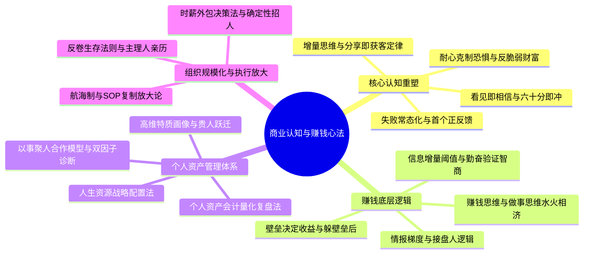

# 第 66 章 商业认知与赚钱心法 —— 从“刷题找捷径”到“构建壁垒做增量”

## 学习目标

- 理解增量思维与分享即获客定律的复利逻辑
- 掌握失败常态化与首个正反馈构建成功惯性的机制
- 理解看见即相信与六十分即冲原则降低行动门槛的心法
- 掌握壁垒决定收益与躲壁垒后策略的二元赚钱路径
- 理解赚钱思维与做事思维水火相济的双核进阶模型
- 掌握情报梯度与接盘人逻辑进行高质量投资决策的方法
- 掌握个人资产会计量化复盘法把自己当公司管
- 理解人生资源战略配置法优化时间精力健康家庭的资产组合
- 识别高维特质画像并掌握贵人跃迁实现非线性增长的路径
- 理解耐心克制恐惧与反脆弱财富的底层逻辑
- 掌握以事聚人合作模型与合作失败双因子诊断工具
- 理解信息增量阈值与勤奋验证智商前置论的认知升级机制
- 掌握航海制与SOP复制放大论实现标准化规模化
- 掌握时薪外包决策法与确定性招人准则买回高价值时间
- 理解反卷生存法则与主理人亲历原则的组织生存策略

## 66.1 生活类比

想象商业认知升级是一场RPG游戏的修仙之路：你初入江湖（新手村），若走“存量博弈”老路，便是野外刷怪拼手速，永远卷不过氪金大佬；若悟得“增量思维”，便开启了开放地图模式——分享攻略不减经验反而吸引队友组队刷本，形成越分享越幸运的复利飞轮。前路必经“失败常态化”副本，十之八九翻车是常态，但一次出货（首个正反馈）便能确立信心，小成功是成功之母，成功自带惯性。你不必等“因为相信所以看见”，只需在航海实战中“看见即相信”，见过大佬过关、见过微小结果，便敢信自己能过，六十分装备即冲，不等毕业装。赚钱本质是稀缺，稀缺源于壁垒：无壁垒是红海野外刷怪，有壁垒是稀有装备护体；普通人自造神装太难，不如“躲壁垒后”——抱大腿进公会分红利，核心看清“接盘人”画像。修行需双修：纯指挥不下场（赚钱思维）易成云玩家，纯莽不谋略（做事思维）上限低，水火相济才是版本答案。情报像听风辨位：离策划（规则制定者）越近情报越准，投资本质看谁接盘。角色面板量化（个人资产会计）让时间、健康、技能、颜值、人脉打分制，每年结算总资产增减，不进则退。属性点加点（人生资源配置）讲究策略：20-30岁全加智力/敏捷（投资自我），30-40岁体质/智力平分，40+全加体质/幸运（稳健复利）。洗髓伐毛换骨（高维特质）需谦虚好学反常规松弛直击本质，线性刷怪+高维带飞=跨越式升级。标准化速通路线（航海制/SOP）有手册+带练教练+组队圈友，跟着走即可拿首杀。雇佣NPC挂机（时薪外包/确定性招人）：主C时薪2000雇NPC时薪100刷材料，主C腾出时间打BOSS（战略）。避开万人坑自带干粮（反卷生存/主理人亲历）：拒绝纯肝红海，走认知/资源/品牌门槛赛道；团长必须亲自看地图（一线信息）不能只听汇报。

## 66.2 概念地图

## 66.3 增量思维与分享即获客定律 —— 越分享越幸运的复利逻辑

### 为什么需要这个概念？

普通人误以为分享经验会培养竞争对手，导致闭门造车、错失资源链接。在非存量博弈、可无限扩容的增量市场中，公开分享反而能筛选同频者、吸引优质项目、建立个人品牌。这是打破“零和博弈”思维定势、实现认知跃迁的核心杠杆。

### 核心定义

> **增量生意**：非存量博弈、可无限扩容的业务模式
> **分享即获客**：在增量市场中，公开分享经验不稀释利益，反而作为最低成本营销手段筛选同频合伙人、吸引资源

> "如果做的不是存量生意，而是增量生意，越分享越幸运"
> 
> ——《docs/202303/TZZwdy53eofCYQxu2xucdoV1nod.md, p.1》

这个定义展示了商业模式的两种本质形态：存量生意中分享即让利，增量生意中分享即增值。你要做的第一件事，是判断自己身处哪种生意。

### 关键性质

**复利效应**：分享越多，链接的高质量节点越多，信息流入质量越高，形成正向飞轮。

**信任前置**：通过持续输出建立专业人设，降低后续合作、融资、招聘的信任建立成本。

### 典型例子

**案例 1：亦仁的信息处理复利**
亦仁每日半小时处理常人3-4小时信息量，源于长期公开分享建立的“信息增量阈值”模式识别能力。【docs/202303/TZZwdy53eofCYQxu2xucdoV1nod.md, p.15】

**案例 2：家蒙知乎好物坚持深耕**
前3月仅入账1.37元坚持深耕单一赛道，后年入百万，验证“耐受时间”与“单点突破”。【docs/202303/TZZwdy53eofCYQxu2xucdoV1nod.md, p.8】

### 边界条件

- 仅适用于增量市场（非存量博弈）；存量市场中分享可能直接稀释蛋糕
- 需具备持续输出高质量内容的能力，“水贴”式分享无法建立专业信任资产
- 核心商业机密（如独家供应链、核心算法）不在分享范围内

### 分享即获客定律（来源：《docs/202303/TZZwdy53eofCYQxu2xucdoV1nod.md》）

在增量市场中，公开分享赚钱经验不会造成竞争损耗，反而能作为筛选同频合伙人、吸引优质项目、建立个人品牌的最低成本营销手段。

**推导过程**：  
1. **前提判断**：商业模式分为存量博弈（蛋糕固定，分享=让利）与增量博弈（蛋糕可无限做大，分享=扩容）。  
2. **机制分析**：增量市场中，核心稀缺非“信息”而是“执行力/资源/信任”。公开分享经验（信息）边际成本趋近零，却能筛选同频高执行力者、吸引互补资源方、沉淀专业信任资产。  
3. **飞轮形成**：分享→吸引同频/资源/信任→获得更优质项目反馈→产出更高质量分享→循环。  
4. **结论**：越分享，节点越多，信息增量阈值越易跨越，复利越强。

**作用**：该定律为“公开输出”提供了底层逻辑支撑，指导从业者在增量赛道中将“分享”转化为“获客/融资/招聘/合伙”的最低成本杠杆，避免陷入“教会徒弟饿死师父”的零和博弈恐惧。

---

## 66.4 失败常态化与首个正反馈 —— 成功惯性的起点是“赚到第一块钱”

### 为什么需要这个概念？

普通人因恐惧失败而不敢尝试，或因一次挫折就全盘否定自我，陷入“避免失败”而非“追求成功”的防御心态。接受“十之八九失败”为常态，可消除恐惧，将精力转向增加试错次数与容错率。“赚到第一块钱”非钱本身，而是打破“上班/专家”固有认知路径，确立“相信才能做到”的心智基石。

### 核心定义

> **失败常态化公理**：赚钱项目成功率天然低（十之八九失败），接受失败为常态，成功视为多元素叠加的概率事件
> **首个正反馈**：从0到1赚到的第一块钱及其带来的信心确立，是成功惯性的起点，小成功是成功之母

> "失败是常态，十之八九。如果你有这个预期，做很多事情都不会怕失败，反而觉得成功是多元素加持运气值。"
> 
> ——《docs/202303/TZZwdy53eofCYQxu2xucdoV1nod.md, p.2》

> "最重要的是第一个正反馈，赚到第一块钱，不只是钱，你赚到了信心。因为相信才能做到。小成功才是成功之母，成功是有惯性的。"
> 
> ——《docs/202303/TZZwdy53eofCYQxu2xucdoV1nod.md, p.2》

这两段话揭示了心理建设的两个层面：宏观上建立“失败=常态”的概率思维，微观上捕捉“首单=信心”的认知锚点。

### 关键性质

**认知重构**：从“怕失败”转向“多试错”，心力像肌肉一样被难题“撑开”，形成“都经历过，不过如此”的抗压韧性。

> "你做的事情越大，遇到的难题越大。心力不断被撑开。经历多了，格局打开，很多事情“都经历过，不过如此”，抵抗力自然就强了，就像体育锻炼一样。"
> 
> ——《docs/202303/TZZwdy53eofCYQxu2xucdoV1nod.md, p.3》

这个“心力撑开机制”解释了为什么经历过大风浪的人，面对新挑战时底气更足。

**惯性效应**：一旦跑通首个闭环，后续复制放大阻力显著降低，进入“成功有惯性”的正向循环。

### 典型例子

**案例 1：家蒙知乎好物**
前3月收入1.37元未放弃，耐受期后年入百万。【docs/202303/TZZwdy53eofCYQxu2xucdoV1nod.md, p.8】

**案例 2：郑小焦酒店经理跃迁**
传统酒店经理通过社群链接大佬（贵人），实现认知与身份跨越，验证“线性努力+高维链接=非线性增长”。【docs/202303/TZZwdy53eofCYQxu2xucdoV1nod.md, p.16】

### 边界条件

- 试错成本必须在可承受范围内（如时间、小额资金），不可赌上生存筹码
- 需配合“复盘沉淀”，单纯试错不总结等于在原地打转
- “首个正反馈”必须来自真实市场交易（陌生人付费），而非亲友捧场

### 失败常态化公理（来源：《docs/202303/TZZwdy53eofCYQxu2xucdoV1nod.md》）

赚钱项目的成功率天然低（十之八九失败），接受失败为常态可消除恐惧，将精力从“避免失败”转移至“增加试错次数与容错率”，成功视为多元素叠加的概率事件。

**推导过程**：  
1. **观察事实**：赚钱项目涉及选品、流量、转化、交付、复购等多环节，任一环节卡顿即导致失败，成功需全链路打通，概率天然低。  
2. **心理机制**：普通人将失败内化为“我不行”，产生防御性回避；高手将失败外化为“该环节未跑通”，产生针对性复盘。  
3. **策略转换**：预设“十之八九失败”，单次试错成本控制在可承受范围，通过增加试错频次（N次）提升至少一次成功的概率 1-(0.9)^N。  
4. **结论**：失败是常态，成功是多元素叠加加持运气的低概率事件，接纳常态化即获得行动自由度。

**作用**：该公理重塑了“失败”的语义，将其从“否定自我”重构为“校准路径”的必要成本，配合“首个正反馈”机制，构建了低成本试错、快速迭代、捕捉成功惯性的完整心智模型。

---

## 66.5 看见即相信与六十分即冲原则 —— 用微小结果建立大信心

### 为什么需要这个概念？

普通人陷入“相信才能看见”的因果倒置：觉得自己不行所以不敢做，导致永远没有结果、永远不相信自己。追求“最优解”导致决策瘫痪：最优解成本极高且需“配得上资格”，当下资源下根本拿不到最优解。需要一套降低行动门槛、在不确定中启动的实操心法。

### 核心定义

> **看见即相信**：普通人通过“看见”（航海实战、他人案例、微小结果）建立“相信”，降低行动门槛，形成“开始-喜欢-坚持”正向循环
> **六十分即冲**：在当下资源禀赋下，评分60分（不讨厌、可行）即可启动。行动中修正优于犹豫中观望

> "我们是普通人，可能做不到因为相信所以看见，但我们都可以因为看见所以相信。"
> 
> ——《docs/202303/TZZwdy53eofCYQxu2xucdoV1nod.md, p.4》

> "不是要选择一个最优的什么东西……不期待选到最优，因为成本极高。目前当下还不配，当你配得上的时候，自然而然就出现了。什么东西六十分、差不多，其实就可以冲了。"
> 
> ——《docs/202303/TZZwdy53eofCYQxu2xucdoV1nod.md, p.5》

这两个概念构成了“行动前置”的完整闭环：看见他人可行 → 相信自己可行 → 60分方案启动 → 行动中迭代。

### 关键性质

**反脆弱启动**：不等准备好才开始，而是开始后在反馈中变好；微小正反馈是打破认知锁的楔子。

**机会成本最小化**：60分方案试错成本低，即使失败沉没成本可控；等最优解的机会成本极高。

### 典型例子

**案例 1：亦仁的信息输入建议**
"每天花半小时-1小时看生财，你就会上瘾。信息输入量达成一定值，大脑CPU会连点成线" 【docs/202303/TZZwdy53eofCYQxu2xucdoV1nod.md, p.15】

**案例 2：涛哥新人三步起盘法**
盘点手中牌 → 确立流量+产品双核 → 去工具中毒从小红书切入，不纠结选最优平台。【docs/202303/TZZwdy53eofCYQxu2xucdoV1nod.md, p.6】

### 边界条件

- “60分”不等于随意马虎，底线是“不违法、不违规、不违背底线道德、不讨厌”
- 启动后必须建立“快速反馈-复盘迭代”机制，否则陷入盲目行动
- 核心竞争力形成后（时间价值极高），需转向“专注深耕单一项目”，而非持续并行试错

### 看见即相信定律（来源：《docs/202303/TZZwdy53eofCYQxu2xucdoV1nod.md》）

普通人通过“看见”（航海实战、他人案例、微小结果）建立“相信”，降低行动门槛，形成“开始-喜欢-坚持”正向循环。这修正了“相信才能看见”的因果倒置。

**推导过程**：  
1. **因果倒置识别**：普通人陷入“相信→行动→看见”循环，因无初始信念而永不行动。  
2. **外部锚点引入**：航海实战/他人案例/微小结果提供“可被看见”的客观证据，绕过主观信念门槛。  
3. **微小正反馈放大**：行动产生微小结果（如首单、首粉、首完成）→ 强化“能行”信念 → 降低下次行动门槛 → 形成正向循环。  
4. **结论**：看见即相信是普通人突破认知锁的唯一可行路径，不依赖天赋、仅依赖执行。

**作用**：该定律提供了“零门槛启动”的操作协议：先去航海/看案例/找微小结果“看见”，再“相信”自己能行，最后用“六十分即冲”低成本试错，彻底解决“迷茫-不行动-更迷茫”的死循环。

---

## 66.6 壁垒决定收益与躲壁垒后策略 —— 普通人赚钱的二元路径

### 为什么需要这个概念？

普通人误以为“努力=赚钱”，实则无壁垒处竞争充分利润稀薄，纯靠蛮力堆砌的红海注定内卷。赚钱本质是稀缺，稀缺源于壁垒（专利、势能、数据模型、品牌、资源独家）。明确路径只能二选一：自己建壁垒（极难） 或 躲进别人建好的壁垒后（投好企业/跟强人）。

### 核心定义

> **壁垒**：赚钱的本质载体，即稀缺性保护机制。包括技术专利、商业势能、数据模型、品牌护城河等
> **躲壁垒后**：普通人建壁垒难，宜“混圈子躲到壁垒后”，即投资好企业、跟随高手、加入成熟组织共享壁垒红利

> "赚钱的本质是稀缺...所以最好是有强大的壁垒，能参与的少"
> 
> ——《docs/202303/VCOwdhhC6ocAEcxyn7AcJ5hOngc.md, p.1》

> "赚钱有两种：一是建壁垒；二是混圈子躲到壁垒后。好的企业就是壁垒，投到好企业的就是躲在壁垒后的。"
> 
> ——《docs/202303/VCOwdhhC6ocAEcxyn7AcJ5hOngc.md, p.1》

> "以前自己也很卷，现在会避开需要非常努力才能拿到结果的事情...我要保证我的工作效率是别人3倍的同时，工作时间也是别人的3倍，这样别人就永远追不上我了"
> 
> ——《docs/202303/TZZwdy53eofCYQxu2xucdoV1nod.md, p.7》

> "投资有一条极简原则：谁是接盘人。接盘群体的画像越清晰就越有保障...如果你没有想清楚谁来接，那么你就是最后一个。"
> 
> ——《docs/202303/VCOwdhhC6ocAEcxyn7AcJ5hOngc.md, p.4》

这四段话串联起了完整的赚钱逻辑链：稀缺源于壁垒 → 壁垒分建/躲两路 → 躲壁垒后的核心是识别真壁垒 → 识别真壁垒的金标准是“接盘人画像清晰度”。

### 关键性质

**二元排他**：无壁垒必内卷，有壁垒才躺赚。努力只能在壁垒内放大收益，无法创造壁垒。

**识别壁垒的关键看“接盘人”**：接盘群体画像越清晰、想象力越大，壁垒越厚，投资价值越高。

### 典型例子

**案例 1：亦仁跟投理想汽车、小i机器人**
靠近规则制定者、捕捉趋势关键人、确认接盘人画像，实现“躲壁垒后”收益。【docs/202303/VCOwdhhC6ocAEcxyn7AcJ5hOngc.md, p.10】

**案例 2：反卷生存法则**
保证效率3倍同时时间3倍，他人永远追不上；主动避开纯靠蛮力堆砌的红海。【docs/202303/TZZwdy53eofCYQxu2xucdoV1nod.md, p.7】

### 边界条件

- “躲壁垒后”需具备识别真壁垒的眼光（情报梯度顶层信息），否则易成“接盘侠”
- 自身无壁垒时，切勿硬抗头部玩家，应寻找非标准化赛道（需认知/资源/品牌门槛）
- 壁垒有生命周期：技术专利会过期、品牌会老化、政策会变化，需持续迭代或迁徙

### 多源对照：壁垒与赛道选择

**共识**：
- 素材一与素材二均认为：无壁垒必内卷，赚钱本质是稀缺
- 普通人建壁垒难，首选“躲壁垒后”策略
- 赛道选择应避开纯蛮力红海，寻找认知/资源/品牌门槛

**分歧**：
- 素材一强调“效率3倍+时间3倍”的超额努力构建个人壁垒
- 素材二更强调通过投资/跟投优质标的，直接共享企业级壁垒红利

### 情报源头价值定理（来源：《docs/202303/VCOwdhhC6ocAEcxyn7AcJ5hOngc.md》）

信息价值随距离规则制定者的层级呈指数衰减；投资本质是投人，核心竞争力在于靠近规则制定者，捕捉趋势上关键人的一手情报。

**推导过程**：  
1. **信息熵增规律**：情报从规则制定者（源头）向外传递，每经过一层中介（媒体、分析师、社群、散户），都会经历解读、过滤、滞后，信噪比指数级下降，价值指数级衰减。  
2. **投资本质还原**：投资非买“标的”，实为买“人/趋势/壁垒”。趋势上关键人掌握一手情报与执行力，投人即投中了情报源头与壁垒构建能力。  
3. **行动指南**：普通人无法直接触达源头，核心任务是“压缩层级”——付费社群/高客单价咨询/跟投头部玩家，将情报距离压缩至1-2层。  
4. **结论**：情报源头距离决定决策质量，靠近制定规则者是高质量投资的前置条件。

**作用**：该定理揭示了“信息差” 的本质是“层级差”，指导从业者将精力从“广泛搜集公开信息”转移至“付费/社交/投资靠近源头”，实现决策质量的阶跃提升。

### 接盘人定价定理（来源：《docs/202303/VCOwdhhC6ocAEcxyn7AcJ5hOngc.md》）

资产内在价值由“下一级接盘人”的支付意愿与能力决定。接盘群体画像清晰度、规模与想象力正相关于投资价值。不知接盘人为谁，己即接盘人。

**推导过程**：  
1. **价值锚点转移**：资产无内在固定价值，价值仅在交易瞬间由“下一买家”支付意愿定义。  
2. **画像清晰度=确定性**：接盘群体是谁（机构/散户/战略买家）、为何买（战略协同/财务回报/FOMO）、能买多久（周期/政策/流动性），画像越清晰，退出确定性越高，现价溢价空间越大。  
3. **自我校验**：若想不清“谁接盘/为何接/何时接”，说明无退出路径，自己必然成为最后接盘者（韭菜）。  
4. **结论**：投资决策的核心不是“买什么”，而是“卖给谁”。接盘人画像是估值的真实锚点。

**作用**：该定理将投资决策从“预测未来”简化为“识别接盘人”，提供了一个可落地的尽调清单：画像接盘群体→验证支付能力/意愿/周期→画像模糊即放弃，有效规避“接盘侠”命运。

---

## 66.7 赚钱思维与做事思维的水火相济 —— 从“交易员”到“创业者”的双核进阶

### 为什么需要这个概念？

大多数人单核运行：要么只会分析运筹（赚钱思维）却不肯亲自下场执行，要么只会埋头苦干（做事思维）缺乏战略筹谋。两种思维本质不兼容：赚钱思维追求杠杆、配置、概率；做事思维追求极致、细节、确定性。成为卓越领袖（人杰）的充要条件是打通两者，实现水火相济、随势应变。

### 核心定义

> **赚钱思维**：侧重分析、运筹、谋划、配置资源（如军师、参谋、交易员、套利者）
> **做事思维**：侧重身先士卒、逢山开路、遇水搭桥、追求细节（如创业者、执行者）
> **水火相济**：在具体情势下，能在战略筹谋与战术执行间自由切换、互为支撑

> "通常是兼有而侧重，分析、运筹、谋划、配置资源属于赚钱思维，军师、参谋、交易员、套利者就是这种典型；身先士卒、逢山开路、遇水搭桥、追求细节等就属于做事思维"
> 
> ——《docs/202303/VCOwdhhC6ocAEcxyn7AcJ5hOngc.md, p.2》

> "这两种思维属性其实并不兼容，而要成为人杰，就是能够打通两种思维，水火相济，随着具体的情势做出最合适的应对。"
> 
> ——《docs/202303/VCOwdhhC6ocAEcxyn7AcJ5hOngc.md, p.2》

> "赚钱思维起步就很快...但最终成为旷世伟人的概率小很多。既有大志，就应当创业做事"
> 
> ——《docs/202303/VCOwdhhC6ocAEcxyn7AcJ5hOngc.md, p.2》

### 关键性质

**互补张力**：纯赚钱思维起步快但天花板低（易成投机者）；纯做事思维成长慢但根基稳（易成匠人）。

**阶段切换**：探索期重“做事”跑通闭环，放大期重“赚钱”配置杠杆，成熟期需“水火相济”统筹全局。

### 典型例子

**案例 1：亦仁的双核实践**
半小时处理海量信息（赚钱思维/模式识别）+ 亲自定航海项目/写周报（做事思维/一线细节）。【docs/202303/TZZwdy53eofCYQxu2xucdoV1nod.md, p.1】

**案例 2：涛哥的战略与执行分层**
建议新人“码手中牌、定流量产品、去工具中毒”（赚钱思维/战略）+ “航海制SOP交付、教练陪伴”（做事思维/标准化执行）。【docs/202303/TZZwdy53eofCYQxu2xucdoV1nod.md, p.6】

### 边界条件

- 初创期创始人必须亲历一线（做事思维主导），不能只做“甩手掌柜”（纯赚钱思维）
- 组织规模化后，需建立“赚钱思维层”（战略/投资/并购）与“做事思维层”（业务/执行/交付）的分层协作机制
- 切忌在执行层面用赚钱思维（投机取巧），在战略层面用做事思维（瞎操心细节）

### 思维水火相济定理（来源：《docs/202303/VCOwdhhC6ocAEcxyn7AcJ5hOngc.md》）

赚钱思维（筹谋）与做事思维（执行）本质不兼容，但成为卓越领袖（人杰）的充要条件是打通两者，实现水火相济、随势应变。

**推导过程**：  
1. **本质冲突**：赚钱思维核心是“配置/概率/杠杆”，倾向分散风险、快速止损、不恋战；做事思维核心是“极致/细节/确定性”，倾向全力以赴、死磕细节、不放弃。两者在微观行动层面直接冲突。  
2. **发展阶段映射**：探索期（0-1）必须做事思维主导，唯有亲身跑通闭环才能建立确定性；放大期（1-N）必须赚钱思维主导，唯有配置杠杆/资本/人才才能规模化；成熟期（N-N+1）需水火相济，战略层赚钱思维决策“买什么/卖什么”，执行层做事思维交付“极致体验”。  
3. **人杰标准**：仅具备单一思维者，要么成“聪明的投机者”（无资产积累），要么成“笨拙的匠人”（无规模突破）。唯有能随情势在两者间自由切换、甚至融合为“战略上的投机者+战术上的匠人”者，才能构建持久护城河。  
4. **结论**：水火相济非天生，需刻意在两个维度轮流深耕，最终内化为直觉。

**作用**：该定理为创业者/管理者提供了“双核进阶”的发展地图：早期强制做事、中期强制赚钱、后期强制水火相济，避免单核运行导致的天花板或夭折。

---

## 66.8 情报梯度与接盘人逻辑 —— 投资本质是投人、投趋势、投壁垒

### 为什么需要这个概念？

普通人获取的信息多为“公开消息/二手解读”，已历经多层传递价值大幅衰减，决策依据失真。顶级情报掌握在规则制定者手中，每传一层价值降一分，核心任务是靠近制定规则者、寻找趋势上关键人。投资决策最核心变量不是“买什么”而是“谁来接盘”，想不清接盘人自己就是最后接盘者。

### 核心定义

> **情报梯度**：信息价值随距离规则制定者的层级呈指数衰减。核心竞争力在于靠近源头捕捉一手情报
> **接盘人逻辑**：资产内在价值由“下一级接盘人”的支付意愿与能力决定。接盘群体画像清晰度、规模与想象力正相关于投资价值

> "顶级情报掌握在规则制定者的手里，情报每往外走一层，就意味着价值降一分，要做的就是想方设法靠近制定规则的人。"
> 
> ——《docs/202303/VCOwdhhC6ocAEcxyn7AcJ5hOngc.md, p.3》

> "投资就是投人，我做的事是找到在趋势上的、能提升成功概率的一帮人，然后投进去。"
> 
> ——《docs/202303/VCOwdhhC6ocAEcxyn7AcJ5hOngc.md, p.3》

> "投资有一条极简原则：谁是接盘人。接盘群体的画像越清晰就越有保障...如果你没有想清楚谁来接，那么你就是最后一个。"
> 
> ——《docs/202303/VCOwdhhC6ocAEcxyn7AcJ5hOngc.md, p.4》

> "比如一夜暴富、收益巨大的速成故事，e租宝、暴雷的P2P以及历史上无数的金融骗局，说到底都是在给人快速改变的希望，人性不变，上套者就前赴后继。"
> 
> ——《docs/202303/VCOwdhhC6ocAEcxyn7AcJ5hOngc.md, p.5》

这四段话构建了投资决策的完整认知链：情报从源头衰减 → 必须靠近源头 → 投资本质投人 → 判断标准看接盘人 → 警惕利用恐惧的速成骗局。

### 关键性质

**投资本质是投人**：找到在趋势上的、能提升成功概率的一帮人，投进去即投中了壁垒与接盘人。

**情报获取成本随层级指数上升**：普通人靠“混圈子/付费社群/付费咨询”压缩层级，缩短情报距离。

### 典型例子

**案例 1：资本流水线内生圈层**
种子/天使/VC/PE分工明确，好项目早被内部瓜分或由资本策划推高，外部散户极难触达核心优质标的。【docs/202303/VCOwdhhC6ocAEcxyn7AcJ5hOngc.md, p.11】

**案例 2：速成骗局利用恐惧收割**
e租宝/P2P暴雷：利用人性“恐惧”（怕错过、怕被甩下）而非单纯贪婪收割韭菜，验证“耐心克制恐惧”是核心防线。【docs/202303/VCOwdhhC6ocAEcxyn7AcJ5hOngc.md, p.5】

### 边界条件

- 无法靠近规则制定者时，退而求其次寻找“距离源头1-2层”的可信节点（如生财涛哥/亦仁等头部KOL）
- 接盘人画像模糊、周期过长（>5-7年）、依赖政策单一支撑的标的，极大概率是陷阱
- 情报有效期极短：趋势确立后的“确定性溢价”窗口期通常仅6-18个月，过期即变为公共认知

---

## 66.9 个人资产会计量化复盘法 —— 把自己当公司管，用资产负债表管理人生

### 为什么需要这个概念？

普通人缺乏个人成长的量化抓手：凭感觉觉得“在进步”实则可能在贬值（健康下降、技能过时、颜值老去）。缺乏统一度量衡：时间、健康、技能、人脉、颜值等异构资产无法直接加总比较。需要一套像管公司财务一样管个人资产的工具，将“模糊成长”转化为“可视化复利”。

### 核心定义

> **个人资产会计公式**：总资产 = 净资产 + 负债（引入会计恒等式）
> **打分制量化**：以时间为锚定起点（如18岁总资产=时间10年），健康/颜值/技能/人脉等引入满分10分打分制
> **动态复盘**：刻意练习/学习加分，懈怠/贬值减分，定期更新总资产表，直观反映个人信用增值情况

> "总资产（Asset）=净资产（Equity）+负债（Liability）。"
> 
> ——《docs/202303/VCOwdhhC6ocAEcxyn7AcJ5hOngc.md, p.7》

> "可以自己锚定一个起点，根据自己的实际资产记下数额，到底资产多了还是少，会一目了然"
> 
> ——《docs/202303/VCOwdhhC6ocAEcxyn7AcJ5hOngc.md, p.7》

> "如果是技能类的，可以用打分制（满分10分）的方式做记录...往顶尖水平更进一步，也加分。"
> 
> ——《docs/202303/VCOwdhhC6ocAEcxyn7AcJ5hOngc.md, p.7》

这个公式将会计恒等式引入个人成长管理，让异构资产（时间、技能、健康、颜值、人脉）在统一度量衡下可加总、可比较、可追踪。

### 关键性质

**自己是核心资产**：大脑、能力、颜值、气质、信用构成的“自己”，是信用最高、风险最低、增值确定性最强的核心资产。

> "个人+傍身财=个人资产提升...个人价值更大概率会上涨，就是说这个人的信用（Credit）是看涨的"
> 
> ——《docs/202303/VCOwdhhC6ocAEcxyn7AcJ5hOngc.md, p.6》

> "请永远牢记一条：自己永远是信用最高、最靠得住、最有价值的资本。"
> 
> ——《docs/202303/VCOwdhhC6ocAEcxyn7AcJ5hOngc.md, p.6》

**傍身财服务于个人品牌**：外部金融资产（证券/房产）仅作为个人品牌的杠杆，投资自我边际收益最高。

**资产-资本转化飞轮**：健康/劳力/知识 → 金钱资本 → 购买资产 → 产出更多资本 → 循环滚雪球。

> "财富累积可归根于两点：资产<-->资本...先用健康、劳力、知识等积攒金钱资本，然后用资本换取像证券、房产、贵金属之类的资产，然后再用资产换取更多的资本，就这么周而复始的滚雪球。"
> 
> ——《docs/202303/VCOwdhhC6ocAEcxyn7AcJ5hOngc.md, p.7》

### 典型例子

**案例 1：作者实操量化复盘**
从18岁起点“总资产=时间10年”，逐项记录健康5分/颜值7分/视频剪辑5分/人脉...，每年复盘增减。【docs/202303/VCOwdhhC6ocAEcxyn7AcJ5hOngc.md, p.7】

**案例 2：量化贬值观测**
若一年内无技能习得、健康恶化，总资产从“时间10年+技能”贬值为“时间9年”，残酷可视化。【docs/202303/VCOwdhhC6ocAEcxyn7AcJ5hOngc.md, p.12】

### 边界条件

- 打分制主观性强，需建立个人统一标准（如技能满分10分=行业顶尖可变现水平），避免自我感动式加分
- “时间”资产不可逆递减，必须通过技能/健康/人脉的增值对冲时间贬值，否则净资产必缩水
- 该工具适用于“自我管理”，不适用于向外部融资/合作展示（外部需GAAP审计报表）

### 自我为最高信用资产定理（来源：《docs/202303/VCOwdhhC6ocAEcxyn7AcJ5hOngc.md》）

在资产-资本转化框架下，个人（大脑、能力、形象、信用）具有最高信用等级、最低风险、确定性增值特征。傍身财（外部资产）仅作为个人品牌的杠杆，投资自我边际收益最高。

**推导过程**：  
1. **资产分层**：个人资产=“自己”（人力资本+声誉资本）+“傍身财”（金融资产+实物资产）。  
2. **信用等级比较**：“自己”具备不可分离性、不可抵押性、增值路径可控（刻意练习/学习/健康管理）三大特征，信用等级远高于受市场波动、政策风险、流动性约束的金融资产。  
3. **边际收益比较**：投资自我（学习/健康/形象/人脉）的边际回报率在早中期显著高于金融资产，且具有复利叠加效应（能力迁移/人脉裂变/品牌溢价）。  
4. **杠杆关系**：“傍身财”放大“个人品牌”溢价，“个人品牌”锚定“金融资产”配置能力，二者正向循环但核心驱动力始终是“自己”。  
5. **结论**：自己是最高信用、最低风险、确定性增值的核心资产，一切财富管理应以“投资自我”为第一优先级。

**作用**：该定理确立了个人财富管理的“第一性原理”：**资产配置的起点与终点都是“自己”**。指导从业者将有限资金/时间优先投入技能习得、健康维护、高质量社交、个人品牌建设，而非过早过度配置金融资产。

---

## 66.10 人生资源战略配置法 —— 时间、精力、健康、家庭的资产组合优化

### 为什么需要这个概念？

普通人只管钱不管命：拼命赚钱却透支健康、忽视家庭、主业长板生锈、副业零储备，最终陷入“赚了钱买药、家庭破裂、职业被替代”的悲剧。时间/精力是战略资源，比金钱更稀缺、不可再生，配置错一步人生质量大幅下降。需要一套跨年龄周期的资源配置策略，实现“主业有长板、副业有储备、身体有本钱、家庭有根基”。

### 核心定义

> **战略资源配置优先级**：健康（最大资本，必投入） > 家庭（稳定根基，每日同步） > 主业长板（每日淬炼） > 副业储备（未来不可替代领域，每日固定2小时）
> **分阶段策略**：20-30岁激进投资自我（大脑/经验，留10%备用）；30-40岁稳激各半十年翻倍；40+主稳健善用复利

> "除了金融资产往大里说，人的财富最宝贵的事时间和精力，怎么配置这笔财富才是真正重要的、决定人生质量的大事。"
> 
> ——《docs/202303/VCOwdhhC6ocAEcxyn7AcJ5hOngc.md, p.8》

> "健康是现在以及未来最大的资本...一定得花时间锻炼、还要注意饮食。"
> 
> ——《docs/202303/VCOwdhhC6ocAEcxyn7AcJ5hOngc.md, p.8》

> "家庭是稳定的根基...每天都应该排出时间来交流沟通保持同步。"
> 
> ——《docs/202303/VCOwdhhC6ocAEcxyn7AcJ5hOngc.md, p.8》

> "20到30岁，以提升自身价值为主...用作投资可采用激进策略，以小博大。"
> 
> ——《docs/202303/VCOwdhhC6ocAEcxyn7AcJ5hOngc.md, p.8》

> "30-40岁是资产暴增期，财务规划以严格做好风控，稳健和激进各一半，通常十年期至少翻一倍"
> 
> ——《docs/202303/VCOwdhhC6ocAEcxyn7AcJ5hOngc.md, p.8》

> "40岁以上就以稳健为主，善用复利。"
> 
> ——《docs/202303/VCOwdhhC6ocAEcxyn7AcJ5hOngc.md, p.8》

### 关键性质

**杠杆思维**：下班后固定2小时练“后备技能”是杠杆率最高的投资（低成本、高确定性、抗周期）。

**动态再平衡**：随年龄/家庭/行业变化，动态调整各资源权重，避免“单一资产配置过度”（如全仓主业、零配健康）。

### 典型例子

**案例 1：作者的资源配置建议**
"本专业要确保足够的投入...挑一个在未来不会被取代的领域开始学习，下班后固定投入2个小时在后备技能训练上" 【docs/202303/VCOwdhhC6ocAEcxyn7AcJ5hOngc.md, p.8】

**案例 2：家庭同步机制**
每天排出时间交流沟通保持同步，避免“赢了事业输了家庭”的隐性负债爆雷。【docs/202303/VCOwdhhC6ocAEcxyn7AcJ5hOngc.md, p.8】

### 边界条件

- “每日2小时副业”前提是主业稳定、健康达标、家庭和睦，否则是透支而非投资
- 健康投资不可杠杆化（不能借钱健身、不能外包睡眠），必须亲自投入时间执行
- 40岁后若主业无壁垒、副业未成型、健康透支，风险极高，需强制止损调整结构

---

## 66.11 高维特质画像与贵人跃迁 —— 链接高手实现非线性增长

### 为什么需要这个概念？

个人努力呈线性增长，靠蛮力永远卷不过时间成本更低的年轻人，必须寻找非线性跃迁路径。贵人（高维认知/资源持有者）能让你的努力被更多人看见，捕获机会，实现跨越式增长。但贵人不缺勤奋者，缺“值得帮助的人”，需具备高维特质才能被贵人看见、信任、托付。

### 核心定义

> **高维特质画像**（赚大钱者五大共性）：谦虚真诚（反向求教）、好学敏感（新事物即试）、反常规选择、松弛状态、直击本质思考；外在映射为物欲低、低调不张扬
> **贵人跃迁**：线性努力 + 高维链接 = 非线性增长。核心在于“先给予、后索取”，通过持续输出显性价值被看见

> "（1）谦虚。（2）好学。（3）选择异于常人。（4）状态是放松悠闲的。（5）思考直击本质。"
> 
> ——《docs/202303/TZZwdy53eofCYQxu2xucdoV1nod.md, p.9》

> "（1）谦逊低调不张扬。（2）物欲很低"
> 
> ——《docs/202303/TZZwdy53eofCYQxu2xucdoV1nod.md, p.9》

> "每个人的拼搏努力是线性的，如果想获得跨越性增长需要1.机会 2.贵人，链接不同的人，自己的努力被更多人看到，才能迎接更多机会。"
> 
> ——《docs/202303/TZZwdy53eofCYQxu2xucdoV1nod.md, p.9》

> "圈内没有足够信任度之前，链接效率是比较低的，建议先和涛哥这样的大节点先链接上。"
> 
> ——《docs/202303/TZZwdy53eofCYQxu2xucdoV1nod.md, p.9》

> "新人如何找到自己的生态位，比如你可以写内容、做志愿者帮助别人、见面会给别人提供价值。只要你持续的去做，就会慢慢被人看见了。"
> 
> ——《docs/202303/TZZwdy53eofCYQxu2xucdoV1nod.md, p.9》

### 关键性质

**信任前置链接律**：在低信任社群中直接找合伙人/投资人效率极低，最优策略是先链接高信任度大节点（如涛哥/船长），借其背书辐射。

**社群生态位构建**：新人融入大型社群路径 = 主动提供显性价值（写内容/做志愿者/办线下局） → 持续曝光 → 被看见/被信任 → 链接资源。

### 典型例子

**案例 1：郑小焦酒店经理跃迁**
通过社群链接大佬跟着学习，实现认知与身份跨越。【docs/202303/TZZwdy53eofCYQxu2xucdoV1nod.md, p.16】

**案例 2：亦仁成为社群核心节点**
半小时处理常人3-4小时信息，源于长期大量输入建立的模式识别模型，成为社群核心节点反向吸引贵人。【docs/202303/TZZwdy53eofCYQxu2xucdoV1nod.md, p.15】

### 边界条件

- “蹭贵人”不等于“混熟”：贵人看重“执行反馈闭环”（执行建议→同步结果→感谢→循环N次），而非吃饭喝酒刷脸
- 自身无显性价值输出时，付费购买高客单价咨询/课程是获取贵人注意力的最快捷径（皮在游戏中）
- 贵人链接具有排他性：同时依附多个理念冲突的贵人会导致认知分裂、行动瘫痪，需单线程深度链接

---

## 66.12 耐心克制恐惧与反脆弱财富 —— 怕错过比贪婪更可怕

### 为什么需要这个概念？

投资亏损根源不是贪婪，而是恐惧：FOMO（怕错过）、阶层跌落焦虑、怕被同龄人超越，导致追高杀低、买入骗局。速成骗局（e租宝/P2P）均利用“恐惧”收割：给人快速改变的希望，恐惧下理智失守。耐心是分辨真伪、避免成韭菜、长期自然胜出的必要条件，是反脆弱财富的基石。

### 核心定义

> **恐惧驱动亏损**：相比于贪婪，恐惧（怕被时代甩下、怕错过机会、怕别人超过自己）才是投资亏损深层根源
> **耐心定力**：恐惧之下还能沉住气即“气度初成”，练成分辨真伪眼光、拥有不当韭菜定力，即境界提升大步
> **长期自然胜出**：只要不当韭菜（不追高、不杠杆、不碰不懂领域），时间站在你这边，自然胜出

> "细想深层原因，相比于贪婪，恐惧才是根源，怕被时代甩下，怕错过机会，尤其怕其他人超过自己。"
> 
> ——《docs/202303/VCOwdhhC6ocAEcxyn7AcJ5hOngc.md, p.5》

> "恐惧之下还能沉住气就是气度初成，练成分辨真伪的眼光、拥有不当韭菜的定力，就是境界提升的一大步"
> 
> ——《docs/202303/VCOwdhhC6ocAEcxyn7AcJ5hOngc.md, p.5》

> "其实只要不当韭菜，在一段时间后就会自然胜出。"
> 
> ——《docs/202303/VCOwdhhC6ocAEcxyn7AcJ5hOngc.md, p.5》

> "比如一夜暴富、收益巨大的速成故事，e租宝、暴雷的P2P以及历史上无数的金融骗局，说到底都是在给人快速改变的希望，人性不变，上套者就前赴后继。"
> 
> ——《docs/202303/VCOwdhhC6ocAEcxyn7AcJ5hOngc.md, p.5》

### 关键性质

**幸存者偏差陷阱**：市场上只看见“暴富故事”，看不见“暴亏尸体”，导致普通人高估成功率、低估风险。

**时间是朋友**：壁垒内复利、品牌沉淀、信任积累，都需要时间发酵；急于求成反而破坏复利进程。

### 典型例子

**案例 1：历史金融骗局**
e租宝、P2P暴雷均利用“恐惧”而非贪婪收割，人性不变上套者前赴后继。【docs/202303/VCOwdhhC6ocAEcxyn7AcJ5hOngc.md, p.5】

**案例 2：亦仁/涛哥的耐心建议**
建议新人“耐受时间”（家蒙前3月1.37元坚持）、拒绝“贪多嚼不烂”（单期航海建议报1-2条）、专注长期主义。【docs/202303/TZZwdy53eofCYQxu2xucdoV1nod.md, p.8】

### 边界条件

- 耐心≠死扛：必须建立在“正确方向/有壁垒/可复利”基础上，错误方向上耐心等于慢性自杀
- 需配合“止损纪律”：单次试错亏损超阈值（如本金5-10%）必须止损，耐心是留给正确策略的时间
- 杠杆放大恐惧：加杠杆会压缩耐心容忍窗口，微小波动即触发强平，普通人投资严禁加杠杆

### 耐心是反脆弱财富的前提定理（来源：《docs/202303/VCOwdhhC6ocAEcxyn7AcJ5hOngc.md》）

恐惧（FOMO、阶层跌落焦虑）而非贪婪是投资亏损根源；耐心是分辨真伪、避免成为韭菜、实现长期自然胜出的必要条件。

**推导过程**：  
1. **人性拆解**：金融骗局（e租宝/P2P/庞氏）核心话术非“贪婪承诺高收益”，实为“恐惧制造稀缺/错过亿万富翁/阶层跌落”，利用FOMO绕过理性决策。  
2. **恐惧机制**：恐惧触发杏仁核劫持前额叶，压缩决策时间窗口，强迫“当下买入/全仓/加杠杆”，破坏风控体系。  
3. **耐心对抗**：耐心=前额叶对杏仁核的抑制控制力。恐惧之下沉住气，即保留了“思考/验证/等待/止损”的时间窗口，从而分辨真伪、拒绝速成。  
4. **长期胜出**：市场长期向上（经济增长/技术进步/人口红利），壁垒内复利、品牌信任、人脉网络均需时间沉淀。只要不因恐惧做出毁灭性决策（归零/强平/信用破产），时间天然站在耐心者一边。  
5. **结论**：耐心非被动等待，是主动克制恐惧、保留决策自由度的核心能力，是反脆弱财富的基石。

**作用**：该定理将“耐心”从道德美德升维为“风控核心指标”，指导投资者建立“恐惧感知-耐心介入-分辨真伪-长期持有”的标准化投资心理操作流程。

---

## 66.13 以事聚人合作模型与合作失败双因子诊断

### 为什么需要这个概念？

普通人找合伙人靠缘分/酒局/情感，缺乏结构化评估框架，导致合作易散、利益分配扯皮、失败互怪。合作本质是资源拼图：项目成功需满足必要条件，人脉圈需拼凑这些条件，缺一不可。失败诊断只有两因：资源不足（可积累）或人格短板（直接排除），极大简化复盘复杂度。

### 核心定义

> **以事聚人**：项目驱动型社交。列成功必需条件 → 盘点人脉匹配 → 真诚邀约利润平分 → 共事深化信任
> **合作失败双因子**：1. 资源不足（资金/技能未达阈值，需继续积累）；2. 人格短板（胸襟/眼界/魄力不足，直接排除）

> "评估某个项目的可行性，列出成功必需条件，然后仔细分析手里的人脉圈，寻找满足条件的朋友，真诚想邀、一起共事，利润平摊"
> 
> ——《docs/202303/VCOwdhhC6ocAEcxyn7AcJ5hOngc.md, p.6》

> "要是做不成会出现有两种情况：一是资金或是技能不足...还没到了看重机会人脉高于那点投入的程度...二是胸襟眼界魄力不足，这样的话是不考虑作为合作人选的。"
> 
> ——《docs/202303/VCOwdhhC6ocAEcxyn7AcJ5hOngc.md, p.6》

> "即便是亏损也会是在相互安慰鼓励中感情越来越深厚，之后随便一个投资就能赚回更多。"
> 
> ——《docs/202303/VCOwdhhC6ocAEcxyn7AcJ5hOngc.md, p.6》

### 关键性质

**利润平分制**：对等合作而非雇佣关系，利润平摊倒逼双方全力以赴，避免“打工心态”。

**失败亦资产**：即便亏损，在相互安慰鼓励中感情深厚，积累情谊与经验，为后续合作奠基。

### 典型例子

**案例 1：作者实操以事聚人**
评估项目可行性列条件、匹配人脉圈找朋友、真诚邀约平摊利润，失败也积累情谊。【docs/202303/VCOwdhhC6ocAEcxyn7AcJ5hOngc.md, p.6】

**案例 2：社群生态位构建**
新人通过“写内容/做志愿者/办线下局”提供价值，被大节点看见后链接核心资源。【docs/202303/TZZwdy53eofCYQxu2xucdoV1nod.md, p.9】

### 边界条件

- 仅适用于“非标准化/高不确定性”早期项目；成熟标准化业务应走招聘/外包/采购流程
- “利润平分”前提是双方贡献可度量、可替代性低；核心不可替代贡献者需股权/分红差异化激励
- 人格短板识别需多维交叉验证（过往履历/共事观察/背景调查），单次接触易误判

---

## 66.14 信息增量阈值与勤奋验证智商前置论 —— 量变引发认知质变

### 为什么需要这个概念？

普通人迷茫“看什么/做什么”，根因不是智商不够，而是勤奋程度未达标（输入量不足），大脑无素材建模。大脑需通过大量信息输入（量变）形成模式识别小模型，连点成线产生质变洞察（信息增量阈值）。亦仁半小时处理常人3-4小时信息，源于长期积累的高速消化吸收能力，而非天赋异禀。

### 核心定义

> **信息增量阈值**：大脑通过大量输入形成模式识别模型，达临界点后自动连点成线产生洞察的临界值
> **勤奋验证智商前置**：迷茫根因是输入量不足，建议强制每日半小时高密度输入，以量变引发认知质变

> "现在很多圈友都在迷茫自己该看什么，但是很多人的勤奋程度还不足以验证自己的智商。"
> 
> ——《docs/202303/TZZwdy53eofCYQxu2xucdoV1nod.md, p.15》

> "每天花半小时-1小时看生财，你就会上瘾。信息输入量达成一定值，你的大脑CPU会连点成线，自动把很多东西连起来。"
> 
> ——《docs/202303/TZZwdy53eofCYQxu2xucdoV1nod.md, p.15》

> "很久之前对看帖有浓厚的兴趣，你看了非常多之后，你对信息增量和模块会非常快……可能一般人看3-4个小时，亦仁半小时都看完了。"
> 
> ——《docs/202303/TZZwdy53eofCYQxu2xucdoV1nod.md, p.15》

### 关键性质

**复利加速**：信息处理速度随积累指数级提升（亦仁6-8倍效率），早积累早享受复利，晚积累永远追不上。

**结构化输入**：非随机刷信息，而是按“赛道Top10风向标/核心书单/友商动态”定向高密度输入。

### 典型例子

**案例 1：亦仁每日高效处理**
社群精华帖/风向标/书籍/友商星球，耗时仅半小时，效率是常人6-8倍。【docs/202303/TZZwdy53eofCYQxu2xucdoV1nod.md, p.15】

**案例 2：家蒙深耕积累信息增量**
知乎好物前3月1.37元坚持深耕，实则是在积累“赛道信息增量”，跨越阈值后单点爆发。【docs/202303/TZZwdy53eofCYQxu2xucdoV1nod.md, p.8】

### 边界条件

- 输入必须高质量：垃圾信息不仅不产出模型，还会污染认知、占用带宽，需严选源头（付费社群/经典书/头部实战派）
- 必须配合“输出倒逼输入”：写周报/做复盘/教他人，倒逼大脑结构化整理，加速模型形成
- 阈值因人而异：认知基础弱者需更大输入量才能跨越，不可盲目对标头部玩家输入时长

### 勤奋验证智商前置论（来源：《docs/202303/TZZwdy53eofCYQxu2xucdoV1nod.md》）

大多数人迷茫“看什么/做什么”，根因是勤奋程度未达标（输入量不足），导致大脑无素材建模。建议强制每日半小时高密度输入，以量变引发认知质变。

**推导过程**：  
1. **认知建模前提**：大脑形成模式识别模型（Chunking）需海量高质量样本输入，样本量未达阈值时，模型不成型，表现为“迷茫/看不懂/判断失误”。  
2. **勤奋门槛量化**：亦仁实测每日半小时高密度输入（精华帖/风向标/书籍/友商动态）可维持模型更新；常人需3-4小时达成同等输入量，差距源于“长期积累的模型库”实现了压缩感知。  
3. **因果归因纠正**：将“迷茫”归因于“智商不够”导致学习习得性无助；归因于“输入量不足/勤奋未达标”则可通过强制输入量化解决。  
4. **工程化落地**：设定“每日半小时高密度输入”作为最低门槛，以量变（输入积累）引发质变（模型成型/洞察涌现），这是普通人唯一可控的认知升级路径。  
5. **结论**：勤奋（输入量）是智商（模型质量）的前置验证条件，无充分输入谈不上智商发挥。

**作用**：该论点将“迷茫”从不可控的天赋问题转化为可控的工程问题，给出“每日半小时高密度定向输入”这一极低门槛、极高确定性的认知升级标准动作，是普通人实现认知跃迁的最小可行性行动（MVA）。

---

## 66.15 航海制与SOP复制放大论 —— 标准化手册即可社群放大

### 为什么需要这个概念？

普通人单打独斗试错成本高、周期长、易放弃，缺乏“跟着走”即可拿结果的标准化路径。项目若具备标准化操作手册（SOP），即可通过社群复制放大规模与收益，降低新人试错成本。生财商业价值在于筛选/孵化具备SOP潜力的项目，而非单纯提供流量或资金。

### 核心定义

> **航海制**：生财核心交付产品形态。具备手册SOP、教练陪伴、志愿者协作、圈友共战的结构化训练营
> **SOP复制放大论**：有SOP的项目即可社群复制放大；生财筛选/孵化具备SOP潜力项目，通过“跟着走”获首个正反馈

> "最好的方式就是跟着航海。因为航海有很多手册、有经验的教练、志愿者，有很多圈友一起在战斗。"
> 
> ——《docs/202303/TZZwdy53eofCYQxu2xucdoV1nod.md, p.10》

> "(1) 如果有项目可以让圈友迅速上手，获得价值；(2) 如果已经有SOP，复制给圈友可以放大。"
> 
> ——《docs/202303/TZZwdy53eofCYQxu2xucdoV1nod.md, p.10》

> "之前的模式：明确的知识点，布置作业，检查作业，后来取消了——主要原因：（1）之前能带的人非常有限，老师船长也没精力做那么多，但我们的初衷是带更多人上船感受这个东西"
> 
> ——《docs/202303/TZZwdy53eofCYQxu2xucdoV1nod.md, p.10》

> "最多的好像一年报了30+多条船。建议一个人单次报1-2条差不多了，专注在一个事情上拿到结果。"
> 
> ——《docs/202303/TZZwdy53eofCYQxu2xucdoV1nod.md, p.10》

### 关键性质

**标准化交付 vs 个性化辅导的结构性矛盾**：早期“布置作业-检查作业”模式因师资瓶颈被迫取消，转向SOP+教练+志愿者模式。

**批量思维对抗不确定性**：单人日产200条视频、开18个闲鱼店铺，用概率思维对抗单点不确定性。

### 典型例子

**案例 1：航海多船并行极值观测**
圈友单年报名30+条船，官方建议单期报1-2条专注拿结果，揭示“动作量”与“专注度”张力。【docs/202303/TZZwdy53eofCYQxu2xucdoV1nod.md, p.16】

**案例 2：乔合百度答题实测**
五维筛选法（操作难度/平台规则/绿色合规/可批量/周期利润）验证标准有效性，近1000学员单号日利润20元、188元学费周回本。【docs/202303/TZZwdy53eofCYQxu2xucdoV1nod.md, p.13】

### 边界条件

- SOP仅适用于“可标准化、重复性强、决策节点少”业务；非标服务/高创意/强决策业务难SOP化
- 教练/志愿者稀缺：优质教练需“实战过+愿分享+能带人”，供给极其有限，制约航海制规模化上限
- “跟着走”不等于无脑执行：学员需具备基础执行力/工具操作/反馈复盘能力，纯小白仍需预训练

### SOP复制放大论（来源：《docs/202303/TZZwdy53eofCYQxu2xucdoV1nod.md》）

项目若具备标准化操作手册（SOP），即可通过社群复制放大规模与收益。生财的商业价值在于筛选/孵化具备SOP潜力的项目，而非单纯提供流量或资金。

**推导过程**：  
1. **规模化瓶颈识别**：早期“布置作业-检查作业”模式严重依赖稀缺师资（船长/老师），带人上限极低（数十人），与“带更多人上船”初衷矛盾。  
2. **标准化抽离**：将可显性化的知识点/操作步骤/决策树抽离为SOP手册，将隐性经验沉淀为“教练/志愿者”角色，实现“教稀缺→料丰富”反转。  
3. **社群放大机制**：SOP标准化→边际复制成本趋近零→圈友“跟着走”即可上手→教练/志愿者仅处理异常/答疑/情绪→单船承载人数指数级提升→社群整体交付规模放大。  
4. **商业价值重定义**：生财非卖课/卖流量，实为“SOP孵化器+社群分发网络”，筛选具备SOP潜力项目→打磨手册/培养教练→社群分发→收取学费/分成，构建可规模化的商业闭环。  
5. **结论**：SOP是社群规模化的必要充分条件，无SOP不成规模，有SOP必可放大。

**作用**：该论点为“知识付费/社群训练营/项目孵化”提供了标准化的产品化框架：先跑通单例→沉淀SOP→招募教练/志愿者→社群分发→规模化收益，避免陷入“非标服务难复制/高客单价难规模”的死胡同。

---

## 66.16 时薪外包决策法与确定性招人准则 —— 买时间而非买人

### 为什么需要这个概念？

创业者常陷入“自己干省钱”或“业务刚起步就招人”的两极：前者被琐事淹没无暇战略，后者固定成本拖垮现金流。招人本质是“买时间”：用低时薪买回高时薪创始人的时间，去做更高杠杆的事（战略/融资/核心决策）。招人时机取决于业务确定性而非规模：高确定立即招买时间，低确定不招避成本。

### 核心定义

> **时薪外包决策法**：个人时薪 = 月收入 / 有效工时。若个人时薪 >> 雇佣成本时薪，立即组建团队释放高价值时间
> **确定性招人准则**：高确定性业务立即招人买时间（CEO做战略）；低确定性探索期招人即增固定成本拖垮现金流

> "你一个月赚10w，时薪￥2k，就应该请一个时薪￥100的助理，把你的时间释放出来。"
> 
> ——《docs/202303/TZZwdy53eofCYQxu2xucdoV1nod.md, p.11》

> "如果确定性高，建议立刻组建团队，协助你去做执行，腾出自己的时间；如果是新人，不建议招人，因为反而是成本。"
> 
> ——《docs/202303/TZZwdy53eofCYQxu2xucdoV1nod.md, p.11》

> "主理人亲自看帖才能把控方向不走偏，而且人的认知比较高。现在的航海项目也是亦仁定的。如果自己不了解，也很难给大家定项目"
> 
> ——《docs/202303/TZZwdy53eofCYQxu2xucdoV1nod.md, p.11》

### 关键性质

**杠杆放大**：创始人时薪2000元/小时，雇佣助理100元/小时，杠杆率20倍；释放时间去做战略/融资/关键决策，ROI极高。

**核心方向把控权不可委托**：主理人必须亲审一线信息（风向标/精华），仅靠下属汇报会导致信息失真、方向跑偏。

### 典型例子

**案例 1：涛哥的时薪算账**
"你一个月赚10w，时薪￥2k，就应该请一个时薪￥100的助理，把你的时间释放出来" 【docs/202303/TZZwdy53eofCYQxu2xucdoV1nod.md, p.11】

**案例 2：亦仁的亲历把控**
亲自定航海项目、亲自写周报、亲自看精华帖，认知高度决定组织上限，核心方向不可委托。【docs/202303/TZZwdy53eofCYQxu2xucdoV1nod.md, p.11】

### 边界条件

- 早期探索期（PMF前）创始人必须亲自跑通销售/交付/产品，不可招人代替“找方向”
- 招人后需建立“流程喂养/AI化员工”模型：核心业务拆解为标准化问题库与SOP，让普通人按流程产出70-80分稳定结果
- 避免“雇佣昂贵专家”陷阱：早期团队核心是“成就型动机+可塑性”而非“资深专家”，后者成本高且难适应变化

### 确定性招人准则（来源：《docs/202303/TZZwdy53eofCYQxu2xucdoV1nod.md》）

招人时机取决于业务确定性而非规模。高确定性业务应立即招人买时间（CEO做战略）；低确定性探索期招人即增加固定成本与管理负担，拖垮现金流。

**推导过程**：  
1. **成本结构拆解**：招人=固定成本（工资/社保/管理）+ 可变产出。探索期产出不确定（可能为0），固定成本必亏；确定期产出稳定>固定成本，招人即正收益。  
2. **时薪杠杆计算**：创始人时薪 = 月现金流/有效工时。若创始人时薪 2000元/时，助理成本 100元/时，每雇佣1小时助理释放1小时创始人时间，净增价值 1900元，ROI=1900%。  
3. **核心权责不分离**：方向把控（选项目/定策略/审风向）依赖创始人一线认知，委托下属必然信息失真（过滤/滞后/美化），导致战略跑偏。  
4. **结论**：招人决策变量唯一为“业务确定性”，而非“资金充裕/人手不足”。高确定即招买时间，低确定坚决不招守现金流。

**作用**：该准则为早期创业者提供了清晰的“招人/不招”决策红线，避免过早招人烧光现金流或过晚招人错失规模化窗口，同时守住“主理人亲历一线”的战略底线。

---

## 66.17 反卷生存法则与主理人亲历原则 —— 避开红海、亲自把舵

### 为什么需要这个概念？

“努力就有结果”的赛道必然内卷：年轻人时间成本低、抗压强、无包袱，后发者纯靠蛮力永远卷不过。组织核心方向把控权若委托下属，信息失真、方向跑偏风险极高，认知高度决定组织上限。需要一套“避开红海选赛道 + 亲自把舵定方向”的生存法则。

### 核心定义

> **反卷生存法则**：主动避开纯靠蛮力堆砌的红海，转向需认知门槛/资源门槛/品牌护城河的非标准化赛道。保证效率3倍同时时间3倍，他人永远追不上
> **主理人亲历原则**：社群/组织核心方向把控权不可委托。主理人必须亲自审阅一线信息（风向标/精华帖），认知高度决定组织上限

> "以前自己也很卷，现在会避开需要非常努力才能拿到结果的事情。因为一件事如果努力就有结果，就会有很多年轻人卷进来，你是卷不过他们的。"
> 
> ——《docs/202303/TZZwdy53eofCYQxu2xucdoV1nod.md, p.7》

> "我要保证我的工作效率是别人3倍的同时，工作时间也是别人的3倍，这样别人就永远追不上我了"
> 
> ——《docs/202303/TZZwdy53eofCYQxu2xucdoV1nod.md, p.7》

> "主理人亲自看帖才能把控方向不走偏，而且人的认知比较高。"
> 
> ——《docs/202303/TZZwdy53eofCYQxu2xucdoV1nod.md, p.11》

> "现在的航海项目也是亦仁定的。如果自己不了解，也很难给大家定项目"
> 
> ——《docs/202303/TZZwdy53eofCYQxu2xucdoV1nod.md, p.11》

### 关键性质

**赛道筛选标准**：有认知壁垒（需深度理解）、有资源壁垒（独家渠道/数据）、有品牌壁垒（用户心智占位）、非纯劳动力堆砌。

**一线信息亲审机制**：亦仁每日半小时看完精华/风向标/书籍/友商动态；涛哥亲自定航海项目；创始人亲自跑通销售/交付闭环。

### 典型例子

**案例 1：亦仁避坑指南**
"以前自己也很卷，现在会避开需要非常努力才能拿到结果的事情" 【docs/202303/TZZwdy53eofCYQxu2xucdoV1nod.md, p.7】

**案例 2：生财第七期战略**
信息进化（风向标前沿）、航海进化（体验/持续/时长优化）、项目孵化泛化（日落地项目数百个），均由主理人亲自把舵。【docs/202303/TZZwdy53eofCYQxu2xucdoV1nod.md, p.14】

### 边界条件

- “主理人亲历”不等于事必躬亲：战略/关键决策/一线信息/核心人才亲历；执行/运营/标准化流程必须授权并SOP化
- 反卷不等于躺平：在非红海赛道内，需付出“效率3倍+时间3倍”的超额努力，构建他人追不上的复利护城河
- 组织规模化后（>50-100人），需建立“中台/战略部”辅助主理人处理一线信息，但最终拍板权仍在主理人

### 反卷生存法则（来源：《docs/202303/TZZwdy53eofCYQxu2xucdoV1nod.md》）

在“努力即有结果”的赛道上，后发者将面临无限内卷（年轻人时间成本低）。高手应主动避开纯靠蛮力堆砌的红海，转向需认知门槛、资源门槛、品牌护城河的非标准化赛道。

**推导过程**：  
1. **红海定义**：“努力=结果”的赛道，门槛仅为“时间/体力/基础执行力”，年轻人边际成本极低，供给无限弹性，价格战/内卷必然发生。  
2. **壁垒赛道特征**：非标赛道要求“认知理解/独家资源/品牌心智/复杂决策”，这些要素边际成本高、不可标准化复制、需长期沉淀，天然筛掉纯蛮力玩家。  
3. **超额努力护城河**：在壁垒赛道内，再叠加“效率3倍（工具/AI/流程/SOP）+ 时间3倍（专注/放弃低价值/健康管理）”，形成他人模仿成本极高、追赶周期极长的复合壁垒。  
4. **结论**：反卷非躺平，而是“换赛道+超额努力”双重策略，在壁垒内卷赢确定性。

**作用**：该法则为创业者/职场人提供了赛道选择的“避坑指南”与“护城河建设标准”：拒绝纯劳动力密集型红海，选认知/资源/品牌壁垒赛道，内部实施效率/时间双3倍标准，实现可持续的差异化生存。

### 主理人亲历原则（来源：《docs/202303/TZZwdy53eofCYQxu2xucdoV1nod.md》）

社群/组织的核心方向把控权不能委托。主理人必须亲自审阅一线信息（风向标/精华帖），仅靠下属汇报会导致信息失真、方向跑偏。认知高度决定组织上限。

**推导过程**：  
1. **信息失真链条**：一线信息（客户反馈/竞品动态/风向标/精华帖）→ 中层汇报（筛选/总结/美化/滞后）→ 主理人决策。每一层传递都引入主观过滤与延迟，决策依据偏离真实环境。  
2. **认知高度锚定上限**：组织战略眼界=主理人认知高度。主理人不亲历一线，认知必然滞后于环境变化，组织无法捕捉窗口期机会、无法规避新型风险。  
3. **授权边界划分**：战略/关键决策/一线信息/核心人才=主理人亲历（不可委托）；执行/运营/标准化流程/一般人员=授权+SOP（必须委托）。  
4. **规模化演进**：>50-100人时，设立“中台/战略部”负责一线信息聚合/结构化/预判断，但最终拍板权、风向标定义权、核心项目定项权仍在主理人。  
5. **结论**：主理人亲历一线非微观管理，是守住组织认知上限、决策准确性的战略红线。

**作用**：该原则为组织领导者划定了“必亲历/可授权”的铁律边界，防止“甩手掌柜”导致的战略失焦，同时指引大规模组织如何通过“中台赋能+权力保留”平衡效率与准确性。

---

## 66.18 设计中的取舍

### 为什么不用“全信息覆盖”而是“高密度定向输入”？

全信息覆盖会淹没在噪音中，大脑无法建模。高密度定向输入（赛道Top10风向标/核心书单/友商动态）虽覆盖面窄，但信噪比极高，能快速跨越“信息增量阈值”建立模式识别模型。这是“勤奋验证智商前置论”的工程化落地：与其广撒网捕鱼，不如在鱼群密集处精准撒网。

**Trade-off 分析**：
- **得**：信息处理效率指数级提升（亦仁6-8倍）、认知模型质量更高、决策准确率显著提升
- **失**：可能错过长尾赛道的黑马机会、对非核心领域认知盲区扩大、依赖源头质量（源头若偏颇则全盘偏颇）
- **平衡点**：核心赛道（主业/副业主攻方向）做高密度定向输入；非核心赛道保持低频泛读，仅作认知边界拓展

### 为什么“利润平分”优于“股权激励”用于早期合伙？

早期项目不确定性极高，估值无法定价，股权谈判极易撕裂关系。利润平分制：现金流为王、贡献即时结算、无估值博弈、退出机制简单（不干了分手即可）。这是“以事聚人”模型在早期项目的最优解。

**Trade-off 分析**：
- **得**：极低谈判成本、激励对齐度高（多干多得）、退出零摩擦、现金流导向天然筛选“成就型动机”伙伴
- **失**：无法锁定核心人才长期绑定、难以引入大额资金合伙人、项目做大后税务/法务结构需重构
- **平衡点**：早期（PMF前/年入<100万）用利润平分跑通闭环；跑通后引入期权池/分红权分层，核心不可替代人才给股权，执行层维持利润分成

### 为什么“增量思维”优于“存量博弈”？

存量市场蛋糕固定，分享即让利，竞争本质是零和博弈，普通人无壁垒必死；增量市场蛋糕可无限做大，分享即增值，核心竞争力是“执行力/资源/信任”而非“信息垄断”，普通人通过分享可低成本获取稀缺资源。

**Trade-off 分析**：
- **得**：打破零和博弈思维、建立复利飞轮、吸引同频高质量节点
- **失**：需持续产出高质量内容（高沉没成本）、核心机密不可分享、存量业务板块需严格隔离
- **平衡点**：核心业务判断为增量属性时全力分享；存量属性板块（独家供应链/核心算法/谈判底价）严格保密

### 为什么“六十分即冲”优于“寻找最优解”？

最优解成本极高（全网调研/专家咨询/试错验证）且需“配得上资格”（资源/信誉/能力匹配），当下资源下根本拿不到；60分方案当下可得、试错成本低、行动中可迭代、机会成本最小。

**Trade-off 分析**：
- **得**：极低启动门槛、快速获得真实反馈、避免决策瘫痪、保留资源迭代
- **失**：可能选到劣质赛道/低质合伙人/有缺陷产品、需频繁修正消耗精力
- **平衡点**：启动期（0-1）全员60分即冲、快速验证；成长期（1-N）核心赛道/核心合伙人/核心产品转向“专注深耕/追求极致”，非核心保持60分并行

### 为什么“躲壁垒后”优于“自建壁垒”？

普通人自建壁垒（专利/品牌/数据/网络效应）需极长周期、极高资源、极强运气，成功率极低；躲壁垒后（投资/跟投/加入/合伙）可直接共享成熟壁垒红利，成功率显著提升。

**Trade-off 分析**：
- **得**：大幅缩短获益周期、降低试错成本、借力打力实现杠杆收益
- **失**：需具备识别真壁垒眼光（情报梯度顶层）、面临“接盘侠”风险、分享收益而非独享
- **平衡点**：无壁垒期全力“躲壁垒后”积累资本/认知/人脉；有壁垒雏形/核心资源期同步“自建壁垒”，双线并行

### 为什么“耐心克制恐惧”优于“贪婪驱动”？

贪婪驱动导致追高、加杠杆、重仓单一标的、忽视风控，极易在波动中归零；耐心克制恐惧保留决策自由度、分辨真伪、配合止损纪律、长期复利，反脆弱性强。

**Trade-off 分析**：
- **得**：规避速成骗局/庞氏局、避免强平/归零、捕捉长期复利红利
- **失**：错过短期暴利机会（如暴涨牛市/投机热点）、需极强心理建设、显得“保守/慢”
- **平衡点**：核心仓位（80%+）耐心复利、严控风险；卫星仓位（<20%）小额高风险试错满足贪婪探索，不伤筋骨

---

## 66.19 动手练习

### 练习 1：复盘你的首个正反馈与耐受时间

回顾你过往的创业/副业尝试：
1. 你的‘首个正反馈’（第一笔陌生人付费收入）是什么？花了多久？带来了什么认知变化？
2. 是否有过‘前3个月仅入账极少’却坚持下来的经历？那段‘耐受时间’你是怎么熬过来的？
3. 若当下重新开始，你会如何缩短耐受期、加速首个正反馈到来？

回答问题：
- 为什么说‘小成功是成功之母’？失败常态化预期如何改变你的试错策略？
- 如何区分‘值得坚持的耐受期’与‘应当止损的错误方向’？

### 练习 2：绘制你的个人资产负债表与人生资源配置图

参照‘个人资产会计公式’（总资产=净资产+负债）动手实操：
1. 设定起点（如当前年龄），列举资产项：健康、颜值、核心技能、人脉、时间剩余价值、金融资产等
2. 引入满分10分打分制（定义你的‘行业顶尖可变现水平’为10分），为每项打分
3. 计算总资产分值，对比一年前：哪些增值？哪些贬值（如健康下降、技能过时）？
4. 依据‘人生资源战略配置法’，填写下周时间分配表：健康/家庭/主业长板/副业储备各占多少小时？是否符合‘健康>家庭>主业>副业’优先级？

回答问题：
- 如果把‘自己’视为最高信用等级核心资产，你目前的‘投资自我’回报率（ROI）约多少？
- 30-40岁‘稳激各半十年翻倍’在你身上如何落地？具体的‘激进资产’与‘稳健资产’各是什么？

### 练习 3：项目筛选决策树实战演练：从‘纠结选最优’到‘六十分即冲’

选取你当前犹豫的2-3个备选项目（如：小红书无货源/视频号书单/知乎好物/闲鱼虚拟资料等）：
1. 应用‘新人三步起盘法’：码出你手中的牌（钱/时间/技能/资源），确认流量+产品双核心，去工具中毒选定切入平台
2. 对每个项目应用‘五维筛选法’打分（1-10分）：操作难度/平台规则顺应度/绿色合规/可批量化/周期利润，总分≥35分为‘六十分即冲’候选
3. 选定一个‘不讨厌、可行’的项目，制定前2周MVP验证计划：最低成本跑通‘获客-转化-交付’闭环的关键动作清单

回答问题：
- 为什么‘最优解成本极高且需配得上资格’？你过往因追求最优解而错失的机会有哪些？
- MVP验证期如何设置‘止损线’（如投入上限/时间上限/指标阈值）避免陷入盲目行动？

### 练习 4：贵人跃迁路径设计：从‘蹭大腿’到‘价值互换’

识别你所在领域的3-5位‘高维节点’（贵人/大佬/头部KOL/社群主理人）：
1. 分析他们的‘高维特质画像’：为何他们能赚大钱？（谦虚/好学/反常规/松弛/直击本质）
2. 设计‘链接协议’：你能提供的显性价值是什么？（写内容/做志愿者/办线下局/整理资料/付费咨询）
3. 规划‘执行反馈闭环’：购买其最高价产品/服务 → 深度研读提出建设性问题 → 执行建议 → 同步结果成绩感谢 → 循环N次

回答问题：
- 为什么‘信任前置链接律’建议先链接大节点（如涛哥/船长）而非直接找目标合伙人？
- 如何避免‘同时依附多个理念冲突的贵人’导致认知分裂？你的单线程深度链接对象是谁？

### 练习 5：反卷赛道选择与SOP化规模化推演

基于‘反卷生存法则’分析你当前/计划的赛道：
1. 该赛道是否属于‘努力即有结果’的纯蛮力红海？（如：无门槛搬运/无脑刷单/纯体力堆砌）
2. 识别该赛道的三大壁垒维度：认知门槛（需深度理解什么）、资源门槛（独家渠道/数据）、品牌门槛（用户心智占位）
3. 设计‘效率3倍+时间3倍’的超额努力方案：如何用工具/AI/RPA/团队实现单人产出3倍？如何确保每日有效投入时长是同行3倍？
4. 若项目已跑通，推演‘SOP复制放大’路径：核心业务拆解为标准化问题库/SOP → 像喂AI一样喂料给员工 → 普通人按流程产出70-80分稳定结果

回答问题：
- ‘主理人亲历原则’在你的组织中如何落地？哪些一线信息（风向标/客户反馈/竞品动态）必须由你亲自审阅？
- 当团队规模超过50人，如何建立‘中台/战略部’辅助你处理一线信息但保留最终拍板权？

---

## 66.20 本章小结

本章我们系统梳理了商业认知与赚钱心法的完整体系。以下是核心概念速查表：

| 概念 | 解释 |
|------|------|
| 增量思维 | 非存量博弈下分享经验不稀释利益反而吸引同频资源实现复利 |
| 首个正反馈 | 赚到第一块钱打破固有认知确立相信才能做到的心智基石 |
| 看见即相信 | 普通人通过看见微小结果建立信心降低行动门槛形成正向循环 |
| 六十分即冲 | 当下资源下60分可行方案即可启动行动中修正优于犹豫观望 |
| 壁垒决定收益 | 赚钱本质是稀缺源于壁垒普通人宜躲壁垒后而非硬建壁垒 |
| 赚钱/做事思维 | 筹谋配置与执行攻坚本质不兼容但人杰需水火相济随势应变 |
| 情报梯度 | 信息价值随离规则制定者层级指数衰减核心任务是靠近源头 |
| 接盘人逻辑 | 投资极简原则看清谁是下一波接盘人想不清自己就是最后接盘 |
| 个人资产会计 | 引入会计恒等式总资产=净资产+负债打分制量化追踪个人信用增值 |
| 人生资源配置 | 健康>家庭>主业长板>副业储备分阶段动态配置战略资源 |
| 高维特质 | 谦虚好学反常规松弛直击本质五大共性映射物欲低低调不张扬 |
| 贵人跃迁 | 线性努力+高维链接=非线性增长核心是先给予显性价值被看见 |
| 耐心克制恐惧 | 恐惧而非贪婪是亏损根源耐心是分辨真伪避免成韭菜的必要条件 |
| 以事聚人 | 项目驱动社交列必需条件匹配人脉利润平分失败积累情谊经验 |
| 信息增量阈值 | 大脑大量输入形成模式识别模型达临界点连点成线产生质变洞察 |
| 航海制SOP | 手册+教练+志愿者+圈友结构化训练营降低试错成本跟着走拿结果 |
| 时薪外包决策 | 个人时薪远高于雇佣成本时立即组建团队买回高价值战略时间 |
| 确定性招人 | 高确定业务立即招人买时间低确定探索期招人增固定成本拖垮现金流 |
| 反卷生存法则 | 避开纯蛮力红海转向认知/资源/品牌门槛赛道效率时间双3倍他人追不上 |
| 主理人亲历原则 | 核心方向把控权不可委托主理人必须亲审一线信息认知高度决定组织上限 |

下一章中，我们将学习 **项目筛选与执行策略 —— 从“纠结选最优”到“低成本试错快速验证”**，掌握新人三步起盘法、五维项目筛选法、SOP复制放大论、确定性招人准则等从0到1的项目决策与执行框架。

