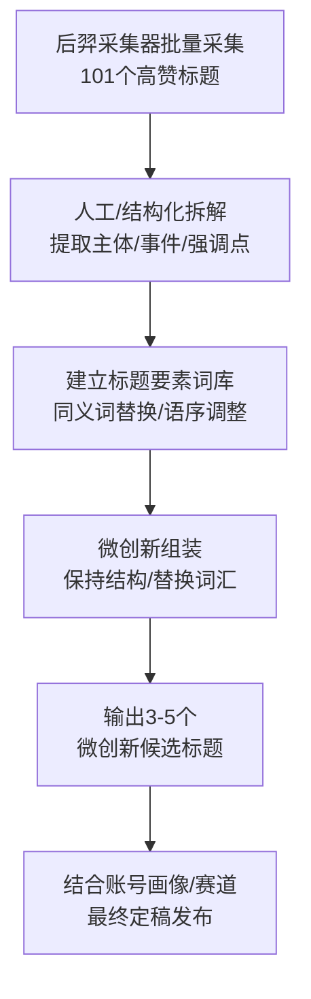
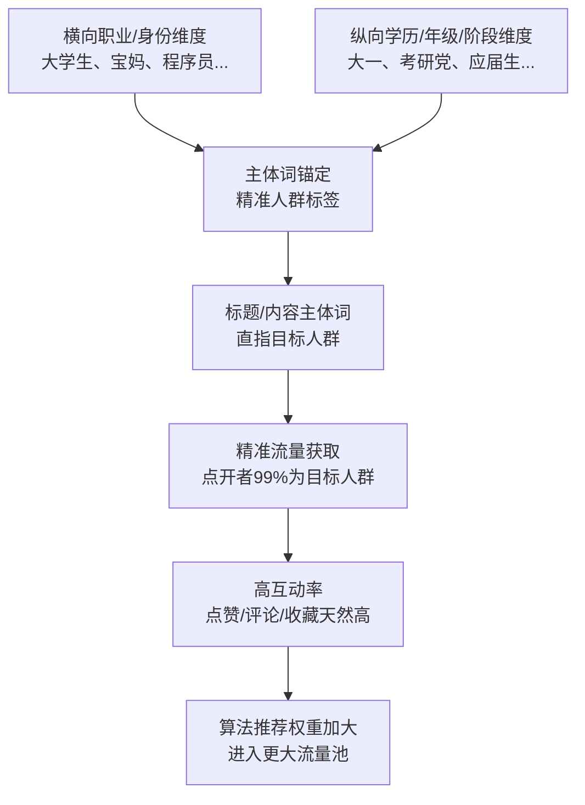
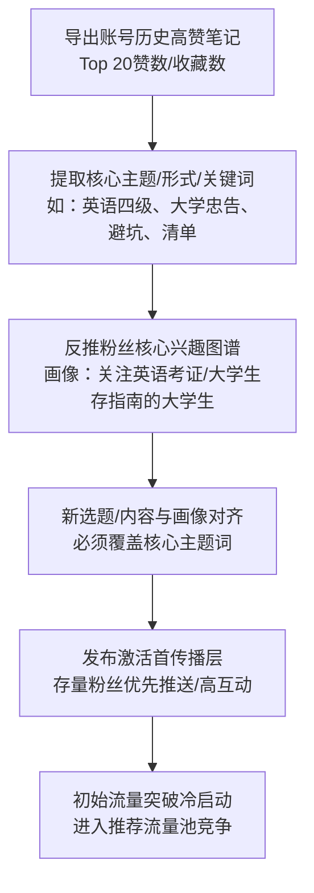
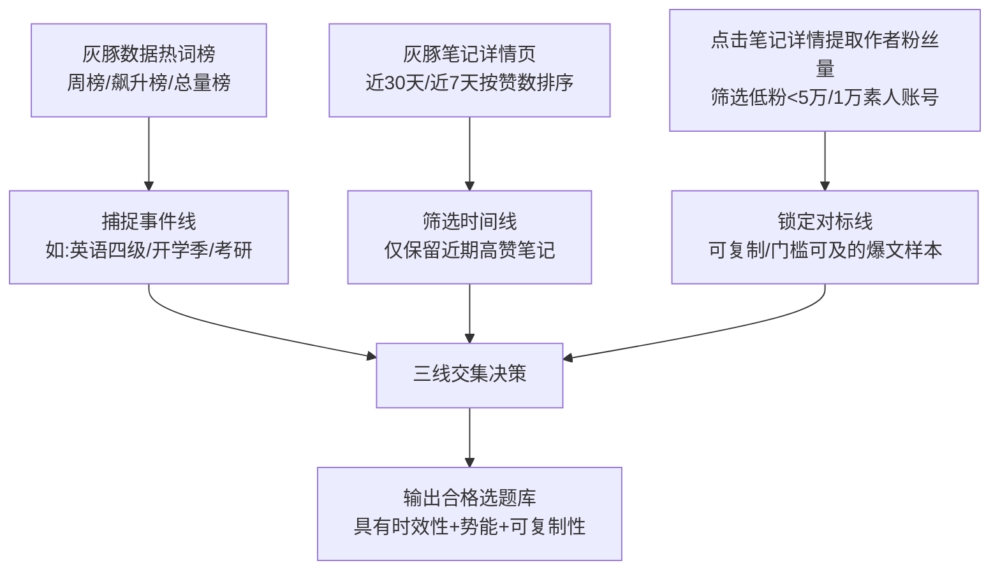
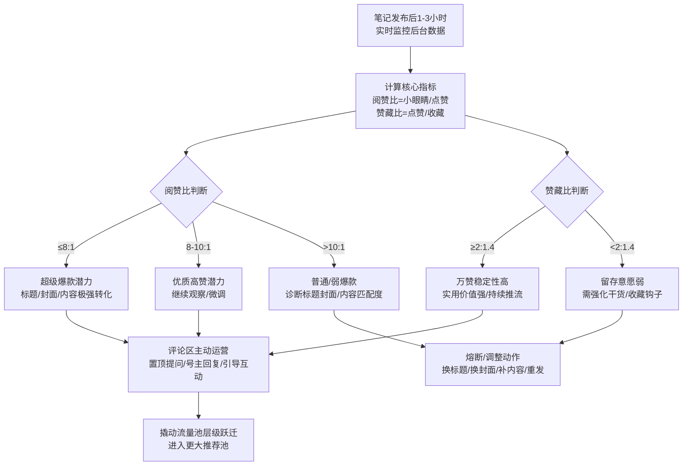
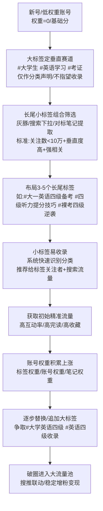
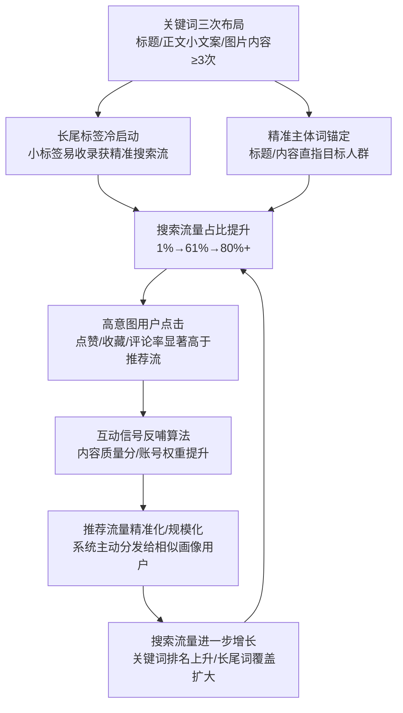
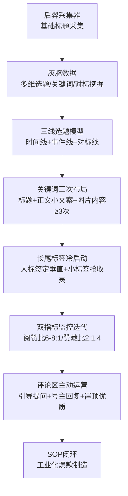
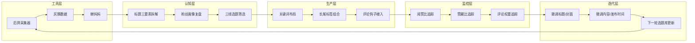

# 第 33 章 小红书数据驱动爆文生产 —— 爆款标题三要素、三线选题、关键词三次布局、长尾标签冷启动
作者：龙哥

## 学习目标

- 掌握爆款标题三要素（主体、事件、强调点）拆解重组法，实现标题批量化改写
- 理解自我参照效应选题定律，学会精准锁定受众画像（横向职业/纵向学历年级）提升流量精准度
- 熟练执行账号历史粉丝画像复盘，激活存量账号首传播层，规避冷启动失败风险
- 内化三线选题筛选模型（时间线、事件线、对标线），建立标准化选题决策体系
- 精通关键词三次高频布局原则（标题/正文小文案/图片内容），系统性获取高转化搜索流量
- 能运用赞藏比（≥2:1.4）与阅赞比（6-8:1）双指标实时预判爆款潜力，指导内容优化
- 掌握长尾标签冷启动策略（大标签定赛道、小标签抢收录），解决新号零流量难题
- 建立搜索流量主导认知，构建“关键词布局→搜索流量→高互动→反哺推荐”正向飞轮
- 串联后羿采集器、灰豚数据等工具链，落地“工具采集→认知拆解→标准化生产→数据复盘”全链路SOP

## 33.1 生活类比

想象小红书爆文生产是一场“精准钓鱼比赛”：后羿/灰豚工具是鱼群探测雷达，告诉你鱼在哪、什么鱼、吃什么饵；主体词（大学生/宝妈）是精准选定的钓点，只钓目标鱼种不浪费饵料；事件词（开学/考试/换季）是鱼群聚集的黄金时段，顺应自然规律自带流量势能；强调词（避坑/必备/贴心/残酷真相）是诱食力最强的饵料配方，直击痛点痒点一口咬钩；关键词三次布局是在鱼钩、鱼线、浮漂全涂满诱饵味，让鱼无论从哪个方向靠近都能闻到味道；长尾标签是专用的小型鱼窝，新手避开大神聚集的大鱼窝，在小窝里轻松收获；赞藏比/阅赞比是实时鱼获监测仪，还没拉杆就知道这竿子稳不稳、大不大；评论区运营是守窝补窝，留住鱼群、引来更多鱼。就像老钓手不会盲目撒网，而是“探测→选点→配饵→守窝→监测→复盘”，爆文生产也是数据驱动的标准化工程，而非玄学运气。

## 33.2 概念地图

小红书数据驱动爆文生产体系
├── 核心理论模型
│   ├── 自我参照效应选题定律 —— P002
│   ├── 爆文生产 = 数据工具降维打击 + 认知拆解重组 —— P001
│   ├── 精准流量 > 泛流量，搜索流量 > 推荐流量 —— P002
│   ├── 账号权重与标签体量需适配（长尾起号定律） —— P003
│   └── 互动权重排序：评论 > 收藏 > 赞 —— P004
├── 标准化操作方法
│   ├── 爆款标题三要素拆解重组法（主体+事件+强调点） —— P001
│   ├── 账号历史粉丝画像复盘（激活首传播层） —— P001
│   ├── 三线选题筛选模型（时间线/事件线/对标线） —— P001
│   ├── 关键词三次高频布局原则（标题/正文小文案/图片内容≥3次） —— P001
│   ├── 长尾标签冷启动策略（大标签定垂直+小标签抢收录） —— P001
│   ├── 赞藏比/阅赞比双指标爆款预判体系（2:1.4 / 6-8:1） —— P001
│   └── 评论区主动运营引导法（文案引导+号主回复+置顶优质） —— P002
├── 工具链与数据源
│   ├── 后羿采集器（标题/数据批量采集→Excel/飞书表格清洗） —— P001
│   ├── 灰豚数据（达人分类/热词榜/飙升榜/笔记详情/标签提取） —— P001
│   └── 蝉妈妈（辅助验证选题/对标） —— P001
├── 全链路标准化流程 (SOP)
│   ├── 步骤1：工具采集拆解（后羿采101标题+灰豚挖热词/对标）
│   ├── 步骤2：账号画像复盘（反推粉丝偏好/定核心赛道）
│   ├── 步骤3：三线筛选选题（近30/7天+热点节点+低粉素人对标）
│   ├── 步骤4：内容标准化生产（关键词3次布局+长尾标签组合+评论钩子）
│   ├── 步骤5：发布后数据监控（阅赞比/赞藏比/评论权重实时追踪）
│   └── 步骤6：复盘迭代优化（按指标微调标题/封面/内容/发布时间）
└── 实证验证案例
├── 教育赛道7天60%爆文率（5篇3篇万赞） —— P005
├── 首篇失败教训（忽视画像复盘仅获个位数赞） —— P005
├── 关键词优化使搜索流量从1%跃升至61% —— P005
└── 量化阈值验证：赞藏比2:1.4/阅赞比6-8:1 —— P005

> **本章素材来源声明**：本章所有引用素材均来源于《docs/202303/20230328_068.md》，下文引用块中标注的 `P001` 即指代该文件。

## 33.3 爆款标题拆解重组法 —— 让标题长出“爆款基因”

### 为什么需要这个概念？

你是否有过这样的经历：熬夜写完一篇干货满满的笔记，发出去却只有个位数的点赞？大概率不是内容不行，是标题没“勾住”用户。小白凭感觉写标题，极易踩坑：要么主体模糊（用户不知道在说谁），要么无事件锚点（用户不知道为什么现在要看），要么缺乏强调点（用户不知道点进去能获得什么）。

素材作者韩北樱在实战中发现：**爆款标题背后有固定结构，掌握结构即可批量复制成功**。《docs/202303/20230328_068.md》中写道：

> "利用内容数据工具找到对标爆款账号，分析爆文笔记的标题、内容、数据，找出能够爆文的共性然后进行模仿创作。对标爆款笔记是普通人做出成绩最好的捷径。" —— P001

这段话告诉我们，普通人最高效的路径是“拆解验证过的爆款”而非“凭空创新”。作者用后羿采集器采集了 101 个 #大学生 话题下的高赞笔记标题，通过归纳整理，提炼出了**爆款标题三要素公式**。

### 核心定义

> **爆款标题三要素公式**（来源：《docs/202303/20230328_068.md》）

$$
\text{爆款标题} = \text{主体（精准人群）} + \text{事件（周期/热点/节点）} + \text{强调点（痛点/痒点/难点形容词）}
$$

**逐项推导解释**：
- **主体**：对应“在说谁”，决定算法把笔记推给谁。主体越精准（如“大学生”而非“大家”），定向分发越准，点开者匹配度越高，互动率天然高。
- **事件**：对应“为什么现在看”，锚定周期节点（开学、考试周、毕业季）。蹭周期不蹭热点，不易违规且长期有效，为笔记提供时效性势能。
- **强调点**：对应“点进去能得什么”，用形容词（必备、避坑、贴心、残酷真相、详细、容易忘记、必须）制造心理缺口，直击用户痛点/痒点/难点，转化为点击欲。

三要素分别对应分发、时效、转化三个独立维度，互不替代，共同决定标题效能。缺主体→算法无法定向分发→泛流量低互动；缺事件→无时效性红利→易沉底；缺强调点→无心理钩子→点击率低。三要素可加性组合，是因为它们解决了标题生产中三个必须回答的问题。

### 方法演进：从原标题采集到微创新标题输出



**流程说明**：
1. **采集基础样本**：用后羿采集器对话题页/笔记页二级采集，导出标题、赞数、用户主页至 Excel/飞书表格；
2. **三要素结构化拆解**：人工逐条标注每个标题的主体（如“大学生”）、事件（如“开学”）、强调点（如“必备/避坑/容易忘”）；
3. **建立同义词替换库**：将“物资”→“清单”、“所需”→“必备”、“怎么样”→“最容易忘”，积累可复用的词汇对照表；
4. **微创新组装**：保持“主体+事件+强调点”骨架不变，替换同义词、调整语序、强化情绪钩子，批量产出 3-5 个候选标题；
5. **画像对齐定稿**：结合账号历史粉丝画像（见 33.5 节），剔除不符合粉丝预期的主体词（如“学姐”），锁定最终发布标题。

此流程图展示了标题生产从“采集验证样本”到“结构化拆解”再到“词库化微创新”的标准化工业流水线，每一步都有明确工具与产出，而非靠灵感突击。

### 逐层拆解与典型例子

**主体词决定流量精准度**  
主体是“大学生”，点开笔记的 99% 都是大学生，受众精准 → 互动率天然高。千万别把“学姐”写进标题主体，用户不关心你是谁，只关心“这跟我有什么关系”。

**事件词决定时效性**  
“开学”、“考试周”、“毕业季”、“换季”是自带流量的节点。蹭周期不蹭热点，不易违规且长期有效。

**强调词决定点击欲**  
“贴心、必备、避坑、残酷真相、详细、容易忘记、必须” —— 这些形容词直击用户心理缺口，制造“点进去不看会亏”的紧迫感。

**实战微创新演示**：《docs/202303/20230328_068.md》给出了两组原标题与改写对照：

| 原标题三要素 | 微创新改写标题 | 改写逻辑 |
|---|---|---|
| 主体：大学生<br>事件：开学<br>强调点：开学所需物资 | **大学生开学必备清单，这几样东西最容易忘！** | “物资”→“清单”；“所需”→“必备”；“物资怎么样”→“最容易忘”制造焦虑 |
| 主体：大学生（建议给大学生/学弟学妹，非学姐）<br>事件：大学期间赚钱<br>强调点：小钱/避坑/学姐建议 | **学姐建议：大学生想赚零花钱，这几条避坑指南请收好** | 明确受众“大学生/零花钱”，强调“避坑/收好”实用价值 |

这个公式展示了：标题不是写给自己看的“日记”，而是写给算法和用户的“检索指令”。主体词=精准定向，事件词=时效锚定，强调词=点击诱饵。三要素缺一不可，缺主体=泛流量低互动，缺事件=无时效性，缺强调=点击率低。

> **素材引用**  
> "主体：大学生 事件：开学 强调点：开学所需物资——换成常用说法：开学要准备的东西（这个‘东西’怎么样？形容词：详细、贴心、必备、容易忘记、不能忘记、必须）" —— P001  
> "主体：大学生（建议是给大学生、学弟学妹的，而不是标题里的学姐） 事件：大学生期间赚钱 强调点：小钱（大多数大学生只是需要赚点零花钱） 学姐建议（过来人的建议）" —— P001

### 边界条件

- 仅拆解标题不结合账号粉丝画像，易导致“标题对但内容不对”冷启动失败（详见 33.5 节）；
- 机械套用不微创新（如不替换同义词、不调整语序），会被判定低质或同质化；
- 娱乐/颜值/情感赛道标题结构不同（更依赖反差/悬念/情绪），本公式适用于教育/知识/干货/工具/攻略等强需求赛道。

---

## 33.4 自我参照效应选题定律 —— 只写“与用户有关”的事

### 为什么需要这个概念？

创作者最容易陷入“自我表达”陷阱：写自己觉得有用、自己感兴趣的内容。但用户很自私——**人们只会关注与自己有关的事情**。这是心理学经典的“自我参照效应”。

《docs/202303/20230328_068.md》原文明确指出：

> "在心理学上，有一个‘自我参照效应’，意思是人们往往只会关注与自己有关的事情，把握住这一点其实选题大有可为。" —— P002

### 核心定义

> **自我参照效应选题定律**（来源：《docs/202303/20230328_068.md》）

选题必须精准锁定受众画像：
- **横向维度**：职业/身份（大学生、宝妈、程序员、教师、护士……）
- **纵向维度**：学历/年级/专业/阶段（大一/大二/考研党/应届生/三年经验……）

标题与内容的“主体词”必须直指目标人群，实现“谁看谁有感”。

### 方法演进：受众画像精准化的可视化过程



**流程说明**：
1. **双维定位**：横向锁定职业/身份（如“大学生”），纵向锁定年级/阶段（如“大二/考研党”）；
2. **主体词植入**：将细分画像转化为标题与正文的核心主体词（如“给大二考研党的……”）；
3. **精准获客**：算法按主体词分发，点开用户 99% 匹配画像，天然具备高互动基因；
4. **权重跃迁**：高互动反哺推荐，形成“精准流量→高互动→更精准推荐”正向循环。

此流程图展示了从双维度画像定位到主体词植入，再到精准流量获取与算法权重跃迁的完整因果链条，说明为何“精准主体词”是爆款的基因起点。

### 关键性质

- **主体词越精准，流量越精准，互动率（赞/评/藏）越高，算法推荐权重越大**。
- 泛泛而谈“大家都适用”的选题，往往无人买单，因为无人觉得“在说我”。

### 典型例子

| 选题类型 | 标题示例 | 评价 |
|---|---|---|
| 好选题（精准主体） | 给大学生的英语四级避坑指南 | 主体=大学生，事件=四级，强调=避坑 → 精准获客 |
| 坏选题（模糊主体） | 如何高效学习英语 | 主体模糊，无精准人群锚定，点击意愿弱 |

《docs/202303/20230328_068.md》强调：

> "主体：能够精准的获取流量，主体是大学生，那么点开笔记的 99% 都是大学生，受众精准用户就更容易对笔记做出点赞、评论、收藏的行为" —— P002

这就是主体词的杠杆作用：用“排除法”筛选受众，反而获得了更高质量的“留存流量”。

### 边界条件

- 仅有精准主体词但内容质量低/无实用价值，仍无法留住用户、获取复购；
- 账号存量粉丝画像与新选题主体不匹配时，需先做“账号画像复盘”再选题（详见 33.5 节）。

---

## 33.5 账号历史粉丝画像复盘 —— 接手存量号的“破冰钥匙”

### 为什么需要这个概念？

接手/运营存量账号时，**无视历史粉丝偏好是冷启动失败的首因**。粉丝是被历史高赞内容“筛选”而来的，其阅读习惯已固化。新内容必须符合粉丝既有认知框架，才能激活“首传播层”获得初始流量。

《docs/202303/20230328_068.md》记录了作者接手一个 5k 粉教育号的惨痛教训：

> "该账号之前发的内容，高赞集中在 英语四级、大学忠告、建议、残酷真相 这几篇笔记，粉丝大多数由高赞笔记转化而来，他们更关注这些……第一次找的选题以及内容，明显不符合该账号粉丝的阅读习惯。" —— P001

### 核心定义

> **账号历史粉丝画像复盘法**（来源：《docs/202303/20230328_068.md》）

通过分析账号历史高赞笔记主题/形式/关键词，反推粉丝核心兴趣图谱。新选题/新内容必须与该画像高度重合，实现“粉丝预期”与“内容供给”对齐。

### 方法演进：历史高赞分析到首传播层激活的可视化流程



**流程说明**：
1. **数据导出**：在后台/灰豚导出账号历史 Top 20 高赞/高藏笔记的标题、正文关键词、封面形式、发布时间；
2. **主题聚类**：人工/工具聚类提取高频主题（如“英语四级”“大学忠告/建议”“残酷真相”“避坑指南”）、高频形式（清单图文/对话式/干货长图）；
3. **画像建模**：反推粉丝画像——大一/大二、英语四六级备考期、焦虑避坑、求实用干货的大学生群体；
4. **选题对齐**：新选题必须命中核心主题词（如“英语四级/大学生存”），形式沿用高互动形式（清单/避坑）；
5. **首传播激活**：发布后存量粉丝因“符合预期”高概率点赞/评论/收藏，触发算法首轮推荐，完成冷启动。

此流程图展示了从历史数据导出到主题聚类、画像建模、选题对齐、首传播激活的完整闭环，揭示“画像复盘”如何成为存量号破冰的第一性原理动作。

### 关键性质

- **忽视画像复盘，选题再热、标题再好，也会因“非粉丝所需”而沉底**。
- 画像复盘是选题筛选的“第一关卡”，不通过此关，后续动作皆无效。

### 实战教训复盘

**首篇失败**：作者按灰豚热词总榜选了“大学生开学准备”，虽是热词但不符画像（粉丝偏好“英语四级/大学忠告”），仅获个位数赞。

**修正后**：选题锚定“英语四级/大学生存建议”，配合关键词布局，连产万赞爆款。

> **素材引用**  
> "该账号之前发的内容，高赞集中在 英语四级、大学忠告、建议、残酷真相 这几篇笔记，粉丝大多数由高赞笔记转化而来，他们更关注这些" —— P001  
> "第一次找的选题以及内容，明显不符合该账号粉丝的阅读习惯。" —— P001

### 边界条件

- 新注册号（0粉）无历史画像，可直接按赛道标准画像选题，无需复盘；
- 若需转型赛道，需通过“夹带私货/渐进式切换”慢慢迁移粉丝画像，不可突变。

---

## 33.6 三线选题筛选模型 —— 让选题同时过“时效、热度、可复制”三关

### 为什么需要这个概念？

选题靠灵感极不稳定，靠蹭大热点易违规或掉粉，靠抄大V难复制。我们需要一套标准化筛选逻辑，确保每个选题都具备爆款潜质。将“拍脑袋决定选题”升级为“三维坐标锁定选题”。

### 核心定义

> **三线选题筛选模型**（来源：《docs/202303/20230328_068.md》）

$$
\text{合格选题} = \text{时间线} \cap \text{事件线} \cap \text{对标线}
$$

- **时间线**：选题素材必须来自近 30 天 / 近 7 天 新发布的高赞笔记，保证时效性；
- **事件线**：选题必须符合当下热点周期/节点（如开学季、考试周、毕业季），自带流量势能；
- **对标线**：参考对象必须是“低粉素人爆文”而非“大V官方号”，保证动作可复制、门槛可及。

**三线缺一不可**：无时间线=过时；无事件线=无势能；无对标线=学不会、做不动。

**为何取交集而非并集**：

时间线保证素材新鲜度，事件线保证顺应周期势能，对标线保证动作可复制。三者分别对应“新鲜、有势、可学”三个独立必要条件。若取并集，只要满足一条即入选，会导致选题库混入过时素材、无势能话题、不可复制的大V案例，稀释选题质量。交集运算是“对题质量做与门逻辑”，是最高标准的筛选门槛。

### 方法演进：三维筛选交集决策的可视化流程



**流程说明**：
1. **事件线捕捉**：打开灰豚“热词榜”周榜/飙升榜，锁定近 7 天赛道内飙升热词（如“英语四级”“考研政治”）；
2. **时间线筛选**：在“笔记详情”页按“近 30 天/近 7 天”+“赞数降序”筛选，仅保留近期新发布的高赞笔记；
3. **对标线锁定**：点击笔记作者主页，筛选粉丝量 < 5 万（或 < 1 万）的素人账号，其爆文动作（标题结构/封面风格/内容框架/标签组合）才具备可复制性；
4. **交集决策**：同时满足三线的笔记，提取其选题方向、标题模版、关键词包、标签组合，纳入备选题库。

此流程图展示了三线筛选如何将“海量候选题”通过三重过滤器压缩为“高确定性选题库”，每一道关卡对应一个工具动作与判断标准，实现了选题决策的标准化。

### 工具链支撑

灰豚数据“热词榜/达人榜/笔记详情”是执行三线筛选的核心工具链：
- 热词榜（周榜/飙升榜/总量榜）捕捉趋势 → 事件线；
- 近 30/7 天按赞数排序 → 时间线；
- 点击笔记详情提取热词/标签，筛选低粉素人爆文 → 对标线。

《docs/202303/20230328_068.md》操作指引：

> "即标题和关键词在灰豚数据上查找，近 30 天、近 7 天按照赞数由高到低排序，最好参考低粉爆文笔记，进行对标模仿" —— P001

### 典型执行流程

1. 近 7 天热词榜出现“英语四级”（事件线）；
2. 筛选近 30 天赞数高的低粉笔记（时间线+对标线）；
3. 提取其标题结构/关键词/封面风格；
4. 微创新发布。

### 边界条件

- 赛道冷门、无近期热词/爆文时，可放宽时间线至 60/90 天，但必须保留对标线；
- 蓝海新赛道无对标账号时，可跨平台（抖音/知乎/小红书）寻找同质化对标。

---

## 33.7 关键词三次高频布局原则 —— 让算法“听懂”你的笔记

### 为什么需要这个概念？

算法不“读”内容，只“数”关键词频次与分布。关键词出现太少，系统识别不出主题，无法匹配搜索/推荐流量；关键词堆砌过多，会被判定营销/作弊，导致限流。我们需要一个“刚好好”的标准。

### 核心定义

> **关键词三次高频布局原则**（来源：《docs/202303/20230328_068.md》）

$$
\sum_{区域 \in \{\text{标题}, \text{正文小文案}, \text{图片内容}\}} \text{Count(核心关键词)} \ge 3
$$

**逐项推导解释**：
- **σ（求和符号）**：表示对三大识别区域的覆盖计数求和。
- **区域集合 {标题, 正文小文案, 图片内容}**：对应系统三大语义识别通道——标题索引（检索入口）、正文 NLP 语义理解、图片 OCR 视觉识别。
- **Count(核心关键词)**：每个区域中核心关键词（热词/标签词）的自然出现次数。
- **≥ 3 阈值**：实战验证显示，出现 1-2 次时系统语义识别置信度不足，搜索匹配与推荐分发均弱；出现 3 次覆盖三大通道后，语义置信度跨越临界点，触发平台“提炼重要信息提升曝光”提示，搜索流量占比显著跃升；出现 ≥5 次或生硬堆砌则触发反作弊判定风险。3 是“三通道覆盖+自然分布+低风险”的最优解。

核心关键词需在“标题、正文小文案、图片内容”三大区域累计出现 ≥ 3 次。建议分布：标题必带 1 次，正文开头/结尾/评论置顶各 1 次，封面图/正文配图文字叠加 1 次。

《docs/202303/20230328_068.md》多处强调：

> "把笔记涵盖热词在文案中提上 3 遍，这样做主要是为了获得搜索流量。" —— P001  
> "关键词在内容、标题、小文案三部分加起来至少提及三次。" —— P001  
> "笔记涵盖的热词在标题、文案、图片内容中，提到不少于三次，更能获得搜索流量" —— P001

### 方法演进：关键词三区布局到搜索流量获取的数据流向

```mermaid
graph TD
    A[核心关键词包<br/>从灰豚笔记详情/热词榜提取] --> B[标题区<br/>必带1次/前置核心词]
    A --> C[正文小文案区<br/>开头/结尾/评论置顶<br/>自然嵌入2-3次]
    A --> D[图片内容区<br/>封面标题/配图文字叠加<br/>OCR识别覆盖1次]
    B --> E[系统语义识别强化<br/>标题索引+正文语义+图片OCR<br/>三重确认主题]
    C --> E
    D --> E
    E --> F[触发平台提示<br/>"提炼重要信息提升曝光"]
    F --> G[搜索流量精准匹配<br/>搜索流量占比从1%→61%]
    G --> H[高意图用户点击<br/>互动率提升→反哺推荐流量]
```

**流程说明**：
1. **关键词提取**：从灰豚对标爆文“笔记详情页”提取“涵盖热词”（即标签/关键词），构建核心词包（如“英语四级/避坑/资料/听力/作文/翻译”）；
2. **三区布局**：标题前置核心词 1 次（如“英语四级避坑指南”）；正文开头/结尾/评论置顶自然嵌入 2-3 次；封面图大字标题/配图关键步骤文字叠加覆盖 1 次；
3. **三重识别**：系统通过“标题索引（检索入口）+ 正文语义（NLP 理解）+ 图片 OCR（视觉识别）”三重确认笔记主题，语义置信度大幅提升；
4. **加速通道**：频次达标触发官方提示“在笔记标题及正文中，提炼笔记重要信息，有机会提升笔记的曝光量”，进入推荐加速通道；
5. **搜索获客**：精准匹配用户搜索意图，搜索流量占比从 1% 跃升至 61%+，带来高转化长尾流量。

此流程图展示了关键词如何通过三区布局触发系统三重识别机制，进而激活平台加速通道与搜索流量获取的完整因果链路。

### 关键性质

- **搜索流量精准度高、转化率高、生命周期长，是商业变现核心流量来源**；
- 关键词频次达标会触发平台“提炼重要信息提升曝光”官方提示，进入加速通道；
- 关键词布局是“搜索流量主导论”（33.10 节）落地的核心动作。

### 实证对比

《docs/202303/20230328_068.md》给出了极具说服力的前后对比：

- **优化前**：搜索流量仅 1%，数据极差；
- **优化后**：标题/文案/图片三处布局核心词“英语四级/避坑/资料”，搜索流量跃升至 61%，获万赞，并触发平台提示：“在笔记标题及正文中，提炼笔记重要信息，有机会提升笔记的曝光量”。

> **素材引用**  
> "把笔记涵盖热词在文案中提上 3 遍，这样做主要是为了获得搜索流量。" —— P001  
> "关键词在内容、标题、小文案三部分加起来至少提及三次。" —— P001  
> "笔记涵盖的热词在标题、文案、图片内容中，提到不少于三次，更能获得搜索流量" —— P001  
> "其中有一篇关于过英语四级的万赞笔记，搜索流量在 61%，并且也被提示了‘在笔记标题及正文中，提炼笔记重要信息，有机会提升笔记的曝光量’。" —— P005

这个原则展示了：关键词不是“写给人看的”，是“写给算法看的索引标签”。三次分布覆盖了“检索入口（标题/标签）”、“语义理解（正文）”和“视觉识别（图片OCR）”，全方位告诉系统：这篇笔记讲的是 XX。

### 边界条件

- 关键词必须是用户真实搜索的“热词/标签词”，非自造生词；
- 布局需自然融入语句/画面，生硬堆砌会触发反作弊机制；
- 长尾词/衍生词可辅助布局，但核心词频次必须达标。

---

## 33.8 赞藏比与阅赞比双指标爆款预判体系 —— 用数据提前“预知”爆款

### 为什么需要这个概念？

发布后不知好坏，等数据出来再改已错过黄金推流期。我们需要实时监控的“先行指标”，在发布早期（前 1-3 小时）预判爆款潜力。将主观“觉得这篇会火”量化为客观可验证的数学阈值。

### 核心定义

> **双指标爆款预判体系**（来源：《docs/202303/20230328_068.md》）

**指标 1：赞藏比 ≥ 2 : 1.4** → 判定万赞稳定性  
- 收藏权重高 = 实用价值强 = 持续推流；
- 点赞 = 情绪价值，收藏 = 实用价值；

**指标 2：阅赞比（小眼睛/点赞）6-8 : 1** → 判定超级爆款潜力  
- 普通高赞约 10:1；
- 超级爆款 6-8:1，说明极强的“标题/封面-内容”转化力；

**权重排序**：评论 > 收藏 > 赞。需主动运营评论区撬动流量池层级。

《docs/202303/20230328_068.md》原文：

> "从赞藏来看，一篇笔记能够到 2：1.4 以上，万赞就会很稳定，会有持续不断的推荐。" —— P001  
> "从小眼睛和点赞来看，普通的高赞回答，小眼睛和点赞比例在 10：1，但是超级爆款比例 6-8:1。" —— P001  
> "对于教育学习领域来说，赞和藏，更像是一个情绪价值和一个实用价值的区分。" —— P001  
> "按照小红书的权重来算，评论＞收藏＞赞，因此还要做的一件事就是：一定要在文案和内容中，引导读者评论，同时号主，也要在评论区多评论，多互动。" —— P002

> **⚠ 数据溯源提示**：上述阈值为作者实战经验值（单账号、单赛道、单周期验证），非平台官方公开基准，亦无统计学置信区间披露。不同赛道、不同账号权重阶段、不同内容形式下阈值会漂移。建议读者在积累 10+ 篇自有样本后，自行校准专属阈值，切勿生搬硬套。

### 方法演进：发布早期双指标监控到分级预判与评论运营介入的决策树



**流程说明**：
1. **实时监控**：发布后 1h/3h/6h 记录“小眼睛（阅读量）、点赞、收藏、评论”四项基础数据；
2. **双指标计算**：阅赞比 = 阅读量 / 点赞数；赞藏比 = 点赞数 / 收藏数；
3. **分级预判**：
   - 阅赞比 ≤ 8:1 + 赞藏比 ≥ 2:1.4 → **超级爆款种子**，全力运营评论区、追加投流；
   - 阅赞比 8-10:1 + 赞藏比达标 → **万赞稳定款**，常规运维、监控 24h 趋势；
   - 阅赞比 > 10:1 或 赞藏比不达标 → **诊断弱环节**（标题封面点击率低/内容干货不足/收藏钩子缺失），启动微调；
4. **评论区杠杆**：无论哪档，均执行“文案引导提问 + 号主前 50 条必回 + 置顶优质问答”，利用“评论>收藏>赞”最高权重撬动流量池层级跃迁。

此决策树展示了如何用两个可计算指标在发布早期完成分级预判，并据此触发差异化运营动作（全力推/常规维/熔断调），将“事后复盘”前置为“事中干预”。

### 关键性质

- **赞藏比反映“实用价值/留存意愿”，决定推流持久度**；
- **阅赞比反映“点击转化率/内容吸引力”，决定爆发上限**；
- **评论区运营（引导提问/号主回复/置顶优质评论）是提升权重的最高杠杆**。

> **⚠ 权重排序溯源提示**：“评论>收藏>赞”权重排序为作者基于平台规则认知的实战推演结论，非官方文档公开算法。平台从未公开完整权重公式，且权重随赛道、账号阶段、内容形式动态调整。建议读者以“综合互动率（含评论深度、收藏转发、完读时长）”为核心判断，而非单一维度权重排序。

### 典型例子

- 万赞笔记赞藏比稳定在 2:1.4 以上，持续获得推荐流量；
- 超级爆款阅赞比达 6:1 甚至更低，说明极强的“标题/封面-内容”转化力。

### 边界条件

- 仅适用于教育/知识/干货类赛道，娱乐/颜值/情感赛道指标体系不同；
- 新号前几篇笔记数据基数小，指标波动大，需积累 10+ 篇样本后再参考；
- 指标异常（如赞高藏低、阅高赞低）需结合内容形式具体诊断，不可死套公式。

---

## 33.9 长尾标签冷启动策略 —— 新号避开“红海”抢“蓝海”

### 为什么需要这个概念？

新号/低权重号蹭大标签（如 #大学生 1亿+关注）极难被收录，流量归零。大标签竞争激烈，算法优先分发高权重账号，新号无胜算。长尾小标签竞争弱、垂直度高、易收录，是新号冷启动的“隐形入口”。

### 核心定义

> **长尾标签冷启动策略**（来源：《docs/202303/20230328_068.md》）

- **大标签定垂直领域**（如 #大学生），**小标签抢收录入口**（如 #大一新生避坑指南 / #高数期末复习）；
- 优先选择“关注人数少但垂直度高、与内容强相关”的长尾标签组合（3-5个）；
- 待笔记被小标签收录、获取初始精准流量、权重上涨后，再逐步争取大标签收录。

《docs/202303/20230328_068.md》原文：

> "新号权重低，笔记不容易被大的标签收录。但我们可以把它做的更好：如果选择小标签，就更容易被收录，收录后就会推荐给关注该标签的人以及获取到搜索流量" —— P001  
> "大标签定垂直领域，小标签更加精准易被收录，再加上好的选题和内容，就能够获得到更多的流量。" —— P001  
> "由此联想到了知乎，在知乎写回答如果是一个新号，就不建议回答关注人数上万的问题" —— P003

### 方法演进：大标签定赛道到逐步换大标签的演进路径



**流程说明**：
1. **定赛道不贪收录**：新号发笔记时，大标签（如#大学生 #英语四级）仅作“赛道声明”打在末尾，不指望被收录；
2. **筛选长尾**：用灰豚“笔记详情页提取标签”、小红书搜索框下拉联想、对标爆文标签，筛选“关注数<10万、垂直度极高、与内容强相关”的长尾标签（如#大二英语四级备考 #四级听力单项突破）；
3. **组合布局**：单篇笔记挂 3-5 个长尾标签（前 2 个最核心），放在正文末尾/评论置顶，形成“标签矩阵”；
4. **快速收录**：长尾标签竞争弱，系统易收录，笔记进入“标签页推荐流”+“搜索流”双通道，获取精准种子用户；
5. **权重养成**：精准流量带来高互动（赞藏比/阅赞比达标），账号权重、笔记权重、标签权重同步上涨；
6. **逐步破圈**：权重达标后，主动替换/追加大标签，争取大标签收录，进入主流大流量池，实现规模化增长。

此流程图展示了新号如何通过“大标签定身、小标签抢收、精准流量养权、逐步换大破圈”的分阶段策略，解决“零权重无法收录、无收录无流量、无流量无权重”的死循环。

### 关键性质

- 小标签收录门槛低，易触发“标签页推荐”+“搜索流量”双重曝光；
- 长尾标签用户意图极强（搜 #高数期末复习 的必是要考高数的大一/大二），精准度极高；
- 标签体系是小红书内容分发的底层骨架，运营标签即运营流量分发逻辑。

### 典型例子

新号发“英语四级”笔记，不加 #大学英语四级（大标签），改加：
- #英语四级裸考逆袭
- #大二英语四级备考  
- #四级听力提分技巧

（长尾标签），快速被收录获赞。

### 边界条件

- 标签必须与内容强相关，挂无关热门标签会被判定违规/低质；
- 单篇笔记标签数建议 3-5 个（1个大标签定赛道 + 2-4个长尾标签抢流量）；
- 账号权重提升后，需主动“换大标签”，否则长期困在长尾流量池无法破圈。

---

## 33.10 搜索流量主导论 —— 做“被搜到”比“被推到”更赚钱

### 为什么需要这个概念？

推荐流量（被动分发）不可控、波动大、泛粉多、转化低。搜索流量（主动需求）用户意图强、精准度高、转化率高、生命周期长（长尾效应）。商业变现（引流私域/卖课/带货）的核心是“精准获客”，搜索流量 ROI 远超推荐流量。

### 核心定义

> **搜索流量主导论**（来源：《docs/202303/20230328_068.md》）

通过“关键词三次布局 + 长尾标签冷启动 + 精准主体词”系统性获取搜索流量。目标：将账号搜索流量占比从个位数（如 1%）提升至主导地位（如 61% 甚至 80%+）。搜索流量增长 → 互动率提升 → 反哺推荐流量 → 形成“搜推联动”正向飞轮。

《docs/202303/20230328_068.md》核心论断：

> "毕竟搜索来的才更容易点赞，点赞会加大推送，搜索越多，推送越精准，量起的越快。" —— P002  
> "热词的搜索量高，既是标签也是热词关键词。" —— P002  
> "精准流量 > 泛流量，搜索流量 > 推荐流量" —— P002

### 方法演进：搜推联动正向飞轮循环



**流程说明**：
1. **三大引擎并发**：关键词三次布局（语义识别）、长尾标签冷启动（分发入口）、精准主体词（受众定向）三位一体，构建搜索流量获取底座；
2. **搜索占比跃升**：从个位数（1%）提升至主导地位（61%+），搜索成为第一流量来源；
3. **高质量互动**：搜索用户带着明确需求而来，点赞/收藏/评论率天然高于推荐流泛粉；
4. **算法反哺**：高质量互动信号反哺推荐算法，提升内容质量分与账号权重，推荐流量随之精准化、规模化；
5. **飞轮加速**：推荐流量带来新增搜索行为（用户搜同款/相关词），关键词排名上升，长尾词覆盖扩大，搜索流量进一步增长，形成“搜推联动”正向飞轮。

此循环图展示了搜索流量如何通过“布局→获客→互动→反哺→再获客”形成自我增强的正向飞轮，解释了为何“搜索流量主导”是可持续增长的核心战略。

### 关键性质

- **搜索流量是“确定性流量”**：只要关键词排名在前，就持续有用户主动点进来；
- **热词即关键词即标签，三位一体**，布局热词=布局关键词=布局标签；
- 教育/技能/工具/攻略等强需求赛道，搜索流量价值最高。

### 实证案例

- 万赞笔记“英语四级避坑指南”搜索流量占比 61%，长尾关键词“四级听力/作文/翻译技巧”持续带来每日稳定增粉；
- 对比：早期两篇笔记搜索流量仅 1%，靠推荐流量偶尔爆一下，随后迅速衰退。

### 边界条件

- 纯娱乐/颜值/情绪类内容，搜索需求弱，推荐流量仍为主力，不可强行搜索化；
- 新号无权重时，关键词排名靠后，搜索流量极少，需先靠长尾标签/推荐流量积累权重；
- 平台算法调整可能改变搜/推权重，需持续监控数据调整策略。

---

## 33.11 数据驱动内容生产全链路SOP —— 从“玄学创作”到“工业化爆款制造”

### 为什么需要这个概念？

单一技巧（如只会写标题、只会蹭热点）无法稳定产出爆款。我们需要一套“工具采集 → 认知拆解 → 标准化生产 → 数据复盘 → 迭代优化”的闭环体系。将爆款生产从“概率游戏”转化为“确定性工程”，实现可复制、可规模化。

### 核心定义

> **数据驱动内容生产全链路 SOP**（来源：《docs/202303/20230328_068.md》）

**7 步标准化流程**：

下表展示了完整的 7 步 SOP，包含每步的核心动作、工具、产出物与验收标准。

| 步骤 | 动作 | 核心工具 | 关键产出 | 验收标准 |
|---|---|---|---|---|
| ① | 批量采集爆款标题/数据 | 后羿采集器 | 101+ 标题库、赞数、用户主页 | 覆盖核心话题 Top 101 |
| ② | 多维挖掘选题/关键词/对标 | 灰豚数据/蝉妈妈 | 热词榜、飙升榜、对标账号库、标签包 | 锁定赛道天花板/趋势/可复制对标 |
| ③ | 账号画像复盘定粉丝偏好 | 历史高赞笔记 | 粉丝兴趣图谱、核心赛道 | 新选题与画像重合度 > 80% |
| ④ | 三线模型筛选选题 | 灰豚数据 | 3-5 个备选题目 | 同时满足时间线/事件线/对标线 |
| ⑤ | 关键词三次布局+评论引导 | 关键词表/话术库 | 标题/正文小文案/图片内容/评论置顶关键词落位 | 核心词三区累计 ≥3 次，评论钩子就位 |
| ⑥ | 长尾标签冷启动 | 标签搜索/灰豚 | 1 大标签 + 2-4 长尾标签组合 | 小标签收录率 > 80% |
| ⑦ | 阅赞比/赞藏比监控迭代 | 后台数据/灰豚 | 每日监控仪表盘 | 阅赞比<8:1、赞藏比>2:1.4、评论>50 条 |

**核心理念**：工具是员工，人是老板；工具跑数据，人做决策、做微创新、做质量把关。

此表格展示了从工具采集到数据复盘的完整工业化流水线，每步都有明确的输入、工具、产出与验收标准，消除了“靠感觉创作”的随意性。

### 实证验证

《docs/202303/20230328_068.md》记录了完整实战案例：

> "通过这个方法，做到了一个账号 7 天内 60% 的爆文率。" —— P005

**案例复盘**：
1. 接手 5k 粉教育号；
2. 后羿采集 101 个高赞标题拆解三要素；
3. 灰豚挖掘热词/对标账号；
4. 画像复盘锚定“英语四级/大学忠告”；
5. 三线筛选选题；
6. 关键词三次布局+长尾标签；
7. **7 天产 3 篇万赞，爆文率 60%**。

> **⚠ 样本显著性提示**：上述“7天60%爆文率”基于单账号、单赛道（教育/英语）、单周期（7天）、单操作者（作者本人）的单案例验证，样本量极小（n=5），统计功效不足，不具备普适性推广依据。该结果仅证明“该方法在该特定条件下可行”，不代表所有账号/赛道/执行者均能复刻。建议读者以“小规模测试（3-5篇）→ 校准指标/阈值 → 再规模化”的节奏落地。

### 方法演进图



### 数据流图



### 边界条件

- 工具数据有滞后性（灰豚 T+1），需结合实时热点（🧣热搜/抖音榜单）补齐时效性；
- SOP 执行者需具备基础审美/文案/选品能力，纯小白执行仍易偏离质量线；
- 赛道差异大，教育/知识类 SOP 可直接迁移，娱乐/颜值/情感类需重构指标体系。

---

## 33.12 多源对照

### 核心共识

各平台均认可：
1. **标题三要素通用性**：精准人群（主体）、时效节点（事件）、利益点（强调点）是标题的通用骨架。
2. **关键词高频布局利于搜索**：核心词在标题、正文、图片多通道覆盖能强化语义识别，获取搜索流量。
3. **新号宜走长尾冷启动**：避开头部大标签/大热点竞争，优先占位长尾标签/长尾关键词，积累权重后再破圈。
4. **数据指标指导迭代**：完读率、互动率、转化率等量化指标是内容优化的核心依据，而非主观臆断。

### 关键分歧

| 维度 | 小红书（本章体系） | 抖音/视频号 | 知乎 |
|---|---|---|---|
| **核心流量逻辑** | 搜索为主、推荐为辅，标签分发构成骨架 | 推荐为主、搜索为辅，算法分发为核心 | 搜索为主、时间线分发为辅，SEO 权重极高 |
| **标题风格** | 实用干货、避坑清单、主体词前置 | 前三秒制造悬念/反差/情绪金句 | 首句定点击，偏专业观点/故事叙事 |
| **标签/话题作用** | 核心分发通道，讲究大小标签组合策略 | 话题/挑战赛为主，标签权重较低 | 话题页分发，擅长长尾 SEO |
| **爆款核心指标** | 赞藏比、阅赞比、评论权重 | 完播率、转粉率、留存时长 | 赞同数、收藏数、感谢数 |
| **冷启动路径** | 长尾标签 + 精准主体词 + 关键词布局 | DOU+ 投流 / 达人相似人群定向 | 盐选/想法 / 回答高赞问题 |
| **内容形式** | 图文为主，封面图决定点击 | 短视频/直播为主，前 3 秒决定留存 | 长文/回答/视频，深度决定权重 |

这些差异源于各平台底层分发机制与用户心智模式的根本不同，跨平台迁移时必须重构指标体系与操作手法，不可生搬硬套。

---

## 33.13 设计中的取舍

我们选择三线模型而非蹭大热点或跟随大V，是因为大热点竞争极烈，新号无权重无团队极难破圈，且易违规或掉粉；大V爆文依赖其个人IP、团队与资源，普通人抄袭动作、选题、形式极难复刻，成功率极低；而低粉素人爆文代表同等资源下跑出的结果，其动作可复制、门槛可及、概率可期待，是普通人最高效的捷径。这一取舍的核心在于：用“可复制性”换取“爆款上限”，用“确定性工程”替代“概率博弈”。

我们将关键词频次设定为“三区累计≥3次”而非“越多越好”，是因为出现少于3次时算法语义识别不足，搜索与推荐匹配均会变弱；超过5次或生硬堆砌则会触发反作弊与营销判定，导致限流违规；3到4次自然分布恰好覆盖检索、语义、视觉三大识别通道，性价比最高。这一取舍的本质是在“语义识别置信度”与“反作弊风险”曲线上寻找最优平衡点，而非单纯追求频次最大化。

我们不把评论数作为核心考核指标，尽管评论权重最高，是因为评论易刷、易水军、难量化质量，直接用评论数易被刷量欺骗；赞藏比与阅赞比更难造假，更能反映内容真实价值；评论区运营作为杠杆动作嵌入生产流程（文案引导、号主回复、置顶优质），而非作为考核指标设定硬性KPI。这一取舍的逻辑在于：指标要“难造假、强关联、可操作”，动作要“高杠杆、可标准化、可持续”，二者分工明确，不可混淆。

---

## 33.14 动手练习

### 练习 1：实战演练：手把手拆解一个爆款标题并微创新

给定某教育赛道爆款标题：《大二学姐建议：大学生英语四级避坑指南，这份资料请收好》

任务 1：拆解其三要素（主体/事件/强调点）
任务 2：基于“自我参照效应”，若目标受众改为“考研党”，请改写标题（保持结构、替换同义词）
任务 3：设计 3 个长尾标签组合用于新号冷启动（避开 #考研 大标签）
任务 4：列出该笔记需在标题/正文/图片中累计 ≥3 次布局的核心关键词

回答问题：
- 为什么要把“学姐”从主体词中剔除，改为“大学生/考研党”？
- 如果该账号历史高赞全是“四六级”，发“考研”选题会有什么后果？

### 练习 2：数据诊断：判断一篇笔记是否具备超级爆款潜力

某笔记发布 3 小时后数据：小眼睛（阅读量）12,000，点赞 1,800，收藏 1,000，评论 120

任务 1：计算阅赞比、赞藏比
任务 2：根据双指标阈值（阅赞比 6-8:1、赞藏比 ≥2:1.4），判断该笔记属于：普通高赞 / 万赞稳定 / 超级爆款潜力
任务 3：若赞藏比不达标，但评论区已有 50 条高质量问答，根据“评论>收藏>赞”权重排序，该如何操作进一步撬动流量？

回答问题：
- 为什么收藏权重高于点赞？结合“情绪价值 vs 实用价值”解释
- 阅赞比过高（如 15:1）通常意味着什么问题（标题/封面/内容哪个环节）？

### 练习 3：全流程模拟：从 0 到 1 策划一个小红书教育号冷启动周计划

场景：新注册小红书号，定位“大学生英语学习/考证”，目标 7 天产出 3 篇千赞+笔记

任务 1：使用后羿采集器/灰豚数据（模拟）完成“选题挖掘”，列出符合“三线模型”的 5 个备选题目
任务 2：针对第 1 个选题，完成“标题拆解重组”产出 3 个微创新标题
任务 3：制定“关键词布局表”：核心词/长尾词/标签词在标题/正文开头结尾/封面图/评论置顶的具体落位
任务 4：设计“评论区运营预案”：置顶评论话术/引导提问模板/号主回复频次
任务 5：设定“每日监控仪表盘”：发布后 1h/3h/6h/24h 需记录的核心指标及预警阈值

回答问题：
- 新号第 1 天发布笔记，为何建议“长尾标签 3-5 个 + 0 个大标签”？
- 若第 3 天笔记数据：阅赞比 12:1、赞藏比 1:1、评论<5 条，按 SOP 应启动哪些熔断/调整动作？

---

## 33.15 本章小结

这一章中我们学习了如何利用数据工具将小红书爆文生产从“玄学运气”转化为“确定性工程”。首先我们掌握了爆款标题三要素拆解重组法，理解了主体、事件、强调点的结构化作用；其次我们内化了自我参照效应选题定律，学会精准锁定受众画像获取高精准流量；接着我们明白了账号历史粉丝画像复盘是接手存量号的破冰钥匙，必须激活首传播层；然后我们建立了三线选题筛选模型，让选题同时过时效、热度、可复制三关；随后我们精通了关键词三次高频布局原则，系统性获取高转化搜索流量；接着我们掌握了赞藏比与阅赞比双指标爆款预判体系，实现发布早期的数据诊断；然后我们学会了长尾标签冷启动策略，解决新号零流量难题；接着我们确立了搜索流量主导认知，构建了搜推联动正向飞轮；最后我们串联了后羿采集器、灰豚数据等工具链，落地了全链路标准化SOP，并用教育赛道 7 天 60% 爆文率实证验证了方法论有效性。

本章我们一起学习了以下概念：

下表汇总了本章核心概念与释义，供快速回顾。

| 概念 | 解释 |
|------|------|
| 爆款标题三要素 | 主体（精准人群）+ 事件（周期/热点/节点）+ 强调点（痛点/痒点/难点形容词），替换同义词即可批量改写 |
| 自我参照效应选题定律 | 选题必须精准定义受众画像（横向职业+纵向学历年级），主体词越精准流量越精准互动率越高 |
| 账号历史粉丝画像复盘 | 接手存量号必做：分析历史高赞笔记反推粉丝偏好，新内容必须符合既有阅读习惯以激活首传播层 |
| 三线选题筛选模型 | 时间线（近30/7天新发布）+ 事件线（符合当下热点周期/节点）+ 对标线（参考低粉素人爆文而非大V） |
| 关键词三次高频布局原则 | 核心关键词在标题、正文小文案、图片内容三处累计出现≥3次，强化语义识别获取精准搜索流量 |
| 赞藏比与阅赞比双指标 | 赞藏比≥2:1.4判定万赞稳定（收藏=实用价值）；阅赞比6-8:1判定超级爆款（普通高赞约10:1） |
| 长尾标签冷启动策略 | 新号避开大标签竞争，优先布局垂直度高的长尾小标签易收录获精准流量，权重积累后再争取大标签 |
| 搜索流量主导论 | 搜索流量（主动需求）比推荐流量（被动分发）更精准、转化更高、生命周期更长，是商业变现核心资产 |
| 后羿采集器/灰豚数据 | 前者批量采集爆款标题/数据做基础拆解，后者多维挖掘热词趋势/对标账号/标签体系做精准选题 |
| 数据驱动全链路SOP | 工具采集→画像复盘→三线筛选→关键词布局+评论引导→长尾标签冷启动→阅赞/赞藏监控迭代，7天60%爆文率验证有效性 |

下一章中，我们将学习 **百家号竖版口播号变现实操**，包括百粉原创认证跃迁、实时热点为王、活力值增量收益模型、T+1结算等核心方法论，敬请期待。


