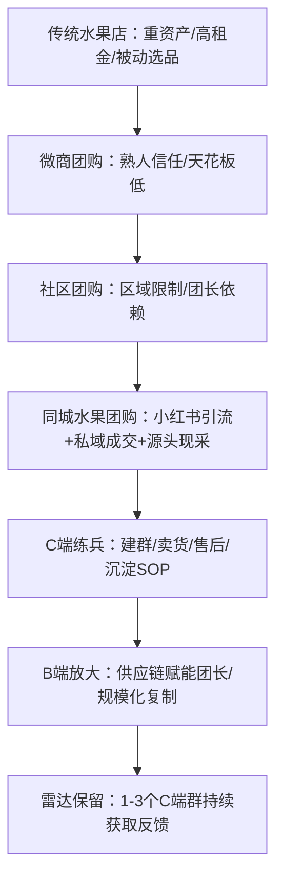
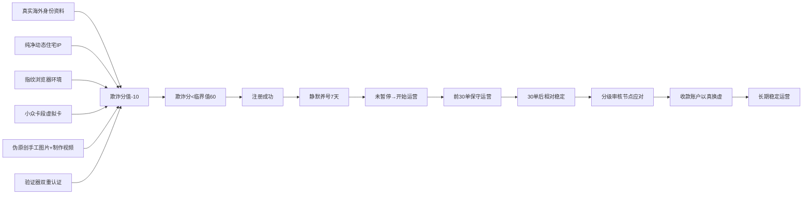
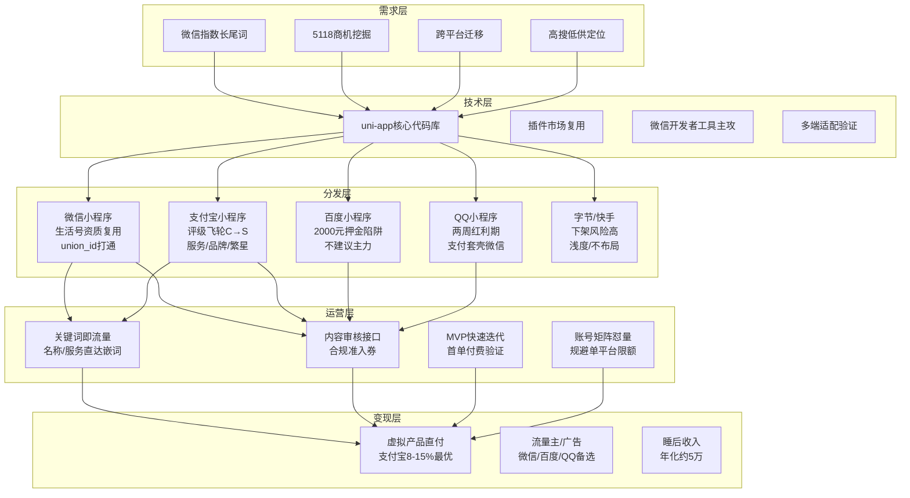

# 第 61 章 三大实战项目深度拆解
作者：龙哥

## 学习目标

- 理解同城水果团购“公域种草+私域信任+源头供应链”三位一体的轻资产闭环模式
- 掌握Etsy注册运营中“全维度模拟真实人设”降低欺诈分值的概率博弈机制
- 了解小程序多端矩阵“关键词即流量、零边际成本躺赚”的工具型产品商业模型
- 能运用“移木建信”、源头现采、爬虫选题等标准化SOP快速跑通冷启动
- 能识别Etsy Plaid验证、百度押金、字节下架等平台规则红线，规避预期收益为负的赛道
- 能根据自身资源禀赋，判断是否具备水果团购供应链优势、海外真实人脉、开发基础等入场门槛

## 61.1 生活类比

想象这三个项目是三种不同难度的“开店”游戏。同城水果团购就像你在朋友圈卖自家果园现摘的水果：公域种草好比你在小区广告栏贴张好看的海报（小红书笔记），私域成交相当于邻居加你微信进“吃货群”下单（快团团），源头供应链就是你大清早去批发市场挑最甜的、省去中间商差价，移木建信则是承诺“满20人发红包”说话算话，邻居才敢预付款。核心优势在于大家天天吃水果（高频刚需），信了你的品质就“静默下单”（复购）。Etsy注册则像你想在美国路边摆摊卖手工艺品，但城管（风控）极严：欺诈分值是城管手里的“可疑度打分表”，身份证真假、摊位位置、收钱码、商品是不是真手工、你有没偷懒都在考核范围内。全维度模拟要求你必须找个真在美国的亲戚（真实身份），用他家宽带（住宅IP），用他的电脑（指纹浏览器），用他的银行卡（收付款），还得拍视频证明是你亲手做的（制作过程主图）。Plaid验证更是美国城管要求必须绑定真美国银行账户验资，市面主流虚拟收款账户基本都无法通过。核心结论就是没有真在美国的亲戚（海外真实人脉），别来凑热闹，预期收益为负。小程序多端矩阵则像你开发一个“万能开瓶器”，想在所有超市货架（微信/支付宝/百度/🐧）上摆放：关键词即流量意味着顾客搜“开红酒”、“开啤酒”就能直接看到你（平台内部搜索分发），uni-app多端相当于一个模具（代码库）生产出适配各超市货架规格的产品。评级飞轮好比支付宝超市给摊位评级（C/S级），评级高给最显眼位置、允许贴更多标签（关键词）。零边际成本体现为模具做好后（开发一次），后续基本不用管（客服周<2h），躺着收钱（睡后收入）。平台差异则表现为支付宝超市顾客最痛快（付费率8-15%）、微信超市限制iOS顾客付费、百度超市收2000元押金才让进场。

## 61.2 概念地图

第61章 三大实战项目深度拆解
├── 同城水果团购 —— 公私域+源头供应链轻资产闭环
│   ├── 核心模式：小红书引流 → 微信群/快团团成交 → 新发地现采发货
│   ├── 关键方法论
│   │   ├── 移木建信（小承诺快兑现建信任）
│   │   ├── 源头现采模式（昨单今采今发，零库存极致鲜度）
│   │   ├── 低粉高互动爬虫选题法（后裔采集器1:1复刻超越）
│   │   ├── 水果三原则（好货抢跑/应季待熟/动态成本定价）
│   │   ├── 分级售后包装体系（源头/物流/售后全链路降损）
│   │   └── 社群SOP化运营（欢迎语/购买引导/猜价游戏/群卫生/发品标准）
│   ├── 核心定律
│   │   ├── 刚需高频强复购=私域最优属性（非旺季月复购38%）
│   │   ├── 一级批发源头=核心护城河（价格低20%+、规避行业坑）
│   │   ├── 小红书0粉红利期=普通人流量突围最佳窗口
│   │   └── C端验证模型→B端规模化供应链（练兵→放大）
│   └── 实证数据：40天3群、单日破9000、0粉1.5万赞、价格锚定对比
├── Etsy注册运营 —— 全维度模拟真实人设的概率博弈
│   ├── 核心模型：欺诈分值模型（资料/IP/卡段/产品/运营多维加权）
│   ├── 关键方法论
│   │   ├── 11步注册全流程SOP（IP检测→邮箱→向导→上品→身份→收付款→证件→验证器）
│   │   ├── 网图伪原创元数据重构（Magicexif写入EXIF）
│   │   ├── 动态住宅IP养号（scamalytics查垃圾值）
│   │   ├── 虚拟卡BIN码归属地校验（bincheck.io）
│   │   ├── 指纹浏览器环境隔离（AdsPower/Hubstudio）
│   │   ├── 验证器双重保险（Authenticator+Enpass云同步）
│   │   ├── 邮件申诉标准化流程（附制作视频）
│   │   └── 收款账户“以真换虚”迁移（真实卡过验→虚拟卡运营）[ID: docs/202303/20230328_174.md]
│   ├── 核心定律
│   │   ├── 新手无海外人脉入场预期收益为负（劝退定理）
│   │   ├── 风控概率论本质（全维度逼近真实用户）
│   │   ├── 产品合规主观性（自拍制作过程构建证据链）
│   │   ├── 店铺生命周期分级审核（首单/3单/10单/30单阶梯复审）
│   │   └── Plaid验证壁垒致美区近乎不可行
│   └── 避坑实证：买店铺/资料重复封店、港店成功率低、7天静默养号降暂停率
└── 小程序多端矩阵 —— 关键词即流量、零边际成本躺赚
    ├── 核心模型：uni-app一次开发多端发布 → 账号矩阵规避限额 → 搜索分发免费精准流量
    ├── 关键方法论
    │   ├── 微信指数/5118/跨平台迁移/高搜低供 四大需求挖掘法
    │   ├── 六大平台差异化运营（微信/支付宝/百度/🐧/快手/字节）
    │   │   ├── 支付宝：评级飞轮（C/B/A/S级→关键词数/流量权重）→ 服务/品牌认证/繁星计划
    │   │   ├── 微信：生活号资质复用（省300元/个、打通union_id）
    │   │   ├── 百度：2000元押金陷阱锁死现金流
    │   │   ├── 🐧：前两周红利期≈后续半年流量、支付套壳微信
    │   │   └── 字节/快手：虚拟支付收紧、下架风险高
    │   ├── 企业主体资质复用降本（注册公司→生活号→内容审核→软著）[ID: docs/202303/L8sxdC6wYorZO1xVgNbc39L4nvf.md]
    │   ├── uni-app开发调试顺序（主攻微信工具→适配其他端）
    │   └── MVP迭代+合规先行（内容审核接口为准入券）
    ├── 核心定律
    │   ├── 零边际成本躺赚（高频刚需非内容型、年成本≤5000元）
    │   ├── 首单付费验证正向循环（真需求试金石）
    │   ├── 平台红利窗口期差异（支付宝黄金期/百度深坑/QQ红利期）
    │   └── 内容合规=生存底线（UGC类必接审核接口）
    └── 实证数据：3账号月入4000+、支付宝付费率8-15%>微信4-6%、年化约5万

## 61.3 同城水果团购 —— 公域种草+私域信任+源头供应链的轻资产闭环

### 为什么需要这个概念？

你可能会问：为什么要把水果团购做成“小红书引流+微信私域+一级批发现采”这种三层结构？因为传统模式都有硬伤：实体水果店或超市面临中间商层层加价、鲜度不可控、选品被动的痛点，你永远在为房租和损耗买单；微商团购依赖熟人关系，信任建立慢，天花板极低，卖完一圈亲戚朋友就没人了；社区团购受固定小区物理范围限制，想象空间被锁死。普通人创业往往缺资金、缺经验、缺场地，我们需要的是一个零门槛启动、高频复购、可规模化复制的模型。

### 核心定义

> "同城水果团购是通过在公域平台发布内容（特别是小红书），引流到微信内售卖。"
> 
> ——《新发地水果小李哥实战复盘》[ID: docs/202303/20230328_156.md]

这个模式的本质是一个三位一体的轻资产闭环：一是流量端的公域种草，在小红书发笔记，通过多路径引流私域（主页挂小号、评论区私信、小红书群、地推）；二是转化端的私域信任，在微信群或快团团小程序成交，通过移木建信、SOP化群运营、口碑裂变实现转化；三是产品端的源头供应链，去新发地一级批发市场现采，实现零库存极致鲜度，动态定价比零售低20%以上。

### 关键方法论

#### 移木建信：小承诺快兑现，建立陌生人信任基石

> "真诚的目的是什么？为了获取信任。如何快速获取信任？「移木建信」"
> 
> ——《新发地水果小李哥实战复盘》[ID: docs/202303/20230328_156.md]

**定义**（来源：《新发地水果小李哥实战复盘》[ID: docs/202303/20230328_156.md]）

> 移木建信 = 设定一个小的公开承诺（如“群满200人发红包”）并快速兑现 → 以“言而有信”的行为快速建立陌生人信任基础 → 区别于以红包为诱饵的营销手段。

**执行动作**：建群即发布成员达到xx人发xxx红包的承诺；兑现即截图红包发完发截图，强化“说话算话”心智。这个方法展示了：信任不需要漫长的时间堆砌，一个可验证的微小承诺兑现，比一万句承诺更有说服力。

#### 源头现采模式：昨单今采今发，零库存极致鲜度

> "用户昨天下单，今天采集最新鲜的货，当天发出。我们每天 6 点多到市场，发现好吃的水果，我们会先买下来。然后发起团购卖出去。"
> 
> ——《新发地水果小李哥实战复盘》[ID: docs/202303/20230328_156.md]

**定义**（来源：《新发地水果小李哥实战复盘》[ID: docs/202303/20230328_156.md]）

> 源头现采 = 利用一级批发市场地理优势 → 用户昨单 → 今早6点跑市场询价/试吃/采买 → 现场打包 → 当天发货 → 价格比水果店低20%+。

**核心逻辑公式**：

团购价 = 一级批发价 + 物流成本 + 薄利

零售价 = 一级批发价 + 二级批发差价 + 三级批发差价 + 店租/损耗/人工 + 利润

**推导过程**：传统零售链条中，水果从一级批发市场流向二级批发商，再到三级批发商或零售终端（水果店/超市），每一级都要加价覆盖运营成本并获取利润；同时实体店面临房租、人工、损耗等固定成本。源头现采模式直接从一级批发市场采购，省去了二级、三级批发差价以及店面运营成本，仅保留物流成本与薄利。因此团购价格可比零售价低20%以上，这正是“价格锚定优势”的数学来源。

这个模式展示了：省去中间商层层加价 + 无店面成本 = 价格锚定优势（至少低20%）。

**价格锚定实证**：

| 水果 | 团购价 | 水果店价 | 超市价 | 价格优势 |
|------|--------|----------|--------|----------|
| 粑粑柑 | 7.6元/斤 | 12元/斤 | 9.68元/斤 | -36.7% |
| 小台芒 | 9.7元/斤 | 未实测* | 11.68元/斤 | -16.9% |
| 伦晚 | 6.65元/斤 | 未实测* | 9.98元/斤 | -33.4% |

> "粑粑柑（我们 7.6 元/斤，水果店 12 元/斤，连锁超市 9.68 元/斤）... 小台芒（我们价格 9.7 元/斤，超市 11.68 元/斤）... 伦晚（我们 6.65 元/斤，超市 9.98 元/斤）... 我们价格平均比水果店至少低 20%左右"
> 
> ——《新发地水果小李哥实战复盘》[ID: docs/202303/20230328_156.md]

*注：小台芒、伦晚水果店价为作者原文未实测，表格中标注为“未实测”以区分实测与推断。

#### 低粉高互动爬虫选题法：数据化模仿超越，降低创作门槛

> "通过爬虫快速筛选出最新、有效的模版/选题，然后去模仿超越。用这种方式我爆了非常多的内容。"
> 
> ——《新发地水果小李哥实战复盘》[ID: docs/202303/20230328_156.md]

**方法**（来源：《新发地水果小李哥实战复盘》[ID: docs/202303/20230328_156.md]）

使用后裔采集器爬取关键词前500条笔记，筛选低粉高赞（如<1万粉但>1万赞）、低粉高评论的爆款内容，提取模版要素（选题类型、排版结构、文案风格、配色、图片构图），进行1:1复刻（对方图片做底图层，上层替换自家实拍图/文案），再微创新注入自家真实场景/数据/口吻完成“超越”。

**两大爆款模版实例**：
- 模版一「应季水果」：标题“XX水果上市了”，封面实拍图+产地/价格/口感三要素，正文“产地直发/现摘现发/不好吃退款”
- 模版二「挑水果小技巧」：标题“教你一招挑XX”，封面对比图（好果vs坏果），正文3个动作要领+最后放团购入口

这个方法论展示了：不靠灵感靠数据，不靠原创靠模仿超越，普通人也能稳定产出爆款。

#### 水果三原则：好货抢跑、应季待熟、动态成本定价

**方法**（来源：《新发地水果小李哥实战复盘》[ID: docs/202303/20230328_156.md]）

| 原则 | 核心动作 | 底层逻辑 |
|------|----------|----------|
| **好货抢跑** | 每日早市现采，发现极品即买即卖，错过不补 | 一级市场好货稀缺，手慢无，稀缺性驱动转化 |
| **应季待熟** | 不按日历上架，按口感成熟度上架（如沃柑等好吃了再上） | 只有好吃才能复购，上架即承诺口感，反向倒逼选品标准 |
| **动态成本定价** | 每日跟踪一级市场价格波动，实时调整售价；进价>售价时宁缺毋滥/亏本退款 | 价格随行就市保利润，极端行情下“品质底线>单单利润”守护信任资产 |

#### 分级售后包装体系：源头/物流/售后全链路降损

**方法**（来源：《新发地水果小李哥实战复盘》[ID: docs/202303/20230328_156.md]）

源头端：自采把控，现场试吃拒绝久放果，当天发出杜绝隔夜；物流端：差异化包装SOP——软果（草莓/无花果）多包层+垫纸+冰袋，硬果（苹果/橙子）标准纸托+缓冲膜，易压果（桃/李）单果网套+加固纸箱；售后端：快团团红包秒赔，无需沟通降低时间成本，破损即赔促进复购。

#### 社群SOP化运营：将“运营”变成“流水线动作”

**方法**（来源：《新发地水果小李哥实战复盘》[ID: docs/202303/20230328_156.md]）

| 环节 | 标准化动作 | 话术/工具要点 |
|------|------------|--------------|
| **入群欢迎** | 发互动话术+历史晒单图+下单链接+优惠券 | “欢迎xx，这是之前大家的收货反馈[图]，点这里下单[链接]，领券减2元” |
| **购买引导** | 分享小程序到群+引导收货晒单 | “下单后点右上角分享到群，收货拍张图发群里，大家一起瞅瞅” |
| **活动转化** | 猜价格游戏：猜中免单/全群享猜中价 | “这款新果多少钱一斤？猜对免单，全群按猜中价买” |
| **群卫生** | 定期踢除仅抢红包不说话的僵尸粉 | 保持群活跃度，避免无效人数稀释权重 |
| **发品标准** | 统一文案模版+实拍图+固定格式，一键转发 | “品名/产地/口感/价格/下单链接/发货时间”六要素齐全 |

### 核心定律

#### 定律一：刚需高频强复购 = 私域最优属性

> "水果刚需，每个人都要吃。水果品类多... 购买频次自然高。水果消耗快，只要好吃用户复购非常强。现在非水果旺季，用户月复购率仍在38%。"
> 
> ——《新发地水果小李哥实战复盘》[ID: docs/202303/20230328_156.md]

**定理表述**：
私域LTV = 客单价 × 月复购率 × 留存月数 × 裂变系数

水果赛道天然具备刚需（人人吃，无需教育市场）、高频（周周买、月月买，自然高频）、强复购（非旺季月复购率38%，剔除新客未消费周期实际更高，用户养成“静默下单”习惯）。这个定律展示了：赛道属性决定商业模式上限，水果是普通人私域创业的“自带复利”赛道。

#### 定律二：一级批发源头 = 核心护城河

> "我哥在全国最大的农产品一级批发市场... 开水果档口，在供应链方面有足够的优势。我们价格平均比水果店至少低 20%左右。因为从一级市场拿货，省去中间商赚差价。"
> 
> ——《新发地水果小李哥实战复盘》[ID: docs/202303/20230328_156.md]

**定理表述**：
成本优势 = (二三级批发差价 + 店租/损耗/人工) / 一级批发价

核心洞察：前期靠“刷脸”拿低价不可持久，供应链规模化需量大才能锁定成本优势；源头经验可规避行业隐性坑（如阿克苏苹果“两层礼盒套路”、陈果冒充新果、水分增重等）；必须亲自做C端验证模型，理解团长痛点，建立SOP后再赋能B端放大。

#### 定律三：小红书“0粉爆款”红利期 = 普通人流量突围最佳窗口

> "小红书目前属于非常大的红利期：越来越多人用小红书... 平台会给新手很多流量扶持。天然的种草平台：用户看到相关内容更容易去消费。而且有能力去消费，50%来自一二线城市。小白快速上手：图文形式的创造，创作门槛低... 平台对中小创作者友好，就算0 粉丝也有机会做爆款。"
> 
> ——《新发地水果小李哥实战复盘》[ID: docs/202303/20230328_156.md]

**数据验证**：0粉账号单篇最高1.5万赞，一周引流建群300人，用户画像为一二线城市、年轻女性、高消费能力、种草即购买心智。

#### 定律四：C端验证模型 → B端规模化供应链

> "做 C 端目的是为了知道团长是怎么干的，才能更好服务他们。同时以后会保留 1-3 个 C 端群，方便拿到用户第一时间对水果的反馈。起量快速的办法是找 B 端团长，所以后面我会专心做好供应链。"
> 
> ——《新发地水果小李哥实战复盘》[ID: docs/202303/20230328_156.md]

**演进路径**：
阶段1（C端练兵）：亲自建群/卖货/售后/选品/定价 → 理解团长痛点 → 验证选品逻辑 → 获取用户一手反馈 → 沉淀SOP
阶段2（B端放大）：把控供应链/文案/卖点/素材 → 赋能团长（供货+素材+文案） → 团长只负责引流/私域/客户维护
阶段3（雷达保留）：保留1-3个C端群 → 作为“试错雷达”拿一手反馈 → 新品测款/选品调整

这个定律展示了：先做难而正确的事（C端练兵），再做易而放大的事（B端供应链），不可倒置。

### 实证数据总结

以下数据为作者亲测实证，展示了冷启动效果与核心指标表现：

| 指标 | 数值 | 来源 |
|------|------|------|
| 冷启动周期 | 40天 | 亲测 |
| 建群数量 | 3个团购群 | 亲测 |
| 单日最高交易额 | 9000+元 | 亲测 |
| 最快建群/出单 | 1天建200人群，出5单 | 亲测 |
| 协助朋友建群 | 300人 | 亲测 |
| 非旺季月复购率 | 38% | 亲测 |
| 0粉爆款最高赞 | 1.5万赞 | 亲测 |
| 价格优势 | 比水果店低20%+ | 实测对比 |
| 适配人群 | 宝妈优势显著 | 观察实证 |

> "单日最高交易额破 9000+... 40 天从 0 到 1 建立起 3 个水果团购群... 最快一天建立一个 200 人群，当天出了 5 单... 手把手教朋友建立一个 300 人群... 现在非水果旺季，用户月复购率仍在38%... 下面是我 0 粉账号做到了 1.5 万赞。"
> 
> ——《新发地水果小李哥实战复盘》[ID: docs/202303/20230328_156.md]

### 边界条件与避坑指南

1. **供应链是硬门槛**：纯倒手无护城河，必须具备一级货源整合能力或源头优势
2. **极端行情决策**：进价>售价时，坚决“宁缺毋滥、亏本退款、不发次品”，以品质底线守护长期信任资产
3. **先C后B不可逆**：跳过C端练兵直接找团长 = 无SOP、无话语权、极易被团长反向绑架
4. **宝妈比较优势**：拍照审美/群运营共情/碎片时间匹配/信任建立，综合胜出男性同胞

> "极端情况出现进价比售价高... 我对产品宁缺毋滥，宁可不卖，也不会卖出质量差的水果。当有好货时立马上狂推，货不好时坚决不卖。... 做了之后发现，宝妈做更有优势，不论是拍照引流、微信群运营等等，比男同胞有太多优势。"
> 
> ——《新发地水果小李哥实战复盘》[ID: docs/202303/20230328_156.md]

### 方法演进图

---

## 61.4 Etsy注册与运营 —— 全维度模拟真实人设的概率博弈

### 为什么需要这个概念？

你可能听说过“Etsy卖手工赚美元”，但素材作者开篇直接泼冷水：

> "我的回答是：不建议。原因如下：1.使用国内资料是无法注册 Etsy 的。2.即使你有国外的资料，那么也无法保证注册成功。3.即使注册成功了，因为这个平台极高的风控，店铺依然很容易被暂停甚至封店。如果你没有海外的朋友，那么就不要开始了。"
> 
> ——《Etsy注册运营全流程指南》[ID: docs/202303/20230328_174.md]

**核心痛点**：Etsy风控极严，单一合规（如真实产品）无法抵消多维违规（虚拟卡、服务器IP、重复资料）；国内卖家缺乏海外真实人脉（身份/地址/银行卡/电脑/IP），资料重复率高、环境模拟成本大；购买店铺/资料极高概率因重复导致关联封店，维权无门。

### 核心定义：欺诈分值模型

> "Etsy 平台这套欺诈值打分系统是怎么计算的，我们永远无法得知，但是我们能做的就是在每一个细节上面，越接近一个“正常人”，努力降低这个分数，那么店铺就会越稳定。"
> 
> ——《Etsy注册运营全流程指南》[ID: docs/202303/20230328_174.md]

**定义**（来源：《Etsy注册运营全流程指南》[ID: docs/202303/20230328_174.md]）

> **欺诈分值模型** = 资料真实度 + IP纯净度 + 卡段重复率 + 产品合规度 + 运营异常度 多维加权打分
> 
> 超过临界值（假设60分）即触发暂停/封店

**模型演示**：

| 店铺 | 资料 | IP | 付款卡 | 收款卡 | 产品 | 欺诈分 | 结果 |
|------|------|----|-------|--------|------|--------|------|
| A | 真实 | 住宅 | 虚拟 | 虚拟 | 原创 | 50分 | 暂存高风险 |
| B | 真实 | 住宅 | 真实 | 真实 | 原创 | 10分 | 稳定 |
| C | 购买 | 服务器 | 虚拟 | 虚拟 | 搬运 | 90分 | 必封 |

这个模型揭示了：风控不是非黑即白的“是/否”，而是概率分布。唯有全维度向“真实正常用户”无限逼近，才能将分值压至安全线以下。

### 关键方法论

#### 11步注册全流程SOP：标准化动作规避主观随意

**方法**（来源：《Etsy注册运营全流程指南》[ID: docs/202303/20230328_174.md]）

1. 检测IP/货币一致性：打开etsy.com，滑到底部看国家/货币是否匹配目标站点
2. 邮箱注册：Outlook/Gmail → 验证邮箱
3. 进入Sell on Etsy向导：设置语言/国家/货币/店名
4. 上传伪原创产品（关键）：主图含制作过程视频截图/填Tag/设处理时间
5. 填写个人身份/地址：小到大格式（门牌号→街道→城市→州→邮编→国家）
6. 配置虚拟收款账户：万里汇/PingPong等（非美区）
7. 上传证件：驾照/护照/身份证，需与注册地址国家一致
8. 绑定虚拟信用卡付款：卡头BIN码必须匹配注册国家
9. 配置验证器2FA：Google/Microsoft Authenticator，禁用短信验证
10. 保存备用码：截图/Enpass云同步，防手机丢失锁死账号
11. 静默养号7天：注册完成完全不动，7天后未暂停再装修上品

#### 网图伪原创元数据重构：Magicexif写入EXIF

> "如果使用的是网图（网络上找的图片），注意要修改图片的名称，并使用工具修改或者增加图片的元数据。图片元数据修改工具可以用 Magicexif。"
> 
> ——《Etsy注册运营全流程指南》[ID: docs/202303/20230328_174.md]

**方法**：下载网图 → 修改文件名为英文无中文（如handmade_ceramic_mug_001.jpg） → Magicexif写入EXIF（相机型号：iPhone 14 Pro / Canon EOS R5，拍摄参数：光圈f/1.8、快门1/120s、ISO 64、焦距24mm，GPS坐标：目标国家真实地标坐标如洛杉矶圣塔莫尼卡海滩） → 上传作主图 → 保留制作过程视频备存申诉。

#### 动态住宅IP养号：scamalytics查垃圾值

> "建议注册 Etsy 店铺时使用动态住宅 IP... 因为这样的 IP 是最干净的。使用 IP 前，先检查 IP 是否属于目标国家，并且可以用这个网站（scamalytics.com/ip）看 IP 的垃圾值是否过高，绿色提示最好，黄色一般，红色直接不要用。"
> 
> ——《Etsy注册运营全流程指南》[ID: docs/202303/20230328_174.md]

**操作流程**：购买动态住宅代理 → 接入指纹浏览器 → scamalytics.com检测（ISP显示电信运营商名如Comcast/Verizon=住宅IP✓，显示云厂商名如Amazon/Google/Alibaba=机房IP✗，垃圾值：绿色<黄色<红色，红色直接弃用） → 注册期用动态IP → 店铺稳定后可切固定IP降成本。

#### 虚拟卡BIN码归属地校验：bincheck.io

> "使用前一定要查卡头，卡头必须和注册国家一致。比如注册的是美国店，那么卡头也必须是美国的。使用这个链接（bincheck.io），输入虚拟卡号的前 6 位查询是属于哪个国家的。"
> 
> ——《Etsy注册运营全流程指南》[ID: docs/202303/20230328_174.md]

**实操**：注册加拿大站 → 虚拟卡头453211 → bincheck.io查询显示发卡国为美国 → **不可用**，会触发风控；必须找卡头归属地与店铺国家一致的虚拟卡。

#### 指纹浏览器环境隔离：AdsPower/Hubstudio

> "使用指纹浏览器软件，建议使用 adspower 或者 Hubstudio。对于第二点（模拟当地电脑环境），可以用指纹浏览器解决。"
> 
> ——《Etsy注册运营全流程指南》[ID: docs/202303/20230328_174.md]

**核心价值**：模拟UA/时区/语言/分辨率/Canvas/WebGL等指纹参数，创建隔离可定制虚拟环境，支持团队协作跨设备同步，解决“国内电脑模拟海外环境”的核心痛点。

#### 验证器双重保险：Authenticator + Enpass云同步

> "不建议使用手机短信的方式来验证... 验证器软件是在手机上的，如果手机丢失，或者恢复出厂设置了，那么数据也会丢失，无法恢复。所以建议也要把验证时的二维码截图保存下来。或者也可以使用这个软件：enpass，是个密码管理软件，也支持保存这种一次性验证码，可以绑定云盘..."
> 
> ——《Etsy注册运营全流程指南》[ID: docs/202303/20230328_174.md]

**双重保险方案**：主方案使用Google/Microsoft Authenticator（手机端）；备份方案1为二维码截图保存（离线备选）；备份方案2为Enpass密码管理器云同步（跨设备恢复）。

#### 邮件申诉标准化流程：附制作视频为核心证据

> "首先，点击联系 Etsy 支持... 选择邮件申诉... 如果是新店被暂停，那么在附件的地方，可以选择上传产品的手工制作视频... 申诉之后，Etsy 会给你发送一封自动邮件... 过几天之后就会再发一封审核结果的邮件。Etsy 现在回复邮件的时间越来越慢，7-14 都有可能。"
> 
> ——《Etsy注册运营全流程指南》[ID: docs/202303/20230328_174.md]

**标准动作**：后台Contact Support → Email appeal → 实情陈述 → 附件上传制作视频（新店暂停时关键证据） → 发送 → 监控邮箱7-14天 → 未回复追加二次申诉。

#### 收款账户“以真换虚”迁移策略

> "解决方案就是：可以在店铺开下来并运营一段时间后，把收款卡改为虚拟收款卡，比如万里汇这一类的，那就能解决税费...和收款...的问题。"
> 
> ——《Etsy注册运营全流程指南》[ID: docs/202303/20230328_174.md]

**迁移时机与逻辑**：

| 阶段 | 收款账户 | 理由 |
|------|----------|------|
| 注册初期（0-30单） | 亲戚真实海外银行卡 | 信任度最高，通过收款验证概率最大 |
| 稳定期（>30单） | 切换万里汇等虚拟收款 | 解决回款效率/税务合规/汇率损耗 |

### 核心定律

#### 定律一：新手入场劝退定理

> "如果你没有海外的朋友，那么就不要开始了。因为一旦开始，你就要进入开店，封店的恶性循环之中，最后疲惫地放弃这个平台，精力和金钱都损失，何必呢？"
> 
> ——《Etsy注册运营全流程指南》[ID: docs/202303/20230328_174.md]

**判定标准**：无海外可信人脉（提供真实身份/地址/银行卡/电脑/IP）的国内新手 → 预期收益为负 → **直接放弃**

#### 定律二：风控概率论本质

> "风控是一个概率问题，不是简单的“是”或者“不是”的问题。有条件就尽量接近真实，如果没条件就要接受有被封的可能性，没人能肯定这么做是封还是不封。"
> 
> ——《Etsy注册运营全流程指南》[ID: docs/202303/20230328_174.md]

**核心公式**：
P(存活) = f(资料真实度, IP纯净度, 卡段匹配度, 产品合规度, 运营规范度)

同操作有的店活有的店死 = 样本点落在概率分布不同区间。

#### 定律三：产品合规主观性

> "第一，这是个很主观的定义，因为我们都不是 Etsy 审核人员，所以我们怎么认为并不重要，重要是 Etsy 审核人员怎么认为。第二，我们要做的就是，能自己拍图就自己拍图。"
> 
> ——《Etsy注册运营全流程指南》[ID: docs/202303/20230328_174.md]

**唯一策略**：自我拍摄制作全过程视频/图片 → 构建不可辩驳的证据链 → 应对不可预测的定期抽查。

#### 定律四：店铺生命周期分级审核

> "一般来说，店铺出了 30 单之后，就是比较稳定了。即使申诉成功，并不意味着你的店铺就可以一劳永逸了。Etsy 会在店铺出首单，三四单，十单，三十单，百单，甚至千单左右都会再次审核。"
> 
> ——《Etsy注册运营全流程指南》[ID: docs/202303/20230328_174.md]

**审核节点阶梯**：
首单 → 3-4单 → 10单 → 30单（高危期分水岭） → 百单 → 千单

**前30单红线**：日上新≤3款，注册时上传产品尽量不动，严禁刷单/大幅调价/批量打折/超期发货/回复超时。

#### 定律五：Plaid验证壁垒致美区近乎不可行

> "美区的 Etsy 因为需要过 plaid 验证，所以暂时没有好的方案来收款。现在不建议注册美国地区的 Etsy，会触发 plaid 验证，而市面上的虚拟收款账户暂时基本都无法通过 plaid 验证。"
> 
> ——《Etsy注册运营全流程指南》[ID: docs/202303/20230328_174.md]

**避坑指引**：规避美区 → 注册加拿大/英国/澳洲/德国等非Plaid站点。

### 避坑实证

| 坑点 | 实证结论 | 应对 |
|------|----------|------|
| 买店铺/资料 | 极高概率因重复资料关联封店，维权无门 | 坚决自注册，拒绝购买 |
| 香港公司注港店 | 成功率低且不稳定，失败居多 | 不建议专门注册公司尝试 |
| 静默养号7天 | 显著降低初期暂停率 | 必执行：注册完放置7天不动 |
| 邮件申诉 | 成功率>客服工单，视频证据为王 | 标准化申诉流程，必附制作视频 |

> "买资料最大的问题是，你永远不知道卖家会把一份资料卖给多少人，而拿着重复的资料去注册店铺，肯定是很容易出问题的... 我自己测试用中国护照开港店是不行的。但对于中国人开的香港公司... 测试结果是：有一定的概率能成功。多位朋友测试过了，有的成功，有的失败，失败居多。"
> 
> ——《Etsy注册运营全流程指南》[ID: docs/202303/20230328_174.md]

### 数据流图：注册到稳定的全链路信号流转

---

## 61.5 小程序多端矩阵 —— 关键词即流量、零边际成本躺赚的工具型产品模型

### 为什么需要这个概念？

你可能在纠结：做独立站还是小程序？做微信还是全平台？素材作者给出了明确答案：

> "利用业余时间，开发了十几款小程序，累计10万+用户，变现5万+"
> 
> "因为每个支付宝账号只能创建10个小程序，所以需要多个支付宝账号怼量"
> 
> "使用uniapp开发一次即可，uniapp还有插件市场，插件可以直接导入使用。对了，他还可以直接发布h5。"
> 
> ——《独立开发者小程序多端矩阵实战分享》[ID: docs/202303/L8sxdC6wYorZO1xVgNbc39L4nvf.md]

**核心洞察**：独立站/👸号依赖SEO/推荐算法，获客成本高、不稳定；工具类产品需求稳定但分散在各平台搜索入口；单平台流量有上限且规则多变；非技术/弱技术创业者需要低维护、可复用、高杠杆的“睡后收入”载体。

### 核心定义

#### 小程序多端矩阵运营

> "基本每个工具，就是一个关键词。小程序的名字，自带流量，取名字很关键。"
> 
> ——《独立开发者小程序多端矩阵实战分享》[ID: docs/202303/L8sxdC6wYorZO1xVgNbc39L4nvf.md]

**定义**：利用uni-app一次开发、多端发布（微信/支付宝/百度/🐧/快手/字节/H5），通过账号矩阵规避平台限制（如支付宝单号限10应用），最大化获取各平台搜索入口流量与变现收益。

#### 关键词即流量模型

**定义**：工具名/服务直达嵌入长尾高搜索指数词，依托平台内部搜索分发实现“搜即得、用即走”免费精准流量。

**公式**：
免费精准流量 = Σ(关键词_i 搜索指数 × 排名权重_i) (i=1到n)

**变量定义与推导**：
- 关键词_i 搜索指数：平台内部搜索工具（如微信指数、支付宝搜索后台）显示的该词日均搜索量，代表用户主动需求强度
- 排名权重_i：小程序在该关键词搜索结果中的位置权重，排名越靠前权重越高，受评级、服务直达、品牌认证等因素影响
- 求和运算：多个长尾关键词覆盖不同细分需求，流量可叠加
- 业务含义：工具类小程序无需外部推广，通过名称与服务直达配置关键词，直接捕获平台内部高意图搜索流量，实现“零推广成本获客”

#### 评级飞轮（支付宝特有）

> "关键词设置的个数跟小程序的评级有关系。比如刚上架时，是C级，那么最多只能设置5个关键词。 B级10个，C级15个，S级20个。小程序的评级越高，给的流量越多，S级还有特别加权。敲黑板：这个很重要，一定要创建一个 “小程序服务”，在搜索关键词时，这个权重很大。"
> 
> ——《独立开发者小程序多端矩阵实战分享》[ID: docs/202303/L8sxdC6wYorZO1xVgNbc39L4nvf.md]

**评级-流量正向循环**：
创建小程序服务 → 接入内容审核 → 功能完备迭代 → 评级提升(C→B→A→S) → 关键词数量增加(5→10→15→20) + 特别加权(S级) → 搜索流量放大 → 使用数据变好 → 评级进一步提升

**推导逻辑**：评级是支付宝衡量小程序质量与服务能力的综合指标，高等级意味着平台给予更多展示资源（关键词槽位、搜索权重、特别加权），带来更多自然搜索流量；流量增加带来更多使用数据（日活、留存、转化），进而推动评级进一步提升，形成正向飞轮。

### 关键方法论

#### 四大需求挖掘法：数据驱动选品，拒绝拍脑袋

**方法**（来源：《独立开发者小程序多端矩阵实战分享》[ID: docs/202303/L8sxdC6wYorZO1xVgNbc39L4nvf.md]）

| 方法 | 工具/渠道 | 核心动作 | 判断标准 |
|------|-----------|----------|----------|
| **微信指数长尾挖掘** | 微信搜“微信指数”小程序 | 输入种子词→获取下拉长尾词+日指数趋势→多词对比 | 看趋势不看绝对值，上升趋势=需求增长 |
| **5118商机挖掘** | 关注5118👸号→商机挖掘 | 输入核心词→查看长尾需求列表+指数趋势 | 高指数+上升趋势=高潜力切入点 |
| **跨平台需求迁移** | 微信生态验证済功能 | 将微信爆款功能迁移至支付宝/百度/QQ等竞品少平台 | 先发优势+平台扶持=低成本复制 |
| **高搜低供定位** | 目标平台搜索核心词 | 头部应用用量极大+跟进竞品极少/无 | 需求旺盛+竞争真空=蓝海切入点 |

#### 六大平台差异化运营：知己知彼，集中兵力打歼灭战

**平台对比决策表**：

以下表格对比了六大主流小程序平台在付费意愿、评级机制、核心运营、开发调试、资质复用、变现模式六个维度的核心差异，为多端矩阵资源分配提供决策依据：

| 维度 | **支付宝（主阵地）** | **微信（主阵地）** | **百度（规避）** | **🐧（浅度布局）** | **字节/快手（规避）** |
|------|---------------------|-------------------|------------------|-------------------|---------------------|
| **付费意愿** | 8-15%（无iOS限制） | 4-6%（iOS禁虚拟支付） | 限制虚拟支付 | 套壳微信支付 | 限制虚拟支付/强制流量主 |
| **评级机制** | C/B/A/S级→关键词数/流量权重 | 无显性评级，依赖搜索/推荐 | 无显性评级 | 无显性评级 | 无显性评级 |
| **核心运营** | 服务/品牌认证/繁星计划→冲评级 | 生活号资质复用(省300元/个) | 2000元押金陷阱锁死现金流 | 前两周红利期≈后续半年流量 | 下架风险高/审核严 |
| **开发调试** | 有坑(不能传图片) | **最佳体验/工具链完善** | 兼容性差/调试费劲 | 生态不全 | 坑多/审核不可控 |
| **资质复用** | 企业主体开通商户号 | 生活号复用→注册≤50个/省认证费 | 企业主体开通商户号 | 企业主体开通商户号 | 企业主体开通商户号 |
| **变现模式** | 直接虚拟支付/高ARPU | 虚拟支付受限/流量主/广告 | 流量主/虚拟支付受限 | 流量主为主 | 流量主/广告 |

**决策结论**：集中资源深耕支付宝+微信，浅度布局QQ红利期，坚决规避百度/字节/快手深坑。

#### 企业主体资质复用与合规降本法

**方法**（来源：《独立开发者小程序多端矩阵实战分享》[ID: docs/202303/L8sxdC6wYorZO1xVgNbc39L4nvf.md]）

注册公司 + 开通企业网银（便于打款认证） → 微信端创建生活号复用资质注册 ≤50个小程序（省300元/个认证费） → 统一接入图片/文本内容审核接口（图片处理类必接，否则必下架） → 统一申请软著（广告主/高级能力门槛） → 支付宝优先用企业账号联系客服（基本不用排队）。

**成本核算**：年综合运营成本 ≤ 5000元（含注册公司/代记账/服务器/数据库/企业网银），十几款小程序通过生活号复用 → 省认证费约1.5万+。

#### uni-app开发调试顺序：主攻微信，再适配其他

**方法**（来源：《独立开发者小程序多端矩阵实战分享》[ID: docs/202303/L8sxdC6wYorZO1xVgNbc39L4nvf.md]）

主攻微信开发者工具开发调试（体验最佳、工具链完善） → 功能稳定后依次适配验证：支付宝（注意：不能直接传图片等坑）、百度（兼容性差、调试费劲）、🐧（生态不全、支付套壳微信）、字节/快手（仅作了解，不深度适配）。

**避坑指引**：避免多端同步调试导致效率极低，微信工具调试效率碾压其他端。

#### MVP迭代 + 合规先行：内容审核接口为准入券

> "先做MVP：小程序开发时，不要追求完美，先上线，有人用再继续优化，没人用，不要浪费太多时间；合规：小程序一定要接入内容审核接口，否则早晚会被下架。"
> 
> ——《独立开发者小程序多端矩阵实战分享》[ID: docs/202303/L8sxdC6wYorZO1xVgNbc39L4nvf.md]

**铁律**：凡涉及UGC（用户上传图片/视频/文本）的工具类小程序 → **必须**上线前接入平台指定内容审核接口；微信/支付宝/百度/QQ均强制，否则必因违规投诉或巡检下架；合规成本是不可压缩的“准入券”而非可选项。

### 核心定律

#### 定律一：工具类小程序“零边际成本躺赚”

> "需求稳定：工具类小程序是刚需，基本不会受到疫情影响，需求很稳定；躺赚：小程序基本就是开发的一次性投入，后续基本没有维护工作量，基本做到躺赚。"
> 
> ——《独立开发者小程序多端矩阵实战分享》[ID: docs/202303/L8sxdC6wYorZO1xVgNbc39L4nvf.md]

**数学表述**：
边际成本 ≈ 0 (客服周<2h, 无内容生产压力)
长周期复利 = 单次开发投入 × Σ[月现金流_t / (1+r)^t] (t=1到T)

**验证数据**：年综合成本≤5000元，月睡后收入稳定4000+，年化约5万。

#### 定律二：首单付费验证正向循环

> "赚到第一块钱、获取第一个用户很重要，因为这基本证明了，你的需求是有人愿意付费的，只有愿意付费的需求，才真正是用户的需求；同样，有人付费了，获得激励后，才能继续做下去。"
> 
> ——《独立开发者小程序多端矩阵实战分享》[ID: docs/202303/L8sxdC6wYorZO1xVgNbc39L4nvf.md]

**飞轮模型**：
首单付费 → 验证真需求 → 正向激励 → 持续迭代 → 扩大矩阵 → 更多首单

#### 定律三：平台规则红利窗口期差异

**平台生命周期定位**：
- **支付宝**：黄金期（付费意愿强、评级透明、客服友好、生态成熟）
- **微信**：成熟期（流量大但虚拟支付受限、竞争激烈、需生活号复用降本）
- **百度**：深坑期（2000元押金锁死现金流、兼容性差、不推荐主力布局）
- **🐧**：红利期仅前两周（流量≈后续半年总和、支付套壳微信、无长期运营机制）
- **字节/快手**：收紧期（虚拟支付限制、下架风险高、不可控）

#### 定律四：内容合规 = 生存底线

> "合规：小程序一定要接入内容审核接口，否则早晚会被下架。"
> 
> ——《独立开发者小程序多端矩阵实战分享》[ID: docs/202303/L8sxdC6wYorZO1xVgNbc39L4nvf.md]

**适用范围**：凡涉及用户生成内容（图片处理/文字处理/视频处理）的小程序，无一例外。

### 实证数据总结

以下数据为作者多平台汇总实证，验证了商业模型的可行性与收益水平：

| 指标 | 数值 | 来源 |
|------|------|------|
| 开发小程序数量 | 十几款 | 亲测 |
| 累计用户 | 10万+ | 亲测 |
| 变现金额 | 5万+ | 亲测 |
| 月睡后收入 | 稳定4000+ | 3账号汇总 |
| 支付宝付费率 | 8-15% | 实测对比 |
| 微信付费率 | 4-6% | 实测对比 |
| 年综合运营成本 | ≤5000元 | 核算 |
| 零基础学习 | 20小时 | 亲测 |
| 首个应用开发 | 20小时 | 亲测 |
| 熟练后单应用 | 5小时 | 亲测 |
| 客服维护 | 周<2小时 | 亲测 |

> "3个账号，睡后收入，在4k/月左右，加个🍗还是够了... 从数据上看，支付宝的付费比例在8% -15%左右；微信付费比例在4%-6%左右... 以上几项，一年的成本，不超过5000块。"
> 
> ——《独立开发者小程序多端矩阵实战分享》[ID: docs/202303/L8sxdC6wYorZO1xVgNbc39L4nvf.md]

### 边界条件与避坑指南

1. **仅适用工具类**：高频刚需、非内容消耗型、标准化程度高（图片压缩/格式转换/水印去除等）
2. **需基础开发能力**：零基础20小时上手uni-app，纯小白存在学习曲线陡峭风险
3. **推广是瓶颈**：开发容易推广难，必须依托平台搜索流量而非自带流量
4. **平台规则变动风险**：百度押金/字节下架等不可控，集中资源深耕支付宝+微信

### 架构分层图：小程序多端矩阵系统全景

---

## 61.6 多源对照

### 共识

三个项目虽然形态迥异，但达成了以下**底层共识**：

| 共识维度 | 同城水果团购 | Etsy注册运营 | 小程序多端矩阵 |
|----------|-------------|--------------|----------------|
| **概率思维** | 爬虫选题提高爆款概率 | 欺诈分值模型概率博弈 | 矩阵怼量对抗单点不确定性 |
| **标准化SOP** | 社群运营/选品/售后全流程SOP | 11步注册/申诉/养号标准化流程 | 开发调试/上架运营/合规标准化 |
| **信任资产** | 移木建信/品质把关沉淀信任 | 制作视频证据链/真实人设建信任 | 首单付费验证/稳定交付建信任 |
| **供应链/技术杠杆** | 一级批发源头=价格/品质护城河 | 指纹浏览器/动态IP/验证器=环境护城河 | uni-app多端复用=开发效率杠杆 |
| **先验证后放大** | C端练兵→B端供应链赋能 | 静默养号7天→保守运营30单→稳定后扩 | MVP上线→首单验证→扩大矩阵 |
| **红利窗口期** | 小红书0粉红利期 | 无（反而强调门槛高、劝退） | 支付宝黄金期/QQ两周红利期 |

### 分歧

| 分歧维度 | 同城水果团购 | Etsy注册运营 | 小程序多端矩阵 |
|----------|-------------|--------------|----------------|
| **入场门槛** | 低（有源头/会手机即可） | 极高（需海外真实人脉全套） | 中（需基础开发/学习意愿） |
| **核心壁垒** | 供应链+私域信任复利 | 环境模拟真实度+资料独特性 | 关键词布局+评级飞轮+多端矩阵 |
| **变现路径** | 实物高频复购 | 手工艺品高客单/美元收款 | 虚拟工具低客单/高频复购/睡后收入 |
| **风控态度** | 平台相对友好/算法扶持新人 | 极度严苛/概率论博弈/劝退导向 | 合规为底线/平台规则差异巨大 |
| **时间投入** | 高（每日早市/打包/群运营） | 高（环境配置/养号/申诉） | 低（开发一次/后续极低维护） |
| **规模化路径** | C端→B端团长赋能 | 单店深耕/多店矩阵风险极高 | uni-app多端+账号矩阵天然规模化 |

---

## 61.7 设计中的取舍

### 为什么不用“买现成店铺/资料”快速入场Etsy？

因为资料重复率导致关联封店是概率必然事件。买家无法知晓卖家把一份资料卖给了多少人，一旦资料重复，无论你操作多规范，欺诈分值中的“资料唯一性”维度直接拉满，店铺必封。且买店铺后封店无法界定是资料问题还是操作问题，维权无门。自注册虽慢，但每一步都在压低欺诈分值，是唯一可控路径。

> "买资料最大的问题是，你永远不知道卖家会把一份资料卖给多少人，而拿着重复的资料去注册店铺，肯定是很容易出问题的。买店铺同理... 后期被封了到底是资料问题还是操作问题，就没办法说得清。"
> 
> ——《Etsy注册运营全流程指南》[ID: docs/202303/20230328_174.md]

### 为什么水果团购不直接做“社区团购/美团优选”模式？

因为社区团购受物理小区范围锁死，团长获客半径有限，想象空间被压缩。同城水果团购利用小红书“同城/同省”算法分发，突破物理边界，覆盖全城甚至周边城市，私域沉淀后通过快团团/微信群实现“同城配送/自提点”灵活履约，拥有更大的市场天花板。

> "相比微商团购起步更容易，微信好友数少也可以做。相比小区团购没有区域的限制，这种想象空间更高，做的范围也更广。"
> 
> ——《新发地水果小李哥实战复盘》[ID: docs/202303/20230328_156.md]

### 为什么小程序不做“内容型/社区型”而专做“工具型”？

因为内容型需要持续生产内容（高边际成本）、依赖推荐算法（不确定性高），而工具型：需求稳定（刚需高频，不随宏观环境波动）、边际成本趋零（开发一次，多端复用，无内容生产压力）、搜索分发确定性高（用户主动搜索，意图精准，转化率高）、合规可控（功能固定，审核标准明确）。

> "需求稳定：工具类小程序是刚需，基本不会受到疫情影响，需求很稳定；躺赚：小程序基本就是开发的一次性投入，后续基本没有维护工作量，基本做到躺赚。"
> 
> ——《独立开发者小程序多端矩阵实战分享》[ID: docs/202303/L8sxdC6wYorZO1xVgNbc39L4nvf.md]

### 为什么Etsy坚决规避美区（Plaid验证）？

因为Plaid验证要求绑定真实美国银行账户，市面主流虚拟收款账户（万里汇/PingPong/连连/空中云汇/光子易）均无法通过。这是硬性技术壁垒，非资源/技巧可突破。规避美区注册加拿大/英国/澳洲/德国站点，虽流量略低但可行性从0变1，是理性选择。

> "美区的 Etsy 因为需要过 plaid 验证，所以暂时没有好的方案来收款。现在不建议注册美国地区的 Etsy，会触发 plaid 验证，而市面上的虚拟收款账户暂时基本都无法通过 plaid 验证。"
> 
> ——《Etsy注册运营全流程指南》[ID: docs/202303/20230328_174.md]

### 这种设计的trade-off是什么？

| 维度 | 获得 | 牺牲 |
|------|------|------|
| **水果团购** | 高复购/高信任/供应链护城河 | 高物理劳动强度/极端行情亏损风险/地域限制 |
| **Etsy** | 美元高客单/手工溢价/长尾长久 | 极高入场门槛/持续风控压力/美区不可行/单店上限低 |
| **小程序矩阵** | 零边际成本/睡后收入/多平台分发/确定性流量 | 需开发能力/单品天花板低/依赖平台规则/推广瓶颈 |

---

## 61.8 动手练习

### 练习 1：同城水果团购冷启动推演

假设你在二线城市，无水果供应链资源，但想尝试同城水果团购：

1. 如何在本地寻找并验证一级批发市场货源？关键考察指标有哪些？
2. 0粉小红书账号，前7天内容发布计划如何排布？（参考爬虫选题法、引流四部曲）
3. 首个微信群（种子用户20人）如何通过“移木建信”和“猜价格游戏”完成首单破冰？
4. 遭遇极端天气导致进价>售价时，你的决策标准是什么？如何向用户解释？（参考水果三原则中的动态成本定价）

**回答问题**：
- 为什么说“先做C端验证模型，再做B端放大”是必经路径？
- 宝妈群体在该模式中具有哪些显著比较优势？

### 练习 2：Etsy注册风控实战模拟

你决定尝试注册一家Etsy加拿大站店铺，手头有一张加拿大虚拟信用卡（卡头453211），一张万里汇收款账户，一台国内电脑：

1. 使用bincheck.io查询卡头453211，发现发卡国家为美国。此时能否直接用于加拿大站注册？为什么？（参考虚拟卡BIN码归属地校验）
2. 你打算用静态服务器IP（阿里云海外节点）注册。用scamalytics.com检测显示ISP为'Alibaba Cloud'，垃圾值红色。会发生什么？如何修正？（参考动态住宅IP养号）
3. 注册时上传产品主图，你从Pinterest下载了一张手工陶瓷杯图片，文件名为'IMG_2023.jpg'。直接上传会有什么风险？如何用Magicexif处理？（参考网图伪原创元数据重构法）
4. 店铺注册完成后，作者建议“静默养号7天”。这7天内你绝对不能做哪三件事？（参考注册全流程SOP第11步）

**回答问题**：
- 为什么说“风控是概率问题，不是是非问题”？欺诈分值模型如何解释“同操作有的店活有的店死”？
- 美区Plaid验证为何成为硬性壁垒？收款账户“以真换虚”策略的操作时机与风险点是什么？

### 练习 3：小程序多端矩阵选品与上架决策

你掌握uni-app基础，想开发一款“视频去水印”工具类小程序：

1. 用微信指数搜“视频去水印”，日指数1200，趋势平稳；5118长尾词挖掘出“抖音去水印小程序”指数800、“快手去水印”指数600。如何判断这是真需求而非伪需求？（参考微信指数长尾挖掘法、5118商机挖掘法）
2. 在支付宝小程序搜“视频去水印”，发现头部应用“去水印神器”月用量50万，但第2-10名月用量均<1万。这是蓝海还是红海？为什么？（参考高搜低供定位法的判断标准：头部用量极大+跟进竞品极少/无）
3. 你决定首发支付宝。新上架C级只能设5个关键词，你会选择哪5个？如何通过“创建小程序服务+品牌认证”冲刺B级（10个关键词）？（参考支付宝小程序评级与流量运营组合拳）
4. 该工具涉及用户上传视频（UGC），合规上必须接入什么接口？不接入后果是什么？（参考内容合规是小程序生存底线论）

**回答问题**：
- 为什么作者建议“集中资源深耕支付宝+微信，浅度布局QQ，规避百度/字节/快手”？（参考平台规则红利窗口期论、平台对比决策表）
- “首单付费验证正向循环”在工具类小程序中如何体现？若上线两周0付费，你的止损标准是什么？（参考首单付费验证正向循环论、MVP迭代）

---

## 61.9 本章小结

这一章中我们深度拆解了三个极具代表性的实战项目。首先，**同城水果团购**展示了如何用“小红书公域种草+微信私域信任+一级批发现采供应链”三位一体，跑通一个刚需高频、复购率38%、价格低20%、单日破9000的轻资产创业闭环，核心在于移木建信建信任、爬虫选题降门槛、源头现采控品质、C端练兵再B端放大。其次，**Etsy注册运营**揭示了极严风控平台下的概率论生存法则：欺诈分值模型要求全维度模拟真实人设（真实身份/纯净住宅IP/指纹浏览器/匹配卡段/伪原创图片/验证器双重保险），新手无海外人脉预期收益为负，美区Plaid验证成硬性壁垒，店铺生命周期面临阶梯式分级审核，唯有全流程标准化SOP+静默养号+邮件申诉才能在概率游戏中存活。最后，**小程序多端矩阵**验证了工具类产品“关键词即流量、零边际成本躺赚”的商业模型：uni-app一次开发多端发布，账号矩阵规避限额，支付宝评级飞轮放大搜索流量，微信生活号复用资质降本，首单付费验证真需求，内容审核接口为生存底线，集中资源深耕支付宝+微信规避百度/字节深坑，年成本5000元换取年化5万睡后收入。

本章我们一起学习了以下概念：

| 概念 | 解释 |
|------|------|
| 同城水果团购模式 | 小红书引流+微信私域成交+一级批发源头现采的轻资产创业闭环 |
| 移木建信 | 通过小承诺快速兑现建立陌生人信任基础，而非红包诱饵营销 |
| 源头现采模式 | 用户昨单今采今发，零库存极致鲜度，价格比零售低20%+ |
| 低粉高互动爬虫选题法 | 采集器爬取前500条，筛选低粉高赞/评论，1:1复刻模版再超越 |
| 水果赛道私域最优属性 | 刚需高频强复购，非旺季月复购率38%，用户养成静默下单习惯 |
| C端验证→B端放大 | 亲自做C端理解团长痛点建立SOP，再赋能B端团长规模化扩张 |
| Etsy欺诈分值模型 | 资料真实度/IP纯净度/卡段重复/产品合规/运营异常多维加权，超临界值封店 |
| 全维度模拟真实人设 | 真实海外身份+纯净住宅IP+指纹浏览器+小众卡段+伪原创图片+验证器双重认证 |
| 新手入场劝退定理 | 无海外真实人脉（身份/地址/银行卡/电脑/IP）的国内新手预期收益为负 |
| Plaid验证壁垒 | 美区强制Plaid银行验证，主流虚拟收款账户均无法通过，建议规避美区 |
| 店铺分级审核 | 首单/3单/10单/30单/百单/千单阶梯式复审，30单前为高危期 |
| 小程序多端矩阵 | uni-app一次开发多端发布，账号矩阵规避限额，最大化搜索入口流量 |
| 关键词即流量模型 | 工具名/服务直达嵌入长尾高搜索指数词，依托平台内部搜索实现免费精准获客 |
| 平台付费意愿差异 | 支付宝8-15% > 微信4-6% > 百度/快手/字节(限制虚拟支付或强制流量主) |
| 评级飞轮 | 支付宝C/B/A/S级决定关键词数量与流量权重，运营动作提升评级形成正向循环 |
| 零边际成本躺赚 | 高频刚需非内容消耗型，需求稳定，uni-app多端复用后维护极低，单次开发长周期复利 |
| 内容合规=生存底线 | 涉及UGC图文处理类小程序必须接入平台指定内容审核接口，否则必下架 |

下一章中，我们将学习 **“认知重塑与商业思维”** —— 从打工惯性到老板心法，拆解普通人创业的核心认知障碍，建立知识付费“避坑工具”定位、项目分层匹配能力圈、执行力内驱力建设等底层心法。

