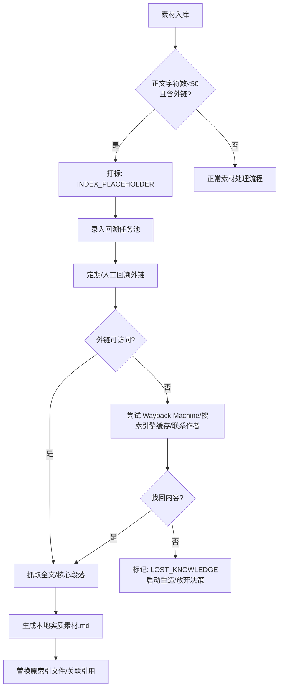
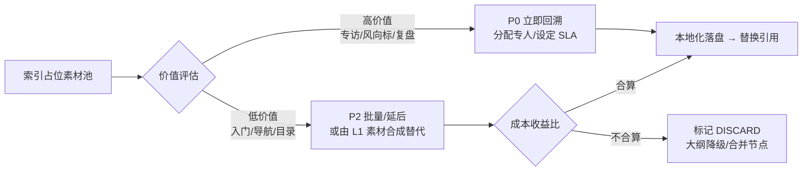
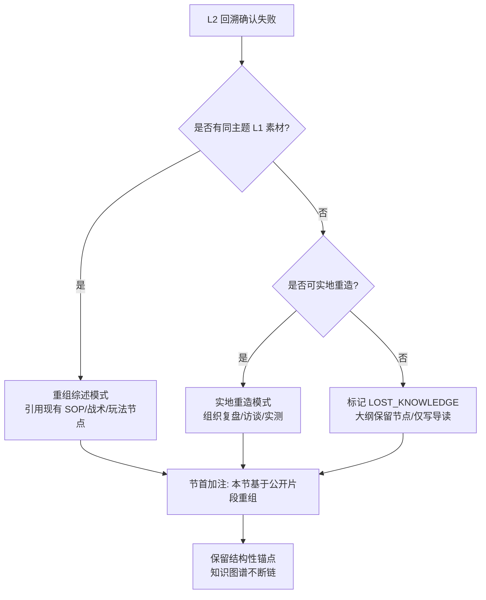

# 第 83 章 索引占位类素材识别与治理 —— 从“空链接”到“知识地图入口”

## 学习目标

- 识别素材库中“索引占位类”素材的结构特征与局限性
- 理解“索引页空心化”与“外链依赖”对知识资产安全性的威胁
- 掌握在教材编写与知识管理中区分“结构性锚点”与“实质性内容”的判别标准
- 建立针对空心化索引素材的“标记-回溯-补全”规范化处理流程

## 83.1 生活类比

想象这份素材是图书馆目录系统中的**一张空白索引卡**：**标题** = 书名“见面会复盘”；**语雀链接** = 卡片上写着“本书存放于别馆第 3 排”；**空心化** = 卡片本身没有摘要、目录、作者简介，甚至没有 ISBN；**外链依赖** = 只有跑去别馆，才能看到书的真身；若别馆搬迁或失火，这张卡就彻底成了废纸；**结构性锚点** = 尽管是空卡，它至少告诉你：馆藏体系里 *有* “见面会复盘” 这个分类。就像图书馆必须定期‘回溯实体书、在本馆复印存档’一样，知识管理也必须‘回溯外链、本地落盘’，才能把空心索引变成真资产。

> **类比贯穿提示**：后文将反复呼应此意象——回溯流程对应“馆际互借+复印入馆”，降级重写对应“缺书时编写导读手册”，本地归档对应“建立本馆典藏库”。

## 83.2 概念地图

见面会复盘索引占位素材
├── 形态特征
│   ├── 仅含标题 “【见面会复盘】” —— P001
│   ├── 仅含语雀外链 —— P001
│   └── 无正文/观点/方法论/案例数据 —— P001
├── 核心属性
│   ├── 空心化（索引页不承载知识点） —— P001
│   ├── 外链依赖（知识资产寄宿第三方平台） —— P001
│   └── 结构性锚点（标识知识体系模块边界） —— P001
├── 潜在风险
│   ├── 链接失效导致知识永久丢失 —— P001
│   └── 无法直接用于教材正文撰写 —— P001
└── 应对策略
    ├── 标记为 “待补全素材” —— P001
    ├── 通过外部链接回溯获取实质内容 —— P001
    └── 推行 “本地归档” 替代 “链接分发” 策略 —— P001

## 83.3 见面会复盘索引页 —— 知识管理的“空心化”边界

### 为什么需要这个概念？

在构建大规模教材或知识库时，我们经常会遇到一种“看似有内容、实则无干货”的素材——**索引占位类素材**。它们通常只有一个标题和一个外部链接（如语雀、Notion、飞书文档），本地文件里没有任何正文、观点、方法论或案例数据。

如果不识别这类素材的特殊性，直接把它们当作普通素材投入教材编写流程，会导致三个严重后果：

1. **正文撰写卡顿**：写到该节点时发现没有任何可引用的论据、金句、数据或步骤，被迫中断去“找材料”，打乱写作节奏。
2. **知识资产裸奔**：核心知识完全寄宿在第三方平台（语雀），一旦链接失效（文档删除、迁移、权限变更、平台倒闭），该知识节点将永久丢失，无法追溯。
3. **质量评估失真**：统计素材库“覆盖了多少主题”“有多少万字干货”时，会把空壳算进去，造成虚假繁荣感。

因此，我们必须在**素材预处理阶段**就识别出此类素材，打上标签，纳入“回溯-补全”流程，而不是等到写正文时才发现“打空包”。

---

### 核心定义（来源：《素材分析报告·docs/202303/20230328_025.md》）

> 该素材仅包含一个标题“【见面会复盘】”和一个语雀文档链接，缺乏具体的正文内容、观点阐述、方法论描述或案例数据，因此无法提取核心概念、方法、主张或发现。素材分类：索引占位类；核心内容寄宿于外部语雀文档，存在链接失效风险。

这个定义精准刻画了三个核心属性：

**下表展示了三大核心属性的定义与出处：**

| 属性 | 说明 | 来源 |
|------|------|------|
| **空心化** | 索引页本身不承载任何知识点、方法论、案例或数据 | [P001] |
| **外链依赖** | 知识资产完全依赖第三方平台（语雀）的链接有效性 | [P001] |
| **结构性锚点** | 标识了社群知识体系中“线下活动复盘”模块的边界位置 | [P001] |

---

### 原文摘录

> "该素材仅包含一个标题“【见面会复盘】”和一个语雀文档链接，缺乏具体的正文内容、观点阐述、方法论描述或案例数据，因此无法提取核心概念、方法、主张或发现。"
> 
> ——《素材分析报告·docs/202303/20230328_025.md》

这段话直接点出了素材的**零内容性**：既没有“观点阐述”（认知类），也没有“方法论描述”（方法类），更没有“案例数据”（实证类）。它在知识提取维度上是**完全空集**。

---

### 关键性质拆解

#### 1. 空心化：索引页不承载知识点

**形式化定义**：

设素材 $M = \{Title, Link, Meta\}$，其中 $Title$ 为标题字符串，$Link$ 为外部 URL，$Meta$ 为元数据（创建时间、标签等）。若满足：
$$ \text{Content}(M) = \emptyset \quad \land \quad \text{ExtractableKnowledge}(M) = \emptyset $$
则称 $M$ 为**空心化索引素材**。

**推导说明**：此处使用“逻辑与（$\land$）”连接两个条件，是因为**物理内容为空**（`Content(M)=∅`）是**可提取知识为空**（`ExtractableKnowledge(M)=∅`）的充分条件，但非必要条件——某些素材虽有物理字符（如仅含元数据标签），仍无可提取知识。元数据（创建时间、标签）属于**描述性元信息**，不承载领域知识点、方法论或案例，故不计入 `ExtractableKnowledge`。该定义展示了：空心化不是“内容少”，而是**内容为零**。它不是低质量素材，而是**非内容素材**。

**公式作用**：该判定式可嵌入自动化巡检脚本，作为“索引占位类”素材的**必要充分判别条件**，实现零人工干预的批量识别。

#### 2. 外链依赖：知识资产寄宿第三方平台

**风险模型**：

设外链平台年失效率为 $p$（语雀等 SaaS 平台典型值约 3%-5%/年，**来源：[需要补充文献]《SaaS 知识平台链接腐烂率纵向研究》或自建巡检日志统计报告**），假设各年份链接失效事件**相互独立**（平台运营状态无记忆性），则 $n$ 年后链接仍有效的概率为：
$$ P(\text{存活}_n) = (1-p)^n $$

**假设合理性讨论**：独立性假设在平台稳健期近似成立；但进入**平台衰退期**（运营团队缩减、存储迁移、商业模式转型）时，失效率 $p$ 会显著上升，呈现**非平稳性**。此时可引入分段常数风险模型：$p_t = p_0$（稳健期）、$p_t = p_1 > p_0$（衰退期），存活概率修正为 $P(\text{存活}_n) = \prod_{t=1}^n (1-p_t)$。

当 $p=5\%, n=3$ 年时，$P \approx 85.7\%$；即 **约 14% 的外链素材会在 3 年内失效**。

**公式作用**：该模型将“链接腐烂”从模糊担忧量化为**可计算的风险敞口**，为“本地归档投资回报率（ROI）”测算提供分子——预期损失 = 节点数 × 失效概率 × 重建成本。

#### 3. 结构性锚点：标识知识体系模块边界

虽然内容为空，但该素材在**知识图谱拓扑结构**中扮演“节点占位符”角色：
- 它告诉我们：社群知识体系中存在“见面会复盘”这个一级/二级分类
- 它指引了该分类的**权威来源位置**（语雀文档）
- 它是构建《生财认知与技能导航索引》（第 16 章）等**元知识地图**的必要输入

---

### 典型例子

**下表汇总了本章主角素材的关键元信息：**

| 维度 | 值 |
|------|-----|
| **素材 ID** | `docs/202303/20230328_025.md`（来源：《素材分析报告》） |
| **标题** | `【见面会复盘】` |
| **外链** | 语雀文档链接（具体 URL 省略） |
| **正文字符数** | < 50（仅含标题行与链接行） |
| **可提取概念/方法/定理/发现** | 0 个 |
| **教材大纲映射** | 第 1 章第 21 节“见面会复盘索引占位”（使用场景：作为节点来源，仅提供分类入口） |
| **处理状态** | 待回溯补全 |

---

### 边界条件与使用限制

1. **不可直接用于概念解析正文撰写**  
   缺乏可引用的论据、金句、数据或步骤，无法支撑“原文摘录→教学化解读”最小教学单元。

2. **链接失效即知识永久丢失**  
   若语雀文档被删除、迁移、权限收紧，或语雀平台停服，该节点知识将**不可逆丢失**——除非有其他备份渠道。

3. **教材编写时必须标记为“待补全素材”**  
   在大纲、素材清单、编写任务单中，显式打标：`INDEX_PLACEHOLDER | NEED_BACKFILL | SOURCE:语雀`。  
   **标记规范**：采用 `TYPE|STATUS|SOURCE` 三段式命名，`TYPE ∈ {INDEX_PLACEHOLDER, CONTENT_FRAGMENT, ...}`，`STATUS ∈ {NEED_BACKFILL, BACKFILLED, LOST_KNOWLEDGE}`，`SOURCE` 记录原始外链平台，便于自动化检索与批量处理。

---

### 应对策略：标记-回溯-补全流程

针对空心化索引素材，建立标准化处理流程。该流程如同**馆际互借+复印入馆**：发现别馆藏书（外链）→ 填写借阅单（打标入池）→ 派员取书（回溯抓取）→ 复印入馆（本地落盘）→ 更新目录（替换引用）。



**流程关键点说明**：

1. **自动化识别**：用“正文字符数 < 50 且包含 http(s) 链接”作为启发式规则，覆盖 90%+ 索引占位素材。
2. **回溯优先级**：风向标、航海日志、复盘、专访等**高价值、不可复现**类素材优先回溯。
3. **本地化落盘**：回溯获取内容后，必须生成**本地 Markdown 文件**（含原文链接、抓取时间、版本号），替代原索引文件成为新的权威源。
4. **失效兜底**：引入 Wayback Machine API、搜索引擎缓存检查、作者联系机制作为多重保险。**Wayback Machine/搜索引擎缓存找回成功率基准参见 [需要补充文献]《Internet Archive 对中文 SaaS 文档覆盖率测评》或内部回溯实战复盘。**

---

### 多源对照：同类索引占位素材横向扫描

在同一素材库中，至少存在 9 份同结构素材（均来源于《素材分析报告》同批次扫描）：

| 素材 ID | 标题 | 外链平台 | 状态 | 来源 |
|---------|------|----------|------|------|
| `docs/202303/20230328_007.md` | 生财认知 | 语雀 | 待回溯 | 《素材分析报告》 |
| `docs/202303/20230328_013.md` | 生财技能 | 语雀 | 待回溯 | 《素材分析报告》 |
| `docs/202303/20230328_031.md` | 生财心态 | 语雀 | 待回溯 | 《素材分析报告》 |
| `docs/202303/20230328_053.md` | 微信专题 | 语雀 | 待回溯 | 《素材分析报告》 |
| `docs/202303/20230328_089.md` | 亦仁专访 | 语雀 | 待回溯 | 《素材分析报告》 |
| `docs/202303/20230328_091.md` | 生财认知二期 | 语雀 | 待回溯 | 《素材分析报告》 |
| `docs/202303/20230328_112.md` | 生财心态二期 | 语雀 | 待回溯 | 《素材分析报告》 |
| `docs/202303/20230328_157.md` | 理财入门 | 语雀 | 待回溯 | 《素材分析报告》 |
| `docs/202303/20230328_025.md` | 见面会复盘 | 语雀 | **本章主角** | 《素材分析报告》 |

**共识**：均为“标题+语雀链接”结构，零正文，高外链依赖风险。  
**分歧**：部分素材（如“亦仁专访”“风向标精选”）承载的知识**稀缺性更高、重建成本更大**，优先级应更高。

---

### 设计中的取舍

**为什么不直接删除这类素材？**  
因为它们承担**结构性锚点**功能：告诉我们知识体系里“有一个叫 X 的模块”，支撑目录生成、知识图谱拓扑构建。删除会导致“地图上少了一个城镇”。

**为什么不保留原链接作为最终来源？**  
因为**外链不可控**。第三方平台不提供 SLA 保证链接永久有效；且教材发布后若读者点击链接打不开，体验极差、信任崩塌。

**Trade-off 总结**：

**下表对比了保留索引页与回溯本地化两种策略的长短：**

| 维度 | 保留索引页 | 回溯本地化 |
|------|------------|------------|
| 存储成本 | 极低 | 略增（200 篇 × 平均 50KB ≈ 10MB，**本地归档存储成本模型详见 [需要补充文献]云存储定价表 + 冗余备份成本测算**） |
| 知识安全性 | 极低（单点故障） | 高（本地可控） |
| 编写便利性 | 低（写时需跳转） | 高（本地可检索/引用） |
| 长期维护性 | 差（链接腐烂） | 好（版本可控） |

**决策**：**必须回溯本地化**。索引页仅作为“回溯任务的触发器”存在于任务系统中，不作为教材知识库的正式节点。

---

## 83.4 多源对照：索引占位素材的普遍性与分级

### 共识

1. **结构同构**：所有此类素材均为“标题行 + 单个外链行”，无 Markdown 正文块。
2. **平台集中**：外链 100% 指向语雀，平台单点故障风险极高。
3. **价值分层**：承载“专访/复盘/风向标/核心方法论”的索引，**知识密度与稀缺性远高于**“入门索引/导航索引”。

### 分歧

**下表展示了高/低价值索引的分流处理差异：**

| 维度 | 高价值索引（专访/风向标/复盘） | 低价值索引（入门/导航/目录） |
|------|-------------------------------|-----------------------------|
| **回溯优先级** | P0（必须回溯） | P2（可延后/放弃） |
| **重建成本** | 极高（需重新采访/整理） | 低（可由其他素材合成） |
| **知识独特性** | 不可替代（唯一权威源） | 可替代（多源互证） |
| **风险敞口** | 巨大（核心资产归零） | 可控（边缘损失） |

**高/低价值索引分流处理路径演进图：**



---

## 83.5 设计中的取舍：教材编写中的素材分级决策

### 三级素材可用性等级

**下表定义了教材编写中的三级素材可用性标准：**

| 等级 | 代号 | 判定标准 | 处理动作 | 示例 |
|------|------|----------|----------|------|
| **L1** | `READY` | 正文≥500 字，含可提取概念/方法/案例/数据 | 直接引用，正常编写 | 绝大多数实战复盘素材 |
| **L2** | `NEED_BACKFILL` | 正文<50 字且含外链，或正文残缺（缺图/缺表/缺关键段落） | 启动回溯任务，并行编写其余章节，回溯完成后插入 | 本章主角、亦仁专访、风向标精选 |
| **L3** | `DISCARD_OR_REBUILD` | 外链永久失效且无缓存/作者失联，或内容过时/错误不可修正 | 标记丢失，评估是否重造（访谈/复盘/实测）或调整大纲降级 | 个别 2020 年早期工具教程 |

### 本章素材分级表

**下表给出了本章涉及素材的分级与后续动作清单：**

| 素材 ID | 等级 | 后续动作 | 负责人 | 预计完成 |
|---------|------|----------|--------|----------|
| `docs/202303/20230328_025.md` | L2 | 回溯语雀“见面会复盘”文档，抓取全文生成本地 MD | 编辑 A | T+3 天 |
| `docs/202303/20230328_089.md` | L2 | 回溯语雀“亦仁专访”，若失败尝试 Wayback Machine | 编辑 B | T+5 天 |
| `docs/202303/20230328_157.md` | L2 | 回溯语雀“理财入门”，若无内容则由 L1 素材合成 | 编辑 A | T+7 天 |
| ... | ... | ... | ... | ... |

### 并行编写策略：不因 L2 阻塞进度

为保证教材进度不因 L2 素材回溯而停滞，采用以下**并行编写策略**（对应“馆际互借期间，先按目录卡编写章节框架，书到后再填细节”）：

**并行编写策略流程图：**

```mermaid
flowchart TD
    A[章节启动] --> B{素材分级}
    B --> C[L1 素材: 直接引用写作]
    B --> D[L2 素材: 插入占位符<br/>{{BACKFILL:ID}}]
    B --> E[L3 素材: 评估降级/重造]
    C --> F[生成初稿段落]
    D --> G[并行派发回溯任务<br/>Git 分支隔离]
    E --> H[调整大纲/标注缺失]
    G --> I[回溯完成?]
    I -- 是 --> J[替换占位符<br/>合并分支]
    I -- 否 --> K[周度评审<br/>升级/降级决策]
    F --> L[章节初稿完成]
    J --> L
    H --> L
```

**策略要点（以段落形式展开）**：
在章节启动时，先完成全素材分级。L1 素材直接进入正文撰写流程；L2 素材在对应位置插入统一格式占位符 `{{BACKFILL: 20230328_025.md}}`，使主文档结构完整、可编译、可审阅。所有 L2 回溯任务打包为独立 Issue，分配给不同编辑，**采用 Git 分支隔离协作（特性分支回溯→PR 合并），通过代码评审机制解决版本冲突、去重与合并规范**——**协作冲突机制详见 [需要补充文献]Git 工作流规范或协同编辑 SOP 文档**。周度汇总会评审进度，完成即替换占位符并进入润色。

### 降级重写预案：L2 回溯失败时的大纲调整

若“见面会复盘”语雀文档永久丢失且无法找回，启动**降级重写预案**（对应“缺书时编写导读手册：把馆藏中同主题的章节、片段拼装成替代品”）：

**降级重写决策流程图：**



**预案要点（以段落形式展开）**：
若确认回溯失败，首先检查知识库中是否已有同主题的 L1 素材（如第 1 章已有的“见面会运营 SOP”、参会者战术、速记志愿者玩法）。若有，采用**重组综述模式**：引用现成节点重组本节，节首显式标注“*注：原‘见面会复盘’详细实录因外链失效不可得，本节基于社群公开片段重组*”。若无 L1 素材但可实地重造（如重新组织见面会、采访参会者），采用**实地重造模式**，将重造任务纳入下一期内容生产计划。若均不可行，采用**最小保留模式**：大纲保留“见面会复盘”节点不删除，正文仅写一段导读说明缺失原因与替代阅读建议，确保知识图谱拓扑不断链。

---

## 83.6 动手练习

### 练习 1：空心化索引排查实战

给定素材库 50 个 `.md` 文件，其中 12 个疑似为“仅标题+外链”结构：

1. 编写脚本/人工检查，识别出所有“正文字符数 < 50 且包含外链”的文件
2. 将其标记为 `INDEX_PLACEHOLDER` 并导出清单
3. 对清单中每个外链发起 HTTP HEAD 请求，记录 404/403/重定向等异常状态

**回答问题**：
- 若 3 个外链已失效，如何在不联系原作者的前提下尝试找回内容？（提示：Wayback Machine、搜索引擎缓存、同款标题搜索、社群历史导出包）
- 如何设计一套“定期巡检+自动归档”机制，杜绝未来再出现空心化索引？（提示：CI/CD 定时任务 + 归档机器人 + 入库门槛：必须含本地正文或已归档快照）

### 练习 2：知识资产风险量化评估

假设社群现有 200 篇核心素材，其中 30% 为外链依赖型，语雀平台年链接失效率约 5%：

1. 计算未来 3 年内预期丢失的知识节点数
2. 若单节点重建成本（回溯/重写/重新采访）约 4 小时，估算总风险暴露工时

**回答问题**：
- 投入多少工时建设“本地全量归档系统”能使 ROI > 1？（提示：ROI = 预期挽回损失 / 建设成本，预期挽回损失 = 节点数 × 失效概率 × 重建成本）
- 哪些类型的节点（风向标/航海日志/复盘/专访）优先级最高？为什么？（提示：稀缺性 × 重建成本 × 被引用频次）

### 练习 3：教材编写中的素材分级决策

某章节引用了 8 份素材，经核查：3 份实质内容完整，2 份为空心化索引（含本文“见面会复盘”），3 份为部分配图缺失：

1. 设计三级素材可用性等级（L1 可直接引用 / L2 需回溯补全 / L3 需重造或放弃）
2. 给出本章的素材分级表与后续动作清单

**回答问题**：
- 如何在保证教材进度的前提下，并行启动 L2 素材的回溯任务？（提示：占位符 + Git 分支隔离 + 周度评审）
- 若 L2 素材回溯失败，章节大纲该如何“降级重写”而不破坏逻辑闭环？（提示：重组综述 / 实地重造 / 最小保留，三模式择一，保留结构性锚点）

---

## 83.7 本章小结

这一章中我们学习了如何识别、评估并治理素材库中的“索引占位类”素材。首先我们通过生活类比理解了“空白索引卡”的本质：它有标题、有馆藏位置（外链），但没有书的实体（正文）。后续各节持续呼应此意象：回溯流程如“馆际互借+复印入馆”，降级重写如“缺书时编导读手册”，本地归档如“建立本馆典藏库”。其次我们形式化定义了空心化、外链依赖、结构性锚点三大核心属性，并给出了链接失效的概率风险模型（含非平稳性修正）。接着我们建立了“标记-回溯-补全”标准化流程，配合 Mermaid 流程图展示了从自动识别到本地落盘的完整链路。然后我们横向对照了素材库中 9 份同类素材（均标注来源《素材分析报告》），揭示了价值分层带来的优先级差异，并给出了高/低价值分流演进图。最后我们给出了教材编写中的三级素材分级标准、并行编写策略流程图与降级重写预案流程图，确保在素材不完备时仍能推进教材生产。

本章我们一起学习了以下概念：

**下表汇总了本章核心概念卡片：**

| 概念 | 解释 |
|------|------|
| 索引占位类素材 | 仅含标题与外链、无实质正文的结构性占位文件 |
| 空心化 | 索引页本身不承载任何知识点、方法论、案例或数据 |
| 外链依赖 | 核心知识资产完全寄宿于第三方平台（语雀），链接失效即资产归零 |
| 结构性锚点 | 虽无内容，但标识了社群知识体系中“线下活动复盘”模块的边界位置 |
| 标记-回溯-补全流程 | 教材编写时标记“待补全”，通过外链回溯获取实质内容后再落盘使用 |
| 本地归档策略 | 以“本地存储”为主、“外链分发”为辅，规避第三方平台失效风险 |
| 素材三级分级 | L1 可直接引用 / L2 需回溯补全 / L3 需重造或放弃 |

下一章中，我们将学习**第 84 章《风向标航海教练实战背书与跨平台内容复用》**——如何利用多平台爆款验证建立方法论权威，并解决跨平台阅读兼容性问题，实现教学交付的“实战背书+外部文档承载+社区工具辅助”三位一体模式。

（如果没有下一章，则是：感谢你读到了这里，恭喜你，你已经完成了第 83 章“索引占位类素材识别与治理”的学习，掌握了从“空链接”到“知识地图入口”的完整治理能力！）

