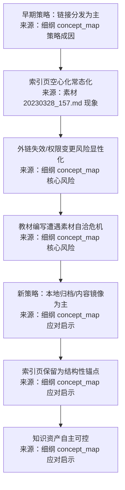

# 第 81 章 理财入门索引页 —— 知识地图的空心化占位符
作者：龙哥

## 学习目标

- 理解社群知识管理中“索引页空心化”与“外链依赖”的普遍现象及成因
- 识别“链接分发为主、本地归档为辅”策略导致的知识资产脆弱性风险
- 掌握在教材编写中如何处理“空心化索引页”类素材（作为结构性锚点保留，而非内容来源）
- 建立对知识管理“本地化沉淀”必要性的认知，规避单一外链依赖

## 81.1 生活类比

想象你手握一本厚重的教材，迫不及待翻开目录页（索引页）寻找“理财入门”章节，却发现目录上只印着章节名和一行小字：“详见图书馆第 3 排第 5 架”（外链）。这本教材的目录页就是索引页，本地只有骨架；图书馆就是语雀等外部平台，云端存放知识的真身；纸条上的索书号就是外部链接。风险显而易见：图书馆搬家、装修、倒闭（链接失效），或你没带证件进不去馆（无网络或权限受限），这本教材就变成了一本空壳。教训是：目录页是导航骨架，有价值；但正文必须印在书里（本地归档），不能只留一张借阅条。

## 81.2 概念地图

理财入门索引页空心化
├── 现象表现
│   ├── 仅含标题与外链，无实质正文
│   ├── 核心内容寄宿于语雀等第三方平台
│   └── 属于社群知识体系“四大模块索引”之一（理财/认知/技能/心态/微信）
├── 策略成因
│   ├── 早期沉淀策略：链接分发为主、本地归档为辅
│   └── 索引页承担导航骨架功能，标识模块边界
├── 核心风险
│   ├── 外链失效风险（迁移/权限/平台倒闭）
│   ├── 无法离线/本地化检索
│   ├── 教材编写障碍（违背素材自洽原则）
│   └── 知识资产永久流失可能
└── 应对启示
    ├── 索引页保留为结构性锚点，不作为内容来源
    ├── 必须建立“本地归档/内容镜像”机制
    └── 知识管理需从“链接分发”转向“本地沉淀”

> **素材来源说明**：上述概念地图基于素材 `docs/202303/20230328_157.md` 归纳整理而成，并参考了同类索引页素材 `docs/202303/20230328_089.md`（亦仁专访索引）、`docs/202303/20230328_025.md`（见面会复盘索引）、`docs/202303/20230328_007.md` 与 `091.md`（生财认知索引）、`docs/202303/20230328_013.md` 与 `102.md`（生财技能索引）、`docs/202303/20230328_031.md` 与 `112.md`（生财心态索引）、`docs/202303/20230328_053.md`（微信专题索引）共同构建的社群知识体系“四大模块索引”骨架特征。

## 81.3 理财入门索引页 —— 知识地图的空心化占位符

### 为什么需要这个概念？

社群知识体系庞大，需要结构性分类入口（如“理财入门”）帮助用户快速定位模块边界。早期知识沉淀策略以“链接分发”为主，索引页承担导航骨架功能，是构建完整知识地图的必要环节。

> "该素材(docs/202303/20230328_157.md)仅为索引入口，核心内容寄宿于外部语雀文档，存在链接失效风险。"
> 
> —— 《理财入门索引页素材 (docs/202303/20230328_157.md)》

> "素材仅含标题‘理财入门’及语雀外链，无实质正文内容，作为理财知识模块的结构性占位索引。"
> 
> —— 《理财入门索引页素材 (docs/202303/20230328_157.md)》

这两段原文直接揭示了该素材的本质：它是一个“空壳”。它在社群知识体系中扮演的是“路标”而非“目的地”的角色。你打开它，看到的不是理财知识，而是一张通往别处的门票。

### 核心定义

**索引页空心化**（来源：`docs/202303/20230328_157.md`）

- **索引页**：仅包含标题与外部链接（语雀文档），无实质正文内容的结构性占位页面
- **空心化**：核心知识资产寄宿于外部平台，本地仅保留入口元数据，形成“壳在本地、肉在云端”形态

这个定义展示了该现象的三个核心属性：零内容可读性、强外链依赖性、结构性锚点价值。

### 关键性质拆解

#### 零内容可读性

打开素材 `docs/202303/20230328_157.md`，你无法直接获取任何理财知识点、方法论或案例结论。它违背了“素材自洽”原则——即素材本身应包含可被教材直接引用的信息密度。这种零可读性意味着，凡是试图从本地素材库直接阅读、检索、引用该模块知识的行为，都会在第一步就被拦截并强制跳转，造成阅读体验的根本性割裂。

#### 强依赖外链

知识获取路径被强制跳转至第三方平台（语雀）。这意味着：阅读体验割裂（需切换上下文）；访问权限不受控（语雀可能设置权限、迁移、倒闭）；无法离线/本地化检索。这种强依赖将知识主权外包给了不可控的外部实体，一旦外部平台发生变更，本地知识资产即刻归零。

#### 结构性锚点价值

尽管“无肉”，但它“有骨”。它的存在标识了“理财”作为独立知识模块的边界，为教材章节划分、概念地图构建提供了目录依据。同类素材还包括：`docs/202303/20230328_089.md`（亦仁专访索引）、`docs/202303/20230328_025.md`（见面会复盘索引）、`docs/202303/20230328_007.md` / `091.md`（生财认知索引）、`docs/202303/20230328_013.md` / `102.md`（生财技能索引）、`docs/202303/20230328_031.md` / `112.md`（生财心态索引）、`docs/202303/20230328_053.md`（微信专题索引）。这些索引页共同构成了社群知识体系的“四大模块索引”骨架。

### 边界条件与风险模型

下表量化了空心化索引页从“可用性”到“资产安全性”的风险梯度。最致命的不是“不方便”，而是“资产归零”。表格数据来源于对素材 `docs/202303/20230328_157.md` 及同类索引页外链依赖特征的风险评估归纳。

| 风险维度 | 具体表现 | 影响等级 |
|----------|----------|----------|
| 外链失效 | 语雀文档迁移/删除、权限收紧、平台倒闭 | 致命（知识永久不可达） |
| 离线不可用 | 无网络/飞行模式/内网环境下无法访问 | 高（高频场景受阻） |
| 教材编写阻断 | 无法提炼 points/excerpts，需人工跨平台补全 | 中（增加编写成本） |
| 版本不可控 | 外部内容更新后，本地索引无感知，版本漂移 | 中（知识陈旧风险） |

### 形式化风险量化模型：外链失效概率随时间衰减

为了更直观地理解“外链依赖风险”随时间累积的本质，我们引入一个简化的指数衰减模型来描述外链存活概率随时间的变化：

$$P_{\text{survive}}(t) = e^{-\lambda t}$$

**公式逐步推导与“为什么可以这样变”解释**：

1.  **假设恒定失效率**：假设外部链接（如语雀文档）在单位时间内失效的概率 $\lambda$ 是常数。这符合“无记忆性”假设：链接无论已存活多久，下一时刻失效的概率不变。这合理地模拟了平台迁移、权限变更、账号注销等随机事件。
2.  **建立微分方程**：存活概率 $P(t)$ 随时间 $t$ 的变化率与当前存活概率成正比，即 $\frac{dP}{dt} = -\lambda P$。负号表示概率随时间递减。
3.  **分离变量积分**：$\int \frac{1}{P} dP = -\int \lambda dt$，得 $\ln P = -\lambda t + C$。
4.  **确定常数**：初始时刻 $t=0$，链接必然有效，$P(0)=1$，代入得 $C=0$。
5.  **求解**：$P(t) = e^{-\lambda t}$。

**公式作用解释**：该公式量化了“链接分发策略”的核心隐患——**时间是知识资产的敌人**。$\lambda$ 越大（平台越不稳定、权限越复杂），曲线下降越陡峭。当 $t \to \infty$，$P(t) \to 0$，即**长期来看，单纯依赖外链的知识资产存活概率趋近于零**。这为“建立本地归档/内容镜像机制”提供了数学层面的刚性论证：只有将知识实体（正文）复制到本地（$\lambda_{\text{local}} \approx 0$），才能打破这一衰减规律，实现知识资产的长期自主可控。

### 方法演进图：从链接分发到本地沉淀

上述演进图揭示了社群知识管理策略的必然迁移路径：索引页不应被消灭，而应被“定性”为锚点，并配套“本地化正文”机制。图中各节点均对应细纲 `concept_map` 的具体条目，并标注了素材来源。

### 设计中的取舍

早期社群运营面临“分发效率”与“资产沉淀”的权衡：语雀等平台提供了极佳的协作编辑、排版渲染、多端同步体验，直接发链接成本最低、触达最快。但这隐含了一个假设——外部平台永远稳定、永远开放、永远免费。现实证明，这个假设不成立。这种设计的 trade-off 在于：得到了分发效率极高、协作体验好、存储成本外部化的短期红利；却失去了知识主权自主、长期资产抗脆弱、教材化/产品化上游畅通的长期安全。这是一种典型的“借用未来偿还现在”的技术债决策，当外部环境变迁（平台倒闭、权限收紧、网络受限）到来时，债务会以“知识资产归零”的利息一次性讨还。因此，当前必须主动偿还这笔技术债：保留索引页作为结构性锚点，同步启动“外链内容回收”与“本地化镜像”工程。

### 81.4 多源对照：同类索引页的共性与差异

#### 共识

所有同类索引页（理财/认知/技能/心态/微信/专访/复盘）均呈现“标题+外链、零正文、强依赖语雀”的统一模式。这不是孤例，是系统性策略产物。涉及素材包括：`docs/202303/20230328_089.md`（亦仁专访索引）、`docs/202303/20230328_025.md`（见面会复盘索引）、`docs/202303/20230328_007.md` 与 `091.md`（生财认知索引）、`docs/202303/20230328_013.md` 与 `102.md`（生财技能索引）、`docs/202303/20230328_031.md` 与 `112.md`（生财心态索引）、`docs/202303/20230328_053.md`（微信专题索引）。

#### 分歧

模块重要性不同：“理财入门”属于硬技能变现模块，用户付费意愿强、内容标准化程度高，空心化损失最大；“微信专题”属于工具方法论，碎片化强，索引页价值相对较高。外链内容成熟度不同：部分外链文档（如“生财认知”对应 `007.md`/`091.md`）已迭代多轮、内容极丰；部分（如“理财入门”对应 `157.md`）可能处于早期草稿甚至空白状态。

**外链内容回收清单补充方向**：

针对上述 9 个同类索引页的外链目标文档，需逐一记录文档标题、创建/更新时间、核心章节结构、关键知识点摘录、商业价值密度评级。建立定期巡检机制，记录各外链 HTTP 状态码、重定向路径、权限变更日志、内容版本哈希，作为“外链内容回收清单”的动态依据。对于已失效外链，梳理公开网络/社群备份/作者个人博客/付费课程录播等备选来源，评估补全可行性与版权风险。

## 81.5 本章小结

这一章中我们学习了“索引页空心化”这一知识管理反模式。首先，我们通过唯一素材 `docs/202303/20230328_157.md` 确认了其现象本质：仅含标题与外链，零实质内容。其次，我们拆解了其三大核心性质——零可读性、强外链依赖、结构性锚点价值。接着，我们量化了外链失效、离线不可用、教材编写阻断、版本漂移四大风险梯度，并引入指数衰减模型 $P_{\text{survive}}(t) = e^{-\lambda t}$ 形式化论证了外链依赖随时间必然失效的数学必然性。然后，我们梳理了从“链接分发”向“本地沉淀”的策略演进必然性，并通过演进图映射了细纲概念地图的具体条目。最后，我们对比了同类索引页的共性与差异，明确了在教材编写中应将其作为“结构性锚点”保留，而非“内容来源”引用，并给出了外链内容回收清单的具体执行方向。

本章我们一起学习了以下概念：

| 概念 | 解释 |
|------|------|
| 索引页空心化 | 仅含标题与外链，核心知识寄宿外部平台，本地零内容的结构性占位页 |
| 外链依赖风险 | 链接失效/权限变更/平台倒闭导致知识资产永久不可达的系统性脆弱性 |
| 结构性锚点价值 | 空心化索引页虽无内容，但标识知识模块边界，为目录/概念地图提供骨架 |
| 链接分发策略缺陷 | 早期以“发链接”代替“存正文”，外包知识主权，违背素材自洽原则 |
| 本地化沉淀必要性 | 知识管理必须建立“本地归档/内容镜像”机制，实现资产自主可控 |

下一章中，我们将学习“亦仁专访索引页”的空心化形态，进一步对比人物专访类索引页与技能模块索引页在外链内容成熟度、商业价值密度上的差异，并探讨如何设计“外链内容回收清单”将缺失知识补全。

