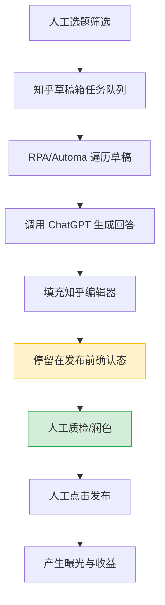
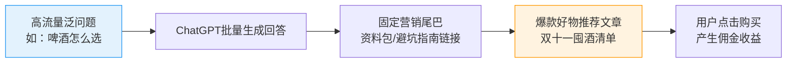
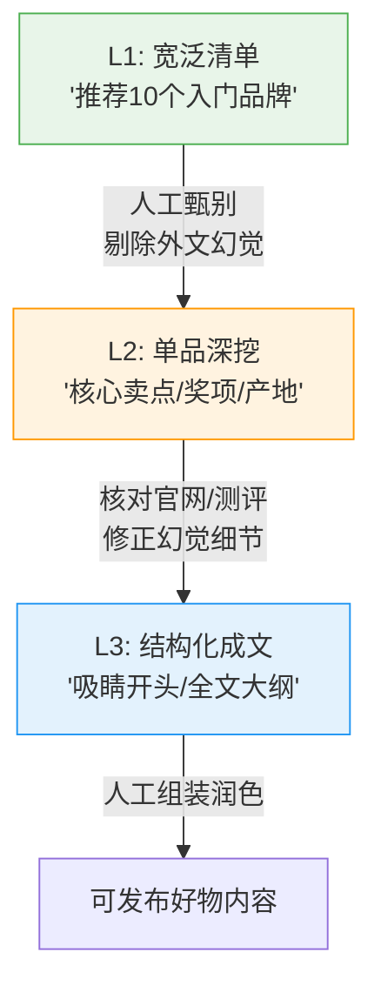
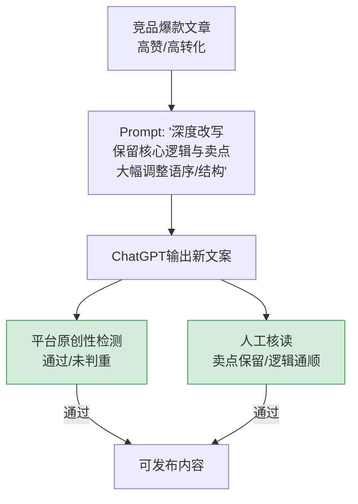
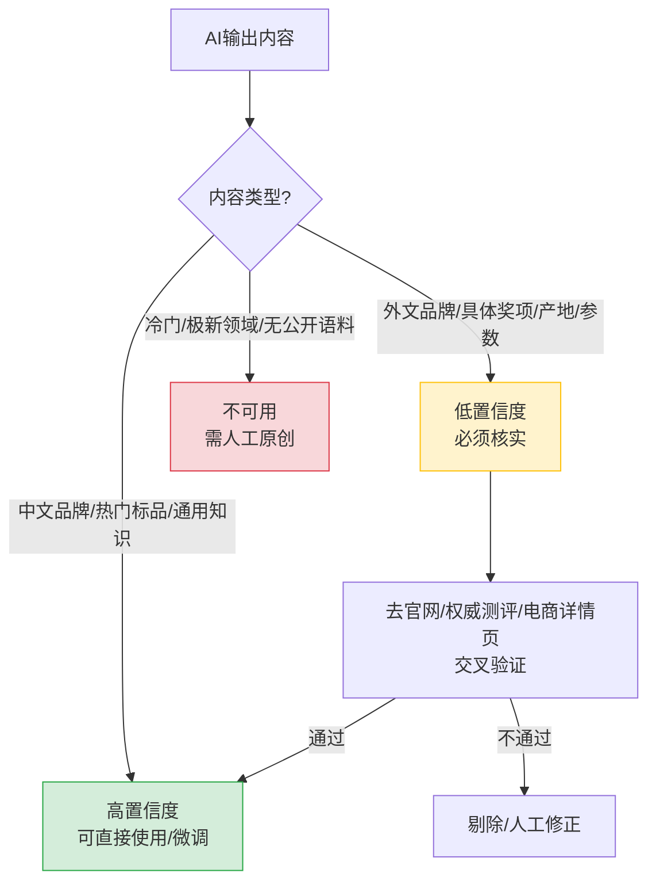
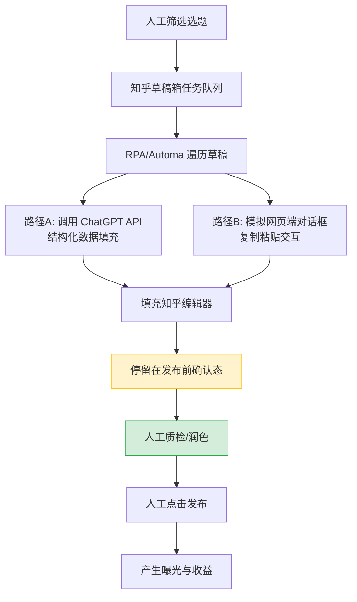
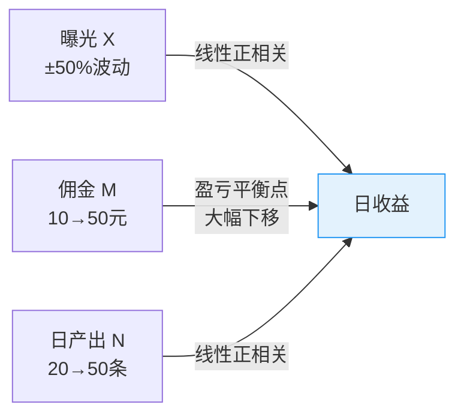

# 第 19 章 知乎好物推荐自动化变现 —— ChatGPT+RPA的最小闭环
作者：龙哥

## 学习目标

- 理解知乎好物推荐自动化闭环的核心架构与人机协作分工
- 掌握间接引流式回答策略的设计逻辑与泛流量向爆款文导流的漏斗模型
- 熟练运用好物清单分级生成Prompt策略（品牌筛选→单品深挖→结构化成文）控制AI输出质量
- 掌握竞品爆款改写法低成本规避查重的实操技巧与适用边界
- 建立AI幻觉甄别的领域知识护城河意识，明确“懂行才能把AI当实习生使”的前置条件
- 能搭建RPA+草稿箱半自动化发布流，平衡效率与账号安全风控
- 通过实战数据验证低门槛账号（8级/2000粉）跑通变现的可行性边界

## 19.1 文献编号映射表

本章引用的两篇核心素材在全书统一编号体系中的映射关系如下：

| 章内引用 ID | 全书统一编号 | 素材文件名 | 素材简述 |
|-------------|--------------|------------|----------|
| P001 | [Doc19-1] | `docs/202303/20230328_123.md` | 程序员“大胡子”实战复盘：ChatGPT+Automa搭建知乎好物自动化闭环、选题入草稿箱策略、人机协同分工、3月收益截图验证、Automa部署网络门槛 |
| P006 | [Doc19-2] | `docs/202303/GhbsdeUAeo0lWdxwqcecdwx0nuh.md` | 大胡子深度拆解：间接引流式回答公式、好物清单三级Prompt策略、竞品爆款改写法、AI幻觉甄别实测（中文品牌准/外文品牌错）、账号门槛（8级/2000粉）、改写查重对比图 |

后文所有引用均采用 `[Doc19-1]`、`[Doc19-2]` 格式，并在引用块右上角标注段落定位（如 `para.3` 表示第3自然段）。

---

## 19.2 生活类比

想象知乎好物自动化是一个**“中央厨房+配送员+质检员”的外卖体系**：ChatGPT 是中央厨房大厨，按菜单（Prompt）批量预制半成品（回答草稿），脑力活儿全包了，但不懂食客过敏史（幻觉风险）；RPA 是自动化配送机器人，把半成品从后厨（草稿箱）端到餐桌前（发布确认页），不累、不眠、不出错，但不会尝味道；人工是资深质检/店长，最后一道关卡试吃（润色核实），确认没毒（合规）、味道对（质量）再允许上桌（发布）；草稿箱是传菜台缓冲区，切断“做”与“上”的直接耦合，给质检争取时间窗口；间接引流是免费试吃样品引流正餐，用低成本泛回答（试吃）把路人拉进店，再用爆款好物文（招牌菜）完成转化（下单）。就像外卖平台靠“中央厨房标准化+骑手自动化+店长把关”跑通规模化闭环，知乎好物副业也靠“AI生成+RPA执行+人工兜底”实现确定性收益。**这一类比将贯穿本章各核心单元：19.3 中的“中央厨房/质检员”对应 AI 与人工分工，19.6 的“传菜台/缓冲区”对应草稿箱作用，19.8 的“刹车机制”对应人工确认闸门。**

---

## 19.3 概念地图

知乎好物自动化变现体系
├── 核心闭环架构
│   ├── 知乎好物自动化闭环          —— [Doc19-1]
│   ├── 人机协同三角分工             —— [Doc19-1], [Doc19-2]
│   │   ├── ChatGPT：脑力生成         —— [Doc19-1]
│   │   ├── RPA：体力执行              —— [Doc19-2]
│   │   └── 人工：质量兜底             —— [Doc19-1], [Doc19-2]
│   └── RPA+草稿箱半自动化发布流       —— [Doc19-2]
├── 内容生产策略矩阵
│   ├── 间接引流式回答（泛流量蓄水池） —— [Doc19-2]
│   ├── 好物清单分级生成Prompt         —— [Doc19-2]
│   │   ├── L1：宽泛品牌清单生成       —— [Doc19-2]
│   │   ├── L2：单品深度挖掘           —— [Doc19-2]
│   │   └── L3：结构化成文辅助         —— [Doc19-2]
│   └── 竞品爆款改写法                 —— [Doc19-2]
├── 核心门槛与护城河
│   ├── AI幻觉甄别与领域知识护城河       —— [Doc19-2], [Doc19-1]
│   │   ├── 中文品牌高置信度             —— [Doc19-2]
│   │   ├── 外文品牌/事实类高幻觉区      —— [Doc19-2]
│   │   └── 知识密度决定AI杠杆率         —— [Doc19-2]
│   └── 账号冷启动低门槛验证             —— [Doc19-2]
└── 规模化与验证论据
    ├── 大力出奇迹量级法则            —— [Doc19-1]
    ├── 间接引流优于直接硬广          —— [Doc19-2]
    └── 3月收益实证与账号门槛量化      —— [Doc19-2], [Doc19-1]

---

## 19.4 知乎好物自动化闭环 —— 让AI当实习生、RPA当搬运工、人工做质检

### 为什么需要这个概念？

知乎好物推荐的核心瓶颈在于内容创作产能。每一篇回答都是一次曝光机会，人力写作效率低、难持续。纯人工模式下想规模化极难，必须引入自动化手段解决“写什么”、“怎么写”、“去哪发”、“点哪里”的全流程问题。但完全自动化发布极易触发平台风控封号，需要人工把关质量与合规，形成“AI生成+RPA执行+人工兜底”铁三角。

### 核心定义

**知乎好物自动化闭环**（来源：[Doc19-1, para.3] 与 [Doc19-2, para.1-2]）

> "我的做法是：挑选出自己觉得适合 chatgpt 回答的问题，存到草稿箱，然后 rpa 机器人自己挨个去回答即可，当然 rpa 机器人不会真正的提交，还是需要人工再次确认，加以润色才能发表。这差不多就完成了一个通过 chatgpt 自动卖货的最小闭环。"
> 
> —— [Doc19-1, para.3]
> 
> "这差不多就完成了一个通过chatgpt自动卖货的最小闭环。我的做法是：挑选出自己觉得适合chatgpt回答的问题，存到草稿箱，然后rpa机器人自己挨个去回答即可，当然rpa机器人不会真正的提交，还是需要人工再次确认，加以润色才能发表。"
> 
> —— [Doc19-2, para.1-2]

这是一个**最小可行性自动化商业循环**：选题入草稿箱 → RPA调用ChatGPT批量生成草稿 → 人工复核润色发布 → 产生收益。

三大分工明确（人机协同三角分工）：
- **ChatGPT** 解决脑力问题（内容生成） —— [Doc19-1, para.4]
- **RPA** 解决体力问题（流程自动化） —— [Doc19-2, para.15]
- **人工** 解决质量问题（事实核查与风控） —— [Doc19-1, para.3], [Doc19-2, para.2]

> "如果说chatgpt是解决脑力问题，那么RPA就是解决劳动力的实际操作问题"
> 
> —— [Doc19-2, para.15]

### 闭环演进图

> **类比映射**：草稿箱 = 传菜台缓冲区（切断“做”与“上”的直接耦合）；人工确认节点 = 质检员试吃关卡（最后一道防线）。

### 关键性质

1. **半自动化而非全自动**：RPA停留在“发布前确认态”，不直接提交，保留人工最后一道关卡。
2. **草稿箱作为缓冲池**：人工预筛选适合AI回答的问题存入，规避AI幻觉导致的低质内容污染账号（ChatGPT 适配性选题策略，[Doc19-1, para.3]）。
3. **规模化前提**：大力出奇迹，单条内容边际收益低，唯有批量堆量才能累积流量变现（[Doc19-1, para.4]）。

> "其实知乎好物的瓶颈就是创作，大力出奇迹，每一篇文章或回答接触用户就是一次曝光机会。"
> 
> —— [Doc19-1, para.4]

### 典型例子

程序员“大胡子”副业实操：账号仅8级、2000粉，3月通过该闭环跑通变现，晒出收益截图验证（[Doc19-1, para.12-13]；[Doc19-2, para.28]）。红酒/啤酒垂类：利用ChatGPT生成品牌清单、单品深度挖掘、吸睛标题开头，配合固定营销尾巴引流至爆款文章。

### 边界条件

- 必须具备垂直领域知识甄别AI幻觉：外文品牌翻译、具体奖项易瞎编，不懂行无法驾驭（[Doc19-2, para.5-6]）。
- 网络环境要求：RPA工具（如Automa）依赖浏览器插件商店，需科学上网才能安装使用（[Doc19-1, para.8-9]）。
- 非暴富捷径：仅能满足副业确定性收益需求，无法带来指数级爆富（[Doc19-1, para.5]）。

> "正好 chatgpt 横空出世，于是就想到用它来自动化创作，但仅作为辅助创作，它不会带来暴富，但可以满足副业的需求"
> 
> —— [Doc19-1, para.5]

---

## 19.5 间接引流式回答 —— 用泛流量蓄水池浇灌爆款转化池

### 为什么需要这个概念？

直接发好物文章竞争大、对账号权重要求高、转化路径长。高流量泛问题竞争小、易获曝光，但购物意图弱，直接带货转化差。需要一种低成本“流量漏斗”：用AI批量占领长尾入口，再导流至高转化核心内容。

### 核心定义

**间接引流式回答**（来源：[Doc19-2, para.6-8]）

> "那就是通过chatgpt回答一些高流量的泛回答，此类回答一般竞争较小，但购物意愿度一般...写此类回答的目的当然也是为了引流...引流到我的爆款好物推荐文章"
> 
> "chatgpt的回答+固定尾巴（文案+链接）"
> 
> —— [Doc19-2, para.6-8]

标准化结构：[ChatGPT生成泛知识回答正文] + [固定营销尾巴（引流文案+目标文章链接)]

核心逻辑：泛流量回答做“蓄水池”，爆款好物文做“转化池”，中间用固定尾巴连通。

### 漏斗分层图

> **类比映射**：泛回答 = 免费试吃样品（低成本引流）；爆款文章 = 招牌正餐（高转化变现）；固定尾巴 = 服务员推荐卡（连接两者）。

### 关键性质

- **流量分级利用**：不追求单条回答直接带货，追求全链路流量归因与转化最大化（[Doc19-2, para.9]）。
- **批量化优势**：单条泛回答成本极低，可大规模铺设长尾关键词构建流量护城河。
- **用户群体同源性**：回答泛问题的用户画像与目标好物文章读者高度重合，导流精准（[Doc19-2, para.9]）。

> "此类回答一般竞争较小，但购物意愿度一般...写此类回答的目的当然也是为了引流，至少用户群体差不多。引流到我的爆款好物推荐文章"
> 
> —— [Doc19-2, para.9]

### 典型例子

回答“啤酒怎么选”、“红酒醒酒器有必要买吗”等泛问题，文末挂载《双十一囤酒清单》爆款文章链接。固定尾巴话术：“整理了份避坑指南/选品清单，点击查看全文”（[Doc19-2, para.10]）。

### 边界条件

- 尾巴不能太硬广：需包装成“资料分享/避坑指南”等利他形式，否则易被平台判定引流违规。
- 目标爆款文章必须真材实料：引流来的用户若发现内容空泛，信任瞬间崩塌，后续不复点击。
- 仅适用于内容型平台（知乎/小红书/👸号），不适用于纯货架电商（淘宝/拼多多/抖音小店）。

---

## 19.6 好物清单分级生成Prompt —— 从宽泛筛选到单品深挖再到结构化成文

### 为什么需要这个概念？

一次性让AI写完整推荐文，幻觉率高、逻辑散、卖点不准，不可用。需要将复杂创作任务拆解为可验证、可迭代的原子步骤，逐层把控质量。不同层级Prompt对AI能力要求不同：列表类易、事实类难、文案类中。

### 核心定义

**好物清单分级生成Prompt策略**（来源：[Doc19-2, para.11-14]）

三层递进策略，每层对应独立的素材摘录与定位：

#### L1：宽泛品牌清单生成（[Doc19-2, para.11]）

> "目前发现chatgpt推荐好物，问它中国的品牌，回答的会比较清楚，但国外品牌就有很多回答不了，特别是翻译的中文品牌名经常搞错。"
> 
> —— [Doc19-2, para.11]

让AI列品牌池（注意：中文品牌准、外文品牌易翻车，需人工甄别）。

#### L2：单品深度挖掘（[Doc19-2, para.12]）

> "由于上述清单中，可能有一些回答的很笼统，于是我们需要细化或强化推荐理由，那么我们可以单独问chatgpt该品牌"
> 
> —— [Doc19-2, para.12]

针对单一产品追问特色、奖项、核心卖点、差异化理由，修正幻觉。

#### L3：结构化成文辅助（[Doc19-2, para.13-14]）

> "我们再看下，让它给刚才的啤酒文章写一个非常具有吸引力的开头"
> 
> "以下是我用过的一些特色推荐理由的提问词：1、介绍一下范佳乐白啤的特色 2、范佳乐白啤获得过几次奖项... 3、给啤酒文章写一个非常具有吸引力的开头 4、写一篇推荐啤酒的文章..."
> 
> —— [Doc19-2, para.13-14]

生成吸睛标题、高转化开头、全文大纲框架，最后由人工组装润色。

### 三级Prompt链路图

### 关键性质

- **人工介入点前置**：在清单阶段就要用领域知识筛掉外文品牌错误，防止错误放大（[Doc19-2, para.11]）。
- **Prompt颗粒度越细，输出可控性越强**：问“范佳乐获得过几次奖项”比问“写推荐理由”准得多（[Doc19-2, para.14]）。
- **复用性高**：同一垂类下，这套Prompt模板可复用于不同SKU，边际成本趋近零。

### 典型例子

啤酒垂类实操：先问“国内精酿啤酒品牌有哪些” → 再问“范佳乐白啤特色/奖项/卖点” → 最后问“给啤酒文章写吸睛开头/全文框架”。提问词库积累：介绍特色、查奖项、写开头、写全文、优化标题，形成标准化提问清单（[Doc19-2, para.14]）。

### 边界条件

- 无法替代人工实测体验：AI只能复述公开信息，无法给出真实口感/使用感受，深度评测仍需人工。
- 外文品牌/冷门品类幻觉率极高：非核心标品类目建议人工主导、AI辅助，不可反向依赖。
- 平台算法偏好真实体验：纯AI生成无实拍图/无真实细节的内容，权重通常低于实测内容。

---

## 19.7 竞品爆款改写法 —— 低成本规避查重的内容复用手段

### 为什么需要这个概念？

新手不会写Prompt、没有素材库、不懂选题，面对空白编辑器无从下手。同领域已有爆款文章证明了选题、结构、卖点的市场有效性，直接复用成功要素概率最高。直接搬运会被判重限流，需要“洗稿”但保留核心逻辑的技术手段。

### 核心定义

**竞品爆款改写法**（来源：[Doc19-2, para.16-17]）

> "参考同行爆款文章，然后拿过来让chatgpt帮你改写。"
> 
> "下面这个是改写我之前创作的文案，重新生成了一个新的文案，改写之后基本逻辑都正确了，而且避免了抄袭。"
> 
> —— [Doc19-2, para.16-17]

输入：同行爆款文章全文/片段 → 指令：帮我改写/重写/优化 → 输出：逻辑正确、非抄袭的新文案。无需复杂Prompt工程，利用大模型强语义理解与重组能力，一键完成去重与逻辑重构。

### 改写对比流程图

### 关键性质

- **门槛极低**：不会写Prompt也能用，只需会复制粘贴发送“帮我改写”（[Doc19-2, para.16]）。
- **保留核心卖点**：改写非原创，是对已验证成功结构的“借壳生子”，转化率基线有保障。
- **规避查重实测有效**：作者实测改写后通过平台原创性检测，未判定抄袭（[Doc19-2, para.17], 附图 [Doc19-2, img/62c309dacc5e4b64ce3dfca12186f398.png]）。

### 典型例子

作者将自己旧文输入ChatGPT改写，生成新文案，逻辑通顺、核心卖点保留，晒图验证。可批量操作：采集竞品Top50爆款标题+正文，循环改写，快速填充内容库。

### 边界条件

- 仅适用于“知识/经验/推荐”类软文，不适用于强时效性新闻、强专业性技术文档、强个人IP色彩内容。
- 核心数据/具体案例/个人真实经历无法通过改写获得，必须人工注入。
- 长期依赖改写会导致账号内容同质化，缺乏差异化人设，需配比原创内容维护账号调性。

---

## 19.8 AI幻觉甄别与领域知识护城河 —— 懂行才能把AI当实习生使

### 为什么需要这个概念？

ChatGPT在外文品牌翻译、具体奖项数据、冷门品类事实上严重瞎编（幻觉）。盲信AI输出发布会导致账号发布错误内容，破坏专业人设，降低用户信任与转化。平台算法打击低质内容，AI幻觉制造的垃圾内容会拖垮账号权重。

### 核心定义

**AI幻觉甄别与领域知识护城河**（来源：[Doc19-2, para.5-6, 11] 与 [Doc19-1, para.3]）

> "比较适合你已经了解某一行业产品，这样才知道ChatGPT是像认真回答的，而不是瞎编的。"
> 
> "目前发现chatgpt推荐好物，问它中国的品牌，回答的会比较清楚，但国外品牌就有很多回答不了，特别是翻译的中文品牌名经常搞错。"
> 
> "下面这个国外品牌虽然地域回答错了，但是推荐理由还是很详细的，可以直接使用"
> 
> —— [Doc19-2, para.5-6, 11] & [Doc19-1, para.3]

领域知识是驾驭AI变现的前置条件：只有懂行的人能判断AI输出的真伪，将其作为“实习生”高效使唤。

甄别维度：
- 中文品牌/热门标品 → AI可信度高
- 外文品牌/长尾非标/具体数据 → AI可信度低，必核

### 幻觉甄别决策树

### 关键性质

- **认知门槛即变现门槛**：不懂行业无法甄别幻觉，也就无法商业化应用AI，形成天然护城河（[Doc19-2, para.5]）。
- **AI擅长“形式/结构/文案润色”，不擅长“事实/数据/真实体验”**，分工必须清晰（[Doc19-2, para.11]）。
- **知识密度决定AI利用率**：知识储备越丰富，能委托给AI的任务比例越高，杠杆率越高。

### 典型例子

询问“范佳乐白啤产地/中文名”AI答错（说是德国实为比利时、译名搞错），但问“特色/奖项/卖点”回答详实可用（[Doc19-2, para.11]）。中国精酿品牌清单AI答准，国外品牌清单AI翻车，验证“中文语料充分、外文语料稀缺”导致认知不对称。

### 多源对照

**共识**：两篇素材均确认ChatGPT在中文品牌/热门标品上表现可靠，外文品牌/具体事实极易幻觉；领域知识是甄别幻觉的必要前置条件（[Doc19-1, para.3]；[Doc19-2, para.5-6, 11]）。

**分歧**：
- **[Doc19-2] 更强调“外文品牌地域/译名错但卖点描述可用”** —— 认为部分幻觉可容忍、可利用。其上下文为：作者在实操中发现，尽管范佳乐的产地和中文译名回答错误，但该品牌的特色口感描述、获奖情况等“推荐理由”依然详实可用，可直接作为文案素材填充。这反映了实战派对AI输出的“拆解利用”心态：不求全对，但求可用部分高质量。
- **[Doc19-1] 更强调“网络环境部署门槛”** —— 指出Automa等RPA工具需科学上网，这是技术落地的隐性门槛（[Doc19-1, para.8-9]）。其上下文为：评论区用户反馈无法下载Automa插件，作者确认为“最可能就是你的网络不是科学的”，揭示了轻量级RPA工具链在国内部署时的网络依赖性，这是从0到1搭建自动化流程时必须跨越的基础设施坎。

### 边界条件

- 非领域专家不可盲目复制：看到别人用AI赚钱，自己不懂行业硬上，必死于幻觉。
- 随模型迭代幻觉率会下降但不会归零：事实核查永远是人工不可外包的最后一环。
- 极新/极冷门领域无公开语料训练，AI完全不可用，必须人工原创。**[推断]**

---

## 19.9 RPA+草稿箱半自动化发布流 —— 以草稿箱为缓冲，以人工确认为闸门

### 为什么需要这个概念？

完全自动化发布（含点击发布按钮）极易触发平台反作弊风控，导致封号/限流。纯人工发布效率低，无法支撑“大力出奇迹”所需的批量产出量级。需要一种“刹车机制”：自动化跑到发布前一步停下，人工快速扫眼确认再点发布。

### 核心定义

**RPA+草稿箱半自动化发布流**（来源：[Doc19-1, para.3] 与 [Doc19-2, para.15, 20]）

> "我的做法是：挑选出自己觉得适合chatgpt回答的问题，存到草稿箱，然后rpa机器人自己挨个去回答即可，当然rpa机器人不会真正的提交，还是需要人工再次确认，加以润色才能发表。"
> 
> "如果说chatgpt是解决脑力问题，那么RPA就是解决劳动力的实际操作问题"
> 
> "大胡子 : 我自己用的 automa，针对网页的"
> 
> "大胡子 : 最可能就是你的网络不是科学的"
> 
> —— [Doc19-1, para.3] & [Doc19-2, para.15, 20]

标准化动作流：
1. 人工筛选问题存草稿箱
2. RPA遍历草稿箱调用ChatGPT填充回答
3. RPA停留在“发布前确认态”
4. 人工二次润色确认
5. 人工点击发布

草稿箱双重作用：既是RPA任务队列，又是人工选题质检关卡。

### 数据流图（含API/网页端分支）

> **实现差异备注**：路径A（API）稳定性高、速度快、无需前端选择器维护，但需申请API Key并承担Token成本；路径B（网页端模拟）零API成本、所见即所得，但极其依赖前端DOM结构稳定性，且受限于ChatGPT网页端反爬/限流。作者实测采用路径B（Automa模拟网页端），因个人副业规模下Token成本敏感且API申请有门槛（[Doc19-1, para.8]）。

> **类比映射**：草稿箱 = 传菜台缓冲区（双重角色：任务队列+质检关卡）；RPA停在发布前 = 配送员敲门等店长验收（刹车机制）。

### 关键性质

- **效率与安全平衡点**：将90%重复劳动（打字、排版、切换页面）交给RPA，保留10%核心决策（内容质量、合规风险）给人工。
- **单账号日产能跃升**：从人工日更几条提升至几十条，支撑矩阵号运营。
- **工具选型关键**：基于浏览器插件的轻量级RPA（如Automa）门槛最低，适合个人开发者（[Doc19-1, para.8]）。

### 典型例子

Automa插件操作知乎网页端：录制一次“打开草稿→调用AI→填充内容→停在发布按钮”动作，循环执行。作者实测：配合该流程，3月知乎好物收益稳定产出，验证流程跑通（[Doc19-1, para.12-13]）。

### 边界条件

- 平台前端改版会导致RPA选择器失效，需维护更新脚本，非一次配置永久受益。
- 多账号矩阵运营时，需配合指纹浏览器/独立IP环境，防关联封号。
- 人工确认环节若偷懒不看直接点发布，等同于全自动，失去风控意义。

---

## 19.10 实战收益验证与账号门槛 —— 8级2000粉即可跑通变现

### 为什么需要这个概念？

很多新手误以为做好物推荐需要大V账号、高权重、高粉丝，产生畏难心理。需要真实数据打破认知壁垒，证明低门槛账号也能通过流程化运营实现冷启动变现。

### 核心定义

**账号冷启动低门槛验证**（来源：[Doc19-2, para.28] 与 [Doc19-1, para.12-13]）

> "知乎账号8级，倾向于红酒/啤酒领域好物推荐...粉丝不多，就2000人，相信很多圈友都能很快达到这个粉丝量。"
> 
> "下面是3月份收益 "
> 
> "下面是 3 月份收益  "
> 
> —— [Doc19-2, para.28] & [Doc19-1, para.12-13]

账号门槛：知乎8级、2000粉丝（作者自述“很多圈友都能很快达到”）
变现验证：3月收益截图显示流程跑通并产生实际现金流
核心指标：非单条爆款收益，而是累积曝光转化的规模化收益模型

### 关键性质

- **冷启动成本低**：无需养号半年、无需买大号，普通用户正常使用积累即可达标。
- **大力出奇迹规律**：单条收益低、波动大，但量级上去后总收益趋于稳定可预期（[Doc19-1, para.4]）。
- **可复制性强**：作者强调该玩法对新号/中小账号友好，非幸存者偏差。

### 典型例子

作者账号：8级、2000粉、垂类红酒/啤酒，3月收益截图为证。评论区反馈：多位圈友表示“学到了”、“去试试”，验证方法论传播度。

### 量化收益模型推演

下表汇总了收益模型的关键变量与估算区间：

| 变量 | 含义 | 估算区间 | 备注 |
|------|------|----------|------|
| N | 日产出内容数 | 20-50 条 | 含RPA批量 |
| X | 单条平均曝光 | 500-2000 | 受账号权重/选题影响大 |
| Y% | 曝光点击率(CTR) | 1%-3% | 泛回答CTR通常低于好物文 |
| Z% | 点击购买转化率(CVR) | 0.5%-2% | 红酒/啤酒决策链路长、CVR低 |
| M | 客单价佣金 | 10-50 元 | 高客单价垂类核心优势 |

日均预期收益 = N × X × Y% × Z% × M

若 N=30, X=1000, Y%=2%, Z%=1%, M=30元 → 日收益 ≈ 180元，月收益 ≈ 5400元。这与作者晒出的月收益数量级一致。

#### 敏感性分析图

**敏感性分析**：曝光 X 波动 ±50% 时收益线性波动；佣金 M 从 10 元涨到 50 元，盈亏平衡点大幅下移。这解释了为什么红酒/啤酒高客单价垂类更适合该模型——M 高补偿了 Z% 低的劣势。

### 边界条件

- 垂类差异大：红酒/啤酒客单价高、决策链路长、内容依赖度高，其他低客单标品类目（如日用百货）可能更依赖价格战而非内容。
- 收益波动受平台分发影响大：算法调整、流量分配变化会直接影响月收益，非固定薪资。
- 需持续投入：断更即断流，无资产化积累（如私域沉淀），停止运营收益即归零。

---

## 19.11 设计中的取舍

**为什么不用全自动发布（含点击发布按钮）？** 因为知乎反作弊系统对“非人类行为模式”极其敏感：固定频率、零停顿、无鼠标轨迹的点击发布会在分钟级触发风控。半自动化保留人工确认环节，引入人类操作的随机性（阅读停顿、滑动轨迹、思考间隔），大幅降低封号概率。代价是单条需 10-30 秒人工确认，但这是用时间换账号存活的必然交易。

**为什么不用“直接好物回答”而用“间接引流式回答”？** 直接好物回答面临：选题竞争激烈、需高账号权重、转化链路长（用户需点进文章再决策）。间接引流利用泛问题竞争小、易曝光的特性，用低成本内容做“漏斗入口”，再导流至高转化爆款文，实现流量分级利用。代价是增加了一层跳转损耗，但整体 ROI 更高。

**RPA 工具为何选 Automa 而非影刀/按键精灵？** Automa 是浏览器插件，零安装门槛、可视化编排、原生支持网页 DOM 操作，适合个人开发者快速迭代。影刀/按键精灵需客户端安装、脚本编程门槛高、跨平台兼容性差。代价是 Automa 依赖 Chrome 扩展商店，国内需科学上网安装，这是隐性部署成本（[Doc19-1, para.8-9]）。

---

## 19.12 动手练习

### 练习 1：设计一条间接引流式回答

选定一个你熟悉的垂类（如：咖啡豆、机械键盘、婴儿辅食），完成以下设计：
1. 列出 3 个高流量、低竞争、购物意图较弱的泛问题（作为蓄水池入口）
2. 设计一句统一的固定营销尾巴（文案+引导动作），要求不硬广、利他感强、能自然导流至你的某篇爆款/目标好物文章
3. 说明该垂类下“用户群体同源性”的判断依据：为什么回答泛问题的用户大概率也是目标好物文的潜在读者？

思考题：
- 如果尾巴过于营销化，平台会判定违规限流；如何用“资料包/避坑指南/选品清单”包装尾巴？
- 目标爆款文章必须具备什么核心素质，才能承接泛流量导入而不崩塌信任？

### 练习 2：实操演练：好物清单三级Prompt链式调用

沿用练习1的垂类，在 ChatGPT 中按顺序执行三级提问并记录输出：
【L1 宽泛清单】提问：'推荐 10 个适合新手入门的 [垂类] 品牌，仅列中文名/英文名/一句话特色' → 人工甄别：划掉外文品牌翻译错误/不存在的幻觉项
【L2 单品深挖】选 1 个靠谱品牌的 1 款核心单品，追问：'该产品的核心卖点/差异化优势/权威奖项/真实用户痛点解决方案是什么？' → 核对事实：去官网/测评/电商详情页验证 AI 给出的奖项/参数/产地是否属实
【L3 结构化成文】提问：'为该单品写一个 100 字内吸睛开头（含冲突/悬念/利益点），并给出全文大纲（含 3 个核心论据模块）'

复盘问题：
- L1 阶段你剔除了多少幻觉项？外文品牌翻译错误率约多少？
- L2 阶段发现了哪些“看着很详细实则错误”的幻觉细节？（如：产地错、奖项编造、参数虚标）
- 为什么说“领域知识是前置条件”？若不懂行，你能在 L1/L2 发现错误吗？

### 练习 3：搭建最小化 RPA+草稿箱半自动化发布流（可选工具：Automa / 影刀 / 按键精灵 / 触动精灵）

目标：实现‘遍历知乎草稿箱→调用 ChatGPT 填充回答→停留在发布确认态’的自动化闭环。

步骤拆解：
1. 环境准备：安装指纹浏览器/独立 IP 环境（防关联）；安装 RPA 工具（Automa 需科学上网加载插件商店）
2. 录制/编排流程：打开知乎草稿箱列表 → 循环点击每条草稿 → 复制问题标题 → 粘贴至 ChatGPT 对话框（或通过 API 填充） → 复制生成回答 → 粘贴回知乎编辑器 → 定位‘发布’按钮前一步（如‘预览’或‘确认发布’弹窗）停止
3. 异常处理：网络超时重试、元素未找到重定位、草稿箱为空退出循环
4. 人工介入 SOP：每条草稿停留后，人工扫眼 10 秒核查（有无违规词/明显幻觉/排版错乱）→ 确认无误点击发布 → 记录日志

验收标准：
- 连续跑通 5 条草稿无报错、无封号风控触发
- 单条人工确认耗时 ≤ 30 秒，整体效率较纯手工提升 ≥ 5 倍

反思题：
- 平台前端改版（如按钮 className 变更）会导致 RPA 选择器失效，如何建立低维护成本的选择器策略？（提示：优先用文本/相对定位/语义属性，避免脆弱的 CSS 路径）
- 多账号矩阵运营时，如何配合指纹浏览器实现“一套 RPA 脚本跑多环境”？

### 练习 4：竞品爆款改写实战与查重对比测试

在你的垂类领域，找 3 篇近 30 天点赞 500+ 的竞品爆款文章，分别执行：
1. 将全文输入 ChatGPT，Prompt：'请帮我深度改写这篇文章，保留核心逻辑与卖点，大幅调整语序/词汇/段落结构，使其通过平台原创性检测，输出全文'
2. 将改写后的新文案分别用知乎/小红书/👸号的创作后台‘原创性检测’或第三方查重工具（如 CopyLeaks、维普）测试，记录重复率/相似度
3. 人工阅读对比：核心卖点是否保留？逻辑是否通顺？是否丢失了关键数据/案例/个人真实经历？

分析问题：
- 改写策略对哪类内容“保真度高”（如：通用知识/结构化论证），对哪类“失真严重”（如：具体数据/个人故事/专业术语）？
- 长期大量使用改写内容，账号人设/调性会发生什么漂移？如何配比原创内容维护差异化？
- 若竞品文章本身含有错误观点，改写会不会放大传播谬误？如何建立“改写前核查”机制？

### 练习 5：量化验证：低门槛账号冷启动收益模型推演

基于作者披露数据（8级/2000粉/红酒啤酒垂类/3月收益截图），建立简易收益推演模型：

假设变量：
- 单条回答/文章平均曝光 = X
- 曝光点击率（CTR）= Y%
- 点击购买转化率（CVR）= Z%
- 客单价佣金 = M 元
- 日产出内容数 = N 条（含 RPA 批量）

计算：
1. 日均预期收益 = N × X × Y% × Z% × M
2. 反推：若目标月入 3000 元，日产出 N=20 条，客单佣金 M=20 元，需要的综合转化率（Y%×Z%）是多少？
3. 敏感性分析：曝光 X 波动 ±50% 时，收益波动范围；佣金 M 从 10 元涨到 50 元，对盈亏平衡点的影响

数据来源建议：
- 知乎创作者后台‘数据中心’导出近 30 天曝光/点击/购买/佣金明细
- 同垂类头部账号公开分享的单条收益/转化漏斗数据

思考：
- 为什么作者说“大力出奇迹”？模型中哪个变量最不可控、最依赖量级堆叠？
- 红酒/啤酒高客单价、长决策链路的垂类特性，如何体现在模型参数（M 高、Z% 低、决策周期长）中？换成 9.9 包邮日用品垂类，模型参数会如何剧变？

---

## 19.13 本章小结

这一章中我们学习了知乎好物推荐自动化变现的完整方法论。首先，我们拆解了“AI生成+RPA执行+人工兜底”的最小闭环架构，理解了三大角色的分工边界；其次，掌握了间接引流式回答策略，学会用泛流量蓄水池浇灌爆款转化池；接着，熟练运用好物清单分级生成Prompt策略，从宽泛筛选到单品深挖再到结构化成文，逐层把控AI输出质量；然后，掌握了竞品爆款改写法这一低门槛内容复用手段及其适用边界；接着，建立了AI幻觉甄别的领域知识护城河意识，明确“懂行才能把AI当实习生使”的前置条件；然后，搭建了RPA+草稿箱半自动化发布流，在效率与账号安全之间找到平衡点；最后，通过实战数据验证了低门槛账号（8级/2000粉）跑通变现的可行性边界。

本章我们一起学习了以下概念：

| 概念 | 解释 |
|------|------|
| 知乎好物自动化闭环 | 选题入草稿箱→RPA调用ChatGPT生成草稿→人工复核润色发布→产生收益的最小可行性商业循环 |
| 人机协同三角分工 | ChatGPT解决脑力生成、RPA解决体力执行、人工解决质量兜底，三者缺一不可 |
| 间接引流式回答 | ChatGPT回答高流量泛问题+固定营销尾巴导流至爆款好物文，构建泛流量蓄水池→转化池漏斗 |
| 好物清单分级生成Prompt | 三层递进：宽泛品牌筛选→单品深度挖掘修正幻觉→结构化成文辅助，颗粒度越细可控性越强 |
| 竞品爆款改写法 | 输入同行爆款文→指令改写→输出逻辑正确非抄袭新文案，低门槛复用成功结构规避查重 |
| AI幻觉甄别与领域知识护城河 | 中文品牌/热门标品AI可信，外文品牌/具体事实极易瞎编；无垂直领域知识无法甄别幻觉，也就无法商业化驾驭AI |
| RPA+草稿箱半自动化发布流 | 草稿箱作任务队列与质检关卡双重角色；RPA跑到发布前确认态停下，人工把关合规与质量，平衡效率与安全 |
| 大力出奇迹量级法则 | 知乎好物瓶颈在创作产能，每篇回答即一次曝光机会，唯有批量堆量累积流量实现规模化变现 |
| 账号冷启动低门槛 | 8级、2000粉即可跑通变现，无需大号/养号半年，普通用户正常积累即达标，方法论可复制性强 |

下一章中，我们将学习招聘平台挖掘商业机会与RPA自动化运营 —— BOSS直聘的“反向猎头”玩法。

