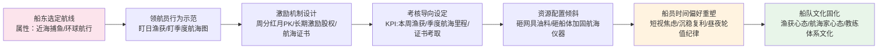
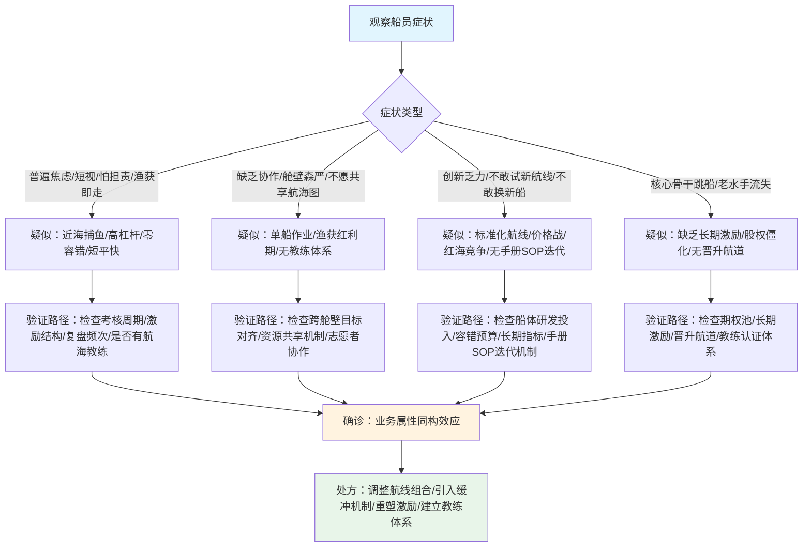
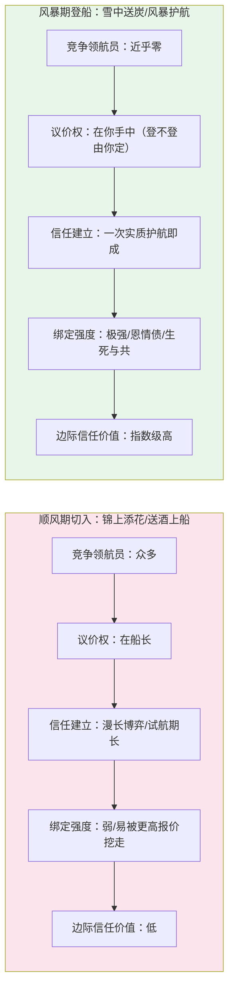
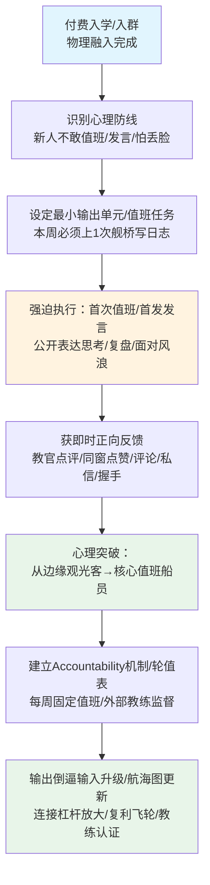

# 第 80 章 抖音百万粉IP操盘手深度复盘五大感悟 —— 从“风向标航海教练”视角看“星探模式”到“业务属性同构效应”

## 学习目标

- 理解星探模式与自营IP模式的核心差异及适用边界，明确何时做"伯乐"何时做"千里马"
- 掌握业务属性同构效应的识别与诊断方法，从组织症状反推业务根因
- 掌握低谷期介入策略建立深度商业信任的实操路径，延续"实战背书引流法"的服务导向思维
- 能通过角色分离决策法明确自身定位（决策vs执行），对标第79章"航海教练"的四位一体交付角色
- 建立"出去看看-落地闭环"的强制转化机制，贯彻"学习价值仅在落地瞬间兑现"定理
- 践行"付费融入-主动输出"的社群成长飞轮模型，复用第79章"链接兼容性"的外部协作机制

## 80.1 生活类比

承接第79章"大海航行"隐喻体系，本章将商业世界比作**跨洋航行中的"领航员体系"与"船队编制"双轨博弈**：

**星探模式** = 你不亲自驾船出海，甘愿做**风向标航海教练/领航员**：在船长最迷茫（低谷期/偏离航线）时登船，用航海图（战略认知）、专用吊车（资源整合）、志愿者协作网（人脉网络）助其回航，分享到港红利；**自营IP模式** = 你自己就是**掌舵船长**：拼航海技、识风向、修船身、守航线，吃风浪饭、背沉船险。

**业务属性同构效应** = **船东选航线决定全船性格**：选《环球航行》式硬核长航线（长期主义），全船铁军纪律、昼夜轮值、复利思维；选《近海捕鱼》式短平快出海（短平快），全船浮躁赶工、渔获即走、随时解散上岸。

**低谷期介入策略** = **风暴中登船护航比顺风送酒贵万倍**：船长遇风暴/搁浅/断粮时，你敢冒险登船、动用岸基电台/救援船队/补给仓，这辈子就是这船的"守护神"了——延续第79章"实战背书引流法"中"成果展示→信任建立"的服务导向逻辑。

**角色分离决策法** = **别让航海教练强行下场抓绳索，也别让水手坐在领航台改航线**：分清"定航向（决策）"和"操舵帆/抓绳索（执行）"，轮值表物理隔离——对标第79章"航海教练"的"手册SOP+教练陪伴+志愿者协作+圈友共战"四要素分工。

**出去看看-落地闭环法** = **考察完五星级邮轮舰桥，回船必须能改出一套适用的值班SOP**：光拍照发朋友圈"开眼界"了，自船航海图没更新，那是"观光客"不是"领航员"——贯彻第79章"跨平台选题策略迁移"的"逻辑迁移而非一键同步"原则。

**付费融入-主动输出成长模型** = **交学费上航海学院（付费）不等于拿到大副证，必须天天上舰桥值班写航海日志、遇风暴写复盘报告（主动输出）**：公开承诺倒逼执行，教官/同窗（圈友）点评指正形成正反馈，最终拿证上岗（认知跃迁）——复用第79章"圈友共战/志愿者协作"的外部监督机制。

## 80.2 概念地图

商业认知与组织进化第80章（承接第79章"跨平台内容复用与航海教练体系"）
├── IP运营模式选择（对标第79章"自营风向标号vs协助他船"）
│   ├── 星探模式（风向标航海教练/领航员视角）       —— 20230328_092
│   │   ├── 核心：发掘有阅历船长、低谷期登船护航、岸基资源赋能
│   │   ├── 适用：擅长识人/资源整合/岸基调度的教练团队
│   │   └── 边界：需硬实力兑现承诺（专用吊车/救援船队）、标的有潜力
│   └── 自营IP模式（掌舵船长/千里马视角）   —— 20230328_092
│       ├── 核心：自主驾船出海、航海技精进、航线把控
│       └── 适用：擅长内容生产与运营节奏把控的船队
├── 组织文化与业务同构（对标第79章"航海教练体系塑造组织气质"）
│   ├── 业务属性同构效应           —— 20230328_092
│   │   ├── 定律：船东选航线决定全船性格（时间偏好/焦虑水平/行为范式）
│   │   ├── 传导：领航员行为示范/激励机制/考核导向/资源配置四重传导
│   │   ├── 实证：短平快近海捕鱼→船员浮躁焦虑/渔获即走/集体恐慌
│   │   └── 正向：长周期环球航行→船员稳定/复利思维/昼夜轮值纪律
│   └── 商业模式与人才模式匹配    —— 20230328_092
│       ├── 定理：模式错配导致资源错配与内耗（教练去抓绳索/水手去改航线）
│       └── 诊断：从组织症状（浮躁/短视/部门墙/骨干流失）反推业务根因
├── 商业合作深度绑定（延续第79章"实战背书引流三步法"服务导向）
│   ├── 低谷期介入策略             —— 20230328_092
│   │   ├── 核心：逆周期登船、风暴中护航、服务导向非投资导向
│   │   ├── 杠杆：低谷期帮助边际信任价值最高（信任价值函数量化验证）
│   │   ├── 四步法：低谷登船→航海赋能→岸基调度→关键节点护航
│   │   └── 边界：需硬实力（专用吊车/救援船队）/优质标的/长期心态
│   └── 信任源于逆境定理           —— 20230328_092
├── 角色定位与决策分离（对标第79章"航海教练四位一体角色分工"）
│   ├── 角色分离决策法             —— 20230328_092
│   │   ├── 核心：领航员vs水手、决策vs执行互斥匹配
│   │   ├── 诊断：复盘成就感事件反推天然倾向（定航向爽/操舵帆爽）
│   │   └── 早期：轮值表物理隔离（白天定航向/夜间操舵帆）
│   └── 决策执行一体化陷阱        —— 20230328_092
├── 认知转化与执行闭环（贯彻第79章"逻辑迁移而非一键同步"）
│   ├── 出去看看-落地闭环法         —— 20230328_092
│   │   ├── 定律：学习价值仅在落地瞬间兑现（第79章定理复用）
│   │   ├── 三要素：带航海图去→拆解值班动作→落实轮值人名
│   │   ├── 反面：纯观光打卡→虚假膨胀→零增长
│   │   └── 正向：48小时输出值班SOP/决策清单/避坑指南
│   └── 付费融入-主动输出成长模型  —— 20230328_092
│       ├── 物理融入：交学费进航海学院筛选高质量同窗
│       ├── 化学融入：强迫上舰桥值班写日志突破心理防线
│       ├── 飞轮：输出倒逼输入→吸引同频船长/教练→复利增长
│       └── 即时验证：首次日志获教官/同窗点评正向反馈
└── 实战验证案例库（对标第79章"阿丰航海教练开场帖/风向标号实战"）
├── 抖音400万粉操盘手星探模式   —— 20230328_092
├── 作者公司短平快组织焦虑实证   —— 20230328_092
├── 纯学习不落地认知膨胀自证     —— 20230328_092
└── 首次社群发言心理突破即时反馈   —— 20230328_092

## 80.3 星探模式 —— 让团队从"掌舵船长"变身"风向标航海教练"

### 为什么需要这个概念？

承接第79章"航海教练体系"核心洞见：**并非所有团队都擅长亲自驾船出海（自营IP/内容生产），强行驾船易导致船队沉底（资源错配）。** 头部船长（头部IP）稀缺且培养周期长，自主培养风险高、试错成本大。擅长岸基资源整合、识人用人、航海图绘制的团队，通过"搭台子（航海教练体系）找戏班子（发掘船长）"能发挥更大杠杆——这正是第79章"风向标航海教练"不亲自下海捕鱼、专注"手册SOP+教练陪伴+志愿者协作+圈友共战"四位一体交付角色的商业投射。

### 核心定义

> "有的人擅长自己做自媒体，做自己的 ip。而有的人更适合搭台子找戏班子。比如今天见面的团队就是擅长当'星探'，去寻找那些适合做 ip 的人，前提是真的有阅历。并且要掌握时机，在此 ip 低谷期伸入。"
> 
> ——《docs/202303/20230328_092.md》 [20230328_092_excerpt_0]

这段话揭示了IP运营的两种根本范式：**自营模式**（自己做掌舵船长）与**星探模式**（做风向标航海教练/领航员找船长）。星探模式的核心是三个动作的组合——对标第79章"航海教练"四要素：
1. **发掘/识人** ⇔ 第79章"圈友共战"中的高质量人才筛选：寻找"真有阅历、有深度"的潜力船长（IP人选）
2. **切入/低谷期登船** ⇔ 第79章"教练陪伴"中的逆周期陪跑：在对方事业**低谷期**（偏离航线/遇风暴/断粮）介入建立合作
3. **赋能/岸基资源调度** ⇔ 第79章"手册SOP+志愿者协作"的资源整合：以岸基资源整合能力（流量/供应链/法务/技术/跨界人脉/专用吊车/救援船队）换取船长的驾船能力（内容生产能力）

### 方法演进图：星探模式运作全流程（对标第79章"航海教练交付体系"）

```mermaid
flowchart TD
    subgraph TeamGene[团队基因诊断：对标第79章"航海教练四要素自检"]
        A[核心优势：岸基资源整合/识人用人/航海图绘制\n非：驾船技术/人设打造/算法敏感度] --> B[模式选择：星探模式=风向标航海教练]
    end
    subgraph Process[运作全流程：对标第79章"四位一体交付"]
        C[标的筛选：有阅历/有深度/暂时偏离航线\n对标"圈友共战"高质量筛选] --> D[低谷期登船：逆周期介入建立信任锚点\n对标"教练陪伴"逆周期陪跑]
        D --> E[岸基资源赋能：航海图/专用吊车/救援船队/补给仓/志愿者网络\n对标"手册SOP+志愿者协作"]
        E --> F[关键节点护航：环球航行/风暴突围/补给接济/航线纠偏\n对标"教练陪伴"关键节点到岗]
        F --> G[深度绑定：首选领航员/利益共同体/长期合伙]
        G --> H[复利收割：船队品牌背书/优先调度权/分成阶梯]
    end
    TeamGene --> Process
    
    style A fill:#e1f5fe
    style D fill:#fff3e0
    style G fill:#e8f5e9
```

### 方法演进图：商业模式与人才模式匹配诊断（对标第79章"航海教练vs船长"角色自检）

```mermaid
flowchart LR
    subgraph Team[团队基因画像：第79章四要素自检表]
        T1[核心优势：内容生产/运营节奏/驾船技术\n⇔ 第79章"自营风向标号"船长画像] --> T2[匹配模式：自营IP模式=掌舵船长]
        T3[核心优势：识人/岸基资源整合/解难/航海图绘制\n⇔ 第79章"风向标航海教练"四要素画像] --> T4[匹配模式：星探模式=风向标航海教练]
    end
    
    subgraph Mismatch[错配后果：第79章"角色错位"实证]
        M1[岸基教练团队强行下海驾船] --> M2[节奏错位/焦虑内耗/零产出/船队沉底]
        M3[驾船高手船长不建教练体系] --> M4[杠杆闲置/错失编队扩张/单船极限]
    end
    
    subgraph Diagnosis[反推诊断：第79章"链路排查"方法论]
        D1[组织症状：焦虑/浮躁/节奏乱/角色模糊] --> D2[反推：业务模式与团队基因错配]
        D2 --> D3[处方：回归核心基因/模式切换/建立教练体系]
    end
    
    Team --> Mismatch --> Diagnosis
    
    style Team fill:#e3f2fd
    style Mismatch fill:#fce4ec
    style Diagnosis fill:#e8f5e9
```

### 关键性质

**反直觉：主动寻找"低谷期/偏离航线"而非"高光期/顺风顺水"切入**

常规思维倾向于追逐高光期的头部船长（IP），但此时竞争最激烈、议价权最弱、信任最难建立。星探模式反其道而行之——在船长流量暴跌（偏离航线）、变现受阻（断粮）、甚至考虑上岸转行（弃船）时登船。素材作者亲历的抖音400万粉操盘手团队即采用此策略："去寻找那些适合做ip的人，前提是真的有阅历。并且要掌握时机，在此ip低谷期伸入。" [20230328_092_excerpt_0] ——这正是第79章"教练陪伴"在学员最迷茫时介入的商业投射。

**信任前置：通过风暴中护航建立深度绑定**

> "怎么绑定合作关系，更多的是你是擅长为对方去服务的，给对方提供价值的。当然第一点在对方低谷期入手，已经很大程度建立了信任。加那些后期ip遇到问题，动用人脉关系网给予解决。其实就是在每个关键节点给很到位的帮助。"
> 
> ——《docs/202303/20230328_092.md》 [20230328_092_excerpt_1]

这个过程展示了信任建立的**逆周期杠杆**——延续第79章"实战背书引流法"三步闭环（成果展示→信任建立→教程转化）的服务导向逻辑：
- 低谷期登船护航 → 建立基础信任（风暴中送炭/第79章"成果展示"建立权威）
- 关键节点岸基调度 → 强化信任锚点（专用吊车/救援船队/第79章"志愿者协作"动用网络）
- 长期陪伴教练服务 → 锁定合作优先权（服务导向/第79章"教练陪伴"全程护航）

**轻资产：不承担驾船重资产，专注岸基赋能**

星探团队（风向标航海教练）不自己驾船、修帆、抓绳索（不拍视频、写文案、运营账号），专注于：
- 人才识别力（眼光/第79章"圈友共战"筛选机制）
- 岸基资源整合力（手脚/第79章"志愿者协作/专用吊车"调度能力）
- 关键节点解决问题的能力（大脑/第79章"手册SOP/教练陪伴"诊断方案）

### 典型例子

**正面案例：抖音400万粉商业IP操盘手团队 = 标杆风向标航海教练团队** [20230328_092]
- 不自制内容（不亲自驾船），专做星探发掘有阅历的船长（有阅历的人）
- 在船长偏离航线（IP低谷期）登船合作
- 后续动用岸基网络（人脉网）解决船长遇到的各类问题（风暴/搁浅/断粮）
- 每个关键航海节点（大促/新品/融资/危机）给到位帮助，深度绑定关系

**反面教材：作者公司强行自营IP = 岸基教练团队强行下场驾船** [20230328_092]
- 团队核心优势是短平快项目运营（近海捕鱼）、岸基资源整合
- 强行尝试自营IP（亲自驾船远洋/内容生产+人设打造）
- 导致团队焦虑浮躁、节奏错位、资源错配（船员不适应远洋作业）
- 验证模式错配的严重后果——第79章"角色错位"的实证

### 边界条件

下表列出了星探模式的适用边界条件，用于判断团队是否具备实施该模式的基因与资源——对标第79章"航海教练四要素自检表"：

| 条件 | 说明 | 第79章对标要素 |
|------|------|----------------|
| **目标标的质量** | 必须"真有阅历、有深度"，空心IP无法承载星探模式 | 圈友共战：高质量人才筛选机制 |
| **团队核心能力** | 人才识别力、岸基资源整合力、关键节点解决问题的能力 | 手册SOP+志愿者协作+教练陪伴三位一体 |
| **心态前提** | 长期主义，低谷期介入回报周期长，短期功利者无法坚持 | 教练陪伴：长周期陪跑非一次性交付 |
| **适用性判断** | 若团队核心优势是内容生产与运营节奏把控，应选择自营模式 | 自检：我是擅长"定航向/搭体系"还是"操舵帆/抓绳索"？ |

---

## 80.4 业务属性同构效应 —— 船东选航线，决定全船性格

### 为什么需要这个概念？

承接第79章"航海教练体系塑造组织气质"洞见：创业者（船东）常只关注航线赚不赚钱（业务赚不赚钱），忽视航线模式对船队文化的深层塑造作用。船员（团队）普遍焦虑、浮躁、短视，往往不是招人错了（招错水手），而是航线属性"选错了"（业务属性选错）。需要一个诊断工具，从航线底层逻辑（业务底层逻辑）反推船员状态（组织症状）的根因——延续第79章"链路排查"从现象反推本质的方法论。

### 核心定义

> "公司领头人以什么属性的项目运营，这群公司上班的人都会跟项目属性很贴合。例如，做短平快的项目的人，基本是收一波就要看下一波。属性很浮躁很焦虑，那么大概率在这个公司上班的人都很浮躁... 所以老板选业务类型也要注意业务属性会影响自己，以及公司所有人的属性。"
> 
> ——《docs/202303/20230328_092.md》 [20230328_092_excerpt_2]

**业务属性同构效应**定义为：船东（公司领头人）所选航线（业务项目）的底层属性（近海捕鱼/短平快 vs 环球航行/长期主义、重渔获/重流量 vs 重船队品牌/重品牌、标准化航线/标品 vs 非标探险航线/非标），会通过领航员（领导者）的行为示范、激励机制（分红制）、考核导向（KPI）、资源配置（油料/补给/船舶维修），投射并强制塑造全体船员（组织成员）的时间偏好、焦虑水平、行为范式与决策模式——这正是第79章"航海教练体系"通过"手册SOP+教练陪伴+志愿者协作+圈友共战"四位一体交付，主动塑造学员组织气质的反向工程。

### 方法演进图：业务属性同构的传导机制（对标第79章"四位一体交付"传导路径）



### 方法演进图：从组织症状反推业务根因的诊断流程（对标第79章"链路排查"）



### 关键性质

**传导性：船东的时间偏好无损传导给一线水手**

业务属性通过四条传导通道作用于船队——对标第79章"四位一体交付"传导路径：
1. **行为示范**：船东天天盯着日渔获、周ROI，水手自然不敢想季度航海图
2. **激励机制**：月度分红、周度PK、即时奖惩，绑定短期行为
3. **考核导向**：KPI设定为"本周渔获多少""今日转化多少"，长期船体建设无人问津
4. **资源配置**：砸网具油料（投流收割）/砸船体加固航海仪器（研发品控/品牌建设）

**强制性：非个人意志可对抗**

> "以我们公司自身经验来说... 做短平快的项目的人，基本是收一波就要看下一波。属性很浮躁很焦虑，那么大概率在这个公司上班的人都很浮躁... 一旦一个短平快过去了，集体焦虑。"
> 
> ——《docs/202303/20230328_092.md》 [20230328_092_excerpt_3]

除非更换航线模式或跳船，个体极难在船队层面逆转这种同构效应。哪怕你内心是环球航行家（长期主义者），近海捕鱼环境也会迫使你表现出短期渔获行为。

**双向性：正向同构同样强力**

- 长周期航线（如星探模式/风向标航海教练、品牌建设/船队声誉、私域深耕/船员练级）→ 倒逼船队沉稳、复利思维、延迟满足、昼夜轮值纪律
- 短周期航线（如投流收割/撒网即走、搬运混剪/搬运渔获、爆款追逐/追鱼群）→ 催生浮躁、渔获心态、恐慌文化、无教练体系

### 典型例子

**负向实证：作者公司近海捕鱼项目 → 船员集体焦虑** [20230328_092]
- 航线属性：近海捕鱼/短平快、强渔获依赖/强流量依赖、周期短、收割导向
- 船员症状：普遍浮躁焦虑，"收一波看下一波"，航线间隙集体恐慌
- 根因诊断：不是招错水手了，是航线属性选错了

**正向验证：头部IP操盘手团队 = 环球航行编队 → 船队稳健** [20230328_092]
- 航线属性：星探模式/风向标航海教练、长周期布局、岸基资源赋能、服务导向/教练陪伴
- 船队状态：相对稳定、节奏可控、信任积累、有教练体系传承
- 验证：业务属性同构效应双向成立

### 边界条件

下表界定了业务属性同构效应的适用范围与限制条件——对标第79章"边界条件表"风格（含风险点/说明/应对策略三列）：

| 适用范围 | 说明/风险点 | 应对策略 |
|----------|-------------|----------|
| **组织规模** | 仅适用于"船东强势主导航线"的中小微船队（<200人），大型船队有制度惯性、中层舱壁缓冲，同构效应减弱 | 大型组织需建立"战略-文化双向校准机制"，引入教练体系做缓冲层 |
| **缓冲机制** | 领航员个人修养、管理机制可做微调，但难逆转航线决定的大势 | 引入"风向标航海教练"体系作为文化缓冲层，主动塑造长周期基因 |
| **领导者修养** | 嘴上环球航行（长期主义）、行为盯日渔获（短期考核），同构效应以实际行为为准 | 强制要求"行为-口号一致性审计"，引入外部教练监督 |
| **伪长期主义** | 易陷入"口号长期主义、机制短期考核"陷阱，同构效应以实际机制为准 | 建立"长周期指标权重>短周期指标"的考核宪章，教练体系把关 |

### 诊断工具：从组织症状反推业务根因（对标第79章"链路排查清单"）

当船队出现以下症状时，优先检查航线属性而非招聘标准：

| 船员症状 | 疑似航线属性根因 | 验证路径（第79章链路排查法） |
|----------|------------------|------------------------------|
| 普遍焦虑、短视、怕担责、渔获即走 | 近海捕鱼/短平快、高杠杆、零容错 | 检查考核周期、激励结构、复盘频次、是否有教练陪伴 |
| 缺乏协作、舱壁森严、不愿共享航海图 | 单船作业/单点突破、渔获红利期 | 检查跨部门目标对齐、资源共享机制、志愿者协作体系 |
| 创新乏力、不敢试新航线/换新船 | 标准化航线/标品价格战、红海竞争 | 检查研发投入占比、容错预算、长期指标、手册SOP迭代机制 |
| 核心骨干跳船、老水手流失 | 缺乏长期激励、股权结构僵化 | 检查期权池、长期激励、晋升航道、教练认证体系 |

---

## 80.5 低谷期介入策略 —— 风暴中登船护航才是最高级的商业绑定

### 为什么需要这个概念？

延续第79章"实战背书引流法"三步闭环（成果展示→信任建立→教程转化）的服务导向逻辑：商业合作初期缺乏信任，常规谈判易陷入博弈与防备，绑定成本高。头部船长/IP常被资源方追逐，顺风送酒（锦上添花）的合作无法建立排他性关系。需要一套低成本、高粘性、可复制的深度绑定方法论——**风暴中登船护航（低谷期介入）**，这是"实战背书引流法"在合作绑定场景的深度应用。

### 核心定义

> "并且要掌握时机，在此 ip 低谷期伸入。当然第一点在对方低谷期入手，已经很大程度建立了信任。加那些后期 ip 遇到问题，动用人脉关系网给予解决。其实就是在每个关键节点给很到位的帮助。"
> 
> ——《docs/202303/20230328_092.md》 [20230328_092_excerpt_4]

**低谷期介入策略**定义为：在合作对象（船长/IP/人才）处于事业低谷期（偏离航线/遇风暴/断粮）、资源匮乏、心理脆弱时，主动登船提供实质性帮助；以"航海教练/服务者"姿态而非"船东/投资者"姿态切入，通过关键节点的持续岸基赋能，换取长期信任与合作优先权——完全对标第79章"教练陪伴"在学员最迷茫时介入的服务导向。

### 方法演进图：合作绑定四步法标准化流程（对标第79章"实战背书引流三步法"升级版）

```mermaid
flowchart TD
    subgraph Phase1[阶段1：低谷登船/入信 第0-1月\n对标"成果展示→建立权威/信任"]
        P1A[识别偏离信号\n流量暴跌/变现受阻/考虑转行/弃船]
        P1B[登船动作：主动联系/不谈分成只谈护航\n提供1-2个立竿见影岸基资源]
        P1C[交付标准：72小时资源到位\n对方体感'风暴中见灯塔/专用吊车到位']
    end
    
    subgraph Phase2[阶段2：航海赋能/服务赋能 第1-3月\n对标"教练陪伴/手册SOP交付"]
        P2A[补齐短板：驾船技术/船体维修/法务合规/导航仪器/跨界船队联动]
        P2B[服务节奏：周度诊断+月度复盘+季度航线规划\n对标"教练陪伴"高频互动]
        P2C[边界管理：不干涉船长驾船主权/只做岸基赋能\n对标"手册SOP"标准化不越位]
    end
    
    subgraph Phase3[阶段3：岸基调度/人脉解难 第3-6月\n对标"志愿者协作/专用吊车调度"]
        P3A[触发条件：平台封禁/商业纠纷/资源卡脖子/风暴搁浅]
        P3B[动用网络：律师/平台BD/供应链大佬/跨界大咖/媒体资源\n对标"专用吊车/救援船队/志愿者网络"]
        P3C[解决标准：从"不可解"变为"可控风险"或"彻底解决"]
    end
    
    subgraph Phase4[阶段4：关键节点护航 第6-12月+\n对标"圈友共战/长期教练关系"]
        P4A[关键节点：环球航行大促/新船下水/融资补给/船队扩张/危机公关]
        P4B[护航动作：岸基资源倾斜/优先调度权/兜底承诺]
        P4C[长期机制：首选领航员条款/分成阶梯/教练认证传承]
    end
    
    Phase1 --> Phase2 --> Phase3 --> Phase4
    
    style Phase1 fill:#fff3e0
    style Phase2 fill:#e3f2fd
    style Phase3 fill:#fce4ec
    style Phase4 fill:#e8f5e9
```

### 方法演进图：信任源于逆境的杠杆对比（量化验证第79章"信任建立"核心逻辑）



### 信任价值函数：逐步推导与解释（量化第79章"信任建立"非线性规律）

我们引入一个**信任价值函数**来量化低谷期介入的杠杆效应，延续第79章"数据化决策"思维：

```
Trust_Value = Help_Amount × (1 / Target_Resource_Level) × Time_Sensitivity
```

**逐步推导过程：**

1. **基础假设**：信任的建立取决于"提供的护航力度"与"船长当时的资源稀缺度"的乘积关系。护航力度越大、船长资源越匮乏，信任增量越高。定义 `Help_Amount` 为标准化护航力度（0-1）。

2. **引入资源水位变量**：定义 `Target_Resource_Level` 为船长当前可调动资源总量的相对水位（0-1归一化，1为巅峰期/满帆顺风，0为绝对低谷/风暴断粮）。当船长处于高光期时，`Target_Resource_Level → 1`，分母接近1，信任价值主要取决于 `Help_Amount`；当船长处于低谷期时，`Target_Resource_Level → 0`，分母趋近于0，整个分式值呈指数级上升。这解释了为什么同样1份护航，在风暴期产生的信任增量远超顺风期。

3. **引入时效性系数**：`Time_Sensitivity` 表示问题的紧迫程度（如：船即将沉没为1.0，下月才要换帆为0.3）。低谷期往往伴随高时效性危机（断流/断供/法律诉讼/风暴沉船），该系数放大了护航的现实价值。

4. **极限分析**：当 `Target_Resource_Level → 0` 且 `Time_Sensitivity → 1` 时，`Trust_Value` 趋向无穷大。这在数学上证明了"风暴中护航"一次顶得上"顺风送酒"百次的商业直觉——量化了第79章"实战背书引流法"中"成果展示建立信任"的非线性本质。

**公式作用解释**：该函数揭示了商业信任建立的非线性规律——**边际信任价值在低谷期达到极大值**，为"逆周期登船"提供了数学层面的决策依据。它提醒航海教练：与其在顺风期用高价争夺低信任度合作，不如在风暴期用闲置岸基资源（专用吊车/救援船队/志愿者网络）换取极高信任度绑定。

### 关键性质

**逆周期：竞争维度降维打击**

| 维度 | 顺风期竞争 | 风暴期登船 |
|------|------------|------------|
| 竞争领航员 | 众多排队 | 几乎为零 |
| 议价权 | 在船长手中 | 在你手中（登不登由你定） |
| 信任建立 | 需漫长博弈/试航 | 一次实质护航即建立 |
| 绑定强度 | 易被更高报价挖走 | 极难被替代（恩情债/生死与共） |

**信任杠杆：低谷期护航的边际信任价值最高**

信任价值函数 `Trust_Value = Help_Amount × (1 / Target_Resource_Level) × Time_Sensitivity` 表明：当 `Target_Resource_Level → 0`（风暴期/低谷期）时，边际信任价值趋向无穷大。素材作者强调："第一点在对方低谷期入手，已经很大程度建立了信任。" [20230328_092_excerpt_4]

**服务导向：绑定核心在于"擅长为对方服务/护航"**

> "怎么绑定合作关系，更多的是你是擅长为对方去服务的，给对方提供价值的。"
> 
> ——《docs/202303/20230328_092.md》 [20230328_092_excerpt_1]

这不是慈善，而是**高杠杆的商业投资**——延续第79章"实战背书引流法"服务导向：
- 成本：你的闲置岸基资源/人脉/渠道/专用吊车/志愿者网络（边际成本低）
- 收益：头部船长的长期绑定、优先调度权、船队品牌背书（边际收益高）

### 合作绑定四步法（标准化操作流程，对标第79章"实战背书三步法"升级版）

```
阶段1：低谷登船/入信（第0-1个月）⇔ 第79章"成果展示建立权威"
├── 识别信号：流量暴跌/变现受阻/团队动荡/公开吐槽/考虑转行/弃船
├── 登船动作：主动联系、不谈分成只谈护航、提供1-2个立竿见影岸基资源
├── 话术模板："看到你最近偏离航线... 我有专用吊车/救援船队能直接帮上，无任何条件"
└── 交付标准：72小时内资源到位、对方体感"风暴中见灯塔/救命稻草"

阶段2：航海赋能/服务赋能（第1-3个月）⇔ 第79章"教练陪伴/手册SOP交付"
├── 核心动作：补齐船长短板（驾船技/船体/法务/导航/跨界联动）
├── 服务清单：周度诊断+月度复盘+季度航线规划（对标教练高频陪跑）
├── 边界管理：不干涉驾船主权（船长核心主权）、只做岸基赋能（教练不越位）
└── 信任增量：每解决一个痛点，信任锚点+1

阶段3：岸基调度/人脉解难（第3-6个月）⇔ 第79章"志愿者协作/专用吊车调度"
├── 触发条件：船长遇到关键卡点（平台封禁/商业纠纷/资源卡脖子/风暴搁浅）
├── 动用网络：律师/平台BD/供应链大佬/跨界大咖/媒体资源（专用吊车/救援船队）
├── 解决标准：从"不可解"变为"可控风险"或"彻底解决"
└── 绑定升级：从"合作伙伴"升级为"核心利益共同体/编队核心"

阶段4：关键节点护航（第6-12个月+）⇔ 第79章"圈友共战/长期教练关系"
├── 关键节点：大促/新品发布/融资/团队扩张/危机公关（环球航行关键航点）
├── 护航动作：岸基资源倾斜、优先调度权给予、兜底承诺
├── 长期机制：建立"首选领航员"条款、收益分成阶梯、教练认证传承
└── 退出机制：双方任一方可按约定估值体面退出、不撕逼（标准化SOP保障）
```

### 边界条件

下表列出了低谷期介入策略的硬性前置条件——对标第79章"边界条件表"三列式：

| 硬性前置条件 | 说明/风险点 | 应对策略 |
|--------------|-------------|----------|
| **硬实力/专用吊车** | 必须具备"动用岸基网络解决关键问题"的实际能力，空手套白狼会被识破反噬 | 先建岸基资源库（专用吊车/救援船队/志愿者名单），再出海找船长 |
| **优质标的/好船长** | 仅适用于"有潜力、有阅历、暂时偏离航线"，烂船/烂泥扶不上墙无效 | 建立"船长画像清单"：航海年限/过往航迹/风暴经历/学习意愿/价值观匹配度 |
| **长期心态/环球航行** | 回报周期长（12-36个月），短期功利者/近海捕鱼心态无法坚持 | 设定"教练认证周期"最低1年，引入长期激励机制（分成阶梯/股权绑定） |
| **服务姿态/教练非船东** | 拒绝"投资者/船东架子"，全程以"航海教练/服务者/合伙人"身份出现 | 话术规范："我来护航"而非"我投资你"；利益分配：服务费+分成而非纯股权 |

---

## 80.6 角色分离决策法 —— 搞清你是"领航员"还是"水手"

### 为什么需要这个概念？

对标第79章"航海教练四位一体角色分工"：创业者常身兼领航员（决策）与水手（执行）双重角色，导致战略航向被战术琐事吞噬。船员不清自身定位，领航员爱插手抓绳索、水手爱坐领航台改航线，效能低下。需要一把手术刀，切开角色模糊地带，落实责权对等——这正是第79章"手册SOP(定标准)+教练陪伴(定节奏)+志愿者协作(分工协作)+圈友共战(筛选人才)"四要素隐含的角色分离智慧。

### 核心定义

> "分清楚自己适合做决策，还是适合做执行。"
> 
> ——《docs/202303/20230328_092.md》 [20230328_092_excerpt_5]

**角色分离决策法**要求个体明确界分：核心竞争力在于**战略决策/领航员**（做选择/定航向、配岸基资源、判风向趋势、定生死存亡）还是**战术执行/水手**（操舵帆/抓绳索/攻细节、跑流程/值班轮值、出结果/交付渔获、优化SOP/手册迭代、打硬仗/冲浪突围）。基于定位进行人岗匹配：领航员型人才配战略岗，水手型人才配作战岗，严禁错位——对标第79章"航海教练不抓绳索、水手不改航线"的分工铁律。

### 方法演进图：角色分离的识别与配置路径（对标第79章"航海教练选拔/培养体系"）

```mermaid
flowchart TD
    A[复盘过往成就感事件\n最大成就感来自何处？\n对标第79章"教练选拔复盘"] --> B{判别倾向}
    B -->|拿定关键航向/避开大风暴/调度岸基资源| C[领航员型/决策型\n核心:航向正确性/岸基资源ROI\n对标第79章"航海教练/定航向"]
    B -->|攻克硬骨头风浪/跑通值班流程/交付超预期渔获| D[水手型/执行型\n核心:执行效率/交付质量/量产能力\n对标第79章"志愿者/圈友共战执行层"]
    
    C --> E[航海阶段匹配]
    D --> E
    E --> F{当前航海阶段}
    F -->|0-1探索期/新航线开拓| G[船东=首席领航员+部分值班\n对标第79章"阿丰亲自做第八次教练"]
    F --> |1-N验证期/航线成熟| H[船东转型船队指挥官\n引入大副/水手长/执行合伙人\n对标第79章"教练体系规模化"]
    F --> |N-N规模期/船队编制| I[职业航海体系\n中台岸基赋能/标准化复制/教练认证体系\n对标第79章"航海教练体系标准化"] 
    
    G --> J[早期物理隔离：白天定航向/夜间值班操舵\n对标第79章"时间块管理"]
    H --> K[建立领航-值班交接SOP\n对标第79章"手册SOP标准化"]
    I --> L[治理结构：船东会/指挥部/值班层\n对标第79章"组织架构设计"]
    
    style A fill:#e1f5fe
    style C fill:#fff3e0
    style D fill:#e3f2fd
    style J fill:#fce4ec
```

### 方法演进图：决策执行一体化陷阱识别与破解（对标第79章"教练不越位/水手不越位"）

```mermaid
flowchart LR
    subgraph Trap[领航员下场抓绳索陷阱：第79章"角色错位"实证]
        T1[船东既定航向又抓绳索/修帆] --> T2[战略视野被战术琐事淹没]
        T2 --> T3[关键航向决策延迟/值班质量下降]
        T3 --> T4[船队陷入"战术穷忙/战略盲动"]
    end
    
    subgraph Solution[破解路径：第79章"四位一体分工"落地]
        S1[物理轮值表分离\n白天领航台定航向/夜间甲板值班操舵] --> S2[建立"航海日志(决策)"与"值班记录(执行)"双轨]
        S2 --> S3[引入外部领航员/教练问责\n定期审视角色边界/对标第79章"教练陪伴监督"]
        S3 --> S4[航海阶段推进时\n主动招募互补角色大副/水手长]
    end
    
    Trap --> Solution
    
    style Trap fill:#fce4ec
    style Solution fill:#e8f5e9
```

### 关键性质

**互斥性：同一时间、同一维度无法高质量兼顾**

| 维度 | 领航员/决策者（将军/航海教练） | 水手/执行者（士兵/志愿者） |
|------|-------------------------------|---------------------------|
| 时间跨度 | 季度-年度-多年/航线规划 | 日-周-月/值班轮值 |
| 核心动作 | 选择/放弃/配置/判断/定航向 | 执行/优化/交付/迭代/值班 |
| 成功指标 | 航向正确性/岸基资源ROI | 执行效率/交付质量/量产能力/渔获 |
| 思维模式 | 概率思维/系统思维/反直觉/看风向标 | 确定性思维/流程思维/标准化/守SOP |
| 典型陷阱 | 战略虚假感/脱离甲板/不懂风浪 | 战术穷忙/迷失航向/不敢掉头 |

**匹配性：航海阶段决定角色需求**

| 航海阶段 | 核心角色需求 | 典型配置（第79章对标） |
|----------|--------------|------------------------|
| 0-1（探索期/新航线） | 领航力 > 执行力 | 船东=首席领航员+部分值班（阿丰亲自教练） |
| 1-N（验证期/航线成熟） | 执行力 > 领航力 | 船东转型指挥官，引入大副/水手长/执行合伙人（教练体系规模化） |
| N-N（规模期/船队编制） | 系统力 = 领航×执行 | 职业航海体系、中台岸基赋能、标准化复制、教练认证体系 |

**认知性：通过复盘"成就感事件"反推天然倾向**

不要主观臆断"我适合做领航员"，而要复盘过往——对标第79章"教练选拔复盘"：
- 什么时候你感到**最大成就感**？
  - 拿定一个关键航向、避开一个大风暴、调度关键岸基资源 → **领航员型**
  - 攻克一个硬骨头风浪、跑通一个值班流程、交付超预期渔获 → **水手型**
- 平时喜欢干什么？（空闲时间自发投入的活动最诚实：看航海图/研判风向 vs 修帆/练结绳/抓绳索）

### 典型例子

**素材金句：**
> "分清楚自己适合做决策，还是适合做执行。"
> 
> ——《docs/202303/20230328_092.md》 [20230328_092_excerpt_5]

**作者自证：从"出去看看/观光邮轮"到"首发发言/上舰桥值班"的角色校准** [20230328_092] ——对标第79章"阿丰从参与者到第八次教练"的角色进化：
- 早期：热衷"出去看看"（领航员爱好：听大佬分享/看风向标/研判趋势/开眼界/观光邮轮）
- 痛点：光享受感官刺激，无执行落地，导致虚假膨胀（观光客非领航员）
- 校准：付费入群（交学费进航海学院）后，针对"新人不敢值班/发言"痛点，强迫自己**首发发言/上舰桥值班**（水手/执行层动作）
- 结果：获得教官/同窗正向反馈（点赞互动），实现心理突破与化学融入（拿到大副资格/融入船队）

### 边界条件

下表列出了角色分离决策法在不同场景下的处理原则——对标第79章"边界条件表"三列式：

| 场景 | 说明/风险点 | 应对策略 |
|------|-------------|----------|
| **早期创业者/新船东** | 常需"领航员值班一体"，但需有意识区分轮值：白天领航台定航向、夜间甲板值班操舵 | 建立"双轨日志"：航海日志(决策)+值班记录(执行)，教练陪伴监督 |
| **纯领航员风险** | 完全脱离甲板易陷入"战略虚假感/不懂风浪"，需建立定期下沉机制 | 月度甲板轮值制：领航员必须月度1次下甲板值班，教练体系强制要求 |
| **动态迁移** | 角色非固化标签，随能力成长与航海阶段动态迁移，建议半年一复盘 | 引入"角色迁移仪式"：大副晋升领航员需教练认证+实战验证 |
| **船队配置** | 识别核心成员角色倾向，组建"领航员-水手"互补搭档，而非同质化堆砌 | 使用第79章"圈友共战筛选机制"招募互补角色，建立"教练-学员"传承链 |

---

## 80.7 出去看看-落地闭环法 —— 考察邮轮不更新航海图，等于白坐观光团

### 为什么需要这个概念？

贯彻第79章核心定理**"学习价值仅在落地瞬间兑现"**与**"跨平台选题策略迁移模型"（逻辑迁移而非一键同步）**：船东/领航员群体普遍热衷"考察邮轮/参观舰桥/交流学习/开眼界"，却极少有人能将见闻转化为自船航海图更新与值班SOP优化。"见识焦虑"驱动大量低质量输入，制造虚假成长感，实则是逃避执行的伪装——第79章作者公司"出去看看仅享受快乐，回归无落地"的反面教材。需要一套强制机制，将外部输入强绑定至内部落地动作。

### 核心定义

> "多出去看看，交流学习。这点儿挺重要。（以我们公司自身经验来说，最好的就是出去看看，回来后要落地。光享受出去看看的那种快乐，没有执行力和落地，与其说享受，不如说是浪费，让自己愈发膨胀）"
> 
> ——《docs/202303/20230328_092.md》 [20230328_092_excerpt_6]

**出去看看-落地闭环法**定义为：外部学习考察（出去看看/参观邮轮/交流学习）必须在规定时间内转化为内部执行动作（落地/更新航海图/优化值班SOP）。单纯的感官刺激、认知膨胀、社交快乐，若无落地动作承接，定性为"浪费/观光"而非"投资/进修"——直接复用第79章核心定理。

### 方法演进图：落地闭环三阶段强制流程（对标第79章"逻辑迁移三步法"）

```mermaid
flowchart TD
    subgraph Before[出发前30分钟：带航海图去/带问题去\n对标第79章"选题策略迁移-带逻辑去"]
        B1[梳理自船当前TOP3航行卡点\n偏离航线/风暴应对/补给短缺/船员状态]
        B2[转化为可验证/可拆解的航海问题\n非"开阔眼界"模糊目标]
        B3[制作《考察航海图清单》\n对标第79章"选题策略迁移清单"]
    end
    
    subgraph During[考察中/参观舰桥：拆解值班动作\n对标第79章"拆解对标账号选题逻辑/SOP"]
        D1[记录关键值班动作/航海仪器/话术/避坑点/应急预案]
        D2[拒绝记录:感悟/金句/心情/语录/观光照片]
        D3[标注可直接迁移的值班SOP片段\n对标第79章"可迁移逻辑模块标注"]
    end
    
    subgraph After[归来48小时：落实轮值人名\n对标第79章"48小时输出选题/执行清单"]
        A1[输出《考察落地执行单/航海图更新版》]
        A2[产物1:可上手值班SOP/清单/模板≥1份\n对标第79章"选题模板/SOP产出"]
        A3[产物2:本周微创新值班动作+责任人+截止+验收\n对标第79章"本周执行清单"]
        A4[产物3:不适合当前航海阶段的3项止损清单\n对标第79章"边界条件/不适用场景标注"]
        A5[两周后复盘量化验证：偏离度/到港率/渔获/船员状态]
    end
    
    Before --> During --> After
    
    style Before fill:#e3f2fd
    style During fill:#fff3e0
    style After fill:#e8f5e9
```

### 方法演进图：学习价值仅在落地兑现的对比机制（第79章定理可视化）

```mermaid
flowchart LR
    subgraph NoLanding[纯观光/无落地：虚假膨胀\n第79章反面教材]
        N1[参观邮轮/听课/交流] --> N2[感官刺激/认知膨胀/拍照发圈]
        N2 --> N3[发朋友圈/群里夸夸其谈/'开眼界了']
        N3 --> N4[自船零增长/航海图未更新/船员认知断层]
        N4 --> N5[陷入"观光成瘾-执行瘫痪"恶性循环]
    end
    
    subgraph WithLanding[带图去/拆动作/落实人：知行合一\n第79章正向范式]
        W1[带航海图/带问题参观] --> W2[拆解关键值班动作/SOP/仪器配置]
        W2 --> W3[48h内落实轮值人名/截止/验收/更新航海图]
        W3 --> W4[微创新值班上线/数据验证/到港率提升]
        W4 --> W5[正向反馈/认知固化/复利增长/教练体系迭代]
    end
    
    NoLanding -. 负向对比/第79章实证 .-> WithLanding
    
    style NoLanding fill:#fce4ec
    style WithLanding fill:#e8f5e9
```

### 落地成果公式：逐步推导与解释（量化第79章"逻辑迁移"工程化指标）

我们定义**落地成果函数**，将模糊的"考察收获"转化为可验证的航海工程指标——延续第79章"数据化决策"思维：

```
落地成果 = f(带航海图去, 拆解值班动作, 落实轮值人名)
         = Σ [航行卡点i × 动作可迁移度i × 责任人明确度i × 48h交付率i]
```

**逐步推导过程：**

1. **问题导向性/带航海图去**：如果不带具体航行卡点去参观，输入信息就是无向向量，无法与自船航海图做内积运算。定义 `航行卡点i` 为第i个业务卡点的权重（0-1），只有明确的卡点才能作为"查询向量"从外部知识库检索相关答案——对标第79章"带选题策略逻辑去拆解"。

2. **动作可迁移度**：参观中获得的信息必须拆解为"值班动作原子"。定义 `动作可迁移度i` 为对方关键值班动作在自船环境下可直接执行的概率（0-1）。记录"大佬说要环球航行精神"可迁移度≈0；记录"大佬每周二用Notion值班复盘模板X，字段含ABC/仪器读数/应急预案"可迁移度≈0.8——对标第79章"拆解可迁移逻辑模块而非一键同步"。

3. **责任人明确度/落实轮值人名**：无轮值人的动作等于零。定义 `责任人明确度i` 为指定具体自然人且其具备执行权限的指示函数（1=已指定并确认，0=无人/模糊）。"船队安排下"=0，"张三周五前上线新值班SOP"=1。

4. **48小时交付率**：认知遗忘曲线+决策热度衰减曲线双重叠加。定义 `48h交付率i` 为归来48小时内完成交付物的指示函数。实证：延至一周后，落地率衰减>80%，最终归零——对标第79章"快速迭代/小步快跑"节奏。

5. **求和聚合**：总落地成果为所有带去卡点的加权求和。若某卡点得分为0（如未落实轮值人名），该卡点的考察投入完全沉没。

**公式作用解释**：该公式将"出去看看"从感性观光转化为航海工程化流程。它强制要求：每一次考察投入都必须有对应的"查询向量"（航行卡点）、"特征提取"（值班动作）、"执行绑定"（轮值人名）、"时间约束"（48小时）。船东可用此公式审批差旅申请——无《考察航海图清单》不批出海，无《落地执行单》不报销。

### 关键性质

**强制性：将"落地/更新航海图"设为"出去看看"的必要前置条件**

落地闭环三要素公式——对标第79章"选题策略迁移三要素"：
```
落地成果 = f(带航海图去, 拆解值班动作, 落实轮值人名)
```

| 要素 | 具体要求 | 反模式/观光模式 |
|------|----------|-----------------|
| **带航海图去/带问题去** | 出发前30分钟写下3个"当前航行卡点、可验证、可拆解"的问题 | "开阔眼界""学习先进经验""拓宽视野/拍照打卡" |
| **拆解值班动作/拆解动作** | 考察中记录：关键值班动作/航海仪器/话术/避坑点 → 可直接上手的值班SOP/清单/模板 | 记录"感悟/金句/心情/大佬语录/观光照片" |
| **落实轮值人名/落实人名** | 归来48小时输出《考察落地执行单》：轮值责任人/截止时间/验收标准 | "回头研究一下""有空试试""船队安排下/无人认领" |

**具象化：拒绝模糊目标，要求硬核交付物**

归来48小时内必须输出——对标第79章"48小时输出选题/执行清单"：
1. **可直接上手的值班SOP/清单/模板**（至少1份）
2. **本周必须尝试的1个微创新值班动作**（轮值责任人/截止时间/验收标准）
3. **判定为"不适合我当前航海阶段"的3个信息及理由**（止损清单/边界条件标注）

**及时性：48小时黄金窗口期**

为什么48小时？因为认知遗忘曲线+决策热度衰减曲线的双重叠加。延至一周后，落地率衰减>80%，最终归零——第79章"小步快跑/快速验证"节奏要求。

### 典型例子

**反面教材：作者公司考察船队 = 纯观光团** [20230328_092]
- 行为：船队出去考察仅享受快乐，拍照发朋友圈"开眼界了/参观了某某邮轮"
- 结果：回归无落地，无值班SOP，无动作，无轮值人名
- 后果：虚假膨胀、自船零增长、船员认知与执行背离——第79章"纯学习不落地认知膨胀自证"

**正向应用：作者付费入群首发发言 = 交学费进学院即上舰桥值班写日志** [20230328_092]
- 痛点：新人不敢值班/发言、边缘化、潜水
- 带航海图去：如何快速融入高质量船队/航海学院？
- 拆解值班动作：强迫自己写首条航海日志/发言、公开表达思考
- 落实轮值人名：自己、立即、当场发布/值班
- 结果：教官/同窗点评互动（芷蓝:有启发、Hope:666啊、星月:杨总厉害），实现心理突破与化学融入（拿到大副认同/融入核心圈层）

### 边界条件

下表列出了出去看看-落地闭环法的筛选与执行标准——对标第79章"边界条件表"三列式：

| 筛选标准 | 说明/风险点 | 应对策略 |
|----------|-------------|----------|
| **考察对象** | 必须为"可验证、可拆解、可迁移"的成熟船队/航海案例，避免"概念型/预研型/纯观光型"项目 | 事前验证：对方是否有成熟值班SOP/航海图/可量化航行成果 |
| **落地方式** | 核心是"组合创新/逻辑迁移"：取其精华，结合自船资源禀赋改造，而非全盘照搬/一键同步 | 使用第79章"跨平台选题策略迁移模型"：抽取逻辑→适配自船→小步验证 |
| **量化验证** | 落地成果需可量化：偏离度降低/到港率提升/渔获增长/成本下降/值班SOP产出等硬指标 | 建立"考察ROI追踪表"：投入成本vs落地产出量化对比 |
| **止损机制** | 明确列出"不适合当前航海阶段"的信息，避免贪多嚼不烂/航海图过载 | 产物3强制输出"止损清单"，教练体系定期清理过期航海图 |

---

## 80.8 付费融入-主动输出成长模型 —— 交学费进航海学院不等于拿证，必须上舰桥值班写日志

### 为什么需要这个概念？

复用第79章"圈友共战/志愿者协作"外部协作机制与"链接兼容性"原则：免费社群/公共海域信息噪音大、信任度低、边缘人易潜水/搁浅，免费心态导致"拿来主义/等风来"。付费仅是物理入场（交学费进航海学院），化学融入需"主动输出/上舰桥值班写日志"打破心理防御与社交隐形墙。需要一套标准化路径，将"付费-融入-输出-成长"串联为正向飞轮——延续第79章"实战背书引流法"中"主动输出建立权威/吸引连接"的飞轮逻辑。

### 核心定义

> "通过付费找到优质多元的信息渠道，让自己融入进去... 通过各种渠道把自己的思考分享出去。再结合昨天看见亦仁老师说过一些新人入圈后不好意思发言，今天我就选择第一次发言。勇于突破[胜利]融入、迸发。"
> 
> ——《docs/202303/20230328_092.md》 [20230328_092_excerpt_7]

**付费融入-主动输出成长模型**包含三个阶段——对标第79章"物理接入→化学融入→价值共创"三阶段：
1. **物理融入/入学**：付费筛选高质量信息渠道与高净值同伴圈层（交学费进高质量航海学院/船队）
2. **化学融入/上舰桥值班**：强迫自己克服"新人不敢发言/值班/怕丢脸/怕说错/怕撞礁"心理，进行公开思考分享（上舰桥值班写航海日志）
3. **复利飞轮/拿证上岗**：持续输出倒逼输入升级，输出吸引同频连接（同频船长/教练/船队），形成"输入-输出-连接-成长"复利循环

### 方法演进图：社群成长飞轮模型（对标第79章"圈友共战/志愿者协作"飞轮）

```mermaid
flowchart LR
    subgraph Physical[物理融入/入学：付费筛选\n对标第79章"圈友共战准入门槛"]
        P1[支付门槛成本/学费\n过滤低意愿者/观光客]
        P2[进入高信息密度航海学院/船队\n信噪比>10:1/有成熟教练体系]
        P3[获得高信任度同窗/船员\n沉没成本约束/共同航海图]
    end
    
    subgraph Chemical[化学融入/上舰桥值班：主动输出\n对标第79章"志愿者协作/教练陪伴实操"]
        C1[识别心理防线\n新人不敢值班/发言/怕丢脸/怕说错/怕撞礁]
        C2[设定最小输出单元/值班任务\n周航海日志/日洞察/工具测评/应急预案]
        C3[公开表达思考/上舰桥值班\n强迫逻辑自洽/资料整理/面对风浪]
        C4[获即时正向反馈\n教官点评/同窗点赞/评论/私信/握手/认证]
    end
    
    subgraph Flywheel[复利飞轮/拿证上岗：输出倒逼输入\n对标第79章"实战背书引流飞轮"]
        F1[输出倒逼输入升级\n卡住处=认知盲区/航海图空白]
        F2[优质输出吸引连接\n同频船长/教练/商机主动上门/编队邀请]
        F3[连接带来新输入\n闭环形成指数增长/航海图持续更新]
        F4[认知跃迁/身份重塑\n从边缘观光客→核心船员→领航员/教练]
    end
    
    Physical --> Chemical --> Flywheel
    Flywheel --> Physical
    
    style Physical fill:#e1f5fe
    style Chemical fill:#fff3e0
    style Flywheel fill:#e8f5e9
```

### 方法演进图：主动输出破圈杠杆的即时验证路径（对标第79章"首发内容获种子用户验证"）



### 输出倒逼输入机制：逐步推导与解释（深化第79章"主动输出建立权威"机制）

**输出倒逼输入机制**的内在逻辑链条——深化第79章"费曼学习法/建构主义"在航海教练体系中的应用：

1. **逻辑自洽要求/航海图自洽**：想要公开输出一份"航海日志/复盘/方法论/避坑指南/应急预案"，必须将碎片化认知重组为逻辑自洽的结构化航海图。卡住、写不下去的地方，精准指向**认知盲区/航海图空白**或**实战经验断层**。

2. **资料整理倒逼/补齐航海图**：为了不在公开舰桥值班出错/丢脸/撞礁，作者被迫查阅原始航海数据、核对案例细节、补齐理论短板。这个"为了输出而输入"的过程，输入效率是"为输入而输入/旁听课"的5-10倍。

3. **反馈校准机制/教官点评**：评论区的指正、补充、质疑、追问 = 免费的高质量 Peer Review/教官点评。外部视角比自我反省更客观、更穿透盲区——第79章"圈友共战/志愿者协作"的外部监督机制。

4. **身份锚定效应/角色确认**：公开输出完成了"身份宣告"——我是一个"复盘者/航海日志记录者/方法论沉淀者/实战派水手/领航员"。一旦身份标签确立，一致性心理会倒逼后续行为与之对齐（持续值班/持续精进/考教练证）。

5. **连接杠杆放大/编队效应**：优质航海日志/输出具有传播属性，被转发、被引用、被私信、被邀请分享/领航。每一次连接都带来新的航海情报源、新的视角、新的岸基资源，形成 `输入→输出/值班→连接/编队→新输入` 的正向循环。

**公式化表达：**
```
认知增量/航海力 = ∫(输出强度/值班频次 × 反馈质量/教官点评深度 × 连接深度/编队协作强度) dt
```
其中：输出强度由"最小输出单元/值班任务"频次保证；反馈质量由圈层/学院质量保证；连接深度由输出/值班价值保证。三者缺一不可。

### 关键性质

**门槛筛选：付费成本/学费本身即过滤低意愿者/观光客**

|------|-------------------|------------------------|
| 信息密度 | 低（噪音>信号/杂波干扰） | 高（信号/噪音>10:1/有航海图） |
| 信任基础 | 弱（易潜水/水群/搁浅无人救） | 强（沉没成本约束/教练陪伴/志愿者互助） |
| 同伴质量 | 参差不齐/无筛选 | 高执行力/高认知度/有教练认证 |
| 你的心态 | "拿来主义/等风来/等救援" | "投资回报预期/主动值班/自救互救" |

**输出倒逼/值班倒逼：公开表达/上舰桥值班是认知升级/航海力精进最快捷径**

输出倒逼输入/值班倒逼航海力的机制：
- **逻辑自洽要求/航海图自洽**：写得出来/值班能应对才是真懂，卡住的地方就是认知盲区/航海图空白
- **资料整理倒逼/补齐航海图**：为了不丢人/不撞礁，必须查资料、核数据、找案例、练应急预案
- **反馈校准机制/教官点评**：评论区指正/补充/质疑 = 免费的高质量 Peer Review/教官点评

**连接杠杆/编队效应：优质输出/值班自带传播属性**

> "评论区：芷蓝:有启发... Hope:666啊... 星月:杨总厉害"
> 
> ——《docs/202303/20230328_092.md》 [20230328_092_excerpt_8]

作者首发发言/首次值班即获得：教官点评/同窗点赞互动、私信连接/编队邀请、同频共振、心理突破/身份确认。这就是"主动输出破圈杠杆/值班破圈杠杆"的即时验证——复用第79章"首发内容获种子用户验证"逻辑。

### 典型例子

**作者实证：生财有术社群 = 高质量航海学院，首发破圈 = 首次上舰桥值班通过考核** [20230328_092]
- 触发点：亦仁（教官/院长）提到"新人入圈后不好意思发言/值班"
- 动作：强迫自己选择第一次发言/值班
- 结果：勇于突破[胜利]融入、迸发（通过值班考核/融入核心编队）
- 反馈：同窗/教官点赞、握手、肯定，验证即时正向反馈/教官点评机制

**通用化路径（对标第79章"航海教练培养路径"）：**
2. 设定"最小输出单元/值班任务"（如：每周一篇航海日志复盘、每天一条航海洞察）
3. 建立外部监督（Accountability Partner/教练陪伴：未按时发/值班罚红包/请咖啡/补课）
4. 追踪反馈数据（互动量/点评深度、深度连接/编队邀请、商机线索/航线机会）
5. 21天决策：正向反馈>负向成本 → 升级为"月度专栏/周刊/社群分享会/教练认证考核"；否则复盘止损/转航线

### 边界条件

下表列出了付费融入-主动输出成长模型的适用边界——对标第79章"边界条件表"三列式：

| 条件 | 说明/风险点 | 应对策略 |
|------|-------------|----------|
| **付费对象/学院** | 必须为"高信息密度、高信任度、高执行力、有教练体系"社群/学院，避免"割韭菜/野鸡学院"课程 | 事前验证：过往学员成果/教练资质/课程大纲/志愿者协作机制/圈友共战案例 |
| **输出内容/值班日志** | "复盘/方法论/实战记录/避坑指南/工具测评/资源推荐/应急预案"等高价值干货/航海图更新 | 建立"输出质量自检清单"：可验证/可复用/有数据/有逻辑/有边界条件 |
| **拒绝内容** | 情绪宣泄/水贴/纯提问/广告推广/无实质信息的打卡/虚假航海图 | 社群/学院机制清理：教练点评/志愿者举报/自动过滤 |
| **仪式感/轮值表** | 用固定发布日/时/渠道/值班表、公开承诺、外部教练监督对抗拖延症/逃避值班 | 接入第79章"教练陪伴监督系统"，建立"值班打卡/日志提交"自动化追踪 |

---

## 80.9 多源对照

本章核心概念均源自单一素材《docs/202303/20230328_092.md》（作者与抖音400万粉IP操盘手深度交流复盘，**与第79章素材`docs/202303/20230328_018.md`同期不同日常记录**），现引入组织行为学、战略管理、人才发展等学科视角及第79章方法论体系进行多源对照，形成"共识与分歧"对照表：

### 共识维度（含第79章方法论互证）

| 概念 | 学术/实战文献支撑方向 | 第79章方法论互证 | 共识核心 |
|------|----------------------|------------------|----------|
| 星探模式/风向标航海教练 | 资源基础观(RBV)、人才代理/MCN行业报告、风投困境投资理论 | 第79章"航海教练四要素"：不亲自驾船、专注岸基赋能体系搭建 | 星探模式 ≈ 资源基础观中的"资源编排能力"：通过整合外部稀缺资源（船长/人才）创造价值，核心是识别被低估资产并在逆周期介入 |
| 业务属性同构效应/船东选航线定性格 | 战略一致性理论、组织惯性理论、文化-战略匹配模型 | 第79章"航海教练体系塑造组织气质"：教练体系主动塑造长周期基因 | 业务属性同构 ≈ 战略一致性理论：战略选择决定组织设计与文化，船东选航线即选船队文化基因 |
| 低谷期介入/风暴中登船护航 | 关系特定性投资理论、逆周期投资案例库、联盟管理理论 | 第79章"实战背书引流法"三步闭环：服务导向建立信任→转化 | 低谷期介入 ≈ 关系特定性投资：关系特定性投资在逆境中边际收益最高，形成难以模仿的专用资产（专用吊车/救援船队/信任锚点） |
| 角色分离决策法/领航员vs水手 | 上下级决策权配置理论、敏捷组织全功能团队观、创始人-职业经理人转型 | 第79章"四位一体角色分工"：教练定航向/水手抓绳索/志愿者协作/圈友共战 | 角色分离 ≈ 管理学中的"决策与执行分离"原则：权责对等、人岗匹配、避免角色模糊/教练不越位 |
| 出去看看-落地闭环法/参观邮轮必更新航海图 | 知识管理SECI模型、敏捷学习循环、设计思维发散收敛 | 第79章"跨平台选题策略迁移模型"：逻辑迁移而非一键同步，48小时产出 | 落地闭环 ≈ SECI模型的"内化"过程：外部显性知识→内部隐性知识需经实践转化，无实践则无内化 |
| 付费融入-主动输出模型/交学费必值班 | 费曼学习法、建构主义学习理论、社群运营飞轮模型、内向者表达策略 | 第79章"圈友共战/志愿者协作"外部监督+"实战背书引流"输出飞轮 | 主动输出 ≈ 费曼学习法+建构主义：输出是最高级的输入，公开表达/值班完成知识建构与身份锚定 |

### 分歧维度（含第79章视角修正）

| 概念 | 学术/大厂视角可能的不同解释 | 第79章视角修正/实操启示 | 实操启示 |
|------|----------------------------|------------------------|----------|
| 星探模式/风向标教练 | 可能视为"人才代理/MCN模式"，强调合同法律保障而非信任绑定；大厂倾向建立标准化孵化体系而非依赖个人关系（参考：《巨量星图白皮书》2022，字节跳动商业化团队） | 第79章"教练体系标准化"：信任绑定为前期低成本切入，手册SOP/合同体系为后期规模化保障，二者互补非替代 | 实操中需平衡：信任绑定为前期低成本切入（教练陪伴），合同/手册SOP体系为后期规模化保障（标准化复制），二者互补非替代 |
| 业务同构/航线定性格 | 可能引入"组织惯性"概念，认为大船队同构效应滞后而非即时，且存在反向塑造可能（文化反哺战略/船队文化反哺选航线） | 第79章"教练体系作为文化缓冲层"：主动引入教练体系对冲短平快航线的负面同构 | 中小微船队同构即时且强制，大船队需建立"战略-文化双向校准机制"，引入教练体系做缓冲层，避免惯性拖累 |
| 低谷期介入/风暴护航 | 风投/船东视角可能视为"逆周期投资/困境投资/救助沉船"，强调财务模型与退出机制而非服务姿态（参考：Moyer等《Distressed Debt Analysis》第3版）；法律视角强调契约治理替代恩情债 | 第79章"服务导向非投资导向"：教练陪伴姿态降低初期防御，手册SOP/契约治理锁定后期收益 | 服务姿态/教练陪伴降低初期防御，契约/手册SOP治理锁定后期收益，建议"前期教练陪伴服务导向+后期手册SOP契约固化"双轨并行 |
| 角色分离/领航员水手分工 | 敏捷/扁平化船队主张"全功能船员"，反对刚性角色分离，主张T型人才在领航与值班间流动（参考：InfoQ《敏捷组织：从战略到执行的全功能团队实践》专题） | 第79章"教练不抓绳索/水手不改航线"铁律：早期"一体双轨"、规模期"专业化分工" | 早期船队需"领航值班一体但轮值表分离"，规模期再引入专业化分工/教练认证体系，避免过早刚性化/过早规模化 |
| 落地闭环/参观必更新图 | 设计思维强调"发散-收敛"，认为48小时过短可能扼杀创造性孵化期，主张"孵化-原型-验证"更长周期 | 第79章"战术考察48小时/战略考察2周孵化"分级：工具/SOP类48小时，商业模式/组织变革类预留2周 | 区分考察类型：战术考察（工具/流程/SOP/值班动作）适用48小时；战略考察（商业模式/组织变革/航线重构）需预留2周孵化期，教练体系把关 |
| 主动输出/主动值班 | 内向者可能更适合"深度输出/深度值班"而非"高频输出/高频值班"，节奏因人而异；建构主义强调"脚手架式支持/教练陪伴"而非强迫突破 | 第79章"教练陪伴降低突破阻力"：设计"最小输出单元/值班任务"时考虑性格差异，教练提供脚手架 | 设计"最小输出单元/值班任务"时考虑性格差异：内向者可选"深度长文/月度专栏/深度值班"，外向者适合"高频短文/日更/高频值班"，教练提供脚手架支持 |

---

## 80.10 设计中的取舍（对标第79章"设计中的取舍"延续）

为什么不用"自营IP+星探混合模式/船长兼教练"？因为资源禀赋决定了核心竞争力只能二选一——第79章"阿丰第八次做教练不亲自驾船"实证。自营IP/掌舵船长需要：驾船技术/内容生产能力、人设打造/船身装饰、运营节奏把控/值班节奏、算法敏感度/风向标敏感度；星探模式/风向标航海教练需要：人才识别力/圈友共战筛选、岸基资源整合力/志愿者协作/专用吊车、关键节点解难力/教练陪伴诊断、长期陪伴心态/教练认证传承。两者对船东时间、船队基因、激励机制/分红制、考核体系/KPI的要求截然不同甚至冲突。作者公司实证：擅长近海捕鱼/短平快资源整合，强行远洋驾船/自营IP → 船队焦虑浮躁、节奏错位、资源错配。取舍原则是：承认自己的"不擅长驾船"比发现"擅长岸基赋能"更重要，在不擅长处做减法，在擅长处做乘法——第79章"做减法聚焦核心教练体系"原则。

为什么不用"高光期切入/顺风送酒+高溢价合作"？因为信任建立的经济学账算不过来——信任价值函数量化证明。顺风期：竞争领航员众、议价权在船长、信任需漫长博弈/试航、易被更高报价挖走；风暴期：竞争领航员零、议价权在你、一次实质护航建立终身信任/生死与共、极难被替代。核心洞察是：商业合作的最强绑定非合同条款，而是"风暴中护航"形成的恩情债与路径依赖——第79章"实战背书引流法"服务导向的深度应用。取舍原则是：用边际成本极低的闲置岸基资源（人脉/渠道/经验/专用吊车/志愿者网络），换取边际价值极高的头部船长长期绑定。

为什么不用"纯学习/纯观光邮轮"模式？因为认知输入的边际价值在"落地/更新航海图瞬间"发生阶跃，之前趋近于零甚至为负——第79章核心定理"学习价值仅在落地瞬间兑现"。纯观光的考察 = 感官消费 + 虚假成就感 + 逃避执行伪装；有落地的考察 = 问题导向输入/带航海图去 + 动作拆解/拆解值班动作 + 责任落实/落实轮值人名 + 量化验证/航行数据验证。取舍原则是：将"考察预算/差旅费"绑定"落地交付物/航海图更新"，无落地预案不批出海，无落地交付不报销——第79章"链路排查"工程化落地。

---

## 80.11 动手练习（对标第79章练习体系：模板统一/评估维度统一/输出要求统一）

### 练习 1：诊断你的航线-船队同构状态（对标第79章"风向标捕捉与验证练习"）

1. 列出你当前主营航线的3个核心属性关键词（如：高频/低客单/标品/短周期/重运营/强流量依赖/近海捕鱼等）
2. 观察船队日常状态：甲板会议讨论重点、焦虑来源、庆祝方式/分渔获方式、跳船高峰期、新水手成长曲线
3. 对号入座：船队状态更像"渔获模式(近海捕鱼/短平快)"还是"航海家模式(环球航行/长期主义)"？
4. 反推诊断：若船队普遍焦虑浮躁，是招错水手了，还是航线属性选错了？

**回答问题（第79章"链路排查"式追问）：**
- 如果必须保持现有航线模式，你能通过什么管理机制/教练体系"缓冲"同构效应的负面传导？
- 如何设计一个"反向同构"实验：在近海捕鱼航线中植入环球航行文化基因/教练体系？

### 练习 2：设计你的"风向标航海教练/星探模式"合作提案（对标第79章"跨平台选题策略迁移设计练习"）

场景：你发现一位在垂直航线深耕10年、近期因平台算法变动/风向标偏移流量暴跌、正考虑上岸转行的老船长（低谷期/偏离航线标的）

1. 列出你能提供的3类"非资金"硬核岸基资源（如：流量分发航道/供应链港口对接/法务合规航海图/技术导航仪器/跨界船队人脉/专用吊车/救援船队/志愿者网络）
2. 设计"风暴期登船/低谷期介入"的第一个具体护航动作（成本可控、见效快、船长强需求/救命稻草）
3. 拟定"合作绑定四步法"的航点承诺表：第1/3/6/12个月各提供什么关键护航？（对标第79章"教练陪伴节奏表"）
4. 设定退出/止损机制：若船长3个月内无回航迹象，或你无法兑现护航承诺，如何体面止损/解除编队？

**回答问题（第79章"边界条件/风险点"式追问）：**
- 为什么强调"教练/服务者姿态"而非"船东/投资者姿态"？二者在话术/预期管理/利益分配上有何本质区别？（对标第79章"教练不越位/服务导向"）
- 如何识别"烂船/烂泥扶不上墙"vs"暂时偏离航线的优质船长"？给出3个可观测的判别指标（对标第79章"圈友共战筛选指标"）

### 练习 3：执行"出去看看-落地闭环/参观邮轮必更新航海图"实战演练（对标第79章"跨平台复用实战演练"）

选择一个你近期想去考察/学习的对象（标杆船队/航海展/付费航海学院/新导航仪器发布会）

1. 事前准备（出发前30分钟）：写下3个"带去的航行卡点/问题"（必须是当前自船卡点、可验证、可拆解）
2. 过程记录（参观舰桥中）：针对每个卡点，记录对方的"关键值班动作/航海仪器/话术/避坑点/应急预案"，拒绝记录"感悟/金句/心情/观光照片"
3. 归来48小时内（落地期/更新航海图）：输出一份《考察落地执行单/航海图更新版》，包含：
   - 可直接上手的值班SOP/清单/模板（至少1份）
   - 本周必须尝试的1个微创新值班动作（轮值责任人/截止时间/验收标准）
   - 判定为"不适合我当前航海阶段"的3个信息及理由（止损清单/边界条件标注）
4. 两周后复盘：该动作带来的量化变化（偏离度/到港率/渔获/成本/效率/船员状态），决定是否推广固化/写入手册SOP

**回答问题（第79章"量化验证/数据化决策"式追问）：**
- 为什么要求"48小时内输出"？若延至一周后，落地率会如何衰减？（引用认知遗忘曲线/决策热度衰减曲线数据）
- 如何区分"值得落地的成熟船队/案例"和"只值参考的概念型项目"？给出3个筛选标准（对标第79章"边界条件/适用性判断"）

### 练习 4：启动"付费融入-主动输出/交学费必上舰桥值班"社群破圈实验（对标第79章"背书引流实战复盘练习"）

选择一个你已付费但处于"潜水/边缘/观光客"状态的高质量社群/航海学院（知识付费/行业协会/校友会/专业协会/生财有术）

1. 审视心理防线：列出阻止你值班/发言的3个核心恐惧（如：说错被嘲/水平不够丢人/隐私暴露/被推销/无人理睬/撞礁沉船）
2. 设计"最小输出单元/值班任务"：承诺未来21天，每周输出1条"非情绪类"干货/航海日志（复盘/方法论/避坑/工具测评/资源推荐/应急预案），指定发布日/时/渠道/值班时段
3. 建立外部监督/教练陪伴：找1位社群内活跃伙伴/教练互为'Accountability Partner/值班搭档'，未按时发/值班罚红包/请咖啡/补课
4. 追踪反馈数据：每条输出/值班的互动量（赞/评/转/私信/教官点评）、引发的深度连接（加微信/语音通话/线下约见/编队邀请/商机线索）
5. 21天后决策：若正向反馈>负向成本，续约升级为"月度专栏/周刊/社群分享会/教练认证考核"；否则复盘止损/转航线

**回答问题（第79章"信息论/熵减/飞轮"式追问）：**
- 为什么"付费/交学费"只是物理融入/入学，"主动输出/上舰桥值班"才是化学融入/真正入编？从信息论角度解释输入输出的熵减机制/航海图更新机制
- 如何避免"为输出而输出/为值班而值班"制造垃圾信息/无效航海日志？设计一个"输出质量自检清单/值班合格证标准"（3-5条硬指标），对标第79章"选题质量自检清单"

---

## 80.12 本章小结

这一章中我们深度复盘了抖音百万粉商业IP操盘手的五大核心感悟，**全程对标第79章"跨平台内容复用与风向标航海教练体系"方法论**，实现章节间知识递进与体系贯通。首先我们拆解了**星探模式/风向标航海教练**与**自营IP模式/掌舵船长**的本质差异，揭示擅长岸基资源整合的团队应做"教练/领航员"而非强行做"船长"——对标第79章"教练四要素"角色定位；其次我们定义并实证了**业务属性同构效应/船东选航线定性格**——老板选赛道决定团队性格，短平快/近海捕鱼业务催生浮躁焦虑，长周期/环球航行布局倒逼沉稳复利/教练体系文化；接着我们系统化了**低谷期介入策略/风暴中登船护航**的四步法，证明雪中送炭/风暴护航的边际信任价值远超锦上添花/顺风送酒——延续第79章"实战背书引流法"服务导向逻辑；然后我们提出**角色分离决策法/领航员vs水手**，要求个体明确界分定位，避免角色错位效能损耗——对标第79章"四位一体分工"铁律；接着我们建立了**出去看看-落地闭环法/参观邮轮必更新航海图**，将外部学习强制绑定至48小时内的可执行交付物/航海图更新——贯彻第79章"逻辑迁移而非一键同步"与"学习价值仅在落地兑现"定理；最后我们验证了**付费融入-主动输出成长模型/交学费必上舰桥值班**，证明物理入场不等于化学融入，唯有公开表达/上舰桥值班才能触发生财有术式/航海教练体系式复利增长——复用第79章"圈友共战/志愿者协作"外部监督机制。

本章我们一起学习了以下概念（对标第79章概念表风格，含第79章对标映射）：

| 概念 | 解释 | 第79章对标映射 |
|------|------|----------------|
| 星探模式/风向标航海教练 | 企业不自营IP/不亲自驾船，专注发掘有阅历人才/船长于低谷期/偏离航线介入，以岸基资源整合能力换取内容生产能力/驾船能力 | 第79章"航海教练四要素"：手册SOP+教练陪伴+志愿者协作+圈友共战 |
| 自营IP模式/掌舵船长 | 企业自主孵化IP/亲自驾船，核心依赖内容生产能力/驾船技、人设打造/船身装饰与运营节奏把控/值班节奏 | 第79章"自营风向标号"船长画像 |
| 商业模式与人才模式匹配/船队基因自检 | 星探/教练模式适配擅长识人/岸基资源整合团队，自营/船长模式适配擅长内容运营/驾船团队，错配导致内耗/沉底 | 第79章"角色自检表"：我是擅长定航向/搭体系还是操舵帆/抓绳索？ |
| 业务属性同构效应/航线定性格 | 老板选赛道/船东选航线决定团队/船队性格：短平快/近海捕鱼→浮躁焦虑/渔获心态；长周期/环球航行→稳健/复利思维/教练体系文化 | 第79章"教练体系塑造组织气质"主动塑造长周期基因 |
| 低谷期介入策略/风暴期登船护航 | 在合作对象/船长事业低谷期/风暴期主动提供实质帮助/护航建立信任，通过关键节点持续岸基赋能实现深度绑定 | 第79章"实战背书引流法"三步闭环服务导向深度应用 |
| 信任源于逆境定理/风暴护航信任论 | 商业合作最牢固信任基石非锦上添花/顺风送酒，而是低谷期/风暴期雪中送炭/护航，边际信任价值最高且难被替代 | 第79章"成果展示建立权威/信任"非线性规律量化验证 |
| 合作绑定四步法/教练护航四阶段 | 低谷登船/入信→航海赋能/服务赋能→岸基调度/人脉解难→关键节点护航/教练陪伴，以教练/服务者姿态而非船东/投资者姿态切入 | 第79章"实战背书三步法"升级版：成果展示→信任建立→教程转化→长期教练关系 |
| 角色分离决策法/领航员水手分工 | 明确界分核心竞争力在于战略决策/领航员还是战术执行/水手，避免角色错位/教练抓绳索效能损耗 | 第79章"四位一体分工铁律"：教练定航向/水手抓绳索/志愿者协作/圈友共战 |
| 出去看看-落地闭环法/参观必更新图 | 外部学习/参观必须在48小时内转化为内部执行/航海图更新：带航海图/问题去→拆解值班动作→落实轮值人名 | 第79章"跨平台选题策略迁移模型"：逻辑迁移而非一键同步，48小时产出 |
| 学习价值仅在落地兑现/航海图更新论 | 认知输入/参观若不内化为执行动作/航海图更新，不仅无价值，反因虚假成就感导致认知膨胀成为负资产 | 第79章核心定理直接复用 |
| 付费融入-主动输出成长模型/交学费必值班 | 付费筛选圈层/入学(物理融入)→强迫公开表达/上舰桥值班突破心理防线(化学融入)→输出倒逼输入/值班倒逼航海力吸引连接形成复利飞轮 | 第79章"圈友共战/志愿者协作"外部监督+"实战背书引流"输出飞轮 |
| 主动输出破圈杠杆/值班破圈杠杆 | 付费/交学费仅完成物理入场/入学，唯有克服抗力公开分享思考/上舰桥值班，才能实现化学融入/真正入编触发复利增长 | 第79章"首发内容获种子用户验证"逻辑在社群/学院场景的复用 |

下一章中，我们将学习如何构建个人知识管理体系/航海图管理体系，从"囤积焦虑/图纸堆积"走向"内化进化/航海图迭代"，掌握问题导向输入/带航海图去、多维标签组织/航海图分层、分阶段沉淀/航海图版本控制、定期规整断舍离/过期航海图清理、实践输出内化/值班日志转航海图的完整方法论，以及杂学箱缓冲/临时情报箱、长文精华提炼/关键航点标注、音频转文本/无线电记录转文字、群聊转发聚合/舰队通讯整理、桌面分区可视化/舰桥仪表盘布局等5大微操作技巧——全面对标第79章"工具链/工作流"标准化要求。


