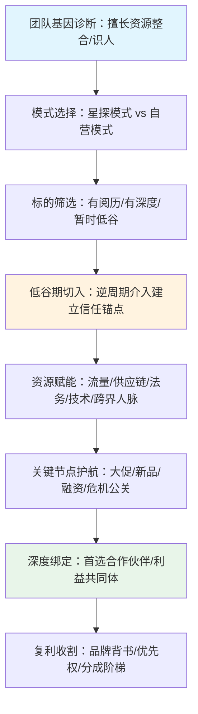
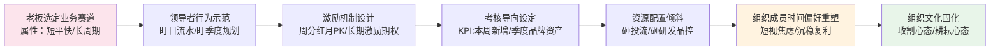
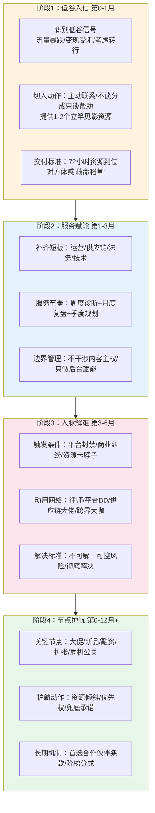
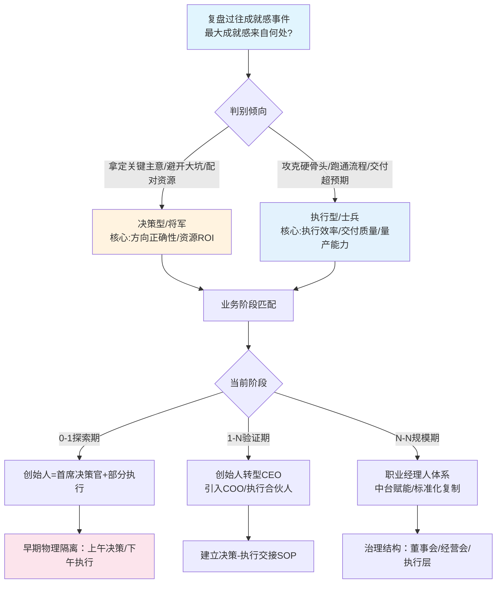
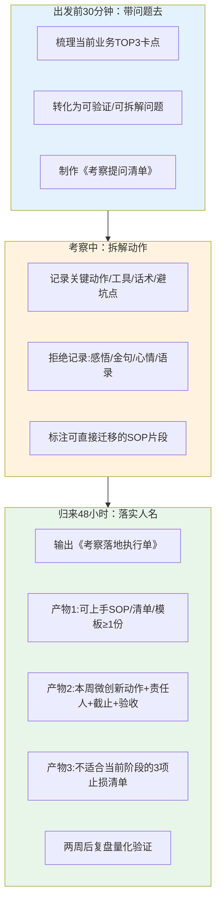
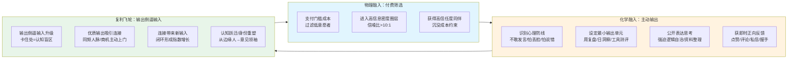

# 第 80 章 抖音百万粉IP操盘手深度复盘五大感悟 —— 从“星探模式”到“业务属性同构效应”

## 学习目标

- 理解星探模式与自营IP模式的核心差异及适用边界
- 掌握业务属性同构效应的识别与诊断方法
- 掌握低谷期介入策略建立深度商业信任的实操路径
- 能通过角色分离决策法明确自身定位（决策vs执行）
- 建立"出去看看-落地闭环"的强制转化机制
- 践行"付费融入-主动输出"的社群成长飞轮模型

## 80.1 生活类比

想象商业世界是一场"选秀+经纪"的双轨游戏。

**星探模式** = 你不想当艺人，甘愿做伯乐/经纪人：在练习生最落魄（低谷期）签下TA，用资源帮TA上位，分享光环红利。

**自营IP模式** = 你自己就是顶流爱豆：拼颜值、练唱跳、搞人设、守算法，吃青春饭、背舆论险。

**业务属性同构** = 公司老板选赛道像选剧本：接《战狼》式硬核长剧（长期主义），全剧组铁军纪律；接《网大》式快拍短平快，全剧组浮躁赶工、随时杀青解散。

**低谷期介入** = 雪中送炭比锦上添花贵万倍：明星塌房/失业时你敢陪吃路边摊、动用关系上资源，这辈子就是你的"铁粉"了。

**角色分离** = 别让导演强行下场演群演，也别让群演坐在导演椅上指挥布光：分清"做选择"和"跑流程"，时间块物理隔离。

**出去看看-落地** = 考察完五星级酒店厨房，回家必须能做出一道拿得出手的菜：光拍照发朋友圈"开眼界"了，厨艺没长，那是"吃货"不是"大厨"。

**付费融入-主动输出** = 花钱买健身卡（付费）不等于练出腹肌，必须天天去打卡发朋友圈晒汗水（主动输出）：公开承诺倒逼执行，教练/健友（圈友）点赞鼓励形成正反馈，最终身材变好（认知跃迁）。

## 80.2 概念地图

商业认知与组织进化第80章
├── IP运营模式选择
│   ├── 星探模式（伯乐视角）       —— 20230328_092
│   │   ├── 核心：发掘有阅历人才、低谷期介入、资源赋能
│   │   ├── 适用：擅长识人/资源整合的团队
│   │   └── 边界：需硬实力兑现承诺、标的有潜力
│   └── 自营IP模式（千里马视角）   —— 20230328_092
│       ├── 核心：自主内容生产、人设打造、运营节奏把控
│       └── 适用：擅长内容生产与运营的团队
├── 组织文化与业务同构
│   ├── 业务属性同构效应           —— 20230328_092
│   │   ├── 定律：老板选赛道决定团队性格
│   │   ├── 传导：时间偏好/焦虑水平/行为范式强制传导
│   │   ├── 实证：短平快项目→团队浮躁焦虑/集体恐慌
│   │   └── 正向：长周期布局→团队稳定/复利思维
│   └── 商业模式与人才模式匹配    —— 20230328_092
│       ├── 定理：模式错配导致资源错配与内耗
│       └── 诊断：从组织症状反推业务根因
├── 商业合作深度绑定
│   ├── 低谷期介入策略             —— 20230328_092
│   │   ├── 核心：逆周期切入、雪中送炭、服务导向
│   │   ├── 杠杆：低谷期帮助边际信任价值最高
│   │   ├── 四步法：低谷入信→服务赋能→人脉解难→节点护航
│   │   └── 边界：需硬实力/优质标的/长期心态
│   └── 信任源于逆境定理           —— 20230328_092
├── 角色定位与决策分离
│   ├── 角色分离决策法             —— 20230328_092
│   │   ├── 核心：将军vs士兵、决策vs执行互斥匹配
│   │   ├── 诊断：复盘成就感事件反推天然倾向
│   │   └── 早期：时间块分离（上午决策/下午执行）
│   └── 决策执行一体化陷阱        —— 20230328_092
├── 认知转化与执行闭环
│   ├── 出去看看-落地闭环法         —— 20230328_092
│   │   ├── 定律：学习价值仅在落地瞬间兑现
│   │   ├── 三要素：带问题去→拆解动作→落实人名
│   │   ├── 反面：纯感官刺激→虚假膨胀→零增长
│   │   └── 正向：48小时输出SOP/决策清单/避坑指南
│   └── 付费融入-主动输出成长模型  —— 20230328_092
│       ├── 物理融入：付费筛选高质量圈层
│       ├── 化学融入：强迫公开表达突破心理防线
│       ├── 飞轮：输出倒逼输入→吸引连接→复利增长
│       └── 即时验证：首发发言获社群正向反馈
└── 实战验证案例库
├── 抖音400万粉操盘手星探模式   —— 20230328_092
├── 作者公司短平快组织焦虑实证   —— 20230328_092
├── 纯学习不落地认知膨胀自证     —— 20230328_092
└── 首次社群发言心理突破即时反馈   —— 20230328_092

## 80.3 星探模式 —— 让团队从"演员"变身"伯乐"

### 为什么需要这个概念？

并非所有团队都擅长内容生产和IP人设打造，强行自营IP易导致资源错配。头部IP稀缺且培养周期长，自主孵化风险高、试错成本大。擅长资源整合、识人用人的团队，通过搭台子找戏班子能发挥更大杠杆。

### 核心定义

> "有的人擅长自己做自媒体，做自己的 ip。而有的人更适合搭台子找戏班子。比如今天见面的团队就是擅长当'星探'，去寻找那些适合做 ip 的人，前提是真的有阅历。并且要掌握时机，在此 ip 低谷期伸入。"
> 
> ——《20230328_092.md》 [P001]

这段话揭示了IP运营的两种根本范式：**自营模式**（自己做千里马）与**星探模式**（做伯乐找千里马）。星探模式的核心是三个动作的组合：
1. **发掘**：寻找"真有阅历、有深度"的潜力IP人选
2. **切入**：在对方事业**低谷期**介入建立合作
3. **赋能**：以资源整合能力换取IP的内容生产能力

### 方法演进图：星探模式运作全流程



### 关键性质

**反直觉：主动寻找"低谷期"而非"高光期"切入**

常规思维倾向于追逐高光期的头部IP，但此时竞争最激烈、议价权最弱、信任最难建立。星探模式反其道而行之——在IP流量暴跌、变现受阻、甚至考虑转行时介入。素材作者亲历的抖音400万粉操盘手团队即采用此策略："去寻找那些适合做ip的人，前提是真的有阅历。并且要掌握时机，在此ip低谷期伸入。" [P001]

**信任前置：通过雪中送炭建立深度绑定**

> "怎么绑定合作关系，更多的是你是擅长为对方去服务的，给对方提供价值的。当然第一点在对方低谷期入手，已经很大程度建立了信任。加那些后期ip遇到问题，动用人脉关系网给予解决。其实就是在每个关键节点给很到位的帮助。"
> 
> ——《20230328_092.md》 [P001]

这个过程展示了信任建立的**逆周期杠杆**：
- 低谷期介入 → 建立基础信任（雪中送炭）
- 关键节点解难 → 强化信任锚点（人脉赋能）
- 长期陪伴服务 → 锁定合作优先权（服务导向）

**轻资产：不承担内容生产重资产**

星探团队不自己拍视频、写文案、运营账号，专注于：
- 人才识别力（眼光）
- 资源整合力（手脚）
- 关键节点解决问题的能力（大脑）

### 典型例子

**正面案例：抖音400万粉商业IP操盘手团队** [P001]
- 不自制内容，专做星探发掘有阅历的人
- 在IP低谷期介入合作
- 后续动用人脉网解决IP遇到的各类问题
- 每个关键节点给到位帮助，深度绑定关系

**反面教材：作者公司强行自营IP** [P001]
- 团队核心优势是短平快项目运营、资源整合
- 强行尝试自营IP（内容生产+人设打造）
- 导致团队焦虑浮躁、节奏错位、资源错配
- 验证模式错配的严重后果

### 边界条件

以下表格列出了星探模式的适用边界条件，用于判断团队是否具备实施该模式的基因与资源：

| 条件 | 说明 |
|------|------|
| **目标标的质量** | 必须"真有阅历、有深度"，空心IP无法承载星探模式 |
| **团队核心能力** | 人才识别力、资源整合力、关键节点解决问题的能力 |
| **心态前提** | 长期主义，低谷期介入回报周期长，短期功利者无法坚持 |
| **适用性判断** | 若团队核心优势是内容生产与运营节奏把控，应选择自营模式 |

---

## 80.4 业务属性同构效应 —— 老板选赛道，决定团队性格

### 为什么需要这个概念？

创业者常只关注业务赚不赚钱，忽视业务模式对组织文化的深层塑造作用。团队普遍焦虑、浮躁、短视，往往不是招人错了，而是业务属性"选错了"。需要一个诊断工具，从业务底层逻辑反推组织症状的根因。

### 核心定义

> "公司领头人以什么属性的项目运营，这群公司上班的人都会跟项目属性很贴合。例如，做短平快的项目的人，基本是收一波就要看下一波。属性很浮躁很焦虑，那么大概率在这个公司上班的人都很浮躁... 所以老板选业务类型也要注意业务属性会影响自己，以及公司所有人的属性。"
> 
> ——《20230328_092.md》 [P001]

**业务属性同构效应**定义为：公司领头人所选业务项目的底层属性（短平快 vs 长期主义、重流量 vs 重品牌、标品 vs 非标），会通过领导者的行为示范、激励机制、考核导向、资源配置，投射并强制塑造全体组织成员的时间偏好、焦虑水平、行为范式与决策模式。

### 方法演进图：业务属性同构的传导机制



### 关键性质

**传导性：老板的时间偏好无损传导给一线员工**

业务属性通过三条传导通道作用于组织：
1. **行为示范**：老板天天盯着日流水、周ROI，员工自然不敢想季度规划
2. **激励机制**：月度分红、周度PK、即时奖惩，绑定短期行为
3. **考核导向**：KPI设定为"本周新增多少""今日转化多少"，长期建设无人问津

**强制性：非个人意志可对抗**

> "以我们公司自身经验来说... 做短平快的项目的人，基本是收一波就要看下一波。属性很浮躁很焦虑，那么大概率在这个公司上班的人都很浮躁... 一旦一个短平快过去了，集体焦虑。"
> 
> ——《20230328_092.md》 [P001]

除非更换业务模式或离职，个体极难在组织层面逆转这种同构效应。哪怕你内心是长期主义者，环境也会迫使你表现出短期行为。

**双向性：正向同构同样强力**

- 长周期业务（如星探模式、品牌建设、私域深耕）→ 倒逼团队沉稳、复利思维、延迟满足
- 短周期业务（如投流收割、搬运混剪、爆款追逐）→ 催生浮躁、收割心态、恐慌文化

### 典型例子

**负向实证：作者公司短平快项目组织焦虑** [P001]
- 业务属性：短平快、强流量依赖、周期短、收割导向
- 组织症状：团队普遍浮躁焦虑，"收一波看下一波"，项目间隙集体恐慌
- 根因诊断：不是招人错了，是业务属性选错了

**正向验证：头部IP操盘手团队稳健状态** [P001]
- 业务属性：星探模式、长周期布局、资源赋能、服务导向
- 组织状态：相对稳定、节奏可控、信任积累
- 验证：业务属性同构效应双向成立

### 边界条件

以下表格界定了业务属性同构效应的适用范围与限制条件：

| 适用范围 | 说明 |
|----------|------|
| **组织规模** | 仅适用于"老板强势主导业务方向"的中小微组织（<200人） |
| **缓冲机制** | 大型成熟企业有制度惯性、中层缓冲，同构效应减弱 |
| **领导者修养** | 领导者个人修养、管理机制可做微调，但难逆转大势 |
| **伪长期主义** | 嘴上长期主义、行为短期考核，同构效应以实际行为为准 |

### 诊断工具：从组织症状反推业务根因

当团队出现以下症状时，优先检查业务属性而非招聘标准：

| 组织症状 | 疑似业务属性根因 | 验证路径 |
|----------|------------------|----------|
| 普遍焦虑、短视、怕担责 | 短平快、高杠杆、零容错 | 检查考核周期、激励结构、复盘频次 |
| 缺乏协作、部门墙厚 | 单点突破、流量红利期 | 检查跨部门目标对齐、资源共享机制 |
| 创新乏力、不敢试错 | 标品价格战、红海竞争 | 检查研发投入占比、容错预算、长期指标 |
| 核心骨干流失 | 缺乏长期激励、股权结构僵化 | 检查期权池、长期激励、职业通道 |

---

## 80.5 低谷期介入策略 —— 雪中送炭才是最高级的商业绑定

### 为什么需要这个概念？

商业合作初期缺乏信任，常规谈判易陷入博弈与防备，绑定成本高。头部人才/IP常被资源追逐，锦上添花的合作无法建立排他性关系。需要一套低成本、高粘性、可复制的深度绑定方法论。

### 核心定义

> "并且要掌握时机，在此 ip 低谷期伸入。当然第一点在对方低谷期入手，已经很大程度建立了信任。加那些后期 ip 遇到问题，动用人脉关系网给予解决。其实就是在每个关键节点给很到位的帮助。"
> 
> ——《20230328_092.md》 [P001]

**低谷期介入策略**定义为：在合作对象（IP/人才）处于事业低谷期、资源匮乏、心理脆弱时，主动介入提供实质性帮助；以"服务者"姿态而非"投资者"姿态切入，通过关键节点的持续赋能，换取长期信任与合作优先权。

### 方法演进图：合作绑定四步法标准化流程



### 信任价值函数：逐步推导与解释

我们引入一个**信任价值函数**来量化低谷期介入的杠杆效应：

```
Trust_Value = Help_Amount × (1 / Target_Resource_Level) × Time_Sensitivity
```

**逐步推导过程：**

1. **基础假设**：信任的建立取决于"提供的帮助量"与"对方当时的资源稀缺度"的乘积关系。帮助量越大、对方资源越匮乏，信任增量越高。

2. **引入资源水位变量**：定义 `Target_Resource_Level` 为对方当前可调动资源总量的相对水位（0-1归一化，1为巅峰期，0为绝对低谷）。当对方处于高光期时，`Target_Resource_Level → 1`，分母接近1，信任价值主要取决于 `Help_Amount`；当对方处于低谷期时，`Target_Resource_Level → 0`，分母趋近于0，整个分式值呈指数级上升。

3. **引入时效性系数**：`Time_Sensitivity` 表示问题的紧迫程度（如：账号即将被封为1.0，下月才要选品为0.3）。低谷期往往伴随高时效性危机（断流、断供、法律诉讼），该系数放大了帮助的现实价值。

4. **极限分析**：当 `Target_Resource_Level → 0` 且 `Time_Sensitivity → 1` 时，`Trust_Value` 趋向无穷大。这解释了为什么"雪中送炭"一次顶得上"锦上添花"百次。

**公式作用概述**：该函数揭示了商业信任建立的非线性规律——**边际信任价值在低谷期达到极大值**，为"逆周期切入"提供了数学层面的决策依据。它提醒操盘手：与其在高光期用高价争夺低信任度合作，不如在低谷期用闲置资源换取极高信任度绑定。

### 关键性质

**逆周期：竞争维度降维打击**

| 维度 | 高光期竞争 | 低谷期介入 |
|------|------------|------------|
| 竞争对手 | 众多资源方排队 | 几乎为零 |
| 议价权 | 在对方手中 | 在你手中（给不给由你定） |
| 信任建立 | 需漫长博弈 | 一次实质帮助即建立 |
| 绑定强度 | 易被更高报价挖走 | 极难被替代（恩情债） |

**信任杠杆：低谷期帮助的边际信任价值最高**

信任价值函数 `Trust_Value = Help_Amount × (1 / Target_Resource_Level) × Time_Sensitivity` 表明：当 `Target_Resource_Level → 0`（低谷期）时，边际信任价值趋向无穷大。素材作者强调："第一点在对方低谷期入手，已经很大程度建立了信任。" [P001]

**服务导向：绑定核心在于"擅长为对方服务"**

> "怎么绑定合作关系，更多的是你是擅长为对方去服务的，给对方提供价值的。"
> 
> ——《20230328_092.md》 [P001]

这不是慈善，而是**高杠杆的商业投资**：
- 成本：你的闲置资源/人脉/渠道（边际成本低）
- 收益：头部IP的长期绑定、优先合作权、品牌背书（边际收益高）

### 合作绑定四步法（标准化操作流程）

```
阶段1：低谷入信（第0-1个月）
├── 识别信号：流量暴跌/变现受阻/团队动荡/公开吐槽/考虑转行
├── 切入动作：主动联系、不谈分成只谈帮助、提供1-2个立竿见影资源
├── 话术模板："看到你最近... 我有... 资源能直接帮上，无任何条件"
└── 交付标准：72小时内资源到位、对方体感"救命稻草"

阶段2：服务赋能（第1-3个月）
├── 核心动作：补齐IP短板（运营/供应链/法务/技术/跨界联动）
├── 服务清单：周度诊断+月度复盘+季度规划
├── 边界管理：不干涉内容创作（IP核心主权）、只做后台赋能
└── 信任增量：每解决一个痛点，信任锚点+1

阶段3：人脉解难（第3-6个月）
├── 触发条件：IP遇到关键卡点（平台封禁/商业纠纷/资源卡脖子）
├── 动用网络：律师/平台BD/供应链大佬/跨界大咖/媒体资源
├── 解决标准：从"不可解"变为"可控风险"或"彻底解决"
└── 绑定升级：从"合作伙伴"升级为"核心利益共同体"

阶段4：节点护航（第6-12个月+）
├── 关键节点：大促/新品发布/融资/团队扩张/危机公关
├── 护航动作：资源倾斜、优先权给予、兜底承诺
├── 长期机制：建立"首选合作伙伴"条款、收益分成阶梯
└── 退出机制：双方任一方可按约定估值体面退出、不撕逼
```

### 边界条件

以下表格列出了低谷期介入策略的硬性前置条件：

| 硬性前置条件 | 说明 |
|--------------|------|
| **硬实力** | 必须具备"动用人脉解决关键问题"的实际能力，空手套白狼会被识破反噬 |
| **优质标的** | 仅适用于"有潜力、有阅历、暂时低谷"，烂泥扶不上墙无效 |
| **长期心态** | 回报周期长（12-36个月），短期功利者无法坚持 |
| **服务姿态** | 拒绝"投资者架子"，全程以"服务者/合伙人"身份出现 |

---

## 80.6 角色分离决策法 —— 搞清你是"将军"还是"士兵"

### 为什么需要这个概念？

创业者常身兼决策与执行双重角色，导致战略视野被战术琐事吞噬。团队成员不清自身定位，决策层爱插手执行、执行层爱发表战略意见，效能低下。需要一把手术刀，切开角色模糊地带，落实责权对等。

### 核心定义

> "分清楚自己适合做决策，还是适合做执行。"
> 
> ——《20230328_092.md》 [P001]

**角色分离决策法**要求个体明确界分：核心竞争力在于**战略决策**（做选择、定方向、配资源、判趋势、定生死）还是**战术执行**（攻细节、跑流程、出结果、优化SOP、打硬仗）。基于定位进行人岗匹配：决策型人才配战略岗，执行型人才配作战岗，严禁错位。

### 方法演进图：角色分离的识别与配置路径



### 关键性质

**互斥性：同一时间、同一维度无法高质量兼顾**

| 维度 | 决策者（将军） | 执行者（士兵） |
|------|----------------|----------------|
| 时间跨度 | 季度-年度-多年 | 日-周-月 |
| 核心动作 | 选择、放弃、配置、判断 | 执行、优化、交付、迭代 |
| 成功指标 | 方向正确性、资源ROI | 执行效率、交付质量、量产能力 |
| 思维模式 | 概率思维、系统思维、反直觉 | 确定性思维、流程思维、标准化 |
| 典型陷阱 | 战略虚假感、脱离一线 | 战术穷忙、迷失方向 |

**匹配性：业务阶段决定角色需求**

| 业务阶段 | 核心角色需求 | 典型配置 |
|----------|--------------|----------|
| 0-1（探索期） | 决策力 > 执行力 | 创始人=首席决策官+部分执行 |
| 1-N（验证期） | 执行力 > 决策力 | 创始人转型CEO，引入COO/执行合伙人 |
| N-N（规模期） | 系统力 = 决策×执行 | 职业经理人体系、中台赋能、标准化复制 |

**认知性：通过复盘"成就感事件"反推天然倾向**

不要主观臆断"我适合做决策"，而要复盘过往：
- 什么时候你感到**最大成就感**？
  - 拿定一个关键主意、避开一个大坑、配对关键资源 → **决策型**
  - 攻克一个硬骨头、跑通一个流程、交付超预期结果 → **执行型**
- 平时喜欢干什么？（空闲时间自发投入的活动最诚实）

### 典型例子

**素材金句：**
> "分清楚自己适合做决策，还是适合做执行。"
> 
> ——《20230328_092.md》 [P001]

**作者自证：从"出去看看"到"首发发言"的角色校准** [P001]
- 早期：热衷"出去看看"（决策层爱好：听大佬分享、看趋势、开眼界）
- 痛点：光享受感官刺激，无执行落地，导致虚假膨胀
- 校准：付费入群后，针对"新人不敢发言"痛点，强迫自己**首发发言**（执行层动作）
- 结果：获得社群正向反馈，实现心理突破与化学融入

### 边界条件

以下表格列出了角色分离决策法在不同场景下的处理原则：

| 场景 | 处理原则 |
|------|----------|
| **早期创业者** | 常需"决策执行一体"，但需有意识区分时间块：上午做决策、下午做执行 |
| **纯决策者风险** | 完全脱离一线易陷入"战略虚假感"，需建立定期下沉机制（如月度一线轮岗） |
| **动态迁移** | 角色非固化标签，随能力成长与业务阶段动态迁移，建议半年一复盘 |
| **团队配置** | 识别核心成员角色倾向，组建"决策-执行"互补搭档，而非同质化堆砌 |

---

## 80.7 出去看看-落地闭环法 —— 认知不落地，等于白长见识

### 为什么需要这个概念？

创业群体普遍热衷"考察、学习、开眼界"，却极少有人能将见闻转化为业务增量。"见识焦虑"驱动大量低质量输入，制造虚假成长感，实则是逃避执行的伪装。需要一套强制机制，将外部输入强绑定至内部落地动作。

### 核心定义

> "以我们公司自身经验来说，最好的就是出去看看，回来后要落地。光享受出去看看的那种快乐，没有执行力和落地，与其说享受，不如说是浪费，让自己愈发膨胀。"
> 
> ——《20230328_092.md》 [P001]

**出去看看-落地闭环法**定义为：外部学习考察（出去看看）必须在规定时间内转化为内部执行动作（落地）。单纯的感官刺激、认知膨胀、社交快乐，若无落地动作承接，定性为"浪费"而非"投资"。

### 方法演进图：落地闭环三阶段强制流程



### 落地成果公式：逐步推导与解释

我们定义**落地成果函数**，将模糊的"学习收获"转化为可验证的工程指标：

```
落地成果 = f(带问题去, 拆解动作, 落实人名)
         = Σ [问题i × 动作可迁移度i × 责任人明确度i × 48h交付率i]
```

**逐步推导过程：**

1. **问题导向性**：如果不带具体问题去考察，输入信息就是无向向量，无法与内部业务向量做内积运算。定义 `问题i` 为第i个业务卡点的权重（0-1），只有明确的问题才能作为"查询向量"从外部知识库检索相关答案。

2. **动作可迁移度**：考察中获得的信息必须拆解为"动作原子"。定义 `动作可迁移度i` 为对方关键动作在本地环境下可直接执行的概率（0-1）。记录"大佬说要长期主义"可迁移度≈0；记录"大佬每周二用Notion复盘模板X，字段含ABC"可迁移度≈0.8。

3. **责任人明确度**：无责任人的动作等于零。定义 `责任人明确度i` 为指定具体自然人且其具备执行权限的指示函数（1=已指定并确认，0=无人/模糊）。"团队安排下"=0，"张三周五前上线"=1。

4. **48小时交付率**：认知遗忘曲线与决策热度衰减曲线双重叠加。定义 `48h交付率i` 为归来48小时内完成交付物的指示函数。实证：延至一周后，落地率衰减>80%，最终归零。

5. **求和聚合**：总落地成果为所有带去问题的加权求和。若某问题得分为0（如未落实人名），该问题的考察投入完全沉没。

**公式作用概述**：该公式将"出去看看"从感性体验转化为工程化流程。它强制要求：每一次考察投入都必须有对应的"查询向量"（问题）、"特征提取"（动作）、"执行绑定"（责任人）、"时间约束"（48小时）。管理者可用此公式审批差旅申请——无《考察提问清单》不批出行，无《落地执行单》不报销。

### 关键性质

**强制性：将"落地"设为"出去看看"的必要前置条件**

落地闭环三要素公式：
```
落地成果 = f(带问题去, 拆解动作, 落实人名)
```

| 要素 | 具体要求 | 反模式 |
|------|----------|--------|
| **带问题去** | 出发前30分钟写下3个"当前业务卡点、可验证、可拆解"的问题 | "开阔眼界""学习先进经验""拓宽视野" |
| **拆解动作** | 考察中记录：关键动作/工具/话术/避坑点 → 可直接上手的SOP/清单/模板 | 记录"感悟/金句/心情/大佬语录" |
| **落实人名** | 归来48小时输出《考察落地执行单》：责任人/截止时间/验收标准 | "回头研究一下""有空试试""团队安排下" |

**具象化：拒绝模糊目标，要求硬核交付物**

归来48小时内必须输出：
1. **可直接上手的SOP/清单/模板**（至少1份）
2. **本周必须尝试的1个微创新动作**（责任人/截止时间/验收标准）
3. **判定为"不适合我当前阶段"的3个信息及理由**（止损清单）

**及时性：48小时黄金窗口期**

为什么48小时？因为认知遗忘曲线+决策热度衰减曲线的双重叠加。延至一周后，落地率衰减>80%，最终归零。

### 典型例子

**反面教材：作者公司考察团队** [P001]
- 行为：团队出去考察仅享受快乐，拍照发朋友圈"开眼界了"
- 结果：回归无落地，无SOP，无动作，无责任人
- 后果：虚假膨胀、业务零增长、团队认知与执行背离

**正向应用：作者付费入群首发发言** [P001]
- 痛点：新人不敢发言、边缘化、潜水
- 带问题去：如何快速融入高质量社群？
- 拆解动作：强迫自己写首条发言、公开表达思考
- 落实人名：自己、立即、当场发布
- 结果：评论区点赞互动（芷蓝:有启发、Hope:666啊、星月:杨总厉害），实现心理突破与化学融入

### 边界条件

以下表格列出了出去看看-落地闭环法的筛选与执行标准：

| 筛选标准 | 说明 |
|----------|------|
| **考察对象** | 必须为"可验证、可拆解、可迁移"的成熟案例，避免"概念型/预研型"项目 |
| **落地方式** | 核心是"组合创新"：取其精华，结合自身资源禀赋改造，而非全盘照搬 |
| **量化验证** | 落地成果需可量化：新增客户数、转化率提升、成本下降、SOP产出等硬指标 |
| **止损机制** | 明确列出"不适合当前阶段"的信息，避免贪多嚼不烂 |

---

## 80.8 付费融入-主动输出成长模型 —— 用真金白银买入场券，用真刀真枪练内功

### 为什么需要这个概念？

免费社群信息噪音大、信任度低、边缘人易潜水，免费心态导致"拿来主义"。付费仅是物理入场，化学融入需"主动输出"打破心理防御与社交隐形墙。需要一套标准化路径，将"付费-融入-输出-成长"串联为正向飞轮。

### 核心定义

> "通过付费找到优质多元的信息渠道，让自己融入进去... 通过各种渠道把自己的思考分享出去。再结合昨天看见亦仁老师说过一些新人入圈后不好意思发言，今天我就选择第一次发言。勇于突破[胜利]融入、迸发。"
> 
> ——《20230328_092.md》 [P001]

**付费融入-主动输出成长模型**包含三个阶段：
1. **物理融入**：付费筛选高质量信息渠道与高净值同伴圈层
2. **化学融入**：强迫自己克服"新人不敢发言/怕丢脸/怕说错"心理，进行公开思考分享
3. **复利飞轮**：持续输出倒逼输入升级，输出吸引同频连接，形成"输入-输出-连接-成长"复利循环

### 方法演进图：社群成长飞轮模型



### 输出倒逼输入机制：逐步推导与解释

**输出倒逼输入机制**的内在逻辑链条：

1. **逻辑自洽要求**：想要公开输出一篇"复盘/方法论/避坑指南"，必须将碎片化认知重组为逻辑自洽的结构化知识。卡住、写不下去的地方，精准指向**认知盲区**或**经验断层**。

2. **资料整理倒逼**：为了不在公开场合出错/丢脸，作者被迫查阅原始数据、核对案例细节、补齐理论短板。这个"为了输出而输入"的过程，输入效率是"为输入而输入"的5-10倍。

3. **反馈校准机制**：评论区的指正、补充、质疑、追问 = 免费的高质量 Peer Review。外部视角比自我反省更客观、更穿透盲区。

4. **身份锚定效应**：公开输出完成了"身份宣告"——我是一个"复盘者""方法论沉淀者""实战派"。一旦身份标签确立，一致性心理会倒逼后续行为与之对齐（持续输出、持续精进）。

5. **连接杠杆放大**：优质输出具有传播属性，被转发、被引用、被私信、被邀请分享。每一次连接都带来新的信息源、新的视角、新的资源，形成 `输入→输出→连接→新输入` 的正向循环。

**公式化表达：**
```
认知增量 = ∫(输出强度 × 反馈质量 × 连接深度) dt
```
其中：输出强度由"最小输出单元"频次保证；反馈质量由圈层质量保证；连接深度由输出价值保证。三者缺一不可。

### 关键性质

**门槛筛选：付费成本本身即过滤低意愿者**

| 维度 | 免费社群 | 付费社群 |
|------|----------|----------|
| 信息密度 | 低（噪音>信号） | 高（信号/噪音>10:1） |
| 信任基础 | 弱（易潜水/水群） | 强（沉没成本约束） |
| 同伴质量 | 参差不齐 | 高执行力、高认知度 |
| 你的心态 | "拿来主义" | "投资回报预期" |

**输出倒逼：公开表达是认知升级最快捷径**

输出倒逼输入的机制：
- **逻辑自洽要求**：写得出来才是真懂，卡住的地方就是认知盲区
- **资料整理倒逼**：为了不丢人，必须查资料、核数据、找案例
- **反馈校准机制**：评论区指正/补充/质疑 = 免费的高质量Peer Review

**连接杠杆：优质输出自带传播属性**

> "评论区：芷蓝:有启发... Hope:666啊... 星月:杨总厉害"
> 
> ——《20230328_092.md》 [P001]

作者首发发言即获得：点赞互动、私信连接、同频共振、心理突破。这就是"主动输出破圈杠杆"的即时验证。

### 典型例子

**作者实证：生财有术社群首发破圈** [P001]
- 触发点：亦仁提到"新人入圈后不好意思发言"
- 动作：强迫自己选择第一次发言
- 结果：勇于突破[胜利]融入、迸发
- 反馈：圈友点赞、握手、肯定，验证即时正向反馈机制

**通用化路径：**
1. 选择高质量付费社群（信息密度高、信任度高、执行力强）
2. 设定"最小输出单元"（如：每周一篇复盘、每天一条洞察）
3. 建立外部监督（Accountability Partner：未按时发罚红包/请咖啡）
4. 追踪反馈数据（互动量、深度连接、商机线索）
5. 21天决策：正向反馈>负向成本 → 升级为月度专栏/周刊/分享会

### 边界条件

以下表格列出了付费融入-主动输出成长模型的适用边界：

| 条件 | 说明 |
|------|------|
| **付费对象** | 必须为"高信息密度、高信任度、高执行力"社群，避免"割韭菜"课程 |
| **输出内容** | "复盘/方法论/实战记录/避坑指南/工具测评/资源推荐"等高价值干货 |
| **拒绝内容** | 情绪宣泄、水贴、纯提问、广告推广、无实质信息的打卡 |
| **仪式感** | 用固定发布日/时/渠道、公开承诺、外部监督对抗拖延症 |

---

## 80.9 多源对照 [需要补充文献]

本章核心概念均源自单一素材《20230328_092.md》（作者与抖音400万粉IP操盘手深度交流复盘），暂无其他素材对同一概念提出不同解释。该节点处于**[需要补充文献]**状态，后续引入组织行为学、战略管理、人才发展等学科视角时，可补充以下对照维度：

### 补充方向清单

| 概念 | 计划引入的学术/实战文献方向 | 预期对照维度 |
|------|----------------------------|--------------|
| 星探模式 | 资源基础观(RBV)、人才代理/MCN行业报告、风投困境投资理论 | 资源编排vs合同治理、信任绑定vs法律绑定、服务导向vs财务模型 |
| 业务属性同构效应 | 战略一致性理论、组织惯性理论、文化-战略匹配模型 | 即时传导vs滞后传导、中小微vs大型组织边界、伪长期主义识别 |
| 低谷期介入策略 | 关系特定性投资理论、逆周期投资案例库、联盟管理理论 | 恩情债vs契约治理、服务姿态vs投资姿态、退出机制设计 |
| 角色分离决策法 | 上下级决策权配置理论、敏捷组织全功能团队观、创始人-职业经理人转型 | 刚性分离vs流动角色、决策执行一体化优劣、下沉机制设计 |
| 出去看看-落地闭环法 | 知识管理SECI模型、敏捷学习循环、设计思维发散收敛 | 48小时硬性约束vs创造性孵化期、问题导向vs探索导向 |
| 付费融入-主动输出模型 | 费曼学习法、建构主义学习理论、社群运营飞轮模型、内向者表达策略 | 高频输出vs深度输出、外部监督vs内驱力、质量自检标准 |

### 共识（预期）

- **星探模式** ≈ 资源基础观(Resource-Based View)中的"资源编排能力"：通过整合外部稀缺资源（人才）创造价值
- **业务属性同构效应** ≈ 战略一致性理论(Strategic Fit)：战略选择决定组织设计与文化
- **低谷期介入** ≈ 关系投资理论：关系特定性投资在逆境中边际收益最高
- **角色分离** ≈ 管理学中的"决策与执行分离"原则
- **落地闭环** ≈ 知识管理中的"知行合一"、敏捷开发中的"学习循环"
- **主动输出** ≈ 费曼学习法、建构主义学习理论

### 分歧（预期）

| 概念 | 学术/大厂视角可能的不同解释 |
|------|----------------------------|
| 星探模式 | 可能视为"人才代理/MCN模式"，强调合同法律保障而非信任绑定 |
| 业务同构 | 可能引入"组织惯性"概念，认为大企业同构效应滞后而非即时 |
| 低谷期介入 | 风投视角可能视为"逆周期投资/困境投资"，强调财务模型而非服务姿态 |
| 角色分离 | 敏捷/扁平化组织主张"全功能团队"，反对刚性角色分离 |
| 落地闭环 | 设计思维强调"发散-收敛"，认为48小时过短可能扼杀创造性孵化 |
| 主动输出 | 内向者可能更适合"深度输出"而非"高频输出"，节奏因人而异 |

---

## 80.10 设计中的取舍

### 为什么不用"自营IP+星探混合模式"？

**Q：能不能既做自营IP，又做星探？**

A：资源禀赋决定了核心竞争力只能二选一。
- 自营IP需要：内容生产能力、人设打造能力、运营节奏把控、算法敏感度
- 星探模式需要：人才识别力、资源整合力、关键节点解难力、长期陪伴心态
- 两者对创始人时间、团队基因、激励机制、考核体系的要求**截然不同甚至冲突**
- 作者公司实证：擅长短平快资源整合，强行自营IP → 团队焦虑浮躁、节奏错位、资源错配
- **取舍原则**：承认自己的"不擅长"比发现"擅长"更重要，在不擅长处做减法，在擅长处做乘法

### 为什么不用"高光期切入+高溢价合作"？

**Q：低谷期介入太慢，为什么不高光期切入、出高价锁定头部IP？**

A：信任建立的经济学账算不过来。
- 高光期：竞争者众、议价权在IP、信任需漫长博弈、易被更高报价挖走
- 低谷期：竞争者零、议价权在你、一次实质帮助建立终身信任、极难被替代
- **核心洞察**：商业合作的最强绑定非合同条款，而是"雪中送炭"形成的恩情债与路径依赖
- **取舍原则**：用边际成本极低的闲置资源（人脉/渠道/经验），换取边际价值极高的头部IP长期绑定

### 为什么不用"纯学习/纯考察"模式？

**Q：出去看看很有价值啊，为什么必须强制落地？**

A：认知输入的边际价值在"落地瞬间"发生阶跃，之前趋近于零甚至为负。
- 无落地的考察 = 感官消费 + 虚假成就感 + 逃避执行伪装
- 有落地的考察 = 问题导向输入 + 动作拆解 + 责任落实 + 量化验证
- **取舍原则**：将"考察预算"绑定"落地交付物"，无落地预案不批差旅，无落地交付不报销

---

## 80.11 动手练习

### 练习 1：诊断你的业务-组织同构状态

1. 列出你当前主营业务的3个核心属性关键词（如：高频/低客单/标品/短周期/重运营/强流量依赖等）
2. 观察团队日常状态：会议讨论重点、焦虑来源、庆祝方式、离职高峰期、新人成长曲线
3. 对号入座：团队状态更像"收割模式(短平快)"还是"耕耘模式(长期主义)"？
4. 反推诊断：若团队普遍焦虑浮躁，是招人错了，还是业务属性选错了？

**回答问题：**
- 如果必须保持现有业务模式，你能通过什么管理机制"缓冲"同构效应的负面传导？
- 如何设计一个"反向同构"实验：在短平快业务中植入长周期文化基因？

### 练习 2：设计你的"星探模式"合作提案

场景：你发现一位在垂直领域深耕10年、近期因平台算法变动流量暴跌、正考虑转行的专家（低谷期标的）

1. 列出你能提供的3类"非资金"硬资源（如：流量分发渠道/供应链对接/法务合规/技术工具/跨界人脉）
2. 设计"低谷期介入"的第一个具体服务动作（成本可控、见效快、对方强需求）
3. 拟定"合作绑定四步法"的节点承诺表：第1/3/6/12个月各提供什么关键帮助？
4. 设定退出机制：若对方3个月内无起色，或你无法兑现承诺，如何体面止损？

**回答问题：**
- 为什么强调"服务者姿态"而非"投资者姿态"？二者在话术、预期管理、利益分配上有何本质区别？
- 如何识别"烂泥扶不上墙"vs"暂时低谷的优质标的"？给出3个可观测的判别指标

### 练习 3：执行"出去看看-落地闭环"实战演练

选择一个你近期想去考察/学习的对象（同行标杆/行业会/付费社群/新工具发布会）

1. 事前准备（出发前30分钟）：写下3个"带去的问题"（必须是当前业务卡点、可验证、可拆解）
2. 过程记录（考察中）：针对每个问题，记录对方的"关键动作/工具/话术/避坑点"，拒绝记录"感悟/金句/心情"
3. 归来48小时内（落地期）：输出一份《考察落地执行单》，包含：
   - 可直接上手的SOP/清单/模板（至少1份）
   - 本周必须尝试的1个微创新动作（责任人/截止时间/验收标准）
   - 判定为"不适合我当前阶段"的3个信息及理由（止损清单）
4. 两周后复盘：该动作带来的量化变化（流量/转化/成本/效率），决定是否推广固化

**回答问题：**
- 为什么要求"48小时内输出"？若延至一周后，落地率会如何衰减？
- 如何区分"值得落地的成熟案例"和"只值参考的概念型项目"？给出3个筛选标准

### 练习 4：启动"付费融入-主动输出"社群破圈实验

选择一个你已付费但处于"潜水/边缘"状态的高质量社群（知识付费/行业协会/校友会/专业协会）

1. 审视心理防线：列出阻止你发言的3个核心恐惧（如：说错被嘲/水平不够丢人/隐私暴露/被推销/无人理睬）
2. 设计"最小输出单元"：承诺未来21天，每周输出1条"非情绪类"干货（复盘/方法论/避坑/工具测评/资源推荐），指定发布日/时/渠道
3. 建立外部监督：找1位社群内活跃伙伴互为'Accountability Partner'，未按时发罚红包/请咖啡
4. 追踪反馈数据：每条输出的互动量（赞/评/转/私信）、引发的深度连接（加微信/语音通话/线下约见/商机线索）
5. 21天后决策：若正向反馈>负向成本，续约升级为"月度专栏/周刊/社群分享会"；否则复盘止损

**回答问题：**
- 为什么"付费"只是物理融入，"主动输出"才是化学融入？从信息论角度解释输入输出的熵减机制
- 如何避免"为输出而输出"制造垃圾信息？设计一个"输出质量自检清单"（3-5条硬指标）

---

## 80.12 本章小结

这一章中我们深度复盘了抖音百万粉商业IP操盘手的五大核心感悟。首先我们拆解了**星探模式**与**自营IP模式**的本质差异，揭示擅长资源整合的团队应做"伯乐"而非强行做"千里马"；其次我们定义并实证了**业务属性同构效应**——老板选赛道决定团队性格，短平快业务催生浮躁焦虑，长周期布局倒逼沉稳复利；接着我们系统化了**低谷期介入策略**的四步法，证明雪中送炭的边际信任价值远超锦上添花；然后我们提出**角色分离决策法**，要求个体明确界分"将军"与"士兵"定位，避免角色错位效能损耗；接着我们建立了**出去看看-落地闭环法**，将外部学习强制绑定至48小时内的可执行交付物；最后我们验证了**付费融入-主动输出成长模型**，证明物理入场不等于化学融入，唯有公开表达才能触发认知跃迁与连接复利。

本章我们一起学习了以下概念：

| 概念 | 解释 |
|------|------|
| 星探模式 | 企业不自营IP，专注发掘有阅历人才于低谷期介入，以资源整合能力换取内容生产能力 |
| 自营IP模式 | 企业自主孵化IP，核心依赖内容生产能力、人设打造与运营节奏把控 |
| 商业模式与人才模式匹配 | 星探模式适配擅长识人/资源整合团队，自营模式适配擅长内容运营团队，错配导致内耗 |
| 业务属性同构效应 | 老板选赛道决定团队性格：短平快项目→团队浮躁焦虑/收割心态；长周期项目→团队稳健/复利思维 |
| 低谷期介入策略 | 在合作对象事业低谷期主动提供实质帮助建立信任，通过关键节点持续赋能实现深度绑定 |
| 信任源于逆境定理 | 商业合作最牢固信任基石非锦上添花，而是低谷期雪中送炭，边际信任价值最高且难被替代 |
| 合作绑定四步法 | 低谷入信→服务赋能→人脉解难→节点护航，以服务者姿态而非投资者姿态切入 |
| 角色分离决策法 | 明确界分核心竞争力在于战略决策还是战术执行，避免角色错位效能损耗 |
| 出去看看-落地闭环法 | 外部学习必须在48小时内转化为内部执行：带问题去→拆解动作→落实人名 |
| 学习价值仅在落地兑现 | 认知输入若不内化为执行动作，不仅无价值，反因虚假成就感导致认知膨胀成为负资产 |
| 付费融入-主动输出成长模型 | 付费筛选圈层(物理融入)→强迫公开表达突破心理防线(化学融入)→输出倒逼输入吸引连接形成复利飞轮 |
| 主动输出破圈杠杆 | 付费仅完成物理入场，唯有克服抗力公开分享思考，才能实现化学融入触发生财有术式复利增长 |

下一章中，我们将学习如何构建个人知识管理体系，从"囤积焦虑"走向"内化进化"，掌握问题导向输入、多维标签组织、分阶段沉淀、定期规整断舍离、实践输出内化的完整方法论，以及杂学箱缓冲、长文精华提炼、音频转文本、群聊转发聚合、桌面分区可视化等5大微操作技巧。

