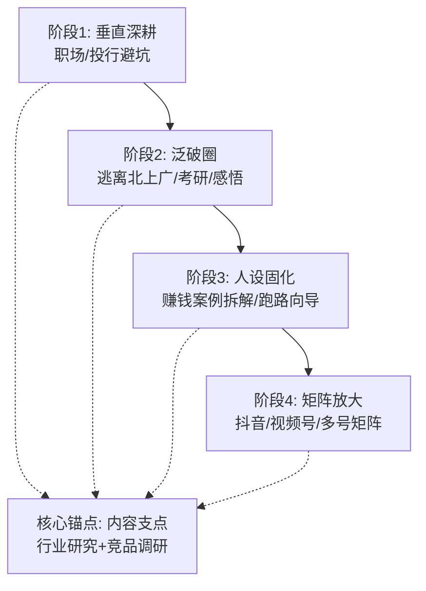

# 第 34 章 个人IP与社群变现实战体系

## 学习目标

- 理解个人IP在自媒体时代的低门槛财富杠杆属性
- 掌握反差选题法制造认知冲突获取流量的核心逻辑与实操公式
- 内化“生活苦逼即创作养料”的心法，将挫折转化为内容燃料
- 熟练运用定位迭代三阶段模型，完成从垂直深耕到人设固化的动态进化
- 识别并打磨个人内容支点，构建差异化护城河与结构化生产体系
- 建立用户投射型IP认知，让粉丝爱上“未来的自己”实现高信任转化
- 掌握0元社群冷启动变现法，以最低风险验证商业模型并快速放大
- 建设朋友圈IP，用“去专家化、做朋友”逻辑构建私域高信任账户
- 量化公私域分层转化漏斗，建立可反推、可诊断、可复制的流量变现数学模型
- 运用商业模式组合决策矩阵，基于四维评估科学选择变现路径组合
- 执行私域引流风控SOP，在账号安全与引流效率间寻找动态平衡点
- 践行跨平台迁移复利论，将核心能力剥离账号实现永久资产积累

## 34.1 生活类比

想象个人IP建设是一场“开餐厅”创业游戏：你不需要买楼雇厨师，只需摆个摊（零成本启动），菜好吃（利他内容）食客就会排队（流量复利），这就是**个人IP红利**的低门槛与高复利本质。菜单上写着“米其林大厨教你用路边摊食材做满汉全席”（普通人人设+精英领域+野路子），路人好奇驻足（点击），这就是**反差选题法**制造认知冲突的核心逻辑。你曾因做菜翻车被投诉（职场挫折），于是录制《避坑指南》卖给想开餐厅的人（真实素材变现），这就是**生活苦逼即创作养料**的心法——挫折不是阻碍，而是最好的素材库。先卖一种招牌菜精准获客（垂直深耕），再推大众套餐破圈涨粉（泛内容破圈），最后立“翻车避坑专家”人设收高客单徒弟（人设固化），这就是**定位迭代三阶段**的动态进化路径。你祖传的秘制酱料配方（核心竞争力/行业研究能力），别人学不来、你用不累、食客认价值、能衍生出无数新菜品，这就是**内容支点**构建的差异化护城河。食客看着你心想“这就是我想成为的厨神”，他们买单不是崇拜你，是为“未来的自己”买单，这就是**用户投射型IP**让粉丝爱上“未来的自己”的高信任转化机制。先免费请100人试吃建口碑（盘子>利润），再收499元会员费（低价筛选高意向），稳态日卖3份月入8万，这就是**0元社群冷启动变现法**以最低风险验证商业模型的最小闭环。不挂专家招牌，只在朋友群发“今日采购心得/翻车复盘”（真实感悟），食客信任你胜过信任广告，这就是**朋友圈IP**用“去专家化、做朋友”逻辑构建私域高信任账户。路人(1600) → 试吃留微信(800, 50%) → 办卡会员(160, 20%)，每天多拉20人试吃就能稳定日出3单，这就是**公私域分层转化漏斗**建立的可反推、可诊断、可复制的流量变现数学模型。先卖私厨上门(1v1验证) → 再办会员制食堂(社群规模) → 后开厨艺培训班(训练营高客单) → 暂不搞预制菜工厂(录播课重资产)，这就是**商业模式组合决策矩阵**基于四维评估科学选择变现路径组合的阶段匹配逻辑。摆摊别太招摇被城管抓(封号)，老摊主日接待<200客、早中晚只发3条朋友圈、拒绝发小广告，这就是**私域引流风控SOP**在账号安全与引流效率间寻找动态平衡点的操作手册。在夜市摆摊练就的“招呼客/改菜单/控成本”本领(网感/方法论)，换到商场美食广场依然能开张即火，这就是**跨平台迁移复利论**将核心能力剥离账号实现永久资产积累的终极护城河。

## 34.2 概念地图

第34章 个人IP与社群变现实战体系
├── 认知基石
│   ├── 个人IP红利：低门槛/高复利/强迁移/利他驱动  —— P001, P004, P007
│   ├── 反差选题法：人设张力+标题核弹+真实支撑  —— P002, P005
│   ├── 生活苦逼即创作养料：挫折转燃料/真实溢价/动力反转  —— P003, P006
│   └── 跨平台迁移复利论：能力>账号/网感迁移/资产剥离  —— P004, P007
├── 账号成长进化
│   ├── 定位迭代三阶段：垂直深耕→泛破圈→人设固化  —— P008, P009, P010
│   ├── 内容支点：核心竞争力/差异化壁垒/结构化生产/投射锚点  —— P011
│   └── 用户投射型IP：共情代偿/强信任低门槛/双向成长飞轮  —— P012
├── 变现闭环体系
│   ├── 0元社群冷启动：盘子>利润/低价筛选/高转化验证/极低边际成本  —— P001, P005, P013, P014
│   ├── 朋友圈IP：去专家化/做朋友/高频低强度/废物朋友对比效应  —— P015
│   ├── 公私域分层转化漏斗：量化模型/可反推/卡点诊断/跨赛道迁移  —— P016, P017
│   └── 商业模式组合决策矩阵：四维评估/阶段匹配/组合协同/精力守恒  —— P018, P019
└── 风控与资产沉淀
    ├── 私域引流风控SOP：分级管理/内容合规/工具化沉淀/安全优先  —— P004, P005, P007, P020
    └── 跨平台迁移复利论：能力迁移/时间压缩/降维打击/资产永续  —— P004, P007

> **来源说明**：P001-P020 为素材段落编号，对应 `docs/202303/20230328_065.md` 与 `docs/202303/K4zfd2djsoEAdWxTaXrceSf9nLf.md` 两份核心素材的关键片段。

## 34.3 个人IP红利 —— 普通人的低门槛财富杠杆

### 为什么需要这个概念？

传统创业需要资金、团队、供应链，门槛极高。打工者缺乏抗风险能力，急需零成本、可复利的副业路径。自媒体时代将“影响力”资产化，个人IP成为普通人翻身的核心杠杆。

> "自媒体时代最大的红利就是个人 IP，都不用做成那么现象级的 IP，就我这种还不算什么影响力的，我已经感受到流量多香了。"
> 
> —— P001

这段话揭示了个人IP的本质：**不需要百万大V的体量，微影响力（千粉级）即可撬动高客单价变现**。作者刘晨昊用亲身经历证明：一个“还不算什么影响力”的普通人，通过小红书单月变现 8w+。

### 核心定义

**个人IP**（来源：P001, P004, P007）

$$
\text{个人IP} = (\text{真实人设} + \text{垂直内容} + \text{持续频次}) \times \text{时间复利}
$$

这个公式展示了三个核心变量的乘积关系：第一个变量“真实人设”指代普通人标签（非专家/大V），能降低用户防御心理；第二个变量“垂直内容”指代聚焦细分赛道（职场/投行/避坑），能精准获客；第三个变量“持续频次”指代高频输出练就“网感”，时间复利放大资产价值。这个公式揭示了个人IP构建的底层逻辑：真实人设建立信任基座，垂直内容筛选精准用户，持续频次积累复利资产，三者缺一不可。

### 关键性质

个人IP红利具有四大关键性质：首先是**低门槛**，零资金启动，仅需时间与执行力投入，普通人即可参与；其次是**高复利**，内容资产永久留存，持续产生被动流量与信任红利，时间站在创作者这边；第三是**强迁移**，网感、选题能力、文案框架可跨平台复用（抖音练感 → 小红书出道），能力资产不随账号消亡；最后是**利他驱动**，价值源于“帮用户解决问题”，利他越深变现越易，商业本质是利他。

### 典型例子

**刘晨昊路径**（来源：P001, P004, P007）

| 阶段 | 关键动作 | 核心收获 |
|------|----------|----------|
| 抖音探索期 | 2个月折腾，3个方向5篇内容 | 练就“网感”，验证职场赛道流量最好 |
| 小红书出道期 | 第2篇《普通人进入投行咨询》爆款 | 确立反差人设，次日出道 |
| 社群变现期 | 0元建群+499元早鸟价+飞书沉淀SOP | 首周50人付费，单月稳定8w+ |

这个案例完整展示了从零起步到变现的全链路：抖音探索期虽然未起号，但完成了选题节奏、标题直觉、用户心理的隐性训练；小红书出道期利用积累的网感，第2篇笔记即爆款出道；社群变现期通过0元冷启动+低价预售+SOP沉淀，实现单月8万+稳定变现。

> "网感，就是靠练，一篇不行第二篇，第二篇不行第三篇，直到你找到你出道的方式"
> 
> —— P004

这句话道出了核心：**网感不是天赋，是大量试错后的模式识别能力**。作者在抖音“折腾2个月未起号”，实则完成了选题节奏、标题直觉、用户心理的隐性训练，使其进入小红书后第2天即爆款出道。

### 边界条件

个人IP建设必须经历“丑陋的尝试期”：前期大量无数据内容是练网感的必要成本，不可因早期数据差而放弃；单平台依赖风险极高：违规限流会导致公域流量截断→私域引流断崖→收入肉眼可见下降，必须布局矩阵号与跨平台分散风险；核心护城河非“号”而是“人”：账号可封，人设、网感、私域信任资产可迁移，能力才是永久资产。

> "你看现在小红书对我违规处理，我收入是肉眼可见的降低啊哈哈哈哈哈"
> 
> —— P007

这个惨痛教训直接催生了后文的“矩阵号布局”与“跨平台迁移复利论”。

---

## 34.4 反差选题法 —— 制造冲突感的标题核弹

### 为什么需要这个概念？

平台算法推荐机制下，标题决定分发上限（占99%权重）。同质化内容泛滥，用户注意力稀缺，常规标题无法穿透信息过滤。普通人缺乏权威背书，需用“认知冲突”制造稀缺感获取首次点击。

> "小红书就是标题党，标题取的好，成功了 99%，毫不夸张说这一点。"
> 
> —— P005

### 核心定义

**反差选题法**（来源：P002, P005）

$$
\text{爆款标题} = [\text{反差人设}] + [\text{稀缺领域}] + [\text{野路子/捷径/避坑}] + [\text{利益承诺}]
$$

这个公式展示了标题设计的四个模块化组件：第一个模块“反差人设”指代普通人/打工人/非HR/年薪10万内等平民标签；第二个模块“稀缺领域”指代投行咨询/大厂Offer/年薪百万/晋升密码等高认知领域；第三个模块“野路子/捷径/避坑”指代不卷业绩/摸鱼上岸/拒绝内耗/野路子等反常识切入点；第四个模块“利益承诺”指代不吃亏/避坑/少走弯路/直接拿结果等利益钩子。这个公式揭示了爆款标题的工程化构造逻辑：通过人设与领域的张力差制造冲突，用反常识路径打破固有认知，最后用利益承诺驱动点击行动。

### 关键性质

反差选题法具有三大关键性质：首先**必须真实**，反差源于真实经历（普通人进投行），非标题党式编造，内容支撑不住标题必翻车；其次**精准打击痛点**，目标用户的核心焦虑（如普通人想进大厂、想赚钱）是选题的靶心；最后**可模块化复用**，同一核心反差可生产系列化内容（面试/薪资/避坑/心法），形成内容生产流水线。

### 典型例子

**出道作拆解**（来源：P002）

> "普通人和投行咨询精英人设形成强烈反差，野路子，没见过，看一看不吃亏这样的感觉"
> 
> —— P002

| 模块 | 出道作体现 | 心理触发 |
|------|------------|----------|
| 反差人设 | 普通人 | 代入感：就是我 |
| 稀缺领域 | 投行咨询 | 渴望感：高薪圣地 |
| 野路子 | 野路子才是最合适的 | 认知冲突：颠覆常识 |
| 利益承诺 | （隐含）不吃亏 | 行动诱导：点进来看 |

**结果**：次日即出道，成为账号标志性爆款，确立职场赛道定位。

### 多源对照：标题权重的不同理解

**共识**：标题是分发核心杠杆，占权重 80%-99%。

**分歧**：

| 来源 | 核心观点 | 适用边界 |
|------|----------|----------|
| P005（K4zfd2djsoEAdWxTaXrceSf9nLf.md） | 标题党思维：80%精力投标题，制造反差/悬念/利益钩子 | 小红书等“标题+封面”双核分发平台 |
| P001（20230328_065.md，刘晨昊） | 标题占80%精力，反差+利益点设计爆款标题 | 个人IP起号期、资源有限的新手 |

> **教练视角**：新手先练“反差标题党”建立流量基本盘，进阶再引入“数据拆解模仿”与“叙事序列化”，三者互补而非互斥。

### 边界条件

反差必须基于真实能力支撑：**内容支点**（行业研究/竞品调研）是持续输出的根基，无支点反差必崩；避免过度娱乐化：纯八卦/吐槽类虽播放大但转化极低（用户“哈哈哈就走了”）；需配合“利他内容”比例：高利他内容(案例拆解)转粉付费强，高娱乐内容破圈快，按比例配比。

> "播放量和转粉最高的，还是利他性强的...核心可能还是觉得我有用"
> "播放量最大的：喜闻乐见类的...职场吐槽类：播放量大，转化很低，用户来了哈哈哈就走了"
> 
> —— P009

---

## 34.5 生活苦逼即创作养料 —— 将挫折转化为内容燃料的心法

### 为什么需要这个概念？

普通人创业常陷入“顺利时懒得动、挫折时不敢动”的死循环。缺乏真实素材是内容枯竭的核心原因，职场顺遂反而无真话可说。需要一套重构认知的框架，将痛苦显性化为创作资产。

### 核心定义

**认知重构**（来源：P003, P006）

$$
\text{创作燃料} = \text{痛苦事件} \xrightarrow{\text{复盘抽象}} \text{通用避坑指南/方法论}
$$

**机制**：痛苦倒逼高频输出 → 高频输出练就网感 → 网感换来流量变现 → 变现缓解焦虑形成正向循环

这个公式揭示了挫折转化为创作燃料的内在机制：痛苦事件经过复盘抽象，提炼为通用避坑指南或方法论，成为创作的核心素材；痛苦倒逼创作者高频输出，高频输出练就网感，网感换来流量变现，变现反过来缓解焦虑，形成正向循环。

### 关键性质

生活苦逼即创作养料具有三大关键性质：首先是**真实性溢价**，真实挫折产出的内容自带“说人话”属性，极易建立情感共鸣与信任；其次是**动力反转**，职场顺利期缺乏紧迫感（抖音探索慢），职场崩塌期反而极速突破（小红书次日出道），挫折成为爆发的催化剂；最后是**素材无限**，每一次踩坑、避坑、跑路、重来，都是用户最想看的“野路子”干货，素材库永不枯竭。

### 典型例子

**刘晨昊的动力反转**（来源：P003, P006）

| 时期 | 状态 | 创作表现 |
|------|------|----------|
| 职场顺利期 | 带团队正乐呵 | 抖音探索2个月，折腾慢，缺乏素材 |
| 职场崩塌期 | 团队解散、面临跑路 | 小红书第2天出道，单月变现8万 |

这个对比生动诠释了动力反转机制：顺境中缺乏驱动力与真实素材，逆境中反而迸发出惊人的执行力与内容张力。

> "做自媒体做得好的，观察下来都是生活特别不如意的...如果你现在过得不太顺利，放宽心，也许这就是你的创作养料"
> 
> —— P003

> "前期抖音探索慢，还是因为当时职场之路还算顺利，带团队正乐呵呢。后期小红书能快速突破，还是生活苦逼，团队没了，自己也要快跑路的状态"
> 
> —— P006

### 边界条件

生活苦逼即创作养料有三大边界条件：**非美化苦难**，必须基于“解决问题/复盘避坑”视角输出，单纯吐槽情绪无商业价值；**需具备基础复盘能力**，将具体经历抽象为通用方法论（如面试SOP/避坑清单），而非流水账记录；**心理承受力要求**，需接受“被白嫖/被质疑/违规封号”常态化，保持“适当被白嫖、不害臊、持续行动”心态。

---

## 34.6 定位迭代三阶段 —— 从垂直深耕到人设固化的进化路径

### 为什么需要这个概念？

新手常纠结“选什么赛道”，导致决策瘫痪或频繁切换赛道浪费红利期。账号成长非线性，需匹配不同阶段的流量逻辑与变现需求。缺乏动态调整机制，易陷入“僵尸垂类”或“泛流量无变现”陷阱。

### 核心定义

**定位迭代三阶段**（来源：P008, P009, P010）

| 阶段 | 核心任务 | 内容策略 | 变现目标 |
|------|----------|----------|----------|
| **1. 垂直深耕期** | 精准获客 | 聚焦细分领域（职场/投行咨询），专业内容筛选高意向种子用户 | 建立信任资产，验证赛道 |
| **2. 泛话题破圈期** | 规模涨粉 | 引入大众话题（逃离北上广/考研/宏观感悟），情绪共鸣破圈 | 扩大公域流量池 |
| **3. 人设固化期** | 高效变现 | 锚定核心标签（赚钱案例拆解者/跑路向导），吸引高付费意向精准用户 | 社群/咨询/训练营高客单变现 |

### 关键性质

定位迭代三阶段具有三大关键性质：首先是**动态非静态**，定位随创作者生命周期（认知升级/商业模式演进）持续迭代，IP意味着“不断生长”；其次是**流量与变现解耦**，前期用泛流量做规模，后期靠垂直人设做转化，不可本末倒置；最后是**核心锚点不变**，全程围绕“内容支点”（核心竞争力）展开，支点决定内容上限。

### 典型例子

**刘晨昊路径演进**（来源：P008, P009, P010）

```
阶段1(垂直)：职场/投行咨询避坑 → 精准获客(高意向种子用户)
    ↓ 积累信任资产、验证赛道
阶段2(破圈)：逃离北上广/考研就业/宏观感悟 → 情绪共鸣破圈(泛粉激增)
    ↓ 扩大流量池、筛选同频人群
阶段3(固化)：赚钱案例拆解者 + 跑路向导 → 高客单变现(社群/训练营)
```

> "那个时期的我，内容方向已经变成了：行业机会和我的思考、赚钱案例分享和拆解"
> "她们关注刘晨昊，到底在关注什么，我觉得是在关注未来自己的投射"
> "没有一步到位过，包括到目前为止，我还在迭代还在调整，IP没有尽头，IP意味着不断生长......"
> 
> —— P009, P010

### 方法演进图



这个流程图展示了定位迭代的完整路径：从垂直深耕起步，通过泛破圈扩大流量池，再到人设固化实现高效变现，最终通过矩阵放大实现规模化，全程以内容支点为核心锚点。

### 边界条件

破圈内容不可失守底线：泛内容必须关联核心人设（如“普通女孩的宏观思考”），纯蹭热点会模糊标签；固化非僵化：人设标签需随商业模式升级迭代（社群→训练营→咨询），拒绝标签化包袱；前置条件：必须先跑通“垂直深耕”积累种子用户与信任资产，无种子用户直接破圈必死。

---

## 34.7 内容支点 —— 个人IP持续输出的核心护城河

### 为什么需要这个概念？

盲目模仿爆款导致内容空心化，无法建立长期用户信任。普通人缺乏系统性知识体系，需找到可持续输出的“发力点”。内容生产效率低源于“无米下锅”，支点决定素材库广度与深度。

### 核心定义

**内容支点**（来源：P011）

> "找到自己的发力点很重要：行业研究我是擅长的，竞品调研我也是，这是我的内容支点。每个人都有自己的支点，找到这个很重要"
> 
> —— P011

**识别标准**（四维判断）：
1. **别人学不来**：源于独特经历/技能壁垒（如投行从业/创业跑路）
2. **你做不累**：顺应天赋优势区，零意志力成本高频执行
3. **用户认价值**：直接关联用户痛点（省钱/省时/赚钱/爽感/安全感）
4. **能持续产出**：可衍生系列化内容（案例拆解/行业洞察/避坑指南）

### 关键性质

内容支点具有三大关键性质：首先是**差异化壁垒**，支点源于个人独特经历，天然形成护城河；其次是**结构化生产**，支点决定内容分类与SOP——案例拆解类：结果先行 → 路径拆解 → 细节复盘（用户视角+说人话）；行业研究类：拒绝截图堆砌，必须输出观点（哪怕错也要有立场）；情绪抒发类：节点营销 + 真实示弱 + 里程碑复盘；最后是**用户投射锚点**，支点内容让用户看到“未来想成为的自己”，建立深度情感连接。

### 典型例子

> "案例拆解类：先说结果...核心就是【以用户的视角】体验这个案例，然后说人话"
> "行业研究类：不要单纯截图报告...要有自己的观点，哪怕这个观点是不对的"
> 
> —— P011

作者依托“竞品调研”这一支点，产出《某竞品如何从0到1做社群》系列笔记，实现高转化、高付费，验证了支点驱动内容生产的有效性。

### 边界条件

**支点 ≠ 标签**：标签是表层包装（如“职场博主”），支点是内核能力（如“拆解商业案例的方法论”）；**必须可变现**：支点需直接关联商业模式（咨询/社群/课程），纯兴趣支点难以持续商业化；**需持续打磨**：支点能力需随行业迭代更新（如引入AI工具升级调研效率），否则会过期。

---

## 34.8 用户投射型IP —— 让粉丝爱上“未来的自己”

### 为什么需要这个概念？

传统专家型IP门槛高、距离感强、用户付费决策链路长。普通人缺乏权威背书，需用“共情+代偿”建立更强情感连接。高客单价变现需要极高信任度，投射型IP能压缩信任建立周期。

### 核心定义

**用户投射型IP**（来源：P012）

> "她们关注刘晨昊，到底在关注什么，我觉得是在关注未来自己的投射，具体来说就是刘晨昊在做她们想做的事、说她们想表达没表达出来的话"
> 
> —— P012

$$
\text{IP价值} = \text{用户投射强度} \times \text{创作者代偿真实度} \times \text{落地可行性}
$$

**核心机制**：创作者替用户做他们想做的事、说他们想说却不敢说的话、走他们想走却不敢走的路。

这个公式揭示了用户投射型IP的价值构成：用户投射强度决定关注度，创作者代偿真实度决定信任度，落地可行性决定转化率，三者共同构成IP的商业价值。

### 关键性质

用户投射型IP具有三大关键性质：首先是**强信任低门槛**，用户因“共情”而非“仰视”付费，决策链路极短（最快20分钟成交）；其次是**高粘性高复购**，投射关系天然包含“陪伴成长”预期，用户生命周期价值(LTV)极高；最后是**反哺创作者**，用户投射倒逼创作者持续进化（不能让“未来的自己”失望），形成双向成长飞轮。

### 典型例子

> "用户投射型IP...替用户做他们想做的事、说他们想说的话"
> "用户投射倒逼创作者持续进化...形成双向成长飞轮"
> 
> —— P012

**表现**：粉丝高频私信“我也想跑路/进大厂/做副业”，并直接购买社群/咨询/训练营。

### 边界条件

**必须真实走过**：投射基于创作者真实经历（跑路/避坑/赚钱），伪造人设必翻车；**需提供“地图”与“装备”**：仅提供情绪共鸣不够，必须交付可落地的方法论/工具/社群；**规模化边界**：投射型IP强依赖主理人个人魅力，团队化扩张易稀释信任密度，需标准化交付体系支撑。

---

## 34.9 0元社群冷启动变现法 —— 低风险验证商业模型的最小闭环

### 为什么需要这个概念？

传统社群创业面临“先花钱建群→无人买单→沉没成本”的高风险。普通人缺乏品牌背书，高价社群转化率极低，需低门槛验证支付意愿。社群运营边际成本极低（500人群成本=100人群），核心难点在“拉盘子”而非“讲课”。

### 核心定义

**0元社群冷启动**（来源：P001, P005, P013, P014）

> "起盘我 0 元成立一个社群，单月变现 8w+的经验"
> "初创社群，快速拉一个100个人的盘子，比赚钱本身更重要，所以价格不能太高"
> 
> —— P005, P013

**核心逻辑**：盘子 > 利润。初期目标是“凑齐100人建立氛围/社交证明”，而非利润最大化。

### 关键性质

0元社群冷启动变现法具有四大关键性质：首先是**低价筛选高意向**，499元门槛过滤“白嫖/低意向”，留存高付费意愿种子用户；其次是**高转化验证模型**，首期50%转化率(100人进群50人付费)证明产品市场契合度(PMF)；第三是**稳态可复制**，后期日增20好友→出单3单(20%转化)，单月稳定变现8万+；最后是**极低边际成本**，社群运营成本随规模增长极低，利润率随人数指数级提升。

### 典型例子

**刘晨昊实战全链路**（来源：P001, P005, P013, P014）

```
Step 0(前置)：公域稳定流量入口（小红书日增好友20+）
    ↓
Step 1(亲近)：起盘前1个月"1v1和每个用户都聊过"，零成本挖掘痛点打磨大纲建立信任
    ↓
Step 2(钩子)：飞书文档沉淀SOP/复盘报告 → 点赞领资料
    ↓
Step 3(筛选)：私信推销早鸟价499元 → 一周收50人(2.5万)
    ↓
Step 4(稳态)：日增好友20人 → 出单3单(4500/日) → 月入8万+
```

这个全链路展示了从公域引流到私域转化的标准化执行路径：前置条件是公域稳定流量，Step1通过1v1深度沟通建立信任并挖掘痛点，Step2用飞书文档沉淀SOP作为钩子，Step3私信推销早鸟价筛选种子用户，Step4进入稳态运营实现规模化变现。

> "100个人里面，在一周内，大概有50个人给我付费了...后期的转率...大概也能达到20%，即一天佛系➕20个人，大概有3人可以直接买单"
> 
> —— P014

### 社群起盘预售四步法（标准化SOP）

| 步骤 | 核心动作 | 关键指标 |
|------|----------|----------|
| **Step 1 亲近** | 1v1建信任，适当被白嫖 | 聊遍种子用户，挖掘真实痛点 |
| **Step 2 钩子** | 小册子进度公开预热 | 建立期待感，筛选关注者 |
| **Step 3 筛选** | 点赞领资料+私信推销早鸟价 | 499元筛选高意向种子用户 |
| **Step 4 验证** | 计算转化率验证模型 | 首期50% → 稳态20% |

这个标准化SOP将社群冷启动流程固化为可复制、可执行、可考核的四步操作，每一步都有明确的核心动作与关键指标，新人可直接上手执行。

### 边界条件

**前置条件**：公域已有稳定流量入口（小红书日增好友20+），无流量社群必死；**核心风险**：单平台依赖（小红书违规→流量断→社群死），必须布局矩阵号/跨平台分散风险；**非万能药**：适合“非标服务/高频陪伴/强主理人风格”品类，不适合标品/重交付/弱人设赛道。

---

## 34.10 朋友圈IP —— 私域信任账户的“去专家化”建设法

### 为什么需要这个概念？

公域流量获客成本高、信任度低、转化链路长。微信私域是高客单价变现主阵地，但传统“微商式发圈”已失效（用户屏蔽/拉黑）。普通人无专家光环，需用“朋友人设”降低用户防御心理，建立“废物朋友对比优势”。

### 核心定义

**朋友圈IP**（来源：P015）

> "关注你的，不算你的用户，加你好友的才是"
> "公域IP很难打造，朋友圈IP难度小得多，你只需要比用户那些废物朋友们有见地一点点，你就显得很牛逼了"
> "少点专家口吻，多一些自己的感悟，在朋友圈，你是用户的朋友"
> 
> —— P015

**运营公式**：
$$
\text{朋友圈IP} = \text{去专家化} + \text{做朋友} + \text{高频低强度(早中晚2-3条)} + \text{真实感悟替代硬广}
$$

这个公式揭示了朋友圈IP构建的四大支柱：去专家化降低用户防御，做朋友建立平视关系，高频低强度维持存在感，真实感悟替代硬广建立信任账户。

### 关键性质

朋友圈IP具有三大关键性质：首先是**信任建立极快**，“你只需要比用户那些废物朋友们有见地一点点，你就显得很牛逼了”，利用对比效应快速建立权威；其次是**低维护成本**，无需专业排版/修图，碎片化时间即可产出，抗周期性强；最后是**高转化率**，信任前置于成交，用户主动询价/下单，无需硬推销。

### 典型例子

**刘晨昊实操对比**（来源：P015）

| 运营方式 | 表现 | 结果 |
|----------|------|------|
| **朋友圈IP** | 早中晚发2-3条真实感悟(避坑/心法/复盘) | 好友从800增至1000+，社群日销3单稳定 |
| **微商式硬广** | 发截图/鸡汤/刷屏 | 被屏蔽/拉黑/投诉 |

这个对比实验直观证明了朋友圈IP相对于传统微商式运营的巨大优势：真实感悟建立信任，硬广截图引发反感。

### 四专栏内容体系

| 专栏 | 占比 | 核心内容 | 例子 |
|------|------|----------|------|
| **观念输出** | 5条/周 | 认知升级/避坑心法/反常识观点 | "普通人进大厂，野路子比正统路径快" |
| **专业产品** | 6条/周 | 社群/课程/咨询的幕后/案例/细节 | "今天社群里有个姐妹面试拿到Offer了..." |
| **生活圈** | 5条/周 | 真实生活碎片/情绪/家人/宠物 | "猫又把键盘拆了，但我心态稳了" |
| **附加价值** | 5条/周 | 资料包/工具/书单/福利/钩子 | "整理了份《大厂面试避坑清单》，扣1领" |

这个内容体系通过四大专栏的黄金比例配置，实现了观念建立权威、产品展示价值、生活增强亲和、福利驱动互动的全方位覆盖。

### 边界条件

**频次红线**：早中晚2-3条为上限，多了“真的烦”，触发用户屏蔽机制；**内容红线**：拒绝微商式截图/鸡汤/刷屏；仅分享“亲身经历/踩坑避坑/认知升级/真实感悟”；**依赖公域引流**：朋友圈IP无自带流量，必须配合小红书/抖音/视频号公域内容持续导流新好友。

> "频次：早中晚各2-3条已经够了，多了真的烦"
> 
> —— P015

---

## 34.11 公私域分层转化漏斗 —— 量化流量变现的数学模型

### 为什么需要这个概念？

多数创作者只有“流量思维”无“转化思维”，不知需要多少流量支撑目标收入。私域运营缺乏数据指标，无法诊断卡点（是流量不够、转化率低、还是客单价低）。需要一个可复制、可反推、可监控的标准化漏斗模型指导日常运营。

### 核心定义

**公私域分层漏斗**（来源：P016, P017）

> "小红书群大概有1600人-微信800人-付费会员不到160人，各层级总体转率，大家可以自己计算"
> "后期的转率...大概也能达到20%，即一天佛系➕20个人，大概有3人可以直接买单"
> 
> —— P016, P017

$$
\begin{aligned}
\text{公域粉丝} &\xrightarrow{50\%} \text{私域好友} \xrightarrow{20\%} \text{付费会员} \\
1600 &\rightarrow 800 \rightarrow <160
\end{aligned}
$$

**核心公式**：
$$
\text{目标月收入} \div \text{客单价} = \text{月需新增付费数} \div 20\% = \text{月需新增好友数} \div 50\% = \text{月需公域涨粉数}
$$

**关键指标**：
- 公私域转化率：50%
- 私域付费转化率：20%
- 日增好友20人 → 日出单3单

这个公式展示了从目标收入反推到公域涨粉需求的完整推导链条：目标月收入除以客单价得出月需新增付费数，除以私域转化率20%得出月需新增好友数，除以公私域转化率50%得出月需公域涨粉数。关键指标则量化了各层级的标准化转化基准。

### 关键性质

公私域分层转化漏斗具有三大关键性质：首先是**可反推指导行动**，以结果倒推动作——例如：需月入10万、客单500 → 月需200单 → 日需7单 → 日增好友35人 → 日涨粉70；其次是**诊断卡点利器**，流量够但好友不增 → 引流动作/钩子有问题；好友够但不出单 → 朋友圈IP/信任/产品有问题；最后是**标准化复制**，该模型在作者、学员、圈友中多次验证有效，具备跨赛道迁移性。

### 典型例子

**刘晨昊实测数据**（来源：P016, P017）

| 层级 | 数量 | 转化率 | 关键动作 |
|------|------|--------|----------|
| 公域粉丝 | 1600 | — | 小红书垂直内容+反差标题 |
| 私域好友 | 800 | 50% | 私信话术+二维码图片+钩子资料 |
| 付费会员 | <160 | 20% | 朋友圈IP信任账户+社群预售 |

**反推执行**：设定日增好友20人KPI → 设计小红书引流钩子/私信话术/二维码投放 → 每日复盘达标情况

### 边界条件

**转化率随规模递减**：早期种子用户转化率高(50%)，规模扩大后稳态下降(20%)，不可线性外推；**依赖“精准流量”**：泛粉丝公私域转化率极低(可能<5%)，模型前提是垂直内容吸引的精准用户；**平台风控波动**：私域转化率受微信加好友限制(老号日<200)影响，需矩阵号分担。

---

## 34.12 商业模式组合决策矩阵 —— 基于四维评估的变现路径选择法

### 为什么需要这个概念？

变现路径过多(咨询/社群/课程/电商/广告)导致新人决策瘫痪、精力分散。不同阶段/不同资源禀赋适配不同模式，盲目跟风头部大V模式(如卖课)必死。需要一个结构化框架，基于自身条件科学选择并组合变现路径。

### 核心定义

**四维评估矩阵**（来源：P018, P019）

| 维度 | 含义 | 评分标准(1-5分) |
|------|------|-----------------|
| **边际成本** | 新增一个付费用户的增量成本 | 1=极高(需重交付) → 5=极低(零边际成本) |
| **流量依赖度** | 对公域持续流量的依赖程度 | 1=极强(无流量即死) → 5=极弱(存量可持续变现) |
| **竞争壁垒** | 核心竞争力的不可复制性 | 1=易复制/红海 → 5=独家/强护城河 |
| **个人精力** | 主理人需投入的时间精力占比 | 1=全职高强度 → 5=低维护/可授权 |

### 六大模式画像评分表

| 模式 | 边际成本 | 流量依赖 | 竞争壁垒 | 个人精力 | 适用阶段 | 核心判断 |
|------|----------|----------|----------|----------|----------|----------|
| **1v1咨询** | 2 | 5 | 2 | 1 | 新手验证期 | 分分钟能接单，验证需求最佳MVP |
| **社群** | 5 | 4 | 3 | 3 | 成长期 | 运营500人=100人成本，需主理人风格 |
| **训练营** | 4 | 3 | 4 | 2 | 成熟期 | 非标品/先收钱后交付/易差异化/高现金流 |
| **录播课** | 5 | 2 | 2 | 4 | 头部期(20万粉+) | 高首发成本/盗版风险/需大基数/腰部避坑 |
| **电商** | 2 | 3 | 2 | 2 | 资源成熟期 | 需自有货源/重供应链/非新手首选 |
| **广告** | 5 | 1 | 1 | 5 | 副业补充 | 红海/品牌预算缩水/仅适合副业 |

这个评分表通过四维量化评估，为每种商业模式画像，帮助创作者根据自身阶段与资源禀赋科学选择。边际成本越低、流量依赖度越低、竞争壁垒越高、个人精力占比越低的模式，越适合规模化与长期运营。

> "社群...运营500个人的群，和运营100个人的群，成本是一样的...对前段流量和转率要求极高"
> "录播课...第一次生产成本是最高的...买单后快速盗版也是一个问题...目前观察到录播课卖的最好的，大多都是20w粉丝量级的"
> "训练营/大班直播课：最容易打出差异化定位...先收完所有的钱，你后期再慢慢交付"
> "前期不建议太多sku，你顾不过来的，一款好的产品做好口碑是前提"
> 
> —— P018, P019

### 决策逻辑

```
阶段1(新手验证) → 单品突围：1v1咨询(验证需求) + 社群(低成本规模化)
    ↓ 跑通PMF、积累种子用户
阶段2(成长放大) → 组合发力：社群(高频信任) + 训练营(深度交付) + 咨询(标杆案例) = 黄金三角
    ↓ 建立品牌护城河、标准化交付体系
阶段3(成熟矩阵) → 矩阵放大：录播课(标准化资产) + 电商(自有供应链) + 广告(副业)
```

这个决策逻辑展示了商业模式随阶段演进的路径：新手期以单品突围验证PMF，成长期以组合发力构建黄金三角，成熟期以矩阵放大实现资产化。

### 典型例子

**刘晨昊路径**（来源：P018, P019）

```
1v1咨询(起盘前1个月聊遍用户验证需求) 
    → 社群(0元起盘月入8万) 
    → 训练营(筹备中/高客单深度交付) 
    → 暂不做：录播课/电商/广告
```

**避坑实证**：万粉级卖录播课仅200+付费、收入几万、ROI极低，印证矩阵判断准确。

### 边界条件

**必须先跑通“单品突围”**：未验证PMF前铺开多SKU必导致精力分散、全线平庸；**核心壁垒迁移性**：社群壁垒=主理人风格(难复制)；课程壁垒=内容深度(可标准化)；选错赛道壁垒无效；**动态调整**：随平台规则/用户画像/个人认知变化，需每季度复盘调整模式组合权重。

---

## 34.13 私域引流风控SOP —— 账号安全与引流效率的动态平衡

### 为什么需要这个概念？

激进引流导致账号封禁是私域运营最大隐性成本（作者一个月爆2个号）。平台规则持续收紧，旧玩法(硬广/二维码/诱导)失效加速。需要一套标准化、可执行、可迭代的风控操作手册保护核心资产。

### 核心定义

**私域引流风控SOP**（来源：P004, P005, P007, P020）

> "之前引流微信号爆了 2 个。现在平台的规则都更严格了，大家可以小心一点～...还有个人微信养号 sop"
> "新号，请务必养号...不想和我一样一个月被封两个号"
> 
> —— P004, P007

**核心原则**：账号安全 > 引流速度。一个号仅有2-3次机会，珍惜私域资产。

### 关键性质

私域引流风控SOP包含三大核心维度的关键性质：

**分级管理策略**根据账号生命周期制定差异化运营策略：新号（0-3月）需运动/红包/视频养号3-7天，保持无营销痕迹的正常社交行为，红线是直接发广告/加人过快；老号（1年+）维持日常活跃，核心指标是日通过好友<200，红线是>200必封；矩阵号通过轮换分担流量，单号分流总量放大，红线是共用设备/IP/素材。

**内容合规红线**明确禁止内容与替代方案：禁止微商式截图/硬广，替代为真实感悟/避坑/认知升级，原因是投诉率极高必封；禁止二维码图片刷屏，替代为私信发送/群邀请/主页挂载，原因是视觉污染触发风控；禁止诱导分享/集赞，替代为价值资料包/工具/钩子，原因是违规营销导致限流封号。

**工具化沉淀**将经验固化为可执行文档：包括《个人微信养号SOP》《朋友圈运营SOP》《私信话术库/引流钩子库》，团队新人可直接执行，避免“靠人靠运气”。

### 典型例子

**实测数据支撑**（来源：P004, P005, P007, P020）

| 指标 | 安全阈值 | 超标后果 |
|------|----------|----------|
| 老号日通过好友 | < 200 | 必封 |
| 朋友圈日发布频次 | ≤ 5 条(早中晚2-3条) | 被折叠/屏蔽/投诉 |
| 硬广/截图比例 | 0 | 投诉率极高，限流 |

这些实测数据为风控SOP提供了量化的执行基准，让风控从“凭经验”变为“按指标”。

### 边界条件

**平台规则动态变**：需持续更新SOP(如视频号/小红书新规则)，过期SOP反成陷阱；**效率与安全博弈**：严格风控降低引流速度，需通过矩阵号(多号轮换)弥补单号上限；**最终归宿**：私域流量不等于私域资产。账号可封，但“用户关系/信任/方法论”需沉淀至飞书/语雀/本地文档实现资产永续。

---

## 34.14 跨平台迁移复利论 —— 能力迁移比账号迁移更核心

### 为什么需要这个概念？

账号是平台租赁资产，随时被收回；能力是个人所有资产，跨平台永久生效。新手常纠结“在哪个平台”，忽视“练什么能力”，导致平台更换时归零。单平台红利期短(1-2年)，跨平台能力迁移是长期生存唯一解。

### 核心定义

**跨平台迁移复利**（来源：P004, P007）

> "我觉得这个和我前半年在抖音折腾了 2 个月是分不开的...网感，就是靠练"
> "账号只是管道，能力才是资产。账号没了，能力还在，换个号、换个平台，继续干。"
> 
> —— P007

**核心可迁移能力清单**（优先级排序）：

| 优先级 | 能力项 | 具体表现 | 迁移价值 |
|--------|--------|----------|----------|
| **1** | **网感** | 标题/封面/节奏把控、用户心理预期、算法偏好直觉 | 压缩80%试错周期，新平台极速起号 |
| **2** | **选题方法论** | 反差选题/数据拆解/痛点挖掘/热点蹭法 | 核心打法跨平台通用 |
| **3** | **文案结构化SOP** | 开头钩子/中间干货/结尾引导/标题公式 | 生产效率标准化 |
| **4** | **私域转化体系** | 引流钩子/话术/朋友圈IP/社群预售/分层漏斗 | 变现闭环直接复用 |
| **5** | **商业模式设计** | 产品矩阵/定价策略/流量分配/资源配置 | 顶层认知永久资产 |

这个清单按迁移价值从高到低排序：网感是起号的核心隐性技能，能压缩80%试错周期；选题方法论是核心打法，跨平台通用；文案结构化SOP标准化生产效率；私域转化体系直接复用变现闭环；商业模式设计是顶层认知，永久资产属性最强。

### 关键性质

跨平台迁移复利论具有三大关键性质：首先是**时间压缩**，抖音2个月练网感 → 小红书第2天出道(普通人需1-3个月)，压缩80%试错周期；其次是**降维打击**，成熟方法论对抗新平台红利期，形成“成熟打法打幼稚平台”的不对称优势；最后是**资产剥离**，账号数据归平台，但“方法论/模板/素材库/SOP/私域用户”归个人，换平台不换库。

### 典型例子

**刘晨昊跨平台路径**（来源：P004, P007）

```
抖音探索期(2个月)
    ↓ 练就：网感/选题/表达/抗挫折
小红书入局期(第2天出道)
    ↓ 复用：反差标题/垂直赛道/社群模型
抖音矩阵/视频号拓展期
    ↓ 迁移：同套方法论+平台微调
```

> "重点做抖音，小红书佛系搬运...小红书矩阵，这个这两天才开始探索"
> 
> —— P007

### 平台差异性适配表

| 能力项 | 小红书适配 | 抖音/视频号适配 | 快手适配 |
|--------|------------|-----------------|----------|
| **网感** | 重标题/封面/图文节奏 | 重前3秒/口播/视频节奏 | 重真实感/生活化/互动 |
| **选题** | 利他避坑/干货/反差 | 娱乐/冲突/爽文/强节奏 | 生活/情感/实用/接地气 |
| **文案SOP** | 标题党+结构化干货 | 黄金前3秒+悬念+反转 | 口语化+故事化+强行动 |
| **私域引流** | 主页/私信/群/二维码图片 | 小风车/企微/粉丝群/直播 | 私信/评论区/同城/群 |

这个适配表揭示了核心能力迁移时的平台差异化调整：能力内核不变，表现形式需适配平台调性，小红书重标题/封面/图文，抖音重前3秒/口播/视频，快手重真实感/生活化/互动。

### 边界条件

**平台差异性适配**：核心能力迁移，但表现形式需适配平台调性(小红书重标题/封面/图文，抖音重前3秒/口播/视频)；**算法周期差异**：小红书长尾流量长(月级)，抖音爆发短(日级)，运营节奏与变现节奏需同步调整；**非自动迁移**：需主动进行“平台拆解-方法论抽象-本地化适配-小规模测试-放大”，不可盲目搬运。

---

## 34.15 多源对照：核心概念的不同视角

### 共识：个人IP的核心逻辑

所有素材对齐的核心认知：
1. **普通人翻身靠IP**：零成本启动，时间复利，能力>账号
2. **内容即产品**：利他内容建信任，标题/封面定分发，结构化SOP定效率
3. **私域是归宿**：公域引流→私域沉淀→高信任转化，是所有高客单模式的终局
4. **迭代是常态**：IP无终点，定位/内容/模式随认知升级持续迭代

### 分歧：不同阶段/赛道的战术差异

| 维度 | 刘晨昊(职场/知识付费) | 韩北樱(教育/数据驱动) | 李思念(私域/叙事) | 黄岛主(怀旧/搬运) |
|------|----------------------|----------------------|------------------|------------------|
| **起号核心** | 反差标题+垂直赛道 | 数据工具拆解爆款基因 | 逻辑线叙事序列 | 跨平台搬运+去重 |
| **选题权重** | 标题80%+人设反差 | 三线筛选(时间/事件/对标) | 多角度切入核心观点 | 怀旧素材+热门BGM |
| **变现模式** | 社群→训练营→咨询 | 社群/课程/咨询组合 | 高客单咨询/私域服务 | 卖号/广告/带货 |
| **风控策略** | 矩阵号分散+SOP养号 | 账号打标+合规内容 | 熟人屏蔽分组 | 一机一卡一号物理隔离 |
| **核心护城河** | 用户投射型IP+内容支点 | 爆款标题复刻能力+数据模型 | 朋友圈IP+叙事连贯性 | 标准化SOP+矩阵规模 |

> **教练视角**：没有唯一标准答案，**“适合你当下资源禀赋的方法论才是最好的”**。新手建议：先跟一个体系(如刘晨昊的“反差+社群”)跑通闭环，再吸收其他体系优点迭代升级。

---

## 34.16 设计中的取舍

### 为什么不用“全平台同步分发”而是“主攻一平台+佛系搬运”？

**回答**：资源禀赋决定策略。个人/小团队精力有限，平台调性差异大(小红书重图文/标题，抖音重视频/前3秒，视频号重私域/信任)，同步深度运营会导致“全平台平庸”。**主攻一平台跑通PMF、练就核心能力，再用成熟方法论降维打击新平台**，是确定性最高的路径。

> "重点做抖音，小红书佛系搬运...小红书矩阵，这个这两天才开始探索"
> 
> —— P007

### 为什么社群定价“首期低价(499)→稳态提价”而非“一开始高价”？

**回答**：社群冷启动的核心矛盾是“信任不足”而非“价格高”。**低价筛选≠低价值**：499元是“支付意愿验证门槛”，而非“价值定价”。**盘子>利润**：100人群体氛围/社交证明/口碑飞轮，是后续高价产品(训练营/咨询)的转化基础设施。**边际成本为零**：社群运营成本不随人数线性增长，早期低价换规模，后期高价收割长尾，全周期ROI最优。

> "初创社群，快速拉一个100个人的盘子，比赚钱本身更重要，所以价格不能太高"
> 
> —— P013

### 为什么朋友圈IP拒绝“专家人设”而选择“朋友人设”？

**回答**：私域信任建立的心理机制不同于公域。公域用户无预设信任，需“专家光环/权威背书”建立初始信任(仰视)；私域用户已加微信，处于“熟人/弱关系”语境，**“平视/俯视”更舒适**，防御心理最低。**对比效应**：“比废物朋友有见地一点点”即可建立权威，成本远低于打造专家人设。

> "你只需要比用户那些废物朋友们有见地一点点，你就显得很牛逼了"
> 
> —— P015

### 这种设计的 trade-off 是什么？

| 设计选择 | 收益 | 代价/风险 | 应对策略 |
|----------|------|-----------|----------|
| **单平台主攻+矩阵搬运** | 精力聚焦/深度跑透/能力复利 | 单平台风控风险/流量上限 | 矩阵号分担/跨平台布局/私域资产沉淀 |
| **低价冷启动社群** | 快速验证PMF/建立口碑/低边际成本放大 | 早期现金流低/吸引低质量用户 | 早鸟价限时/筛选机制/后期提价/高客单产品补位 |
| **朋友圈IP去专家化** | 信任建立快/维护成本低/转化率高 | 权威感较弱/难承载超高客单(万+) | 配合训练营/咨询等高客单产品/专家背书外包 |
| **量化漏斗指导运营** | 可反推/可诊断/可复制/跨赛道迁移 | 转化率随规模递减/依赖精准流量 | 分阶段设定基准/垂直内容筛选精准用户/矩阵号分流 |

---

## 34.17 动手练习

### 练习1：设计你的反差出道标题

假设你是一名普通行政助理，想在小红书做“职场避坑”账号：

1. 列出你的3个“人设标签”（如：普通打工人/非HR/年薪10万内）
2. 列出3个“高认知/稀缺领域”关键词（如：大厂Offer/年薪百万/晋升密码）
3. 列出3个“反常识/野路子”切入点（如：不卷业绩/摸鱼上岸/拒绝内耗）
4. 组合生成5个符合[反差人设+稀缺领域+野路子+利益承诺]公式的标题

回答问题：
- 哪个标题的“冲突感”最强？为什么？
- 如果内容无法支撑标题承诺，会发生什么？

### 练习2：推演你的公私域转化漏斗

目标：下月通过社群变现 30,000 元，客单价 999 元：

1. 计算需要的付费会员数
2. 按 20% 私域转化率，计算需要新增的微信好友数
3. 按 50% 公私域转化率，计算需要新增的小红书粉丝数
4. 拆解为每日行动指标：日增好友数、日更笔记数、日引流动作数

回答问题：
- 如果实际私域转化率仅 10%，你需要如何调整动作？
- 哪个环节最可能成为瓶颈？如何提前预判？

### 练习3：商业模式组合决策实战

场景：你是一名“考公上岸经验分享”博主，粉丝 5000，私域好友 800，核心竞争力是“资料整理+心态陪伴”，精力有限仅能做 1-2 个 SKU：

1. 用四维矩阵(边际成本/流量依赖/竞争壁垒/个人精力)打分 1-5 分，对比：1v1咨询、付费社群、训练营、录播课、卖资料电商
2. 选出最适合当前阶段的“单品突围”模式，并说明理由
3. 规划 3 个月后的“组合发力”方案，体现协同性

回答问题：
- 为什么“录播课”在万粉级账号通常是坑？
- 如何判断自己是否具备了做“训练营”的条件？

### 练习4：朋友圈IP内容排期设计

为期一周的朋友圈内容规划（早中晚各1条，共21条），要求：

1. 0 条硬广/截图推销，0 条纯鸡汤
2. 覆盖四专栏：观念输出(5条) / 专业产品(6条) / 生活圈(5条) / 附加价值(5条)
3. 每条标注：核心观点/情绪关键词/预期互动动作(如：点赞/私信/转发/收藏)

回答问题：
- 如何判断一条内容是“专家口吻”还是“朋友感悟”？
- 如果某天发了 5 条被用户投诉“刷屏”，如何补救？

### 练习5：跨平台能力迁移审计

盘点你在平台A（如抖音/知乎/公众号）积累的核心能力，填写迁移表：

| 核心能力 | 平台A表现形式 | 平台B(小红书)适配调整 | 可复用资产(模板/素材/SOP) | 迁移难度(1-5) |
|----------|---------------|------------------------|----------------------------|---------------|
| 网感/选题 | | | | |
| 文案结构 | | | | |
| 视觉呈现 | | | | |
| 私域转化 | | | | |
| 商业模式 | | | | |

回答问题：
- 哪项能力迁移难度最高？如何降低难度？
- 如果平台B突然限流，你的“能力资产”如何保住变现基本盘？

---

## 34.18 本章小结

这一章中我们学习了个人IP与社群变现的完整实战体系。首先理解了**个人IP红利**是普通人零成本启动、时间复利、能力跨平台迁移的核心财富杠杆；其次掌握了**反差选题法**用人设张力+标题核弹制造认知冲突获取流量的核心公式；接着内化了**生活苦逼即创作养料**心法，将挫折转化为内容燃料实现动力反转；然后熟练运用**定位迭代三阶段**模型完成从垂直深耕到人设固化的动态进化；识别并打磨**内容支点**构建差异化护城河与结构化生产体系；建立**用户投射型IP**认知让粉丝爱上“未来的自己”实现高信任转化；掌握**0元社群冷启动变现法**以盘子>利润逻辑低风险验证商业模型；建设**朋友圈IP**用去专家化做朋友逻辑构建私域高信任账户；量化**公私域分层转化漏斗**建立可反推可诊断的流量变现数学模型；运用**商业模式组合决策矩阵**基于四维评估科学选择变现路径；执行**私域引流风控SOP**在账号安全与引流效率间寻找动态平衡；最后践行**跨平台迁移复利论**将核心能力剥离账号实现永久资产积累。

本章我们一起学习了以下概念：

| 概念 | 解释 |
|------|------|
| 个人IP红利 | 自媒体时代普通人翻身的核心杠杆：零成本启动、内容资产复利、能力跨平台迁移、利他驱动变现 |
| 反差选题法 | 利用人设与内容主题的强烈张力差制造认知冲突，标题公式：反差人设+稀缺领域+野路子+利益承诺，占分发权重99% |
| 生活苦逼即创作养料 | 将职场/生活挫折重构为创作素材库与爆发动力，真实痛苦产出的内容自带“说人话”属性，极易建立情感共鸣与信任 |
| 定位迭代三阶段 | 垂直深耕(精准获客) → 泛话题破圈(规模涨粉) → 人设固化(高效变现)，动态非静态，核心锚点(内容支点)不变 |
| 内容支点 | 创作者依托核心竞争力建立的持续输出根基：别人学不来、你做不累、用户认价值、能产出系列化内容，构成差异化护城河 |
| 用户投射型IP | 粉丝关注的是“未来想成为的自己”，创作者替用户做想做的事、说想说的话，建立强信任低门槛、高粘性高复购的双向成长飞轮 |
| 0元社群冷启动变现法 | 盘子>利润：低价(499)筛选种子用户、高转化(50%)验证模型、极低边际成本规模化，前置条件是公域稳定流量入口 |
| 朋友圈IP | 私域“去专家化、做朋友”人设：高频低强度(早中晚2-3条)发真实感悟，利用“废物朋友对比效应”建立权威，信任前置成交后置 |
| 公私域分层转化漏斗 | 量化模型：公域粉丝→私域好友(50%)→付费会员(20%)，可反推指导日增KPI、诊断卡点、跨赛道复制，前提是精准流量 |
| 商业模式组合决策矩阵 | 四维评估(边际成本/流量依赖/竞争壁垒/个人精力)：新手单品突围(1v1/社群/训练营) → 成熟组合发力(黄金三角) → 避开重资产坑(录播课/电商) |
| 私域引流风控SOP | 账号安全>引流速度：新号养号/老号日通过<200/朋友圈早中晚2-3条/拒绝微商式硬广，工具化沉淀SOP保护核心资产 |
| 跨平台迁移复利论 | 账号归平台、能力归个人：核心可迁移能力清单(网感>选题>文案SOP>转化体系>商业设计)，压缩80%试错周期，实现降维打击与资产永续 |

下一章中，我们将学习**见面会/线下聚会 —— 从“听大佬吹牛”到“精准链接高手”**，系统拆解线下商业见面会的全生命周期运营体系，揭示“免费最贵、付费筛选”、“手机隔离即专注”、“小局深度大于大局广度”等反直觉铁律，助你将单次见面会转化为可复制的高ROI社交投资。

