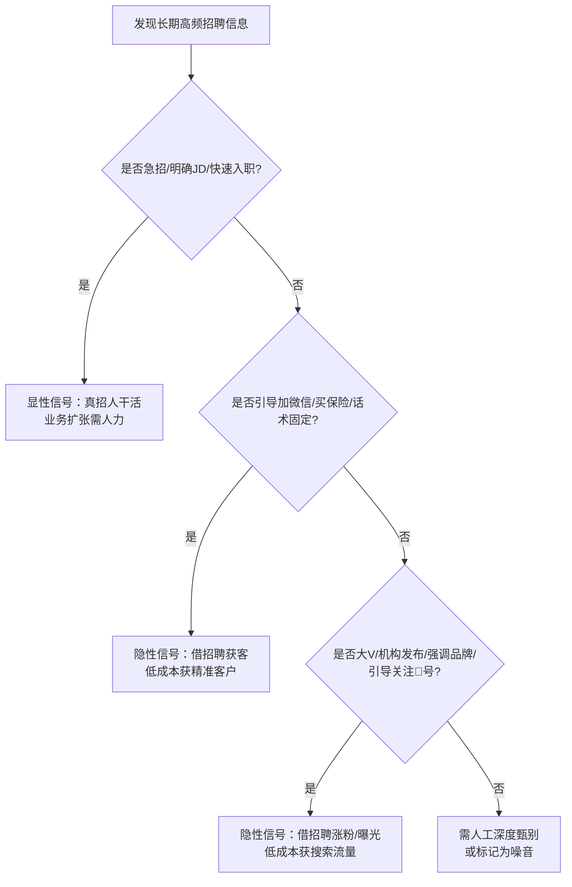
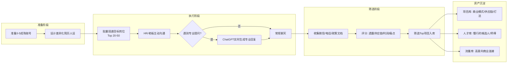
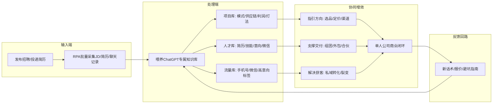
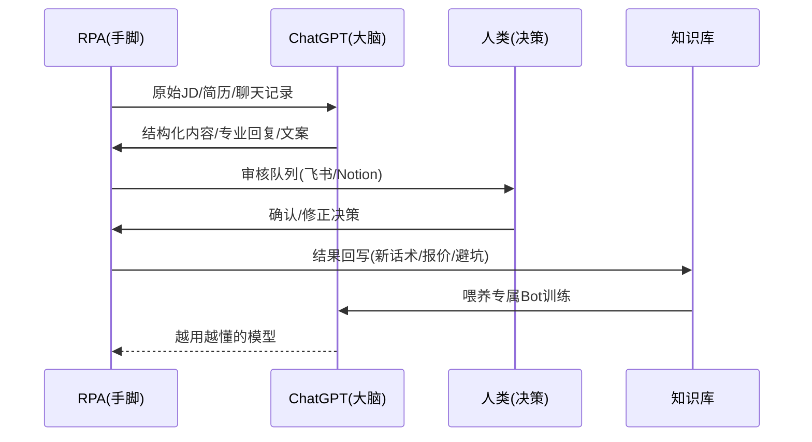
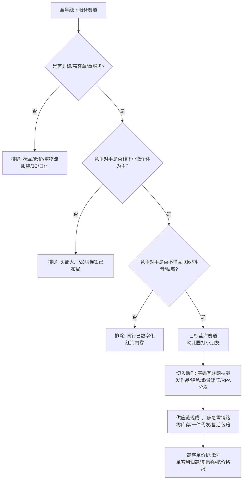

# 第 20 章 招聘平台挖掘商业机会与 RPA 自动化运营 —— BOSS直聘的“反向猎头”玩法

## 学习目标

- 理解招聘平台背后的商业信号解读逻辑：持续招聘即稳定盈利验证
- 掌握反向猎头/海选模式操作流程：以求职者身份批量投递筛选项目
- 掌握 ChatGPT+RPA 自动化协作范式：认知端与执行端的数字员工分工
- 理解幼儿园打小朋友蓝海思维：避开红海选择线下非标服务赛道降维打击
- 掌握项目库-人才库-流量库三位一体构建方法：一次动作三重资产沉淀
- 掌握先手动跑通再自动化的工程化原则：验证模型后再引入 RPA 放大
- 了解招聘信息的隐性属性识别：区分真招人与借招聘行获客/涨粉之实
- 能根据自身资源匹配度，运用五维筛选法评估项目可行性

## 20.1 生活类比

想象招聘平台是一个巨大的“项目超市”，而招聘广告是货架上的“价签”。

持续挂着“招聘”价签的商品 = 已被市场验证“好卖/赚钱”的成熟项目（否则老板早撤柜台了）。

你以“求职者”身份进场试吃/询价 = 低成本、合规、高意向地获取核心配方（供应链/利润/打法）。

ChatGPT 是你的“随身翻译官+谈判专家” = 听不懂行业黑话？它秒回专业参数；不会写简历？它生成高转化话术。

RPA 是你的“分身术+搬运工” = 帮你同时跑遍全国 500 家分店（批量投递/采集）、搬运情报、记账建档，你只管决策。

幼儿园打小朋友 = 别去和“沃尔玛/山姆”（头部大厂/红海标品）抢生意，去隔壁“夫妻小卖部”（线下非标服务）教他们用微信收款、发抖音引流，你的“基础操作”在对方眼里是“黑科技”。

就像逛超市时，货架上长期补货的商品必是畅销款；你不必自己研发新品，只需拿着“求职者”的通行证，去成熟摊位“取经”、“拿货”、“拉客户群”，再用“分身术”复制到下一个城市。

## 20.2 概念地图

招聘平台挖掘商业机会体系
├── 核心公理层
│   ├── 招聘即项目验证信号  —— P001
│   ├── 持续招聘即稳定盈利/隐性获客公理  —— P001
│   └── 幼儿园打小朋友蓝海思维  —— P005
├── 双向渗透策略层
│   ├── 反向猎头/海选模式（求职者视角）  —— P002
│   ├── 发布岗位筛选项目（招聘方视角）  —— P003
│   └── 项目库-人才库-流量库三位一体  —— P003
├── 工具协作赋能层
│   ├── ChatGPT+RPA 自动化协作流程  —— P004
│   │   ├── ChatGPT 管大脑：文案/话术/知识速查
│   │   └── RPA 管手脚：采集/分发/账号管理
│   ├── 先手动跑通再自动化原则  —— P004
│   └── 工具杠杆放大人类判断力原则  —— P004
├── 实战验证与边界层
│   ├── 门窗项目实战验证案例  —— P005
│   ├── BOSS直聘作为高性价比流量库  —— P003
│   └── 招聘信息反推商业模式穿透力  —— P001
└── 执行决策框架层
    ├── 五维项目筛选法（难度/规则/合规/批量/周期）  —— P005
    ├── 六十分即冲原则  —— P002
    └── 销售优先于供应链公理  —— P005

## 20.3 招聘即项目验证信号 —— 用别人的招聘广告做市场调研

### 为什么需要这个概念？

普通人找项目容易陷入“听大佬吹牛”或“跟风烂项目”的坑，公域分享的项目往往已过红利期；需要一个经过市场实战验证、且竞争对手多为普通人的可靠项目来源；传统调研成本高、周期长、样本少，招聘平台提供了现成的、海量的、结构化的商业信号。

> "每一个招聘需求的背后，都是一个项目，每一个持续招聘需求的背后，都是一个大概率稳定赚钱的项目。"
> 
> ——《P001, p.1》

> "被普通人验证过的，同为普通人的你拿到结果的概率相对更大。"
> 
> ——《P001, p.1》

这段话揭示了招聘平台的核心价值：它不是人才市场，而是经过市场验证的商业项目超市。每一个长期挂着招聘广告的岗位，背后都站着一个“大概率稳定赚钱”的项目。这就像超市货架上长期补货的商品，必定是畅销款。

**招聘即项目验证信号**定义（来源：[素材ID: P001, 来源: docs/202303/20230328_047.md]）

本公式为业务逻辑的符号化建模，非数学推导，旨在结构化呈现因果链条。

核心公理：
$$
\text{持续高频招聘} \implies \text{项目盈利稳定需扩张} \lor \text{招聘本身即低成本获客手段}
$$

这个公式展示了两个核心推论：(1) 企业愿意持续支付招聘成本，说明业务现金流为正，需要更多人手去承接增量；(2) 如果招聘不急着成交入职，反而长期高频挂着，大概率是借招聘之名行获客/涨粉/刷曝光之实。

**招聘信号识别分层流程图**

**信号分层识别表**

| 信号类型 | 典型特征 | 背后商业模式 | 识别关键词 |
|----------|----------|--------------|------------|
| 显性信号：真招人干活 | 急招、明确JD、快速面试入职、薪资结构清晰 | 业务扩张需人力 | "急招"、"入职快"、"五险一金" |
| 隐性信号：借招聘获客 | 长期挂岗、不急面试、引导加微信/买保险、话术固定 | 低成本获取精准客户 | "保险"、"理财"、"无责底薪高提成" |
| 隐性信号：借招聘涨粉/曝光 | 大V/机构发布、岗位模糊、强调品牌/影响力、引导关注👸号 | 低成本获取搜索流量/粉丝 | "知名大V"、"团队氛围好"、"关注👸号了解" |

**典型例子**

- **保险公司**：天天招、月月招、年年招，招的不是员工，是精准客户（高客单、高转化、高复购）[P001, p.1]。
- **大V/头部团队**：天天找、月月招、年年招，招的不是员工，是粉丝、搜索、点击和浏览（低成本获流）[P001, p.1]。
- **门窗行业**：BOSS直聘发现同行多为线下小夫妻店，不懂抖音/互联网，发作品获客 -> 对接厂家发货，月询盘 30-60 个，客单价高利润实在 [P001, p.2]。

**边界条件**

仅适用于“持续、高频、长期”的招聘信息，一次性/短期招聘噪音大需过滤。

需具备基本判断力区分“招人干活”还是“借招聘行别的事”。

线上标品/红海品类（如 9.9 包邮）不适用，核心优势在非标、高客单、线下重服务的蓝海赛道。

## 20.4 反向猎头/海选模式 —— 从“你找项目”变成“项目找你”

### 为什么需要这个概念？

传统求职/找项目是单向投递，效率低、被动、信息不对称严重；普通人缺乏主动挖掘项目的资源和能力，但拥有“投简历”的低门槛动作能力；需要一种将“求职”动作转化为“筛选项目”杠杆的方法论。

> "当你用 3,5 个账号，挂出 3,5 个 BOSS 直聘简历之后，那就不是你找项目了，是项目送上门来找你。"
> 
> ——《P001, p.2》

> "你像海选一样去查看这些项目，哪些是你能胜任的，上班或者合作都是不错的选择。"
> 
> ——《P001, p.2》

> "完全不懂的行业，被问问题，回答不上来怎么办？ chatgpt！！！"
> 
> ——《P001, p.2》

这段对话揭示了主动权反转的本质：多账号矩阵 + ChatGPT 兜底 = 零门槛跨界调研。你不再是卑微求职者，而是拿着放大镜的“项目考察官”。

**反向猎头/海选模式**定义（来源：[素材ID: P001, 来源: docs/202303/20230328_047.md]）

本流程为业务逻辑的符号化建模，非数学推导，旨在结构化呈现操作链条。

操作流程：
$$
\begin{aligned}
&\text{Step 1: 准备 3-5 个成熟账号（实名、简历完整度高）} \\
&\text{Step 2: 设计差异化简历定位（懂抖音的销售 / 懂安装的店长 / 想学手艺的小白）} \\
&\text{Step 3: 批量投递目标城市前 20-50 个相关岗位} \\
&\text{Step 4: ChatGPT 实时兜底专业提问（行业术语/技术参数/面试话术）} \\
&\text{Step 5: 筛选：谁发微信给详细政策？谁透露供应链/利润/痛点？} \\
&\text{Step 6: 复盘建立项目库/人才库/流量库}
\end{aligned}
$$

这个流程展示了如何用“数量换质量、用概率对抗单点不确定性”，将求职动作转化为项目筛选杠杆。

**反向猎头海选操作流程图**

**关键性质**

- **主动权反转**：不再是你求人家，是人家求你（或双向奔赴），心态从卑微变平等。
- **批量筛选**：海投即海选，用数量换质量，用概率对抗单点不确定性。
- **低成本试错**：仅需账号和时间成本，无需房租、人力、货源压力，即可实地调研核心商业机密。

**典型例子**

作者以求职者身份投递门窗厂家/安装岗，HR 主动加微信发详细合作政策、厂家报价、安装规范；利用 ChatGPT 应对“系统窗型材壁厚国家标准”、“断桥铝氮气检测流程”等专业提问，实时生成专业回复；最终筛选出：发抖音获客 -> 对接厂家发货（批发/零售）的轻资产合作模式 [P001, p.2]。

**边界条件**

需准备 3-5 个成熟账号（实名、有简历完整度），新号权重低易限流。

简历需设计差异化定位，避免千篇一律被系统判重。

仅适用于需要“招人”的项目方，纯代理/加盟骗局（只收钱不招人）会被自动过滤。

## 20.5 项目库-人才库-流量库三位一体 —— 一次招聘动作，三重资产沉淀

### 为什么需要这个概念？

单一动作（发招聘/投简历）产出单一价值（招到人/找到活）ROI 太低；普通人创业缺项目、缺人、缺流量，需一套动作同时解决三大核心短板；传统渠道获取这三类资源成本极高（猎头费、广告费、时间成本）。

> "项目库+人才库+流量库 搞定！"
> 
> ——《P001, p.3》

> "手机号，微信号都直接拿到了，没有哪个平台比性价比这更高了，说 boss 直聘是流量库一点也不过分。"
> 
> ——《P001, p.3》

> "用 RPA 采集招聘信息和求职者信息，再通过 chatgpt 整合生成出招聘文案以及求职简历，再用 RPA 批量发布到全国。"
> 
> ——《P001, p.3》

这组引文揭示了一次动作、三重资产的杠杆效应：发布招聘/投递简历的同一个动作，同时沉淀了项目模型、人才储备、高意向流量。

**项目库-人才库-流量库**定义（来源：[素材ID: P001, 来源: docs/202303/20230328_047.md]）

本公式为业务逻辑的符号化建模，非数学推导，旨在结构化呈现资产生成链条。

资产生成公式：
$$
\begin{aligned}
\text{项目库} &= \sum (\text{JD分析} + \text{老板聊天}) \to \text{商业模式/供应链/利润结构/推广打法} \\
\text{人才库} &= \sum (\text{求职者简历} + \text{微信} + \text{技能标签}) \to \text{未来组团/外包/合伙种子} \\
\text{流量库} &= \sum (\text{求职者/HR手机号/微信}) \to \text{意图明确的高意向商业连接}
\end{aligned}
$$

这个公式展示了三大资产的来源与转化路径：项目库指引方向，人才库支撑交付，流量库解决获客，形成单人公司完整商业闭环。

**三库协同增效数据流图**

**关键性质**

- **协同增效**：项目库指引方向，人才库支撑交付，流量库解决获客，形成单人公司完整商业闭环。
- **数据资产化**：所有沟通记录、简历、JD 均结构化沉淀，成为可复用、可估值的核心资产。
- **平台套利**：利用 BOSS 直聘的招聘匹配算法，以“招聘/求职”名义合规获取高意向商业连接。

**典型例子**

- **发布招聘**：收到 200+ 简历 -> 筛选 5 个懂抖音运营的人才入库 -> 分析 3 家竞品 JD 总结出“发作品找厂家”模型入项目库 -> 顺手加了 50 个求职者微信入流量库 [P001, p.3]。
- **投递简历**：收到 20+ 老板主动沟通 -> 套出 2 个厂家直供价格体系 -> 加 10 个老板微信谈合作分成 [P001, p.3]。

**边界条件**

必须引入 RPA 实现批量采集/分发/记录，纯人工无法支撑三库同步建设的数据量。

需建立标准化标签体系（行业/模式/阶段/意向度），否则数据堆积变垃圾堆。

合规底线：仅获取公开简历信息及主动提供的联系方式，严禁爬虫破解、购买数据、骚扰用户。

## 20.6 ChatGPT+RPA 自动化协作流程 —— 左脑 ChatGPT 管思考，右脑 RPA 管跑腿

### 为什么需要这个概念？

单人运营面临“认知边界窄”（不懂行业知识）和“执行带宽窄”（号少、手慢、易累）双重瓶颈；传统外包/雇佣成本高、沟通慢、质量难控、忠诚度低；需要一套“非程序员可落地、边际成本趋近零、可 7x24 小时运行”的数字员工体系。

> "用 RPA 采集招聘信息和求职者信息，再通过 chatgpt 整合生成出招聘文案以及求职简历，再用 RPA 批量发布到全国。"
> 
> ——《P001, p.3》

> "完全不懂的行业，被问问题，回答不上来怎么办？ chatgpt！！！"
> 
> ——《P001, p.2》

> "项目库+人才库+流量库 搞定！"
> 
> ——《P001, p.3》

> "自动化是最后一步，先跑完手动流程，再来想自动化的需求"
> 
> ——《P001, p.4》

这组引文构成了完整的人机协作分工图景：RPA 做“手脚”（采集/分发/管理），ChatGPT 做“大脑”（文案/知识/话术），人类做“决策大脑”（筛选/谈判/战略）。

**ChatGPT+RPA 自动化协作流程**定义（来源：[素材ID: P001, 来源: docs/202303/20230328_047.md]）

本模型为业务逻辑的符号化建模，非数学推导，旨在结构化呈现分工协作关系。

分工协作模型：
$$
\begin{aligned}
\text{RPA（手脚）} &: \text{数据采集、账号管理、批量发布沟通、表格录入、去重清洗} \\
\text{ChatGPT（大脑）} &: \text{招聘文案、简历优化、面试话术、行业知识速查、数据结构化} \\
\text{人类（决策大脑）} &: \text{项目筛选、核心谈判、非常规沟通、战略复盘、知识库迭代}
\end{aligned}
$$

协作链路时序图：

这个时序图展示了数据如何在系统中流转形成知识飞轮。

**关键性质**

- **认知边界打破**：完全不懂的行业，被问专业问题，ChatGPT 秒级生成专业回复，实现“零门槛跨界调研” [P001, p.2]。
- **执行规模跃迁**：单人可同时运营全国多城市、多账号、多岗位矩阵，日处理量超百人团队。
- **知识飞轮**：每次沟通产生的新知识（话术、报价、避坑指南）即时喂回 ChatGPT 训练专属 Bot，越用越懂。

**典型例子**

- **门窗项目**：RPA 采集全国 500 个门窗招聘 JD -> ChatGPT 提炼共性：抖音获客+厂家直发+高客单 -> 生成标准化招聘文案/求职简历 -> RPA 批量投放 -> 获得核心供应链联系方式 [P001, p.3]。
- **面试实战**：老板问“系统窗五金件品牌区别”，ChatGPT 秒回“霍普/丝吉利/吉屋/国内二线品牌对比表”，对方认为你是行家直接发合作政策 [P001, p.2]。

**边界条件**

必须先人工跑通完整业务流程（手动发布、手动聊天、手动记录），验证盈利模型后再引入自动化，否则是“自动化地做错事” [P001, p.4]。

ChatGPT 需配合“库内概念调教法”（喂入行业专业术语库、竞品情报库），裸用通用模型幻觉率高、不可靠。

RPA 脚本需具备容错机制（验证码、IP 切换、界面变更、频率限制），否则极易中断导致账号封禁。

## 20.7 幼儿园打小朋友蓝海思维 —— 避开大佬厮杀，专捡普通人捡漏的钱

### 为什么需要这个概念？

普通人容易盯着大佬玩的高大上赛道（AI 大模型、跨境大卖、直播带货头部），入场即被收割；红海赛道规则透明、竞争充分、利润被压榨至薄利，新人无生存空间；需要一套“识别弱竞争、强需求、可复制”赛道的筛选坐标系。

> "非常符合从盗坤那学到的蓝海思维，选择幼儿园的小朋友来打。"
> 
> ——《P001, p.4》

> "同行很多都是线下小门面的小夫妻，压根就不懂什么互联网或者抖音"
> 
> ——《P001, p.4》

> "先跑完手动流程，再来想自动化的需求"
> 
> ——《P001, p.4》

> "通过 boss 直聘，找到了一个门窗的项目，先发作品，再直接抖音找门窗厂家处理订单，批发零售都可以接。"
> 
> ——《P001, p.2》

这组引文揭示了降维打击的本质：你的“基础操作”（剪映剪视频、发抖音、加微信、转介绍）在对手眼里是“高技术/不敢做/不会做”。

**幼儿园打小朋友蓝海思维**定义（来源：[素材ID: P001, 来源: docs/202303/20230328_047.md]，引用“盗坤”理论）

本公式为业务逻辑的符号化建模，非数学推导，旨在结构化呈现赛道筛选条件。

核心策略公式：
$$
\begin{aligned}
\text{目标赛道} &= \{\text{线下小微个体为主} \land \text{不懂互联网运营} \land \text{非标/高客单/重服务}\} \\
\text{竞争对手画像} &= \text{线下小门面小夫妻} \land \neg\text{懂抖音} \land \neg\text{懂私域} \land \text{画面low} \\
\text{切入动作} &= \text{基础互联网技能} \to \text{降维打击}
\end{aligned}
$$

这个公式展示了赛道筛选的三个必要条件与竞争对手的三个典型特征。

**蓝海赛道筛选决策漏斗图**

**关键性质**

- **信息差变现**：你的“基础操作”在对手眼里是“高技术/不敢做/不会做”。
- **客单价护城河**：非标服务/大件商品（门窗、定制柜、装修）单客利润高，天然过滤“9.9 包邮”式价格战。
- **供应链现成**：厂家急需销路，愿意配合“零库存、一件代发、售后包赔”，你只管流量和信任。

**典型例子**

- **门窗案例**：同行不懂抖音，作者发几条施工视频/避坑指南 -> 精准获客 -> 对接本地厂家发货 -> 月入稳定超打工收入 [P001, p.2]。
- **家电维修（蓝狐案例）**：师傅只会修不会推，作者用咸鱼矩阵+地推获客 -> 派单给师傅 3:7/4:6/5:5 分成 -> 两月纯利 30 万 [P005, p.1]。
- **同城相亲**：红娘只会线下聚会不会线上引流，作者用四类账号矩阵+付费投流 -> 高毛利(~100%)降维打击 [P005, p.1]。

**边界条件**

必须是“服务/非标/重信任/重交付”品类，标品/低价/重物流品类（服装、3C、日化）大厂已布局无机会。

需具备基本的“销售/获客”能力，纯技术/纯运营/纯产品思维者无法闭环（小白创业销售优先于供应链公理）。

规模化天花板受限于线下服务半径/师傅管理上限/非标交付标准化难度，难成亿级大生意，适合“小而美”高利润生存。

## 20.8 多源对照

### 共识

- **招聘平台是项目验证的高性价比雷达**：P001 与 P005 均确认 BOSS 直聘聚合了大量线下、小微、已验证现金流为正的真实商业项目。
- **双向渗透策略有效**：P001 提出“发布招聘筛选项目 + 投递简历调研竞对”双向策略，P005 验证了“以求职者身份投递简历获取合作政策”的可行性。
- **ChatGPT+RPA 是单人公司标配**：P001 确立“RPA 管手脚、ChatGPT 管大脑”分工，P005 在家电维修/同城相亲案例中复用了该协作范式。
- **先手动跑通再自动化**：P001 明确“自动化是最后一步”，P005 家电维修案例中作者强调“先人工跑通 SOP 再招人/上 RPA”。

### 分歧

- **P001 侧重“项目发现”**：核心目标是挖掘适合普通人的稳定赚钱项目，强调“被普通人验证过”的项目可复制性强。
- **P005 侧重“服务业规模化铁律”**：核心目标是将验证后的项目标准化、规模化，提出“服务业规模化铁律：标准化前置，人才后置”[P005, p.1]，即创始人必须先将隐性知识显性化为 SOP/问题库，再招低成本执行层。
- **P001 强调“信息差变现”**：通过招聘平台套取商业机密（供应链/利润/打法）[P001, p.2]。
- **P005 强调“执行力与信息差护城河”**：老板自己会操作不构成壁垒，核心竞争力在于“掌握渠道/话术信息差 + 账号矩阵/兼职裂变/话术标准化强执行体系”[P005, p.2]。

## 20.9 设计中的取舍

**为什么不用“公开分享项目/付费社群买项目”而是“自己去招聘平台挖”？**

公域分享的项目往往已过红利期（“见光死”），见了光就成千上万的人跟着做，分享往往意味着自掘坟墓 [P001, p.1]。付费社群买项目存在“幸存者偏差”和“信息滞后”，且你无法验证项目当下的真实盈利状况。招聘平台上的“持续招聘”信号是实时的、经过市场验证的、竞争对手多为普通人的一手情报，自带防内卷属性。

**为什么不用“雇佣团队跑业务”而是“ChatGPT+RPA 数字员工”？**

雇佣团队成本高（房租/社保/工资）、沟通慢、质量难控、忠诚度低、管理内耗大。ChatGPT 解决“认知边界”（不懂行业知识/不会写文案/不会面试话术），RPA 解决“执行带宽”（多账号/全国分发/批量采集/7x24 运行），边际成本趋近零。人类仅保留“决策权”（项目筛选/核心谈判/非常规沟通/战略复盘），实现单人公司规模化运作。

**这种设计的 trade-off 是什么？**

优势：极低成本验证项目、极快速度跨界调研、数据资产自主可控、可随时启停、无管理内耗。劣势：依赖平台规则稳定性（BOSS 直聘算法/风控变化）、RPA 脚本维护成本（界面变更/验证码/IP 池）、ChatGPT 幻觉风险（需专业术语库兜底）、规模化天花板受限于线下服务半径/非标交付标准化难度。

## 20.10 动手练习

### 20.10.1 实战演练：BOSS直聘「海选」目标赛道

**任务**：选择一个你感兴趣但不熟悉的线下服务赛道（如：管道疏通、家电清洗、上门按摩、宠物上门喂养），在 BOSS 直聘完成一次「反向猎头」微型测试。

**步骤 1**：准备 2-3 份差异化简历（如：懂抖音获客的销售 / 懂技术的店长 / 想学手艺的小白），投递该城市前 20 个相关招聘。

**步骤 2**：记录 HR/老板主动沟通的数量、回复速度、是否发送微信/电话、透露了哪些核心信息（合作模式/供应链/利润/痛点）。

**步骤 3**：遇到专业问题（如：疏通机型号选择/清洗药水配比/按摩手法流程），用 ChatGPT 实时生成专业回复继续对话。

**步骤 4**：复盘：哪家透露的「项目模型」最清晰？哪个老板最愿意合作？你是否摸清了「获客-履约-分成」全链路？

**回答问题**：
- 如果 10 家回复，只有 1 家发微信给详细政策，这说明什么？
- ChatGPT 回复的专业话术，对方能否识破？如何规避「AI 味」过重导致信任崩塌？
- 此赛道是否符合「幼儿园打小朋友」特征？竞争对手是否「不懂互联网、线下小夫妻、画面 low」？

### 20.10.2 拆解招聘 JD：从「职位描述」反推「商业模式画布」

**任务**：收集某细分赛道（如：同城家政/门窗安装/代理记账/成人用品外卖）的 20 条高频招聘 JD（职位描述），用 ChatGPT 批量结构化拆解。

**Prompt 参考**：【角色：资深商业分析师】请分析以下 20 个 JD，提取共性字段：1.核心业务动作 2.获客渠道暗示 3.供应链/履约模式 4.薪资结构推算利润率 5.隐性招聘目的判断（真招人/招客户/招流量）。输出 Markdown 表格。

**步骤 1**：用 RPA/手工采集 JD 文本（含公司名、薪资、职责、要求、福利）。

**步骤 2**：喂给 ChatGPT 生成「赛道商业模式共性报告」。

**步骤 3**：人工验证：报告中「获客靠抖音/私域」是否属实？「厂家直发/一件代发」是否可落地？

**回答问题**：
- JD 中「底薪 3000+高提成」vs「纯提成/合伙人制」分别暗示了什么样的现金流结构？
- 如何从「要求：熟悉抖音/视频号/私域运营」反推同行已进入数字化阶段，新人切入点应在哪里？
- 发现某公司「年薪 20 万招运营总监」却长期挂着不撤，结合「幼儿园打小朋友」判断：是真缺人，还是借招聘做品牌曝光？

### 20.10.3 设计最小化 RPA+ChatGPT 自动化闭环原型

**任务**：针对上一练习筛选出的「最优项目」，设计一套「非程序员可落地」的 RPA+ChatGPT 自动化流程原型（无需写代码，画流程图/写伪代码/列清单均可）。

**场景**：每日自动采集该赛道新发招聘 JD -> ChatGPT 提取「新出现的获客渠道/新品类/新合作政策」 -> 推送至你的飞书/微信 -> 你只需一点点确认「是否跟进」 -> 确认后自动生成求职简历/招聘文案 -> RPA 批量投放/发布。

**清单设计**：
1. **RPA 端（影刀/按键精灵/Automa）**：触发条件、采集字段、去重逻辑、投放动作、异常处理（验证码/频控/页面变更）。
2. **ChatGPT 端**：System Prompt 设计（行业术语库/竞品情报库/话术红线）、变量映射（JD 片段->简历亮点）、输出格式约束（JSON/Markdown）。
3. **人工决策节点**：审核队列 UI（飞书多维表格/Notion/Excel）、确认按钮触发下游 RPA。
4. **知识飞轮**：新话术/新报价/新避坑指南 -> 自动写入 ChatGPT 专属知识库（RAG/长文本喂养）。

**回答问题**：
- 环境差异（浏览器缩放/分辨率/文件路径）是 RPA 落地最大变数，如何用「人工跑通一次再自动化」原则设计标准化环境 SOP？
- 紫鸟浏览器不兼容第三方 RPA，若目标平台强制需紫鸟（如亚马逊后台），该流程如何迁移/替代？
- 单条 JD 采集到推送完成，人工决策耗时<30 秒，全自动化耗时<2 分钟，边际成本趋近零。若日处理 500 条，相当于替代多少人工工时？ROI 如何量化？

### 20.10.4 「幼儿园打小朋友」赛道筛选与验证清单

**任务**：列出你所在城市 5 个符合「幼儿园打小朋友」特征的线下非标服务赛道，并按五维筛选法打分（满分 50 分），选最高分赛道制定「首周手动跑通」计划。

**候选赛道示例**：上门收纳整理、老年人陪诊/陪聊、宠物上门美容/医疗、家电维修/清洗、定制家具/门窗安装、同城相亲服务、成人用品即时配送、二手奢侈品上门回收。

**五维打分表（每维 1-10 分）**：
1. 操作难度：是否「傻瓜化复制粘贴」可上手？（如：发作品/加微信/转单给师傅）
2. 平台规则：是否顺应平台鼓励？（如：视频号扶持同城/小红书扶持家居/抖音扶持生活服务）
3. 绿色合规：无证照准入壁垒、无法律红线、无平台封杀风险。
4. 可批量化：是否可多账号矩阵/多城市复制/模拟器多开/RPA 替代？
5. 周期利润：单客利润>200 元、复购率>30%、回本周期<4 周、长期主义可做。

**首周手动跑通计划模板**：
Day 1-2：注册 3-5 个平台账号（抖音/视频号/小红书/咸鱼/BOSS），完善人设主页。
Day 3-4：产出 10 条「对标爆款翻拍/ChatGPT 生成文案」内容，定时发布。
Day 5-6：私域引流（主页挂链/私信钩子/评论区截流），加满 20 个精准意向客户/师傅。
Day 7：成交/派单至少 1 单，复盘「获客成本/转化率/履约难点/利润实测」，决定是否投入 RPA/团队放大。

**回答问题**：
- 为何要求「销售优先于供应链」？若 Day 7 前搞不定厂家/师傅资源，是否应先跑通「发内容-引流-收线索」再补供应链？
- 「六十分即冲」在选赛道时如何应用？总分 40 分但「周期利润」满分 10 分的赛道，能否启动？
- 如何用「信息差与执行力护城河」理论，预判该赛道 3 个月后是否会涌入竞争者？你的护城河在哪里？

## 20.11 本章小结

这一章中我们学习了如何将招聘平台变成普通人挖掘商业机会的“项目超市”。首先，我们确立了**招聘即项目验证信号**这一核心公理：持续高频招聘背后必然是稳定盈利的项目或隐性获客手段。其次，我们掌握了**反向猎头/海选模式**：用多账号矩阵+ChatGPT 兜底，将求职动作转化为项目筛选杠杆，实现“项目找你”的主动权反转。接着，我们构建了**项目库-人才库-流量库三位一体**体系：一次招聘动作同时沉淀项目模型、人才储备、高意向流量，形成单人公司完整商业闭环。然后，我们落地了 **ChatGPT+RPA 自动化协作流程**：左脑 ChatGPT 管思考（文案/知识/话术），右脑 RPA 管跑腿（采集/分发/管理），人类只管决策，打破认知边界与执行带宽双重瓶颈。之后，我们内化了**幼儿园打小朋友蓝海思维**：避开红海大佬厮杀，选择不懂互联网的线下小微个体赛道，用基础运营技能实现降维打击。最后，我们明确了**先手动跑通再自动化**的工程化原则与**五维项目筛选法**，给出了从 0 到 1 的可执行决策框架。

本章我们一起学习了以下概念：

| 概念 | 解释 |
|------|------|
| 招聘即项目验证信号 | 持续高频招聘背后必为项目盈利稳定或隐性获客，是普通人寻找确定性机会的最佳雷达 |
| 反向猎头/海选模式 | 以求职者身份多账号投递，让项目/合作主动找上门，ChatGPT 兜底专业知识实现零门槛跨界调研 |
| 项目库-人才库-流量库三位一体 | 一次招聘动作同时沉淀：项目模型库、人才储备库、高意向流量库，构建单人公司完整商业闭环 |
| ChatGPT+RPA 自动化协作流程 | 左脑 ChatGPT 管思考（文案/知识/话术），右脑 RPA 管跑腿（采集/分发/管理），人类仅管决策 |
| 幼儿园打小朋友蓝海思维 | 选择不懂互联网的线下小微个体赛道（门窗/家电维修/同城服务），用基础运营技能实现降维打击 |
| 先手动跑通再自动化原则 | 业务流程必须先人工完整跑通验证盈利，再引入 RPA 替代标准化环节，避免自动化地做错事 |
| 招聘流量隐性属性 | 长期招聘往往非真招人：保险招客户、大V 招粉丝/流量，识别隐性属性可避坑并反推商业模式 |
| 工具杠杆放大人类判断力 | ChatGPT 破认知边界，RPA 破执行带宽，人类聚焦决策与非常规沟通，实现单人公司规模化运作 |
| 五维项目筛选法 | 操作难度低、顺应平台规则、绿色合规、可批量复制、周期利润正，五维达标再决策投入 |
| 门窗项目实战验证 | 线下小夫妻店不懂抖音，发作品获客对接厂家发货，月询盘 30-60、高客单高利润，验证蓝海可行性 |

下一章中，我们将学习**认知重塑与商业思维 —— 从打工惯性到老板心法**，剖析普通人创业的核心认知障碍，建立知识付费“避坑工具”定位、项目分层匹配能力圈、执行力内驱力建设等底层心法。

