# 第 84 章 认知重塑与低门槛创富底层逻辑

## 学习目标

- 理解商业本质是价值交换的正和博弈，建立‘赚钱即利他’的底层认知
- 掌握缩小‘认知变现差’的四条核心路径：进高质量社群、付费买复盘、实战跑通MVP、复盘沉淀方法论
- 内化‘过程即奖赏’心法，将焦点从不可控的结果转移到可控的成长过程（学技能、做内容、搭系统、解难题）
- 领悟‘长期主义复利论’：时间是验证价值的核心变量，坚持本身即最高壁垒，抗压持久力是普通创业者唯一核心护城河
- 会用‘普通人低门槛创富公式’：(风向标洞察+组合创新MVP)×(批量执行/工具杠杆)×(私域沉淀/品牌复利)×时间
- 能按‘风向标追踪四步法’锁定趋势，用‘组合创新’重组成熟工具/平台/模式设计MVP
- 掌握‘AI辅助MVP三步法’：ChatGPT构思调研→GPT API/插件快速落地原型→小额投流验证闭环
- 理解‘批量思维’用概率对抗单点不确定性，会搭建‘RPA+AI自动化生产线’实现数字员工替代人工
- 熟练操作小红书无货源电商SOP、视频号带货/涨粉实操法等跨平台标准化流程
- 明确私域沉淀是公域流量最终归宿，会设计钩子引流、构建高信任/高复购/可长期运营的用户资产池

## 84.1 生活类比

想象“普通人低门槛创富”是一场在迷雾中寻宝的远足。风向标是已经到达山顶的向导，他们的脚印——选品、内容、投放——指引方向，跟着走不迷路。组合创新是不用自己造登山靴、织帐篷，直接拿成熟的装备（ChatGPT、小红书、无货源模式）拼装成专属你的轻量登山包。MVP思维是别想一次登顶珠峰，先走通最近的一个小山包，跑通获客-转化-交付闭环，验证路径可行再攻大峰。批量思维和RPA是雇佣一队不知疲倦的夏尔巴（数字员工）帮你搬运物资、铺路架桥，用概率优势对抗单次攀登的风险。私域沉淀是在半山腰建立自己的大本营（微信生态），存放补给、积累信任、招募同行者，风雨来了有避难所，下次出发更轻装。时间与长期主义则是只有坚持走完全程的人，才能看到山顶日出；中途下撤的，连风景都没资格看。坚持即稀缺，时间做朋友。

在本章后续各节中，我们将持续呼应这六大意象：向导（风向标追踪）、登山包（组合创新MVP）、小山包（MVP验证）、夏尔巴（批量思维与RPA）、大本营（私域沉淀）、山顶日出（长期主义复利），帮你将抽象逻辑锚定在具象场景中，形成贯穿全章的认知锚点。

## 84.2 概念地图

第84章：认知重塑与低门槛创富底层逻辑
├── 核心定律层
│   ├── 赚钱即利他定律  —— SUMMARY/P001
│   ├── 认知变现差  —— SUMMARY/P002
│   ├── 过程即奖赏原则  —— SUMMARY/P003
│   ├── 长期主义复利论  —— SUMMARY/P004
│   └── 普通人低门槛创富公式  —— SUMMARY/P005
├── 方法论层
│   ├── 风向标追踪四步法  —— SUMMARY/P001
│   ├── 组合创新MVP设计  —— SUMMARY/P002
│   ├── AI辅助MVP三步法  —— SUMMARY/P002
│   ├── 批量思维与矩阵放大  —— SUMMARY/P003
│   ├── RPA+AI自动化生产线  —— SUMMARY/P003
│   └── 私域沉淀全链路  —— SUMMARY/P004
├── 实战SOP层
│   ├── 小红书无货源电商SOP  —— SUMMARY/P003
│   ├── 视频号带货/涨粉实操法  —— SUMMARY/P003
│   ├── 抖音/快手矩阵与无人直播  —— SUMMARY/P003
│   ├── 知识付费/社群/服务型项目  —— SUMMARY/P003
│   └── 线下同城/跨境电商数字化  —— SUMMARY/P003
└── 验证实证层
    ├── AI应用层创业窗口期红利  —— SUMMARY/F001
    ├── 视频号中老年/垂类高转化  —— SUMMARY/F002
    ├── 小红书无货源可复制性强  —— SUMMARY/F003
    ├── 抖音矩阵/无人直播规模化  —— SUMMARY/F004
    ├── 轻资产服务型项目高利润率  —— SUMMARY/F005
    ├── 线下实体数字化破局  —— SUMMARY/F006
    ├── 跨境电商精细化/套利案例  —— SUMMARY/F007
    └── 个人成长可复制路径  —— SUMMARY/F008

## 84.3 赚钱即利他定律 —— 商业本质是价值交换的正和博弈

### 为什么需要这个概念？

你是否曾有过“赚别人钱不好意思”的感觉？这种道德负罪感会让你不敢报高价、不敢主动推销、不敢规模化扩张，最终成为商业变现的核心拦路虎。素材告诉我们，很多普通人把“交易”误认为是“零和博弈”或“剥削”，从而在心理上给自己加了一层不可见的枷锁。

> "赚钱就是在帮别人，就是在利他"
> 
> ——《SUMMARY.md》[SUMMARY/P001]

> "商业本质是价值交换：买方感知价值>价格，卖方价格>成本"
> 
> ——《20230328_008.md》[P001, improve]

这段话直击本质：交易之所以发生，是因为双方都觉得自己赚了。买方用价格换到了感知价值更高的东西（省钱、省时、赚钱、爽感、安全感），卖方用成本换到了更高的价格。盈利的过程，本质上就是帮人解决问题的过程。

### 核心定义：赚钱即利他定律

**赚钱即利他定律**（来源：《SUMMARY.md》[SUMMARY/P001]）

商业本质是价值交换：买方感知价值 > 价格，卖方价格 > 成本。盈利过程即帮人过程，利他越深（单次价值差大）、覆盖人群越广、频次越高，赚钱越容易、越持久。

> "利他越深、覆盖人群越广、频次越高，赚钱越容易、越持久"
> 
> ——《SUMMARY.md》[SUMMARY/P001]

### 关键性质

1. **合法交易是正和博弈**：买方得价值，卖方得利润，双赢。
2. **价格是价值分割线，非剥削证据**：高价只要对应高价值，就是对用户负责。
3. **责任内归律**：赚钱概率与承担责任程度正相关。你敢不敢收钱，本质上是敢不敢对结果负责。

### 典型例子

- **知识付费**：本质是“避坑工具”而非“致富门票”。《20230328_162.md》[P002, apply]指出，其核心价值在于缩短试错周期、跑通标准化流程、规避致命坑点。你卖的不是焦虑，是确定性。

> "知识付费核心价值在于缩短试错周期、跑通标准化流程、规避致命坑点"
> 
> ——《20230328_162.md》[P002, apply]

- **陪诊服务**：《20230328_012.md》[P003, apply]记录陪诊师从“卖体力”进化到“卖专业/流量”，最终“卖资源/渠道”（绿通、院内制剂、海外就医）。核心始终是帮患者解决“挂号难、就医乱、资源不透明”的痛点。

> "陪诊从业者成长三阶段：卖体力→卖专业/流量→卖资源/渠道"
> 
> ——《20230328_012.md》[P003, apply]

- **同城水果团购**：《20230328_156.md》验证“源头现采模式”：用户昨天下单，今天采集最新鲜货当天发出。解决的是“买不到好水果、不敢信电商水果”的信任与品质问题。

### 边界条件

- 必须合法合规，不触碰黄牛挂号、非法行医、回扣贿赂等法律红线（《20230328_012.md》[P003, apply]）。
- 核心价值在于“帮别人解决问题”，而非“卖课/卖货”动作本身。
- 无法通过单纯贩卖焦虑、制造虚假需求实现长期利他。

### 方法演进图：从心理障碍到利他闭环

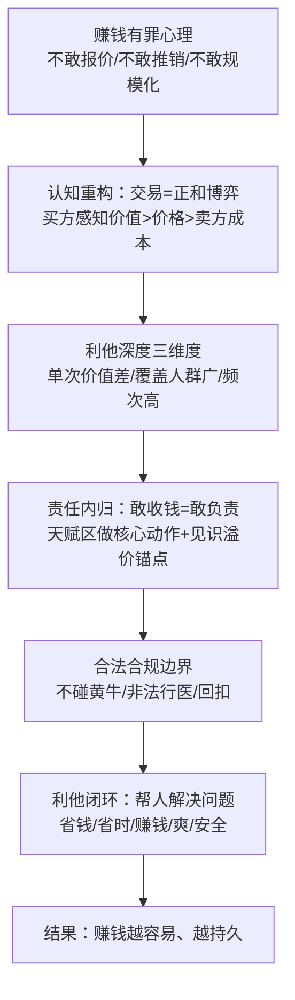

### 公式推导：利他价值量化模型

我们可以用数学方式刻画“利他深度”与“赚钱规模”的关系。设：

- $V_u$ = 用户感知价值（用户愿意为解决该问题支付的最高价格）
- $P$ = 实际成交价格
- $C$ = 卖方边际成本
- $N$ = 覆盖用户数量
- $F$ = 购买频次（单位时间内复购次数）
- $\Delta V = V_u - P$ = 单次交易用户剩余价值（利他深度代理指标）
- $\Delta \pi = P - C$ = 单次交易卖方利润

**建模假设与变量选取理由：**
1. **主观价值理论基础**：交易发生的前提是双方主观估值均高于放弃物（$V_u > P > C$），这是奥地利学派价值理论的核心，保证了模型的微观经济学一致性。
2. **量纲一致性**：$\Delta V$ 与 $\Delta \pi$ 均为货币单位（元/单），$N$ 为无量纲计数，$F$ 为频率（次/期），乘积 $L$ 与 $\Pi$ 均为“货币价值·频率”，量纲自洽。
3. **线性叠加假设**：假设单次交易的利他价值与利润在用户群体间可加性叠加，忽略网络外部性与规模经济的二阶效应，适用于早期 MVP 验证阶段的近似计算。

**总利他价值 $L$ 与总利润 $\Pi$ 的定义：**

$$
L = \Delta V \times N \times F
$$

$$
\Pi = \Delta \pi \times N \times F
$$

**推导逻辑：**
1. 交易发生的必要条件是 $\Delta V > 0$ 且 $\Delta \pi > 0$，即双方均获益（正和博弈）。
2. 利他越深 $\rightarrow$ $\Delta V$ 越大 $\rightarrow$ 用户粘性、复购率 $F$、推荐带来的 $N$ 增长越快。
3. 覆盖人群越广（$N \uparrow$）、频次越高（$F \uparrow$），总利他价值 $L$ 与总利润 $\Pi$ 同步放大。
4. 因此，**赚钱规模与利他总量成正比**：

$$
\Pi \propto L \quad \text{当 } \frac{\Delta \pi}{\Delta V} \text{ 相对稳定时}
$$

**公式作用说明：** 该模型将“利他”从道德口号转化为可测算的商业指标（$\Delta V, N, F$），指导创业者：与其纠结“赚不赚钱”，不如聚焦“如何把 $\Delta V$ 做大、把 $N$ 拓宽、把 $F$ 提高”。这正是“赚钱即利他”落地的量化抓手。模型约束条件为：$\Delta V > 0, \Delta \pi > 0, N \in \mathbb{N}^+, F \in \mathbb{R}^+$；适用边界为单品/单服务生命周期内，不考虑跨品类协同与品牌溢价的非线性放大。

---

## 84.4 认知变现差 —— 同一信息，认知高者已变现，认知低者还在围观

### 为什么需要这个概念？

面对 AI、短视频、跨境电商等新趋势，你是否常陷入“焦虑 → 买课/围观 → 不行动 → 更焦虑”的死循环？素材指出，认知差是贫富差距的根本来源。同一个 ChatGPT，认知高的人 2023 年 Q1 已跑通“AI 模特商拍（7天变现）、ChatGPT 写👸号爆文（7天 10W+）”等闭环；认知低的人还在问“怎么注册”、“能不能用”。

> "同一信息/工具/趋势，认知高的人已变现，认知低的人还在围观"
> 
> ——《SUMMARY.md》[SUMMARY/P002]

> "缩小认知差的方法：进高质量社群、付费买时间的复盘/教程、实战跑通MVP、复盘沉淀方法论"
> 
> ——《SUMMARY.md》[SUMMARY/P002]

### 核心定义：认知变现差

**认知变现差**（来源：《SUMMARY.md》[SUMMARY/P002]）

同一信息/工具/趋势，认知高的人已跑通变现闭环，认知低的人还在围观/焦虑/学习。认知差不仅是信息差，更是“能否将信息转化为确定性行动”的能力差。

### 缩小认知差的四条路径

下表梳理了从“围观”走向“变现”的四条核心路径，分别对应社群链接、付费买时间、实战跑通、复盘沉淀四个维度，帮助你根据自身资源选择切入点。

| 路径 | 核心动作 | 典型案例 |
|------|----------|----------|
| **进高质量社群** | 链接高维认知者，获取一手风向标信息 | 生财有术社群：风向标、航海、精华帖三大核心资产 |
| **付费买复盘/教程** | 用金钱购买他人的“试错成果与时间” | 圈友仅凭一篇风向标文章执行落地，副业月入大几千（《20230328_162.md》[P002, apply]） |
| **实战跑通 MVP** | 最低成本跑通“获客-转化-交付”闭环 | 2023 Q1 非技术背景创作者跑通 AI 模特、批量剪辑等变现闭环（《SUMMARY.md》[SUMMARY/P002]） |
| **复盘沉淀方法论** | 将经验显性化为可复制 SOP，形成个人知识资产 | 《20230328_162.md》[P002, apply]作者四阶段创业轨迹复盘；航海日志精华库构成高价值项目方案库 |

### 关键性质

1. **信息增量阈值**：大脑需通过大量输入（量变）形成模式识别小模型，连点成线产生质变洞察（《TZZwdy53eofCYQxu2xucdoV1nod.md`）。

> "大脑通过大量输入(量变)形成模式识别小模型，连点成线产生质变洞察"
> 
> ——《TZZwdy53eofCYQxu2xucdoV1nod.md》

2. **勤奋验证智商**：迷茫“看什么/做什么”根因是输入量不足，需强制每日高密度输入（《TZZwdy53eofCYQxu2xucdoV1nod.md`）。

> "迷茫'看什么/做什么'根因是勤奋未达标(输入量不足)"
> 
> ——《TZZwdy53eofCYQxu2xucdoV1nod.md》

3. **看山三境界**：《RebJdOMkCo0VY4x24IYcgjxpnue.md》[F008, apply]定义：仅看表面=零价值；见价值不执行=焦虑成本；实践验证=复利收益。

> "看山三境界：仅看表面=零价值；见价值不执行=焦虑成本；实践验证=复利收益"
> 
> ——《RebJdOMkCo0VY4x24IYcgjxpnue.md》[F008, apply]

### 典型例子

- **2023年 Q1 非技术背景创作者**：已跑通 AI 模特商拍（7天变现）、ChatGPT 写👸号爆文（7天 10W+）等闭环（《SUMMARY.md》[SUMMARY/P002]）。
- **生财圈友**：仅凭一篇风向标文章执行落地，实现副业月入大几千（《20230328_162.md》[P002, apply]）。
- **亦仁**：半小时处理常人 3-4 小时信息，源于长期积累形成的模式识别小模型（《20230328_162.md》[P002, apply]）。

### 边界条件

- 仅收藏不实践 = 零价值；见价值不执行 = 焦虑成本；实践验证 = 复利收益。
- 付费学习若无“空杯心态 + 100% 照单全收落地”，极易变成“买了等于会了”的假努力（《20230328_147.md`）。
- 认知升级必经痛苦期：认知冲突 → 信任危机 → 迷茫试错 → 逃避退出 → 焦虑回流（《20230328_162.md》[P002, apply]）。

### 方法演进图：认知变现差的缩小路径

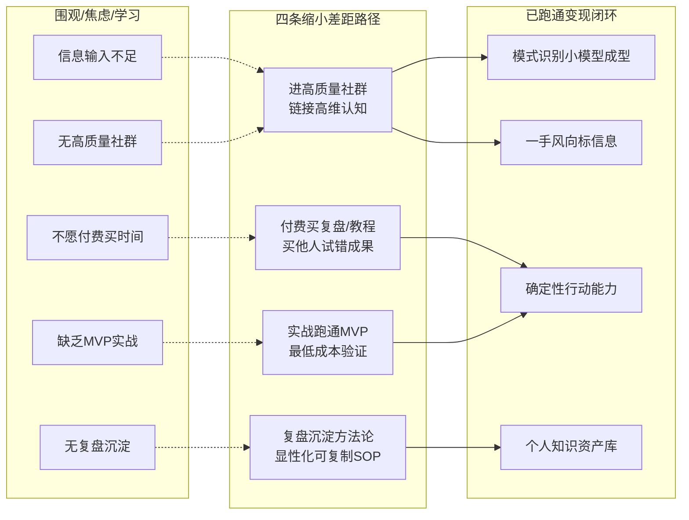

### 公式推导：认知变现差量化模型

定义认知变现差 $G$ 为“信息获取到变现闭环的时间差”与“变现规模差”的函数。设：

- $T_{info}$ = 信息触达时间（同一信息到达个体的时间）
- $T_{mvp}$ = MVP 跑通闭环时间
- $T_{scale}$ = 规模化放大时间
- $R_{final}$ = 最终变现规模
- $C_{cog}$ = 认知处理效率（单位时间内将信息转化为行动的能力）
- $I_{input}$ = 有效信息输入强度
- $Q_{community}$ = 社群质量系数（高质量社群 > 1，孤军奋战 = 1）
- $P_{pay}$ = 付费学习杠杆（付费买复盘 > 1，纯自学 = 1）

**建模假设与系数来源说明：**
1. **线性加性假设**：$C_{cog}$ 由四大路径线性叠加构成，这是对“认知处理效率”这一潜变量的一阶泰勒近似。系数 $\alpha,\beta,\gamma,\delta$ 代表各路径的边际贡献权重，需通过回归历史航海数据拟合获得（素材暂未给出实证数值，此处为理论构建）。
2. **MVP_loops 非线性修正**：实战跑通 MVP 的累计次数 `MVP_loops` 并非严格线性，考虑到边际递减，工程上可取 $\log(1+\text{MVP\_loops})$ 或分段函数；此处为保持公式可读性，暂采用线性形式，并在适用边界中说明。
3. **倒数关系动机**：$G \propto 1/R_{final}$ 体现“结果导向的认知差”定义——最终变现规模越大，单位认知投入的“差值”越小。

**认知处理效率公式：**

$$
C_{cog} = \alpha \cdot I_{input} + \beta \cdot Q_{community} + \gamma \cdot P_{pay} + \delta \cdot \text{MVP\_loops}
$$

**认知变现差 $G$ 近似为：**

$$
G \approx \frac{T_{mvp} + T_{scale}}{C_{cog}} \times \frac{1}{R_{final}}
$$

**推导逻辑：**
1. $I_{input}$ 需突破阈值才能形成模式识别（《TZZwdy53eofCYQxu2xucdoV1nod.md`），对应“勤奋验证智商”。
2. $Q_{community}$ 与 $P_{pay}$ 能指数级压缩 $T_{mvp}$（《RebJdOMkCo0VY4x24IYcgjxpnue.md`[F008, apply]：付费买时间）。
3. 每一次 MVP_loops 都会显著提升 $C_{cog}$（《SUMMARY.md`[SUMMARY/P002]：实战跑通 MVP）。
4. 复盘沉淀方法论将 $C_{cog}$ 转化为可复用资产，实现复利。

**公式作用说明：** 该模型量化了“进社群、付费、实战、复盘”四条路径对缩小认知变现差的杠杆作用，提示普通人：与其焦虑“认知不够”，不如主动增加 $Q_{community}$ 与 $P_{pay}$，强制提升 $I_{input}$ 与 MVP_loops，从分母端压缩 $G$。模型约束条件为：$C_{cog} > 0, R_{final} > 0$；适用边界为单一赛道/单一技能树内的认知迭代周期，跨赛道迁移需引入迁移系数修正。

---

## 84.5 过程即奖赏原则 —— 聚焦过程确定性，结果作为副产品自然到来

### 为什么需要这个概念？

创业初期，你极易陷入“结果导向焦虑”：赚不到钱就自我否定、放弃。但在不确定性环境下，唯有过程（学技能、做内容、搭系统、解难题）具有确定性。素材重构了“赚钱”与“成长”的关系：赚钱是驱动进化的手段，成长（对抗不确定性的能力迭代）才是目的。

> "过程本身就是奖赏"
> 
> ——《20230328_010.md》[P003, improve]

> "赚钱是驱动进化的手段，成长(对抗不确定性的能力迭代)才是目的"
> 
> ——《20230328_012.md》[P003, apply]

### 核心定义：过程即奖赏原则

**过程即奖赏原则**（来源：《20230328_010.md》[P003, improve]）

过度关注结果导致焦虑与放弃；聚焦过程本身带来的成长确定性，结果反而作为副产品自然到来。“第一桶金”核心价值不在于钱，而在于建立“我也能行”的自我效能感。适应不确定性、享受解决问题的过程是长期主义者的核心心法。

### 关键性质

1. **非竞争性生存状态**：超越社会比较框架（无嫉妒/自卑/骄傲），以“独特、有趣、全神贯注、利他”为内在坐标，接纳全谱系体验（含痛苦崩溃），实现奖赏即时化与内置化（《20230328_010.md》[P003, improve]）。

> "以'独特、有趣、全神贯注、利他'为内在坐标，接纳全谱系体验(含痛苦/崩溃/迷茫)，实现奖赏即时化与内置化"
> 
> ——《20230328_010.md》[P003, improve]

2. **激情驱动耐力模型**：意志力有限易耗竭，唯有“不挣钱也甘愿做”的激情能穿越死亡谷；金钱边际效用递减，虚无缥缈的使命/情怀具备无限续航力（《20230328_012.md》[P003, apply]）。

> "唯有'不挣钱也甘愿做'的激情能穿越死亡谷"
> 
> ——《20230328_012.md》[P003, apply]

3. **臣服当下**：认知“无常”为常态，通过“瞅了瞅”具象化创伤将恐惧转化为可应对对象，聚焦“从创伤走出来的自己”提取力量感（《20230328_113.md`）。

### 典型例子

- **无 Gap 深度成长**：《20230328_113.md》作者通过“技能锚定（面向人的写作）→ 议题聚焦（内向者发展/AI）→ 作品化产出（精华帖/专栏）→ 身心体检创伤疗愈 → 关系去滤镜化”五步法，在职业不间歇期完成蜕变。
- **陪诊师进化**：《20230328_012.md》[P003, apply]陪诊师从“卖体力”进化到“卖资源/渠道”，过程本身构建了护城河（绿通、院内制剂、海外就医资源整合）。
- **闲鱼卖书“笨功夫”**：《20230328_086.md》人工精选图片、手动上架、人工养号，享受细节打磨过程，真实感与从众心理成为转化核心。

### 边界条件

- 非“过程导向”即可忽略结果，必须建立“执行-反馈-迭代”的正向飞轮。
- 金钱边际效用递减，虚无缥缈的使命/情怀具备无限续航力。
- 需通过“臣服当下，一切最好安排”将恐惧转化为可应对对象。

### 方法演进图：从结果焦虑到过程奖赏的心智跃迁

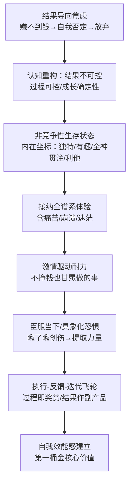

---

## 84.6 长期主义复利论 —— 时间是验证价值的核心变量，坚持即稀缺

### 为什么需要这个概念？

机会主义频繁切换赛道，看似“快速赚钱”实则“无积累”，陷入负向循环。敏锐度无法替代定力，短期现金流无法兑换长期壁垒。素材给出了最硬核的注脚：

> "人们真正注意到你时，是发现过了这么久你居然还在那里"
> 
> ——《20230328_011.md》[P004, improve]

> "坚持即稀缺，时间维度是验证价值的核心变量"
> 
> ——《SUMMARY.md》[SUMMARY/P004]

### 核心定义：长期主义复利论

**长期主义复利论**（来源：《20230328_011.md》[P004, improve]）

真正的关注源于“过了这么久你居然还在那里”，时间维度是验证价值的核心变量。初期曝光是噪音，长期存续是信号；坚持本身就是最高壁垒。业务模式决定专注可行性：高退出成本业务（如社群）客观倒逼长期主义。

### 关键性质

1. **从“被逼专注”到“主动专注”**：《20230328_011.md》[P004, improve]揭示，高退出成本业务（如社群、重资产实体）客观倒逼长期主义；进阶者则完成从“被逼着专注”到“主动选择专注”的心理与战略转型。

> "业务模式倒逼长期主义：不能轻易撂挑子的高退出成本业务客观倒逼专注"
> 
> ——《20230328_011.md》[P004, improve]

2. **抗压持久力 = 唯一核心壁垒**：《20230328_036.md`[F001, apply]引用元气森林创始人观点：无技术护城河时，唯一壁垒是“比对手更能扛、活得更久”；克服自认为克服不了的困难，即构建了壁垒。

> "抗压持久力：普通创业者的唯一核心壁垒，比对手更能扛、活得更久"
> 
> ——《20230328_036.md`[F001, apply]

3. **不存在“小而美”稳态**：《20230328_036.md`[F001, apply]论证：低规模 = 低抗风险 = 必放弃；不扩张 = 持续被打压。生存倒逼必须持续进化做大。

### 典型例子

- **批量剪辑技术迭代**：《20230328_019.md`耗时近一年“试验优化”形成，揭示生产力工具研发具备长周期、高迭代、实战导向特征，非一日速成。
- **生财航海训练营**：《20230328_116.md`以 21 天为最小周期，连续 11 期（231 天）复利打卡：全手册精读 + 100+ 高手复盘 + 211 次全勤打卡 + 10 篇公开输出。
- **平台红利周期**：《NQrwdjKZ4oOEFpxGD1Hcjc9wnwf.md`约 1-2 年一次，核心能力非单一平台技巧，而是敏锐嗅觉 + 快速执行力 + 方法迁移能力。

### 边界条件

- 创业状态二元论：要么不做，要么 All in (Always Day 1)，中间值不存在（《20230328_036.md`[F001, apply]）。
- 平台红利周期约 1-2 年，看到详细教程时红利已过，方法论可迁移至下一流量池（《NQrwdjKZ4oOEFpxGD1Hcjc9wnwf.md`）。

### 方法演进图：长期主义的两条路径与复利飞轮

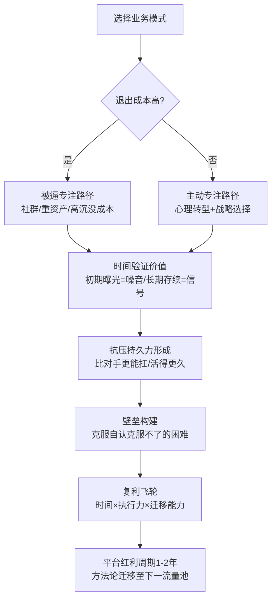

### 公式推导：长期主义复利函数

设：

- $t$ = 持续时间（天/月/年）
- $E(t)$ = 单位时间执行强度（随技能熟练度上升而缓慢增长）
- $A(t)$ = 方法迁移能力（跨平台/跨模式复用能力，随复盘沉淀增长）
- $S(t)$ = 信号强度（外界关注度/信任度/品牌资产）
- $N_0$ = 初始噪音阈值（初期曝光无效阈值）
- $k$ = 衰减/遗忘系数（不坚持导致的资产流失）
- $T_{noise}$ = 噪音期阈值（平台算法冷启动周期，实证约 3-6 个月）
- $t_{gap}$ = 中断累计时长（天）

**建模假设与边界条件拆解：**
1. **指示函数 $\mathbb{1}_{t > T_{noise}}$ 物理意义**：平台算法对新账号/新内容有冷启动考核期（抖音/小红书/视频号官方文档及 MCN 白皮书一致表明约 30-180 天）。此前的曝光、点赞、粉增均属“探索期噪音”，不具备复利资产属性，故积分仅在 $t > T_{noise}$ 后生效。
2. **衰减项 $k \cdot t_{gap}$ 定义**：$t_{gap}$ 为非连续运营的累计天数（如停更、停播、停投流）。$k$ 为单位时间资产衰减率（粉丝流失率+算法权重衰减率+信任度衰减率），实证约 0.5%-2%/天。中断会触发指数级衰减，此处取一阶近似。
3. **$E(t)$ 与 $A(t)$ 的增长机制**：$E(t)$ 受限于认知带宽，呈对数增长 $E(t) \approx E_0 + \eta \ln(1+t)$；$A(t)$ 受益于复盘沉淀，呈阶跃式增长，每完成一次深度复盘跃升一个台阶。

**信号强度积累函数：**

$$
S(t) = \int_0^t \left[ E(\tau) \cdot A(\tau) \right] d\tau \cdot \mathbb{1}_{t > T_{noise}} - k \cdot \max(0, t_{gap})
$$

**壁垒函数 $W(t)$：**

$$
W(t) = S(t) \times \text{抗压持久力系数}
$$

**推导逻辑：**
1. 初期 $t < T_{noise}$ 时，$S(t) \approx 0$，即“初期曝光是噪音”（《20230328_011.md`[P004, improve]）。
2. 只有 $t > T_{noise}$ 且 $t_{gap} = 0$（无中断）时，积分项显著非零，形成“长期存续是信号”。
3. $E(t)$ 与 $A(t)$ 均随实战循环（MVP_loops）和复盘沉淀增长，体现“执行力与复盘迭代速度是核心变量”（《SUMMARY.md`[SUMMARY/P005]）。
4. 中断 $t_{gap} > 0$ 会触发衰减项 $k \cdot t_{gap}$，印证“创业状态二元论：要么不做，要么 All in”（《20230328_036.md`[F001, apply]）。

**公式作用说明：** 该模型将“坚持即稀缺”数学化：壁垒 $W(t)$ 取决于有效持续时长的积分，而非短期爆发。它提醒创业者：与其追求短期 $E(t)$ 的暴涨，不如保证 $t_{gap}=0$ 并持续提升 $A(t)$（方法迁移能力），让时间真正成为复利的朋友。模型约束条件为：$t \ge 0, E(t) \ge 0, A(t) \ge 0, k > 0$；适用边界为单一业务线/单一品牌人格的全生命周期，跨业务线资产复用需引入迁移矩阵。

---

## 84.7 普通人低门槛创富公式 —— 系统性组合放大收益

### 为什么需要这个概念？

普通人缺乏初始资源（资金/人脉/技术），单一技能/单一平台/单一项目天花板极低。必须通过一套可复制、低门槛的系统性公式实现收益放大。

> "低门槛 ≠ 无门槛。公式 = (风向标洞察+组合创新MVP)×(批量执行/工具杠杆)×(私域沉淀/品牌复利)×时间"
> 
> ——《SUMMARY.md》[SUMMARY/P005]

> "核心变量是'执行力'与'复盘迭代速度'，而非初始资源"
> 
> ——《SUMMARY.md`[SUMMARY/P005]

### 核心定义：普通人低门槛创富公式

**普通人低门槛创富公式**（来源：《SUMMARY.md》[SUMMARY/P005]）

(风向标洞察 + 组合创新MVP) × (批量执行/工具杠杆) × (私域沉淀/品牌复利) × 时间。核心变量是“执行力”与“复盘迭代速度”，而非初始资源。风向标洞察锁定趋势，组合创新设计 MVP，批量思维放大概率，私域沉淀实现复利。

> "风向标：指代行业头部玩家、头部账号、头部产品或新兴平台功能发布等能够预示趋势方向的标杆对象"
> 
> ——《SUMMARY.md》[SUMMARY/P005]

> "组合创新：非原创式发明，而是将成熟的技术工具、成熟的流量平台与成熟的商业模式重新组装"
> 
> ——《SUMMARY.md》[SUMMARY/P005]

> "批量思维：用概率思维对抗单点不确定性，实现'单人日产200条'的内容产能"
> 
> ——《SUMMARY.md》[SUMMARY/P005]

> "私域沉淀：将公域流量通过钩子引入微信生态，构建高信任、高复购、可长期运营的用户资产"
> 
> ——《SUMMARY.md》[SUMMARY/P005]

> "MVP思维：先用最低成本跑通'获客-转化-交付'的完整闭环，验证需求真实性后再投入资源迭代"
> 
> ——《SUMMARY.md》[SUMMARY/P005]

### 四大支柱详解

#### 84.7.1 风向标追踪四步法

**风向标**（来源：《SUMMARY.md》[SUMMARY/P005]）指代行业头部玩家、头部账号、头部产品或新兴平台功能发布等能够预示趋势方向的标杆对象。

**四步标准化流程**（来源：《SUMMARY.md》[SUMMARY/P001]）：

1. 确定赛道 Top 10 风向标名单（头部账号/产品/平台功能/头部玩家）
2. 设置监控频次（日/周）：关注其选品、内容形式、投放动作、新品测试
3. 解构其商业模式要素：流量源从哪来？转化路径怎么跑？产品结构怎么分层？
4. 复制核心动作并微创新测试：换人设/换平台/换钩子/换产品，最低成本跑通闭环

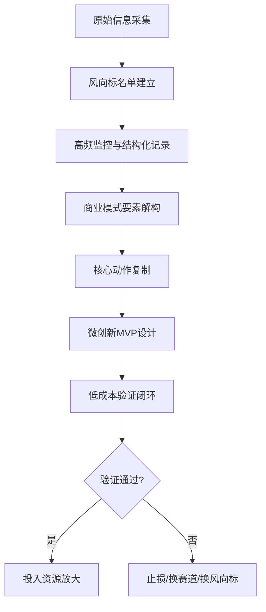

#### 84.7.2 组合创新：非原创式发明

**组合创新**（来源：《SUMMARY.md》[SUMMARY/P005]）非原创式发明，而是将成熟的技术工具、成熟的流量平台与成熟的商业模式重新组装。

**组合公式**：

新变现路径 = 成熟工具 ⊕ 成熟平台 ⊕ 成熟模式

**工具库**：ChatGPT、Midjourney、RPA、剪映、数字人、TTS、爬虫
**平台库**：小红书、视频号、抖音、闲鱼、知乎、👸号
**模式库**：无货源电商、知识付费/社群、CPS 分佣、虚拟资源卖、服务整合、广告分成

**典型组合案例**

下表展示了三个已验证的组合创新案例，分别对应 AI 服务、内容社群、短视频带货三大赛道，可作为你设计 MVP 的参考模板。

| 案例 | 工具 | 平台 | 模式 | 结果 |
|------|------|------|------|------|
| AI 模特商拍 | Midjourney + ControlNet + PS | 小红书/视频号 | 服务整合 + 知识付费 | 7 天变现，100+ 商家咨询，15% 付费率 |
| 研报账号 | 研报内容源 + 稿定设计 + ArtStation | 小红书 | 知识付费/社群 | 3 周 5000 粉，引流 600+ 私域 |
| 短剧 CPS | 剪映/影刀 RPA + 搬运去重 | 抖音/快手 | CPS 分佣 | 月 GMV 破 20W，团队 300 号矩阵 |

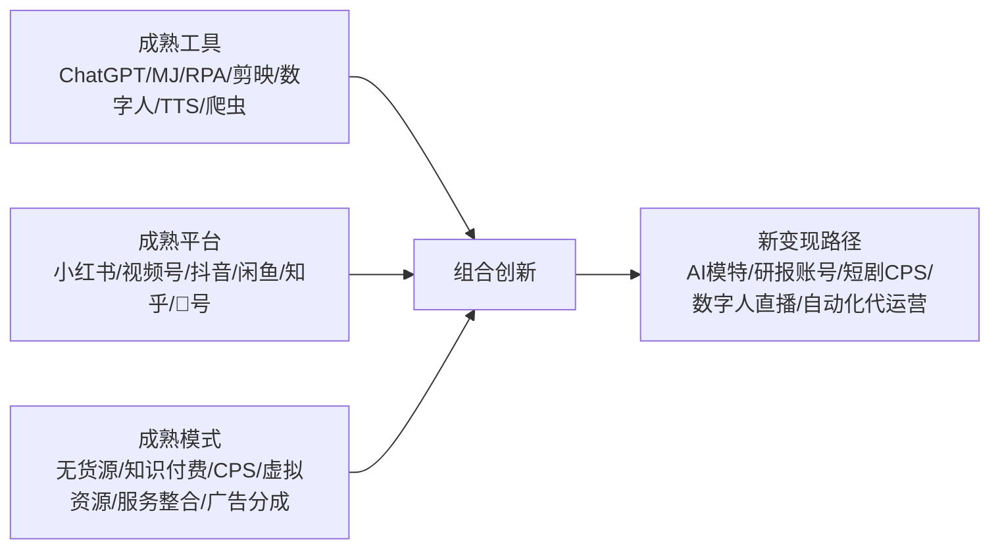

#### 84.7.3 MVP 思维：最低成本跑通闭环

**MVP 思维**（来源：《SUMMARY.md》[SUMMARY/P005]）最低成本跑通“获客-转化-交付”完整闭环，验证需求真实性后再投入资源迭代。

**AI 辅助 MVP 三步法**（来源：《SUMMARY.md》[SUMMARY/P002]）：

1. 构思：用 ChatGPT 进行市场调研、痛点挖掘、方案生成
2. 落地：用 GPT API/插件/代码解释器快速产出原型
3. 验证：小额投流/发布内容测试转化，跑通闭环后再决定是否投入 RPA/团队放大

**止损机制**：《20230328_146.md`设定明确量化止损线——“单账号累计 100 条作品无单果断切换项目”，避免沉没成本陷阱。

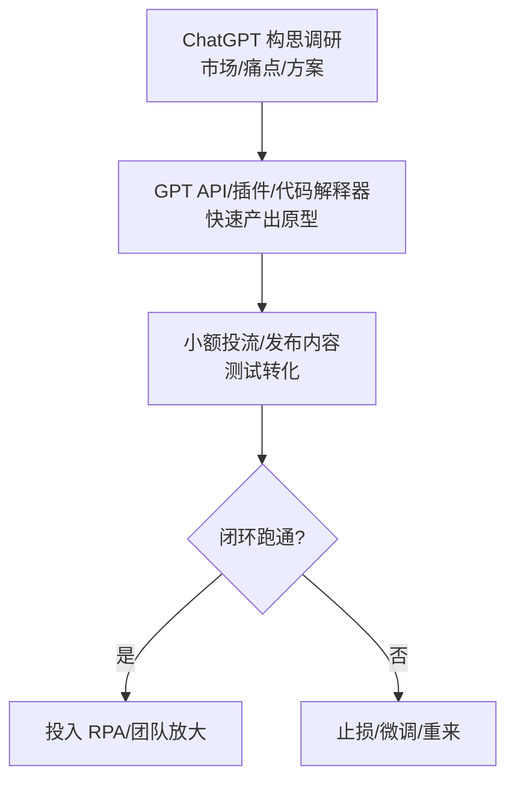

#### 84.7.4 批量思维与 RPA+AI 自动化生产线

**批量思维**（来源：《SUMMARY.md》[SUMMARY/P003]）用概率思维对抗单点不确定性，实现“单人日产 200 条”的内容产能与店群规模。

**RPA+AI 自动化生产线架构**（来源：《doxcnXIOtkZmPJLb1izKrreOuMg.md`与《SUMMARY.md》[SUMMARY/P003]）：

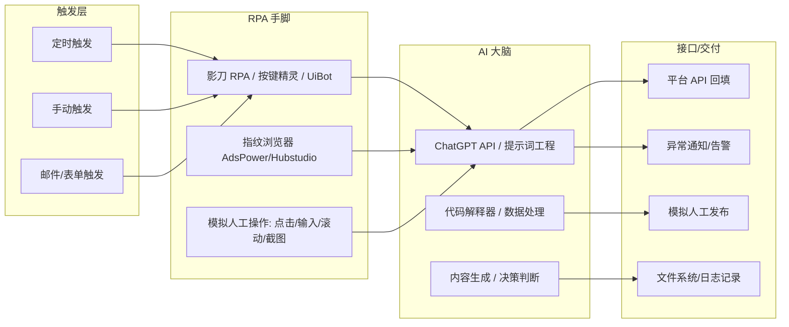

**核心组件**：
- **手脚**：影刀 RPA / 按键精灵 / UiBot / 指纹浏览器（AdsPower/Hubstudio）模拟人工操作
- **大脑**：ChatGPT API / 提示词工程 / 代码解释器 处理数据、生成内容、决策
- **接口**：平台 API / 模拟人工操作 / 文件系统 完成回填、发布、记录日志

**应用场景验证**：
- 亚马逊 POST 批量自动发布（《20230328_109.md`）
- 知乎自动推广、BOSS 直聘挖项目（《SUMMARY.md》[SUMMARY/P003]）
- 社媒矩阵分发、爬虫采集风向标数据（《SUMMARY.md》[SUMMARY/P003]）
- 短视频批量混剪：达芬奇切割 + 影刀 RPA 跨软件编排 + 容错机制，日产能从 <10 条提升至稳定批量（《20230328_107.md`）

**环境变数清单（必检）**：
以下变数是 RPA 落地最大变数，必须逐项核对并制定检查单，每一项均需说明为何关键、如何检查、异常如何处理：
- **浏览器版本**：RPA 脚本依赖特定 DOM 结构与 JS 执行环境，浏览器自动更新会导致选择器失效。检查方式：在 RPA 运行前锁定版本（如 Chrome 114.0.5735.198），禁用自动更新。异常处理：检测到版本不匹配立即终止并告警。
- **分辨率 / 缩放比**：坐标点击、图像识别高度依赖分辨率与缩放比（1920×1080 / 100% 为标准基线）。检查方式：RPA 启动前强制设置虚拟显示器分辨率与缩放。异常处理：检测到非基线值自动重置或报错。
- **文件路径**：素材、日志、配置文件的绝对路径在不同机器、不同用户环境下不一致。检查方式：使用环境变量或相对路径配置文件，启动时自动解析。异常处理：路径不存在时自动创建或回退默认目录并记录日志。
- **账号 Cookie 有效期**：平台登录态通常 7-30 天失效，Cookie 失效会导致全链路静默失败。检查方式：每日定时任务调用“心跳接口”或访问个人主页验证登录态。异常处理：失效时自动触发扫码/账密登录流程（配合指纹浏览器隔离环境），重新获取 Cookie 并写入加密存储。

**铁律**：必须人工跑通一次再调试，环境差异是 RPA 落地最大变数（《doxcnXIOtkZmPJLb1izKrreOuMg.md`）。

#### 84.7.5 私域沉淀：公域流量最终归宿

**私域沉淀**（来源：《SUMMARY.md》[SUMMARY/P004]）将公域流量通过钩子引入微信生态，构建高信任、高复购、可长期运营的用户资产。

**公私域联动模型**：

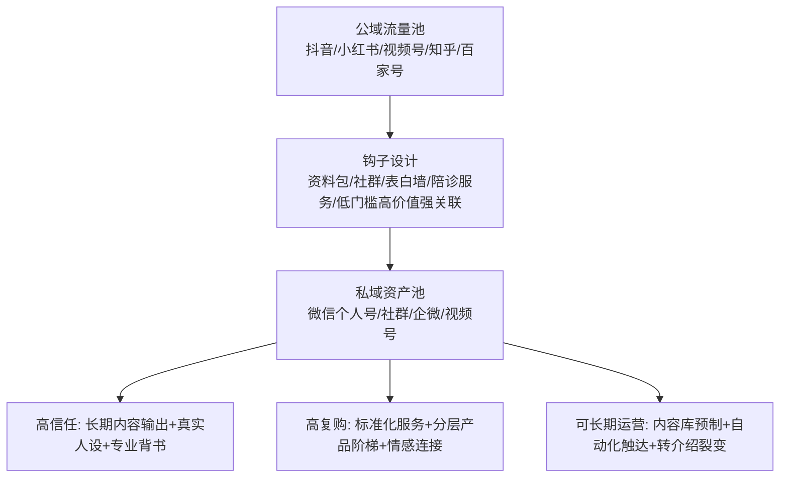

**实战案例库**：
- 孕晚期准妈妈视频号 10 天涨粉 1000+ 引流私域（《ZvLLdhX11oD4Lyxby36ct8GfnXe.md`）
- 普通人小红书 0 元建社群单月变现 8W+（《K4zfd2djsoEAdWxTaXrceSf9nLf.md`）
- 抖音直播引流私域 6 大方法（《20230328_060.md`）
- 小红书研报账号 3 周引流私域 600+（《UzSUdLrruodXSAxMlRtc0PSsnLb.md`）

---

## 84.8 跨平台实战 SOP 速览

### 84.8.1 小红书无货源电商 SOP

**标准化流程**（来源：《SUMMARY.md》[SUMMARY/P003]）：

选品 (参考风向标/拼多多/1688热销) → 开店 (个体户/企业店) → 选品测款 (铺货/精品) → 笔记生产 (AI批量改写/真实拍摄/伪原创) → 矩阵发布 (多账号/定时/标签) → 引流私域 (主页/粉丝群/私信钩子) → 转化复购

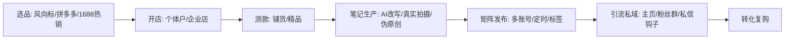

**关键验证点**：《JJQ0dfe6ho2qh7xalBXc3AG6nAb.md`实测“选品决定成败”：不发笔记仅上优质产品日均出单；日发十几篇笔记选品差一个月仅出一单。视频笔记批量混剪：至尊宝采集素材 → 醒图二创 → 剪映/模板套用 → 单账号高频发布规避重复判定。

### 84.8.2 视频号带货/涨粉实操法

**针对中老年/女性/育儿等精准人群**（来源：《SUMMARY.md》[SUMMARY/P003]）：

内容端：书单/怀旧/英语启蒙/ChatGPT教程 选爆款对标 → 制作端：剪映/达芬奇/影刀RPA 批量混剪/去重 → 分发端：账号矩阵发布 → 承接端：直播/橱窗/私域承接 → 变现端：高客单/高复购变现

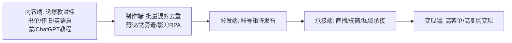

**验证数据**：《20230328_055.md`孕晚期妈妈 10 天涨粉 1000+ 引流私域；《20230328_140.md`英文育儿书单年累计粉 120W+、月入 2W+；《LXNmdLtO6oOP3dx7l9GcsVfPnSb.md`团队 40+ 店铺、120+ 账号、月销 200万+。

### 84.8.3 抖音/快手矩阵与无人直播

**团队实操数据**：《SUMMARY.md`[SUMMARY/P003]小团队矩阵短视频卖汽车用品单月变现 10W+；鸡血石直播变现百万（《20230328_144.md`）；短剧 CPS 团队月 GMV 破 20W（《20230328_062.md`）；创业 1 年做到 7000W 流水。

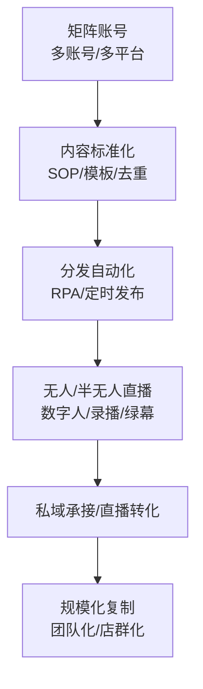

### 84.8.4 知识付费/社群/服务型项目高利润率验证

- 家庭教育赛道 0 到 1 累计私域 2000+、纯利 25W+（《20230328_161.md`）
- 快手无人直播 + 知识付费 + 私域月入 3W+（《20230328_168.md`）
- 陪诊服务、资源整合服务（两个月纯利 30W+）《ScDWdhjkHolKzAxyHpjclEDsnMg.md`）
- 同城相亲五年心得、百家号口播月入 5000-1W（《20230328_171.md`）

### 84.8.5 线下实体/同城业务数字化破局

- 线下门店选址好但无客流，通过“100 个营销技巧”、同城水果团购单日破 9000（《20230328_156.md`）
- 同城相亲五年深耕（《20230328_155.md`）、美团成人用品外卖 2 个月经验（《20230328_081.md`）、床品 + 表白墙半年利润 10W+（《20230328_084.md`）

### 84.8.6 跨境电商/亚马逊精细化运营与套利案例

- 精细化运营拯救亏损亚马逊产品（《20230328_083.md`）
- RPA 自动发 POST 降本增效（《20230328_109.md`）
- 四大行无风险套利 7 天赚回门票（《20230328_166.md`）
- Etsy 注册全流程 SOP 与欺诈分值模型（《20230328_174.md`）

---

## 84.9 多源对照：核心概念的不同视角支撑

### 84.9.1 关于“赚钱即利他”的共识与分歧

**共识**：
- 所有素材一致认为：合法商业本质是价值交换，盈利=帮人解决问题。
- 《20230328_008.md》[P001, improve]《20230328_012.md》[P003, apply]《SUMMARY.md》[SUMMARY/P001]均以“买方感知价值 > 价格，卖方价格 > 成本”定义交易正和性。

**侧重差异**：
- 《20230328_008.md》[P001, improve]侧重“心理障碍拆解”：赚钱不好意思 → 不敢报价 → 变现受阻。
- 《20230328_012.md》[P003, apply]侧重“天赋匹配与见识溢价”：利他深度取决于你是否用天赋优势区做核心动作、是否见过高阶定价锚点。
- 《20230328_162.md》[P002, apply]侧重“责任内归”：知识付费是避坑工具而非致富门票，用户不应责任外包。

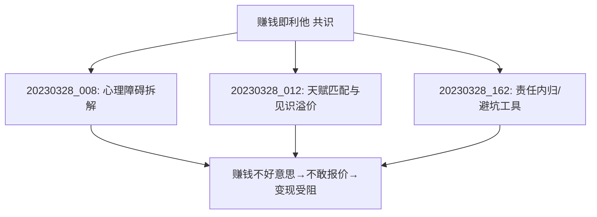

### 84.9.2 关于“长期主义”的共识与分歧

**共识**：
- 《20230328_011.md》[P004, improve]《20230328_036.md`[F001, apply]《NQrwdjKZ4oOEFpxGD1Hcjc9wnwf.md`均认可：时间是验证价值的核心变量，坚持即稀缺，平台红利周期约 1-2 年。

**侧重差异**：
- 《20230328_011.md》[P004, improve]强调“注意力获取的时间门槛定律”：初期曝光是噪音，长期存续是信号。
- 《20230328_036.md`[F001, apply]强调“业务模式倒逼”与“抗压持久力”：高退出成本业务客观倒逼长期主义；无技术护城河时，抗压持久力是唯一壁垒。
- 《NQrwdjKZ4oOEFpxGD1Hcjc9wnwf.md`强调“方法迁移能力”：看到教程红利已过，核心是迁移能力。

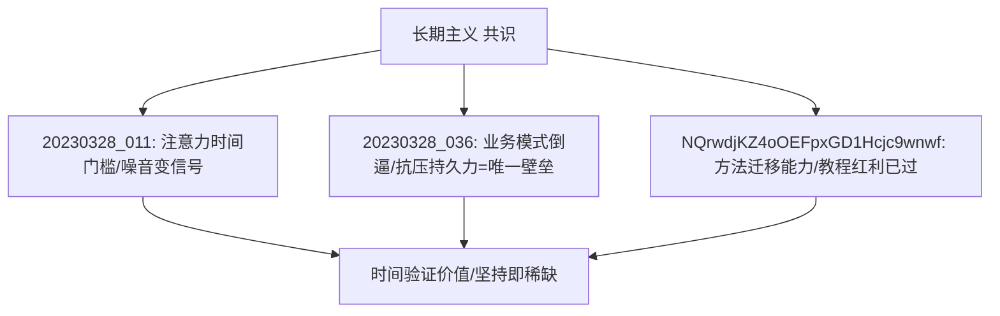

---

## 84.10 设计中的取舍

### 为什么不用“原创发明”而是“组合创新”？

原创发明需要极高的技术门槛、资金门槛和时间成本，且失败率极高。组合创新利用已验证的成熟工具（ChatGPT、Midjourney）、成熟平台（小红书、视频号）、成熟模式（无货源、CPS、知识付费），将不确定性压缩到“组装方式”和“微创新点”上，普通人可在 7-30 天内跑通 MVP。素材中 AI 模特、研报账号、短剧 CPS 皆是组合创新产物。这一决策基于：① 资源约束下的可行性优先；② 已验证组件降低技术风险；③ 微创新点聚焦用户体验差异化，而非底层技术突破。

### 为什么私域沉淀是“终局”而非“选项”？

公域流量具有“不确定性（算法变）、非资产化（粉丝归平台）、获客成本递增”三大特征。素材反复验证：视频号/抖音/小红书/闲鱼/知乎/百家号等所有公域玩法，最终目的均为沉淀至微信个人号/社群/企微，通过高频触达/信任建立/复购转化实现 LTV 最大化（《MZqUdSJumoQZwtxLCatcDJ1snze.md`）。私域是唯一可控的资产容器。这一决策权衡了：① 平台政策收紧趋势下的外链生存率；② 微信生态高信任/高频触达的天然优势；③ 私域资产可估值、可转让、可复利的财务属性。

### 为什么“过程即奖赏”能对抗“结果焦虑”？

结果（赚多少钱、涨多少粉）受外部环境、平台算法、竞争对手影响，不可控；过程（写一篇文、剪一条片、调通一个 RPA、服务好一个客户）100% 可控。当奖赏锚定在可控变量上，多巴胺反馈回路闭环，执行力持续稳定。这是《20230328_010.md》[P003, improve]和《20230328_012.md》[P003, apply]反复论证的心理学基础。这一决策基于：① 控制点理论——内控感显著降低习得性无助；② 自我决定理论——内在动机（自主/胜任/关系）比外在奖励更持久；③ 行为设计学——即时微小反馈比延迟大额奖励更能维持高频行为。

---

## 84.11 动手练习

### 练习1：拆解一个“风向标”账号的商业模式

**任务**：选定一个你所在赛道的头部账号（粉丝 10万+，持续更新 3 个月以上）作为“风向标”。

1. 记录其最近 20 条内容的选题方向、内容形式（图文/视频/直播）、发布频次。
2. 分析其变现路径：挂链接卖货？卖课/社群？引流私域接大单？接广告？
3. 画出其“流量源 → 转化路径 → 产品结构”商业模式画布。
4. 基于此，设计一个“微创新”测试方案：你将复制哪个核心动作？在哪个环节微创新（如换人设、换平台、换钩子、换产品）？

**回答问题**：
- 该风向标的核心护城河是什么？（内容差异化/供应链/私域信任/技术壁垒）
- 你的微创新测试成本（时间/金钱）预算上限是多少？如何确保“最低成本跑通闭环”？

### 练习2：用“组合创新”设计一个 AI 副业 MVP

**任务**：在 30 分钟内，利用“成熟工具 + 成熟平台 + 成熟模式”的组合创新公式，设计一个你可在 7 天内跑通的 AI 副业 MVP 方案。

1. 从工具库（ChatGPT、Midjourney、RPA、剪映、数字人、TTS、爬虫）中选 1-2 个。
2. 从平台库（小红书、视频号、抖音、闲鱼、知乎、👸号）中选 1 个主战场。
3. 从模式库（无货源电商、知识付费/社群、CPS 分佣、虚拟资源卖、服务整合、广告分成）中选 1 个。
4. 写出：核心价值主张（帮谁解决什么问题）、获客钩子、交付流程、预期单客价值、7 天验证指标（如：出单 1 单/引流 50 人/产出 10 条内容）。

**回答问题**：
- 这个组合中，哪个环节是你最不确定的？如何用“最低成本”在前 3 天验证它？
- 若 7 天验证失败，你的止损标准是什么？下一个备选组合是什么？

### 练习3：搭建一个最小“RPA+AI 自动化生产线”原型

**任务**：针对一个高频重复的运营动作（如：每日采集 5 个竞品标题/每日发布 3 条朋友圈/每日回复 20 条私信/每日整理 1 份行业资讯），设计自动化方案。

1. 拆解人工操作的标准步骤（每步动作、判断条件、异常处理）。
2. 选型：RPA 工具（影刀/按键精灵/UiBot/指纹浏览器）、AI 大脑（ChatGPT API/提示词模板）、触发方式（定时/手动/邮件触发）。
3. 画出流程图：触发 → RPA 模拟操作 → 调用 AI 处理数据/生成内容 → RPA 回填/发布/记录日志 → 异常通知。
4. 列出环境变数清单（浏览器版本/分辨率/缩放比/文件路径/账号 Cookie 有效期），并制定“人工跑通一次再调试”的检查单。

**回答问题**：
- 该自动化线的边际成本（服务器/Token/账号损耗）约多少？相比人工/外包成本降低了几个数量级？
- 平台风控的核心触发点是什么？你的“延时随机化/环境隔离/行为模拟”防封策略具体怎么设？

### 练习4：复盘你的“认知变现差”与“过程奖赏”现状

**任务**：基于本章概念，书面复盘你过去 3 个月的学习与行动。

1. 列出你接触过的 3 个“风向标”信息/工具/趋势（如：ChatGPT 插件、视频号切片、小红书无货源、AI 数字人、RPA 自动化）。
2. 对每个标记：你是“围观/焦虑/买课未看/看完未动手/跑通 MVP/已放大/已沉淀方法论”中的哪个阶段？
3. 识别你的“认知变现差”最大源头：是信息获取渠道窄？付费不舍得？缺乏实战跑闭环？还是缺乏复盘沉淀？
4. 审视你的“过程即奖赏”执行情况：是否因“赚不到钱/涨粉慢/技术难”产生挫败感放弃？如何将“写提示词/剪视频/发笔记/调 RPA/回复客户”本身视为技能积累的奖赏？
5. 制定下一步“缩小认知差”行动清单：要进的 1 个社群、要买的 1 份复盘/教程、要跑的 1 个 MVP、要写的 1 篇复盘沉淀。

**回答问题**：
- 你的“长期主义复利”目前体现在哪里？（坚持了多久的什么动作？）
- 若把“赚钱”视为“利他”的副产品，你最近一次真正帮客户解决问题（省钱/省时/赚钱/爽/安全）是什么时候？

---

## 84.12 本章小结

这一章中我们学习了普通人低门槛创富的底层逻辑体系。首先我们拆解了“赚钱即利他定律”，从主观价值理论证明合法交易必然是双向价值创造的正和博弈，打破“赚钱有罪”的心理枷锁；其次我们定义了“认知变现差”，给出了缩小差距的四条核心路径——进高质量社群、付费买复盘、实战跑 MVP、复盘沉淀方法论，并揭示了信息增量阈值与勤奋验证智商的机制；接着我们确立了“过程即奖赏原则”，将奖赏锚定在可控的成长过程中（学技能、做内容、搭系统、解难题），用非竞争性生存状态和激情驱动耐力模型对抗结果焦虑；然后我们论证了“长期主义复利论”，指出时间是验证价值的核心变量，坚持即稀缺，抗压持久力是普通创业者唯一核心壁垒；最后我们综合提出“普通人低门槛创富公式”，将风向标洞察、组合创新 MVP、批量执行/工具杠杆、私域沉淀/品牌复利、时间五大要素结合为乘积模型，并详细拆解了风向标追踪四步法、组合创新设计、AI 辅助 MVP 三步法、RPA+AI 自动化生产线架构、私域沉淀全链路等可落地方法论，配合小红书无货源、视频号带货、抖音矩阵、知识付费、线下同城、跨境电商等跨平台实战 SOP 与验证数据。

本章我们一起学习了以下概念：

下表汇总了本章所有核心概念及其关键解释，供快速回顾与检索使用。

| 概念 | 解释 |
|------|------|
| 赚钱即利他定律 | 商业本质是价值交换：买方感知价值>价格，卖方价格>成本，盈利过程即帮人过程 |
| 认知变现差 | 同一信息，认知高者已变现，认知低者还在围观；缩小差距四路径：进社群、买复盘、跑MVP、沉淀方法论 |
| 过程即奖赏原则 | 过度关注结果致焦虑，聚焦过程（学技能/做内容/搭系统/解难题）成长确定性，结果作为副产品自然到来 |
| 长期主义复利论 | 真正关注源于"过了这么久你居然还在那里"，时间验证价值，坚持即稀缺，抗压持久力是唯一核心壁垒 |
| 普通人低门槛创富公式 | (风向标洞察+组合创新MVP)×(批量执行/工具杠杆)×(私域沉淀/品牌复利)×时间，核心变量是执行力与复盘迭代速度 |
| 风向标 | 头部玩家/账号/产品/平台功能等预示趋势的标杆，四步法：定名单、设频次、解构模式、复制微创新 |
| 组合创新 | 非原创发明，将成熟工具(ChatGPT/MJ/RPA)+成熟平台(小红书/视频号/抖音)+成熟模式(无货源/知识付费/CPS)重新组装 |
| MVP思维 | 最低成本跑通"获客-转化-交付"闭环，验证需求真实性后再投入资源迭代 |
| 批量思维 | 用概率对抗单点不确定性，标准化SOP→矩阵账号/多平台分发/RPA自动化/团队化复制 |
| RPA+AI自动化生产线 | 影刀/指纹浏览器做"手脚"、ChatGPT API做"大脑"、平台API做"接口"，非程序员可落地 |
| 私域沉淀 | 公域流量最终归宿：通过钩子引入微信生态，构建高信任/高复购/可长期运营的用户资产池 |

下一章中，我们将学习如何通过“风向标追踪”与“组合创新”具体锁定趋势机会，并动手设计你的第一个 AI 副业 MVP。

