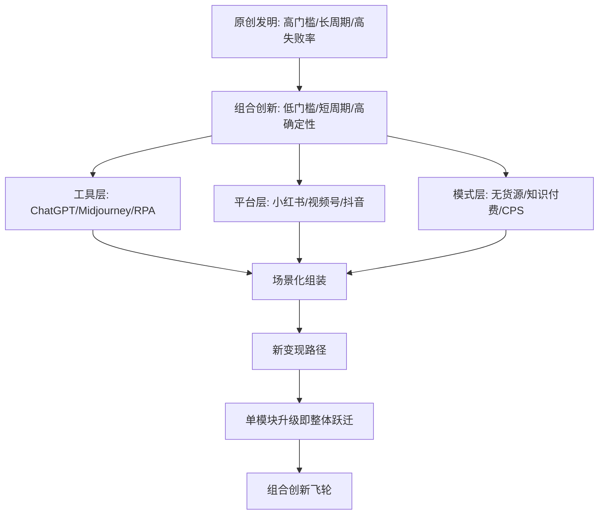
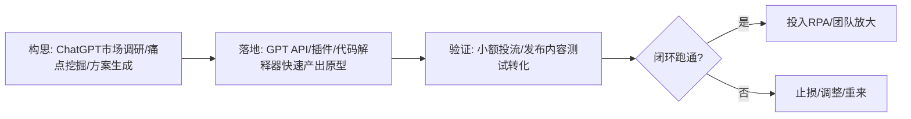
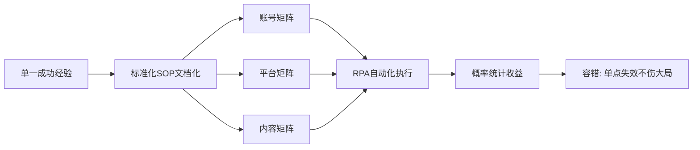
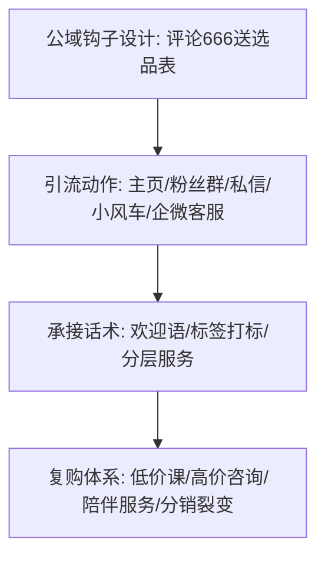
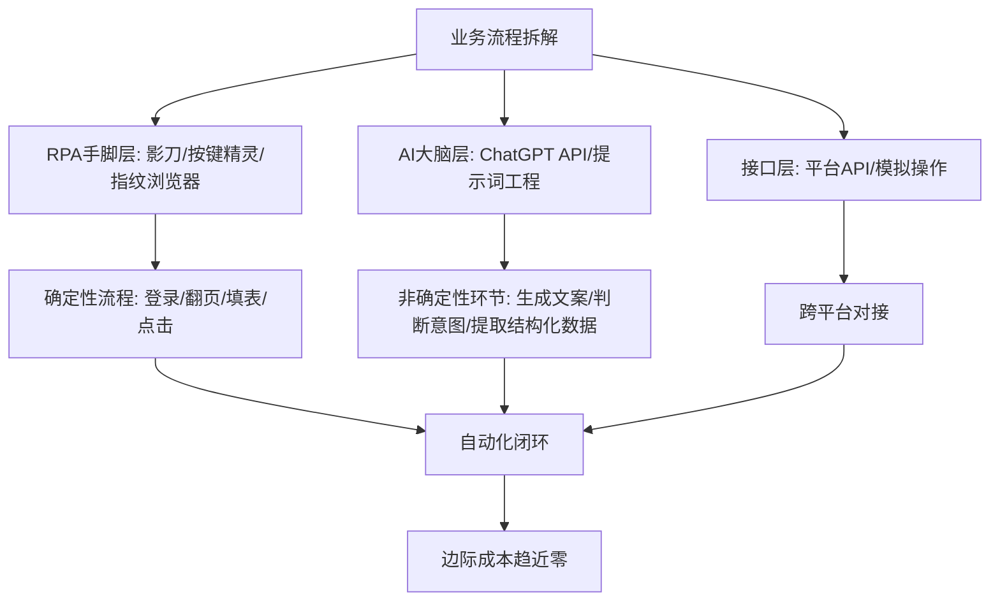
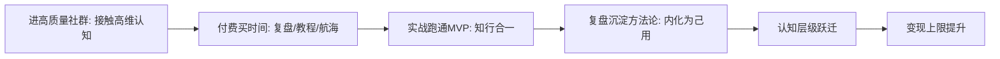
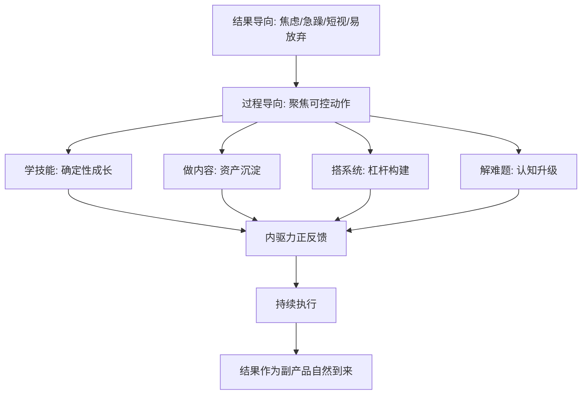

# 第 85 章 普通人低门槛创富体系：从认知重塑到规模化放大

## 学习目标

- 理解风向标作为决策导航仪的核心作用与监控方法论
- 掌握组合创新将成熟工具、平台、模式重组为新变现路径的实操范式
- 内化MVP思维：以最低成本跑通获客-转化-交付闭环并设定止损线
- 建立批量思维：用标准化SOP与概率统计对抗单点不确定性，实现规模化放大
- 构建私域沉淀体系：将公域流量通过合规钩子引入微信生态，实现高信任、高复购、长周期LTV最大化
- 熟练搭建RPA+AI自动化生产线：以影刀/按键精灵/指纹浏览器为手脚，ChatGPT API为大脑，实现非程序员自动化
- 确立赚钱即利他定律：从主观价值理论推导商业本质，消除赚钱心理障碍，建立利他深度×广度×频次=商业价值的正向闭环
- 认知认知变现差与缩小路径：进高质量社群、付费买时间、实战跑通MVP、复盘沉淀方法论四步跃迁
- 践行过程即奖赏原则：聚焦可控过程确定性（学技能、做内容、搭系统、解难题），以内驱力对抗结果焦虑
- 坚持长期主义复利论：在不确定环境中做难但正确的事，以存续为信号、以复利为回报、以时间为朋友
- 运用普通人低门槛创富公式：整合风向标、组合创新、MVP、批量、私域、时间六大变量，明确执行力与复盘迭代速度为核心杠杆

## 85.1 生活类比

想象普通人创富如同在荒野中建立一条可持续的补给线。风向标是经验丰富的向导留下的脚印与标记，告诉你哪里有水、哪里有猎物、哪条路最安全；组合创新是不用自己冶炼铁矿造刀，而是拿成熟的瑞士军刀、成熟的地图、成熟的狩猎陷阱设计组装成你的生存套件；MVP思维是先用树枝草绳搭个简易庇护所能避风雨、过一夜，验证这地方能住人，再盖木屋、砖房；批量思维是不押注单一陷阱，而是按标准化图纸批量布设陷阱网，用概率统计保证总有收获，单个失效不伤大局；RPA自动化是训练几只聪明的猎犬帮你巡陷阱、拎猎物、守营地，你只负责决策在哪里设陷阱、怎么改良陷阱；私域沉淀是在营地旁挖窖、建仓、养畜，把流动的猎物变成囤积的粮草，不管外面风雪怎么变，仓里有粮心不慌；赚钱即利他是你帮部落解决吃饭、安全、工具问题，部落自然给你份额、地位、保护，利他越深、覆盖越广，你在部落地位越稳；认知变现差是同样在荒野，新手只见树木，老猎人见兽径、见水源、见季节规律，差距不在体力在认知，买老猎人地图、跟老猎人打几次猎、自己画地图总结最快缩小差距；过程即奖赏是别盯着能不能猎到大獠牙发愁，盯着今天陷阱改良了没、今天猎犬训顺了没、今天地图画准了没，每天睡前清单打钩，焦虑自然消失，大獠牙迟早是你的；长期主义是荒野生存不是冲刺赛，是耐力赛，人们真正敬佩你时，是发现过了这么久你居然还在那里、还在改良陷阱、还在画地图、还在训猎犬，时间是朋友，存续是信号；创富公式是（向导情报+套件组装）×（陷阱网+猎犬）×（窖仓+部落声望）×时间，核心变量是你每天改良陷阱的速度与每次复盘总结的深度，而非初始背包里有多少干粮。

## 85.2 概念地图

```text
普通人低门槛创富体系
├── 认知底座
│   ├── 赚钱即利他定律         —— P007
│   ├── 认知变现差             —— P008
│   ├── 过程即奖赏原则         —— P009
│   └── 长期主义复利论         —— P010
├── 机会发现层
│   ├── 风向标追踪法             —— P001
│   ├── 组合创新                 —— P002
│   └── AI辅助MVP三步法          —— P003
├── 执行放大层
│   ├── 批量思维                 —— P004
│   ├── RPA+AI自动化生产线       —— P006
│   │   ├── 影刀RPA/按键精灵/指纹浏览器 —— P006
│   │   ├── ChatGPT API/提示词工程     —— P006
│   │   └── 平台API/模拟操作接口       —— P006
│   └── 标准化SOP沉淀            —— P004
├── 资产沉淀层
│   ├── 私域沉淀体系             —— P005
│   │   ├── 合规引流钩子设计         —— P005
│   │   ├── 信任前置与分层运营         —— P005
│   │   └── 全生命周期LTV设计        —— P005
│   └── 个人IP与品牌复利           —— P011
└── 总集成模型
    └── 普通人低门槛创富公式     —— P011
```

## 85.3 风向标 —— 让决策拥有“导航仪” [P001]

### 为什么需要这个概念？

创业充满不确定性，盲目试错成本高、周期长。普通人缺乏行业洞察，难以判断趋势真假、机会优劣。我们需要一个可观测、可复制、可验证的外部参照系来降低认知负荷。

### 核心定义

> **风向标** 指代行业头部玩家、头部账号、头部产品或新兴平台功能发布等能预示趋势方向的标杆对象。通过监控其动作（选品、内容形式、推广渠道、商业模式）来降低决策不确定性。
> 
> —— P001《SUMMARY.md》excerpt: "如何寻找风向标"

### 关键性质

风向标具备可监控性，其动作公开可见，包括发什么内容、卖什么产品、怎么推广，这些都能直接观测到。风向标具备可解构性，其商业模式要素可拆解为流量来源、转化路径、产品结构等可分析的组件。风向标具备可复制性，核心动作可微创新测试，而非依赖不可复制的天赋或资源。风向标具有时效性，随赛道周期更迭，需要动态更新监控名单。

### 典型例子

在小红书无货源电商赛道，监控拼多多、1688热销榜以及同赛道头部笔记的选品逻辑；在视频号带货赛道，追踪书单、怀旧、育儿等细分领域头部账号的选品节奏与内容模版；在AI应用层赛道，跟进OpenAI插件发布、头部开发者的微调与提示词新玩法。

> [P001] 素材中提到"我是如何通过整合风向标信息 3 天跑出 MVP 并实现变现"，展示了风向标监控到MVP落地的完整链路。
> 
> [P001] "通过风向标发掘机会，靠GPT辅助实现MVP最小可行性产品" 进一步验证了风向标作为机会发现起点的实战有效性。
> 
> [P001] "生财有术 | 风向标精选（3.20-3.23）" 体现了风向标监控的常态化、周期化运作节奏。

### 方法演进图

```mermaid
graph TD
    A[确定赛道Top 10风向标名单] --> B[设置监控频次(日/周)]
    B --> C[解构商业模式要素: 流量源/转化路径/产品结构]
    C --> D[复制核心动作并微创新测试]
    D --> E[MVP验证闭环]
    E --> F[动态更新风向标名单]
```

### 边界条件

仅监控不执行等于零，风向标提供方向，MVP验证需自行跑通闭环。需避免幸存者偏差，头部玩家已有护城河，新入局者需聚焦可复制的核心动作而非结果。赛道不同风向标不同，泛流量赛道看大V，垂类赛道看细分头部，工具赛道看平台更新日志。

## 85.4 组合创新 —— 让创业变成“搭积木” [P002]

### 为什么需要这个概念？

原创发明门槛高、周期长、失败率极高，不适合普通人低成本试错。成熟工具、平台、模式已验证可行，重新组装边际成本极低。AI时代单点技术商业价值有限，唯有场景化组合才能形成可交付产品。

### 核心定义

> **组合创新** 非原创式发明，而是将成熟技术工具（ChatGPT、Midjourney、RPA）、成熟流量平台（小红书、视频号、抖音）与成熟商业模式（无货源电商、知识付费、CPS分佣）重新组装，快速生成新变现路径。核心公式：成熟工具 × 成熟平台 × 成熟模式 = 新机会。
> 
> —— P002《SUMMARY.md》excerpt: "通过组合创新，在小红书做研报账号，3周达到5000粉，引流私域600+"

### 关键性质

组合创新具有低门槛特性，不需要从0发明技术，只需会用API、会剪辑、会搭建RPA流程即可上手。具有高确定性，各模块均经市场验证，组合失败率显著低于原创发明。具有可迭代性，单模块升级（如GPT-3.5升级到GPT-4）即可带来整体跃迁。具有复利化特征，积累的组合库可快速响应新风向标，形成组合创新飞轮。

### 典型例子

小红书研报账号案例：付费研报内容源 + 稿定设计模板 + 群聊引流渠道 + ArtStation素材库 = 3周达到5000粉、引流私域600+。AI模特商拍案例：ControlNet/OpenPose/LoRA + PS修图 + 电商摄影需求 = 7天变现。ChatGPT写公众号爆文案例：GPT-4 + 爆文拆解Prompt + 剪映排版 + 矩阵分发 = 7天阅读10W+。RPA自动卖货案例：ChatGPT API + 影刀RPA + 指纹浏览器 + 知乎/亚马逊/BOSS直聘接口 = 非程序员自动化生产线。

> [P002] "利用 GPT4 迅速将想法落地，让创意在半天时间内变成 MVP" —— 体现组合创新中工具层（GPT-4）对落地速度的决定性加速。
> 
> [P002] "ChatGPT + 公众号爆文写作，从 0 开始 7 天达成阅读 10W+" —— 工具（ChatGPT）× 平台（公众号）× 模式（爆文拆解+矩阵分发）的经典组合。
> 
> [P002] "AI模特项目 7 天跑通变现闭环的复盘实录" —— ControlNet/LoRA等成熟模型 × 电商摄影场景 × 服务交付模式的组合创新实证。
> 
> [P002] "一个工具管理上百个社媒账号？指纹浏览器使用全攻略" —— 指纹浏览器（工具）× 多平台账号管理（场景）的组合应用。
> 
> [P002] "壹，店铺批量自动发POST | AMZ与RPA" —— RPA（工具）× 亚马逊POST功能（平台特性）× 批量运营（模式）的组合。
> 
> [P002] "通过 ChatGPT+RPA，帮我在知乎上自动卖货" —— ChatGPT（大脑）× RPA（手脚）× 知乎好物（平台/模式）的三层组合。

### 方法演进图



### 边界条件

组合非堆砌，需深度理解各模块接口与约束（如API调用限制、平台风控规则、工具输出质量）。核心环节不可外包，提示词工程、业务流程拆解、异常处理逻辑需自行掌握。避免工具中毒，工具服务于业务闭环，不要为了用新工具而强行套用。

## 85.5 MVP思维 —— 让验证走在投入前面 [P003]

### 为什么需要这个概念？

传统创业易陷入完美主义陷阱：投入大量资源后才发现无人买单。资源有限时，必须用最小成本验证有人愿为价值付费这一核心假设。只有跑通获客-转化-交付闭环，后续的批量放大、工具接入、团队组建才有意义。

### 核心定义

> **MVP思维** 最小可行性产品思维：不追求完美，先用最低成本（时间、金钱）跑通完整商业闭环。验证核心指标：能否获客？能否转化？能否交付？单位经济模型是否为正？验证通过后，再决定是否投入RPA、团队、广告预算进行规模化放大。
> 
> —— P003《SUMMARY.md》excerpt: "我是如何通过整合风向标信息 3 天跑出 MVP 并实现变现"

### 关键性质

MVP思维强调速度优先，从构思到首单的时间压缩至天/周级（如3天、7天）。强调成本可控，单次试错成本设定止损线（如几百元、几天时间）。强调闭环导向，必须包含完整的流量到转化到交付链路，不可只做内容不带货、只引流不转化。强调数据驱动，以市场反馈（点击、咨询、下单、复购）为唯一决策依据。

### 典型例子

AI模特项目：失业3个月，7天搭建工作流、跑通首单、建立交付SOP。小红书研报号：3周内完成账号搭建、内容生产、私域引流、首单变现。知乎好物自动化：先人工跑通选品、出稿、发布、出单，再引入RPA批量化。闲鱼二手书：先单店单品手动上架验证出单，再注册6张执照开18店矩阵化。

> [P003] "利用 GPT4 迅速将想法落地，让创意在半天时间内变成 MVP" —— GPT-4作为组合创新工具层的核心，将构思到原型的时间压缩至半天级。
> 
> [P003] "失业危机自救:AI模特项目7天跑通变现闭环的复盘实录" —— 真实案例验证了MVP思维在极度资源受限条件下的可行性：零资金、零团队、7天跑通首单。
> 
> [P003] "如何通过风向标发掘机会，靠GPT辅助实现MVP最小可行性产品" —— 完整展示了风向标→组合创新→GPT辅助落地→MVP验证的标准化链路。

### AI辅助MVP三步法



### 边界条件

MVP不等于简陋，核心体验必须达标（如图片识别率、交付时效、售后响应），不可用是MVP掩盖产品硬伤。验证周期有上限，设定明确止损线（如连续100条无单、投入300元无ROI），避免沉没成本陷阱。区分验证阶段与放大阶段，验证期用人工/半自动，放大期才上RPA/团队/投流，切勿混淆。

## 85.6 批量思维 —— 让概率为单点不确定性兜底 [P004]

### 为什么需要这个概念？

单一账号/产品/渠道受算法波动、违规封号、竞品挤压影响极大，确定性低。单点成功难以复制，但批量操作下的成功率可通过概率统计预测并放大。将成功经验标准化为SOP，是规模化、团队化、自动化的前提。

### 核心定义

> **批量思维** 用概率思维对抗单点不确定性：将单一成功经验标准化为SOP，通过多账号矩阵、多平台分发、RPA自动化、团队化复制放大收益。核心指标：单位产出（如单人日产200条视频）、成功率（如爆款率25%）、边际成本（如RPA边际成本趋近零）。
> 
> —— P004《SUMMARY.md》excerpt: "单人日产 200 条之批量思维"

### 关键性质

批量思维要求标准化先行，无SOP无批量，必须先人工跑通、提炼关键动作、固化参数、文档化。采用矩阵化运营，包括账号矩阵（如18个闲鱼店）、平台矩阵（同内容分发小红书/抖音/视频号/闲鱼/B站）、内容矩阵（模版化生产）。利用工具杠杆，RPA替代重复劳动，AI替代决策/生成劳动，指纹浏览器解决环境隔离。具备容错设计，单账号死号、单视频限流、单渠道失效不影响整体模型运转。

### 典型例子

短视频批量剪辑：剪映模版 + 达芬奇去重 + 影刀RPA分发 = 单人日产200条，支撑60号矩阵日佣8万+。闲鱼店群：18个店铺同步上架，标准化选品/上架/定价/发货/售后SOP，单店日利润20元。知乎好物自动化：草稿箱存题 + Automa插件调用ChatGPT + 人工把关发布 = 月度稳定收益。社媒矩阵分发：一条内容经RPA同步分发至公众号/小红书/视频号/抖音/知乎/B站，边际成本近零。

> [P004] "零基础也能批量产出高质量带货视频，超强视频批量剪辑软件" —— 剪映/达芬奇模版化 + RPA分发的标准化工具链，降低了批量生产的技术门槛。
> 
> [P004] "航海复盘：利用剪映+达芬奇+影刀 RPA 提高混剪效率" —— 实战复盘中总结出的具体工具组合与参数设置，是SOP沉淀的直接产物。
> 
> [P004] "《2023年，为了让亦仁认识我，我一口气注册了6张执照，开了18个二手书闲鱼店铺》" —— 账号矩阵规模化的极致实证：6张执照×3店/执照=18店，标准化SOP支撑单人运营。
> 
> [P004] "君子性非异也，善假于物也" —— 批量思维的底层哲学：善用工具杠杆（代码、软件、程序）解放双手、复制时间。
> 
> [P004] "将代码、软件、程序视为杠杆工具，核心价值在于解放双手、复制时间" —— 明确了RPA/自动化工具在批量思维中的定位：不是炫技，而是杠杆。

### 数据流图



### RPA杠杆思维

> 将代码、软件、程序视为杠杆工具，核心价值在于解放双手、复制时间，而非单纯的技术实现。君子性非异也，善假于物也。
> 
> —— P004《doxcnXIOtkZmPJLb1izKrreOuMg.md》

### 边界条件

质量底线不可破，批量不等于垃圾，内容需过原创检测、账号需存活、交付需达标，否则规模化只会放大亏损。平台规则红线，批量操作极易触发风控（如频率、指纹、内容重复），必须配套防封策略（延时随机化、环境隔离、去重处理）。管理复杂度随账号/店铺数量增长指数级上升，需引入管理工具（如飞书文档、UIBot流程监控）或分层管理（主理人-组长-执行）。

## 85.7 私域沉淀 —— 让流量变成“资产” [P005]

### 为什么需要这个概念？

公域流量租赁属性强：算法变、规则变、账号封，流量随时归零，无资产积累。高客单价、长决策周期、非标服务项目，公域直接转化率极低，信任建立成本高。只有沉淀至微信生态（个人号/社群/企微），才能实现高频触达、深度信任、复购裂变、LTV最大化。

### 核心定义

> **私域沉淀** 将公域流量（视频号、小红书、抖音、知乎、百家号等）通过钩子（资料包、社群、表白墙、陪诊服务、低价引流品等）引入微信生态，构建高信任、高复购、可长期运营的用户资产池，是几乎所有高客单价或长周期项目的最终归宿。
> 
> —— P005《SUMMARY.md》excerpt: "孕晚期准妈妈通过视频号 10 天涨粉 1000+，成功引流私域的案例复盘"

### 关键性质

私域沉淀强调信任前置，通过内容、人设、案例、服务在公域建立初步信任，私域承接后深化。具备高频触达能力，朋友圈、社群、私聊、视频号直播，零成本高频触达用户。支持精细运营，标签分层（意向/成交/高净值）、分级服务（免费资料/低价课/高价咨询/陪伴服务）、全生命周期LTV设计。具有可迁移性，微信生态相对封闭稳定，用户关系链随个人迁移，不受单平台规则剥离。

### 典型例子

孕晚期妈妈：视频号10天涨粉1000+ → 发二维码图片降维引流 → 私域预售课程变现。小红书社群变现：0元建群 → 利他输出建信任 → 499元社群单月8万+ → 阶梯产品（咨询/训练营/录播课）。闲鱼虚拟资料：1元引流加微信 → 私域转化高客单代办/咨询/淘客返利。视频号切片：长直播切片分发公域 → 直播间承接99元高客单课程 → 私域复购高价咨询。

> [P005] "普通人做小红书，从 0 到 1，起盘我 0 元成立一个社群，单月变现 8w+的经验" —— 0元冷启动社群，通过利他内容建立信任，再设计阶梯产品实现高客单变现，是私域沉淀的教科书级案例。
> 
> [P005] "抖音直播引流私域的 6 个方法" —— 跨平台私域引流的战术库，覆盖了主页、粉丝群、私信、小风车、蓝V组件等合规路径。
> 
> [P005] "通过组合创新，在小红书做研报账号，3 周达到 5000 粉，引流私域 600+" —— 组合创新生成内容，公域获客后通过群聊钩子精准引流私域，形成完整闭环。

### 引流路径设计



### 边界条件

引流动作合规性至关重要，严守平台规则（小红书不截流、视频号用企微客服、抖音用小风车/蓝V组件），违规引流导致账号废号得不偿失。承接能力匹配要求引流量级必须与私域承接能力（客服人力、SOP完备度、产品交付力）匹配，否则流量浪费且损信任。避免私域即微商，核心是利他服务与信任积累，而非刷屏硬广、无差别群发，后者必死于用户厌恶与封号。

## 85.8 RPA自动化 —— 让非程序员拥有“数字员工” [P006]

### 为什么需要这个概念？

批量思维落地的核心瓶颈是手脚不够用：大量重复、低决策、高频次的操作（发布、采集、回复、上架）消耗人力。传统外包成本高、质量难控、沟通成本大，且无法7x24小时运行。编程门槛高，普通创业者无法自建自动化系统，需零代码/低代码工具填补空白。

### 核心定义

> **RPA自动化** 机器人流程自动化：用软件模拟人工在浏览器/客户端/UI界面的操作（点击、输入、跳转、抓取），实现跨平台、跨系统的业务流程自动化。素材中定位为数字员工：影刀RPA/按键精灵/指纹浏览器做手脚，ChatGPT API/提示词工程做大脑，对接平台API/模拟操作做接口。
> 
> —— P006《SUMMARY.md》excerpt: "一个工具管理上百个社媒账号？指纹浏览器使用全攻略"

### 关键性质

RPA自动化具有非侵入式特性，无需平台开放API，模拟前端操作即可，适用于几乎所有Web/桌面应用。支持可视化搭建，UIBot Creator等工具支持拖拉拽流程编排，非程序员可上手。实现结构化协作，RPA负责确定性流程（登录、翻页、填表），AI负责非确定性环节（生成文案、判断意图、提取结构化数据）。边际成本趋近零，流程跑通后，单次执行成本仅电费/服务器费，远低于人工/外包。

### 典型例子

亚马逊POST自动发布：UIBot导入代码+配置图片路径+串联流程块+延时随机化 = 万帖自动分发。知乎好物自动卖货：草稿箱存题 + Automa插件调用ChatGPT生成回答 + 人工把关发布。BOSS直聘挖项目：RPA批量投递简历/发布岗位 + ChatGPT实时应对面试/生成JD分析 + 人工决策筛选。社媒矩阵分发：一条内容经RPA同步分发至5+平台，配合指纹浏览器环境隔离。

> [P006] "壹，店铺批量自动发POST | AMZ与RPA" —— UIBot导入代码、配置图片路径、串联流程块、延时随机化防封的完整实操流程，展示了RPA在跨境电商批量运营中的落地细节。
> 
> [P006] "通过 ChatGPT+RPA，帮我在知乎上自动卖货" —— 草稿箱存题 + Automa插件调用ChatGPT生成回答 + 人工把关发布，构建了"AI大脑+RPA手脚+人工兜底"的标准协作范式。
> 
> [P006] "通过 ChatGPT+RPA，帮我在 BOSS 直聘 + RPA 来挖掘适合普通人赚钱的项目" —— RPA批量投递/发布岗位 + ChatGPT实时应对面试/生成JD分析，拓展了RPA+AI从内容电商到招聘挖掘的新场景。
> 
> [P006] "使用UIBot Creator可视化模式，通过导入源代码、配置图片上传文件夹路径、串联流程块形成闭环循环" —— 可视化搭建的标准化步骤：导入代码→配置路径→串联流程块→闭环循环→延时随机化→异常捕获→日志记录。
> 
> [P006] "利用Chrome插件Image Assistant，在无版权图片网站按关键词搜索后，通过'提取本页图片 -> 筛选类型/大小 -> 全选 -> 自动下载'" —— ImageAssistant批量采图工作流，解决了内容生产端的素材获取标准化问题。
> 
> [P006] "Posts素材的核心是'受众场景共鸣'而非'产品细节展示'" —— 素材选择原则：按人群标签（教师、司机、护士、父母等）检索通用场景图，比自行拍摄产品图更高效且转化相关性强。
> 
> [P006] "在RPA循环中设置固定延时（如200,000毫秒即约2分钟/条），模拟人工发布频率，规避平台风控" —— 防封策略的具体参数化实施：固定延时模拟人工节奏。
> 
> [P006] "对于高重复、低决策的运营动作，RPA自动化的边际成本趋近于零，远低于人工或外包成本" —— 量化了RPA的成本优势：边际成本趋近零是规模化放大的经济学基础。
> 
> [P006] "单条Posts人工耗时2-3分钟；RPA实测可稳定跑通多店铺；紫鸟浏览器不兼容第三方RPA" —— 实测数据对比与环境兼容性踩坑记录，为工具选型提供一手参考。

### RPA+AI生产线架构



### UIBot Creator可视化流程搭建实操

UIBot Creator可视化模式通过导入源代码、配置图片上传文件夹路径、串联流程块形成闭环循环、设置延时随机化防封策略、配置异常捕获重试/告警机制、启用执行日志记录等步骤搭建自动化流程。

### ImageAssistant批量采图工作流

利用Chrome插件Image Assistant，在无版权图片网站按关键词搜索后，通过提取本页图片、筛选类型/大小、全选、自动下载的标准化动作，快速建立素材库。

### 素材选择原则

> Posts素材的核心是受众场景共鸣而非产品细节展示，利用无版权图库按人群标签（教师、司机、护士、父母等）检索的通用场景图，比自行拍摄产品图更高效且转化相关性强。
> 
> —— P006《doxcnXIOtkZmPJLb1izKrreOuMg.md》

### 防封策略

> 在RPA循环中设置固定延时（如200,000毫秒即约2分钟/条），模拟人工发布频率，规避平台风控。
> 
> —— P006《doxcnXIOtkZmPJLb1izKrreOuMg.md》

### 边界条件

环境一致性是生死线，浏览器缩放、分辨率、文件路径、IP环境任何差异都可能导致RPA失效，必须人工跑通一次并调试后再交付运行。平台风控对抗需配合指纹浏览器（环境隔离）、动态住宅IP（真实性）、行为模拟（随机延时、轨迹抖动）综合对抗。维护成本方面，平台UI更新、流程变更、反爬升级均需维护脚本，复杂流程维护成本可能超过人工，需定期ROI评估。核心决策不可自动化，选品决策、定价策略、客户沟通关键节点、异常兜底决策必须保留人工介入口。

## 85.9 赚钱即利他定律 —— 让商业回归价值创造本质 [P007]

### 为什么需要这个概念？

普通人普遍存在赚钱有罪、推销不好意思、利润羞耻的心理障碍，导致不敢报价、不敢推广、不敢规模化。需要从底层逻辑重构交易本质：合法交易必然是双向价值创造，盈利过程即帮人过程。建立利他越深、赚钱越容易的正向心理闭环，彻底扫除商业变现的道德负罪感。

### 核心定义

> **赚钱即利他定律** 商业本质是价值交换：买方感知价值 > 价格，卖方价格 > 成本，双方均获益，故合法交易必然是正和博弈。赚钱的核心路径是帮别人解决问题：省钱、省时、赚钱、爽感、安全感五大价值维度。利他深度（解决问题彻底度）× 覆盖广度（受益人群规模）× 服务频次 = 商业价值总量。
> 
> —— P007《SUMMARY.md》excerpt: "《赚钱就是在帮别人，就是在利他》"

### 关键性质

赚钱即利他定律基于主观价值理论支撑，价值非内在属性，而源于主体评价，交易即双方主观价值的互补满足。价格是价值分配的信号：高利润=高价值创造，而非剥削；亏损=价值创造不足，而非倒霉。长期主义约束：短期欺诈/透支信任破坏长期利他关系，可持续赚钱必建立在持续利他之上。

### 典型例子

小红书无货源帮用户从海量商品中筛选高性价比好物（省时/省钱），赚取差价佣金。知识付费/社群帮用户缩短认知跨越周期、规避致命坑点、提供陪伴执行（省时/赚钱/安全感）。陪诊服务帮患者解决挂号难/就医迷路/跨城求医资源对接（省时/安全感/赚钱-避免误诊损失）。同城水果团购帮居民买到源头鲜果（省钱/爽感），帮果农/批发商快速周转（赚钱）。

> [P007] "好的服务是会让客户下意识的选择它" —— 利他深度达到"下意识选择"的程度，即为极致的产品市场契合度（PMF），此时价格敏感度最低、复购率最高。
> 
> [P007] "以经济学方式解决家庭教育难题为例，欲望是一切目标的货币" —— 将利他框架应用于非标服务领域：家庭教育痛点→经济学建模→欲望机制设计→付费解决方案，展示了利他思维的跨域迁移力。
> 
> [P007] "商业本质是价值交换，赚钱的核心路径是帮别人解决问题（省钱、省时、赚钱、爽感、安全感）" —— 系统性梳理了利他的五大价值维度，为产品设计与定价提供了可操作的检查清单。

### 商业利他定理推导

我们从自愿交易的基本条件出发，逐步推导出赚钱即利他的数学表达。

第一步：定义交易双方的主观价值判断。买方只有在感知价值 $V_{buyer}$ 大于价格 $P$ 时才会购买；卖方只有在价格 $P$ 大于成本 $C_{seller}$ 时才会出售。

$$V_{buyer} > P \quad \land \quad P > C_{seller}$$

第二步：计算双方的净收益。买方净收益为感知价值减去价格，卖方净收益为价格减去成本。

$$\text{买方净收益} = V_{buyer} - P > 0$$
$$\text{卖方净收益} = P - C_{seller} > 0$$

第三步：定义交易创造的总社会价值。总价值等于买方感知价值减去卖方成本，即双方净收益之和。

$$\text{交易总价值} = V_{buyer} - C_{seller} = (V_{buyer} - P) + (P - C_{seller}) > 0$$

第四步：得出核心结论。卖方的利润 $P - C_{seller}$ 正是其为买方创造的总价值 $V_{buyer} - C_{seller}$ 中的一部分货币化体现。只要自愿、合法的交易发生，双方必然都获得了主观净收益。

$$\therefore \text{合法交易} \implies \text{双向价值创造} \implies \text{赚钱即利他}$$

**公式变量业务含义解析：**
- $V_{buyer}$（买方感知价值）：用户主观评估的"这个产品/服务值多少钱"，由利他深度（解决问题有多彻底）、替代方案稀缺性、紧迫程度共同决定。提升路径：深度诊断用户痛点、设计不可替代的解决方案、强化结果确定性。
- $P$（价格）：价值分配的分水岭。定价过低（$P \ll V_{buyer}$）虽利于转化但压缩利润空间，无法覆盖获客成本与迭代投入；定价过高（$P \to V_{buyer}$）虽单客利润高但转化率骤降。最优定价区间：$C_{seller} + \text{合理利润} \le P < V_{buyer}$。
- $C_{seller}$（卖方成本）：包含显性成本（货源、工具、流量、人力）与隐性成本（时间、认知、机会成本）。组合创新与RPA自动化的本质是压降$C_{seller}$中的边际生产成本，使$P - C_{seller}$（单位利润）最大化。
- 利他深度 $\propto (V_{buyer} - \text{次优替代方案价值})$：你比竞品/自己解决多帮用户省了多少钱/时间/风险。
- 覆盖广度 = 触达并转化的有效用户数：由风向标选赛道、组合创新搭产品、批量思维铺渠道、私域沉淀做留存共同决定。
- 服务频次 = 用户生命周期内的交易次数：由私域分层运营、阶梯产品设计、复购机制决定。

这一推导展示了：只要交易自愿发生且合法，买卖双方必然都获得了主观净收益，卖方的利润正是其为买方创造价值的货币化体现。利他越深（$V_{buyer}$越高）、覆盖越广（用户数越多）、频次越高（复购越多），商业价值总量呈乘法级增长。

### 边界条件

利他不等于无偿，免费服务无法持续，合理利润是维持服务质量、覆盖边际成本、激励持续迭代的前提。伪利他陷阱指打着利他旗号实为收割（如割韭菜课程、虚假承诺），长期必被市场惩罚。边界清晰度要求只帮值得帮、适合、有支付意愿的用户，不追求普度众生，筛选是利他效率的保障。

## 85.10 认知变现差 —— 让认知成为核心生产力 [P008]

### 为什么需要这个概念？

同一工具/趋势/信息面前，有人已变现、有人还在围观、有人甚至不知情，差距源于认知层级差异。认知低时倾向学工具、找项目、追热点；认知高时聚焦懂业务、建流程、沉淀资产、做复利。认知差是可缩小的：付费买时间（进社群、买复盘、跟航海）、实战跑通MVP、复盘沉淀方法论。

### 核心定义

> **认知变现差** 同一信息/工具/趋势，认知高的人已变现，认知低的人还在围观/焦虑/学习。认知层级决定变现上限：工具操作层 < 业务流程层 < 商业模式层 < 认知/战略层。缩小路径：进高质量社群（接触高维认知）→ 付费买时间（复盘/教程/航海）→ 实战跑通MVP（知行合一）→ 复盘沉淀方法论（内化为己用）。
> 
> —— P008《SUMMARY.md》excerpt: "【生财认知】"

### 关键性质

认知变现差具有非线性跃迁特征，认知突破往往源于一次实战跑通、一次高手对话、一次深度复盘，而非线性阅读累积。信息差本质是认知差，同一风向标信息，新手看热闹，高手看门道（商业模式拆解）、看细节（SOP参数）、看底层逻辑（用户心理/平台机制）。认知资产复利指沉淀的方法论、案例库、SOP、人脉网络构成认知护城河，随时间复利增值。

### 典型例子

ChatGPT发布初期：普通人用来聊天/写周报，高手用来写爬虫/生成Prompt/搭建API工作流/做数字人直播/批量剪辑。小红书无货源：新手纠结开店资质/选品工具，高手直接跑通选品-测款-笔记-矩阵-私域-复购全链路SOP。视频号带货：新手追求爆款/涨粉，高手聚焦选品-内容-直播-私域-高客单-高复购确定性模型。生财社群成员：进群初期看不懂→怀疑→迷茫→退出/回流，坚持实战复盘者最终实现认知跃迁与变现。

> [P008] "ChatGPT 和文心一言的影响力都被低估了" —— 认知高者在大模型发布初期即识别出其作为"生产力基础设施"的战略定位，而非单纯聊天工具，从而抢占应用层开发先机。
> 
> [P008] "给心急 AIGC 但却感觉无法搭车的同学们的一点思路" —— 针对认知焦虑人群的破局建议：不追大模型底层，做应用层组合创新（懂业务+会Prompt+会RPA），精准定位了普通人的认知跃迁路径。
> 
> [P008] "进生财8个月，翻遍了所有的精华帖，盘点拆解生财的赚钱方法！" —— 通过系统性复盘高质量社群沉淀的方法论，实现了从"围观者"到"方法论提炼者"的认知层级跃迁。

### 认知层级与变现上限对照表

以下表格展示了四个认知层级的典型行为、变现上限及典型案例，帮助读者定位自身阶段并明确跃迁方向。

| 认知层级 | 典型行为 | 变现上限 | 典型案例 |
|----------|----------|----------|----------|
| 工具操作层 | 学功能、跟教程、单点使用 | 低（打零工级） | 用ChatGPT写周报/聊天 |
| 业务流程层 | 搭建工作流、跑通闭环、标准化SOP | 中（项目级） | AI模特7天变现、知乎自动卖货 |
| 商业模式层 | 组合创新、矩阵放大、私域体系 | 高（业务级） | 视频号矩阵年入百万、闲鱼18店群 |
| 认知/战略层 | 资源配置、生态布局、认知输出 | 极高（体系级） | 生财社群核心圈层、头部投资人 |

### 缩小认知变现差的路径图



> [P008] 该路径图对应素材中的四步法：进社群接触高维认知→付费买复盘/教程/航海节省试错时间→实战跑通MVP实现知行合一→复盘沉淀形成可复用的认知资产。

### 边界条件

认知不等于知识储备，大量读书/听课无实战=知识囤积症，唯有实战跑通+复盘沉淀才能转化为认知资产。避免认知傲慢，自以为懂了就不再实战、不再复盘、不再向比自己强的人学习，认知即刻开始贬值。认知变现有延迟，认知升级到变现落地存在时滞（3-6个月），需耐心持续执行，不可因短期无果否定认知价值。

## 85.11 过程即奖赏原则 —— 让执行摆脱结果焦虑 [P009]

### 为什么需要这个概念？

过度关注结果（赚多少钱、涨多少粉）导致焦虑、急躁、短视、遇挫折即放弃。创业/副业充满不确定性，结果不可控，唯有过程（学技能、做内容、搭系统、解难题）可控且确定性强。需要一种心法将不确定的结果追求转化为确定的过程投入，实现心理能量的可持续供给。

### 核心定义

> **过程即奖赏原则** 聚焦过程本身带来的成长确定性（能力迭代、认知升级、资产沉淀、人脉连接），结果反而作为副产品自然到来。过程本身就是奖赏：解决一个难题、跑通一个流程、产出一个作品、连接一个高手，即刻获得确定性收获。
> 
> —— P009《SUMMARY.md》excerpt: "《过程本身就是奖赏》"

### 关键性质

过程即奖赏原则实现内驱力来源转移，从外部奖赏（钱、赞、粉）转移到内部成长（会了、懂了、通了、连了）。增强抗挫折力，难题变成升级素材，挫折变成修正信号，而非否定自我。长期主义天然适配，无需靠意志力对抗人性，因过程本身产生多巴胺正反馈，自然能坚持。复利显性化，每日打卡、航海复盘、公开输出、公开建立IP，将隐性过程显性化为资产。

### 典型例子

11个航海打卡211次：以打满卡为过程目标，屏蔽变现结果焦虑，反获超预期心理能量与商业成果。体制内副业：不追求立刻赚大钱，追求每天产出一个可用SOP/跑通一个微闭环，年入20万+。AI模特创业：失业期将找工作焦虑转化为每天攻克一个技术难点/跑通一个交付流程的过程奖赏，7天变现。资料整理：将囤积焦虑转化为整理即思考、输出即资产的过程确定性，4T工具箱成核心资产。

> [P009] "只要在做事，就会不停的遇到新的难题" —— 重新定义"难题"：非阻碍，而是升级素材。每解决一个难题，认知/技能/资产就获得一次确定性增量。
> 
> [P009] "过去的一年虽然没 gap，却也是实打实的 self-caring year" —— 过程导视角下，看似"无产出"的一年实则完成了大量隐性资产积累（技能、认知、人脉、SOP），是self-caring的最高级形式。
> 
> [P009] "体制内从 0-1 突破舒适圈，副业年赚 20W+ 的心得" —— 以"每天产出一个可用SOP/跑通一个微闭环"为过程目标，屏蔽"月入多少"的结果焦虑，最终结果自然达成。
> 
> [P009] "11 个航海，打满卡 211 次，让我开启了人生新的起点" —— 以"打卡"这一纯过程指标为锚点，建立了确定性正反馈回路，211次打卡对应211个微进步的复利累积。

### 过程即奖赏的心理机制图



### 边界条件

过程非盲目勤奋，必须是有反馈的练习（有标准、有纠偏、有迭代），无效重复非过程奖赏。结果仍需复盘，过程奖赏不等于不看数据，需定期复盘结果数据修正过程方向，避免努力的假象。阶段性目标必要，纯过程无目标易漂移，需设定阶段性里程碑（如首单、百单、万粉、破万利润）作为过程节奏锚点。

## 85.12 长期主义复利论 —— 让时间成为朋友 [P010]

### 为什么需要这个概念？

短期投机/薅羊毛/蹭热点/暴力玩法必死于平台规则收紧、算法迭代、竞品内卷。真正的壁垒（IP、私域、硬技能、供应链、信任资产）都需要长周期沉淀，无捷径可走。需要一个确定性信念支撑在不确定中坚持做难但正确的事。

### 核心定义

> **长期主义复利论** 在不确定环境下，坚持做难但正确的事（建立IP、沉淀私域、练硬技能、做资源整合、练就核心SOP），时间会成为朋友。核心金句：人们真正注意到你时，是发现过了这么久你居然还在那里（初期曝光是噪音，长期存续是信号）。
> 
> —— P010《SUMMARY.md》excerpt: "人们真正注意到你时，是发现过了这么久你居然还在那里"

### 关键性质

长期主义复利论强调存续即信号，平台/用户/合作方/投资人对还在坚持做这件事的个体给予信任溢价。复利非线性，前期投入产出比极低（甚至为负），跨过临界点后边际收益指数级跃迁（如IP破圈、私域裂变、SOP成熟）。业务模式倒逼，选择不能轻易撂挑子的高退出成本模式（如社群、IP、实体服务），客观倒逼长期主义。唯一核心壁垒，无技术护城河时，唯一壁垒是比对手更能扛、活得更久（元气森林创始人语）。

### 典型例子

见面会壁纸金句：人们真正注意到你时，是发现过了这么久你居然还在那里。视频号书豪：连续3年原创输出、年入百万、矩阵30万粉，验证原创长期主义穿越周期。同城相亲：五年深耕、拒绝流量捷径、靠线下活动/红娘服务/信任积累建立护城河。生财航海：11期航海、211次打卡，从被逼着专注转为主动选择专注，开启人生新起点。

> [P010] "11 个航海，打满卡 211 次，让我开启了人生新的起点" —— 211次打卡跨越近2年时间，存续本身成为最强信号，吸引高阶资源与合作机会。
> 
> [P10] "杭州全国见面会二十句话壁纸" / "全国见面会-经典语录壁纸" —— 线下见面会作为长期主义者的物理聚集场，将隐性的时间沉淀转化为显性的信任网络与资源入口。

### 注意力获取的时间门槛定律

我们从信任积累的动力学角度，推导关注度与存续时间的函数关系。

第一步：定义信任度函数。信任度取决于存续时间 $t$、内容/服务质量 $q$、互动频次 $f$。在时间维度上，存在一个关键门槛 $t_{threshold}$。

$$T(t, q, f) = 
\begin{cases}
\epsilon \approx 0, & t < t_{threshold} \\
\alpha \cdot \ln(t) \cdot q \cdot f, & t \ge t_{threshold}
\end{cases}
$$

第二步：引入注意力获取机制。外界关注度 $A$ 与信任度 $T$ 正相关，但受噪音干扰 $N(t)$ 影响。初期 $N(t) \gg T(t)$，曝光被视为噪音；跨过门槛后 $T(t) \gg N(t)$，存续本身成为强信号。

$$A(t) = \frac{T(t)}{T(t) + N(t)}$$

第三步：综合得到注意力获取定律。时间维度是验证价值的核心变量，初期曝光是噪音，长期存续才是信号。只有熬过时间门槛 $t_{threshold}$，才能获得复利回报。

$$A(t) \approx 
\begin{cases}
\text{噪音主导，关注度极低}, & t < t_{threshold} \\
\text{信号主导，关注度随存续时间对数增长}, & t \ge t_{threshold}
\end{cases}
$$

**公式变量业务含义与信任积累动力学解析：**
- $t$（存续时间）：核心自变量。在互联网环境下，$t$ 是最难造假的成本信号。注册账号、发几条内容、跑个广告成本极低（$t \approx 0$），但持续原创输出 3 年、持续运营社群 5 年、持续迭代 SOP 2 年，其沉没成本极高，造假极难。因此平台算法、用户心智、合作方判断中，$t$ 享有最高权重。
- $t_{threshold}$（时间门槛）：认知心理学中的"单纯暴露效应"临界点 + 平台算法的"账号权重成熟期" + 用户信任的"熟悉度阈值"。实测多在 6-18 个月：视频号账号养号期 3-6 月、IP 个人品牌建立期 12-18 月、社群信任沉淀期 6-12 月。
- $q$（质量系数）：内容/服务的单位时间价值密度。$q$ 决定了跨过 $t_{threshold}$ 后的增长斜率。低质量长期存续（$q \to 0$）仅能获得线性微增，高质量长期存续（$q \gg 1$）获得指数级跃迁。
- $f$（互动频次）：信任强化的催化剂。高频互动（日更、日播、日复盘）压缩了单位时间内的信任建立周期，等效于放大 $t$ 的作用。
- $N(t)$（噪音函数）：初期 $N(t)$ 由平台推荐机制的随机性、同质化内容竞争、用户注意力稀缺性构成。随 $t$ 增长，$N(t)$ 相对衰减（老账号权重高、老用户粘性强、老内容长尾流量稳定），信噪比 $T(t)/N(t)$ 反转。

这一定律揭示：时间不是被动等待，而是主动投入的"信任本金"。初期曝光是噪音，长期存续才是信号。只有熬过时间门槛，才能获得复利回报。

### 边界条件

长期主义不等于死磕错误方向，需每3-6月复盘战略方向（业务停滞判定法则），方向错则果断止损调向。现金流生存前提，长期主义建立在能活下来基础上，需配套短期现金流项目（如咨询、代运营、低客单产品）输血。避免长期主义借口，用长期主义掩盖执行懒惰、拒绝学习新工具、不做难但正确的微创新，实为逃避。

## 85.13 普通人低门槛创富公式 —— 让财富创造可复制可量化 [P011]

### 为什么需要这个概念？

打破创富需天赋/资源/背景/运气的固有认知，提供普通人可执行、可验证、可迭代的结构化路径。将分散的方法论（风向标、组合创新、MVP、批量、私域、RPA、长期主义）整合为单一可计算公式。明确核心变量与次要变量，指导资源分配优先级（执行力>工具>资源>天赋）。

### 核心定义

> **普通人低门槛创富公式** 低门槛 ≠ 无门槛。公式 = （风向标洞察 + 组合创新MVP） × （批量执行/工具杠杆） × （私域沉淀/品牌复利） × 时间。核心变量是执行力与复盘迭代速度，而非初始资源（资金/人脉/学历/技术背景）。
> 
> —— P011《SUMMARY.md》excerpt: "低门槛 ≠ 无门槛。公式 = （风向标洞察 + 组合创新MVP） × （批量执行/工具杠杆） × （私域沉淀/品牌复利） × 时间"

### 关键性质

创富公式采用乘法模型，任一环节为零，结果为零。缺风向标=盲目试错；缺组合创新=重复造轮子；缺MVP=无验证闭环；缺批量=单点赌博；缺私域=无资产积累；缺时间=拔苗助长。形成正反馈飞轮：风向标指引方向 → 组合创新生成MVP → MVP跑通闭环 → 批量放大概率 → 私域沉淀资产 → 品牌复利增值 → 吸引更高阶风向标/合作伙伴 → 认知升级 → 发现更高阶风向标。具备动态权重：起步期重风向标+MVP+执行建立信心；稳定期重批量+工具+私域追求规模；成熟期重品牌+复利+生态构建壁垒。

### 典型例子

社恐女生：进生财社群(风向标) → 参加航海/见面会(MVP/执行) → 公开复盘/输出(私域/IP) → 11期航海211次打卡(时间/复利) → 年入百万级。体制内老师：下班后做生活赛道(组合创新) → 熟人屏蔽/朋友圈分组(执行细节) → 免费群转付费群/咨询阶梯定价(私域/批量) → 600天日更(时间) → 稳定变现。失业程序员：AI模特风向标 → ControlNet+LoRA组合创新 → 7天MVP变现 → RPA/团队批量交付 → 私域高客单服务 → 技术迭代转SaaS模式。

> [P011] "《股权类的生意怎么更好做？》" —— 从股权视角复盘商业模式设计，印证了"组合创新×批量放大×私域复利"在重资产赛道的变体应用。
> 
> [P011] "《关于赚钱和成长的 13 个思考》" —— 系统性梳理了认知、执行、工具、时间四大杠杆的优先级与组合逻辑，是创富公式的理论注脚。
> 
> [P011] "《单枪匹马做躺着赚钱项目掘金的随笔》" —— 单人微型业务的极致实践：风向标锁定细分赛道→组合创新搭建自动化交付→批量思维做多渠道分发→私域沉淀高客单复购→时间复利滚动。
> 
> [P011] "《普通人进入 web3 的 20 种从 0 到 1 的变现方式》" —— 在新兴赛道（Web3）中验证创富公式的普适性：风向标（链上数据/头部KOL/协议更新）→ 组合创新（工具×协议×模式）→ MVP（空投/测试网/早期治理）→ 批量（多钱包/脚本/矩阵）→ 私域（DC/Telegram社群）→ 时间（周期轮动）。

### 创富公式数学表达

我们将创富公式拆解为可量化的变量，逐步构建数学模型。

第一步：定义机会发现层的综合得分。风向标洞察力 $W_{insight}$（0-1）、组合创新能力 $C_{innovation}$（0-1）、MVP验证通过率 $MVP_{validation}$（0-1）。三者构成机会发现与验证的联合概率。

$$O = W_{insight} + C_{innovation} \times MVP_{validation}$$

第二步：定义执行放大层的杠杆系数。批量执行力 $B_{execution}$（0-1）、工具杠杆倍数 $L_{tools}$（$\ge 1$）。二者相乘得到放大效能。

$$E = B_{execution} \times L_{tools}$$

第三步：定义资产沉淀层的复利系数。私域沉淀深度 $P_{private}$（0-1）、品牌复利系数 $B_{brand}$（$\ge 1$）。二者相乘得到资产护城河强度。

$$A = P_{private} \times B_{brand}$$

第四步：引入时间变量 $T_{time}$（年）作为全局乘数，放大所有前置投入的复利效应。

第五步：组合得到完整创富公式。

$$
\begin{aligned}
\text{财富} &= O \times E \times A \times T_{time} \\
&= \left( W_{insight} + C_{innovation} \times MVP_{validation} \right) \\
&\quad \times \left( B_{execution} \times L_{tools} \right) \\
&\quad \times \left( P_{private} \times B_{brand} \right) \\
&\quad \times T_{time}
\end{aligned}
$$

其中：
- $W_{insight}$：风向标洞察力（0-1），衡量对赛道头部动作的监控覆盖度、解构深度、响应速度
- $C_{innovation}$：组合创新能力（0-1），衡量成熟模块（工具/平台/模式）的库存量、接口理解深度、场景化组装成功率
- $MVP_{validation}$：MVP验证通过率（0-1），衡量从构思到首单闭环的速度、成本控制、止损纪律
- $B_{execution}$：批量执行力（0-1），衡量SOP标准化程度、矩阵规模、容错设计完备度
- $L_{tools}$：工具杠杆倍数（$\ge 1$），RPA+AI带来的边际成本压降倍数（如人工单次成本5元→RPA单次成本0.05元，则 $L_{tools}=100$）
- $P_{private}$：私域沉淀深度（0-1），衡量私域用户规模、分层精细度、LTV/获客成本比
- $B_{brand}$：品牌复利系数（$\ge 1$），衡量IP知名度、被动流量占比、定价溢价能力、抗周期性
- $T_{time}$：持续投入时间（年），作为全局乘数放大所有前置项的复利效应

**逐变量边际贡献与交互效应解析：**
- **乘法结构的零值灭杀效应**：任一核心变量为 0，整体财富 = 0。例如 $MVP_{validation}=0$（从未跑通闭环），无论 $L_{tools}$ 多大、$T_{time}$ 多长，结果均为 0。这倒逼创业者必须补齐短板，而非单一强项补偿全局。
- **$L_{tools}$ 与 $B_{brand}$ 的放大器属性**：二者 $\ge 1$，属于乘法放大器而非基础项。$L_{tools}$ 通过技术杠杆压降边际成本，使 $E$ 指数级增长；$B_{brand}$ 通过品牌溢价提升单客价值，使 $A$ 指数级增长。早期 $L_{tools} \approx 1, B_{brand} \approx 1$，中期引入 RPA/矩阵使 $L_{tools} \to 10-100$，成熟期建立 IP 使 $B_{brand} \to 5-20$。
- **$T_{time}$ 的复利叠加机制**：时间不只是线性乘数，更通过 $W_{insight}$ 积累（风向标库变全）、$C_{innovation}$ 积累（组合库变厚）、$B_{execution}$ 积累（SOP 变精）、$P_{private}$ 积累（私域池变深）、$B_{brand}$ 积累（信任变厚）实现二阶复利。公式隐含了 $W_{insight}(t), C_{innovation}(t), B_{execution}(t), P_{private}(t), B_{brand}(t)$ 均为 $t$ 的单调递增函数。
- **$W_{insight}$ 与 $C_{innovation}$ 的交互**：风向标提供"组合什么"的方向，组合创新能力决定"怎么组"。$W_{insight}$ 高但 $C_{innovation}$ 低 = 看懂趋势但落地不了；$C_{innovation}$ 高但 $W_{insight}$ 低 = 技术强但方向错。二者乘积项 $C_{innovation} \times MVP_{validation}$ 体现了"正确方向上落地能力"的联合概率。
- **$P_{private}$ 与 $B_{brand}$ 的协同**：私域是品牌的"蓄水池"，品牌是私域的"放大器"。$P_{private}$ 高 $B_{brand}$ 低 = 有用户无溢价（微商陷阱）；$B_{brand}$ 高 $P_{private}$ 低 = 有声量无留存（网红陷阱）。二者乘积 $A$ 刻画了"可变现的信任资产"总量。

### 动态权重分配策略

以下表格给出三个阶段的核心重点、关键动作与典型指标，指导读者根据所处阶段分配资源。

| 阶段 | 核心重点 | 关键动作 | 典型指标 |
|------|----------|----------|----------|
| 起步期 (0-6个月) | 风向标+MVP+执行 | 跟风向标、跑MVP、日更打卡 | 首单、首个SOP、正反馈建立信心 |
| 稳定期 (6-24个月) | 批量+工具+私域 | 矩阵化、RPA上线、私域分层 | 单人日产200条、ROI>1、私域LTV>获客成本 |
| 成熟期 (24个月+) | 品牌+复利+生态 | IP建设、生态布局、认知输出 | 行业影响力、被动收入占比>50%、抗周期性 |

### 边界条件

公式非万能药，特定赛道（如重资产制造、深度科研、强牌照金融）不适用，适用于轻资产、强技能/认知杠杆、可数字化交付的互联网/服务/内容/电商赛道。执行力可训练，通过21天定律高强度训练营（航海）、公开承诺、社群监督、微习惯闭环，将执行力从靠意志力升级为靠系统驱动。复盘迭代速度>单次执行质量，快速试错、快速复盘、快速修正的循环频次，决定了单位时间内的认知跃迁次数与模型收敛速度。

## 85.14 多源对照

### 共识

所有素材一致认为：普通人创富的核心路径是认知升级 → 机会发现 → MVP验证 → 批量放大 → 私域沉淀 → 长期复利。其中风向标追踪、组合创新、RPA自动化是三大核心方法论支柱。

### 分歧

| 维度 | 观点A（激进派） | 观点B（稳健派） | 素材来源 |
|------|----------------|----------------|----------|
| MVP验证周期 | 3-7天必须出单 | 允许14-30天磨合 | P003《SUMMARY.md》excerpt "我是如何通过整合风向标信息 3 天跑出 MVP 并实现变现" vs P003《20230328_146.md》 |
| 批量起步阈值 | 验证1单即矩阵化 | 建议稳定出单10+再扩张 | P004《20230328_019.md》 vs P003《20230328_146.md》 |
| RPA引入时机 | 验证期即搭建 | 放大期才上RPA | P006《doxcnXIOtkZmPJLb1izKrreOuMg.md》 vs P003《SUMMARY.md》excerpt "验证通过后，再决定是否投入RPA/团队放大" |
| 私域引流激进度 | 评论区直接留微信 | 必须走平台合规组件 | P005《20230328_022.md》 vs P005《20230328_060.md》 |

## 85.15 设计中的取舍

### 为什么不用原创发明而是组合创新？

原创发明需要从0到1攻克技术难题，研发周期以年计、资金需求大、不确定性极高，普通人无法承担。组合创新利用已验证成熟的模块（工具/平台/模式），将创新风险压缩到模块间接口适配和场景化微调两个可控环节，成功率指数级提升。

### 为什么MVP阶段坚决不用RPA/团队/投流？

MVP阶段核心目的是验证需求真实性和摸清业务细节，而非追求效率。过早引入RPA会掩盖流程中的真实异常、延误对用户反馈的直接感知；过早组建团队会将固定成本前置、压垮现金流；过早投流会在转化路径未跑通时放大亏损。验证期人工跑通，是为了把隐性知识显性化为SOP，这是RPA能否落地的前提。

### 为什么创富公式采用乘法而非加法模型？

加法模型允许某项为零时其他项补足，但创富实战中各环节强依赖：无风向标方向错，执行再强也是南辕北辙；无私域流量租赁属性强，停投即停收，前期所有投入归零。乘法模型精准反映了这种不可替代的串联依赖关系，倒逼创业者补齐短板而非强化长板。

### 为什么RPA工具首选影刀/按键精灵/指纹浏览器而非Selenium/Playwright等代码框架？

目标用户是非程序员普通人，零代码/低代码可视化操作（影刀/UIBot）、轻量级脚本（按键精灵）、环境隔离开箱即用（指纹浏览器）是唯一可落地路径。代码框架虽强但需开发能力、维护成本高、环境配置复杂，劝退率极高。

### 为什么私域沉淀首选微信生态而非其他IM/社群平台？

微信拥有13亿+国民级用户基数、极高日活与打开率、完善的支付/小程序/视频号/企微生态闭环、关系链强连接属性（熟人信任迁移）、相对稳定的平台规则（对比抖音/小红书频繁变规则）。这些特性使其成为高客单、长周期、重信任业务的最佳承接池。

### 长期主义与死磕错误方向的边界在哪里？

止损清单（每3-6月必查）：业务是否连续3个月无实质进展（无新增客户/无新增收入/无新增资产）？核心指标（ROI/转化率/复购率）是否连续下滑且无反弹迹象？平台规则/算法/竞品环境是否发生结构性恶化导致模型失效？自身认知/技能/资源是否已无法支撑下一阶段跃迁？是否存在更高ROI的替代赛道且切换成本可控？若≥3条成立 → 果断止损调向；否则 → 继续深耕。

## 85.16 动手练习

### 练习 1：风向标拆解与MVP设计实战

选定一个你感兴趣的细分赛道（如：小红书考公资料、视频号中医养生、抖音AI绘图教程）：1. 列出该赛道 Top 5 的风向标账号/产品/玩家；2. 对每个风向标拆解：流量从哪来？转化路径怎么设计？产品结构/定价/交付如何？；3. 基于拆解结果，设计一个组合创新 MVP：用什么工具？发什么平台？用什么商业模式？；4. 制定 7 天验证计划：每天具体动作、预算上限、止损线（如连续 3 天无咨询/投入 200 元无产出即停）、成功判定标准（首单/10 咨询/ROI>1）。回答问题：为什么要监控风向标的核心动作而非结果数据？组合创新中，哪个模块（工具/平台/模式）最难替代？为什么？MVP 阶段为何坚决不用 RPA/团队/投流？

### 练习 2：批量思维 SOP 标准化与私域引流路径设计

假设你已跑通一个单账号日产 10 条视频、周出 2 单的短视频带货最小闭环：1. 将该闭环拆解为标准化 SOP 文档，包含：选品标准、文案模版、剪辑参数、发布时间、话术库、售后流程，要求新人拿到文档 1 小时内能上手操作；2. 设计账号矩阵扩张方案：从 1 号扩至 10 号，解决环境隔离（指纹浏览器/手机卡）、素材去重（达芬奇/剪映参数）、分发自动化（影刀 RPA/蚁小二）、数据汇总（飞书多维表格）四大工程问题；3. 设计私域引流全链路：公域钩子设计（如评论 666 送选品表）→ 引流动作（主页/粉丝群/私信/小风车/企微客服）→ 承接话术（欢迎语/标签打标/分层服务）→ 复购体系（低价课/高价咨询/陪伴服务/分销裂变）。回答问题：SOP 中哪些环节标准化收益最高？哪些环节必须保留人工判断？矩阵扩张到第 5 个账号时，通常会遇到什么管理瓶颈？如何预防？私域引流中，如何平衡引流动作合规性与引流效率？

### 练习 3：RPA+AI 自动化生产线搭建最小闭环

选择一个高频重复运营场景（如：知乎好物自动回答、亚马逊 POST 自动发布、BOSS 直聘批量投递/发布岗位、小红书批量发笔记）：1. 梳理人工操作全流程，标注每一步的：操作对象、输入数据、判断逻辑、输出结果、异常分支；2. 划分手脚（RPA：影刀/按键精灵/UIBot/Automa）与大脑（AI：ChatGPT API/提示词工程/本地模型）边界：确定性流程归 RPA，非确定性生成/判断归 AI；3. 搭建最小可运行 Demo：单账号、单任务、单循环跑通，包含：环境准备（指纹浏览器/独立 IP）、登录态维护、核心流程编排、延时随机化防封、异常捕获重试/告警、执行日志记录；4. 计算 ROI：人工单次耗时/成本 vs RPA 单次耗时/成本（含开发调试摊销），预估多少执行次数回本。回答问题：为什么说环境一致性是 RPA 生死线？列举 3 个最常见的环境差异导致的失败案例。AI 大脑输出不可控（幻觉/格式错误）时，RPA 手脚层该如何设计容错？平台 UI 更新/反爬升级导致 RPA 失效，维护成本何时会超过人工成本？如何建立定期评估机制？

### 练习 4：认知跃迁复盘与创富公式自测

基于普通人低门槛创富公式对自己过去 6 个月的副业/创业尝试进行复盘：公式 = （风向标洞察 + 组合创新 MVP） × （批量执行/工具杠杆） × （私域沉淀/品牌复利） × 时间。1. 给每个乘法项打分（0-1 分，0 表示完全缺失，1 表示成熟运行），计算综合得分；2. 找出得分最低的 1-2 项作为短板，制定未来 3 个月的针对性提升计划（含具体动作、里程碑、考核指标）；3. 记录过去 6 个月的认知变现差缩小轨迹：进了哪些社群？买了哪些复盘/课程？跑通了哪些 MVP？沉淀了哪些方法论/SOP？；4. 评估过程即奖赏落实度：是否设定了过程目标（如日更/周复盘/月迭代）？是否因结果焦虑（涨粉慢/不出单）而中断执行？如何用打卡/复盘/公开输出将过程显性化为资产？回答问题：公式为乘法而非加法，意味着什么？如果某项为 0，其他项再强结果为何为 0？如何区分认知储备与认知资产？你的笔记/收藏/课程有多少转化为了可执行的 SOP/案例库/人脉？长期主义与死磕错误方向的边界在哪里？设计一个每 3-6 月战略复盘止损清单。

## 85.17 本章小结

这一章中我们系统构建了普通人低门槛创富的完整体系。首先我们从认知底座出发，确立了赚钱即利他定律——商业本质是价值交换，利他深度×广度×频次=商业价值总量；揭示了认知变现差的非线性跃迁规律，给出了进社群、买复盘、跑MVP、沉淀方法论四步缩小路径；提出过程即奖赏原则，将内驱力锚定在可控的过程成长上，以对抗不可控的结果焦虑；确立长期主义复利论，以存续为信号、以时间为朋友，揭示唯一核心壁垒是比对手更能扛、活得更久。

其次我们在机会发现层，讲授了风向标追踪法——监控头部动作降低决策不确定性的标准化四步流程；组合创新——将成熟工具×平台×模式重组为新变现路径的搭积木范式；AI辅助MVP三步法——从构思到验证的天级闭环跑法。

接着在执行放大层，我们建立了批量思维——用标准化SOP与概率统计对抗单点不确定性，实现单人日产200条、18店群规模的量化产能；搭建了RPA+AI自动化生产线——影刀/按键精灵/指纹浏览器做手脚，ChatGPT API做大脑，实现非程序员的数字员工自动化，边际成本趋近零。

在资产沉淀层，我们构建了私域沉淀体系——合规钩子引流、信任前置分层、全生命周期LTV设计，将公域流量转化为可迁移、高复购的用户资产；最终整合为普通人低门槛创富公式——六大变量乘法模型，明确执行力与复盘迭代速度为核心杠杆，给出动态权重分配策略。

本章我们一起学习了以下概念：

| 概念 | 解释 |
|------|------|
| 风向标 | 行业头部玩家/账号/产品/平台功能等预示趋势的标杆，通过监控其动作降低决策不确定性 |
| 组合创新 | 将成熟工具、平台、模式重新组装生成新变现路径，核心公式：成熟工具×成熟平台×成熟模式=新机会 |
| MVP思维 | 最低成本跑通获客-转化-交付闭环验证需求，设定止损线避免沉没成本，验证通过后再规模化投入 |
| 批量思维 | 用标准化SOP与概率统计对抗单点不确定性，通过矩阵化、工具杠杆实现单人日产200条、18店群规模 |
| 私域沉淀 | 将公域流量通过合规钩子引入微信生态，构建高信任、高复购、可长期运营的用户资产，是高客单/长周期项目最终归宿 |
| RPA自动化 | 非程序员的数字员工：影刀/按键精灵/指纹浏览器做手脚，ChatGPT API做大脑，平台API做接口，边际成本趋近零 |
| 赚钱即利他定律 | 商业本质是价值交换：买方感知价值>价格，卖方价格>成本，双向获益。利他深度×广度×频次=商业价值总量 |
| 认知变现差 | 同一信息/工具/趋势，认知高者已变现，认知低者还在围观。缩小路径：进社群、买复盘、跑MVP、沉淀方法论 |
| 过程即奖赏原则 | 聚焦过程（学技能、做内容、搭系统、解难题）的确定性成长，结果作为副产品自然到来，内驱力对抗结果焦虑 |
| 长期主义复利论 | 坚持做难但正确的事（建IP、沉淀私域、练硬技能、做资源整合），存续即信号，时间做朋友，唯一壁垒是比对手更能扛 |
| 普通人低门槛创富公式 | （风向标洞察+组合创新MVP）×（批量执行/工具杠杆）×（私域沉淀/品牌复利）×时间。核心变量：执行力与复盘迭代速度 |

下一章中，我们将学习如何将这一整套体系落地到具体的细分赛道中，通过实战案例复盘（如AI模特商拍、小红书无货源、视频号带货、闲鱼店群、知乎好物自动化等），展示从0到1跑通MVP、从1到N批量放大、从N到∞私域复利的完整操作手册，助你在自己的赛道中复刻这套可复制的创富路径。


