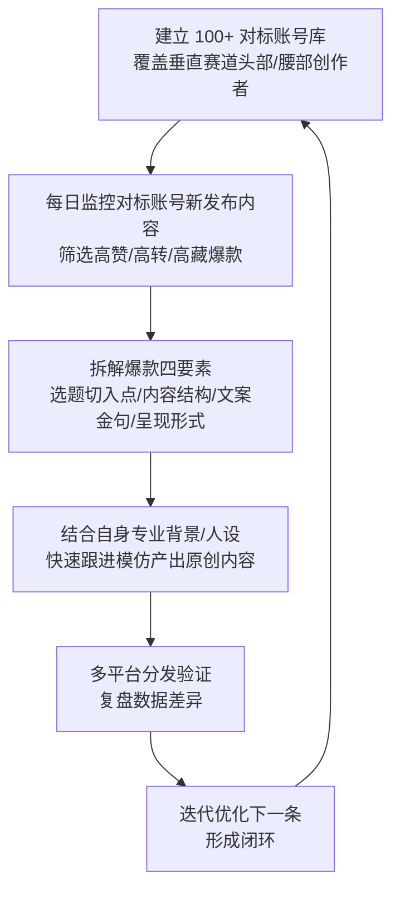
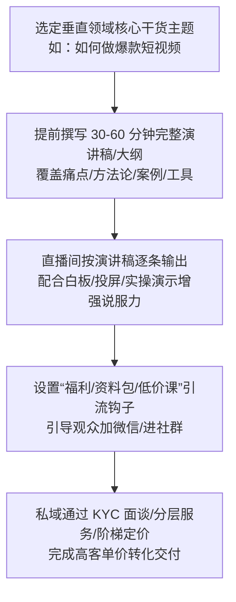
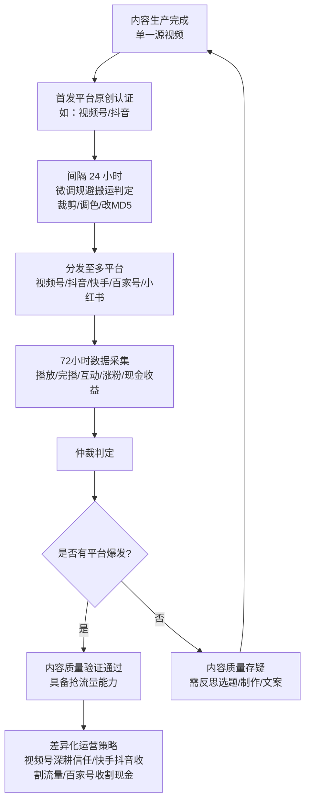
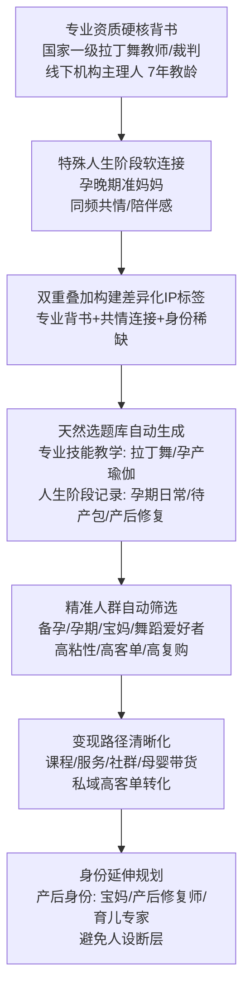
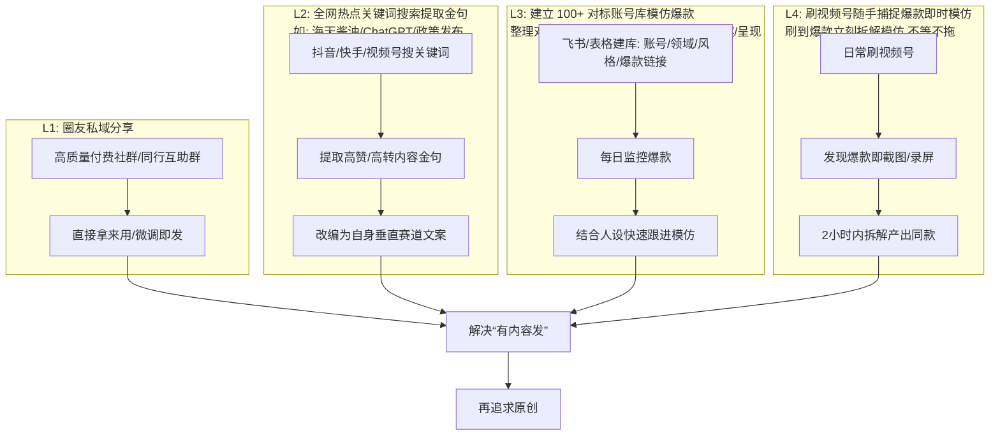
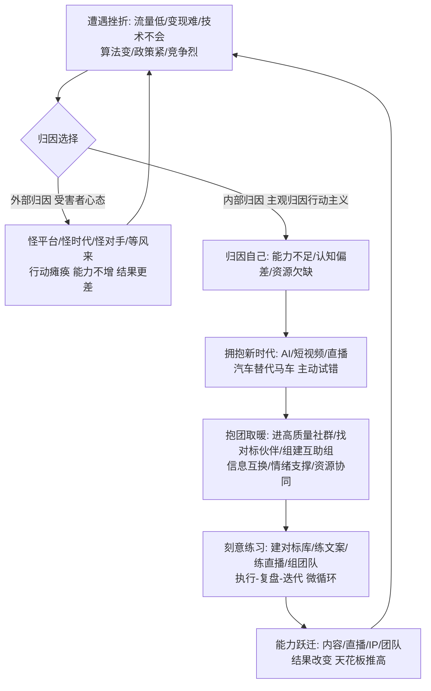

# 第 26 章 视频号商业变现全景图 —— 从“追热点”到“垂直IP+团队化”

## 学习目标

- 理解原创内容长期主义定律：搬运混剪仅为阶段性红利，唯有原创能力才是穿越周期的核心护城河
- 掌握直播即信任天花板定理：直播是建立深度信任、实现高客单价转化与交付的最高效场域
- 理解追热点与垂直IP的辩证关系：冷启动期追热点建基建，成长期转垂直建IP，完成战略转型
- 掌握多平台分发仲裁机制：同一内容多平台分发验证内容质量，剥离平台算法偏见还原内容本身抢流量能力
- 掌握专业人设IP化冷启动法：专业资质+特殊身份双重叠加，构建差异化IP标签实现天然流量加速
- 确立执行力大于内容天赋论：短视频成功核心变量是跟进爆款的执行力与复制爆款的系统化思路，而非天赋
- 内化主观归因行动主义：将“不会做”归因于个人能力而非环境，拥抱新时代、抱团取暖、主动迭代

## 26.1 生活类比

想象视频号创业是一场盖摩天大楼的工程。原创内容能力是地基与结构设计：搬运混剪只是活动板房，只能作为阶段性红利存在；唯有原创能力打地基、做结构，才能盖高、盖久、抗风浪，穿越周期。直播能力是顶层豪华观景台：只有盖到顶层，建立起深度信任，才能卖高价票、看最远风景，触达商业天花板；地基不牢，观景台根本盖不上去。追热点是脚手架与塔吊：盖楼初期（冷启动）必须搭脚手架，快速顶升、运材料，建立正反馈、镜头感、账号权重；但楼盖好了必须拆掉脚手架（转垂直），不能住在脚手架上。多平台分发是多地试桩验地基：同一设计图（内容）在不同地质（平台算法）试桩，有一地打穿（爆款）即证明地基扎实（内容质量过硬），别因一地土软（视频号冷启动慢）否定图纸。专业人设IP化是自带“甲级资质”的施工队进场：专业证书+特殊身份=自带资质背书+稀缺标签，省去招投标（建立信任）环节，直接开工（冷启动加速）。执行力大于天赋是“笨功夫”砌砖头胜过“天才”画图纸：日更288条=砌288层砖，3条爆款=砌出3层观景台，靠的是砌砖频次与标准动作，而非画图天赋。主观归因是包工头心法：楼盖歪了怪地基软（怪平台）？怪图纸烂（怪时代）？怪工人懒（怪对手）？只怪自己“盖楼功夫”不够，才会琢磨砖咋砌、浆咋和、队咋管，最终盖成地标。

## 26.2 概念地图

视频号商业变现全景认知框架
├── 核心定律层
│   ├── 原创内容长期主义定律  —— P001
│   ├── 直播即信任天花板定理  —— P001
│   ├── 追热点反噬论  —— P001
│   ├── 垂直IP+团队化=2023确定性趋势  —— P001
│   ├── 能力先行·势能爆发论  —— P001
│   └── 主观归因行动主义  —— P001
├── 策略战术层
│   ├── 热点杠杆效应  —— P006
│   ├── 多平台分发仲裁机制  —— P006
│   ├── 专业人设IP化  —— P005
│   ├── 执行力大于内容天赋论  —— P006
│   ├── 爆款帕累托法则(3/288法则)  —— P006
│   └── 热点粉丝‘先量后质’定理  —— P006
├── 方法论工具层
│   ├── 爆款拆解模仿法  —— P001
│   ├── 直播信任转化法  —— P001
│   ├── 文案素材四级获取法  —— P006
│   ├── 图文动态视频制作法  —— P006
│   └── 垂直IP+直播间知识付费变现模型  —— P001
└── 增长飞轮层
    ├── 正反馈驱动成长飞轮  —— P006
    ├── 非对称变现路径  —— P006
    └── 个人IP资产复利公式  —— P006

## 26.3 原创内容长期主义 —— 穿越周期的核心护城河

### 为什么需要这个概念？

短视频创业初期，搬运混剪虽能快速出爆款、获流量，但仅为阶段性红利，平台算法收紧后极易限流封号，无法沉淀长久商业价值。创作者面临“追热点虽快但迷失、做原创虽慢但扎实”的两难，需要一个确定性原则指导长期内容策略。

### 核心定义

**原创内容长期主义定律**（来源：《P001》）：搬运混剪仅为阶段性手段，唯有原创作者才拥有长久的商业价值；内容能力（模仿、拆解、跟进爆款的系统性方法论）是穿越周期的核心护城河，而非天赋依赖。

这个定律展示了三个核心性质：

**可习得性**：内容能力非天赋，而是“模仿、拆解、跟进爆款”的标准化方法论，普通人可通过刻意练习掌握。

**复利效应**：原创内容积累形成个人IP信任资产，随时间增值，变现是水到渠成的结果而非直接目标。

**抗周期性**：平台算法、热点趋势变幻莫测，但优质原创内容生产能力始终稀缺，是确定性核心竞争力。

### 方法演进图：爆款拆解模仿法

> **爆款拆解模仿法**（来源：《P001》）通过系统性拆解对标账号的爆款选题、结构、文案、呈现形式，并快速跟进迭代产出原创内容，将“内容创作”这一看似依赖天赋的环节，转化为可标准化、可复制、可迭代的工程化流程。作者书豪通过该方法，6个月产出 288 条视频，单账号做到 7.5 万粉，连续三年年入百万，矩阵总粉超 30 万【P001, p.4】。

### 原文摘录

> "原创作者才有未来，搬运混剪都是阶段性的方法或者手段。所以，既然原创作者才有长久的钱赚，那么内容能力永远不会过时。"
> 
> "内容拼的不是天赋，而是模仿拆解跟进爆款的能力。"
> 
> —— 来源：docs/202303/20230328_054.md

> "做视频号，需要有个从 0 到 1 的学习期，当你具备了做内容的能力和走通了做爆款短视频和爆款直播间的能力...抓住一个超级热点，就可以用你从 0 到 1 的能力快速完成从 1 到 10 甚至是从 1 到 100 的爆发过度。"
> 
> "总计有 288 个视频... 我也主要是靠三个爆款视频增长了 7w 粉丝，剩下的 200 多个视频总计积累了 5000 左右粉丝。"
> 
> "同样的视频我在视频号上只有几百几千播放... 如果其他平台爆了，说明你的视频抢流量的能力还是可以的。"
> 
> —— 来源：docs/202303/20230328_056.md

### 典型例子

作者书豪从零起号，通过“日更+模仿拆解对标账号爆款”6个月产出 288 条视频，将账号做到 7.5 万粉，连续三年年入百万，矩阵总粉超 30 万【P001, p.4】。

同一内容分发至快手（165 万播放）、抖音（70 万播放）、百家号（现金收益 2 万+），视频号初期仅几百播放，证明内容质量恒定时，平台算法为变量，原创能力可跨平台迁移验证【P006, p.2-3】。

### 边界条件

冷启动期“追热点”可作为建立正反馈、练习镜头感、积累账号权重的战术手段，但不可作为长期战略。新手自行写原创文案极易陷入“半个月写不出一篇爆款”的低效陷阱，建议先用圈友文案/热点金句/对标模仿解决“有内容发”，再追求原创。必须度过“0到1”的技能积累期（内容生产、爆款短视频复制、爆款直播间搭建三大核心能力），才能在超级热点来临时实现指数级爆发。

---

## 26.4 直播即信任天花板 —— 商业变现能力的上限

### 为什么需要这个概念？

短视频内容只能建立浅层认知，无法支撑高客单价、非标服务的深度信任与交付。创作者常因恐惧出镜、不会直播而回避直播，导致商业变现天花板极低，只能赚广告费、带低客单货。需要一个低门槛、高杠杆的直播切入路径，将“直播”从“可选项”变为“必选项”。

### 核心定义

**直播即信任天花板定理**（来源：《P001》）：在互联网商业中，直播是建立深度信任、实现高客单价转化与履约交付的最高效场域，是商业变现能力的上限。核心动作：提前准备演讲稿降低出镜门槛，直播讲干货建立专家信任感，引流私域成交知识付费产品。

这个定理展示了三个关键性质：

**信任建立效率极高**：实时互动、真人出镜、语音表达比图文/短视频更能建立“专业、真诚”的人设。

**转化路径最短**：直播间即“种草+拔草”合一场域，公域流量可直接在直播间完成高客单价成交或沉淀私域二次转化。

**可标准化复制**：通过“准备演讲稿+固定话术流程”，将直播从“临场发挥”降维为“标准化执行”，普通人可复制。

### 方法演进图：直播信任转化法

> **直播信任转化法**（来源：《P001》）以“准备演讲稿”降低出镜门槛，通过直播间实时讲授干货建立专家信任感，进而引导私域成交或知识付费产品转化，将直播从“临场发挥”降维为“标准化执行”，普通人可复制。作者书豪直播讲授“如何做爆款短视频”干货，直播结束直接通过微信私域收到红包肯定并转化报名知识付费产品【P001, p.3】。

### 原文摘录

> "直播才是商业的天花板"
> 
> "结合我自己的经验，想在互联网上又稳又快的建立信任，直播能力和积累直播内容这两件事必须要做好"
> 
> "直播这件事，核心是在做转化，做信任与交付。"
> 
> "提前准备好演讲稿就够了。"
> 
> "有一次直播讲如何做爆款短视频，直播结束后有个哥们在微信上给我发了一个红包，说我讲得好，后面还报了我的知识付费产品，这是我意外的惊喜。"
> 
> "直播结束后很多朋友发微信告诉我，说我讲得很好很真诚，其实直播之前我还不太自信..."
> 
> —— 来源：docs/202303/20230328_054.md

### 典型例子

观众事后私信反馈“讲得很好很真诚”，印证直播能有效建立“真诚、专业”人设，增强用户信任资产【P001, p.3】。

2023年趋势预判：必须在视频号上建立知识付费团队，依托直播间完成规模化变现【P001, p.4】。

### 边界条件

直播能力需建立在“内容能力”基础之上（有干货可讲、有方法论可输出），无内容积累的直播无法持续。“准备演讲稿”仅解决“开口说什么”的冷启动问题，长期仍需打磨“临场应变、互动控场、节奏把控”等进阶直播技能。直播非万能：对于极低客单价、极强标品属性的商品，短视频挂车/橱窗转化效率可能高于直播。

---

## 26.5 追热点与垂直IP的辩证关系 —— 热点是脚手架，垂直是大厦

### 为什么需要这个概念？

新手面临“追热点涨粉快但标签乱、做垂直涨粉慢但粉丝精”的策略冲突，容易陷入“只追热点不沉淀”或“死守垂直无流量”的极端。需要明确两者的阶段性分工与转化节点，避免策略错位导致账号废弃。

### 核心定义

**追热点反噬论**（来源：《P001》）：追热点虽易出爆款获流量（93%增粉来自 3 条爆款），但会导致账号标签模糊、后续内容无法延展、创作者迷失方向；官方亦不再鼓励。

**热点杠杆效应**（来源：《P006》）：冷启动期必须追热点，以最低成本建立正反馈、镜头感、账号权重，为后续垂直 IP 转型铺垫基础设施。

**垂直IP+团队化=2023确定性趋势**（来源：《P001》）：放弃泛流量，深耕垂直领域建立个人 IP，开发知识付费产品，组建专业团队在直播间完成规模化变现。

### 关键性质

**阶段互斥**：同一账号同一时期不可同时“追热点”又“做垂直”，必须完成“先追热点建基建 -> 后转垂直建IP”的战略转型。

**粉丝质量分层**：热点粉无粘性、无灵魂、标签泛；垂直粉精准、高信任、高转化、高复购。

**算法博弈**：热点流量靠“蹭”，垂直流量靠“赚”（内容质量+账号权重+用户画像匹配）。

### 方法演进图：冷启动到垂直IP的战略转型路径

### 原文摘录

> "不要再以追热点为增长变现路径了，官方都开始不鼓励追热点。而且做过口播号的同学应该会懂，追热点虽然有很大的概率会出爆款，但是下一步就不知道该做什么，容易迷失在突如其来的流量中，感到空虚。"
> 
> —— 来源：docs/202303/20230328_054.md

> "追热点是一定要追的，哪怕追热点来的粉丝没有粘性没有灵魂。但是没关系，此阶段我们需要做的是靠追热点最快找到正反馈，最快找到自己的出镜感觉，最快培养自己的镜头表现力..."
> 
> "未来必须在视频号做垂直领域的 IP...视频号 2023 年的趋势是做垂直知识付费类账号以及产品，在直播间变现。2023 年必须在视频号上建立知识付费团队。"
> 
> "我也主要是靠三个爆款视频增长了 7w 粉丝，剩下的 200 多个视频总计积累了 5000 左右粉丝。"
> 
> "没想到我做的一个普通男孩的十年，有那么多多年没联系的朋友默默的在看着你... 那么多人私信你夸赞你，给予你认可和鼓励。"
> 
> —— 来源：docs/202303/20230328_056.md

### 典型例子

书豪视频号“豪哥讲真话”：288 条视频中 3 条热点爆款贡献 7 万粉（93%），常规视频仅贡献 5000 粉（7%）；但后续明确提出“未来必须做垂直 IP、做知识付费团队”，完成战略转型【P006, p.2】。

“普通男孩的十年”图文视频（非热点、深度原创）引发大量老友私信夸赞，建立深度信任连接，强化了作者持续创作的内驱力，验证垂直内容的长尾价值【P006, p.4】。

### 边界条件

热点追踪有窗口期：仅在冷启动期（0-1 万粉）及账号权重下降期作为战术补充，不可常态化依赖。垂直赛道选择门槛：需结合“专业技能/资源禀赋/变现路径”三圈交集确定，盲目选垂直易陷入“自嗨无流量”。团队化前提：单人单号跑通“内容-直播-私域-变现”全链路并有稳定正向现金流后，再考虑组建团队放大，否则易因人力成本拖垮现金流。

---

## 26.6 多平台分发仲裁机制 —— 让算法帮你验证内容质量

### 为什么需要这个概念？

创作者常因单一平台数据不佳（如视频号初期几百播放）而自我否定、放弃优质内容，或因单平台爆款而盲目自信、忽视内容短板。需要一个客观、低成本、可量化的内容质量验证机制，剥离平台算法偏见，还原内容本身的“抢流量能力”。

### 核心定义

**多平台分发仲裁机制**（来源：《P006》）：同一内容分发至视频号、抖音、快手、百家号等平台，利用不同平台算法差异验证内容质量。若某平台爆发，说明内容具备抢流量能力，从而建立创作者信心；若全平台扑街，则需反思内容本身。

这个机制展示了三个关键性质：

**低成本**：一条内容多平台分发仅需几分钟，边际成本极低。

**客观性**：不同平台用户画像、推荐机制差异大，能过滤单一平台算法偶然性/偏好性带来的误判。

**反馈分层**：播放量/完播率/互动率/现金收益四维指标交叉验证，全面评估内容商业潜力。

### 方法演进图：多平台分发仲裁流程

### 原文摘录

> "同样的视频我在视频号上只有几百几千播放... 如果其他平台爆了，说明你的视频抢流量的能力还是可以的。"
> 
> "你既然做了一个视频，一定要在视频号、百家号、快手、抖音上都分发一下，测试一下各个平台的播放量..."
> 
> "我最早在 2022 年 10 月份有在快手爆发过一个 165 万播放量的视频，紧接着在抖音上也有了 70 万播放的数据... 同样的视频我在视频号上只有几百几千播放"
> 
> "百家号方面... 赚到了超过2 万元以上的现金"
> 
> —— 来源：docs/202303/20230328_056.md

### 典型例子

书豪同一视频：快手 165 万播放、抖音 70 万播放，视频号仅几百几千、百家号现金收益 2 万+。验证了“内容质量恒定，平台算法为变量”，并发现百家号适合变现、快手/抖音适合爆发、视频号适合信任沉淀的差异化分工【P006, p.2-3】。

作者据此建立“内容生产一次、多平台分发验证、视频号深耕沉淀、百家号收割现金”的跨平台运营策略。

### 边界条件

仅适用于“内容形态通用型”视频（如口播、混剪、图文动态），强平台属性内容（如抖音特效挑战、视频号直播切片）不可跨平台直接分发。需规避平台“搬运/重复”判定风险：建议首发平台原创认证，间隔 24 小时后再分发他平台，或进行微调（裁剪/调色/改 MD5）后发布。视频号初期流量小为常态（熟人社交+推荐算法冷启动慢），不可因视频号数据差即否定内容质量，需以快手/抖音/百家号数据为仲裁标准。

---

## 26.7 专业人设IP化 —— 孕期垂直赛道的天然冷启动加速器

### 为什么需要这个概念？

素人入局短视频面临“无人设、无信任、无差异、涨粉慢”四大困境，常规泛娱乐内容极易沉底。需要一种低成本、高信任、强差异化的账号定位模型，利用现有专业资质与特殊身份叠加，实现冷启动“作弊式”加速。

### 核心定义

**专业人设IP化**（来源：《P005》）：将垂直领域专业资质（国家一级拉丁舞教师/裁判、线下机构主理人）与特殊人生阶段（孕晚期准妈妈）强强叠加，构建“专业背书+共情连接+身份稀缺”的差异化 IP 标签，自带权威性、话题性、信任感，极大降低用户决策成本。

这个定义展示了三个关键性质：

**双重信任锚点**：专业资质提供“硬信任”（专业度背书），特殊身份提供“软信任”（共情/陪伴感），双重作用下转化率显著高于单一维度人设。

**天然选题库**：专业技能教学（拉丁舞/孕产瑜伽）+人生阶段记录（孕期日常/待产包/产后修复）形成取之不尽的内容源泉，且自带垂直属性。

**精准人群筛选**：内容天然筛选“备孕/孕期/宝妈/舞蹈爱好者”高粘性、高客单价、高复购人群，变现路径清晰（课程/服务/社群/母婴带货）。

### 方法演进图：专业人设IP化构建路径

### 原文摘录

> "国家一级拉丁舞教师及裁判，线下机构主理人，7 年专业拉丁舞教师，视频号/小红书内容创作者，同时也是一名孕晚期准妈妈。"
> 
> "视频号 10 天涨粉 1000+，成功引流私域的案例复盘"
> 
> "陈白菜 : 建立对标账号，思考变现方法并快速执行，学习"
> 
> "叁叁 | 拉丁舞者 : 对的，快速执行拿结果是关键"
> 
> "子诺 : 给你点赞，同月子，学习中，希望我们能在自己的圈子慢慢成长～"
> 
> —— 来源：docs/202303/20230328_055.md

### 典型例子

叁叁（作者）：国家一级拉丁舞教师+孕晚期准妈妈双重身份，视频号 10 天涨粉 1000+ 并成功引流私域，后续通过私域转化线下课程/孕产服务实现变现闭环【P005, p.1】。

评论区用户“子诺”留言：“给你点赞，同月子，学习中，希望我们能在自己的圈子慢慢成长”，印证同频人群的强共鸣与社群归属感【P005, p.2】。

### 边界条件

专业资质必须真实可验证（证书/机构/过往作品），造假一旦暴露信任崩塌不可逆。特殊身份具有时间窗口性（孕期仅几个月），需提前规划“产后身份延伸路径”（如：宝妈/产后修复师/育儿专家），避免人设断层。该模式适用于“强专业技能+强人生节点”叠加场景（医生/律师/教师/设计师+备考/考研/结婚/生子/创业）；纯兴趣爱好者无硬核专业背书时，信任建立周期显著拉长。

---

## 26.8 执行力大于内容天赋 —— 普通人的反直觉致胜法则

### 为什么需要这个概念？

大多数普通人因“我没有内容天赋/不善表达/长相普通”而不敢开始、不敢坚持，陷入“等准备好了再开始”的完美主义陷阱。需要打破“天赋论”迷思，建立“执行力>天赋”的底层认知，降低行动门槛。

### 核心定义

**执行力大于内容天赋论**（来源：《P006》）：短视频成功的核心变量非内容创作天赋，而是跟进爆款内容的执行力与复制爆款的系统化思路。普通人可通过高强度重复动作（日更、模仿、拆解）获得成功，内容能力是可习得的系统性方法论。

这个论断展示了三个关键性质：

**可量化的执行指标**：日更频次、对标账号数量（100+）、爆款模仿速度（热点出现即刻产出）、多平台分发覆盖面。

**正反馈驱动飞轮**：追热点快速获得数据正反馈（播放/涨粉） -> 强化信心/镜头感/网感 -> 形成“动作-反馈-进步-持续动作”正向循环。

**方法论可复制**：建立对标账号库、四级文案获取法、图文动态视频制作法等标准化 SOP，将“天赋”拆解为可执行的“动作清单”。

### 方法演进图：文案素材四级获取法

### 方法演进图：图文动态视频制作法

> **文案素材四级获取法**（来源：《P006》）构建分级文案库：L1圈友私域分享（新手直用）、L2全网热点关键词搜索提取金句、L3建立100+对标账号库模仿爆款、L4刷视频号随手捕捉爆款即时模仿。这套方法将“文案创作”这一看似需要天赋的环节，拆解为四个可执行、可迭代、门槛递进的标准动作，彻底解决了新手“写不出文案”的卡点【P006, p.2-3】。

> **图文动态视频制作法**（来源：《P006》）利用图片序列+BGM+文案字幕合成视频，无需真人出镜即可引发强情感共鸣，适合新手练习镜头感与叙事节奏。作者书豪用 1 天制作“普通男孩的十年”视频，引发大量老友私信夸赞与认可【P006, p.3-4】。

### 原文摘录

> "我发现，视频号虽然是内容为王，内容取胜，但是根本就不需要拼内容天赋，本质拼的是跟进爆款内容的执行力和复制爆款的思路！"
> 
> "追热点是一定要追的... 此阶段我们需要做的是靠追热点最快找到正反馈，最快找到自己的出镜感觉，最快培养自己的镜头表现力..."
> 
> "新手可以直接拿来用（新手应先找自己的表现形式，后面再考虑原创，原创文案对没有功底的人来说太费时间了）"
> 
> "你自己写文案，可能半个月都写不出一篇爆款文案。"
> 
> "我是日更的，总计有 288 个视频，有的时候有热点内容出现的时候每天是更新 3 到 5 个视频。"
> 
> —— 来源：docs/202303/20230328_056.md

### 典型例子

书豪：无短视频背景、不善表达、长相普通，但通过“日更 288 条、建立 100+ 对标账号、四级文案获取法、多平台分发验证”，6 个月做到 7.5 万粉、连续三年年入百万【P006, p.1-2】。

作者宣称：新手自行写原创文案极易陷入“半个月写不出一篇爆款”低效陷阱，建议新手先用圈友文案/热点金句/对标模仿解决“有内容发”，再追求原创【P006, p.2-3】。

### 边界条件

执行力非盲目蛮干：必须建立在“正确方法论”（模仿拆解爆款、跟进热点、多平台验证）之上，错误方向的高执行力只会加速失败。天赋在“极致原创/顶级审美/超强表达”层面仍有边际价值：头部 1% 创作者需天赋突破瓶颈，但对 99% 普通人“跑通闭环、稳定变现”，执行力是决定性变量。执行力需配合“复盘迭代”：单纯重复动作无效，需每条视频复盘数据（完播/互动/转化）、拆解对标差距、下条视频针对性优化，形成“执行-复盘-迭代”微循环。

---

## 26.9 主观归因行动主义 —— 拥抱新时代，抱团取暖

### 为什么需要这个概念？

面对算法变化、平台政策收紧、竞争加剧等外部不确定性，创作者易陷入“抱怨环境、怪罪平台、等风来”的受害者心态，丧失主观能动性。需要一种将“外部归因”转为“内部归因”的认知重构工具，重夺掌控感与行动力。

### 核心定义

**主观归因行动主义**（来源：《P001》）：将“不会做”归因于个人能力缺失而非外部环境/平台/时代问题。主张：汽车出现就抛弃马车、拥抱新时代（如 AI/短视频/直播），通过抱团交流共同推高行业天花板，而非等待红利消失。

这个心法展示了三个关键性质：

**完全责任内归**：流量少=内容不行；变现难=模式不对；坚持不下去=内驱力不足。一切结果归因于自我，才有改变的抓手。

**技术乐观主义**：视新工具/新平台/新趋势为“汽车替代马车”的历史性机遇，而非威胁，主动拥抱、快速试错、率先受益。

**协作进化**：单打独斗极限低，需“抱团取暖”（进高质量社群/找对标伙伴/组建互助小组），通过信息互换、情绪支撑、资源协同实现 1+1>2。

### 方法演进图：主观归因行动主义闭环

### 原文摘录

> "你不会做视频号是你的问题，你不会做内容是你的问题，你不会剪辑也是你的问题，不是短视频、直播、视频号的问题，不是时代的问题。"
> 
> "当时代出现汽车的时候，就抛弃马车吧，拥抱新时代，大家共勉，抱团取暖才是王道"
> 
> "先种树后乘凉... 别想着很快赚到几十万几百万，先赚到第一个 100 块钱，第一个 1 万块钱"
> 
> —— 来源：docs/202303/20230328_054.md

### 典型例子

书豪面对“官方不鼓励追热点、视频号初期流量小、直播恐惧出镜”等困境，全部归因于“自己能力不够”，从而驱动：建对标库、练文案、练直播、组团队、拥抱 AI、进社群，最终实现连续四年年入百万【P001, p.4-5】。

评论区互动：面对质疑“视频号流量小”，作者回应“你不会做是你的问题...不是时代的问题”，并呼吁“拥抱新时代，大家共勉，抱团取暖才是王道”【P001, p.5】。

### 边界条件

非盲目自责：归因于自我是为了“找到可改变的变量”，而非自我攻击。需区分“能力不足（可练）”、“认知偏差（可改）”、“资源欠缺（可积累）”与“不可控外部变量（需适配）”。需配合“客观环境扫描”：完全忽视平台规则红线/法律法规/宏观周期的“主观归因”是鲁莽而非担当，需在“敬畏规则、顺应趋势”前提下发挥主观能动性。“抱团”对象筛选：仅与“同频、正向、有结果、愿分享”的伙伴抱团；避开“负面情绪传播者/零和博弈者/只索取不贡献者”，否则抱团反耗能量。

---

## 26.10 多源对照

### 共识

P001 与 P006 均确认：**原创内容是长期护城河，搬运混剪仅为阶段性手段**；**直播是商业天花板，是信任建立与高客单转化的最高效场域**；**2023 年趋势确定为垂直 IP + 知识付费团队 + 直播间变现**；**执行力与方法论大于天赋，普通人可通过标准化 SOP 复制成功**。

### 分歧

- **P001 (docs/202303/20230328_054.md)** 强调“追热点反噬论”，主张官方不鼓励追热点，追热点易迷失方向，应尽快转垂直；
- **P006 (docs/202303/20230328_056.md)** 强调“热点杠杆效应”，主张冷启动期必须追热点，以最低成本建立正反馈、镜头感、账号权重，为后续转型铺垫基建。

> **教学提示**：这不是矛盾，而是**阶段分工**的差异。P001 站在“长期战略”视角（成熟期），P006 站在“冷启动战术”视角（0-1期）。教科书整合为：**冷启动期（0-1万粉）以追热点为战术建基建，成长期（1万粉+）以垂直原创为战略建大厦，完成“脚手架拆除、主体结构封顶”的战略转型。**

---

## 26.11 设计中的取舍

### 为什么不用“纯原创+不追热点”方案？

新手自行写原创文案极易陷入“半个月写不出一篇爆款”的低效陷阱，且无数据正反馈，信心极易崩塌导致放弃。追热点虽粉丝粗糙，但能以极低成本在 1-3 天内跑通“选题-制作-发布-爆款-涨粉-正反馈”完整闭环，建立“我也能行”的自我效能感。

这种设计的 trade-off 是什么？

代价是：前期账号标签不精准、粉丝粘性低、可能被官方限流。收益是：极快建立“内容生产肌肉记忆”+“镜头表现力”+“账号基础权重”+“爆款复制直觉”。这笔交易在“0到1阶段”极其划算，但在“1到100阶段”必须止损转型，否则陷入“流量毒品”无法自拔。【来源：docs/202303/20230328_056.md】

### 为什么选视频号而非抖音为主阵地？

**决策依据**：视频号依托微信生态（熟人社交+公域推荐+私域沉淀一体化），信任传递链路最短，高客单价知识付费转化率最高；抖音算法虽爆发强但信任浅、私域引流难、高客单转化链路长。

**Trade-off**：放弃抖音的巨大公域流量红利与算法爆发力，换取视频号“公私域联动、信任溢价高、知识付费转化链路短”的商业模式确定性。适合“垂直IP+知识付费”模型，不适合“泛娱乐+广告/带货低客单”模型。【来源：docs/202303/20230328_054.md】

### 为什么选知识付费而非带货？

**决策依据**：作者团队核心资源为“方法论/认知/技能”类隐性知识，边际成本趋近于零、复利系数高、可标准化交付；带货需供应链/选品/售后/物流重运营，非作者核心优势，且视频号带货基建（小店/物流/售后）2023 年尚不成熟。

**Trade-off**：放弃带货“见钱快、天花板高（GMV 可达亿级）”的优势，换取知识付费“现金流极其健康（预收款模式）、无库存压力、个人品牌资产复利强、团队复制门槛低”的确定性。适合“小团队、高利润、可复制”战略，不适合“重资产、高周转、赚快钱”战术。【来源：docs/202303/20230328_054.md】

### 为什么选日更而非周更？

**决策依据**：短视频算法对“活跃度/持续产出能力”有显性权重奖励；日更强制创作者建立“选题-制作-发布-复盘”日级高频闭环，将学习曲线压缩至周更的 1/7；日更产出的 288 条视频样本量，足以触发“爆款帕累托法则（3/288）”，周更一年仅 52 条，样本量不足以统计显著。

**Trade-off**：付出 7 倍时间成本与精力成本，换取 7 倍学习速度、算法权重加持、爆款概率样本量保障。适合“全职/半全职、追求快速跑通闭环”创作者；不适合“纯业余、仅作品牌曝光、无变现诉求”创作者。【来源：docs/202303/20230328_056.md】

### 为什么选演讲稿法而非即兴直播？

**决策依据**：即兴直播对“临场表达/逻辑结构/互动控场/抗压心理”要求极高，新手极易翻车（卡顿/跑题/冷场/情绪失控），导致信任崩塌；演讲稿法将“说什么/怎么说/何时互动/何时引流”全部预置，把直播降维为“背诵+执行”，把“不可控变量”压缩至最小。

**Trade-off**：牺牲直播的“鲜活感/互动性/真实感”，换取“零门槛启动/可标准化复制/可团队化批量化”的确定性。适合“冷启动期/新手/知识付费/高客单价”场景；长期仍需向“半即兴/带货话术/强互动”进阶，演讲稿仅为“脚手架”，不可长期依赖。【来源：docs/202303/20230328_054.md】

---

## 26.12 关键公式推导与解释

### 26.12.1 爆款帕累托法则（3/288法则）量化模型

**公式定义**（来源：docs/202303/20230328_056.md）：

设总产出视频数为 $N$，爆款视频数为 $k$，爆款贡献增粉占比为 $P_{fans}$，常规视频平均增粉为 $\mu_{norm}$，爆款视频平均增粉为 $\mu_{hit}$，则：

$$
P_{fans} = \frac{k \cdot \mu_{hit}}{k \cdot \mu_{hit} + (N-k) \cdot \mu_{norm}}
$$

**逐步推导**：

1. **定义总增粉**：$Total\_Fans = \sum_{i=1}^{N} fans_i = k \cdot \mu_{hit} + (N-k) \cdot \mu_{norm}$
2. **定义爆款贡献增粉**：$Hit\_Fans = k \cdot \mu_{hit}$
3. **计算占比**：$P_{fans} = \frac{Hit\_Fans}{Total\_Fans} = \frac{k \cdot \mu_{hit}}{k \cdot \mu_{hit} + (N-k) \cdot \mu_{norm}}$
4. **代入实测数据**：$N=288, k=3, Hit\_Fans \approx 70,000, Norm\_Fans \approx 5,000$
   - $\mu_{hit} = 70,000 / 3 \approx 23,333$
   - $\mu_{norm} = 5,000 / 285 \approx 17.5$
   - $P_{fans} = \frac{3 \times 23,333}{3 \times 23,333 + 285 \times 17.5} = \frac{70,000}{70,000 + 4,987.5} \approx 93.3\%$

**为什么可以这样变？**

该公式将“少数爆款贡献多数增量”的定性认知，显性化为可计算、可预测、可决策的量化模型。分子分母同除以 $N$ 可得：$P_{fans} = \frac{(k/N) \cdot \mu_{hit}}{(k/N) \cdot \mu_{hit} + (1-k/N) \cdot \mu_{norm}}$，即**爆款占比 $\times$ 爆款均值 / 总均值**。这揭示了提升 $P_{fans}$ 只有两条路径：提高爆款占比 $k/N$（更勤奋追热点/更精准模仿）或提高爆款均值 $\mu_{hit}$（更强内容质量/更大流量池），而提高常规均值 $\mu_{norm}$ 对 $P_{fans}$ 边际贡献极低。

**作用说明**：

该公式指导创作者：**冷启动期不应追求“平均质量”，而应追求“爆款接触概率”**——即通过高频产出（大 $N$）+ 热点捕捉/模仿爆款（大 $k/N$）最大化分子。这正是“执行力大于天赋”的数学证明：天赋只能微弱提升 $\mu_{norm}$，执行力能指数级放大 $k$ 与 $N$。

---

### 26.12.2 个人IP资产复利公式

**公式定义**（来源：docs/202303/20230328_056.md）：

个人IP商业价值 $V_t$ 在第 $t$ 期的复利增长模型为：

$$
V_t = V_0 \times (1 + r_{trust})^t \times (1 + r_{leverage})^{I_t} \times (1 + r_{network})^{C_t}
$$

其中：
- $V_0$：初始信任资产（专业资质/过往作品/种子粉丝）
- $r_{trust}$：信任资产日复利率（源于日更原创内容的持续沉淀）
- $r_{leverage}$：爆款杠杆放大率（单条爆款带来的影响力指数级跃升）
- $I_t$：第 $t$ 期累计爆款指标（如：累计爆款条数/累计百万播放条数）
- $r_{network}$：同频人脉网络协同系数（社群/同行/合伙人带来的资源置换价值）
- $C_t$：第 $t$ 期累计深度协作连接数

**逐步推导**：

1. **基础复利（信任沉淀）**：持续日更原创内容 $\to$ 每条视频在目标用户心中存入 1 单位“专业/真诚/陪伴”信任 $\to$ 信任资产按复利增长：$V_{trust} = V_0 (1+r_{trust})^t$。这是“原创内容长期主义”的数学表达。
2. **杠杆跃迁（爆款放大）**：单条爆款视频将创作者推入大流量池，触达非粉用户，产生指数级曝光。若第 $t$ 期累计产出 $I_t$ 个爆款指标，每个爆款使影响力乘以 $(1+r_{leverage})$，则 $V_{leverage} = (1+r_{leverage})^{I_t}$。这是“热点杠杆效应”与“爆款帕累托法则”的数学表达。
3. **网络外部性（人脉协同）**：同频人脉（高质量社群/同行/合伙人）提供信息差、资源位、情绪支撑，每增加 1 个深度协作连接，商业价值乘以 $(1+r_{network})$，则 $V_{network} = (1+r_{network})^{C_t}$。这是“非对称变现路径”与“抱团取暖”的数学表达。
4. **三重乘积**：三者相互独立且正交，总价值为三者乘积：$V_t = V_{trust} \times V_{leverage} \times V_{network}$。

**为什么可以这样变？**

将“变现是水到渠成的结果”显性化为三个可干预、可度量、可复利的增长引擎：$r_{trust}$ 靠**日更原创**提升，$r_{leverage}$ 靠**追热点/模仿爆款**提升，$r_{network}$ 靠**进圈子/混同行/建团队**提升。三者缺一不可：无 $r_{trust}$ 则爆款带来流量无法转化、无复购；无 $r_{leverage}$ 则信任资产只在小圈子内循环、无规模；无 $r_{network}$ 则孤军奋战、认知边界固化、抗风险能力弱。

**作用说明**：

该公式为“个人IP资产复利”提供了可操作的仪表盘：
- **周频度量 $r_{trust}$**：本周日更几条？原创占比？完播率趋势？
- **月度度量 $I_t$**：本月产出几条爆款？累计百万播放条数？
- **季度度量 $C_t$**：本季新增几个深度同行连接？带来多少资源置换/合作机会？
创作者可据此调整资源分配：早期重 $I_t$（追热点/高频产出），中期重 $r_{trust}$（垂直原创/直播信任），后期重 $C_t$（组团队/建生态/做联盟）。

---

### 26.12.3 正反馈驱动成长飞轮动力学方程

**系统动力学建模**（来源：docs/202303/20230328_056.md）：

设状态变量：
- $Q(t)$：内容产出量（累计视频条数）
- $S(t)$：技能水平（内容生产/爆款复制/直播搭建综合能力）
- $F(t)$：正反馈强度（播放量/涨粉/互动/收益综合指标）
- $M(t)$：动机强度（信心/内驱力/坚持意愿）

微分方程组：

$$
\begin{cases}
\frac{dQ}{dt} = \alpha \cdot M(t) \cdot S(t) & \text{产出速率 = 动机 × 技能 × 时间投入系数} \\
\frac{dS}{dt} = \beta \cdot Q(t) \cdot \gamma(F) & \text{技能增长 = 产出量 × 反馈质量修正函数} \\
\frac{dF}{dt} = \delta \cdot Q(t) \cdot S(t) \cdot \eta(Platform) & \text{反馈强度 = 产出量 × 技能 × 平台算法因子} \\
\frac{dM}{dt} = \theta \cdot F(t) - \lambda \cdot M(t) & \text{动机演化 = 正反馈强化 - 心理损耗衰减}
\end{cases}
$$

其中：
- $\gamma(F) = \frac{F}{F+K}$ 为反馈质量修正函数（饱和型：反馈越强、技能越精进，但边际递减）
- $\eta(Platform)$ 为平台算法因子（视频号<抖音<快手，解释多平台分发仲裁必要性）
- $\lambda$ 为心理损耗系数（无正反馈时动机自然衰减）

**稳态分析**：

当 $\frac{dM}{dt} > 0$ 时，即 $\theta F(t) > \lambda M(t)$，飞轮正向旋转，系统进入**指数增长区**；否则进入**衰减区**放弃创作。

**临界条件**：

$F_{crit} = \frac{\lambda}{\theta} M(t)$。新手初期 $M(0)$ 较高（新鲜感），但 $F(0) \approx 0$，极易跌破临界点放弃。因此**必须通过“追热点/多平台分发/图文动态”人为制造早期 $F(t)$ 跨越临界点**，启动飞轮。这正是“热点粉丝先量后质定理”与“正反馈驱动成长飞轮”的动力学本质。

**作用说明**：

该动力学模型揭示了新手创作者“前 100 条视频全扑街”极易放弃的数学根源：$F(t)$ 过低无法跨越临界点 $F_{crit}$，导致 $M(t)$ 指数衰减至零。指导创作者必须**人为制造早期正反馈**——不择手段追热点、多平台分发找爆发、图文动态降门槛——唯有让 $F(t)$ 尽快跨越 $F_{crit}$，飞轮才能自转。同时模型量化了“多平台分发仲裁机制”的必要性：$\eta(Platform)$ 在视频号极低，若不分发至 $\eta$ 较大的快手/抖音，$F(t)$ 几乎不可能在早期跨越临界点。创作者可据此监测飞轮状态：周度记录 $Q, S, F, M$ 四指标，若 $F$ 连续 2 周未跨越 $F_{crit}$，必须强制介入（换赛道/换形态/加大热点追踪/找教练），而非被动等待。

---

## 26.13 动手练习

### 练习 1：设计你的‘视频号冷启动SOP’

假设你是一个普通职场人（如：HR/会计/程序员/教师），想在视频号从 0 到 1 起号：

1. 定义你的‘专业人设IP化’组合：你的专业资质（硬信任）是什么？你能叠加什么特殊身份/人生阶段（软信任）？
2. 制定‘文案素材四级获取法’执行清单：圈友分享源在哪？热点关键词怎么监控？100+ 对标账号怎么建库？刷到爆款怎么即时模仿？
3. 设定‘追热点’的止损线与转型触发条件：粉丝多少/权重多少/收益多少时，必须停止追热点、全面转向垂直原创？
4. 设计‘多平台分发仲裁’流程：首发哪个平台？间隔多久分发？怎么微调规避搬运判定？以哪平台数据为仲裁标准？

回答问题：
- 你的‘0到1学习期’预计多长？三大核心能力（内容生产、爆款短视频复制、爆款直播间搭建）分别怎么练？
- 如果前 100 条视频全扑街（播放<500），你会归因于‘平台不行’还是‘自己能力不够’？接下来怎么动作？

### 练习 2：复盘一次‘热点追踪-内容生产-多平台分发’完整闭环

选取近期一个社会热点事件（如：某大厂裁员/某政策发布/某明星塌房/某考试改革）：

1. 热点捕捉：你在何时、通过什么渠道（热搜/朋友圈/垂直社群/风向标）发现该热点？
2. 选题切入：结合你的垂直赛道/专业人设，设计 3 个不同切入角度的选题（如：避坑指南/深度复盘/普通人应对/行业影响）
3. 文案生产：使用‘文案素材四级获取法’中至少 2 级，在 2 小时内产出 3 条视频文案/分镜脚本
4. 制作分发：用‘图文动态视频制作法’或真人口播在 4 小时内做完 3 条视频，按‘多平台分发仲裁机制’分发至视频号/抖音/快手/百家号
5. 数据仲裁：24 小时/72 小时后记录四平台数据（播放/完播/互动/涨粉/现金收益），填写对比表

回答问题：
- 哪个平台跑赢？说明你的内容在该平台算法权重下‘抢流量能力’如何？
- 视频号数据若最差，你会‘放弃视频号’还是‘坚持视频号深耕、他平台收割现金’？为什么？
- 这次热点追踪是否带来‘正反馈驱动成长’（信心/镜头感/网感提升）？如何量化？

### 练习 3：推演你的‘垂直IP+直播间知识付费’变现模型

基于你的专业领域/资源禀赋，推演完整商业闭环：

1. 垂直赛道定位：你的‘专业技能/资源禀赋/变现路径’三圈交集在哪里？（如：HR赛道-擅长面试辅导-卖面试课/社群/简历服务）
2. 知识付费产品矩阵设计：引流品（9.9-99元）、信任品（299-999元）、利润品（1999-9999元）各设计 1 个，明确交付形态（录播/直播/社群/1v1/文档）
3. 直播间转化路径设计：直播频次/时长/话术流程/互动留人/引流钩子/成交话术/私域承接 SOP
4. 团队化前提与节奏：单人单号跑通全链路的‘最小正向现金流’标准是什么？达到后第一个招聘岗位是？如何把创始人隐性知识显性化为 SOP？

回答问题：
- 你的‘能力先行·势能爆发’临界点在哪里？即：具备什么能力后，遇到行业超级热点（如 AI 爆发/政策红利）能‘1 到 100’爆发？
- 如果直播前 3 个月场观<50、成交 0，你会‘怪平台流量少’还是‘练演讲稿/练话术/练互动/换选品/换赛道’？如何建立‘主观归因’闭环？

---

## 26.14 本章小结

这一章中我们学习/了解/讨论了视频号商业变现的全景认知框架。首先，我们确立了原创内容长期主义定律，明确搬运混剪仅为阶段性红利，唯有原创能力（模仿/拆解/跟进爆款）是穿越周期的核心护城河。其次，我们掌握了直播即信任天花板定理，直播是建立深度信任、实现高客单价转化与交付的最高效场域，是商业变现能力的上限。接着，我们理解了追热点与垂直IP的辩证关系：冷启动期追热点建基建（热点杠杆效应），成长期转垂直建IP（垂直IP+团队化=2023确定性趋势），完成战略转型。然后，我们掌握了多平台分发仲裁机制，同一内容多平台分发验证内容质量，剥离平台算法偏见还原内容本身抢流量能力。接着，我们掌握了专业人设IP化冷启动法，专业资质+特殊身份双重叠加，构建差异化IP标签实现天然流量加速。然后，我们确立了执行力大于内容天赋论，短视频成功核心变量是跟进爆款的执行力与复制爆款的系统化思路，而非天赋。最后，我们内化了主观归因行动主义，将“不会做”归因于个人能力而非环境，拥抱新时代、抱团取暖、主动迭代。

下表汇总了本章核心概念及其核心解释，供快速检索与复盘使用：

| 概念 | 核心解释 |
|------|----------|
| 原创内容长期主义定律 | 搬运混剪仅为阶段性红利，唯有原创能力（模仿/拆解/跟进爆款）是穿越周期的核心护城河 |
| 直播即信任天花板定理 | 直播是建立深度信任、实现高客单价转化与交付的最高效场域，是商业变现能力的上限 |
| 追热点反噬论 | 追热点虽易出爆款但会导致账号标签模糊、创作者迷失方向，不可作为长期变现路径 |
| 垂直IP+团队化 | 2023确定性趋势：放弃泛流量，深耕垂直领域建立个人IP，开发知识付费产品，组建团队在直播间规模化变现 |
| 0到1学习期 | 必经技能积累期（内容、短视频、直播三项能力），唯有度过‘先苦后甜’积累期，才能在超级热点来临时实现指数级爆发 |
| 多平台分发仲裁机制 | 同一内容多平台分发，利用算法差异验证内容质量：快手/抖音验爆发力、百家号验变现力、视频号验信任沉淀力 |
| 热点杠杆效应 | 冷启动期必须追热点，以最低成本建立正反馈、镜头感、账号权重，为后续垂直IP转型铺垫基础设施 |
| 专业人设IP化 | 专业资质（硬信任）+特殊身份（软信任）双重叠加，构建差异化IP标签，自带权威性、话题性、信任感，极大降低用户决策成本 |
| 执行力大于内容天赋论 | 短视频成功核心变量非天赋，而是跟进爆款的执行力与复制爆款的系统化思路，普通人可通过高强度重复动作获得成功 |
| 主观归因行动主义 | 将‘不会做’归因于个人能力而非环境/平台/时代，拥抱新时代（汽车替代马车），抱团取暖共同推高天花板 |

下一章中，我们将学习《怀旧赛道实战SOP —— 标准化去重、流量梯队、矩阵冷启动》，深度拆解黄岛主“80/90后童年怀旧”短视频副业项目，从账号注册环境隔离、跨平台素材搬运去重、剪映六步制作法、流量梯队爬坡模型到小号矩阵互刷，构建可复制的冷启动标准作业程序。

