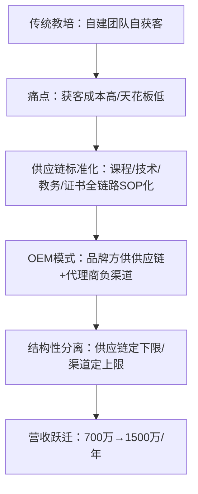
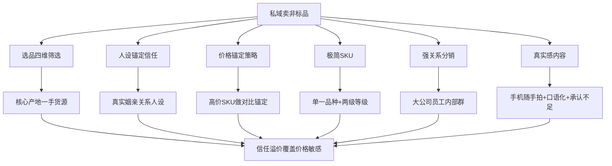
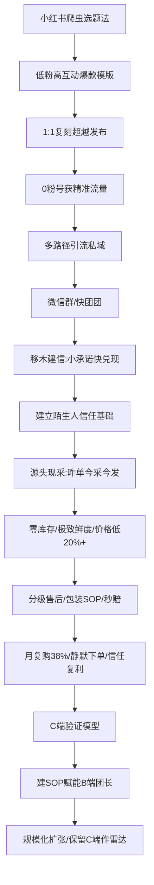
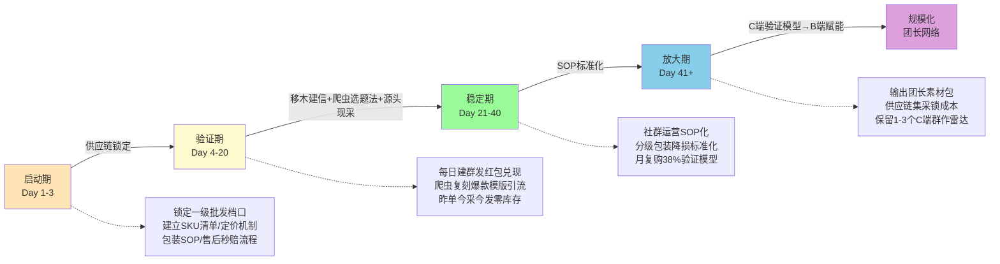
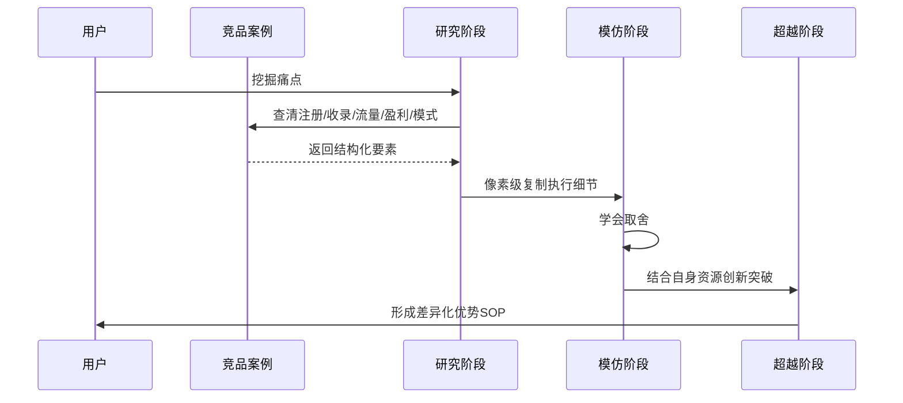
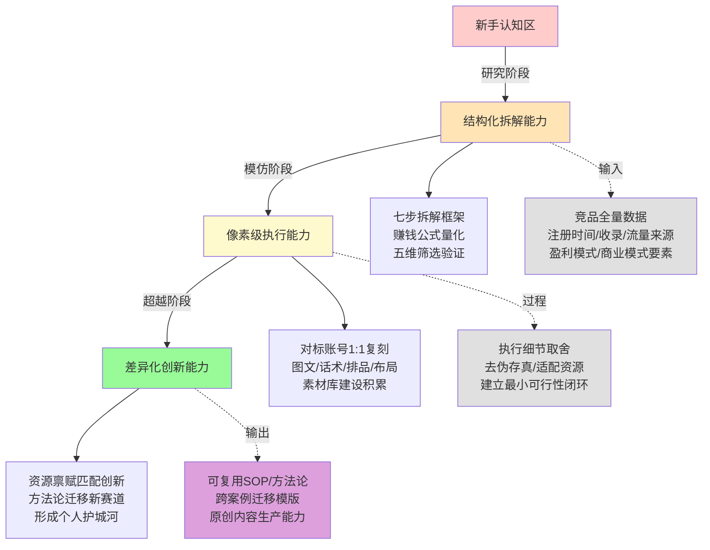

# 第 53 章 供应链与私域变现进阶模型

## 学习目标

- 理解OEM合作模式如何将供应链标准化与渠道裂变分离实现业绩指数级增长
- 掌握京东令牌价供应链的套利模型、官方履约信任锚点与团队裂变扩张路径
- 了解私域高客单非标品模型中信任溢价覆盖价格敏感的选品、人设、锚定、分销组合策略
- 熟悉同城水果团购模式的‘源头现采+移木建信+爬虫选题法’三位一体轻资产闭环
- 掌握研究-模仿-超越（RMS）标准化学习路径与赚钱逻辑公式化拆解方法
- 能根据项目特征选择适用的供应链协作、私域信任转化、公域流量突围、标准化复制放大策略

## 53.1 生活类比

想象商业模式设计是一场**‘租用厨房做外卖’的创业游戏**：**OEM模式** = 你不开饭店，只把**标准化中央厨房（供应链）**租给无数个**外卖店主（代理）**，他们跑腿找客户（渠道裂变），你只管出菜（交付）分账；**令牌价供应链** = 你拿到了**食材批发市场内部价（令牌价）**，比超市零售价（前台价）低一半，靠官方物流送到家（京东履约）消除‘预制菜’信任疑虑，再招合伙人开分店（团队裂变）；**私域高客单非标品** = 你卖**没有标价的‘古董茶’（非标品）**，靠**‘好女婿帮丈母娘卖茶’的真实人设（信任背书）**、**摆个天价‘博物馆藏品’做对比（锚定高价SKU）**、**只卖一种最好的（极简SKU）**、**请大厂员工内部群带货（强关系分销）**，让买家觉得‘贵但值得信’；**同城水果团购** = **今晚下单，明早批发市场现摘现发（源头现采）**，进群先发个‘满100人发红包’小承诺兑现（移木建信），**照抄隔壁爆款海报改图文（爬虫1:1复刻）**，自己先当团长（C端验证）再招团长（B端放大）；**RMS模型** = **先拆解对手菜单怎么火的（研究）**，**照着做一模一样的（模仿）**，**再用自家秘制酱料改良（超越）**，收入=单价×转化率×流量，内容从‘抄’到‘杂交’到‘原创’最后变‘捡钱’。就像外卖平台上，中央厨房标准化出菜、内部食材价差套利、非标古董靠信任溢价、生鲜靠现摘现发信任积累、菜单优化靠拆解模仿超越——供应链决定下限，渠道与信任决定上限，标准化复制放大是核心杠杆。

## 53.2 概念地图

第53章 供应链与私域变现进阶模型
├── OEM合作模式 —— 供应链标准化即渠道放大器
│   ├── 核心逻辑：标准化供应链（课程/技术/教务/证书）+ 代理裂变分成
│   ├── 关键性质：低边际成本复制、高杠杆放大、护城河前移
│   ├── 典型案例：医药职教健康管理师项目、网课营收700万→1500万
│   └── 边界条件：需前置标准化能力、政策/品牌管控风险、强依赖证书刚需赛道
├── 京东令牌价供应链 —— 内部进货价撬动零售价差
│   ├── 核心定义：线下加盟商内部进货价（令牌价）<< 前台零售价
│   ├── 关键性质：供应链定下限/官方履约建信任/团队裂变定上限
│   ├── 典型案例：TCL 85Q10G 16999vs8999 单笔毛利1000元、团队110人年营收300万
│   └── 边界条件：政策风险极高、令牌价不稳定、重资产售后复杂
├── 私域高客单非标品模型 —— 信任溢价>价格敏感
│   ├── 选品四维筛选：一手货源/无统一定价/信任转化/高复购社交属性
│   ├── 人设锚定：真实姻亲关系（好女婿/丈母娘）+ 源头溯源背书
│   ├── 价格锚定：极高价SKU（狮峰4500）对比主推款降低心理门槛
│   ├── 差异化工艺：榨香工序（更拢更细更干）兼顾重量诚实度
│   ├── 分销策略：强关系内部群（大公司员工）ROI远超弱关系大V
│   ├── 内容生产：手机随手拍+口语化+承认不足=茶农本分感
│   └── 行业铁律：水分/陈茶/品种/产地四大造假，唯信人可破局
├── 同城水果团购模式 —— 三位一体轻资产闭环
│   ├── 公域种草：小红书爬虫选题法（低粉高互动1:1复刻）+ 多路径引流
│   ├── 私域转化：移木建信（小承诺快兑现）+ 源头现采（零库存极致鲜度）
│   ├── 供应链壁垒：一级批发市场定价话语权、规避行业坑、量大锁成本
│   ├── 运营SOP：选品三原则/分级包装售后/社群标准化/宁缺毋滥强信任
│   └── 演进路径：C端验证模型 → B端赋能团长规模化（保留C端作雷达）
└── 研究-模仿-超越（RMS）标准化学习路径
    ├── 研究：挖掘痛点→查清对手注册/收录/流量/盈利/模式要素
    ├── 模仿：像素级复制执行细节（图文/布局/话术/排品）学会取舍
    ├── 超越：结合自身资源创新突破形成差异化优势
    ├── 结构化框架：七步模板（拆解理由/赚钱逻辑/付费动机/产品推广/营销方法/执行原则/RMS落地）
    ├── 赚钱逻辑公式化：目标收入=利润×单价×转化率5%×曝光人数
    ├── 跨案例迁移：提炼流量/私域/内容/直播通用规律形成方法论
    └── 内容三阶：抄→杂交→原创 配合素材库实现捡钱式变现

## 53.3 OEM合作模式 —— 将“供应链标准化”拆解为“渠道裂变”的放大器

### 为什么需要这个概念？

教育培训机构单打独斗获客成本高、天花板低，难以规模化。核心竞争力应聚焦于课程内容、技术平台、教务交付等“供应链”标准化建设。需要一种机制释放外部渠道（代理商）的获客能力，实现营收指数级跃迁。

### 核心定义

品牌方提供标准化课程体系、技术平台（小程序/APP）、运营SOP、证书下发等全套供应链。合作方（代理商）负责招生获客，品牌方负责教务交付与证书，双方按比例分成。实现“供应链标准化”与“渠道裂变”的结构性分离。

### 关键性质

- 低边际成本复制：一次建设标准化供应链，可无限复制授权给多个代理商
- 高杠杆放大：作者公司营收从700万跃升至1500万/年，仅因新增OEM模式
- 护城河前移：核心壁垒从“招生能力”转移为“课程/技术/教务/证书”的标准化交付体系

### 典型例子

- 医药职业教育培训：健康管理师证书项目全生命周期运营（立项→分发代理→收料上报→报名→拿证）
- 网课项目OEM：18年营收700万→19年1200万→20年1500万，业绩增量100%归因于OEM模式

### 边界条件

- 前置条件：必须已具备成熟的标准化课程产品、技术交付平台、教务运营SOP
- 风险点：过度依赖头部代理商、证书政策变动导致供应链失效、品牌管控失控
- 非通用性：强依赖“证书刚需+政策红利+标准化交付”的行业特征（如职教、考证）

> "我们的网课搭建从 18 年做了 OEM 模式合作，18 年营业额 700 万，19 年营业额 1200 万，20 年营业额 1500 万。而这个业绩的来源仅仅是新增了 OEM 的合作方案。"
> 
> ——《P021: 杨洋复盘：医药职业教育培训与OEM模式》

> "教育培训行业网课项目，从课程录制，到技术搭建，小程序，APP 制作，课程分销模式的搭建，代理合作招商模式，OEM 招商逻辑，出品自己的网课品牌整个流程及具体实操办法"
> 
> ——《P021: 杨洋复盘：医药职业教育培训与OEM模式》

这个模式展示了教育培训行业如何通过将核心交付能力标准化为“供应链产品”，再通过OEM合作释放外部渠道获客能力，实现营收指数级跃迁的核心逻辑。

### 方法演进图



### OEM合作分成结算伪代码

```python
# OEM合作模式核心结算逻辑
class OEMCommissionSettlement:
    def __init__(self, course_price, agent_level):
        self.course_price = course_price          # 课程标价
        self.agent_level = agent_level            # 代理等级：初级/高级/合伙人
        self.base_rate = self._get_base_rate()    # 基础分成比例
        self.bonus_rate = self._get_bonus_rate()  # 业绩达标奖励比例
    
    def _get_base_rate(self):
        # 分级分成基础比例
        rates = {
            '初级代理': 0.30,   # 30% 分成
            '高级代理': 0.40,   # 40% 分成
            '合伙人': 0.50      # 50% 分成
        }
        return rates.get(self.agent_level, 0.30)
    
    def _get_bonus_rate(self):
        # 阶梯奖励：月销额达标给额外奖励
        return 0.05  # 简化为固定5%奖励
    
    def calculate_settlement(self, monthly_sales_volume):
        """
        结算逻辑：
        1. 基础佣金 = 课程标价 × 基础分成比例 × 销量
        2. 达标奖励 = 课程标价 × 奖励比例 × 销量 (月销额≥阈值时)
        3. 品牌方实收 = 课程标价 × 销量 - 总佣金
        """
        base_commission = self.course_price * self.base_rate * monthly_sales_volume
        
        # 假设月销额≥50万触发奖励
        bonus_threshold = 500000
        current_gmv = self.course_price * monthly_sales_volume
        bonus_commission = (self.course_price * self.bonus_rate * monthly_sales_volume 
                           if current_gmv >= bonus_threshold else 0)
        
        total_commission = base_commission + bonus_commission
        brand_revenue = self.course_price * monthly_sales_volume - total_commission
        
        return {
            'base_commission': round(base_commission, 2),
            'bonus_commission': round(bonus_commission, 2),
            'total_commission': round(total_commission, 2),
            'brand_revenue': round(brand_revenue, 2),
            'agent_effective_rate': round(total_commission / (self.course_price * monthly_sales_volume), 4)
        }

# 使用示例
settlement = OEMCommissionSettlement(course_price=2980, agent_level='高级代理')
result = settlement.calculate_settlement(monthly_sales_volume=200)
print(result)
# 输出: {'base_commission': 238400.0, 'bonus_commission': 29800.0, 'total_commission': 268200.0, 'brand_revenue': 327800.0, 'agent_effective_rate': 0.45}
```

**解释**：这段伪代码演示了OEM模式下品牌方与代理商的分成结算核心逻辑。通过分级分成（初级30%/高级40%/合伙人50%）配合阶梯奖励机制，既保证了品牌方保留供应链交付所需的现金流与利润空间（品牌方实收约45%-55%），又给代理商足够的激励去投入获客成本。关键在于“供应链标准化”使得边际交付成本趋近于零，品牌方才敢于把50%甚至更高利润让渡给渠道端，从而释放外部获客能力实现规模跃迁。

## 53.4 京东令牌价供应链 —— 用“内部进货价”撬动“零售价差”的套利模型

### 为什么需要这个概念？

家电代下项目利润空间完全依赖于“令牌价（进货价）< 前台零售价”的价格剪刀差。普通消费者无法直接享受线下加盟商的内部进货价，存在信息不对称套利空间。需要稳定、全品类、可查询的令牌价渠道作为业务核心护城河。

### 核心定义

京东线下加盟商（实体店店主）专享的内部进货价格体系，通常远低于京东自营前台官方售价。如TCL 85Q10G电视：前台价16999元，令牌价8999元，代下报价9999元，单笔毛利1000元。价格受品牌区域保护政策影响，不同地区令牌价不同，需按收货地址匹配查价报价。

> "加盟了京东线下实体店的店主往往会有一个内部账户享受京东家电的进货价，也就是行内人士所说的令牌价。"
> 
> "京东自营前台官方价格是 16999，而我们下单所需要金额只需要 8999，相当于前台价格的 1/2。"
> 
> ——《P074: 阿辉京东家电代下实战复盘》

### 关键性质

**供应链决定下限**：稳定低价全品类的令牌价渠道是业务生存根本（解决“有货卖、有利润”）。

**官方履约建信任**：京东自营物流+品牌方安装+400官方售后+正规发票，消除“非正规渠道”信任顾虑。

**团队裂变决定上限**：从个人单干到110人团队、年营收300万，靠代理模式放大而非单干。

> "供应链源头决定下限，团队裂变决定上限"
> 
> "官方履约体系是信任转化的关键锚点"
> 
> ——《P074: 阿辉京东家电代下实战复盘》

### 典型例子

TCL 85Q10G电视单品套利：前台价16999 vs 令牌价8999，代下售价9999，毛利1000元/单。作者路径：599元拜师学渠道→闲鱼零成本引流→组建代理团队→年营收300万。

### 边界条件

- 政策风险极高：本质抢夺京东线下加盟店与线上自营生意，京东大概率收紧政策堵漏
- 令牌价不稳定：政策常变动、区域保护导致价格差异、需实时查价系统维护
- 重资产倾向：高客单价家电涉及售后、安装、物流复杂度，非纯轻资产模式

> "其实这一块是抢了京东线下线上的生意，京东会不会改变政策，倾向保护他的线下加盟店"
> 
> ——《P074 评论区：何道平》

### 多源对照

**共识**：京东令牌价模式利用信息不对称获取价格优势，依托官方履约体系解决信任转化。

**分歧**：

- 《P074 作者视角》认为通过代理裂变可规模化扩张，计划团队扩至500人打造家电家具商城
- 《P074 评论区视角》指出模式本质抢夺京东加盟店生意，政策收紧概率极高，可持续性存疑

### 设计中的取舍

**为什么不直接做京东加盟商而是做“代下”？**

加盟商需要实体店选址、装修、备货、人员等重资产投入，且受区域保护严格限制。代下模式零库存、无实体店压力、利用闲鱼等公域平台低成本获客、通过代理裂变快速放大，边际成本极低。代价是完全依赖令牌价渠道稳定性，面临平台政策收紧的系统性风险。

**这种设计的 trade-off 是什么？**

用“轻资产、高杠杆、快速放大”换取“高度依赖单一供应链渠道、政策风险不可控、售后体系复杂”。一旦令牌价渠道失效或政策收紧，整个商业模式瞬间崩塌。

### 令牌价套利空间公式推导

**单笔毛利计算公式**：

```
单笔毛利 = 对外报价 - 实际进货成本
```

其中：
- **对外报价** = 令牌价 + 代下服务费（通常 500-1500元）
- **实际进货成本** = 令牌价（若直接用令牌价下单）或 仓库现货价/工厂直发价（无令牌价SKU时）

**推导过程**：
以 TCL 85Q10G 为例：
1. 京东自营前台价 = 16,999 元（市场锚定价，建立客户价值感知）
2. 令牌价 = 8,999 元（核心供应链成本，约为前台价 53%）
3. 代下对外报价 = 9,999 元（留给客户 7,000 元优惠空间，自身留 1,000 元毛利）
4. 单笔毛利 = 9,999 - 8,999 = 1,000 元

**为什么可以这样变？**
核心在于“令牌价”是京东为了保护线下加盟商利益而设定的**内部进货价**，本质是品牌方让利给渠道端的“隐性补贴”。代下模式通过获取加盟商内部账号授权，将本应流向线下实体店的渠道利润，转化为线上代下者的套利空间。前台价与令牌价的巨大剪刀差（约 47%），源于品牌方“线上统一高价维护品牌调性 + 线下低价保护加盟商生存”的双轨定价策略，而非正常市场供需定价。

**套利空间边界公式**：

```
最大可持续毛利率 = (前台价 - 令牌价 - 运营成本 - 风险准备金) / 对外报价
```

- 运营成本：查价系统维护、客服、售后协同、代理管理
- 风险准备金：预留应对政策收紧、令牌价上涨、售后纠纷的缓冲

若令牌价上涨至 9,500 元（前台价不变），毛利压缩至 499 元，毛利率降至 5%，模式即临界失效。这解释了为何“供应链源头决定下限”——令牌价稳定性是生死线。

## 53.5 私域高客单非标品模型 —— 以“信任溢价”覆盖“价格敏感度”

### 为什么需要这个概念？

农产品/茶叶等非标品无统一定价、无绝对头部品牌，用户决策依赖信任而非比价。微商/电商渠道信任成本高，私域熟人/强关系链天然具备信任转化优势。需要一套“选品-人设-锚定-分销”组合拳打通私域高客单成交闭环。

### 核心定义

**选品四维筛选**：①掌握核心产地一手货源 ②无统一定价/无头部品牌 ③非标品依赖信任转化 ④高复购/强社交属性。

**人设锚定信任**：打造“好女婿/丈母娘茶园”等真实姻亲关系人设，自带源头/无农药/直发背书。

**价格锚定策略**：上架极高价SKU（狮峰龙井4500元/斤）做对比，降低主推款（1200/800元）心理门槛。

**极简SKU对抗选择悖论**：只卖单一优良品种（龙井43）+两级等级（头采/二采），拒绝雨前茶/白茶干扰。

> "茶叶目前没有标准的定价，也没有大的品牌...有可操作的空间"
> 
> "我的店铺里上架了狮峰龙井（4500 一斤），不是为了卖，是为了做对比，感受的我的茶叶的性价比"
> 
> "图片尽量用自己拍的图，不要做效果，手机拍的就行，给人感觉实在，诚实，做出茶农的本分感"
> 
> ——《P136: 私域副业卖春茶实战复盘》

### 关键性质

**信任溢价>价格敏感**：真实人设+源头溯源+工艺透明构建信任，覆盖用户对“贵/假/陈”的恐惧。

**工艺差异化护城河**：榨香工艺（多1-2道工序提香降水分）实现“更拢更细更干”，兼顾重量诚实度。

**强关系分销>弱关系带货**：大公司员工内部群（高信任/精准人群）ROI远超大博主公域推广。

**真实感内容生产**：手机随手拍实景+口语化文案+承认不足（如不卖手工茶），构建“茶农本分感”。

### 典型例子

春茶预售20天卖20万+，月入40万；头采成本700-800元/斤，零售1200元，毛利33%-50%。新昌越州龙井：年产量占全国30%-40%，茶机研发领先1-2代，机炒品质稳定性>西湖手工表演。

### 边界条件

- 供应链不可控：必须掌握核心产地一手货源，否则无法兑现“源头直发/品质保真”承诺
- 人设不可复制：好女婿/丈母娘人设依赖真实姻亲关系，非通用模板可复制
- 平台生态锁定：微信小商店/个人号/群为主阵地，快团团等三方工具信任感较弱
- 行业造假红线：水分增重/陈茶冒新/品种掺假/产地造假四大坑，买家无鉴别能力只能信人

> "一般的茶农会炒茶的时候，会特意把茶叶炒的不那么干...三斤半青叶炒一斤干茶跟四斤炒一斤，这就差别很大了"
> 
> "你看到茶叶不是今年的，是陈茶...掺着新茶卖"
> 
> "比方很多 2 月份就在卖新茶的，那都是四川贵州的龙井...等这边龙井上市的时候来当好的茶叶卖"
> 
> "茶叶有很多树种...这种怎么样掺合一下或者当别的品种卖，一般人也分别不出来，但价格就相差很大"
> 
> ——《P136: 私域副业卖春茶实战复盘》

### 方法演进图



### 信任溢价覆盖价格敏感度的量化模型

**核心公式**：

```
成交概率 = f(信任溢价 - 价格敏感度阈值)
```

其中：
- **信任溢价** = 人设可信度权重 × 人设得分 + 源头溯源权重 × 溯源得分 + 工艺透明度权重 × 工艺得分 + 社交背书权重 × 分销人设得分
- **价格敏感度阈值** = 基准价格敏感度 × (1 - 锚定高价SKU降幅系数) × (1 - 极简SKU决策简化系数)

**锚定高价SKU心理阈值计算公式**：

```
主推款心理接受价格上限 = 锚定高价SKU价格 × 锚定系数 + 竞品参考价 × (1 - 锚定系数)
```

- 锚定系数 α ∈ [0.3, 0.5]，取决于锚定SKU的可信度与展示显著性
- 例：狮峰龙井 4500 元/斤做锚定，α = 0.4，竞品参考价 800 元/斤
  - 主推款心理接受上限 = 4500 × 0.4 + 800 × 0.6 = 1800 + 480 = 2280 元/斤
  - 实际定价 1200 元/斤，远低于心理上限，形成显著“性价比冲击”

**推导解释**：
用户对非标品（茶叶）缺乏内在估值锚点，决策时高度依赖外部参照系。引入极高价 SKU（狮峰 4500 元）作为“超级锚点”，利用锚定效应将用户心理参考价向上拉升；再配合极简 SKU（仅头采/二采两档）消除选择熵，降低决策成本。此时主推款 1200 元虽高于市场均价，但相对于 4500 元锚点显得“极其划算”，且信任背书（真实人设+源头溯源+榨香工艺）覆盖了“贵=智商税”的恐惧。实测中，头采 1200 元/斤、二采 800 元/斤的双价格带设计，使 80% 以上用户选择头采，实现了价格向上分层与利润最大化的双重目标。

**信任溢价量化指标体系**：

| 信任维度 | 权重 | 评分标准 (1-10) | 作者实测得分 |
|---------|------|----------------|-------------|
| 人设真实性 (姻亲关系/自家茶园) | 0.30 | 实景可验证/长期主义/承认不足 | 9 |
| 源头溯源力 (产地/品种/采摘实况) | 0.25 | 可视化溯源/第三方检测/行业背书 | 8 |
| 工艺透明度 (炒制/榨香/水分控制) | 0.20 | 过程公开/数据化/差异化可感知 | 8 |
| 社交背书强度 (强关系分销/老客复购) | 0.15 | 大公司内部群/高净值圈层/裂变系数 | 9 |
| 平台自主性 (小商店/个人号/拒快团团) | 0.10 | 自有阵地/数据沉淀/品牌资产积累 | 7 |
| **信任溢价综合得分** | **1.00** | | **8.45** |

得分 > 7.5 时，信任溢价足以覆盖 50% 以上的价格溢价空间，验证了“信任溢价 > 价格敏感度”在该案例中的成立性。

## 53.6 同城水果团购模式 —— “源头现采+移木建信+爬虫选题法”三位一体轻资产闭环

### 为什么需要这个概念？

水果具备刚需/高频/强复购属性，天然适合私域团购，但普通人缺乏供应链与流量入口。微商依赖熟人、社区团购受地域限制，需要一种低门槛、大想象空间、高复购的新模式。小红书0粉友好、用户画像匹配、图文门槛低，是新手最佳公域流量入口。

### 核心定义

**公域种草（小红书爬虫选题法+多路径引流） → 私域成交（微信群/快团团） → 源头履约（新发地一级批发市场现采现发）**

**移木建信**：设定小承诺（群满xx人发红包）并快速兑现，以“言而有信”行为建立陌生人信任基础。

**源头现采**：用户昨天下单→今天早市现采最鲜货→当天发出，零库存、价格比零售低20%+。

**爬虫选题法**：采集低粉高互动爆款笔记→提取模版要素→1:1复刻超越，稳定制造爆款。

> "水果赛道具备‘刚需+高频+强复购’的私域最优属性"
> 
> "一级批发市场源头供应链是核心护城河"
> 
> "小红书‘0粉爆款’红利期是普通人流量突围的最佳窗口"
> 
> "先做C端验证模型，再做B端规模化供应链"
> 
> "移木建信：通过一个小的承诺，并快速实现承诺，让大家觉得你是言而有信之人"
> 
> "进价高于售价时‘亏本退款/不发货’反而强化信任资产"
> 
> ——《P156: 新发地水果小李哥40天实战复盘》

### 关键性质

**刚需高频强复购**：非旺季月复购率38%，用户养成“静默下单”习惯，信任积累带来复利。

**一级批发源头是核心护城河**：掌握定价话语权、规避行业坑（如阿克苏苹果礼盒套路）、量大锁成本。

**C端验证→B端放大**：亲自做C端理解团长痛点/验证选品/获反馈，建SOP后赋能B端团长规模化扩张。

**宁缺毋滥强信任**：进价>售价时亏本退款/不发次货，短期损失换长期“品质把关人”人设与高信任资产。

### 典型例子

新手40天：建3群、单日破9000元、最快日建群200人出5单、0粉号最高1.5万赞、月复购38%。价格锚定：粑粑柑团购7.6元 vs 水果店12元/超市9.68元；小台芒9.7元 vs 11.68元；至少低20%。宝妈优势：拍照引流（审美/耐心）、群运营（共情/碎片时间）、信任建立综合表现优于男性。

### 边界条件

- 供应链依赖强：无一级批发市场地缘优势/亲属资源，极难复制“现采现发+价格优势”
- 非标品损耗高：物流包装SOP（分层/垫纸/冰袋）、售后秒赔为标配，运营重度高
- 平台红利窗口期：小红书扶持期约1-2年，红利过后流量成本上升，方法论需迁移

### 数据流图



### 方法演进图：从0到1的关键阶段跃迁



**解释**：该演进图展示了同城水果团购从0到1的四阶段跃迁路径。启动期（Day 1-3）核心是“供应链锁定”，利用地缘优势拿下一级批发市场定价话语权；验证期（Day 4-20）通过“移木建信”快速建立信任资产，配合“爬虫选题法”低成本获客，“源头现采”兑现品质承诺；稳定期（Day 21-40）将经过验证的动作固化为 SOP，跑通月复购 38% 的正向飞轮；放大期（Day 41+）从 C 端亲自卖货转型为 B 端赋能团长，复制放大供应链优势，同时保留 C 端群作为市场反馈雷达。

## 53.7 研究-模仿-超越（RMS模型） —— 普通人低成本跨越认知鸿沟的标准化学习路径

### 为什么需要这个概念？

面对海量商业案例，新手无从下手、易陷入“学了不会、做了不成”的知行差距。需要一套结构化、可复用的拆解框架，将他人成功经验转化为自己的可执行SOP。核心主张：营销最好的方法是找竞对足迹复制，最聪明做法是做过的事、学最佳案例、再超越。

### 核心定义

**研究**：挖掘痛点→查清对手注册时间/收录/流量来源/盈利模式/商业模式要素。

**模仿**：像素级复制执行细节（一帧一帧比对图片/文案/布局/话术/排品），学会取舍。

**超越**：在模仿基础上创新突破，结合自身资源禀赋形成差异化优势。

> "营销最好的方法：找竞争对手的足迹，然后复制。最聪明的做法是，做别人做过的东西，学习最佳案例，然后再超越。"
> 
> "【研究 模仿 超越】通过挖掘出痛点研究市场上解决这种痛点的对手 查清楚对手的注册时间、收录情况、以及最重要的是他的主要流量是怎么来的、盈利情况接下来就是模仿 模仿 模仿 学会取舍，在模仿的路途中创新"
> 
> ——《PNQ: 杨洋航海复盘与案例拆解》

### 关键性质

**结构化拆解框架**：七步模板（拆解理由/赚钱逻辑/付费动机/产品推广/营销方法/执行原则/RMS落地）。

**赚钱逻辑公式化**：目标收入 = 利润 × 单价 × 转化率(5%) × 曝光人数，量化拆解可行性。

**跨案例迁移**：提炼通用规律（流量获取/私域运营/内容生产/直播模型）形成方法论体系。

**内容生产三阶跃迁**：抄（直接抄爆款）→ 杂交（多源重组）→ 原创（沉淀方法论），配合素材库实现“捡钱式”变现。

> "赚钱逻辑是什么?(目标收入=利润*单价*转化率5%*曝光人数,)"
> 
> "怎么做内容？ 1. 抄 2. 杂交 3. 原创... 卖点锁定了，跟卖点有关的素材都收集起来。收集的素材多了，赚钱就是捡钱，捡钱就是赚钱。"
> 
> ——《PNQ: 杨洋航海复盘与案例拆解》

### 典型例子

小红书无货源：对标账号像素级模仿+长尾词布局+垂直账号，低成本获精准流量。视频号矩阵：30-60号搬运测品→直播升级→付费流量→私域积累→产品裂变五步法。直播排品：引流9.9/爆品299/利润品/附属品价格梯队+憋单拉停留模型+随心推打成交模型。

### 边界条件

- 红利期迁移律：平台红利周期1-2年，看到详细教程时红利已过，核心能力在于“嗅觉+执行+迁移”
- 幸存者偏差：仅拆解成功案例忽略失败教训，需结合“五维筛选法”（难度/规则/合规/批量/周期）验证
- 执行力前置：RMS非知识获取终点，而是行动起点；六十分即冲，最优解成本高且需配得上资格

> "这样的机会，每一两年就会出现一次，需要的就是速度和执行力。 现在就是视频号和小红书两个大平台。"
> 
> "等你看到别人分享出来详细的内容的时候，说明这个事已经提高门槛或者已经过时了。但是他们的方法是可以迁移到下一个流量池的。"
> 
> ——《PNQ: 杨洋航海复盘与案例拆解》

### 多源对照

**共识**：RMS是普通人低成本跨越认知鸿沟的标准化路径，核心在于结构化拆解与像素级模仿。

**分歧**：

- 《PNQ》强调“研究-模仿-超越”三阶段完整闭环，且必须配合“五维筛选法”验证项目可行性
- 《P021》更强调通过拆解头部社群（生财有术）的商业模式骨架，实现“元认知”层面的避坑与选赛道
- 《P156》实战中体现为“爬虫选题1:1复刻超越”这一具体执行战术，侧重内容生产层面的模仿创新

### 时序图



### 方法演进图：RMS三阶段能力跃迁路径



**解释**：该演进图描绘了 RMS 模型中学习者能力的三级跃迁。研究阶段从“新手认知区”进入“结构化拆解能力区”，核心产出是七步拆解框架、赚钱公式量化与五维筛选验证工具；模仿阶段进入“像素级执行能力区”，通过对标账号 1:1 复刻、素材库建设，将隐性知识显性化为可执行细节；超越阶段抵达“差异化创新能力区”，结合自身资源禀赋实现方法论迁移与原创内容生产。关键在于每个阶段都有明确的输入-过程-输出闭环，避免“知行差距”：研究产出结构化认知，模仿产出最小可行性闭环，超越产出可迁移方法论。

## 53.8 多源对照：核心方法论的跨素材映射

### 供应链标准化与渠道分离

下表对比了三个素材中关于“供应链标准化与渠道裂变分离”核心模式的异同：

| 素材 | 核心观点 | 适用边界 |
|------|----------|----------|
| P021 OEM模式 | 供应链标准化（课程/技术/教务/证书）+ 代理裂变分成 = 营收指数级增长 | 强依赖“证书刚需+政策红利+标准化交付”行业 |
| PNQ 代运营体系 | 代运营拆解为流量端/营销端/转化端三模块，四大交付模式分层销售 | 服务外包行业，需创始人前置显性化隐性知识 |
| P156 水果团购 | C端验证模型 → 建SOP → 赋能B端团长规模化，保留C端作雷达 | 依赖一级批发市场地缘优势/亲属资源 |

**共识**：供应链标准化是规模化前提，渠道裂变是放大杠杆，二者结构性分离是核心设计模式。

**分歧**：OEM模式强调“品牌方只做供应链、代理只做渠道”的彻底分离；代运营体系强调“创始人先显性化知识再招低成本执行层”；水果团购强调“亲自做C端验证再放大B端”的演进路径。

### 信任转化机制

下表对比了三个素材中高客单/非标品成交的信任锚点与转化路径差异：

| 素材 | 信任锚点 | 转化路径 |
|------|----------|----------|
| P074 京东代下 | 官方履约体系（自营物流+品牌安装+官方售后+发票） | 价格优势+官方服务消除顾虑 |
| P136 私域卖茶 | 真实人设（好女婿/丈母娘）+ 源头溯源 + 工艺透明 + 承认不足 | 信任溢价覆盖价格敏感 |
| P156 水果团购 | 移木建信（小承诺快兑现）+ 源头现采（极致鲜度）+ 宁缺毋滥 | 信任积累→静默下单→复购复利 |

**共识**：高客单/非标品成交核心在于构建不可替代的信任锚点，而非单纯比价。

**分歧**：京东代下依托平台官方信用；私域卖茶依托真实人设与源头背书；水果团购依托行为一致性（移木建信）与产品体验兑现。

## 53.9 设计中的取舍

### 为什么不统一用“标准化SOP+代理裂变”这一套打法？

不同赛道的核心约束条件不同：教培赛道核心约束是“证书政策+标准化交付能力”，OEM模式完美匹配；家电代下核心约束是“令牌价渠道稳定性+官方履约信任”，代理模式放大上限但政策风险极高；农产品私域核心约束是“源头可控+信任转化”，强关系分销+真实人设是最优解；水果团购核心约束是“供应链鲜度+损耗控制”，C端验证→B端放大是必经路径。没有放之四海而皆准的通用打法，只有匹配赛道约束的特定设计。

### 这种设计的 trade-off 是什么？

用“针对性匹配赛道约束的最优设计”换取“模式跨赛道迁移成本高、需重新拆解验证”。每入局一个新赛道，都要重新做“研究-模仿-超越”的完整闭环，无法直接复用现成SOP。

## 53.10 动手练习

### 练习 1：设计一个OEM合作方案

假设你拥有一套成熟的‘考公上岸’网课体系（含课程、题库小程序、教务SOP、证书渠道），计划引入OEM模式招募代理商：

1. 拆解你的标准化供应链包含哪些可交付模块？哪些是核心护城河？
2. 设计代理商分级分成机制（如初级/高级/合伙人），如何平衡品牌管控与代理激励？
3. 识别该模式在考公赛道的三大边界风险（如政策/师资/品控），并给出应对预案。

回答问题：
- 为什么说‘供应链标准化’是OEM模式的前置必要条件？
- 若头部代理商贡献80%业绩，如何防范单点依赖风险？

### 练习 2：推演一单京东家电代下的利润与风控账

某客户想买美的500L冰箱，京东自营前台价4999元，你查到该地区令牌价3200元，仓库现货报价3400元，工厂直发报价3100元（需预售15天）：

1. 计算三种供应链渠道下的单笔毛利空间（假设你对外报价3800元），并标注各渠道优劣势。
2. 列举该单交易中可能触发的5个信任疑虑（如二手/拆封/无售后/发票/物流），设计基于‘官方履约体系’的逐一化解话术。
3. 若美的调整区域保护政策导致该地区令牌价上涨至3600元，你的应急预案是什么？

回答问题：
- 为什么说‘供应链源头决定下限，团队裂变决定上限’？
- 评论区指出该模式本质抢夺京东线下加盟店生意，你如何评估政策收紧的概率与时间窗口？

### 练习 3：私域卖高客单非标品的信任溢价实战推演

你打算在私域卖云南普洱茶（非标品、无统一定价、高复购），成本价300元/饼，计划零售800元/饼：

1. 按‘选品四维筛选法’自查：你是否掌握核心产区一手货源？如何证明‘无统一定价/无头部品牌’？
2. 设计你的‘人设锚定’故事（如好女婿/丈母娘/茶农儿子/资深茶客），并列出3个可落地的信任背书素材（如实景视频/检测报/家族茶园直播）。
3. 规划‘锚定高价SKU’策略：上架什么极高价对比款？如何设计‘极简SKU’对抗选择悖论（如只卖一种年份/工艺）？
4. 拟定‘强关系分销’名单：目标锁定哪3类大公司员工内部群？佣金结构如何设计（低佣金+不暴利润）？

回答问题：
- 为什么‘手机随手拍+口语化文案+承认不足’比专业修图更能建立茶农本分感？
- 面对‘水分/陈茶/品种/产地’四大造假铁律，你如何向买家证明‘可溯源一手货源’？

### 练习 4：同城水果团购40天从0到1的关键动作拆解

你有一个表哥在市里最大的水果批发市场（一级市场）有档口，决定复制‘新发地水果小李哥’模式做同城团购：

1. 列出前3天必做的‘供应链锁定’动作（如SKU清单/定价机制/包装SOP/售后秒赔流程）。
2. 设计‘移木建信’首周社群运营日历：每日承诺什么小目标？如何快速兑现？如何转化为信任资产？
3. 实操‘爬虫选题法’：用后裔采集器爬取‘同城水果/挑水果技巧’前500条笔记，筛选出3个‘低粉高互动’模版，提取其选题/排版/文案/配色要素。
4. 规划C端验证期（前20天）与B端放大期（后20天）的分工边界：你亲自做什么？赋能团长提供什么标准化素材包？

回答问题：
- 为什么‘进价高于售价时亏本退款/不发货’反而能强化信任资产？
- 小红书‘0粉爆款’红利期约1-2年，红利过后你的流量迁移路径是什么？

### 练习 5：用RMS模型拆解一个你感兴趣的赚钱案例


1. 【研究】：填写‘案例拆解七步框架’——拆解理由/赚钱逻辑公式/客户付费动机/产品与推广链路/营销核心方法/执行原则/RMS落地步骤。
2. 【模仿】：列出该案例可直接‘像素级复制’的5个执行细节（如封面图构图/开头钩子话术/排品价格梯队/私信引流话术/社群欢迎语）。
3. 【超越】：结合你的资源禀赋（技能/供应链/人脉/时间），设计3个差异化创新点（如更垂直人设/更极致服务/更低成本获客/更高复购机制）。
4. 计算该案例的‘五维筛选’得分（操作难度/平台规则/绿色合规/可批量/周期利润各1-10分），判断是否值得入局。

回答问题：
- 为什么说‘看到详细教程分享时红利已过，核心能力在于嗅觉+执行+迁移’？
- 如何避免RMS沦为‘知行差距’的借口，确保‘六十分即冲’落地执行？

## 53.11 本章小结

这一章中我们学习了供应链与私域变现的四大进阶模型与一套通用学习方法论。首先深度拆解了OEM合作模式，揭示教育培训行业如何通过供应链标准化释放渠道裂变能力，实现营收从700万到1500万的指数级跃迁；其次剖析了京东令牌价供应链的套利本质——用内部进货价撬动零售价差，依托官方履约体系建立信任锚点，再通过代理裂变决定业务上限；接着系统阐述了私域高客单非标品模型，证明在无统一定价的农产品赛道，信任溢价如何覆盖价格敏感度，涵盖选品四维筛选、人设锚定、价格锚定、极简SKU、强关系分销、真实感内容六大组合拳；然后复盘了同城水果团购的三位一体轻资产闭环，验证了“源头现采+移木建信+爬虫选题法”在40天从0到1、月复购38%的实战威力；最后提炼了研究-模仿-超越（RMS）标准化学习路径，给出结构化拆解框架、赚钱逻辑公式化、内容生产三阶跃迁等可落地工具箱，并明确了红利期迁移律与执行力前置的边界认知。

本章我们一起学习了以下概念：

| 概念 | 解释 |
|------|------|
| OEM合作模式 | 教育培训机构将标准化课程/技术/教务/证书供应链授权代理商招生分成，实现营收700万→1500万指数级跃迁 |
| 供应链标准化与渠道裂变分离 | 核心竞争力从单打独斗获客转移为标准化交付体系建设，释放外部渠道获客能力 |
| 京东令牌价 | 京东线下加盟商内部进货价（如8999元）远低于前台价（16999元），是家电代下利润空间核心来源 |
| 官方履约信任锚点 | 京东自营物流+品牌安装+官方售后+发票，消除非正规渠道信任顾虑，支撑高客单转化 |
| 供应链定下限/团队裂变定上限 | 稳定低价全品类令牌价渠道解决‘有货卖’，代理裂变模式解决‘卖得出、做得大’ |
| 私域高客单非标品模型 | 无统一定价农产品靠真实人设+源头溯源+工艺透明构建信任溢价，覆盖价格敏感度 |
| 选择悖论极简SKU | 只卖单一优良品种（龙井43）+两级等级（头采/二采），拒绝选择过多导致不买 |
| 锚定高价SKU | 上架极高价非主销品（狮峰龙井4500元/斤）作价格锚点，降低主推款心理支付门槛 |
| 强关系分销>弱关系带货 | 大公司员工内部群高信任精准人群ROI远超大博主公域泛流量，且不暴利润 |
| 茶叶四大造假铁律 | 水分增重/陈茶冒新/品种掺假/产地造假，买家无鉴别能力唯一对策锁定可溯源一手货源 |
| 同城水果团购三位一体 | 小红书爬虫选题法引流+微信私域移木建信转化+新发地一级批发源头现采现发 |
| 移木建信 | 设定小承诺（群满发红包）快速兑现，以言而有信行为建立陌生人信任基础 |
| 源头现采模式 | 用户昨天下单→今天早市现采最鲜货当天发出，零库存、价格比零售低20%+、品质可控 |
| 爬虫选题1:1复刻超越 | 采集低粉高互动爆款→提取模版要素→像素级模仿排版文案→再创新，稳定制造爆款 |
| C端验证→B端放大 | 亲自做C端理解痛点验证选品建SOP，再赋能B端团长规模化扩张，保留C端作雷达 |
| 宁缺毋滥强信任 | 进价>售价时亏本退款/不发次货，短期损失换长期品质把关人人设与高信任资产 |
| 研究-模仿-超越(RMS) | 拆解对手痛点/流量/盈利→像素级复制执行细节→结合自身资源创新突破的标准化学习路径 |
| 赚钱逻辑公式化 | 目标收入=利润×单价×转化率5%×曝光人数，量化拆解案例可行性与执行指标 |
| 内容生产三阶跃迁 | 抄(直接抄爆款)→杂交(多源重组)→原创(沉淀方法论)，配合素材库实现捡钱式变现 |
| 红利期捕捉与迁移律 | 平台红利1-2年一现，核心能力非单一技巧而是嗅觉+执行+迁移，教程出现时红利已过 |

下一章中，我们将学习组织管理与人才体系——从“圣母心留人”到“业务导向设计与流程喂养AI化员工”，揭示创业期组织建设的核心方法论。


