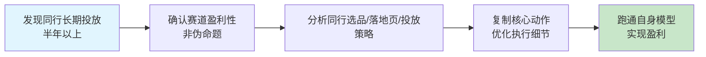
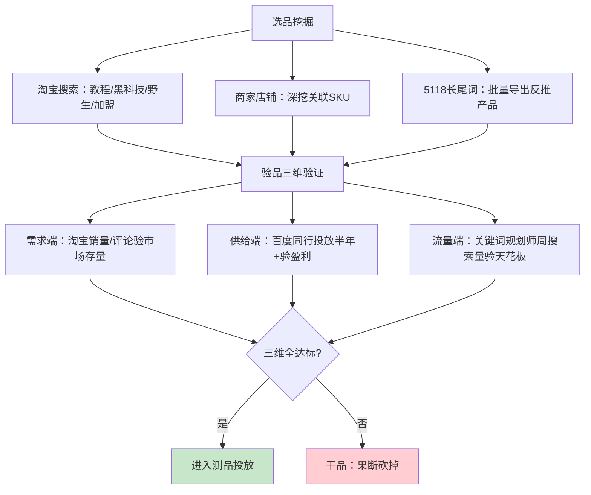
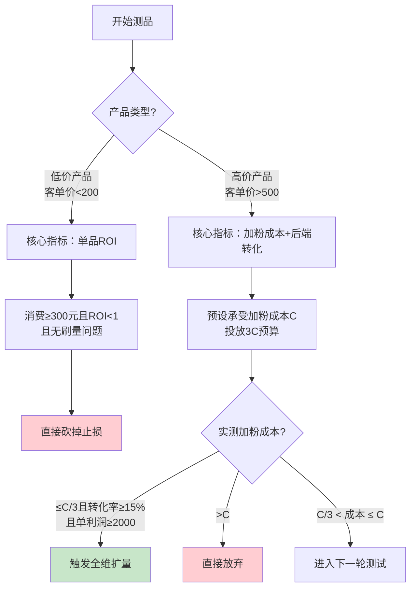
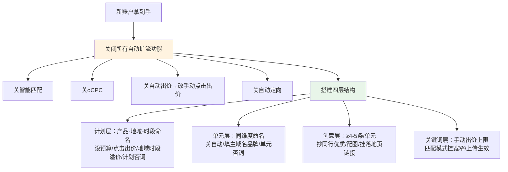
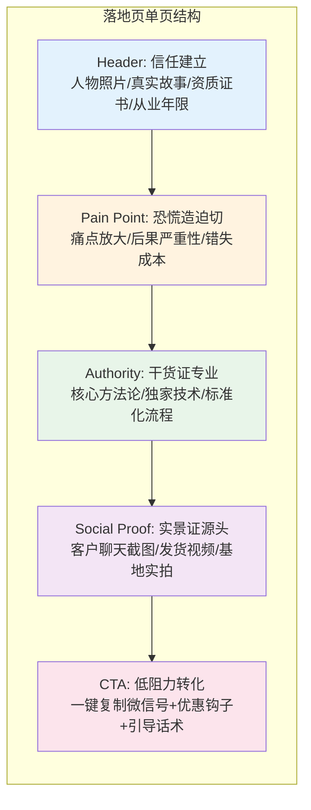
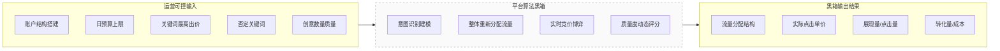
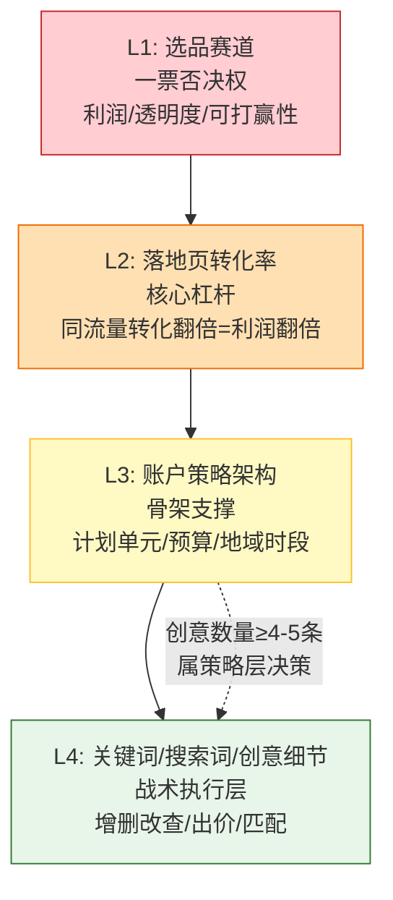
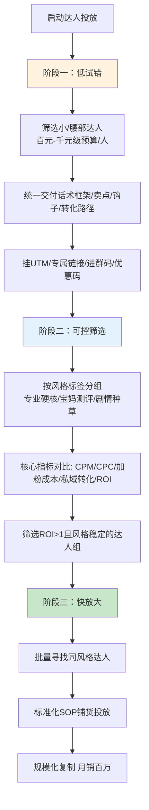

# 第 42 章 百度竞价冷门蓝海项目实操 —— 同行长期投放=盈利铁律、选品三要素、账户减法原则、落地页转化结构
作者：龙哥

## 学习目标

- 理解百度竞价冷门项目的核心逻辑：用同行长期投放验证市场盈利性
- 掌握选品三要素与三步选品法，能独立完成需求端、供给端、流量端的三维产品验证
- 熟练应用低价/高价产品差异化测品模型，设定并执行止损线与扩量阈值
- 掌握账户基建‘减法’原则，能搭建手动控制预算/地域/时段/否词的精准投放账户结构
- 能设计高客单价私域落地页‘信任-恐慌-干货-实景-钩子’五段式转化结构
- 建立平台算法黑箱认知，明确可控参数与不可控边界，制定分层优化策略
- 内化投放决策优先级金字塔，按选品>落地页>策略>关键词的层级分配运营精力
- 掌握跨平台投放策略复用框架，实现百度/巨量/聚光账户结构同构与核心逻辑零迁移成本复用
- 重构试错成本认知，将试错成本视为获取确定性认知的杠杆工具而非门槛
- 能将投放思维外延至达人合作，执行‘低试错-可控-快放大’的KOL投放模型

## 42.1 生活类比

想象百度竞价投放像在陌生城市开一家“精准找客”的路边摊。对面摊位天天排长队、干了三年没倒闭，这就是同行长期投放，证明这条街有真食客、这生意真能赚钱；你卖的不是透明定价的矿泉水，而是成本低、价格模糊、手艺强过对面的秘制酱料、特色小吃，这便是选品三要素——利润覆盖广告、价格不透明、能打过同行。开业前你把“自动推销机器人、强制捆绑套餐”全关了，自己守着收银台、选食客、定价格、拒赖皮顾客，这就是账户减法原则——关掉所有自动扩流功能，手动控制预算、地域、时段、否词。新菜上市时，便宜小吃亏 30 元就撤（止损）；贵菜预算 300 元试卖，成本≤100 元、利润≥200 元、转化≥15% 则全店推、多开分店（扩量），这就是低价/高价差异化测品模型。顾客上前 3 秒：老板亮招牌/晒奖状（信任）→ “再不吃这波食材就没了”（恐慌）→ 现炒展示刀工（干货）→ 墙上贴满好评/后厨透明（实景）→ “扫码加群送张 50 元券，发 1 领券”（钩子），这就是高客单私域落地页五段式结构。城管、交警、天气、对面新开大酒楼，你无法控制路人流总量与结构，只能管好自家“菜品/价格/服务/卫生/营业时间”，这就是平台算法黑箱认知——敬畏算法，只做可控动作。想赚钱：先选对“卖什么菜”（选品）> 再练好“这道菜味道/出餐速度”（落地页）> 再定“几点开门/雇几个服务员”（策略）> 最后才纠结“盘子买蓝的还是白的”（关键词/创意），这就是投放决策优先级金字塔。试新菜亏的钱，不是“亏损”，而是买“这菜这街卖不卖得动”的确定性情报；买得起情报、买得快、买得准，才能活下来开连锁，这就是试错成本认知重构。找几个便宜的小网红各试几百元，筛选出“专业硬核风”转化好，再批量找同风格达人铺货放大，这就是达人投放“低试错-可控-快放大”模型。

## 42.2 概念地图

百度竞价冷门蓝海项目实操体系
├── 核心验证定律
│   ├── 同行长期投放=市场盈利铁律  —— P001
│   ├── 选品三要素：利润覆盖广告/价格不透明/能打过同行  —— P002
│   └── 投放层级决策优先级金字塔：选品>落地页>策略>关键词  —— P007
├── 选品标准化流程
│   ├── 三渠道挖掘法：淘宝搜索/商家店铺/5118长尾词  —— P002
│   ├── 三维验证模型：淘宝销量验需求/百度投放验盈利/关键词规划师验天花板  —— P002
│   └── 干品止损机制：不达标果断砍掉  —— P002
├── 差异化测品模型
│   ├── 低价产品：单品ROI/搜索词/刷量清洗，亏损300元止损  —— P003
│   ├── 高价产品：加粉成本3倍预算测试，达标(转化15%/利润2000/加粉50)触发全维扩量  —— P003
│   └── 免费搜索词策略：初期否词规避，后期放开测试边际收益  —— P003
├── 账户基建与投放执行
│   ├── 减法原则：关闭所有自动扩流功能，手动控制预算/地域/时段/否词  —— P004
│   ├── 分层搭建SOP：计划/单元/创意/关键词四层标准化命名与配置  —— P004
│   ├── 地域时段溢价倍数叠加机制  —— P004
│   └── 创意数量策略：≥4-5条让平台竞价选择降低CPC  —— P004
├── 私域转化承接
│   └── 高客单落地页五段式：信任-恐慌-干货-实景-钩子  —— P005
├── 算法认知与决策边界
│   ├── 平台算法黑箱：单一操作触发整体重分配，非线性因果  —— P006
│   ├── 历史经验失效：算法迭代导致过往策略失效  —— P006
│   └── 有限可控：仅控结构/预算/出价/否词/创意，接受流量分配为黑箱输出  —— P006
├── 跨平台复用框架
│   ├── 账户结构同构映射：计划/单元/创意/关键词/定向一一对应  —— P008
│   ├── 核心策略通用：建策略-投预算-赚钱续投/不赚钱调换/砍掉重来  —— P008
│   └── 流量五大杠杆通则：地域/时段/词量/出价/限制  —— P008
├── 认知重构与外延应用
│   ├── 试错成本即杠杆：可承受范围内无限买确定性(投放/认知/生活)  —— P009
│   └── 达人投放外延模型：小/腰部达人低试错→风格筛选可控→同款铺货快放大  —— P010

## 42.3 同行长期投放=市场盈利铁律 —— 用竞争对手的钱验证你的商业模型

### 为什么需要这个概念？

新手选品最怕“选错赛道”，陷入“有流量无转化”或“转化不覆盖广告成本”的死循环。自己测品成本高、周期长、风险大，且缺乏判断标准。市场上已有玩家持续投放，意味着“需求真、模型跑通、利润正”，是最低成本的验证信号。

### 核心定义

> **同行长期投放=市场盈利铁律**（来源：P001《百度竞价冷门蓝海项目实操》）

**判据**：某平台有竞品持续投放广告超半年至一年
**推论**：该赛道必然存在盈利空间；若自己不盈利，归因于运营执行而非赛道伪命题
**口诀**：有同行在投放，长期投放的，就不可能不赚钱

### 关键性质

这是一个反向筛选器，倒逼自己从“找项目”转向“找同行”，再“抄作业、优执行”。容错率高：只要跑通“选品-验品-投放-私域成交”标准动作，概率极大。适用边界明确：仅适用于搜索广告（人找货、意图强），不适用于信息流（货找人、易烧钱）。

> "有同行在投放，记住这句话，有人长期投放的，它就不可能不赚钱"
> 
> "无论什么项目，如果有一个人一直在做，半年，一年都在做，那这个项目就不可能不赚钱，如果不赚钱就是自己不赚钱"
> 
> —— P001《百度竞价冷门蓝海项目实操》

这个核心判据告诉我们：市场已经用真金白银帮我们完成了「产品-市场匹配」的验证。我们不需要、也不应该去「发明」一个新赛道，而应该去「发现」那些已经被验证过的、但还没被完全红海化的缝隙。

### 典型例子

作者团队盯着百度长期投放的虚拟资料、滋补品、玉石、机械等品类，年净利 30 万+。反例：作者曾尝试信息流广告，无长期投放同行参照，烧钱无果后果断放弃。

### 边界条件

仅适用于“价格不透明、利润覆盖广告成本、同行可打赢”的三要素满足品类。需具备基础投放技能（账户搭建、否词、落地页），纯小白需先补课或跟航海。平台算法迭代快，历史经验会失效，需持续“小步快跑、验证迭代”。

### 方法演进图：同行长期投放验证路径



## 42.4 选品三要素与三步选品法 —— 只卖‘能打赢、利润厚、价格迷’的产品

### 为什么需要这个概念？

选品是竞价生意的“一票否决”项，选错赛道，后续所有投放优化都是零乘以任何数。新手易陷入“喜欢什么卖什么”或“看热度卖什么”的主观陷阱。需要一套可标准化、可外包、可复用的“选品-验品-干品”工业化流程。

### 核心定义

> **选品三要素**（来源：P002《百度竞价冷门蓝海项目实操》）

1. **利润覆盖**：单品利润 > 获客成本 + 履约成本
2. **价格不透明**：价格体系相对不透明，便于溢价
3. **能打过同行**：落地页/销售/供应链具备超越现有同行能力

> **三步选品法**（来源：P002《百度竞价冷门蓝海项目实操》）

**选品**（淘宝/店铺/5118三渠道挖掘）→ **验品**（淘宝销量验需求、百度投放验盈利、关键词规划师验天花板）→ **干品**（测品不达标果断砍掉）

### 关键性质

需求端看淘宝：购买人数证明市场存量，评论区挖痛点、卖点。供给端看百度：同行投放半年+证明变现可行，蝉妈妈/米尔等工具可查历史投放。天花板看关键词规划师：周搜索量决定收入上限（二胡 80/周 vs 人参 7900/周 = 天壤之别）。典型品类：虚拟资料、滋补品、玉石、檀香、机械、无牌电子产品等价格不透明品。

> "选品本质上肯定是要有利润的产品，因为我们有广告费，需要用利润覆盖广告费和成本，这也是为什么选择价格不透明的产品，方便加价。"
> 
> "一定要保证，自己能打得过同行，这样才能保证能抢到流量变现的顺畅度，才能保证赚钱"
> 
> "① 淘宝购买人数（证明这个产品有需求） ② 百度有人长期投放（证明在百度上能赚钱） ③ 百度关键词规划师里搜索量（这个代表有人在百度找这个产品）"
> 
> "这个数据就决定了，我们能赚多少钱"
> 
> —— P002《百度竞价冷门蓝海项目实操》

这三段话把「选品」这件事拆解得非常透彻：**淘宝销量验证「有人要」，百度长期投放验证「能赚钱」，关键词搜索量验证「天花板在哪」。** 三个维度缺一不可，共同构成了一个最小可行的产品验证闭环。

### 典型例子

作者实操：二胡教程周搜 80 次，人参周搜 7900 次，直接放弃二胡、主攻人参类高搜品。验品实测：淘宝搜“教程/黑科技/野生/加盟”挖品，进店挖关联 SKU，5118 导长尾词反推产品。

### 边界条件

必须同时满足三要素，缺一不可（如利润薄、价格透明、打不过同行均直接 PASS）。低价/高价产品验证标准不同，不能一刀切（低价看 ROI 止损 300，高价看加粉成本 3 倍预算测试）。避开“刚需伪命题”：如教育培训类虽刚需但周期长、投诉多、合规难，作者列为避坑区。

### 方法演进图：三步选品法标准化流程



## 42.5 低价/高价差异化测品模型 —— 用‘止损线’和‘扩量阈值’把风险关在门外

### 为什么需要这个概念？

测品是烧钱买数据，无标准化止损线极易“赌徒心理”导致单账户亏损累计过万。低价产品决策快、ROI 即时可见；高价产品周期长、依赖加粉成本与后端转化，指标体系完全不同。需要量化的“红绿灯”指令，让执行层无需思考即可执行“留/砍/扩”决策。

### 核心定义

> **低价产品测品模型**（来源：P003《百度竞价冷门蓝海项目实操》）

**看单品 ROI、关键词/搜索词/刷量清洗**，**单品亏损超 300 元且无刷量问题直接砍掉**

> **高价产品测品模型**（来源：P003《百度竞价冷门蓝海项目实操》）

预设承受加粉成本，**投 3 倍预算测试**；实测加粉成本≤承受成本 1/3、转化率≥15%、单利润≥2000 元 → 触发全维度扩量（加词、放匹配、加价、上同类、多开户抢流量）

### 关键性质

低价止损纪律：账户里“几十个赔钱产品”均执行 300 元止损线清理，保住本金跑赢概率。高价扩量逻辑：预设加粉 200 元，实测 50 元即进入下一轮；400 元直接放弃；达标后“不惜一切代价抢流量”。免费搜索词策略：初期建议否词规避风险，跑通模型后可放开测试边际收益（实测“免费”词也能成单）。

> "低价：投放一单的利润，还不赚钱，并且去看关键词，搜索词，无刷量，就可以删掉...一般词没问题赔钱超过 300 我就干掉了"
> 
> "高价：先定好自己能承受的加粉成本，然后投放 3 倍的加粉成本...利润 2000/ 每单，转化率 15%，加粉成本 50/ 每粉 那就，加词，放匹配，加价，上同类产品，多开户抢流量，各种扩量"
> 
> "实际上，经过我的测试，免费这个词还是可以出单的"
> 
> "刚开始还是建议把这类词否掉的，因为不确定后面赚钱可以再测试，否掉之后，还可以放开。"
> 
> —— P003《百度竞价冷门蓝海项目实操》

这个模型的精妙之处在于：**它把「主观判断」变成了「客观执行标准」。** 低价产品靠「单品 ROI」说话，高价产品靠「加粉成本+后端转化率」说话。一旦数据达标，扩量动作是标准化的、甚至是「不惜一切代价」的；一旦数据不达标，止损动作是果断的、无情的。这就是概率思维在实战中的体现。

### 典型例子

低价实测：投二胡教程消费 200 元，单一词消费 180、免费词消费 150、疑似刷量词消费 198，优化后仍亏→直接停止。高价模型：利润 2000/单、转化 15%、加粉 50 元时，执行“加词、放匹配、加价、上同类产品、多开户抢流量”。

### 边界条件

止损线非绝对真理，需根据产品利润率、转化周期动态调整，核心是“设定止损线并严守”。高价产品前置条件：必须有成熟私域成交体系（落地页+销售话术+交付 SOP），否则前端跑通也变现不了。严禁“不设止损、不看数据、凭感觉加预算”的赌博式操作。

### 测品决策树与公式推导



**溢价倍数叠加公式推导**：

实际最高出价 = 基础出价 × 地域溢价倍数 × 时段溢价倍数

**推导过程**：
1. 基础出价：设定为关键词层面的最高点击出价上限（如 2 元）
2. 地域溢价：针对高价值地域设置溢价系数（如新疆石河子 1.5 倍），表示愿意为该地域流量支付基础出价的 1.5 倍
3. 时段溢价：针对高转化时段设置溢价系数（如周二 20:00 1.5 倍），表示愿意为该时段流量支付基础出价的 1.5 倍
4. 倍数相乘原理：平台在计算最终参与竞价的出价时，将基础出价与所有生效的溢价系数相乘。因为地域与时段是正交维度，用户同时满足两个条件时，溢价效果叠加。
5. 最终公式：实际出价 = 基础出价 × ∏(各维度溢价倍数)

**示例**：基础出价 2 元 × 地域 1.5 × 时段 1.5 = 4.5 元。这意味着愿意为精准时段、精准地域的流量支付最高 4.5 元，从而在优质流量竞争中占据排名优势。

**高价产品扩量阈值判定公式**：

扩量条件 = (实测加粉成本 ≤ 预设承受成本 / 3) ∧ (后端转化率 ≥ 15%) ∧ (单品利润 ≥ 2000 元)

**各项指标含义**：
- 预设承受成本：基于利润率反推的最大可接受获客成本（如利润 2000 元，毛利率 40%，可承担 200 元/粉）
- 3 倍预算测试：投入 3×预设成本（如 600 元）以获得统计显著样本量
- 实测加粉成本 ≤ 1/3：意味着实际获客效率远超预期，具备规模化放量的利润缓冲
- 转化率 ≥ 15%：私域成交环节高效，流量质量达标
- 单利润 ≥ 2000：单客贡献足以覆盖运营成本并留存净利

## 42.6 账户基建‘减法’原则 —— 关掉所有‘自动’功能，把流量控制权拿回自己手里

### 为什么需要这个概念？

平台默认开启“智能匹配、oCPC、自动出价、自动定向”等扩流功能，本质是“帮你花钱、帮平台赚钱”。新手账户无历史数据、无转化模型，开自动=盲人骑瞎马，极易跑飞预算、买到垃圾流量。需要“最小流量原则”：从最精准、最可控的流量起步，跑通模型再逐步放宽。

### 核心定义

> **账户基建‘减法’原则**（来源：P004《百度竞价冷门蓝海项目实操》）

拿到账户第一件事：把能扩大流量的功能全部关掉
核心动作：关智能匹配、关 oCPC、关自动出价、关自动定向，改“手动点击出价”
手动控制四大杠杆：预算（防跑飞）、地域（精准投放）、时段（高转化时段溢价）、否词（切垃圾流量）

### 关键性质

**计划层**：按产品/地域/时段命名、设预算、改点击出价、设地域/时段溢价（倍数相乘）、加计划否词
**单元层**：同维度命名、关所有“自动”、填主域名品牌名、加单元否词
**创意层**：每单元≥2条（建议 4-5 条），抄同行优质创意、配图、挂落地页链接
**关键词层**：手动出价设上限、匹配模式控宽窄（精准/短语/广泛）、上传生效

> "拿到账户第一件事，把能扩大流量的，先全部关掉"
> 
> "出价后面这个框看清楚：都是什么自动，就是百度想给你玩点花样，干掉它"
> 
> "要注意的是，倍数相乘，如果我设定的价格是 2 块，客户是新疆石河子的在周二 8 点钟点击这个广告，我可以接受的最高价格就是：2*1.5*1.5=4.5"
> 
> "建议最少添加两条创意...我一般都写个 4-5 条...相对来说点击价格也会降低"
> 
> —— P004《百度竞价冷门蓝海项目实操》

这个「减法原则」的本质是：**把「控制权」从算法手里夺回来，握在自己手里。** 算法的目标是「最大化平台收入」，你的目标是「最大化 ROI」。两者在账户冷启动期是根本冲突的。只有当你积累了足够的转化数据、跑通了稳定的模型后，才有资格和算法「谈合作」（如开启 oCPC）。

### 典型例子

作者实操：基础出价 2 元，地域溢价 1.5 倍、时段溢价 1.5 倍叠加，实际最高出价=2×1.5×1.5=4.5 元，精准拿高质量流量。创意数量实测：4-5 条创意让平台按人群匹配最优，质量度提升→点击单价下降；单条创意平台强制展现需高出价。

### 边界条件

仅适用于搜索广告“人找货”模式；信息流/展示广告需算法探索，不可全盘套用。账户跑稳后（有稳定转化模型），可尝试开启 oCPC 等智能工具放量，但需设置目标转化成本保护。否词需每日维护：搜索词报告中“免费/教程/视频/怎么”等非商业意图词及时否掉。

### 账户分层搭建 SOP 流程图



## 42.7 高客单私域落地页‘信任-恐慌-干货-实景-钩子’五段式结构

### 为什么需要这个概念？

百度竞价流量贵、精准，但用户进页面 3 秒决定留走，转化率直接决定获客成本（CAC）生死。高客单价产品（如几百上千元）决策链路长、信任门槛高，普通电商详情页完全不够用。需要一套“销售漏斗逻辑+极致减少操作步骤”的标准化页面结构，可复用、可测试、可迭代。

### 核心定义

> **高客单私域落地页五段式结构**（来源：P005《百度竞价冷门蓝海项目实操》）

**Header(人物/故事/简介建信任)** → **Pain Point(恐慌/痛点造迫切)** → **Authority(干货证专业)** → **Social Proof(客户反馈/采摘实景证源头)** → **CTA(一键复制微信号+优惠钩子+引导话术)**

核心原则：尽量少给用户增加步骤，每一步都可能让用户不再加微信

### 关键性质

信任锚点：真人出镜/真实故事/资质证书/从业年限，解决“你是谁凭什么信你”。恐慌营销：放大痛点后果（如“不治疗会恶化”“错过红利年入百万”），制造紧迫感。专业干货：展示核心方法论/独家技术/标准化流程，证明“你懂行、能解决”。实景背书：客户聊天记录截图/发货现场/基地实拍，比文字承诺强 100 倍。低阻力 CTA：一键复制微信号+“领取 XX 优惠/资料”钩子+“发送数字 1 领取”话术，傻瓜化操作。

> "这个页面的关键点：人物，故事，简介，恐慌，干货，客户反馈，采摘实景，加微信领取优惠"
> 
> "就是说，尽量少的给用户增加步骤，每一步都有可能让用户不再加我"
> 
> "页面的关键点：人物，故事，简介，恐慌，干货，客户反馈，采摘实景，加微信领取优惠"
> 
> —— P005《百度竞价冷门蓝海项目实操》

这个五段式结构本质上是一个**微型销售漏斗**：用「信任」打开门，用「恐慌」制造动力，用「干货」建立权威，用「实景」消除疑虑，用「钩子」降低行动门槛。每一段都对应用户决策路径上的一个关键心理关卡。

### 典型例子

作者落地页：个人故事建人设 → 行业痛点造恐慌 → 核心干货证专业 → 客户反馈/采摘视频证源头 → 底部大号微信号+“加微信领优惠”。实测：极致简化操作步骤后，加粉成本从 200 元降至 50 元，直接触发高价产品扩量阈值。

### 边界条件

仅适用于“高客单、非标品、需私域成交”的产品；标品/低客单走电商直购链路更高效。页面加载速度、移动端适配、微信号防屏蔽（用小号/企微/链接跳转）是技术底线。需配合“销售话术 SOP”：加微信后如何诊断、报价、异议处理、成交、交付，否则流量进来也漏光。

### 落地页五段式结构图



## 42.8 平台算法黑箱认知与有限可控边界 —— 敬畏算法，只做可控动作

### 为什么需要这个概念？

运营易陷入“删了个词就涨了/加了个词就跌了”的因果归因陷阱，导致迷信玄学操作。算法是“整体建模、动态分配”，单一操作触发全局重算，结果非线性、不可复现。认清“不可控”边界，才能聚焦“可控”动作（结构/预算/出价/否词/创意），避免内耗。

### 核心定义

> **平台算法黑箱机制**（来源：P006《百度竞价冷门蓝海项目实操》）

**投放操作 → 平台算法判断意图 → 整体重新分配流量 → 结果输出**

**可控参数**：账户结构搭建、日预算上限、关键词最高出价、否定关键词、创意数量质量
**不可控变量**：流量分配权重、质量度评分逻辑、竞争对手实时策略、算法版本迭代

### 关键性质

非线性因果：删一个亏钱词，可能导致整体流量结构变化，原本赚钱的词也跟着没量了。历史经验失效：算法持续迭代，去年有效的账户结构/出价策略今年可能变毒药。只能“逐步优化”：在可控范围内小步试错、快速反馈、放大成功、砍掉失败。

> "是因为我删了这个词后，平台感觉到我有什么意思，整体调整的结果"
> 
> "平台的算法在不断迭代的，不能以极长的以往的经验去判断整体调整"
> 
> "我们的投放并不是我们能完全掌控的，只能在可掌控范围内，逐步优化"
> 
> —— P006《百度竞价冷门蓝海项目实操》

这段话揭示了一个反直觉的真相：**你对账户的每一次「微调」，在算法眼里都是一次「意图变更」，算法会基于新意图重新为你「画像」并重新分配流量。** 所以，不要试图通过「删一个词」「加一个词」这种战术微操来精准控制流量，那是在和黑箱玩猜谜游戏。正确的姿势是：搭好结构（骨架），定好预算/出价/否词（护栏），换好创意（弹药），然后**「看周/月维度整体 ROI」**，用统计规律对抗单次波动噪音。

### 典型例子

作者亲历：删掉一个疑似刷量词，本意省钱，结果平台整体调整导致原本正常词流量骤减。策略：不纠结单一操作得失，看周/月维度账户整体 ROI，结构性调整优于战术性微调。

### 边界条件

不等于“躺平不管”：该加预算加、该否词否、该换创意换，但预期管理要兜底“算法有波动”。需建立“数据看板+周复盘”机制，用统计规律对抗单次波动噪音。跨平台同理：巨量/聚光/百度算法本质相同，皆为黑箱，核心策略可复用但参数需重测。

### 算法黑箱输入-输出模型图



## 42.9 投放决策优先级金字塔 —— 选品>落地页>策略>关键词，别在皮毛上耗尽精力

### 为什么需要这个概念？

运营 80% 精力常耗费在“改出价、加否词、换创意、调匹配”等战术细节上，却忽视决定生死的战略层。资源有限（时间/精力/预算），必须按杠杆率分配：动一分战略，赢十分战术。需要一张“决策地图”，告诉团队：此时此地，最该做的那件事是什么。

### 核心定义

> **投放决策优先级金字塔**（来源：P007《百度竞价冷门蓝海项目实操》）

**优先级排序（指数级递减）**：
- L1 选品赛道（一票否决：利润/透明度/可打赢性）
- L2 落地页转化率（杠杆：同流量下，转化率翻倍=利润翻倍）
- L3 账户策略架构（骨架：计划/单元划分维度、预算分配、地域时段策略）
- L4 关键词/搜索词/创意细节（皮毛：增删改查、出价微调、匹配模式切换）

**创意特例**：创意数量属 L3 策略层，≥4-5 条让平台竞价选择→降低 CPC

> "（1）选品重于投放 （2）投放页面重于投放策略 （3）投放策略重于关键词以及搜索词 （4）创意尽量多"
> 
> "创意多了，平台的选择就会更多...相对来说点击价格也会降低"
> 
> "创意数量多寡直接影响平台评分与点击单价：4-5条创意允许平台按人群匹配最优创意质量度提升降低CPC；单条创意平台强制展现需高出价。"
> 
> —— P007《百度竞价冷门蓝海项目实操》

这个金字塔模型的实战指导意义巨大：**当账户亏损时，先查 L1（产品利润够不够）、再查 L2（页面转化率高不高）、最后才查 L4（关键词出价对不对）。** 绝大多数新手做反了：天天盯着关键词出价改来改去，却从没算过这产品到底有没有利润空间、落地页到底能不能转化。

### 关键性质

向下兼容：L1 选错，L2/L3/L4 做满分也是零；L2 烂，L3/L4 再精妙获客成本也覆盖不了利润。向上穿透：L4 数据（搜索词报告/创意点击率）反哺 L3 策略调整，L3 验证数据反哺 L2 页面优化，L2 转化数据反哺 L1 选品决策。避坑指南：见到“账户亏损”先查 L1 产品利润/ L2 页面转化，最后才查 L4 关键词出价。

### 典型例子

作者团队：测几十个产品（L1 筛选）→ 统一落地页模板快速验证（L2）→ 固定账户结构模板（L3）→ 批量跑词/否词（L4）。创意实测：单条创意 CPC 高、4-5 条创意 CPC 低，验证“创意多给平台选择权”理论。

### 边界条件

仅适用于“搜索广告+私域成交”模型；品牌广告/信息流/直播带货优先级不同。早期探索期（0-1）以 L1/L2 验证为主，跑通后进入 L3/L4 精细化放量期。团队分工建议：老板/合伙人管 L1/L2，投放专员管 L3/L4，严禁越界内耗。

### 优先级金字塔可视化



## 42.10 跨平台投放策略复用框架 —— 百度/巨量/聚光账户结构同构，一套方法论打天下

### 为什么需要这个概念？

多平台投放是规模化必经之路，但每个平台术语不同（计划/广告组/单元），新手极易“词不达意”、重复造轮子。底层逻辑同构：均为“层级结构+竞价机制+定向标签+创意素材+转化归因”，只需建立映射表即可复用。核心策略“建策略-投预算-赚钱续投/不赚钱调换/砍掉重来”跨平台通用。

### 核心定义

> **跨平台账户结构同构映射**（来源：P008《百度竞价冷门蓝海项目实操》）

下表展示了三大主流投放平台账户层级结构的一一对应关系，便于运营者在平台间零成本迁移账户搭建经验。

| 百度 | 巨量引擎 | 小红书聚光 |
|------|----------|------------|
| 计划 | 广告组 | 计划 |
| 单元 | 计划 | 单元 |
| 创意 | 创意 | 创意 |
| 关键词 | 关键词 | 关键词 |
| - | - | 定向 |

> **流量五大杠杆通则**（来源：P008《百度竞价冷门蓝海项目实操》）

地域越广/时段越全/词品越多/出价越高/限制越少 → 流量越多越杂；反之则精准可控。

> "广告组--百度的计划 计划--百度的单元 创意---百度的创意 关键词---百度的关键词"
> 
> "本质上是一样的，计划，单元，创意，关键词...工具，能让我赚钱就行，我不需要懂，会用就行了"
> 
> "① 投放地域，越多，流量越多 ② 投放时段，越全，流量越高 ③ 投放的词，产品...越多流量越多 ④ 出价越高，流量越多 ⑤ 限制越少，流量越多，也越杂 反之亦然"
> 
> —— P008《百度竞价冷门蓝海项目实操》

这种「结构同构」意味着：**你在百度上练就的「账户搭建肌肉记忆」「否词反射弧」「扩量决策树」，可以零迁移成本地直接复用到巨量、聚光上。** 只要建立好映射表，核心逻辑『建策略-投预算-赚钱续投/不赚钱调换/砍掉重来』就是通用的。这就是「工具观」：平台只是流量自动贩卖机，会用就行，不需要懂原理。

### 关键性质

核心逻辑复用：选品验证模型（淘宝销量+同行投放+关键词量）、测品止损/扩量阈值、账户减法原则、落地页结构、优化节奏。差异化适配：各平台用户画像/审核标准/流量分发机制不同，创意素材/落地页话术/定向标签需微调。工具观：‘工具能让我赚钱就行，不需要懂原理，会用就行’—— 把平台当‘流量自动贩卖机’用。

### 典型例子

作者实操：百度跑通模型后，直接复用到巨量引擎/小红书聚光，账户结构一一对应搭建，核心逻辑零迁移成本。截图验证：巨量‘广告组/计划/创意/关键词’ 完美对应 百度‘计划/单元/创意/关键词’。

### 边界条件

仅适用于‘搜索/表单/咨询类’线索获客模式；电商直投 ROI/直播间投流/品牌广告模型不同。平台政策红利期不同：如抖音本地生活扩张期宽容无人直播，成熟期严打；需动态判断窗口期。账户主体资质/行业资质/开户门槛不同，需提前合规准备，避免‘模型跑通却开不了户’。

### 跨平台账户结构同构映射图

```mermaid
graph LR
    subgraph BD[百度推广]
        BD_P[计划]
        BD_U[单元]
        BD_C[创意]
        BD_K[关键词]
        BD_P --> BD_U --> BD_C
        BD_U --> BD_K
    end
    subgraph JL[巨量引擎]
        JL_G[广告组]
        JL_P[计划]
        JL_C[创意]
        JL_K[关键词]
        JL_G --> JL_P --> JL_C
        JL_P --> JL_K
    end
    subgraph JG[小红书聚光]
        JG_P[计划]
        JG_U[单元]
        JG_C[创意]
        JG_K[关键词]
        JG_D[定向]
        JG_P --> JG_U --> JG_C
        JG_U --> JG_K
        JG_U --> JG_D
    end
    BD_P ==映射== JL_G
    BD_U ==映射== JL_P
    BD_C ==映射== JL_C
    BD_K ==映射== JL_K
    BD_P ==映射== JG_P
    BD_U ==映射== JG_U
    BD_C ==映射== JG_C
    BD_K ==映射== JG_K
    style BD_P fill:#e3f2fd
    style JL_G fill:#e3f2fd
    style JG_P fill:#e3f2fd
```

## 42.11 试错成本认知重构 —— 把‘门槛’变‘杠杆’，在可承受范围内无限买确定性

### 为什么需要这个概念？

普通人视“试错成本”为畏途，导致“不敢测、测不够、测不快”，错过红利窗口期。认知升级、投放测品、生活决策本质同构：小成本买反馈、快反馈定决策、大放大赢收益。需要建立“试错预算制”：预留可承受资金/时间，批量并行小赌注，而非单点重注。

### 核心定义

> **试错成本即杠杆**（来源：P009《百度竞价冷门蓝海项目实操》）

**试错成本 = 获取确定性认知的购买成本，而非‘亏损’**
**核心公式**：在可承受范围内（如单品 300 元、月预算 5000 元），无限投入认知/知识付费/投放测试
**复利效应**：知识付费复利最强（一次学习、终身复用）、投放测品次之（模型可复用）、生活决策再次（情绪价值）

### 关键性质

投放端：单品止损 300 元 = 买一张“该品类在百度跑不通”的确定性门票。认知端：付费进社群/买课/找顾问 = 买“避坑地图/捷径/高维认知”，年化复利远超理财。生活端：送花维持关系/买时间/买体验 = 买“情绪价值/信任资产/机会成本降低”。反向操作：因怕亏 300 元不测品 → 永远不知哪品赚钱 → 长期机会成本损失>>300 元。

> "最后希望大家不要把自己能够承受范围内的试错成本，当成门槛"
> 
> "我在我可以承受范围内的关于知识，认知方面花钱是无限花...复利的效果非常强大"
> 
> "试错成本是获取确定性认知、加速复利增长的杠杆工具；适用于投放测品/认知付费/生活决策(送花换情绪价值)。"
> 
> —— P009《百度竞价冷门蓝海项目实操》

这个认知重构极其关键：**它把「成本」变成了「投资」，把「风险」变成了「信息采购预算」。** 当你把单品止损 300 元看作「买一张确定性门票」时，你就不会因为亏了 300 元而心疼、而犹豫、而拖延。你会主动去设计并行测试、批量测试，因为每一次「买门票」都在缩小你的不确定性区间，逼近那个盈利的品类。

### 典型例子

作者认知投入：付费进生财有术社群、跟投放大佬学、买工具/买数据/买咨询，年化回报率>>金融产品。投放实测：几十个产品测一遍，亏几万广告费，跑通 1-2 个蓝海品，年净利 30 万+，ROI 极高。生活决策：送花换情绪价值，维持核心关系，避免决策失误损失，性价比极高。

### 边界条件

必须“可承受”：超出认知/资金承受范围的试错 = 赌博，非杠杆（如借贷投放、全仓梭哈）。必须“有反馈”：无数据回流/无复盘沉淀/无标准化记录的试错 = 盲目烧钱，非买确定性。必须“可复用”：单次试错产出的模型/SOP/认知能否迁移至下一项目/下一平台/下一决策。

### 试错成本杠杆模型图

```mermaid
flowchart LR
    subgraph INPUT[试错投入成本]
        C1[投放测品: 单品300元止损]
        C2[认知付费: 社群/课程/顾问]
        C3[生活决策: 送花/买时间/体验]
    end
    subgraph PROCESS[确定性获取过程]
        P1[小额并行试错]
        P2[快速数据反馈]
        P3[标准化复盘沉淀]
        P4[模型/SOP/认知资产化]
    end
    subgraph OUTPUT[确定性资产与复利]
        O1[投放端: 盈利品类模型可复用]
        O2[认知端: 高维认知终身复利]
        O3[生活端: 信任资产/机会成本降低]
        O4[避免: 长期机会成本损失>>试错成本]
    end
    INPUT --> PROCESS --> OUTPUT
    style INPUT fill:#fff3e0
    style PROCESS fill:#f3e5f5
    style OUTPUT fill:#e8f5e9
```



## 42.12 达人投放‘低试错-可控-快放大’模型 —— 把投放思维外延至KOL合作

### 为什么需要这个概念？

品牌方找头部 KOL 动辄几万十几万，一旦翻车/不转化=巨额沉没成本，且难以复盘归因。达人投放本质同搜索广告：买流量、看转化、算 ROI，完全可以套用“测品-验品-扩量”标准化流程。需要一套“低成本试错、流量可控、快速放大”的达人合作 SOP。

### 核心定义

> **达人投放三阶段模型**（来源：P010《百度竞价冷门蓝海项目实操》）

**① 低试错**：找小/腰部达人（百元/千元级），便宜=试错成本低
**② 可控**：不同风格达人=不同流量方向，投放后看数据筛选“合适风格”
**③ 快放大**：筛选出合适风格后，批量找同风格达人铺货，规模化复制

**核心指标**：CPM（千次曝光成本）、CPC（点击成本）、加粉成本、私域转化率、ROI

> "找小达人，或者腰部达人，他们便宜----试错成本够低 每个博主风格不同----流量方向可控 一但找到合适的，同风格达人，快速铺铺货----可以快速放大"
> 
> —— P010《百度竞价冷门蓝海项目实操》

### 关键性质

反向筛选：不看粉丝量看“风格标签”（如“宝妈测评风”/“专业硬核风”/“剧情种草风”），风格匹配>粉丝量。标准化交付：给达人统一“话术框架/产品卖点/钩子设计/转化路径”，而非“随便拍”。数据穿透：UTM 参数/专属链接/私域进群码/优惠码，穿透归因至单达人/单视频/单计划。

### 典型例子

作者外延：找 10 个小达人各投 500 元 → 筛选出 2 个“专业硬核风”ROI>1 → 批量找 50 个同风格达人铺货 → 月销百万。避坑：拒绝“一口价包结果”、拒绝“不给数据/不挂链接/不配合归因”的达人/MCN。

### 边界条件

仅适用于“有标准化私域成交体系”的高客单/服务类产品；低客单标品走电商分佣/小店随心推更高效。需建立“达人素材库/报价表/历史数据/合作 SOP”资产包，否则规模化时管理成本爆炸。合规红线：医疗/金融/教育等强监管行业达人投放需资质审核，切勿踩线。

### 达人投放三阶段执行流程图



## 42.13 多源对照

本章核心方法论均源自单一核心素材《百度竞价冷门蓝海项目实操》（docs/202303/20230328_172.md），该素材已系统性覆盖从选品验证到账户搭建、从测品模型到落地页设计、从算法认知到跨平台复用的完整知识体系。因此本章不存在多源分歧，所有定义、模型、原则均以该素材为准。

## 42.14 设计中的取舍

问：为什么不用信息流广告而是搜索广告？
答：信息流是“货找人”，依赖算法推荐分发，受众意图弱、转化路径长、极易烧钱买“无效曝光”；搜索广告是“人找货”，用户主动搜索关键词，意图极强、转化路径短、精准度高。作者实测信息流不赚钱后果断放弃，专注搜索广告。代价是流量池相对较小，但换来的是可控的 ROI 和可复制的确定性模型。

问：为什么不用 oCPC 等智能出价而是手动出价？
答：智能出价需要大量历史转化数据训练模型，冷启动期账户无数据、模型不可用，开启智能出价等于把钱包交给算法“随意支配”。手动出价虽繁琐，但能让运营者在每一个决策节点（关键词、地域、时段）施加“人为约束”，把流量控制在“可验证、可复盘、可迭代”的轨道上。代价是前期人工操作成本高，但换来的是对账户“绝对控制权”和对模型“深度理解”。

问：为什么低价/高价产品要用完全不同的测品指标体系？
答：低价产品决策链路短、复购快、ROI 即时可见，适合用“单品 ROI+止损线”这种硬性财务指标直接决策；高价产品决策链路长、依赖私域成交、前端指标是“加粉成本”，后端指标是“转化率/客单价”，两者指标体系完全不同，强行统一会导致“高价品测不出来、低价品止损不及时”。代价是需要维护两套 SOP，但换来的是决策精度的数量级提升。

## 42.15 动手练习

### 练习 1：三维产品验证实战演练

假设你想在百度投放“家用小型制氧机”这一产品，请完成三维验证：

1. 需求端验证：去淘宝搜索“制氧机”，筛选销量前 3 的店铺，记录其月销量、评价数、核心卖点（如静音/便携/医用级），判断市场存量与用户痛点。
2. 供给端验证：在百度搜索“制氧机”，连续观察 7 天以上，记录长期出现在前 3 位推广位的竞品域名，确认是否有同行持续投放半年以上。
3. 流量端验证：使用百度关键词规划师（或 5118）查询“家用制氧机”、“制氧机哪个牌子好”、“制氧机价格”等核心词及长尾词的周搜索量，计算总搜索量天花板。

回答问题：
- 若核心词周搜索量仅 200 次，长尾词合计 800 次，该产品是否值得投放？为什么？
- 若淘宝月销万单，但百度无同行长期投放，可能是什么原因？如何决策？

### 练习 2：账户基建与低价产品止损模拟

场景：你已开通百度推广账户，准备投放“虚拟资料：公考面试真题解析”（客单价 99 元，纯利润约 90 元）。

1. 账户搭建：按“减法原则”列出需关闭的 4 项自动扩流功能，及需手动设置的 4 大控制杠杆（预算/地域/时段/否词）。
2. 计划/单元命名：按“产品-地域-时段”维度命名计划，按“核心词/长尾词/竞品词”命名单元。
3. 创意撰写：撰写 3 条不同卖点创意（如“真题还原度高”/“含答题技巧”/“赠面试礼包”），配图建议。
4. 止损执行：投放第 3 天，账户数据：消费 280 元，对话 12 个，加微信 8 个，成交 1 单(99 元)，搜索词报告含“免费/百度网盘/破解版”等非商业意图词。
   - 计算当前 ROI 与单次加粉成本，是否触发 300 元止损线？
   - 列出需立即加入的计划/单元级否词清单。
   - 决策：继续优化/暂停/砍掉产品，说明理由。

### 练习 3：高价产品扩量决策与落地页诊断

场景：投放“高端定制玉石挂件”（客单价 5000 元，利润 2500 元），预设加粉成本承受上限 200 元。测试投放 3 倍预算(600 元)后，数据：消耗 580 元，加粉 3 个(成本 193 元/个)，咨询深度高，后端转化 1 单(5000 元)。

1. 判断是否触发扩量阈值（加粉成本≤承受 1/3？转化率≥15%？单利润≥2000？），列出扩量具体动作（加词/放匹配/加价/上同类/多开户）。
2. 该产品落地页现为通用电商详情页，请按“信任-恐慌-干货-实景-钩子”五段式重构页面结构，标注每段核心素材来源（如：信任段放大师 30 年证书/非遗传承人身份）。
3. 跨平台复用：若将该模型复用到巨量引擎，账户结构如何映射？核心策略“建策略-投预算-赚钱续投/不赚钱调换/砍掉重来”在巨量上如何执行？流量五大杠杆（地域/时段/词量/出价/限制）如何配置以获精准流量？

### 练习 4：算法黑箱应对与试错成本重构案例分析

案例：某运营者投放“定制西服”，周一否掉一个疑似刷量词“西服定制多少钱”，周二发现原本稳定出单的核心词“高端西服定制”流量骤降 80%，成交归零。运营者陷入“删词导致流量崩”的归因陷阱，连夜加回该词、加预算、改出价，周三流量未恢复反而跑飞预算亏损 2000 元。

1. 用“平台算法黑箱认知”解释：为何单一否词操作触发整体流量重分配？为何“加回/加价”无法挽回？
2. 正确应对流程：当核心词流量异常波动时，应按周/月维度看整体 ROI，而非单日单词；可控动作清单是什么？
3. 试错成本重构：该运营者亏损 2000 元，若视为“买确定性”，买到了什么确定性？如何将此次教训沉淀为 SOP 避免重复？
4. 生活决策迁移：某创业者犹豫是否花 3000 元报名“投放实战训练营”，担心“学不会/骗钱”。用“试错成本即杠杆”视角分析：可承受范围内，该笔支出的潜在复利收益与机会成本对比如何？

## 42.16 本章小结

这一章中我们学习/了解/讨论了百度竞价冷门蓝海项目的完整实操体系。首先我们确立了**同行长期投放=市场盈利铁律**这一核心验证逻辑，用竞争对手的真金白银帮我们完成赛道验证；其次我们掌握了**选品三要素与三步选品法**，建立了需求端、供给端、流量端三维验证的标准化流程；接着我们深入拆解了**低价/高价差异化测品模型**，用量化的止损线和扩量阈值把风险关在门外；然后我们学习了**账户基建‘减法’原则**，关掉所有自动扩流功能，把流量控制权拿回自己手里；之后我们设计了**高客单私域落地页五段式结构**，用信任-恐慌-干货-实景-钩子极致提升转化率；随后我们建立了**平台算法黑箱认知**，明确可控边界，敬畏算法只做可控动作；再然后我们内化了**投放决策优先级金字塔**，按选品>落地页>策略>关键词的层级分配精力；接着我们掌握了**跨平台投放策略复用框架**，实现百度/巨量/聚光账户结构同构与核心逻辑零迁移成本复用；最后我们重构了**试错成本认知**，将试错成本视为获取确定性认知的杠杆工具，并外延至达人投放的『低试错-可控-快放大』模型。

本章我们一起学习了以下概念：

| 概念 | 解释 |
|------|------|
| 同行长期投放=市场盈利铁律 | 竞品持续投放半年以上证明赛道盈利，自身不盈利归因于运营执行而非赛道伪命题 |
| 选品三要素 | 利润覆盖广告成本、价格相对不透明、落地页与销售能力能打过现有同行 |
| 三步选品法 | 选品(淘宝/店铺/5118) → 验品(销量/投放/搜索量) → 干品(止损砍掉) |
| 低价/高价差异化测品 | 低价看ROI止损300元；高价看加粉成本3倍预算测试，达标触发全维扩量 |
| 账户减法原则 | 关闭智能匹配/ocpc/自动出价等扩流功能，手动控制预算地域时段否词 |
| 地域时段溢价倍数叠加 | 基础出价×地域倍数×时段倍数=实际最高出价，精准拿高质量流量 |
| 创意数量策略 | 单元≥4-5条创意让平台按人群匹配最优，质量度提升降低CPC |
| 高客单落地页五段式 | 信任建立 → 恐慌造迫切 → 干货证专业 → 实景证源头 → 低阻力CTA |
| 平台算法黑箱认知 | 单一操作触发整体重分配非线性因果，算法迭代致历史经验失效，仅控显性参数 |
| 投放决策优先级金字塔 | 选品(一票否决) > 落地页(杠杆) > 策略架构(骨架) > 关键词创意细节(皮毛) |
| 跨平台账户结构同构 | 百度/巨量/聚光计划单元创意关键词一一对应，核心策略与流量杠杆通用 |
| 试错成本即杠杆 | 可承受范围内试错成本是获取确定性认知的购买成本，复利效应极强 |
| 达人投放低试错模型 | 小/腰部达人低成本试错 → 不同风格控制流量方向 → 筛选合适风格同款铺货放大 |

下一章中，我们将学习**本地生活服务资源整合**，看看如何用「师傅分级分成、咸鱼矩阵地毯式发布、招聘平台借力裂变」把线下刚需服务做成轻资产高现金流的生意。

感谢你读到了这里，恭喜你，你已经完成了第 42 章的学习！


