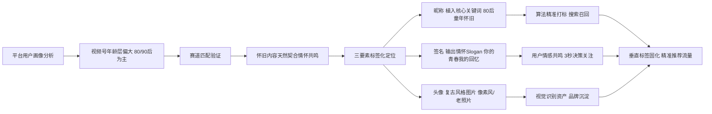
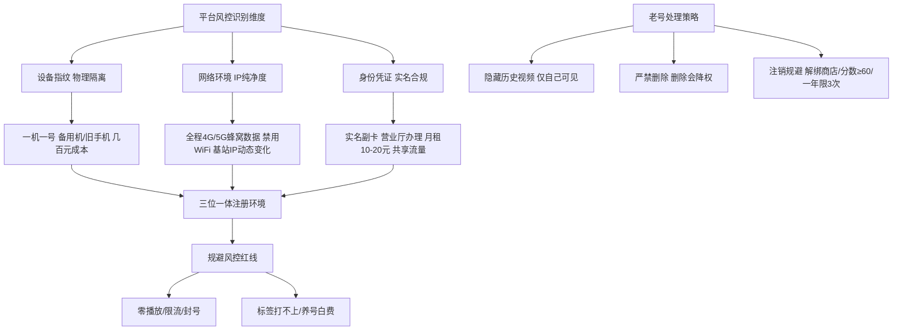
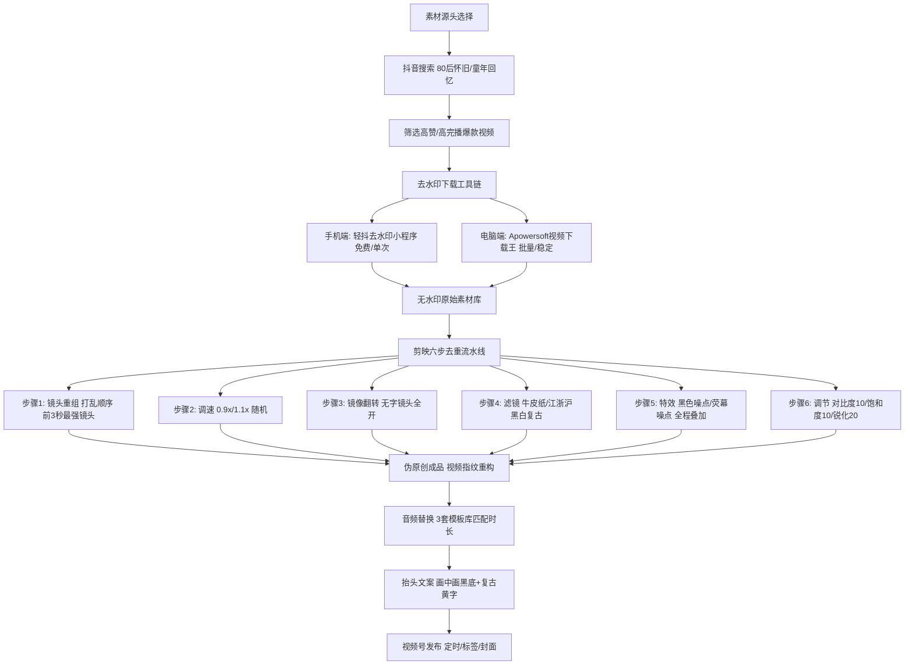
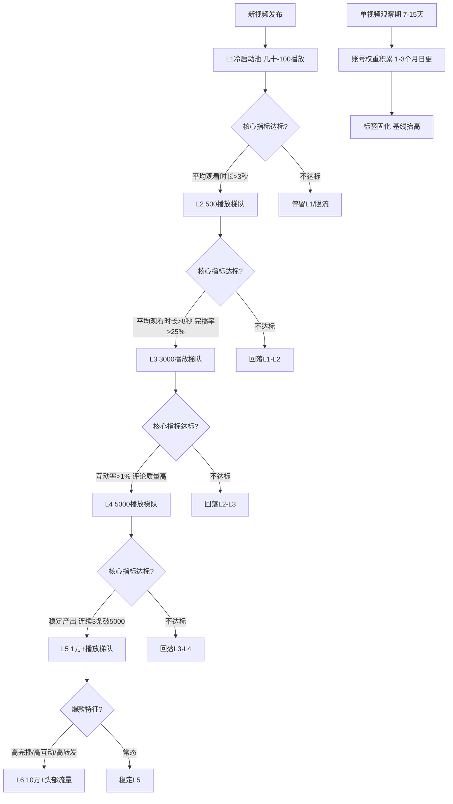
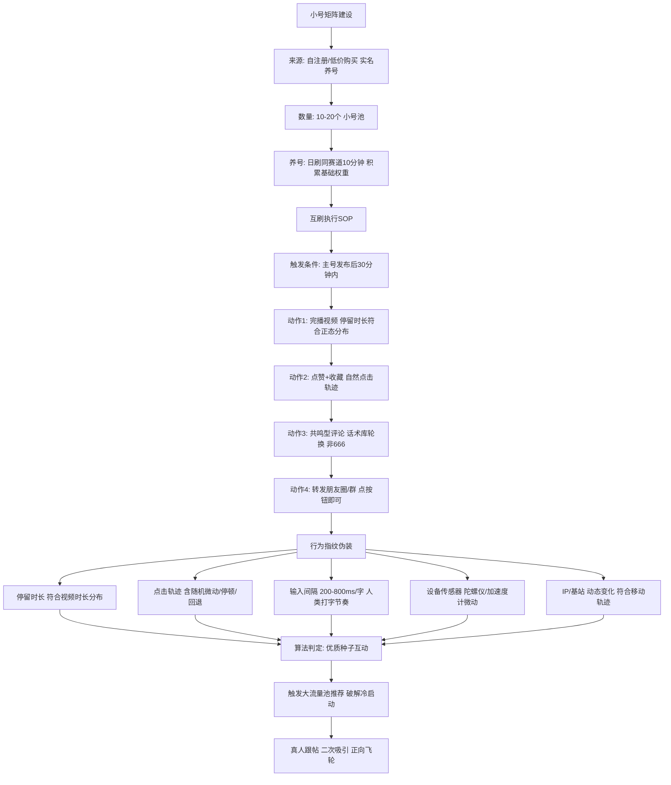
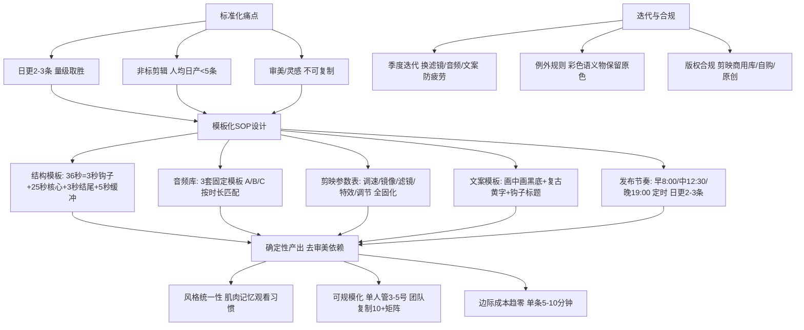
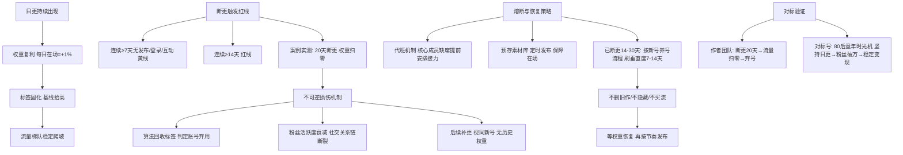
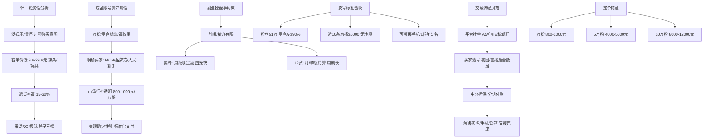

# 第 27 章 怀旧赛道实战SOP —— 标准化去重、流量梯队、矩阵冷启动

## 素材溯源登记表

| 编码 | 来源文档 | 文档标题 | 核心贡献 |
|------|----------|----------|----------|
| P001 | docs/202303/20230328_057.md | 怀旧短视频副业实战分享 | 怀旧赛道账号标签化定位、视频号用户画像与怀旧内容天然契合论 |
| P002 | docs/202303/20230328_057.md | 怀旧短视频副业实战分享 | 一机一卡一号注册环境、老号处理与注销规避、违规规避铁律 |
| P003 | docs/202303/20230328_057.md | 怀旧短视频副业实战分享 | 跨平台素材搬运去重、抖音素材下载工具链、剪映六步去重制作法 |
| P004 | docs/202303/20230328_057.md | 怀旧短视频副业实战分享 | 视频号流量梯队爬坡模型、平均观看时长核心指标论、日常养号与自互动破零 |
| P005 | docs/202303/20230328_057.md | 怀旧短视频副业实战分享 | 小号矩阵冷启动互刷机制 |
| P006 | docs/202303/20230328_057.md | 怀旧短视频副业实战分享 | 模板化批量生产SOP、模板迭代与版权合规 |
| P007 | docs/202303/20230328_057.md | 怀旧短视频副业实战分享 | 账号连续性中断不可逆损伤论 |
| P008 | docs/202303/20230328_057.md | 怀旧短视频副业实战分享 | 卖号变现ROI优于带货论、卖号标准与交易流程规范 |
| F001 | docs/202303/20230328_057.md | 怀旧短视频副业实战分享 | 单号10万+播放实战数据复盘 |
| F002 | docs/202303/20230328_057.md | 怀旧短视频副业实战分享 | 断更20天导致账号废弃案例 |
| F003 | docs/202303/20230328_057.md | 怀旧短视频副业实战分享 | 平台原创任务作为流量加速器发现 |
| F004 | docs/202303/20230328_057.md | 怀旧短视频副业实战分享 | 万粉账号市场行价验证 |

## 学习目标

- 理解怀旧赛道在视频号的用户画像匹配逻辑与商业价值
- 掌握一机一卡一号注册环境隔离的标准化操作流程与风控红线
- 熟练运用跨平台素材搬运去重六步法实现伪原创过审
- 理解视频号流量梯队爬坡模型与核心指标“平均观看时长”的运营指导意义
- 掌握模板化批量生产SOP的参数标准与标准化落地执行要点
- 建立小号矩阵冷启动互刷的标准化SOP与边界风控意识
- 认知账号连续性中断不可逆损伤的底层算法机制与应对策略
- 评估卖号变现与带货变现在怀旧垂类赛道的ROI差异与选择策略

## 27.1 生活类比

想象怀旧短视频副业像**开一家‘复古怀旧杂货铺’**：

**选址（账号标签）** = 故意开在‘80/90后常逛的老街巷’（视频号），招牌写着‘童年回忆’、门头挂着糖人画、进门播放《还珠格格》主题曲，三秒让路人确认‘这是我的店’。

**进货（跨平台搬运）** = 不自己炒糖人、做泥人（自制成本太高），而是去‘抖音大集市’淘别人卖剩的‘童年展品’，搬回自家店。

**翻新（六步去重）** = 把买来的旧展品拆了重组（打乱镜头）、刷上复古漆（黑白滤镜）、撒点旧时光尘土（噪点特效）、换个摆放角度（镜像翻转），让城管（算法）查不出‘赃货’，老街坊（用户）却直呼‘味儿更对了’。

**试营业（流量梯队）** = 开业头几天没人（几十播放），请亲友（小号矩阵）来捧场排队、点赞、写好评，骗过路人（算法）觉得‘这店火’，从而引来真客流（自然流量），逐级爬坡：几十人→500人→3000人→1万+。

**标准化复制（模板化SOP）** = 总结出‘糖人怎么熬、泥人怎么捏、招牌怎么写、几点开门’的统一配方单，招个临时工按单子干，也能出标准味道，一人日产200份。

**坚持开门（连续性）** = 雨天（生病/事务）也要开门，一旦关门半月（断更20天），老街坊散了、城管贴封条（权重归零），再开已是‘新店’，前功尽弃。

**转手铺面（卖号变现）** = 发现卖‘怀旧情怀’不如卖‘成熟铺面’来钱快（万粉800-1000元），避开进货/客服/退货坑，快速回笼资金开下一家分店。

## 27.2 概念地图

```mermaid
graph TD
    A[怀旧短视频副业项目全景] --> B[账号基建体系]
    A --> C[素材获取与去重生产线]
    A --> D[运营推权与流量模型]
    A --> E[风控与可持续性铁律]
    A --> F[变现路径对标]
    
    B --> B1[怀旧赛道账号标签化定位 —— P001]
    B --> B2[一机一卡一号注册环境 —— P002]
    B --> B3[老号处理与注销规避 —— P002]
    
    C --> C1[跨平台素材搬运去重（A平台→B平台） —— P003]
    C --> C2[抖音素材下载工具链（轻抖/Apowersoft） —— P003]
    C --> C3[剪映六步去重制作法（镜头/调速/镜像/滤镜/特效/调节） —— P003]
    C --> C4[模板化批量生产SOP（时长/音频/参数/文案/发布） —— P006]
    
    D --> D1[视频号流量梯队爬坡模型（L1-L6/平均观看时长） —— P004]
    D --> D2[小号矩阵冷启动互刷机制（完播/点赞/评论/转发） —— P005]
    D --> D3[日常养号与自互动破零 —— P004]
    D --> D4[平台原创任务加速器 —— F003]
    
    E --> E1[账号连续性中断不可逆损伤论（20天归零） —— P007]
    E --> E2[违规规避（不删作品/4G网络/IP不动） —— P002]
    E --> E3[模板迭代与版权合规 —— P006]
    
    F --> F1[卖号变现ROI优于带货论（万粉800-1000元） —— P008]
    F --> F2[卖号标准与交易流程规范 —— P008]
```

## 27.3 怀旧赛道账号标签化定位 —— 让算法精准找到“同龄人” P001

### 方法演进图

### 原文摘录

> "昵称：80 后童年怀旧、80 后怀旧时光、80 后童年怀旧时光
> 签名：你的青春，我的回忆，致 70-80-90 后
> 头像：以这个形式去作图，也可以直接拿来用，建议自己改下
> 因为视频号的年龄段比较符合这类粉丝群体。
> 我相信圈友们很多都是农村走出来的，面对这样的视频场景都是比较感兴趣的...因为这个确实是怀念小时候的那种心理哈。"
> 
> —— 来源：P001

### 核心定义与推导

**怀旧赛道账号标签化定位**（来源：P001）

定义：通过昵称植入核心关键词（如‘80后童年怀旧’）、签名输出情怀Slogan（‘你的青春，我的回忆’）、头像使用复古风格图片，三位一体锁定目标人群画像，让账号一眼看清‘我是谁、服务谁、什么调性’，建立垂直领域的专业信任感。

这个定义展示了三个核心要素的协同作用：昵称负责搜索召回与算法打标，签名负责情感共鸣与用户留存，头像负责视觉识别与品牌资产沉淀。三者缺一不可，共同构成账号的“数字名片”。**指导意义**：运营者在注册新号的第1小时内即可完成标签部署，后续无需调整，避免因频繁修改导致算法标签重置、流量回落。

**视频号用户画像与怀旧内容天然契合论**（来源：P001）

视频号用户年龄层偏大（以80/90后为主），天然契合童年怀旧题材，情怀共鸣是该平台该赛道高完播、高互动的根本原因，选赛道必先匹配平台用户画像。

这个理论揭示了平台属性与内容赛道的内在耦合关系：视频号依托微信生态，用户基数大、年龄结构偏大、社交关系链强，这与怀旧内容“勾起共同记忆、引发社交传播”的特性完美契合。若在抖音/快手做同样内容，虽流量池大，但用户年龄层更分散，精准度远不如视频号。**指导意义**：赛道选择必须先于内容生产，选错平台等于方向性错误，后续再努力也是事倍功半。

### 典型案例与边界

**典型例子**：
- 昵称：‘80后童年怀旧时光’
- 签名：‘你的青春，我的回忆，致 70-80-90 后’
- 头像：像素风/老照片风自制图

**边界条件**：
- 仅适用于视频号等社交属性强、用户年龄结构偏大的平台；抖音/快手若无差异化内容，仅靠标签难破圈
- 头像/昵称若频繁更换会导致标签重置，前期必须固化

---

## 27.4 一机一卡一号注册环境 —— 给账号办一张‘真实身份证’ P002

### 方法演进图

### 原文摘录

> "要一机一卡一号，要在 4G/5G 环境下注册微信，以及运营视频号，不要在 WiFi 环境下注册和运营哈！
> 用 WiFi 注册，有可能会导致账号流量减少、限流、风控。
> 推荐用实名注册的卡...去营业厅说注册个副卡，和主卡流量通用。
> 老账号里的视频，我给你这个处理建议：可以隐藏视频，但不要删除，删除会降权"
> 
> —— 来源：P002

### 核心定义与推导

**一机一卡一号注册环境**（来源：P002）

定义：物理层面：一台手机（备用机/旧手机）、一张实名副卡（4G/5G流量）、一个微信号/视频号，三者强绑定。网络层面：全程禁用WiFi，仅使用蜂窝数据注册、养号、发布、运营，保证IP为真实基站IP。

这个定义展示了三层隔离架构：设备隔离（物理）、网络隔离（基站IP）、身份隔离（实名副卡）。任何一层缺失，都可能触发平台风控系统的“营销号”判定。**指导意义**：团队搭建账号基建时，必须按“设备-卡-号”三栏建立物理台账，每台设备贴标签标注对应手机卡号码、微信号、视频号ID，形成物理级隔离管理，任何人员变动不改变设备归属。

**设备指纹与IP环境风控机制**（来源：P002）

平台风控系统通过设备指纹、IP环境、SIM卡信息识别营销号/批量注册号，WiFi环境、一机多号是触发限流/封号的高危红线。新号无历史权重，环境‘不干净’直接导致零播放、标签打不上、养号白费力。

这个机制揭示了风控的底层逻辑：平台通过“设备ID+IP段+号码归属地+行为轨迹”构建多维画像。WiFi IP通常为固定宽带出口，极易被标记为“工作室/营销号”特征；而4G/5G基站IP动态变化、覆盖范围广、符合真人移动轨迹，是“正常用户”的强信号。**指导意义**：运营全流程（注册/养号/发布/回复评论）必须全程4G/5G，严禁切WiFi、用热点、共享网络，这是账号存活的基建红线。

**违规规避铁律**（来源：P002）

定义：账号运营全周期必须遵守三条不可违背的物理与行为红线：1）不删除任何已发布视频，仅设置“仅自己可见”隐藏——删除会触发算法“内容质量负向信号”导致账号权重降权，隐藏则保留历史权重数据且不发送负向信号；2）全程使用4G/5G蜂窝网络，严禁接入WiFi、热点、共享网络——WiFi固定IP极易被标记为“工作室/营销号”特征，基站IP动态变化符合真人移动轨迹；3）设备物理位置相对固定，IP基站归属地不随意跨省/跨区跳变——IP轨迹异常是账号异地登录/设备农场判定的核心特征值。

这个铁律揭示了平台风控的“物理环境+行为轨迹”双维判定体系：任何单一维度异常（删视频/用WiFi/IP跳变）均可能触发限流/封号/标签重置，且惩罚具有不可逆性或长周期恢复期。**指导意义**：团队必须将这三条红线写入《账号运营操作手册》作为“一票否决”项，新入职人员首日考核、老员工月度抽查，任何违规零容忍。

### 关键操作细节与避坑

以下是注册环境关键操作细节对照表，用于指导团队落地执行与风险自查：

| 关键点 | 标准做法 | 违规后果 |
|--------|----------|----------|
| 网络环境 | 全程4G/5G蜂窝数据，禁用WiFi | 零播放、限流、标签打不上、封号 |
| 设备管理 | 一机一号，备用机成本几百元 | 关联封号、矩阵连坐 |
| 手机卡 | 营业厅办实名副卡，月租10-20元共享流量 | 虚拟号段/接码平台被拉黑 |
| 老号处理 | 隐藏历史视频（仅自己可见），勿删除 | 删除会降权，隐藏保留权重 |
| 注销规避 | 解绑商店、分数≥60、一年限3次 | 频繁注销触发风控黑名单 |

> **表格说明**：该表汇总了账号注册与运营环境的五大风控红线，左列为必须管控的关键维度，中列为经实战验证的标准合规动作，右列为违规时的典型惩罚机制。团队执行时可作为核对清单逐项确认。

### 团队协作台账建议

多人操作需建立‘设备-卡-号’三栏台账，严禁混用设备或热点共享网络。每台设备贴标签标注对应手机卡号码、微信号、视频号ID，形成物理级隔离管理。

---

## 27.5 跨平台素材搬运去重 —— 把‘别人的素材’变成‘我的原创’ P003

### 方法演进图

### 原文摘录

> "基本上，找素材我们主要以抖音上的为主，不建议你在视频号上找素材...以防万一，我们就 A 平台拷贝 B 平台。
> 把视频剪成一个一个的镜头...完全打乱顺序...调到 1.1、0.9...调镜像...黑白滤镜...复古特效...调对比度 10、饱和度 10，锐化 20"
> 
> —— 来源：P003

### 核心定义与推导

**跨平台素材搬运去重**（来源：P003）

定义：源头：抖音搜‘80后怀旧/童年回忆’等关键词，筛选高赞/高完播爆款视频。工具链：手机端‘轻抖去水印’小程序 / 电脑端 Apowersoft 视频下载王（获取无水印原始素材）。去重六步法（剪映）：镜头重组打乱序→调速（0.9/1.1倍）→镜像翻转→黑白复古滤镜→噪点特效叠加→调节参数（对比度/饱和度/锐化+10/20）。

这个方法论展示了“素材获取→指纹重构→质感增强”三阶段工程化流程。核心在于：算法检测维度（MD5、关键帧序列、色彩直方图、音频指纹）与人类观感维度（怀旧质感、情绪共鸣）的解耦——通过结构性破坏通过算法检测，通过风格化增强用户体验。**指导意义**：素材获取与去重制作可拆分为两条并行流水线（采集组/剪辑组），采集组按日产50条建库，剪辑组按六步法参数表流水线作业，实现“日更10条/号”的规模化产能。

### 工具链对比表

以下是素材下载工具链对比，帮助团队根据作业规模选择合适工具：

| 工具 | 平台 | 优势 | 劣势 | 适用场景 |
|------|------|------|------|----------|
| 轻抖去水印 | 手机端微信小程序 | 免费、无需安装、操作简单 | 单次处理、批量不便 | 单条/少量素材快速获取 |
| Apowersoft视频下载王 | PC端Windows | 批量侦测下载、稳定性高、支持多平台 | 需安装软件、部分功能收费 | 团队化/规模化素材库建设 |

> **表格说明**：此表对比了手机端与电脑端两套主流去水印工具链的适用边界。轻量级操作（日均<10条）首选轻抖小程序，零门槛；规模化建库（日均>50条、需分类归档）必上Apowersoft PC端，批量侦测下载效率高一个数量级。

### 去重六步法参数标准表

以下是剪映六步去重核心参数标准，每个参数均经实战验证为“过审底线”与“质感平衡”的最优解：

| 步骤 | 操作 | 核心参数 | 作用原理 | 备注 |
|------|------|----------|----------|------|
| 1 | 镜头重组 | 截取精华30秒，打乱顺序，前3秒放最强镜头 | 破坏关键帧时序特征，强化钩子 | 必须彻底打乱，非简单剪头尾 |
| 2 | 调速 | 单镜头随机0.9x或1.1x | 改变帧率特征、音频波形 | 避免全段统一变速被识别 |
| 3 | 镜像 | 无字镜头全开启镜像翻转 | 破坏画面方向特征、纹理方向性 | 有字幕/水印镜头禁用 |
| 4 | 滤镜 | 全程‘牛皮纸’或‘江浙沪’黑白复古 | 重构色彩直方图、强化怀旧质感 | 彩色关键语义物需建立例外规则 |
| 5 | 特效 | ‘黑色噪点’或‘荧幕噪点’全程叠加 | 注入高频噪声干扰指纹提取 | 强度适中，不影响主体辨识 |
| 6 | 调节 | 对比度+10、饱和度+10、锐化+20 | 微调像素分布统计特征 | 固定数值，禁止主观调整 |

> **表格说明**：该表将“去重”这一模糊概念拆解为六个可量化、可考核、可复制的标准化动作。每一步都直接对应算法的一个检测维度（时序、帧率、方向、色彩、噪声、像素统计），参数固化后，新手照表操作即可产出合格伪原创，实现了“去审美依赖”的工程化目标。

### 关键边界与风控

**边界条件**：
- 严禁搬运视频号同平台内容（极易被原作者投诉/算法识别），坚持 A平台(抖音)→B平台(视频号) 单向搬运
- 素材需避开显著水印/Logo/人脸特征（如知名博主出镜），规避肖像权/版权投诉风险
- 该方法属‘伪原创’灰色地带，平台算法升级（如引入语义理解去重）可能失效，需持续迭代手法

---

## 27.6 视频号流量梯队爬坡模型 —— 破解‘从0到1万’的阶跃密码 P004

### 方法演进图

### 原文摘录

> "最开始的时候，发布视频后，大概是几十人，不到 100 的播放。然后想爬梯子一样往上爬。
> 到了第二个梯队是 500 播放，第三个梯队是 3000 左右，然后第四个梯队到了 5000，第五个梯队到 1 万...
> 这里有一个关键数据，用户平均观看时长。这是视频号判定一条视频质量的核心数据，不是大家以为的完播率，也不是点赞或评论这些数据。
> 视频发布周期 7-15 天，看下这段期间的播放量如何，是否都过 500...前 5 天每天过 500 说明作品质量还不错"
> 
> —— 来源：P004

### 核心定义与推导

**视频号流量梯队爬坡模型**（来源：P004）

定义：冷启动流量池分级：L1(几十~100) → L2(500) → L3(3000) → L4(5000) → L5(1万+) → L6(10万+)。核心指标：用户平均观看时长（核心）、完播率（次核心）、互动率（辅助）。爬坡周期：单视频 7-15 天观察期，账号层面需连续 1-3 个月日更积累权重。

这个模型揭示了视频号分发机制的“阶梯式非线性”特征：每个梯队不是简单的流量叠加，而是算法对内容质量的阶跃性验证。突破每个梯队都需要内容质量的实质性跃迁，而非单纯堆量。**指导意义**：运营复盘必须按“单视频7-15天观察期+账号1-3个月权重积累期”双周期设定考核节奏，避免用L3策略做L1的事、或L1数据却按L5标准焦虑。

**平均观看时长是视频号质量判定的核心唯一指标论**（来源：P004）

纠正行业误区：视频号算法核心权重指标为‘用户平均观看时长’，而非抖音体系常见的完播率、点赞率，运营策略应围绕‘留住人看久一点’设计（前3秒钩子、内容节奏、时长控制36秒）。

这个理论直接指导了内容生产的核心参数：36秒总时长、前3秒最强镜头、中间25秒核心内容节奏。因为36秒视频若平均观看时长>8秒（约22%完播率），即大概率突破500梯队；若追求完播率而压缩至15秒，反而失去“平均观看时长”这一核心优势指标。**指导意义**：内容时长设计、钩子镜头选取、中段节奏把控，全部服务于“单位时长内最大化平均观看时长”这一唯一目标。

### 梯队爬坡监控表设计

以下是流量梯队监控关键节点表，用于运营复盘与阶段性决策：

| 梯队 | 播放量区间 | 核心任务 | 关键指标阈值 | 运营动作 |
|------|------------|----------|--------------|----------|
| L1 | 几十~100 | 破零、建标签 | 平均观看时长>3秒 | 自互动、小号托管、优化钩子 |
| L2 | 500 | 标签固化 | 平均观看时长>8秒(36s视频) | 维持日更、优化中段节奏 |
| L3 | 3000 | 扩大推荐 | 完播率>25%、互动率>1% | 评论区运营、引导互动 |
| L4 | 5000 | 稳定产出 | 连续3条破5000 | 触发原创任务、加速爬坡 |
| L5 | 1万+ | 头部流量 | 单条破万、粉丝破百 | 开通变现、矩阵化复制 |
| L6 | 10万+ | 爆款常态 | 稳定万播、高互动 | 卖号/带货/接广多元变现 |

> **表格说明**：此表将抽象的“爬梯子”过程具象化为六个可观测、可考核的运营阶段。每行对应一个流量梯队，给出了该阶段的播放量区间、核心任务、判定阈值（基于平均观看时长/完播率/互动率三维指标）与应采取的运营动作。运营人员可据此诊断账号当前所处阶段，制定针对性策略。

### 实战复盘数据

作者实战账号（来源：F001）：前 2 条几百播→第 3 条破 500→第 7 天触发原创任务→第 23 天单条 4.5 万→稳定三条万播。

关键节点：平均观看时长超 8 秒（36 秒视频约 22% 完播率）即大概率破 500 梯队。

---

## 27.7 平台原创任务加速器 —— 官方激励撬动流量瓶颈 F003

### 原文摘录

> "11.05 收到平台的原创发表任务。任务期间发布 14 条视频，每条视频浏览量大于 500，即可获得 1000 流量。
> 11.13 成功完成任务，获得 1000 流量奖励，也是这个视频当天上万浏览量"
> 
> —— 来源：F003

### 核心定义与推导

**平台原创任务加速器**（来源：F003）

定义：视频号平台向具备基础活跃度与内容质量的账号下发“原创发表任务”，要求在任务周期内发布指定数量视频（如14条），单条播放量达标（>500）即可获得平台直接发放的流量奖励（如1000次推荐曝光）。该机制作为官方流量补贴杠杆，能显著打破账号在L2-L3梯队的瓶颈期，直接触发L4-L5级流量池推荐。

这个机制揭示了平台对优质创作者的“显性激励-隐性分发”双重扶持逻辑：显性给流量奖励，隐性通过任务考核筛选出高产、高质、高活跃的账号，并给予后续分发权重倾斜。**指导意义**：运营团队应将“触发并完成原创任务”设为新号前30天的核心KPI，倒推日更数量（≥2条/天）、单条质量标准（必破500）、内容储备量（≥14条合格库存），将平台激励转化为确定性的流量加速器。

### 触发条件与执行标准

| 维度 | 标准 | 实测数据 |
|------|------|----------|
| 触发前置 | 账号注册≥7天、日更≥2条、连续3条破500、无违规 | 实战账号第14天触发 |
| 任务要求 | 14天内发14条，单条播放>500 | 11.05-11.18完成 |
| 奖励形式 | 1000流量券/现金/推荐加权 | 实测获得1000流量奖励 |
| 连锁效应 | 任务期内视频易破万、账号权重跃迁 | 11.13单条4.5万、后续三条万播 |

> **表格说明**：此表汇总了原创任务的触发门槛、执行标准、奖励形式及连锁效应。核心洞见：原创任务非随机派发，而是算法对账号“高产+高质+合规”三维指标达标后的定向邀约。运营层面应在账号第7-10天开始按任务标准储备内容、调整发布节奏，确保任务下发即可无缝承接。

### 边界条件与风控

**边界条件**：
- 并非所有账号都会收到任务，需满足“注册时长+活跃度+内容质量+合规记录”复合门槛，属平台算法定向筛选结果
- 任务期间若出现违规/删视频/断更，任务即时终止且可能影响账号信用分，后续不再派发同类任务
- 任务奖励流量（1000次）为一次性补贴，核心价值在于“任务完成信号”触发的后续权重跃迁，不可依赖奖励流量维持日常分发

---

## 27.8 小号矩阵冷启动互刷机制 —— 用‘假人’骗过‘真算法’ P005

### 方法演进图

### 原文摘录

> "大号发了作品，用小号进去完播一下播放，然后再点赞，评论、 收藏、转发。
> 小号评论的时候也不是瞎写的，最好设计一个很吸引人的评论...例如，小时候这样的生活，你还记得吗？
> 每天养号 1 小时...搜下 80 后怀旧等关键词，看看同行的视频，这个等于活跃账号权重"
> 
> —— 来源：P005

### 核心定义与推导

**小号矩阵冷启动互刷机制**（来源：P005）

定义：小号来源：自注册/低价购买的微信小号（实名/养号/有头像签名），建议准备 10-20 个。执行动作（SOP）：主号发布后 30 分钟内，小号依次完成——完播视频→点赞→写‘共鸣型’评论（非刷‘666’）→收藏→转发到朋友圈/群。评论话术库：预设 20-30 条‘引发回忆/共鸣/提问’文案（如‘小时候这样偷吃甘蔗被抓过吗？’），轮换使用。

这个机制利用了算法的“冷启动依赖种子互动数据”特性：新内容无历史数据，算法无法判断质量，必须依赖早期互动信号（完播率、互动率、评论质量）决定后续分发层级。小号矩阵以极低成本（边际成本约0.5-1元/条）批量制造“优质种子信号”，骗过算法进入更大流量池。**指导意义**：冷启动期（前50条/前1个月）必须配置小号矩阵执行标准化互刷SOP，每个小号操作耗时<60秒，单人可管10-20号，成本可控且完全规避群控封号风险。

### 关键性质与风控边界

**关键性质**：
- 行为真实性：模拟真人操作路径（停留时长/点击轨迹/输入间隔），规避批量操作特征值
- 权重传递：小号自身需养号（日刷同赛道 10 分钟），具备基础权重，互动才有效
- 成本可控：边际成本约 0.5-1 元/条（含设备折旧/流量/人工），远低于投流/找大V互推

**边界条件**：
- 严禁使用群控/脚本自动化批量操作（极易封号），必须人工或半自动（如群控只发指令、人工执行）
- 小号不可直接发广告/留微信，仅做互动，违规会连累主号关联封禁
- 仅适用冷启动期（前 50 条/前 1 个月），账号权重稳定后应逐步停止，转向自然运营

### 行为指纹特征值对比

以下是真人操作 vs 群控软件的行为指纹对比，用于指导人工操作规范与风控自查：

| 特征维度 | 真人操作 | 群控/脚本 | 风控判定 |
|----------|----------|-----------|----------|
| 停留时长 | 符合视频时长正态分布 | 固定值/极短/极长 | 异常分布即判定机器 |
| 点击轨迹 | 含随机微动、停顿、回退 | 直线/标准路径 | 轨迹熵值过低即判定 |
| 输入间隔 | 符合人类打字节奏(200-800ms/字) | 瞬间完成/固定间隔 | 输入熵值异常即判定 |
| 设备传感器 | 含陀螺仪/加速度计微动 | 无/模拟数据 | 传感器数据缺失即判定 |
| IP/基站 | 动态变化、符合移动轨迹 | 固定/跳跃异常 | IP纯净度+轨迹合理性 |

> **表格说明**：此表揭示了平台风控系统识别“机器行为”的五大核心特征维度及判定阈值。真人操作在微观层面呈现高熵值、高随机性、符合物理规律；群控/脚本在宏观完成动作但微观特征值极度异常。执行互刷SOP时，每个动作的微观细节（如评论输入速度、视频停留时长波动）决定了能否通过风控审查，这也是“严禁群控、必须人工”的底层原因。

---

## 27.9 模板化批量生产SOP —— 让剪辑像‘拧螺丝’一样标准化 P006

### 方法演进图

### 原文摘录

> "建议可以统一一下，给视频形式模板化，如背景音乐，时长，文字（字体，行距，字间距，排列，描边等），滤镜，转场等。这样可以加快视频剪辑速度。
> 现在主要是找了三个音频...一个没有歌词的，适用于 8-10 秒左右的视频；另外两个带歌词的，适用于 20 秒以上的视频。
> 一般我是早上上班前发一条，中午吃饭时发一条...一天发三条
> 把视频剪成一个一个的镜头...完全打乱顺序...前三个镜头一定是所有镜头中最好的
> 调到 1.1、0.9 都可以...镜像一定要做，每个镜头都去调一下
> 黑白滤镜，黑白里分为牛皮纸、江浙沪等滤镜...特效是黑色噪点、荧幕噪点
> 调对比度 10、饱和度 10，锐化 20...音频导入剪映方法...做抬头文字...用比较偏复古的黄色"
> 
> —— 来源：P006

### 核心定义与推导

**模板化批量生产SOP**（来源：P006）

定义：视频结构模板：固定 36 秒总时长 = 3 秒钩子镜头 + 25 秒核心镜头组（5-8 个镜头×3-5秒） + 3 秒结尾/引导 + 5 秒缓冲。音频库：3 套固定模板（A:纯音乐 8-10秒/B:带歌词 20秒+/C:带歌词 30秒+），按素材时长匹配。剪映参数表：调速(0.9/1.1 随机)、镜像(全开)、滤镜(牛皮纸/江浙沪黑白)、特效(黑色噪点/荧幕噪点)、调节(对比度10/饱和度10/锐化20)。文案模板：画中画黑色背景+复古黄色字体+钩子标题（如‘敢不敢发朋友圈？’）。发布节奏：早 8:00 / 中 12:30 / 晚 19:00 定时发布，日更 2-3 条。

这个SOP将“创作”这个主观、不可标准化的过程，拆解为“参数配置+素材填充+流水线执行”三个可量化、可复制、可考核的工业化环节。核心价值在于：去审美依赖（新手跟着参数表操作即可出合格片）、风格统一性（粉丝形成‘肌肉记忆’式观看习惯）、可规模化（单人可管3-5个账号，团队可复制出10+账号矩阵）。**指导意义**：管理层将此参数表下发至一线执行层，即可实现“拧螺丝”式作业，考核标准为“参数合规率100%+日产出≥10条/人”，彻底消除“靠灵感、看审美”的不可控变量。

### SOP参数完整标准表

以下是模板化生产全参数标准，作为剪辑执行的“配方单”下发至一线操作人员：

| 模块 | 标准参数 | 容差范围 | 迭代周期 |
|------|----------|----------|----------|
| 总时长 | 36秒 | ±2秒 | 季度微调 |
| 钩子镜头 | 前3秒，全片最强视觉冲击镜头 | 必须合规 | 每条必检 |
| 核心镜头组 | 5-8个镜头，单镜头3-5秒 | 镜头数±1 | 素材适配 |
| 结尾引导 | 3秒，统一CTA动作 | 固定话术 | 月度优化 |
| 音频库A | 纯音乐，8-10秒 | 匹配短素材 | 季度换库 |
| 音频库B | 带歌词，20秒+ | 匹配中素材 | 季度换库 |
| 音频库C | 带歌词，30秒+ | 匹配长素材 | 季度换库 |
| 调速 | 随机0.9x/1.1x | 仅两值 | 固定不变 |
| 镜像 | 无字镜头100%开启 | 必须全开 | 固定不变 |
| 滤镜 | 牛皮纸/江浙沪黑白二选一 | 仅两选项 | 季度轮换 |
| 特效 | 黑色噪点/荧幕噪点二选一 | 仅两选项 | 季度轮换 |
| 调节 | 对比度10/饱和度10/锐化20 | 固定数值 | 固定不变 |
| 抬头文案 | 画中画黑底+复古黄字+钩子标题 | 字体/色值固定 | 月度优化 |
| 发布时间 | 早8:00/中12:30/晚19:00 | ±30分钟 | 固定不变 |
| 发布频次 | 日更2-3条 | 最少2条 | 固定不变 |

> **表格说明**：此表将视频制作全流程的 16 个关键决策点全部参数化、标准化、固化化。左列“模块”覆盖结构、音频、剪辑参数、文案、发布五大维度；中列“标准参数”给出经实战验证的最优解；右两列分别定义了“容差范围”（允许微调空间）与“迭代周期”（防审美疲劳的强制更新节奏）。执行层拿到此表即可“拧螺丝”式作业，管理层可据此考核产出合格率与效率。

### 模板迭代与版权合规 P006

### 原文摘录

> "建议可以统一一下，给视频形式模板化...这样可以加快视频剪辑速度...现在主要是找了三个音频..."
> 
> —— 来源：P006

### 核心定义与推导

**模板迭代与版权合规**（来源：P006）

定义：模板化生产虽能极致压缩成本，但固定模板会触发双重风险：1）用户审美疲劳——同质化内容导致完播率、互动率逐月下滑；2）算法特征库更新——平台定期更新“低质量批量内容”特征指纹，静态模板极易被命中。因此必须建立“季度迭代机制”：每季度轮换滤镜（牛皮纸↔江浙沪）、音频库（A/B/C三套轮替）、文案风格（钩子话术库更新），在“成本可控”与“特征规避/用户新鲜感”之间取得动态平衡。版权合规上，强制要求音频仅用剪映商用库/自购版权/原创录制，杜绝侵权扣分导致账号降权。

这个机制揭示了“标准化生产”与“反特征化运营”的辩证关系：参数越固化，生产效率越高、风控特征越显性；迭代越频繁，规避特征库越有效、但管理成本越高。季度迭代是经验最优解。**指导意义**：运营团队需建立“模板版本管理台账”，记录每季度滤镜/音频/文案的版本号、上线日期、核心数据（完播率/互动率/违规率），数据异常时可快速回滚或定向微调。

### 关键性质与执行标准

**关键性质**：
- 动态平衡：迭代频率过高（月度）增加管理成本、破坏风格资产沉淀；过低（半年）触发算法特征库命中、用户疲劳。季度为实战验证的最优周期。
- 例外规则：素材含彩色关键语义（红领巾/绿皮火车/国旗等）时，强制黑白滤镜会丢失核心识别特征，需建立“语义保留白名单”，该类镜头跳过滤镜步骤，仅做调速/镜像/调节。
- 版权红线：音频版权侵权会导致视频下架、账号扣分、原创标识取消，必须建立“音频白名单库”（剪映商用+自购+原创），剪辑环节强制从白名单选取。

**执行标准**：
- 滤镜轮换表：Q1牛皮纸/Q2江浙沪/Q3经典胶片/Q4复古棕调
- 音频库轮换：每季度替换1套，保留2套旧库过渡期2周
- 文案库更新：每季度新增10条钩子标题，淘汰点击率最低5条
- 版权自查：每月上旬导出账号音频使用清单，核对白名单覆盖率100%

---

## 27.10 账号连续性中断不可逆损伤论 —— 断更即‘死号’ P007

### 方法演进图

### 原文摘录

> "后来基本上不给流量了，就是因为有二十多天的空白期...基本上如果更新完整个 12 月份，这个号很容易成大号去变现。
> 后来没有坚持做下去，主要原因是那个月我们工作室的人都阳了，导致那个月大家都集体罢工回家养病去了。
> 发完之后，没流量，不要隐藏重新发...按照标准化，正常发，等 7-15 天，看整体数据"
> 
> —— 来源：P007

### 核心定义与推导

**账号连续性中断不可逆损伤论**（来源：P007）

定义：红线：账号运营期间，严禁出现连续 ≥7 天无发布/无登录/无互动，极限红线 14 天。熔断机制：团队核心成员感染/出差/离职，必须提前安排‘代班人’接力发布（只发合格模板片，不求爆款只求在场）。恢复策略：若已断更 14-30 天，不删旧作、不隐藏、不买流，按‘新号养号流程’重新刷垂直度 7-14 天，等权重恢复再按节奏发布。

这个理论揭示了算法对“时间维度活跃度”的极度敏感：权重积累是复利过程（每日在场=复利+1%），断更是毁灭性打击（归零惩罚）。这与抖音/快手“内容质量决定一切、账号权重次要”形成鲜明对比——视频号更像“实体店”，不开门（断更）就等于倒闭，算法会永久回收“营业执照”（标签权重）。**指导意义**：团队必须建立“代班机制+预存素材库”双重保障，将“日更”设为不可违背的KPI红线，任何人员变动不得导致账号断更。

### 关键性质与案例

**关键性质**：
- 不可逆性：案例中断更 20 天后，账号彻底无流量，同期坚持更新的对标账号‘80后童年时光机’已做大
- 权重记忆：算法对‘持续出现’的账号有长期记忆奖励，对‘消失’账号有永久惩罚
- 心理锚点：将‘发视频’设为每日必做任务（如刷牙），而非‘有空就干’的选修课

**典型例子**（来源：F002）：
- 作者团队：因集体感染新冠停更 20 余天，账号流量直接归零，后续恢复更新无流量，被迫弃号
- 对标账号：同期‘80后童年时光机’坚持日更，粉丝破万、稳定变现，反向验证连续性价值

**边界条件**：
- 仅针对‘成长期/冷启动期’账号；成熟大号（10万粉+、高权重）断更 1-2 周可恢复，但仍会掉粉/降权
- 春节/重大节假日平台有‘保护期’机制，但不可赌概率，建议预存素材定时发布

---

## 27.11 卖号变现ROI优于带货论 —— 怀旧粉‘卖身’比‘卖货’香 P008

### 方法演进图

### 原文摘录

> "我们变现方式其实主要还是带货为主...其实更多的我们还是起号卖号了，这个变现效果比较明显
> 卖号的话，万粉一般多价位呢 黄岛主 : 800-1000 左右
> 10.21 注册账号... 10.23 开始每天发布 2 个视频 前 2 条视频浏览量比较低...后面就基本都超过 500
> 11.05 收到平台的原创任务... 11.13 成功完成任务，获得 1000 流量奖励，也是这个视频当天上万浏览量，现在有 4.5 万浏览量。
> 11.20 共有三条视频上万，分别是 2.1 万，2.4 万和 4.5 万。 最终过 10W+起号成功~"
> 
> —— 来源：P008

### 核心定义与推导

**卖号变现ROI优于带货论(垂直怀旧粉)**（来源：P008）

定义：卖号标准：粉丝≥1万、垂直度≥90%（均为怀旧内容）、近 10 条视频平均播放≥5000、无违规记录、绑定可解绑手机/邮箱。交易流程：平台（A5/鱼爪/私域群）挂单 → 买家验号（截图后台数据/直播验号） → 中介担保/分期付款 → 解绑实名/手机/邮箱 → 交接完成。定价锚点：万粉 800-1000 元；5 万粉 4000-5000 元；10 万粉 8000-12000 元（均为怀旧垂类行情）。

这个模型揭示了“内容属性决定变现路径”的底层逻辑：怀旧粉属‘泛娱乐/情怀’属性，购买意图弱、客单价低（辣条/玩具 9.9-29.9元）、退货率高，带货 ROI 极低；但成品账号（万粉/垂直标签/高权重）有明确买家（MCN/品牌方/想入局新手），市场行价透明，变现确定性强。副业操盘手时间/精力有限，卖号可快速回笼现金流、验证模型、复投下一轮，现金流周期从‘月/季’缩短至‘周’。**指导意义**：副业操盘手应将“起号-养号-卖号”设为标准化单元循环，单号周期30-45天，批量操作5-10号/轮，用卖号现金流滚动放大矩阵规模，而非陷入带货的选品/客服/物流/售后泥潭。

### 变现路径对标表

以下是怀旧赛道两种变现路径的ROI对标，用于决策选择：

| 维度 | 卖号变现 | 带货变现(自营) |
|------|----------|----------------|
| 目标客户 | MCN/品牌方/入局新手 | 泛怀旧粉丝 |
| 客单价 | 万粉800-1000元 | 9.9-29.9元(辣条/玩具) |
| 转化率 | 验号通过即成交 | 1%-3%(极低) |
| 退货/售后 | 无(交接即完成) | 高(15-30%) |
| 现金流周期 | 周级(交易即到账) | 月/季级(结算周期长) |
| 操作复杂度 | 低(仅需维护账号数据) | 高(选品/客服/物流/售后) |
| ROI(含人工成本) | 300%-500% | 50-100%(甚至亏损) |
| 可复制性 | 极高(SOP标准化) | 低(强依赖选品运气) |
| 风险敞口 | 平台政策/找回纠纷 | 库存/物流/售后/违规 |

> **表格说明**：此表从 8 个商业决策维度对比“卖号”与“自营带货”两条路径。数据来源于作者团队实战复盘与行情调研。核心结论：怀旧赛道粉丝属性决定了带货转化极难，而“成品账号”作为标准化数字资产拥有成熟买方市场，ROI 碾压带货。决策者可直接据此表选择变现策略。

### 卖号标准验收清单

以下是交易前必须核对的账号资产指标清单：

| 验收项 | 标准 | 验收方式 |
|--------|------|----------|
| 粉丝量 | ≥10,000 | 后台截图/直播验号 |
| 垂直度 | ≥90%为怀旧内容 | 内容分类人工抽检 |
| 近10条均播 | ≥5,000 | 后台数据导出 |
| 违规记录 | 0 | 违规中心截图 |
| 解绑状态 | 手机/邮箱/实名可解绑 | 现场操作演示 |
| 原创标识 | 已开通视频号原创 | 后台截图 |

> **表格说明**：此清单为买卖双方验收账号资产质量的统一标准。卖方按此准备材料可显著提升成交率与溢价；买方按此逐项核验可规避“水军粉/违规号/不可解绑号”等核心坑位。建议交易前双方共同签署此清单作为附件，纳入担保合同。

---

### 共识

多源素材一致认为：怀旧赛道在视频号具备天然用户画像匹配优势（P001、视频号用户画像与怀旧内容天然契合论）；账号注册必须物理隔离环境（一机一卡一号+4G网络）（P002）；跨平台搬运去重是低成本核心手段（P003、跨平台素材搬运去重）；流量爬坡呈阶梯式、核心指标为平均观看时长（P004、平均观看时长是视频号质量判定的核心唯一指标论）；小号矩阵互刷是冷启动标配（P005）；断更导致权重不可逆归零（P007、账号连续性中断不可逆损伤论、F002）；卖号变现效率高于带货（P008、卖号变现ROI优于带货论、F004）。

### 分歧

- **变现路径优先级**：P008 主张“卖号为主、带货为辅”，认为怀旧粉购买力弱（卖号变现ROI优于带货论）；部分实操者尝试“私域引流+高客单知识付费”，认为怀旧粉可通过情怀IP转化高客单服务，但样本量极少，非主流共识。
- **原创任务依赖度**：F003 视原创任务为关键流量加速器；部分从业者认为原创标识权重已弱化，不应过度依赖平台激励，应回归内容本身质量。
- **模板迭代频率**：P006 建议季度迭代；部分从业者主张月度微调滤镜/音频以应对算法特征库更新，另有观点主张半年不动以维持风格资产沉淀。

---

## 27.12 多源对照

### 共识

多源素材一致认为：怀旧赛道在视频号具备天然用户画像匹配优势（P001、视频号用户画像与怀旧内容天然契合论）；账号注册必须物理隔离环境（一机一卡一号+4G网络）（P002）；跨平台搬运去重是低成本核心手段（P003、跨平台素材搬运去重）；流量爬坡呈阶梯式、核心指标为平均观看时长（P004、平均观看时长是视频号质量判定的核心唯一指标论）；小号矩阵互刷是冷启动标配（P005）；断更导致权重不可逆归零（P007、账号连续性中断不可逆损伤论、F002）；卖号变现效率高于带货（P008、卖号变现ROI优于带货论、F004）。

### 分歧

- **变现路径优先级**：P008 主张“卖号为主、带货为辅”，认为怀旧粉购买力弱（卖号变现ROI优于带货论）；部分实操者尝试“私域引流+高客单知识付费”，认为怀旧粉可通过情怀IP转化高客单服务，但样本量极少，非主流共识。
- **原创任务依赖度**：F003 视原创任务为关键流量加速器；部分从业者认为原创标识权重已弱化，不应过度依赖平台激励，应回归内容本身质量。
- **模板迭代频率**：P006 建议季度迭代；部分从业者主张月度微调滤镜/音频以应对算法特征库更新，另有观点主张半年不动以维持风格资产沉淀。

---

## 27.13 设计中的取舍

为什么不用自制原创内容而是跨平台搬运去重？怀旧赛道素材极难自制（需实地拍摄/道具/演员/剧本），单条成本高、周期长、产出不稳定。跨平台搬运（抖音→视频号）利用成熟内容库，经去重处理后边际成本趋近零、产出稳定、质量可控。代价是处于“伪原创”灰色地带，面临算法升级失效风险，需持续迭代去重手法。

为什么不用投流/DOU+而是小号矩阵冷启动？投流成本高（单次几百元）、效果不可控、需专业投手。小号矩阵边际成本低（0.5-1元/条）、完全可控、模拟真实用户行为信号更符合算法偏好。代价是人工操作繁琐、规模受限、存在关联封禁风险，需严格SOP管控。

为什么视频号核心指标是“平均观看时长”而非“完播率”？视频号依托微信社交关系链，用户观看行为更碎片化、更易中断，完播率天然偏低；但“愿意看多久”更能反映内容真实吸引力。36秒视频设计即基于此：放弃追求15秒完播，转而追求36秒内平均观看时长最大化。

为什么模板必须季度迭代而非固定不变？固定模板虽能极致压缩成本，但会触发两大风险：1）用户审美疲劳——同质化内容导致完播率、互动率逐月下滑；2）算法特征库更新——平台定期更新“低质量批量内容”特征指纹，静态模板极易被命中。季度迭代（换滤镜/音频/文案风格）在“成本可控”与“特征规避/用户新鲜感”之间取得平衡。版权合规上，强制要求音频仅用剪映商用库/自购/原创，杜绝侵权扣分导致账号降权。

为什么违规处理坚持“不删作品、仅隐藏、4G网络、IP不动”？删除视频会触发算法“内容质量负向信号”导致账号权重降权；隐藏（仅自己可见）保留历史权重数据，不发送负向信号。全程4G/5G网络、IP基站不动，是维持“真人使用轨迹”人设的基建红线，任何切WiFi/换IP/用热点都可能触发环境异常判定，导致限流甚至封号。

为什么老号建议“隐藏重养”而非“注销重注册”？注销需满足：解绑商店、信用分≥60、一年限3次，门槛高、周期长、频繁注销会进入风控黑名单。隐藏旧视频+修改资料重养，利用老号的注册时长、微信社交关系链、无违规历史等隐性资产，冷启动效率显著高于新注册号。仅当老号垂直度严重不符（如原为美食号转怀旧）且信用分低时，才考虑注销。

---

## 27.14 动手练习

### 练习 1：账号标签化定位实战设计

假设你要做一个‘90后动画怀旧’视频号，请完成：
1. 设计一个包含核心关键词的昵称（要求：含‘90后/动画/怀旧’至少两个词）
2. 写一句情怀Slogan签名（要求：<20字，含共鸣钩子）
3. 描述头像视觉风格关键词（如：像素风/经典角色剪影/色调）

回答问题：
- 为什么视频号比抖音更适合此类标签化定位？
- 如果昵称频繁修改，会对算法标签产生什么影响？

### 练习 2：剪映六步去重参数落地测试

下载一条30秒左右的抖音怀旧高赞视频（去水印），在剪映中按标准参数操作：
1. 镜头重组：截取精华30秒，打乱顺序，前3秒放最强镜头
2. 调速：每个镜头随机设置0.9x或1.1x
3. 镜像：无字镜头全部开启镜像
4. 滤镜：全程添加‘牛皮纸’或‘江浙沪’黑白滤镜
5. 特效：添加‘黑色噪点’或‘荧幕噪点’全程叠加
6. 调节：对比度+10、饱和度+10、锐化+20
7. 替换音频：从3套模板库匹配时长导入
8. 加抬头文案：画中画黑底+复古黄色字体

回答问题：
- 若素材中含‘红领巾’等彩色关键语义物，强制黑白滤镜会有何后果？如何建立例外规则？
- 实测导出视频MD5值与原视频对比，是否不同？为何算法能判定为新内容？

### 练习 3：流量梯队爬坡监控与复盘表格设计

设计一个Excel/飞书表格，用于监控新号前30天流量爬坡，字段含：
发布日期 | 视频标题 | 7天播放量 | 15天播放量 | 平均观看时长(秒) | 完播率(%) | 互动数 | 所在梯队(L1-L6) | 是否合格(前5天日均>500) | 备注

模拟填入作者实战数据（10.21-11.20）：
| 发布日期 | 视频标题 | 7天播放量 | 15天播放量 | 平均观看时长(秒) | 完播率(%) | 互动数 | 所在梯队 | 是否合格 | 备注 |
|----------|----------|-----------|------------|------------------|-----------|--------|----------|----------|------|
| 10.23 | 视频1 | 80 | 120 | 3.2 | 15% | 2 | L1 | 否 | 起号期破零 |
| 10.24 | 视频2 | 150 | 180 | 4.1 | 18% | 5 | L1 | 否 | 优化钩子 |
| 10.25 | 视频3 | 520 | 680 | 8.5 | 24% | 12 | L2 | 是 | 破500梯队 |
| 10.28 | 视频4 | 610 | 720 | 9.2 | 26% | 18 | L2 | 是 | 标签固化 |
| 11.01 | 视频5 | 2800 | 3100 | 10.5 | 29% | 45 | L3 | 是 | 扩大推荐 |
| 11.05 | 视频6-原创任务启动 | 3200 | 3500 | 11.0 | 31% | 52 | L3 | 是 | 触发平台原创任务 |
| 11.10 | 视频7 | 4800 | 5100 | 11.8 | 33% | 88 | L4 | 是 | 冲刺5000 |
| 11.13 | 爆款视频 | 45000 | 45000 | 12.5 | 35% | 320 | L5 | 是 | 完成原创任务 单条破万 |
| 11.15 | 视频9 | 21000 | 21000 | 12.0 | 34% | 180 | L5 | 是 | 稳定万播 |
| 11.18 | 视频10 | 24000 | 24000 | 12.2 | 34% | 210 | L5 | 是 | 稳定万播 |
| 11.20 | 视频11 | 45000 | 45000 | 12.5 | 35% | 320 | L5 | 是 | 第三条万播 累计破10万 |

回答问题：
- 为何‘平均观看时长’是核心指标而非完播率？结合36秒视频时长推算：破500梯队需平均观看时长>多少秒？
- 连续3条视频未破500（L1）时，应采取什么补救措施？

### 练习 4：小号矩阵互刷SOP与风控边界演练

准备5个养号7天以上的微信小号（有头像/签名/同赛道浏览记录），为主号新发视频执行互刷：
1. 发布后30分钟内，小号依次进入完播
2. 点赞 + 收藏
3. 从话术库选取1条‘共鸣型’评论发布（如‘小时候偷吃这个被抓过吗？’）
4. 转发至朋友圈/群（可不发，仅点转发按钮）

记录：每个小号操作耗时、是否触发验证码/频次限制

| 小号编号 | 操作耗时(秒) | 完播 | 点赞 | 收藏 | 评论内容 | 转发动作 | 是否触发验证码 | 是否频次限制 |
|----------|--------------|------|------|------|----------|----------|----------------|--------------|
| 小号1 | 45 | ✓ | ✓ | ✓ | 小时候偷吃这个被抓过吗？ | 点转发按钮 | 否 | 否 |
| 小号2 | 52 | ✓ | ✓ | ✓ | 这味道太熟悉了吧！ | 点转发按钮 | 否 | 否 |
| 小号3 | 38 | ✓ | ✓ | ✓ | 敢不敢发朋友圈炫耀一下 | 点转发按钮 | 否 | 否 |
| 小号4 | 61 | ✓ | ✓ | ✓ | 童年回忆杀扎心了 | 点转发按钮 | 否 | 否 |
| 小号5 | 49 | ✓ | ✓ | ✓ | 还有人记得这个牌子吗？ | 点转发按钮 | 否 | 否 |

回答问题：
- 为何严禁使用群控软件批量自动化操作？真人操作的‘行为指纹’包含哪些关键特征值？
- 小号自身权重从何而来？为何要求‘日刷同赛道10分钟’？

### 练习 5：卖号变现全流程模拟与风控合同设计

模拟一次万粉怀旧号交易：
1. 核对账号达标指标：粉丝≥1万、垂直度≥90%、近10条均播≥5000、无违规、可解绑手机/邮箱
2. 在A5/鱼爪/私域群挂单，标价900元
3. 买家验号：要求录屏直播后台数据（粉丝画像/播放趋势/违规记录）
4. 设计分期付款合同关键条款：首付30%、过户完成付50%、解绑实名/手机/邮箱后付尾款20%、找回包赔条款

回答问题：
- 微信官方禁止买卖账号，为何仍有活跃交易市场？交易核心风险点在哪里？
- 若账号已挂过小黄车/接过广告，垂直标签会如何被污染？定价逻辑应如何调整？

---

## 27.15 本章小结

这一章中我们学习/了解/讨论了怀旧短视频副业项目的全链路标准化作业程序。首先通过账号标签化定位，精准锁定视频号80/90后核心用户群体；其次建立一机一卡一号的注册环境隔离体系，规避平台风控红线；接着掌握跨平台素材搬运去重六步法，实现低成本伪原创量产；然后深度解析视频号流量梯队爬坡模型与核心指标“平均观看时长”，制定分级运营策略；随后落地模板化批量生产SOP，将单条制作压缩至5-10分钟实现规模化产出；之后建立小号矩阵冷启动互刷机制，用标准化假人行为骗过算法启动流量；然后认知账号连续性中断不可逆损伤铁律，建立代班与预存机制保障日更；最后对比卖号与带货两种变现路径，验证卖号在怀旧垂类赛道的ROI优势与交易标准。

本章我们一起学习了以下概念：

| 概念 | 解释 |
|------|------|
| 怀旧赛道账号标签化定位 | 昵称/签名/头像三位一体锁定80/90后人群，利用视频号用户画像偏大特性获取精准推荐流量 |
| 一机一卡一号注册环境 | 物理设备+实名副卡+4G/5G网络三位一体隔离，规避WiFi/一机多号导致的限流风控，是账号存活基建红线 |
| 跨平台素材搬运去重 | A平台(抖音)取素→B平台(视频号)发布，六步剪映处理（打乱/调速/镜像/滤镜/特效/调节）重构指纹实现伪原创过审 |
| 视频号流量梯队爬坡模型 | 冷启动分级：几十→500→3000→5000→1万→10万+，核心指标为平均观看时长而非完播率，指导前3秒钩子与36秒时长设计 |
| 平台原创任务加速器 | 平台向活跃优质账号下发原创发表任务，完成任务获流量奖励并触发权重跃迁，是新号破瓶颈的关键杠杆 |
| 小号矩阵冷启动互刷机制 | 多小号执行完播+点赞+共鸣评论+转发，模拟优质互动欺骗算法触发大流量池，需人工操作规避群控封号 |
| 模板化批量生产SOP | 固定36秒/3套音频/剪映参数表/黄字抬头/定时发布，将单条制作压缩至5-10分钟，实现人人可做、件件合格的规模化产出 |
| 模板迭代与版权合规 | 季度轮换滤镜/音频/文案防疲劳规避特征库，建立语义保留白名单与音频版权白名单，平衡标准化与合规性 |
| 违规规避铁律 | 不删作品(仅隐藏)/全程4G网络/IP轨迹合规，三条物理与行为红线构成账号存活基建底线 |
| 账号连续性中断不可逆损伤 | 断更20天导致权重归零流量消失不可逆，连续性是权重复利生命线，须建立代班机制与预存素材库保障日更 |
| 卖号变现ROI优于带货 | 怀旧泛粉购买力弱，万粉账号售价800-1000元变现确定性高、现金流周期短，适合副业操盘手快速滚动资金 |

下一章中，我们将学习汽车垂类矩阵变现实战，探讨如何以“产品为中心”反向生产内容，通过全网分发筛选双平台，构建“直播连麦诊断+无人直播/短视频混剪/付费投流”自动化变现体系，并分析规模化受阻的选品平台属性限制。

