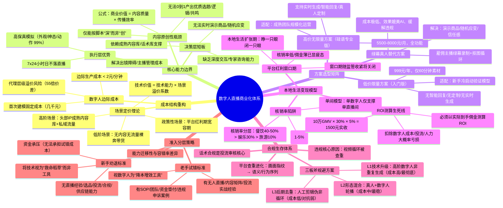
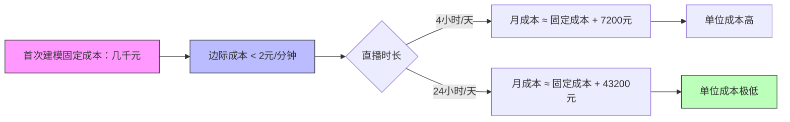
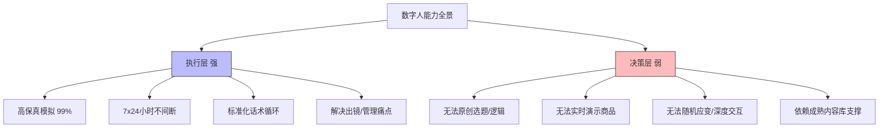
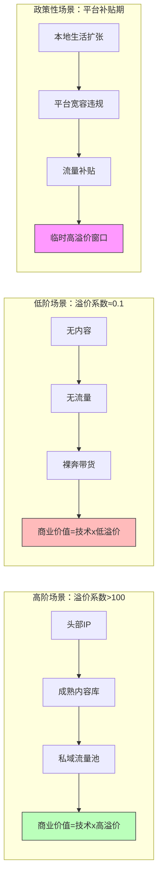
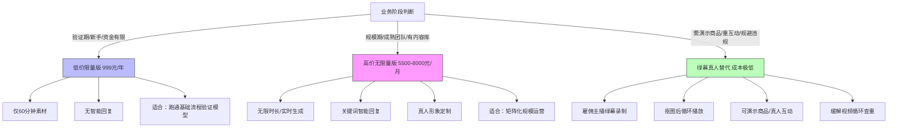
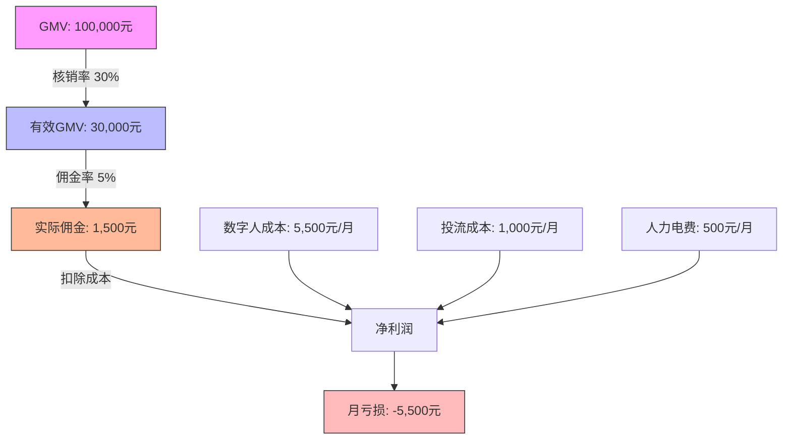
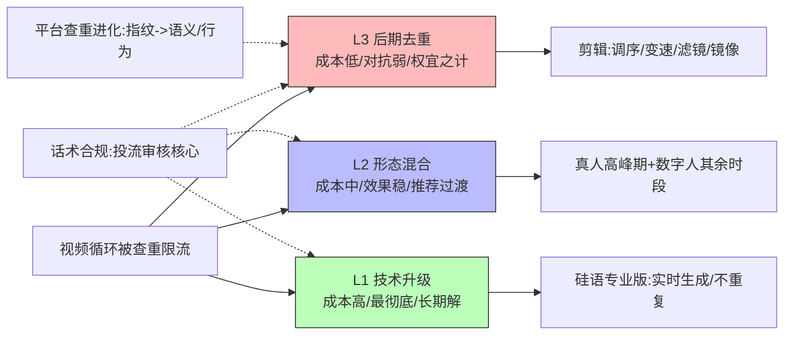
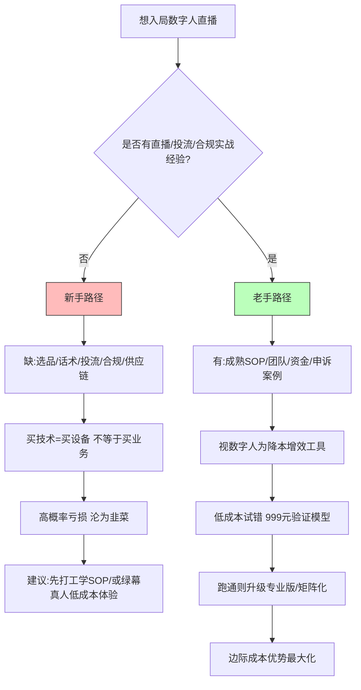

# 第 17 章 数字人直播与本地生活落地实战 —— 技术成熟度与 ROI 的博弈
作者：龙哥

## 学习目标

- 理解数字人直播技术的成本结构：高固定成本（建模）与极低边际成本（<2 元/分钟）的非线性特征
- 识别数字人技术的核心能力边界：擅长“执行层”（高保真模拟、7×24 小时不累），不擅长“决策层”（原创内容、随机应变、深度交互）
- 掌握场景定价理论：技术商业价值由应用场景层级决定，而非技术参数本身；头部 IP 增效 vs 新 IP 孵化的本质差异
- 建立分层方案选型矩阵：根据业务阶段（验证期/规模期）在高价无限量方案、低价限量方案、绿幕真人替代方案中决策
- 量化本地生活核销率陷阱：GMV≠收入，核销率（10%-50%）×佣金率（1%-5%）决定真实现金流，单间模型无规模杠杆
- 掌握违规规避三板斧：技术升级（高阶数字人）、形态混合（真人+数字人）、后期去重（剪辑伪非循环）的成本-效能梯度
- 确立新手劝退与老手试错分层策略：无直播经验者缺乏人货场/选品/投流/合规核心能力，入局必死；有经验者可低成本试错迭代

## 17.1 生活类比

想象数字人直播是一场“虚拟歌手演唱会”。技术成熟度（99% 逼真）等同于虚拟歌手的皮囊、舞蹈、灯光已达顶级水准，肉眼难辨真假；边际成本（<2 元/分）像首次建模像“录制专辑”一次性投入大，后续每场演唱会边际成本极低（无需支付歌手出场费、差旅、住宿）；内容原创性瓶颈意味着虚拟歌手只能“翻唱/按谱演奏”，无法“创作新歌/即兴发挥/和观众深度情感互动”；场景定价理论揭示同一虚拟歌手，在“成熟粉丝团+成熟曲库”的头部 IP 场景下卖千万门票（高溢价）；在“无粉丝无曲库”的新人场景下只能在商场开业剪彩“喊 321”（低价清仓）；分层方案选型里，头部买“顶级全息投影设备”（硅语专业版）；新手买“基础播放器”（999 元入门版）；聪明人直接雇“真人歌手穿绿幕服录制”（绿幕真人替代）；本地生活核销率陷阱如演唱会卖了 10 万张票（GMV），实际入场只有 3 万（核销率 30%），主办方分成 5%，到手 1500 元，扣除设备费 5500 元/月，单场必亏；违规规避三板斧中平台查重像“查重软件”：L1 换“AI 实时作曲不重复”；L2 请“真人歌手轮流上”打破循环；L3 人工剪辑“乱序拼接”骗过查重；新手劝退则是从未办过演唱会的小白，买了顶级设备也办不成演唱会（缺选品/话术/投流/合规/供应链核心能力），沦为设备商的韭菜。

## 17.2 概念地图

## 17.3 数字人边际成本 —— 技术成熟后的极致杠杆

### 为什么需要这个概念？

传统直播依赖真人主播，存在“会累、难管理、出镜障碍”三大痛点，边际成本随时长线性增长。数字人技术突破后，首次建模为一次性固定成本，后续生产边际成本可压缩至 2 元/分钟以内。这一指标重新定义了内容生产的成本结构，使“日不落直播”在经济账上跑通。

### 原文摘录

> "刨去第一次建模几千块钱，之后每分钟视频可以做到 2 块钱以内"
> 
> "发现号称自己是自主研发的，其实也就是个代理商，那你想中间如果还隔着多少层，这成本可以压缩到多低？"
> 
> ——《docs/202303/20230328_051.md 数字人技术深度调研复盘》

> "价格周期 每月 vs 每年；视频时长 不限 vs 60 分钟；是否支持智能回复 可以设置关键词回复 vs 不支持，两种方案的价格，差了 55 倍。"
> 
> ——《docs/202303/wikcnwelee9WgGFyCmMUqm0eyig.md 数字人直播技术原理、方案对比与实操落地》

### 核心定义（来源：P001《docs/202303/20230328_051.md 数字人技术深度调研复盘》）

**数字人边际成本**：完成首次建模（几千元一次性投入）后，生产单位时长数字人视频/直播所需的可变成本。

实测数据：边际成本 < 2 元/分钟，含算力、渲染、驱动等所有增量资源消耗。

### 关键性质

**非线性成本曲线**：固定成本高（建模），边际成本极低，产量越大单位成本越低。这意味着当你把直播时长从每天 4 小时拉到 24 小时，总成本几乎不变，但产能翻了 6 倍。

**成本锚定算力而非人力**：摆脱了“主播时薪”这一不可压缩的强变成本。真人主播时薪 100-500 元是硬成本，数字人边际成本 2 元/分钟 = 120 元/小时，且无上班时间限制。

**代理层级溢价与功能档位双重叠加**：素材实测对比显示，“价格周期 每月 vs 每年；视频时长 不限 vs 60 分钟；是否支持智能回复 可以设置关键词回复 vs 不支持，两种方案的价格，差了 55 倍”。同时作者调研发现“号称自主研发实为代理商”，中间隔着多层转包。这揭示 55 倍价差源于功能档位差（月费版 vs 年费版）与代理层级转包的双重叠加，终端采购价被大幅推高。

### 典型例子

**头部 IP 模式**：刘润、张琪等头部 IP 已跑通“一次建模，无限复用”模式，边际成本优势最大化。他们已有成熟内容库（课程体系切片为话术库），数字人仅作“高保真承接器”，边际成本优势直接转化为利润。

**珠海实地录入方案**：需本人面部采集，虽固定成本高，但保证了高保真度，后续边际成本依然极低。评论区验证：“效果我看过最好的在珠海，需要人当面过去录入人脸才行，单纯软件效果不好的”（来源：P001《docs/202303/20230328_051.md》）。

### 方法演进图：边际成本随时长变化曲线

### 边界条件

- 仅适用于“存量内容复用/标准化话术”场景，无法覆盖“实时互动/随机应变/原创内容”需求。
- 需警惕“自主研发”虚假宣传，实为代理商转包，终端采购价可能被层层加价。
- 技术迭代周期短，今日建模方案可能半年后被新版本替代，沉没成本需快速回收。

---

## 17.4 内容原创性瓶颈 —— 逼真皮囊下的空心灵魂

### 为什么需要这个概念？

数字人技术已攻克“视觉逼真度 99%”（外观、神态、动作），易让人误判为“万能主播”。实战发现：数字人只能“模拟表达”，不能“原创内容”，IP 核心价值仍锚定在内容创作而非形态呈现。忽视该瓶颈会导致“有形无神”：花费高成本建模，却因内容空洞无法转化，陷入“淘宝主播喊 321”的同质化内卷。

### 原文摘录

> "数字人可以特别逼真的模拟一切，但是他不能原创优质内容，而 IP 最重要的内核一定是内容"
> 
> "它暂时只适用于本身已经红了的人，例如刘润张琪这种现象级的"
> 
> "逼真的数字人们都只能当作淘宝主播喊 321 上链接，没有太多附加价值"
> 
> "技术未成熟（无法真实演示商品/随机应变弱）"
> 
> ——《docs/202303/20230328_051.md 数字人技术深度调研复盘》《docs/202303/wikcnwelee9WgGFyCmMUqm0eyig.md 数字人直播技术原理、方案对比与实操落地》

### 核心定义（来源：P001《docs/202303/20230328_051.md 数字人技术深度调研复盘》）

**内容原创性瓶颈**：数字人缺乏从 0 到 1 产出优质选题、逻辑结构、情感共鸣、知识密度的能力，仅能按预设话术/脚本“演”。

**核心公式**：数字人商业价值 = 内容质量 × 传播效率。

**逐式推导与解释**：
1. **内容质量**：指直播间输出话术的选题深度、逻辑严密度、情感穿透力、知识密度。若为 0（纯空泛喊单），则无论传播效率多高，商业价值均为 0。
2. **传播效率**：指数字人技术带来的 7×24 小时不间断曝光、低边际成本放大、多平台同步分发等能力。这是技术层面的杠杆。
3. **乘法关系**：二者为乘法而非加法。内容质量是“1”，传播效率是“放大器”。没有“1”，放大器再强也是放大“0”。这解释了为何大量中小账号买了数字人却跑不出业绩——它们只有传播效率（技术），没有内容质量（IP 内核）。

### 关键性质

**能力边界清晰**：擅长“执行层”（念稿、循环、不累），不擅长“决策层”（选品、改稿、应变、共情）。这是本质区别：执行层可标准化、可复制、可无限放大；决策层需要人类洞察、判断、共情。

**头部 IP 增效逻辑**：刘润/张琪模式本质是“成熟内容库 × 数字人放大器”，而非“数字人造内容”。他们已有成熟课程体系、选题库、话术库，数字人只是把这些存量资产“日不落”地承接出来。

**场景退化规律**：缺乏原创内容支撑时，技术优势退化为价格战，最终沦为低附加值的“循环播放工具”。市场上大量中小账号购买数字人后，因无优质内容库，直播间仅能循环播放通用带货话术，转化极低。

### 典型例子

**现象级失败**：大量中小账号购买数字人后，因无优质内容库，直播间仅能循环播放通用带货话术，转化极低，最终闲置。

**现象级成功**：刘润/张琪团队将成熟课程体系切片为话术库，数字人 7×24 小时高保真承接，实现流量变现放大。这是“内容为王，技术为辅”的标准范式。

### 方法演进图：能力边界分层

### 边界条件

- 绝对边界：无法替代“专家型/咨询型/深度交互型”直播场景（如医疗咨询、复杂非标品讲解、情感连接）。
- 相对边界：随着多模态大模型接入（RAG/知识库/实时推理），“伪原创/半自动决策”边界在外扩，但“核心洞察”仍属人类。

---

## 17.5 场景定价理论 —— 同一技术，不同命运

### 为什么需要这个概念？

同一套数字人技术，为何头部 IP 能卖课赚千万，中小账号却只能“喊 321 亏本”？技术参数（逼真度、帧率、延迟）无法解释商业结果差异，必须引入“应用场景”作为价值定价的核心变量。资本缺的不是技术，是“落地应用场景、流量、故事”，揭示商业化成败的真正杠杆。

### 原文摘录

> "现在资本就缺落地应用场景，缺流量，缺故事，没有好的、高级的应用场景，多好的技术都会陷入内卷"
> 
> "有好的场景就是艺术品，一个几百上千，没好的场景就是清库存，一个几十块"
> 
> "大家都知道，今年抖音在力推本地生活，前期要大量的跑马圈地，所以目前对这种形式的‘无人直播’是睁一只眼闭一只眼的状态"
> 
> "因为同一时间，每个数字人只能支持一个直播间来开播，所以，想做本地生活直播，一定要计算好投入产出比再入局。不要被大数字所欺骗。"
> 
> ——《docs/202303/20230328_051.md 数字人技术深度调研复盘》《docs/202303/wikcnwelee9WgGFyCmMUqm0eyig.md 数字人直播技术原理、方案对比与实操落地》

### 核心定义（来源：P001《docs/202303/20230328_051.md 数字人技术深度调研复盘》）

**场景定价理论**：技术/产品本身无固定商业价值，其价值由所处应用场景的层级与稀缺性定义。

**隐喻公式**：商业价值 = 技术能力 × 场景溢价系数。

**逐式推导与解释**：
1. **技术能力**：指数字人的视觉逼真度、驱动流畅度、生成速度等硬指标。这是基础分，上限由技术水平决定，但在当前 99% 逼真度下，各家技术能力趋于同质化，边际溢价趋近于 0。
2. **场景溢价系数**：指应用场景的稀缺性、流量密度、变现路径成熟度、合规容忍度的综合乘数。
   - 高阶场景（头部 IP+私域流量+成熟内容库）：系数 > 100，技术变身“艺术品”，单价几百上千。
   - 低阶场景（无内容无流量裸奔带货）：系数 ≈ 0.1，技术沦为“清库存”，单价几十块。
   - 政策性场景（平台红利期）：系数由平台补贴人为抬升，但具有时效性。
3. **乘法效应**：技术能力再强（满分 100），若场景系数为 0.1，商业价值仅 10；技术能力一般（60 分），若场景系数 100，商业价值达 6000。这解释了为何“卷参数”不如“造场景”。

### 关键性质

**场景稀缺性决定溢价上限**：
- 高阶场景：头部 IP 成熟内容库+私域流量池 = 高溢价艺术品
- 低阶场景：无内容无流量裸奔带货 = 低价清仓库存
- 政策性场景：抖音本地生活扩张期，平台对无人直播“睁一只眼闭一只眼”，人为制造高容错场景

**场景迁移成本高**：数字人直播带货场景（货架电商）与本地生活场景（到店核销）的运营逻辑、ROI 模型完全不同，不可直接复制。

### 典型例子

**高阶场景**：刘润数字人承接“每天听见吴晓波”成熟 IP 内容库，变现路径清晰（课程/社群/广告），技术溢价充分释放。

**低阶场景**：购买 999 元/年入门版数字人，无内容库、无流量、无选品，硬上抖音带货，视频循环被查重限流，最终闲置。

**政策性场景**：本地生活团购直播，平台补贴流量+宽容违规+标准化话术（到店核销），数字人边际成本优势最大化发挥。

### 方法演进图：场景层级与价值映射（作者推演）

### 边界条件

- 场景窗口期有限：平台红利期随监管收紧将关闭（本地生活核销率低、佣金薄已显露疲态）。
- 场景构建门槛高：需具备“内容生产力+流量获取力+供应链兜底力”三位一体，缺一不可，非单纯购买技术可得。
- 伪场景陷阱：以“有技术就有场景”为借口的盲目入局，本质是被代理商收割的“韭菜”行为。

---

## 17.6 分层方案选型矩阵 —— 用对工具，不花冤枉钱

### 为什么需要这个概念？

市场上数字人方案价格跨度巨大（999 元/年 到 8000 元/月），功能边界模糊，小白极易“买贵买错”。需建立标准化对比维度，根据业务阶段（验证期/规模期）、场景类型（直播/短视频）、核心需求（时长/互动/定制）做决策。核心原则：新手低成本试错验证模型，老手高配置追求极致效率。

### 原文摘录

> "做了一个两种方案的对比表...价格周期 每月 vs 每年；视频时长 不限 vs 60分钟；是否支持智能回复 可以设置关键词回复 vs 不支持"
> 
> "所以，如果做本地生活直播，从性价比角度来说，还是更推荐先尝试999/年的方案起步的。"
> 
> "可以查一下腾讯智影，更适合短视频"
> 
> "999 那个只能做一小时"
> 
> "我们可以雇佣一个临时的专业主播...在绿幕背景下...这样，这个视频抠掉绿幕以后，就是一个‘自制数字人’了"
> 
> ——《docs/202303/wikcnwelee9WgGFyCmMUqm0eyig.md 数字人直播技术原理、方案对比与实操落地》《docs/202303/20230328_093.md 数字人直播行业观察与实操分享》

### 核心定义（来源：P003《docs/202303/wikcnwelee9WgGFyCmMUqm0eyig.md 数字人直播技术原理、方案对比与实操落地》）

建立六维对比坐标系：价格周期、视频时长、真人定制、智能回复、多平台支持、实时直播。

**两大典型方案原型**：

1. **高价无限量方案（如硅语专业版）**：5500-8000 元/月，全功能，适合成熟团队规模化运营
2. **低价限量方案（入门版）**：999 元/年，仅 60 分钟素材，无智能回复/定制，适合冷启动验证

**替代方案**：绿幕真人（雇佣主播绿幕录制+抠图循环），素材称成本仅为高价数字人 1/10，实测约 200 元/场，成本极低、效果媲美 AI、缓解违规。

### 关键性质

**功能边界即价格边界**：时长限制是低价方案硬伤（直播需 7×24 小时，60 分钟根本不够用）。

**智能回复是“无人”关键**：无关键词回复能力 = 纯录播 = 易违规 = 无法承接咨询转化。

**绿幕真人是“降维打击”**：物理真人解决“演示商品/随机应变/信任感”三大 AI 难题，素材实测案例显示“左边真人+右边绿幕抠图主播”同框，后者预录音频可展示商品，效果优于部分配数字人。

### 典型例子

**验证期决策**：作者建议“无经验小白先尝试 999/年方案起步”，实测本地生活场景可跑通基础流程。

**规模期决策**：头部团队采购硅语定制版（8000/月），接入实时直播+智能回复，支撑矩阵化运营。

**替代决策**：实测案例“左边真人+右边绿幕抠图主播”同框，后者预录音频可展示商品，效果优于部分配数字人。

### 方法演进图：方案选型决策树

### 边界条件

- 低价方案不可用于“实时直播/长时长/需互动”场景，强行用会导致违规、封号、客诉。
- 高价方案若无成熟内容库/运营团队兜底，ROI 为负，属于“给代理商打工”。
- 绿幕真人需解决“主播流失/话术更新/多平台分发”工程化问题，非一劳永逸。

---

## 17.7 本地生活核销率陷阱 —— GMV ≠ 收入的残酷算账

### 为什么需要这个概念？

数字人直播切入本地生活看似风口正劲（平台补流量、宽违规），实则藏着“核销率低、佣金薄”的双重收割。直播间挂着 10 万 GMV，实则核销 3 万，佣金 5%，到手仅 1500 元，扣除数字人成本/投流/人力后大概率亏损。该指标揭示了“流量虚假繁荣”与“现金流真实困境”的剪刀差，是入局前必须测算的生死线。

### 原文摘录

> "现阶段本地生活最大的问题是：核销率和佣金太低！"
> 
> "假设我们做了10w的GMV，按照30%的核销率计算，只有3w的有效GMV，再乘以5%的佣金，最后的实际佣金只有1500。"
> 
> "其中，本地餐饮核销率是最高的，在40%~50%之间，连锁餐饮和生活娱乐的核销率也就在30%左右的水平，旅游的核销率在10%。"
> 
> "因为同一时间，每个数字人只能支持一个直播间来开播，所以，想做本地生活直播，一定要计算好投入产出比再入局。不要被大数字所欺骗。"
> 
> ——《docs/202303/wikcnwelee9WgGFyCmMUqm0eyig.md 数字人直播技术原理、方案对比与实操落地》

### 核心定义（来源：P005《docs/202303/wikcnwelee9WgGFyCmMUqm0eyig.md 数字人直播技术原理、方案对比与实操落地》）

**核销率** = 实际到店核销订单数 / 直播间下单总单数，反映用户“下单后履约”的真实意愿。

**实际佣金收入** = GMV × 核销率 × 佣金率（通常 1%-5%），而非 GMV × 佣金率。

**单间模型**：单数字人仅支撑单直播间，无规模杠杆，ROI 必须单间跑通。

**核心公式**：实际佣金收入 = GMV × 核销率 × 佣金率。

**逐式推导与解释**：
1. **GMV（商品交易总额）**：直播间显示的下单总金额，包含未核销、退款、作弊单，是“面子”指标。
2. **核销率**：用户下单后真正到店消费的比例。本地生活特有：用户买团购券后可能忘记、过期、退款、送人不核销。餐饮 40%-50%（高频刚需），娱乐 30%，旅游 10%（决策周期长、不可控因素多）。
3. **佣金率**：平台/服务商/商家三方分账后，服务商实际到手比例。名义佣金率可能 5%-10%，但层层分账后到手常仅 1%-3%。
4. **三重乘法过滤**：GMV 经历“核销率漏斗”再经“佣金率漏斗”，得到真实现金流。10 万 GMV → 3 万有效 GMV（30% 核销）→ 1500 元实收（5% 佣金）。每一层漏斗都在切真金白银。

### 关键性质

**品类分层显著**：
- 餐饮 40%-50%（高频、决策快）
- 生活娱乐 30%
- 旅游 10%（决策周期长、变数大）

**核销率是“隐性退货率”**：电商退货看得见，本地生活“不核销”看不见，实则是更隐蔽的现金流黑洞。

**佣金率博弈**：平台/服务商/商家三方分账，服务商端到手佣金率常被压缩至 1%-3%，进一步压薄利润。

### 典型例子

**实测算账**：10 万 GMV × 30% 核销率 × 5% 佣金 = 1500 元实际收入，若数字人成本 5500/月，单间必亏。

**作者警示**：“不要被大数字所欺骗”，必须以“实际到手佣金”为分母测算 ROI。

### 方法演进图：本地生活现金流漏斗

### 边界条件

- 仅适用于“到店核销”模式（团购券），不适用于“直发货/虚拟兑换”等无核销环节模式。
- 头部服务商可通过“量级谈佣金/自建核销系统/私域复购”对冲，中小服务商无议价权。
- 平台若强制提高核销率考核/降低佣金率，该赛道数字人模式将集体失效。

---

## 17.8 违规规避三板斧 —— 打破“视频循环”的生存技巧

### 为什么需要这个概念？

数字人直播核心违规原因：视频循环播放被平台查重系统判定为“无人直播/录播”，导致限流/封号。该风险是数字人直播能否长期存活的“达摩克利斯之剑”，必须有系统性对策而非侥幸心理。平台红利期虽宽容，但窗口期随监管收紧将关闭，合规能力是长期生存的硬门槛。

### 原文摘录

> "数字人直播会违规的核心原因就是视频循环被查重。那么想解决这个问题，有几个方案："
> 
> "1. 使用更高级的数字人版本...可以制作长时间不重复的视频；2. 真人+数字人组合...让视频‘不循环’；3. 人工将循环的视频进行重新的剪切组合...大大降低违规概率。"
> 
> "能不能过主要看话术"
> 
> ——《docs/202303/wikcnwelee9WgGFyCmMUqm0eyig.md 数字人直播技术原理、方案对比与实操落地》《docs/202303/20230328_093.md 数字人直播行业观察与实操分享》

### 核心定义（来源：P003《docs/202303/wikcnwelee9WgGFyCmMUqm0eyig.md 数字人直播技术原理、方案对比与实操落地》）

**三层递进解决方案**：

1. **L1 技术升级**：采购高阶数字人（如硅语专业版），支持长时长不重复生成、实时驱动，从源头消除循环特征
2. **L2 形态混合**：真人主播 + 数字人轮播/分时段，打破“单一画面循环”特征，利用真人随机应变掩盖 AI 痕迹
3. **L3 后期去重**：人工剪辑循环素材（调序/变速/加特效/镜像/滤镜），生成“伪非循环”视频流，降低查重命中率

### 关键性质

**成本-效能梯度**：技术升级成本高但最彻底；形态混合成本中等且效果最稳；后期去重成本低但对抗性最弱。

**平台查重进化**：从“画面指纹”进化到“语义/行为序列”识别，单纯剪辑去重失效加速，技术升级成唯一长期解。

**合规底线**：话术合规是投流审核核心（“能不能过主要看话术”），违规话术+数字人形态 = 必死无疑。

### 典型例子

**实测案例**：投放随心推测试数字人带货，话术合规+技术优化后，跑出可观转化数据，证明“技术+合规”双达标可行。

**绿幕真人案例**：左真人+右绿幕抠图同框，物理打破循环特征，有效缓解违规，成本远低于高阶数字人。

### 方法演进图：违规规避升级路径

### 边界条件

- 低价方案（999/年）无智能回复、无实时生成，仅靠后期去重极难长期规避查重，属权宜之计。
- 平台政策收紧时（如强制实名认证主播/人脸核验），纯数字人/绿幕方案将全面失效，需预留退出通道。
- 违规规避是“战术”，内容质量与供应链是“战略”，战术再巧拙劣战略必败。

---

## 17.9 新手劝退与老手试错分层 —— 经验门槛决定生存率

### 为什么需要这个概念？

数字人直播看似“低门槛”（不露脸、不累、软件操作），实则隐藏“技术不成熟、费用高昂、违规不可控”三重死亡陷阱。无直播经验小白缺乏“选品/话术/投流/违规申诉/供应链”核心能力，买了技术也跑不通商业闭环，沦为代理商韭菜。必须建立“经验分层准入”认知：只有具备无人直播/内容运营/投流实战经验的老手，才具备低成本试错迭代的资格。

### 原文摘录

> "数字人直播目前还处在初级阶段，效果不错，但是由于平台的现状和高昂的费用，导致目前处在一个比较‘鸡肋’的状态，如果是没有直播经验的小白，我个人并不建议现在入局。"
> 
> "但是之前有无人直播的经验同学...还是建议试一试的。"
> 
> "技术未成熟（无法实时演示商品/随机应变弱）、费用高昂、违规风险不可控"
> 
> ——《docs/202303/wikcnwelee9WgGFyCmMUqm0eyig.md 数字人直播技术原理、方案对比与实操落地》《docs/202303/20230328_051.md 数字人技术深度调研复盘》

### 核心定义（来源：P007《docs/202303/wikcnwelee9WgGFyCmMUqm0eyig.md 数字人直播技术原理、方案对比与实操落地》）

**新手劝退标准**：无直播带货经验、无选品能力、无投流经验、无违规应对经验、无供应链资源、资金承压（无法承担 5500+/月 或 试错亏损）、**将技术视为“救命稻草”而非工具**。

**老手试错标准**：有成熟无人直播/内容矩阵运营经验、有选品/话术/投流 SOP、有违规申诉成功案例、有资金承担试错成本、**将数字人视为“降本增效工具”而非“救命稻草”**。

### 关键性质

**能力迁移性**：直播核心能力（人货场搭建、流量节奏、转化话术）平台通用，老手可将经验迁移至数字人场景。

**容错率差异**：老手试错成本可控（已有团队/流程/资金垫付），新手试错成本毁灭性（全职投入/借贷/无 Plan B）。

**技术红利递减**：早期红利期（平台宽容/流量扶持）适合老手收割，晚期红利期（平台严控/流量内卷）新手入场必死。

### 典型例子

**新手血泪史**：购买 5500/月硅语方案，无内容库、无选品、不会投流，直播间日观看个位数，3 个月亏 2 万+ 后放弃。

**老手收割期**：成熟无人直播团队，接入数字人替代真人主播，边际成本从 200 元/小时（真人）降至 2 元/分钟（AI），利润率飙升。

**作者亲证**：“如果是没有直播经验的小白，我个人并不建议现在入局”；“有无人直播经验同学...建议试一试”。

### 方法演进图：新老手分层路径

### 边界条件

- 极少数“天选之子”：极强自学能力+极高风险偏好+极快迭代速度的新手，可跨越经验门槛（幸存者偏差，不可复制）。
- 平台推出“傻瓜式数字人直播间”产品（一键开播/内置选品/话术/投流/合规）时，新手门槛将大幅降低（尚未出现）。
- 绿幕真人方案可作为新手“低成本体验直播”的过渡方案，但本质仍是真人直播，需面对招聘/管理/排班痛点。

---

## 17.10 多源对照

### 共识

- **技术已达可用阈值**：视觉逼真度 99%，边际成本 < 2 元/分钟，技术本身不再是核心瓶颈。
- **内容为王，技术为辅**：数字人无法原创优质内容，IP 核心价值锚定内容库，无内容库则商业价值归零。
- **头部 IP 增效是当前最优解**：刘润/张琪模式验证“存量内容库 × 数字人放大器”路径可行。
- **违规核心是视频循环被查重**：平台查重机制是生存的硬约束，必须系统性规避。

### 分歧

| 维度 | P001 调研视角 (docs/202303/20230328_051.md) | P003 实操视角 (docs/202303/wikcnwelee9WgGFyCmMUqm0eyig.md) | P004 行业观察视角 (docs/202303/20230328_093.md) |
|------|----------------|---------------|-------------------|
| **入局建议** | 隐含“等场景成熟再入” | 明确“新手劝退，老手试错” | 隐含“技术成熟可直接用” |
| **低价方案价值** | 未深入对比 | 核心推荐：999/年验证模型 | 仅提“更适合短视频” |
| **绿幕真人替代** | 未提及 | 核心替代方案：低成本+缓解违规 | 未提及 |
| **本地生活前景** | 未深入 | 详细算账：核销率/佣金双低，单间必测 ROI | 未提及 |
| **合规核心** | 隐含“技术解决合规” | “话术合规是投流审核核心” | “能不能过主要看话术” |

---

## 17.11 设计中的取舍

### 为什么不用“全自动 AI 生成内容”方案？

因为当前多模态大模型尚不具备“选品判断、话术创新、情感共鸣、危机公关”的决策层能力。数字人只能做“执行层”的高保真模拟。强行上“全自动”会导致直播间内容空洞、僵硬、无法转化，本质是用技术幻觉掩盖商业认知的缺失。

### 为什么不直接买最高配（8000/月）方案？

因为高价方案的边际收益需要“成熟内容库+投流能力+合规话术”三位一体支撑。缺一不可。新手买最高配 = 给代理商打工，ROI 为负。低价方案（999/年）虽功能残缺，但足以支撑“冷启动验证模型”，试错成本可控。

### 绿幕真人 vs 高阶数字人的 trade-off 是什么？

以下表格对比了绿幕真人与高阶数字人在核心维度上的权衡。数据来源：P003《docs/202303/wikcnwelee9WgGFyCmMUqm0eyig.md》实测对比，其中主播薪资、场地设备、后期制作、管理分摊等隐性成本基于作者实测估算。

| 维度 | 绿幕真人 | 高阶数字人 |
|------|----------|------------|
| 成本 | 素材称成本仅为高价数字人 1/10，实测约 200 元/场 | 5500-8000 元/月（纯技术费） |
| 违规风险 | 低（真人画面、可随机应变） | 中（依赖技术升级对抗查重） |
| 交互能力 | 强（真人演示/实时答疑） | 弱（无智能回复或仅关键词匹配） |
| 管理成本 | 高（招聘/排班/流失/话术更新） | 低（软件运维/话术库维护） |
| 规模化潜力 | 受限于人力 | 强（单套技术支撑多间/矩阵） |

**决策建议**：验证期用绿幕真人跑通人货场/选品/话术；规模期迁移至高阶数字人实现边际成本极致压缩。

---

## 17.12 动手练习

### 练习 1：数字人直播 ROI 极限测算

假设你购买硅语专业版数字人（5500 元/月），用于本地生活餐饮团购直播：
1. 直播间日均 GMV 5000 元，核销率 45%，平台佣金率 5%，服务商分成后到手佣金率 2%
2. 计算：日实际佣金收入 = 5000 × 45% × 2% = 45 元
3. 月实际佣金收入 = 日收入 × 30 = 1350 元
4. 月净利润 = 月佣金收入 - 5500（数字人成本） - 投流成本(假设 1000 元) - 人力/电费(假设 500 元) = -5650 元

回答问题：
- 若核销率跌至 30%，佣金率压至 1.5%，模型是否仍可行？（日收 22.5 元，月收 675 元，亏损扩大至 -6325 元，不可行）
- 为何单数字人仅支撑单直播间会导致“无规模杠杆”？如何破局？（单间模型无法通过开设更多直播间分摊固定成本，破局需矩阵化运营或提升单间 GMV/核销率/佣金率）
- 绿幕真人方案若成本仅为数字人 1/10，ROI 模型如何改写？（若绿幕真人能将转化率提升 2 倍，日 GMV 达 1 万，核销率 45%，佣金率 2%，日收 90 元，月收 2700 元，月净利润 = 2700 - 6000 - 1000 - 500 = -4800 元，亏损收窄，但仍需进一步优化）

### 练习 2：方案选型实战推演

某团队拟切入抖音数字人直播带货，现有条件：
- 团队：3 人（1 运营、1 剪辑、1 客服），无专业主播，无成熟选品库
- 资金：启动资金 3 万元，月承压上限 5000 元
- 经验：有短视频剪辑经验，无直播/投流/违规申诉实战经验
- 目标：3 个月内跑通正向现金流

请为该团队设计方案选型决策树：
1. 首月方案选择：999 元/年入门版 vs 5500 元/月专业版 vs 绿幕真人（雇佣兼职主播 200 元/场×30 场=6000 元/月）？
   - **决策**：首选 999 元/年入门版。理由：月均成本 < 100 元，远低于 5000 元承压线；60 分钟素材可支撑本地生活标准化话术循环验证；无智能回复可通过“预设高频问答字幕/评论区置顶”规避；试错成本可控。
2. 核心判断依据：时长需求（本地生活话术标准化，60 分钟可覆盖核心卖点循环）/智能回复必要性（前期靠预设话术覆盖 80% 咨询，人工客服兜底）/违规风控（L3 后期去重+话术合规双保险）/资金承压（999 元/年≈83 元/月，极低）/团队能力边界（剪辑可做去重，运营可写话术，客服可兜底咨询）。
3. 设定“止损线”与“验证指标”：累计投入不超 5000 元（含投流 3000 元+工具 999 元+杂费），连续 14 天日均有效咨询<20 条或日单<5 单即止损切换方案或退出。
4. 若首月验证通过（日单>20 单），二月如何升级方案？
   - 升级硅语专业版（5500/月），开启实时生成+智能回复，支撑 24 小时无人值守；同时招募 1 名运营专员负责话术迭代/投流优化；建立违规申诉 SOP。

回答问题：
- 为何作者建议“无经验小白先尝试 999/年方案”而非直接上专业版？（专业版月费 5500 元超新手承压线，且新手缺内容库/投流能力无法发挥专业版功能，ROI 必为负；入门版低成本验证“模型能否跑通”，跑通再升级不迟）
- 绿幕真人方案的隐性工程化成本有哪些？（主播流失/话术更新/多平台分发）：主播兼职稳定性差，流失需重新招募培训；话术迭代需重新录制、抠图、上传，周期长；多平台分发需分别适配推流参数/画面比例，工程化维护成本高。

### 练习 3：违规规避方案对抗演练

场景：你的数字人带货直播间（低价入门版，仅 60 分钟循环素材）被平台判定“视频循环播放”限流，日流量从 5000 跌至 500。

请按“成本-效能梯度”设计三级应急预案并推演结果：
- **L1 后期去重（零成本）**：剪辑师将 60 分钟素材打乱顺序、变速 0.9/1.1、加滤镜/镜像/噪点、调色，生成“伪非循环”120 分钟素材。
  - 预估：规避查重成功率约 30%-50%（画面指纹层面有效，语义/行为序列层面失效）；素材时长 120 分钟仍不足支撑日播 12 小时（需 720 分钟），需循环 6 次，循环特征依然存在；人工剪辑日耗时 2-3 小时，非标准化可复制。
- **L2 形态混合（中成本）**：招募兼职主播日播 4 小时（高峰期 19-23 点），其余时段数字人循环。
  - 预估：主播成本 200 元/场 × 30 场 = 6000 元/月；真人随机应变可有效掩盖 AI 痕迹，破除“单一循环”特征；交接环节需设计“下播话术+切换动画”保证流畅。
- **L3 技术升级（高成本）**：升级硅语专业版（5500/月），开启实时生成+关键词智能回复。
  - 预估：成本增量 5500-999=4501 元/月，需日增佣金 150 元（月增 4500 元）覆盖；若单单佣金 10 元，需日增 15 单，对应 GMV 提升约 1 万/天（按核销率 30%、佣金率 5% 反推）。

回答问题：
- 平台查重从“画面指纹”进化到“语义/行为序列”后，L1 方案生命周期多久？（预估 1-2 周。语义/行为序列识别不依赖像素级差异，而是分析话术语义重复度、动作行为模式周期性，剪辑手法无法改变语义/行为本质）
- “话术合规是投流审核核心”意味着：即使解决循环问题，话术违规依然必死，如何建立话术合规 SOP？（建立“禁词库/限制词库/必讲合规语”三级话术审核清单；录制前法务/运营双人审签；直播中接入敏感词实时拦截插件；定期复盘违规案例更新库）
- 结合“新手劝退”定律：该团队无直播经验，即便解决违规问题，缺乏何种核心能力导致商业闭环仍跑不通？（缺乏“选品判力/人货场搭建/流量节奏把控/供应链兜底”四大核心能力。违规只是“活下去”的门槛，选品/话术/投流/供应链才是“赚钱”的本领。无经验者解决了合规，面对的依然是：选品不对→无转化；话术烂→留不住人；投流不会→买不到精准流；供应链断→售后崩盘）

---

## 17.13 本章小结

这一章中我们学习了数字人直播技术从“技术指标成熟”到“商业落地成败”的完整认知跃迁。首先我们拆解了**数字人边际成本**的非线性结构：首次建模固定成本高，后续边际成本 < 2 元/分钟，重新定义了内容生产成本曲线，但也揭示了功能档位差与代理层级转包双重叠加导致的 55 倍价差陷阱。其次我们确立了**内容原创性瓶颈**的绝对边界：数字人只能“演”不能“创”，商业价值 = 内容质量 × 传播效率，无内容库则技术溢价归零。接着我们引入**场景定价理论**：同一技术，高阶场景（头部 IP+内容库）如艺术品溢价，低阶场景（无内容无流量）如清仓库存，政策性场景（平台红利期）人为制造高容错窗口。然后我们建立了**分层方案选型矩阵**：高价无限量（成熟团队规模化）、低价限量（新手验证模型）、绿幕真人（低成本替代+缓解违规）三大原型，核心维度是时长/智能回复/定制/实时生成。随后我们量化了**本地生活核销率陷阱**：GMV 虚高，实际佣金 = GMV × 核销率(10-50%) × 佣金率(1-5%)，单间模型无规模杠杆，必须单间跑通 ROI。再然后我们梳理了**违规规避三板斧**：技术升级/形态混合/后期去重三层递进，成本-效能梯度明确，话术合规是投流审核核心，平台查重正从画面指纹进化到语义/行为序列。最后我们确立了**新手劝退/老手试错分层策略**：无直播核心能力（人货场/选品/投流/合规/供应链）的新手入局必死，有经验者可低成本试错迭代，经验门槛决定生存率。

本章我们一起学习了以下概念：

| 概念 | 解释 |
|------|------|
| 数字人边际成本 | 首次建模固定成本高，后续生产边际成本<2元/分钟，重新定义内容生产成本结构 |
| 内容原创性瓶颈 | 数字人只能“演”不能“创”，IP核心价值锚定内容质量，无内容则商业价值为零 |
| 场景定价理论 | 技术商业价值由应用场景层级决定：高阶场景=艺术品溢价，低阶场景=清仓价 |
| 分层方案选型矩阵 | 高价无限量（成熟团队）、低价限量（新手验证）、绿幕真人（低成本替代）三大原型 |
| 本地生活核销率陷阱 | GMV虚高，实际佣金=GMV×核销率(10-50%)×佣金率(1-5%)，单间无杠杆必测ROI |
| 违规规避三板斧 | 技术升级/形态混合/后期去重三层递进，成本-效能梯度明确，话术合规是核心 |
| 新手劝退/老手试错分层 | 无直播核心能力（人货场/选品/投流/合规）的新手入局必死，有经验者可低成本试错 |

下一章中，我们将学习《短剧 CPS 矩阵实战》，深入拆解短剧推广的校企融合兼职模式、三阶薪酬迭代、AI 去重失效实证、代理商避坑指南，以及单月矩阵运营的财务模型与隐性成本实测。

