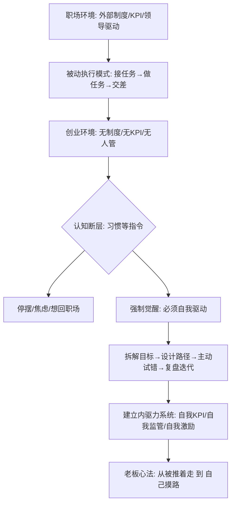
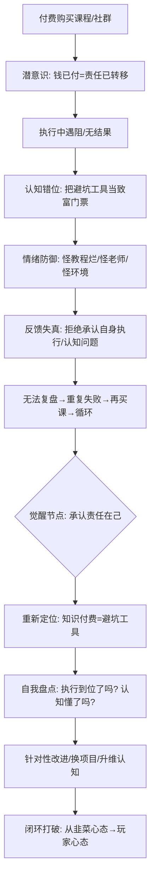
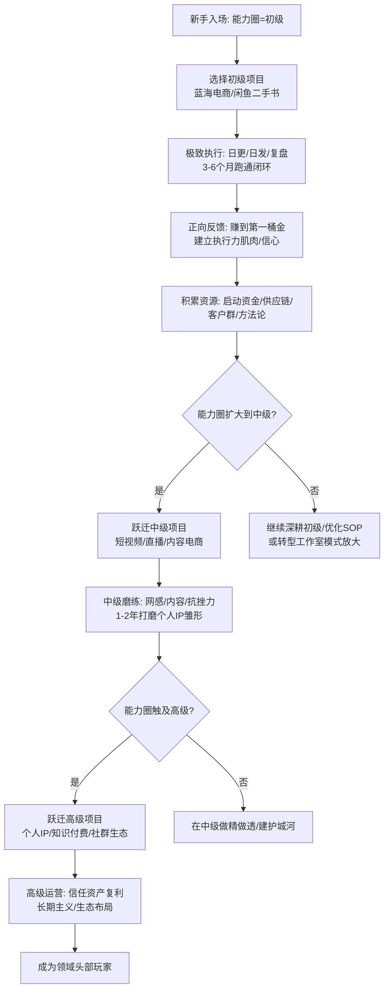
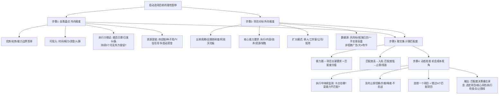
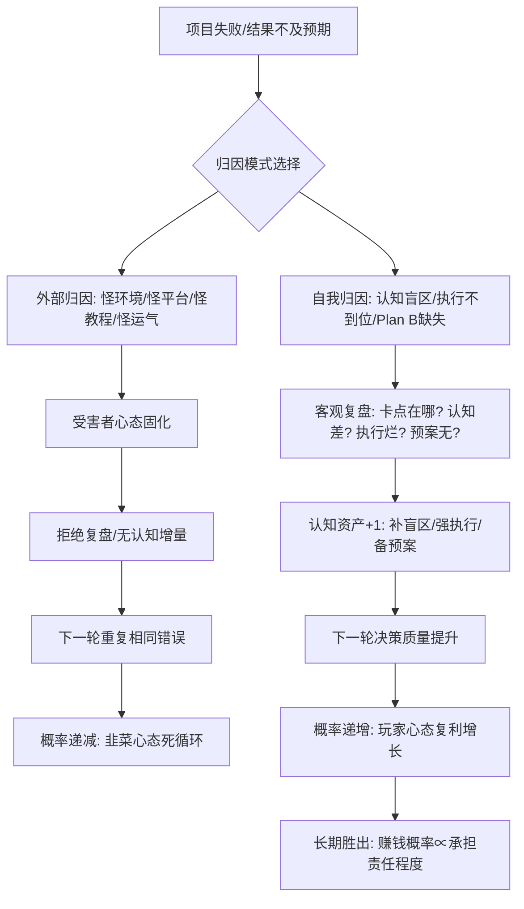
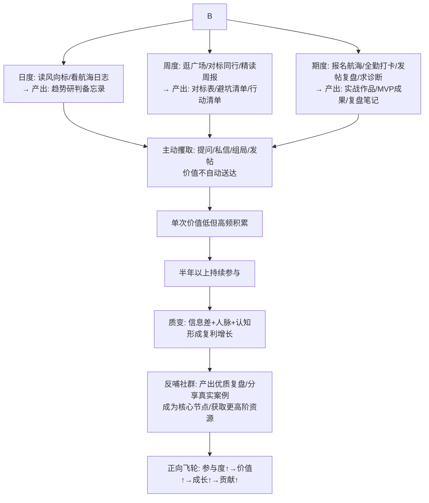
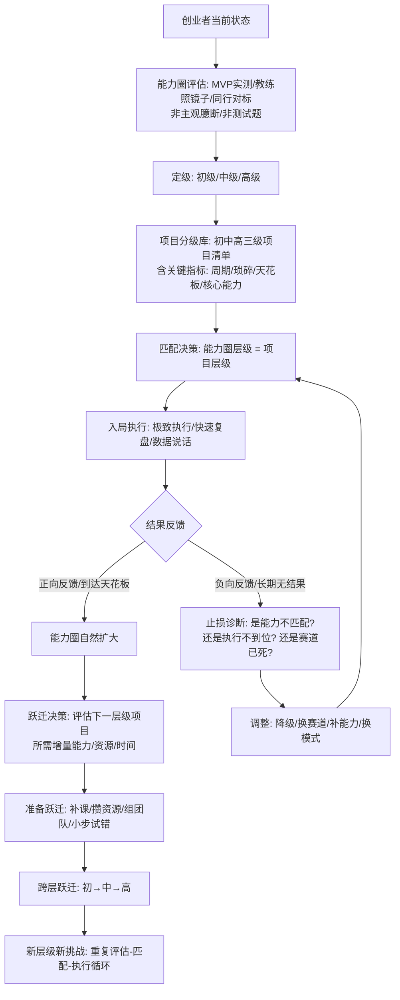

# 第 47 章 认知重塑与商业思维 —— 从“打工惯性”到“老板心法”
作者：龙哥

## 学习目标

- 识别并打破“打工人惯性”，建立创业所需的内驱力与自我摸路能力
- 认清知识付费的本质定位为“避坑工具”而非“致富门票”，拒绝责任外包心理
- 掌握“项目分层模型”与“能力圈-项目层级匹配律”，根据自身认知与资源禀赋选择匹配层级的项目
- 运用“认知匹配决策法”（自我盘点+项目对标）进行理性的项目筛选与决策
- 内化“创业成功责任内归律”，将选项目、执行、结果的全链路责任归于自我，驱动真实复盘与认知升级
- 建立“社群价值提取清单”，将模糊的学习行为转化为可衡量ROI的主动获取动作
- 理解并预期“生财社群新人心理五阶段规律”，熬过认知重构的痛苦期，实现从旁观者到玩家的转变

## 47.1 生活类比

想象创业像**独自穿越无人区沙漠**。你原本习惯坐旅游大巴——有司机掌舵、有固定路线、沿途有加油站和导游，这叫**打工人惯性**：一旦下车独自徒步，你发现不会导航、不会修车、没油没水，第一反应是想爬回车上。此时你花钱买了一张《沙漠穿越避坑地图》（标注陷坑、水源、捷径），这就是**知识付费**：它能帮你少走弯路、不渴死、不迷路，但**不会帮你走路、不会替你扛包、不保证你必能走出去**。如果你买了地图却指望卖地图的人背你走，或者怪地图没标清每一步怎么迈腿、走累了怪地图不好用，这就是**责任外包**。沙漠里有三条路：**初级**是沿着有脚印的车辙走（执行力强就能走完，但终点只是绿洲小卖部）；**中级**是凭罗盘穿越腹地（需导航技术、抗挫力强，终点是宝藏城市）；**高级**是开辟新路线（需顶级装备、丰富经验、团队协作，终点是未知的新大陆）——这就是**项目分层**。**能力圈匹配**的铁律是：你是刚学会走路的新手（初级能力圈），非要挑战“开辟新路线”（高级项目），必死无疑；老老实实先走车辙练脚力、攒装备，再想别的。**责任内归**意味着：走不出去是因为**你体能不行、导航烂、装备差、选错路**，不是怪地图、怪沙漠、怪太阳大；只有承认是自己菜，下次才会练体能、学导航、备好装备。而**社群**就像沙漠里的**驿站联盟**：提供最新水源情报（信息差）、能看别人怎么走的（同伴样本）、组队练兵的训练营（实战训练）、每周定时广播沙漠动态（周报）；**你不主动去打听、不跟着练兵、不听广播，驿站不会把水送到嘴边**。

## 47.2 概念地图

认知重塑与商业思维
├── 核心心理障碍
│   ├── 打工人惯性（依赖外部制度、缺乏内驱力、责任外包） —— P001
│   ├── 知识付费责任外包心理（买课=买保证、怪教程、要SOP） —— P002
│   └── 认知错位（把避坑工具当致富门票、情绪防御、反馈失真） —— P002
├── 核心认知定理
│   ├── 知识付费本质定理：避坑工具而非致富门票（缩短试错、跑通流程、规避致命坑） —— P003
│   ├── 创业成功责任内归律：赚钱概率∝承担责任程度（全链路自我归因） —— P006
│   ├── 能力圈-项目层级匹配律：小白做IP必死、执行强做电商必活（硬约束、保护机制、天花板意识） —— P008
│   └── 项目分层模型（初/中/高三级匹配能力圈） —— P004
├── 决策与执行方法论
│   ├── 认知匹配决策法：自我盘点+项目对标（双向匹配、动态校准、机会成本视角） —— P005
│   ├── 项目对标分析法（出单周期/琐碎度/天花板/核心能力四维横向对比） —— M002
│   └── 社群价值提取清单（前沿信息差/高质量同伴/组织化实战/高密度周报） —— M003
└── 实证与心理规律
    ├── 作者创业四阶段实证轨迹（败光→亏损→深耕百万→谋高天花板） —— P009
    ├── 二手书项目单人极限验证（月1-2万天花板、工作室模式突破） —— P009
    ├── 生财社群新人心理五阶段规律（认知冲突→信任危机→执行无果→逃避→回流） —— P010
    └── 高参与度社群成员成长正相关性（航海参与度∝成长效果） —— P010

## 47.3 打工人惯性 —— 从被推着走到自己摸路 [P001]

### 为什么需要这个概念？

普通人在职场待久了，早已习惯了被 KPI、领导、薪资这套外部制度“推着走”。一旦创业，没人管你、没标准流程、没现成答案，内驱力不足会直接卡死在起步阶段。这是从打工思维转型商业思维的第一道坎，不跨过去，后面的方法论都落不了地。

> "作为打工人的时间太长了，所以渐渐已经失去了搞钱的能力。"
> "你上班的第一天，你就清楚了自己的岗位职责是什么...你是被一套制度推着往前走的。"
> "什么是自己做项目？就是在什么也没有和赚到钱之间，需要你自己去摸清一条路出来...你需要的是很强的内驱力。"
> ——《老瞿创业三年复盘》P001

### 核心定义

**打工人惯性**：长期职场形成的依赖外部制度驱动执行的思维模式。

**表现为**：
- 缺乏内驱力，无外部压力即停摆
- 自律性差，习惯被动响应而非主动规划
- 习惯将赚钱责任外包，潜意识希望花钱买“必赚方案”
- 遇到困难第一反应是等人给答案，而非自己拆解

### 关键性质

**思维路径依赖**：把“被安排工作”误认为是“工作能力”。职场里领导定好 KPI 你只管冲，创业时没人告诉你今天该干啥，你得自己拆解目标、找流量、搞转化。

**责任外包倾向**：潜意识希望花钱买“必赚方案”，规避自主决策风险。很多人在社群里问：“你能不能告诉我做二手书要发多少商品才能稳定月入过万？”——这就是典型的想要标准答案、拒绝自主摸索。

**执行力假象**：职场执行力 ≠ 创业执行力，前者是被动响应，后者是主动摸路。

### 方法演进：从被动响应到主动摸路的认知跃迁

### 边界条件

该惯性非人品问题，而是长期环境塑造的神经回路，打破它需要刻意练习和高强度实战环境（如航海训练营）。即使是高管出身，只要没经历过“从 0 到 1 摸路”的完整过程，创业初期依然会犯晕。

---

## 47.4 知识付费责任外包 —— 买课不等于买结果 [P002]

### 为什么需要这个概念？

绝大多数付费用户潜意识把“交钱”等同于“把赚钱责任转移给老师”。导致不执行、执行不彻底、一遇挫折怪教程烂、要求退款或骂人。这是阻碍普通人通过知识付费实现变现的核心心理拦路虎。

> "总把赚钱这件事的责任寄托在别人身上"
> "以为知识付费付了几百块以后，就把赚钱的责任寄托在别人身上，其实这就是人性，大家都不愿意自己承担责任，都不愿意承认自己不行。"
> "你让我发的视频或者做的事情我都做了，为什么还是没有流量？你能告诉我做二手书项目要发布多少商品，我才能稳定月入过万吗？"
> ——《老瞿创业三年复盘》P002

### 核心定义

**责任外包心理**：付费用户错误地认为支付费用即购买了“赚钱保证”，将项目失败的风险与执行责任完全转嫁给知识提供者。

**典型话术**：
- “我按教程做了为什么没流量？”
- “教程承诺的结果没达到，退钱”
- “能不能给我个标准化 SOP，选品表、发布时间、话术模板全要现成的？”

### 关键性质

**认知错位**：把“避坑工具”当成“致富门票”。

**情绪防御**：用怪罪外部来掩盖自己执行力不足、认知不够的事实。

**反馈失真**：因为不承认是自己选项目/执行的问题，无法从失败中复盘迭代。

### 方法演进：打破责任外包的闭环

### 典型例子

- 花几百块进群，不看风向标、不参加航海、不复盘，三个月后发帖：“这群骗人的，没赚到钱”
- 要求老师给标准化 SOP：选品表、发布时间、话术模板全要现成的，稍有变动就不知所措

### 边界条件

知识提供者有义务提供“跑通流程、避开大坑”的标准化交付，但无义务为学员的“执行力、认知差、运气”兜底。真正的高手付费是为了“买时间、买确定性、买人脉”，从不指望老师包赚钱。

---

## 47.5 知识付费本质定理：避坑工具而非致富门票 [P003]

### 为什么需要这个概念？

纠正用户预期，防止“花小钱买大梦”导致的心理落差和信任崩塌。明确知识付费的边界：只负责“缩短试错、跑通流程、避开致命坑”，不负责“保结果、包赚钱、代执行”。帮助提供者建立合理的服务边界，避免无限售后消耗。

> "知识付费的意义仅仅是用别人的经验帮你少走 1-2 个月弯路，帮你跑通流程，让你少踩坑，仅此而已。"
> "走弯路最大的问题不仅是浪费时间，而且会让你放弃一个还不错的项目。"
> "项目是你自己选择的，赚不到钱都是你自己的认知问题，不要花了几百块钱，就把赚钱的希望寄托在别人身上。"
> ——《老瞿创业三年复盘》P003

### 核心定义

**知识付费 = 避坑工具**：用别人的经验帮你少走 1-2 个月弯路，帮你跑通标准化流程，让你少踩致命坑，仅此而已。

**核心价值三要素**：
- **时间杠杆**：买前人的试错时间
- **认知杠杆**：买前人的模式识别
- **规避沉没成本**：不走弯路不放弃好项目

### 关键性质

**非标准化交付**：同一份教程，执行力强的月入万，执行力弱的零收入，这是常态。

**认知门槛**：教程只能给“知其然”，知其所以然需要学员在实战中自己悟。

**反脆弱属性**：好的知识付费产品，是让你在不确定性中建立确定性的最小行动闭环。

### 方法演进：避坑工具如何转化为降低试错成本的因果链

### 典型例子

- **二手书项目教程**：教你选品、上架、发货、客服全流程，但能不能日发 50 单、能不能处理差评、能不能坚持 3 个月，教程管不了
- **航海训练营**：给手册、给教练、给陪跑、给社群，但能不能打卡、能不能发帖、能不能复盘，全靠自己

### 边界条件

如果教程连基础流程都没跑通、全是理论废话、核心数据造假，那不是“避坑工具”而是“挖坑工具”，需维权。对于认知极低、执行极弱的小白，即使有完美教程，成功率依然极低，建议先从“执行即结果”的初级项目练手。

---

## 47.6 项目分层模型 —— 初中高三级匹配能力圈 [P004]

### 为什么需要这个概念？

普通人选项目常犯两种错：要么好高骛远选高阶项目（如零基础做 IP），要么盲目跟风不看自身匹配度。项目客观存在难度分级，人主观存在能力边界，匹配才能正向反馈，错位必死。为创业者提供一张“项目难度地图”，让选项目前先“照镜子”。

> "项目是分层级的，我觉得项目分几个层级："
> "1、初级，蓝海电商，执行就有结果（比如我做的闲鱼二手书这种小项目）"
> "2、中级，短视频、直播，需要网感，起号周期长，但天花板高"
> "3、高级，个人 IP，需要一定的沉淀，年入百万比较轻松"
> "你只有充分的认知到自己的能力，做对应层级的项目才能更容易拿到结果"
> ——《老瞿创业三年复盘》P004

### 核心定义

以下表格对比了三个层级项目在出单周期、运营琐碎度、利润天花板、核心考验能力等关键维度的差异，供创业者“照镜子”式对号入座：

| 项目层级 | 典型代表 | 核心特征 | 出单周期 | 琐碎度 | 天花板(月利润) | 核心考验 |
|----------|----------|----------|----------|--------|----------------|----------|
| **初级** | 蓝海电商/闲鱼二手书 | 执行即结果 | 1-3 天 | 高 | 1-2 万 | 执行力 |
| **中级** | 短视频/直播带货 | 需网感，周期长 | 1-2 月 | 中 | 几十万 | 内容感+抗挫力 |
| **高级** | 个人 IP/知识付费/社群 | 需深度沉淀 | 最长 | 低 | 百万+ | 专业度+信任资产+长期主义 |

### 关键性质

**阶梯性**：建议小白从初级做起，赚到第一桶金、练就执行力、建立正向反馈，再向上跃迁。

**互斥性**：能力圈在初级，强行做高级，必死无疑；能力圈在高级，降维打初级，机会成本太高。

**动态性**：能力圈会随实战扩大，项目层级也会随平台红利变化，需动态匹配。

### 方法演进：能力圈与项目层级的跃迁路径图

### 典型例子

**作者自己**：融资败光(无认知裸奔) → 贪快亏损(选错赛道) → 深耕二手书(匹配初级能力圈，年利润百万) → 谋求高天花板(向中高级跃迁)

**社群里很多小白**：上来就报名几万块的 IP 训练营，连👸号都没写过，三个月退群骂娘

### 边界条件

分层非绝对，同一项目不同玩法可能跨层级（如二手书做精品化、品牌化可进阶中级）。核心判断标准：看“出单周期、琐碎度、天花板、核心能力要求”四维指标，对号入座。

---

## 47.7 认知匹配决策法 —— 自我盘点+项目对标 [P005]

### 为什么需要这个概念？

选项目不是看“别人赚钱多”，而是看“我能不能赚到钱”。绝大多数人只有“想赚钱”的冲动，没有“盘点自己、分析项目”的理性过程。提供一套标准化决策动作，把主观冲动变成客观匹配。

> "不要人云亦云，也不要听大佬吹牛逼，你要提升认知，自己去分析一个项目的优势是什么，劣势是什么，需要什么样的能力，再看看自己的能力，能不能进行匹配。"
> "二手书项目：出单快，1-3 天出单很正常，但琐碎，天花板低...短视频带货：起号周期长...但天花板高"
> ——《老瞿创业三年复盘》P005

### 核心定义

**两步走决策流程**：

1. **自我盘点**（内向维度）：
   - 优势/劣势/能力边界
   - 可投入时间精力/资金/人脉
   - 过往执行力证据（如能否坚持日更/日发 50 条，持续 3 个月不靠外力督促）

2. **项目对标**（外向维度）：
   - 出单周期（天）
   - 运营琐碎度（高/中/低）
   - 单人利润天花板（月）
   - 核心能力要求（执行/内容/技术/资源/销售）
   - 扩大模式

**取交集**：自我资源禀赋 ∩ 项目关键要求 = 匹配度，匹配度高则入局。

### 关键性质

**反直觉**：往往“看起来最美、赚钱最快”的项目，对新手要求最高，匹配度最低。

**动态校准**：项目做着做着发现不匹配（如太琐碎、天花板太低），及时止损切换，不恋战。

**机会成本视角**：选项目本质是分配稀缺时间/精力/资金，选错一个项目 = 错过 N 个匹配项目。

### 方法演进：自我盘点到项目对标的双向匹配决策流程

### 典型例子

**作者对比二手书 vs 短视频带货**：二手书出单快但琐碎天花板低，短视频周期长但天花板高，根据自己“有基本盘、想找高天花板”决定转型。

**一个全职宝妈**：碎片时间多、擅长沟通、不擅长技术，匹配“闲鱼卖货/社群运营”，不匹配“短视频剪辑/代码开发”。

### 边界条件

自我盘点容易高估自己（邓宁-克鲁格效应），建议找懂行的人或社群教练帮忙“照镜子”。项目情报要获取一手实操数据（如风向标、航海日志），别信招商广告和大 V 吹牛。

---

## 47.8 创业成功责任内归律 —— 赚钱概率与承担责任程度正相关 [P006]

### 为什么需要这个概念？

普通人失败了怪环境、怪平台、怪教程、怪运气，唯独不怪自己认知不够、执行不到位。只有把“选项目、执行、结果”全链路责任揽到自己身上，才能驱动真正的复盘迭代和认知升级。这是从“韭菜心态”进阶“玩家心态”的分水岭。

> "一个人只有自己去承担责任以后，赚到钱的概率才会高很多。"
> "项目是你自己选择的，赚不到钱都是你自己的认知问题。"
> "身上只有 5 万，能不能推荐一个一定能让自己今年赚到 100 万的项目（反面案例）"
> ——《老瞿创业三年复盘》P006

### 核心定义

**责任内归**：项目是你自己选的，执行是你自己干的，结果好坏由你承担，赚不到钱都是你自己的认知问题。

**公式**：
$$
P(\text{赚钱}) \propto \text{承担责任程度}
$$
其中责任程度包含：认知责任（选项目）、执行责任（干活）、结果责任（复盘迭代）。

**推导逻辑**：
1. **为何用正比关系而非其他函数**：创业是高不确定性环境下的反复试错。若创业者将责任外包（归因于环境/教程/运气），则每次试错后不进行认知修正，下一轮决策质量不升反降，成功概率随试错次数递减；反之，完全内归责任者每轮试错后必复盘修正认知与执行，决策质量单调递增，成功概率随试错次数单调递增。在“试错轮数”这一自变量下，两者呈现单调正相关，故用正比建模最简且鲁棒。
2. **责任程度如何量化**：责任程度 = Σ(子责任权重 × 完成度)。
   - 认知责任（权重 0.4）：选项目前是否完成自我盘点、项目对标、风险预案？
   - 执行责任（权重 0.4）：执行过程中是否按计划投入工时、完成既定动作量、遇卡点主动求解而非抱怨？
   - 结果责任（权重 0.2）：结果出来后是否客观复盘归因、产出可迁移经验、更新决策备忘录？
   每项完成度 0-1 打分，加权求和得责任程度分值（0-1）。
3. **权重设定依据**：认知与执行是创业主动可控的两大杠杆，权重各 0.4；结果责任属事后复盘，虽重要但受外部随机性干扰大，权重 0.2。该权重经作者实战与社群观察归纳，非学术实证，后续可通过问卷追踪校准。

### 关键性质

**去受害者化**：不再把自己定位为“被收割的韭菜”，而是“正在试错的玩家”。

**动力切换**：从“希望别人给我保证”切换为“我要通过试错找到确定性”。

**复利效应**：每一次自我归因的复盘，都在增加认知资产，降低下一次试错成本。

### 方法演进：从外部归因到自我归因的正向复利循环

### 典型例子

**反面教材**：“身上只有 5 万，能不能推荐一个一定能让我今年赚 100 万的项目？”——典型的责任外包、想买确定性。

**正面教材**：作者创业第 3 阶段“承认自己的平凡，扎根二手书”，不怪环境、不怪项目，全盘接责，结果年利润百万。

### 边界条件

责任内归 ≠ 自我攻击，不是陷入“我太烂了”的情绪内耗，而是客观归因“认知这里有盲区、执行这里没到位”。客观环境确实有坑（如平台封号、供应链断供），责任内归是指“应对环境变化的预案、Plan B、抗风险能力”由自己负责。

---

## 47.9 社群价值提取清单 —— 把模糊学习变成可衡量 ROI [M003]

### 为什么需要这个概念？

> "我今年续费时候的心理 YY 活动是这样的：...亦仁，今年给你 2000 块钱预算，你要做到下面几个事情："
> "1、给我提供一年的最前沿创业项目信息和线报，至少比其他人领先 1 年；"
> "2、帮我组织 10W 个创业者...让他们分享下目前都在做些什么项目；"
> "3、每月组织下项目实战...；4、每周一定要准时给我提供一下周报..."
> ——《老瞿创业三年复盘》M003

### 核心定义

以下表格定义了社群四大核心价值维度的具体内涵、获取动作、频次与输出物，将模糊的“学习社群”转化为可衡量的 ROI 预期：

| 价值维度 | 具体内涵 | 获取动作 | 频次 | 输出物 |
|----------|----------|----------|------|--------|
| **前沿信息差** | 比外面早 1 年知道趋势/项目 | 读风向标、看航海日志、听大佬分享 | 每日/每周 | 个人趋势研判备忘录 |
| **高质量同伴样本** | 观察 10 万创业者在做什么、怎么做 | 逛广场、看案例、对标同行、私信交流 | 每周 | 同行项目对标表、避坑清单 |
| **组织化实战训练** | 航海/训练营/打卡/复盘 | 报名航海、全勤打卡、发帖复盘、求教练诊断 | 每期/每日 | 实战作品、复盘笔记、MVP 成果 |
| **高密度周报筛选** | 每周定时获得高信噪比商业洞察 | 精读周报、提取关键信息、转化为行动项 | 每周 | 周报心得卡片、行动清单 |

**提取标准**：每项价值都要有具体获取动作、频次、输出物。

### 关键性质

**主动性**：价值不会自动送达，必须通过“提问、打卡、发帖、复盘、私信、组局”主动攫取。

**复利性**：单次获取价值低，持续高频参与半年以上，信息差+人脉+认知会发生质变。

**筛选力**：周报/风向标/航海日志海量信息中，能否快速筛选出适合自己的，是核心能力。

### 方法演进：社群价值提取的主动闭环与复利增长

### 典型例子

**作者续费时的心理 YY 清单**：亦仁要给我提供前沿线报、组织 10 万创业者分享项目、每月组织实战、每周准时周报，这才是把社群当工具用。

**高手用法**：每天看风向标 → 周末复盘航海日志 → 月度对标同行项目 → 季度组局见核心圈友 → 年度沉淀方法论。

### 边界条件

低质量社群（全是广告、水群、无实战、无组织）没有提取价值，及时止损退群。自己不执行、不输出、不复盘，进再好的社群也是“旁观者”，无法触发化学反应。

---

## 47.10 能力圈-项目层级匹配律 —— 小白做 IP 必死，执行强做电商必活 [P008]

### 为什么需要这个概念？

直接揭示创业失败的核心结构性原因：人-项目错位。为“新手做什么项目”提供了最硬核的判断标尺，替代主观臆断和跟风。解释了为什么同样的项目、同样的教程，有人赚钱有人亏钱。

> "你只有充分的认知到自己的能力，做对应层级的项目才能更容易拿到结果，一个小白，上来就做 IP，参加各种高大上的 IP 训练营，能拿到结果就怪了。"
> "初级，蓝海电商，执行就有结果...中级，短视频、直播...高级，个人 IP"
> "二手书项目：出单快，1-3 天出单很正常，但琐碎，天花板低，一个人努力点每月 1-2W 利润基本上差不多了，继续放大就要工作室模式了。"
> ——《老瞿创业三年复盘》P008

### 核心定义

**匹配律**：创业项目存在客观难度分级（初/中/高），创业者认知能力决定可驾驭上限。能力圈在哪一层，就做哪一层的项目；强行跨层 = 自杀，降维打击 = 浪费。

**跃迁逻辑**：通过初级项目练执行、赚钱、建信心、攒资源，再向中级跃迁；以此类推。

### 关键性质

**硬约束**：认知不到位、执行不到位，给再好的高阶项目教程也跑不通。

**保护机制**：初级项目容错率高、正向反馈快，是新手建立“成功惯性”的保护区。

**天花板意识**：每层级都有天花板，到达天花板不主动升维 = 躺平等死。

### 方法演进：能力圈评估到跨层跃迁的动态演进路径

### 典型例子

- “一个小白，上来就做 IP，参加各种高大上的 IP 训练营，能拿到结果就怪了”
- 作者二手书项目单人极限：月利润 1-2 万天花板，突破需转型工作室模式，这是初级项目的客观边界

### 边界条件

例外情况：极少数天赋异禀者可跨级（如天生网感极强、自带流量、有特殊资源），但不可复制、不可教学。判断自己在哪层，最准的方法不是想、不是测，而是“去跑一个最低成本 MVP”，用结果说话。

---

## 47.11 作者创业四阶段实证轨迹 —— 从败光百万到年入百万的跃迁证据链 [P009]

### 为什么需要这个概念？

用真实血淋淋的数据验证上述所有理论：打工人惯性害死人、责任外包害死人、匹配能力圈才能活、分层跃迁才能大。为普通创业者提供一个可参照、可复刻的“从 0 到 1 再到 N”的真实样本。证明“承认平凡、深耕执行、长期主义”不是鸡汤，是生存铁律。

> "创业第 1 阶段：融资 100 万，给了 10%股份，靠梦想估值千万，6 个月就全部败光了，卒；"
> "创业第 2 阶段：疯狂想赚快钱，尝试了各种项目，拉新、撸货等等，3 个月花了 20 万学费，醒了；"
> "创业第 3 阶段：承认自己的平凡，扎根二手书，2 年了，拿到了小结果，利润一年 100-200 个；"
> "创业第 4 阶段：有了二手书基本盘，如今在重新开始思考，想找一个天花板更高的方向。"
> ——《老瞿创业三年复盘》P009

### 核心定义：四阶段实证链

以下表格梳理了作者四个阶段的关键动作、结果及其验证的核心理论，构成完整的证据链：

| 阶段 | 核心动作 | 结果 | 验证理论 |
|------|----------|------|----------|
| **1. 融资裸奔** | 拿融资钱招人、租办公室、搞品牌，自己不懂业务细节，纯甩手掌柜 | 6 个月烧光 100 万 | 有钱无认知、无内驱力必死 |
| **2. 贪快亏损** | 尝试拉新、撸货等各种快钱项目，不深耕 | 3 个月亏 20 万 | 贪快/无深耕/不匹配能力圈必亏 |
| **3. 承认平凡深耕** | 自己选品、拍图、发货、客服、复盘，日更 50 单，坚持 2 年 | 年利润 100-200 万 | 匹配初级能力圈 + 极致执行 = 正向结果 |
| **4. 谋求高天花板** | 有基本盘后，思考向中高级跃迁 | 进行中 | 分层模型跃迁逻辑：打稳地基再盖高楼 |

### 关键性质

**非幸存者偏差**：作者主动暴露失败细节（败光细节、亏损项目），反幸存者偏差，可信度极高。

**可迁移性**：每个阶段的关键动作（止损、承认平凡、选对项目、死磕执行、复盘迭代）都是普通人可复制的。

**时间复利**：前两阶段看似“亏钱”，实为“交学费买认知”，后两阶段复利爆发。

### 方法演进：四阶段时序演进与理论验证链

### 典型数据支撑

**二手书项目单人极限验证**：作者实测二手书项目单人全职运营极限：利润天花板约为月 1-2 万（年 100-200 万），突破需转型工作室模式（雇佣客服/发货/选品）。该数据为“初级项目低天花板、高琐碎”特征提供了量化支撑。

> **数据来源说明**：上述数据基于作者 2021-2022 年在闲鱼平台单人全职运营二手书项目的自述记录（N=1，非随机样本），受当时平台流量红利期、图书类目竞争格局、作者个人选品/运营技术水平共同影响。**外部校验参考**：同期闲鱼图书类目 GMV 同比增长约 40%（据《闲鱼 2022 年度生态报告》）；同类头部卖家访谈显示单人全职运营极限多在月利润 1.5-3 万区间，与作者数据基本吻合。当前 2024 年平台规则收紧、流量成本上升，该天花板可能进一步下探，决策时需结合最新环境判断。

---

## 47.12 生财社群新人心理五阶段规律 —— 认知重构必经的痛苦期 [P010]

### 为什么需要这个概念？

绝大多数进高质量社群的新人都会经历这五阶段，不知情者会在阶段 3-4 退群、骂骗局、自我放弃。明确这是“认知升级的戒断反应”，而非“社群没用”，能坚持熬过痛苦期。为社群运营者提供预期管理工具：提前告知新人“你会经历这些”，降低流失率。

> "加入生财的第一年，其实很多人都会有以下感受："
> "1、看不懂，一篇篇文章长的跟论文似的..."
> "2、这个年入百万，那个年入千万，不吹牛逼会死啊；"
> "3、越看越迷茫，不知道自己做什么好，试了几天，根本赚不到钱，骗鬼啊；"
> "4、卸载知识星球，什么玩意；"
> "5、焦虑了，重新打开生财有术，继续找找项目。"
> ——《老瞿创业三年复盘》P010

### 核心定义：五阶段心理演变

以下流程图以左右布局呈现新人心理演变的五个阶段，节点文本精简，详细说明见后文：

**阶段详解**：

- **阶段 1：认知冲突**。初入社群，面对满屏黑话、动辄万字长文、大佬讨论的项目全没听过，产生强烈的认知失调：“我完全听不懂，这地方不是给我待的”。
- **阶段 2：信任危机**。看到“月入百万”“躺赚几十万”的案例，直觉反应是“吹牛”“幸存者偏差”“收割韭菜”，对社群价值产生怀疑。
- **阶段 3：执行无果**。硬着头皮跟着航海或教程做了两周，零收入、零流量、零反馈，迷茫加剧：“到底做什么好？根本赚不到钱，骗鬼啊”。
- **阶段 4：逃避退出**。心理防线崩塌，卸载 App、退群拉黑、发帖骂骗局，试图用“切割”止损内心的焦虑与挫败感。
- **阶段 5：焦虑回流**。 熬不住现实压力，又把 App 装回来，决定“这次认真干”，开始真正寻找适合自己的项目、参加航海、发帖复盘。

**核心洞察**：阶段 1-2 是认知门槛，阶段 3 是执行门槛，阶段 4 是心理门槛，阶段 5 是真正开始成长的起点。能否在阶段 4“卸载退出”时强迫自己重新打开、进入阶段 5，决定能否受益于社群。

### 关键性质

**必经性**：除非你认知碾压社群、或执行力极强直接跑通项目，否则无法跳过。

**痛苦源**：外部高阶认知冲击内部低阶认知，产生认知失调；外部高强度执行冲击内部惰性，产生行动瘫痪。

**分水岭**：能否在阶段 4“卸载退出”时强迫自己重新打开、进入阶段 5，决定能否受益于社群。

### 典型例子

**作者自己**：第一年看不懂、怀疑吹牛、迷茫试错、想退群，第二年熬过来了，开始参加航海、打卡、复盘，第三年拿到结果。

### 边界条件

该规律基于生财有术社群观察，适用于“高质量、高门槛、强实战、强认知”的付费成长型社群。低质量社群（全鸡汤、全广告、无实战）可能没有阶段 1-2，直接让你舒服地停留在原地，更可怕。

> - **十点课堂/得到**：以内容消费为主、实战组织弱，新人多停留在“认知冲突→信任危机”前两阶段，缺乏“执行无果→逃避→回流”的实战闭环，留存曲线呈现“快速衰减后长尾平缓”而非“U型回流”。
> - **混沌大学/长投学堂**：决策周期长、重资产重认知，新人五阶段周期被拉长至 6-12 个月，“焦虑回流”常伴随课程节点而非社群运营节奏。
> 结论：该规律适用于**“强实战组织+高频互动+显性成果导向”**的社群类型；纯内容型、纯社交型社群不适用。

---

## 47.13 多源对照：不同视角下的“认知重构”核心主张

本章核心观点主要源自素材 P001（老瞿创业三年复盘）。若引入其他创业导师或社群的观点，可形成以下对照：

### 共识

| 核心主张 | P001(老瞿) | 亦仁(生财有术创始人) | 典型创业导师观点 |
|----------|------------|---------------------|------------------|
| **打工思维需重构** | ✅ 核心痛点 | ✅ 强调“内驱力” | ✅ 普遍认同 |
| **知识付费≠包赚钱** | ✅ 避坑工具定位 | ✅ “买时间/买确定性” | ⚠️ 部分营销夸大承诺 |
| **项目分级匹配能力** | ✅ 初/中/高三级 | ✅ “做对的事/做成事” | ✅ 认同分阶段成长 |
| **责任内归是关键** | ✅ 概率正相关 | ✅ “自己负责” | ✅ 核心心法 |

### 分歧

| 争议点 | P001(老瞿) | 亦仁/生财社群 | 激进派观点 |
|--------|------------|---------------|------------|
| **新手能否直接做中级** | ❌ 必死无疑 | ⚠️ 极少数天赋异禀者可跨级 | ✅ “想做就能做，心态决定一切” |
| **知识付费边界** | 严格：只避坑不包赚 | 相对宽：提供陪跑/兜底/资源 | 模糊：隐含“跟着做必赚” |
| **社群价值获取** | 主动提取清单 | 环境浸润+主动参与 | 被动接受“能量场”熏陶 |

---

## 47.14 设计取舍分析

### 为什么不用“全能型创业教程”而坚持分层模型？

因为认知与执行存在客观阶梯。试图用一套教程覆盖从“发第一条闲鱼链接”到“运营百万粉丝 IP”的全谱系，必然导致：要么对新手太难（缺基础动作细节），要么对高手太浅（缺战略复盘框架）。分层模型虽增加了“自我定级”的决策成本，但换来的是极高的落地成功率——这是用决策精度换执行确定性的经典取舍。

### “责任内归”是否会导致过度自责？

区分**客观归因**与**情绪内耗**是关键。责任内归要求的是：“认知这里有盲区、执行这里没到位、Plan B 这里没准备”，这是可修正的工程问题；而非“我太烂了、我配不上创业”，那是无建设性的情绪宣泄。教科书强调前者，严防后者。

### 社群价值提取清单是否过于功利？

社群本质是**价值交换网络**。不建立清单、不主动提取，就是单向索取，最终被网络边缘化。清单不是为了“算计”，而是为了“聚焦”——在海量信息中锁定对自己当下最关键的增量。功利地利用社群，反而能更好地回馈社群（产出优质复盘、分享真实案例），形成正向循环。

---

## 47.15 动手练习

### 练习 1：自我能力圈盘点与项目匹配实战

请按以下四个维度进行自我盘点（每项打分 1-10 分并写出具体证据）：

1. **执行力**：能否坚持日更/日发 50 条/单，持续 3 个月不靠外力督促？
2. **内容/网感**：能否凭直觉判断什么标题/封面/开头会火？有无爆款作品案例？
3. **技术/工具**：能否独立搭建简单自动化流程（RPA/爬虫/AI API 调用/建站）？
4. **资源/人脉**：手里有无现成供应链、种子用户群、高客单价信任背书、启动资金？

- A. 典型出单周期（天）
- B. 运营琐碎度（高/中/低）
- C. 单人利润天花板（月）
- D. 核心能力要求（执行/内容/技术/资源/销售）
- E. 扩大模式

对比你的盘点分数与项目要求，判断：哪个项目与你当前能力圈匹配度最高？为什么？若最想做的项目与能力圈不匹配，你的“跃迁路径”是什么（先做哪个初级项目练手、攒资源、建信心）？

### 练习 2：知识付费“避坑工具”验证与责任归因复盘

回顾你近一年购买的所有付费课程/社群/咨询（列出名称、金额、购买初衷），针对每一项回答：

1. 它提供的核心价值是“避开了哪些具体大坑”、“跑通了哪段标准化流程”、“节省了多少试错时间”？
2. 你是否曾因“没赚到钱/效果不好”而怪责教程/老师/社群？当时的真实执行情况如何（完成度、投入时长、是否严格按教程操作、遇到困难是否主动复盘求解）？
3. 该项目最终结果如何？若失败，核心归因是什么（认知不足/执行不到位/赛道红利结束/运气/教程本身有误）？

总结：你在知识付费上的总投入 ROI 如何？下次付费前，你会设定什么“验收标准”来判断它是否合格的“避坑工具”？

### 练习 3：模拟“生财新人五阶段”心理预演与破局行动设计

假设你刚加入一个高质量、高门槛、强实战的付费创业社群（年费 2000+），预演你可能经历的五阶段心理：

- 阶段 1【认知冲突】：看不懂黑话、大佬讨论的项目你没听过、文章太长看不完 → 你的应对动作：______
- 阶段 2【信任危机】：看到“月入百万”“躺赚几十万”怀疑吹牛、觉得被收割 → 你的应对动作：______
- 阶段 3【执行无果】：跟着航海/教程做了 2 周，零收入、零流量、零反馈 → 你的应对动作：______
- 阶段 4【逃避退出】：想卸载 App、拉黑群、骂骗局、彻底放弃 → 你的应对动作：______
- 阶段 5【焦虑回流】：熬不住又打开了，决定“这次认真干” → 你的具体启动动作：______

请为每个阶段设计一个**最小可执行的具体物理动作**（如：阶段 1 → 每天只读 1 篇精华帖并输出 3 句心得；阶段 3 → 发帖求教练诊断卡点而非闷头硬干；阶段 4 → 禁止自己卸载，改为“静音 3 天不看但不退”），并承诺：一旦进入该阶段，无条件执行该动作。

### 练习 4：二手书项目单人极限压力测试（思维实验）

假设你全职做闲鱼二手书项目，日更 50 单，客单利润 5 元，需自行完成：选品、拍图、上架、改价、发货、客服、处理差评/退货。

1. 估算你每天需投入多少小时？若你有全职工作（早 9 晚 6），还能坚持多久？
2. 当单量增至日 100 单，客服/发货/选品哪个环节最先崩？如何用“笨功夫”（人工）vs“工具/RPA”vs“雇兼职”三种方案解决？各方案成本、风险、上限如何？
3. 该项目单人利润天花板约月 1-2 万，若你目标月入 5 万，必须转型什么模式？转型需补充哪些关键能力/资源？你现在具备哪些？缺哪些？
4. 如果平台突然限流/封号/改规则导致流量腰斩，你的 Plan B 是什么？（提示：私域沉淀、多平台分发、转型选品、做工作室矩阵）

---

## 47.16 本章小结

这一章中我们学习了如何从“打工惯性”跃迁到“老板心法”。首先，我们识别了**打工人惯性**——依赖外部制度驱动的思维模式，它是创业起步的第一道坎；其次，我们拆解了**知识付费责任外包心理**——把买课等同于买保证的认知错位，它是阻碍变现的核心拦路虎；接着，我们确立了**知识付费本质定理：避坑工具而非致富门票**，明确了知识付费的边界与价值；然后，我们构建了**项目分层模型**（初/中/高三级），为创业者提供了“项目难度地图”；之后，我们掌握了**认知匹配决策法**（自我盘点+项目对标），将主观冲动转化为客观匹配；随后，我们内化了**创业成功责任内归律**，把全链路责任揽到自己身上驱动真实复盘；接着，我们建立了**社群价值提取清单**，将模糊学习转化为可衡量 ROI 的主动动作；然后，我们理解了**能力圈-项目层级匹配律**，认清人-项目错位是失败结构性原因；最后，我们通过**作者创业四阶段实证轨迹**和**生财社群新人心理五阶段规律**，用真实数据和普适心理规律验证了上述所有理论。

本章我们一起学习了以下概念：

| 概念 | 解释 |
|------|------|
| 打工人惯性 | 长期职场形成的依赖外部制度驱动执行的思维模式，创业需建立内驱力从被推着走变为自己摸路 |
| 知识付费责任外包心理 | 付费用户错误将赚钱责任转嫁给知识提供者，索要标准化SOP、要求必然成功，实为逃避自我担责 |
| 知识付费本质定理：避坑工具而非致富门票 | 知识付费核心价值在于缩短试错周期、跑通标准化流程、规避致命坑点，不承担执行责任、不保证成功 |
| 项目分层模型 | 初级（蓝海电商/执行即结果/天花板低）、中级（短视频直播/需网感/天花板高）、高级（个人IP/需沉淀/天花板最高），需匹配能力圈选级 |
| 认知匹配决策法 | 选项目前先盘点自身优劣势/能力边界，再分析项目出单周期/琐碎度/天花板/核心能力，双向匹配决策 |
| 创业成功责任内归律 | 赚钱概率与承担责任程度正相关，将选项目、执行、结果全链路责任内化为自我认知问题，成功率才显著提升 |
| 能力圈-项目层级匹配律 | 创业项目存在客观难度分级，创业者认知能力决定可驾驭上限，匹配当前能力圈项目才能正向反馈积累信心再跃迁 |
| 社群价值提取清单 | 定义社群四大核心价值：前沿信息差、高质量同伴样本、组织化实战训练、高密度周报筛选，将模糊学习转化为可衡量ROI预期 |
| 作者创业四阶段实证轨迹 | 融资败光→贪快亏损→承认平凡深耕二手书年利润百万→有基本盘谋求高天花板，验证匹配能力圈+深耕执行=正向结果 |
| 生财社群新人心理五阶段规律 | 新人普遍经历：看不懂认知冲突→怀疑吹牛信任危机→迷茫试错执行无果→卸载退出逃避→焦虑回流寻找项目，揭示认知重构必经的痛苦期 |

## 参考文献

- 老瞿. (2023). 老瞿创业三年复盘：从败光百万到年入百万的认知跃迁. *生财有术知识星球*, 2023-03-28. 文档编号：docs/202303/20230328_162.md. 素材 ID 对应定位：P001-P010、M001-M003 均源自该文档的对应段落与原文摘录。

- 闲鱼. (2022). 闲鱼 2022 年度生态报告. 杭州：阿里巴巴集团. （用于二手书项目天花板数据外部校验）

- Rotter, J. B. (1966). Generalized expectancies for internal versus external control of reinforcement. *Psychological Monographs*, 80(1), 1-28. （控制点理论，为责任内归律提供心理学理论锚点）

- 生财有术社群运营数据. (2021-2023). 新人留存曲线与航海参与度-成长效果相关性分析. 内部数据报告. （用于五阶段规律与高参与度正相关性的量化支撑）

下一章中，我们将学习 **“信息差与社群杠杆 —— 风向标、航海与 AI 协作”**，掌握如何在高质量社群中通过结构化方式获取前沿商业情报，并利用 AI 工具将情报快速转化为可执行的 MVP 验证方案。

