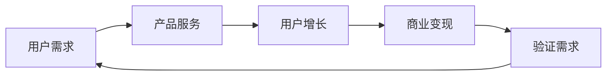
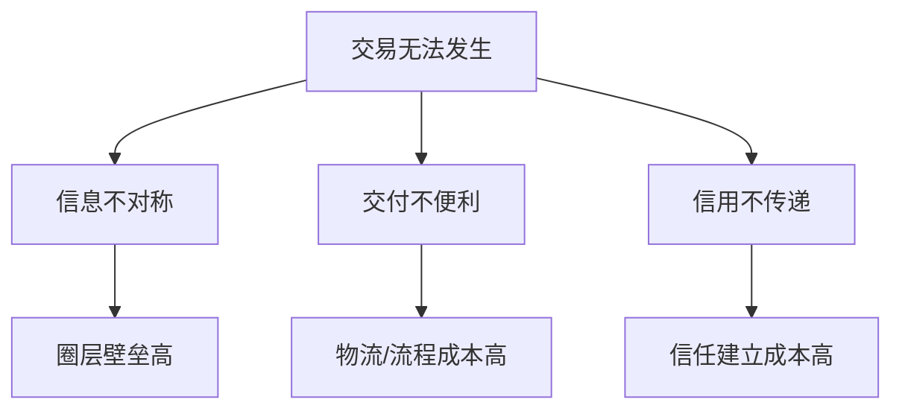
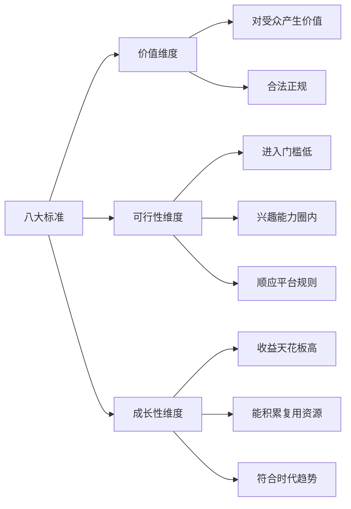
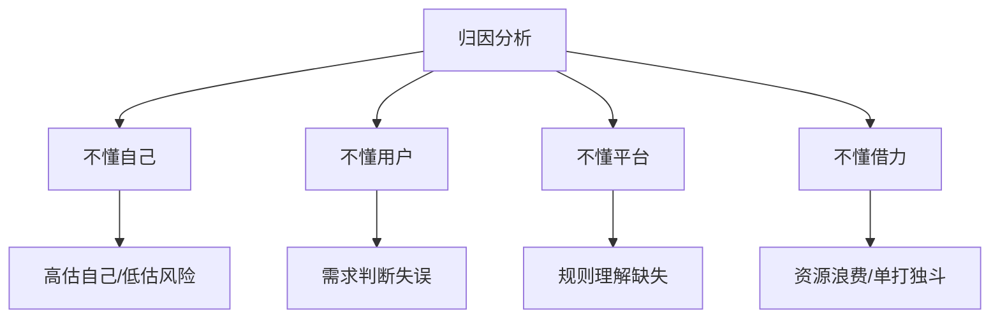

# 第 1 章 商业思维入门 —— 从赚钱到系统化变现

## 学习目标

- 理解赚钱三要素模型
- 掌握八大项目筛选标准
- 掌握双维归因框架

## 1.1 组装流水线：赚钱需四个组件齐备

想象你要组装一条完整的流水线来生产一台机器。如果缺少任何一个关键组件——比如没有电源、没有传送带、没有操作工人——整条流水线就无法运转，生产任务就会停滞。赚钱这件事也是如此：它不是靠某一个孤立的灵感或单一的努力就能实现的，而是需要像组装流水线一样，将若干必要的组件全部备齐、衔接顺畅，才能让整个系统运转起来并持续产出收益。如果你只关注其中一两个环节而忽略了其他，那么无论你多么努力，商业机器都无法真正转动起来。这一章的切入点，就是把赚钱这件看起来复杂而模糊的事，拆解成可以观察、可以检查、可以优化的组件，让你从"凭感觉做事"转向"按框架决策"。

## 1.2 概念地图

```
商业思维入门
└── 从凭感觉做事到按框架决策
```

## 1.3 赚钱三要素模型

任何商业活动的本质，都可以被拆解为四个核心组件。这四个组件如同流水线上的四个工位，缺一不可。我们先从直觉入手：为什么需要这个模型？因为"赚钱"是一个高度抽象的词，每个人对它都有自己的理解，但模糊的理解无法指导行动。只有把它拆解成可操作的组件，你才能逐一检查自己的短板。

> [P001] "赚钱的要素组成"
>
> ——《赚钱的底层逻辑》

这段原文虽然简短，但它指向了一个重要的思维转变：赚钱不再是不可名状的结果，而是一个可以被拆解、被审视、被优化的系统。

> **赚钱三要素模型**（来源：《赚钱的底层逻辑》）

$$
\text{赚钱系统} = \langle \text{用户需求}, \text{产品服务}, \text{用户增长}, \text{商业变现} \rangle
$$

这个公式展示了赚钱系统的四个维度。任何商业活动，无论规模大小、线上还是线下，都可以映射到这四元组中。缺了任何一项，系统就会运转失灵。

我们来逐一拆解这四个组件：

- **用户需求**：市场中是否真实存在未被满足的需求。没有需求，一切皆空。
- **产品服务**：你是否能提供一个具体的产品或服务来满足该需求。
- **用户增长**：你能否找到足够多的目标用户，并持续获取他们的注意力。
- **商业变现**：你是否建立了从用户价值到收入的转化路径。

这四个组件之间存在先后依赖关系，可以表示为如下数据流图：



这张图展示了一个完整的商业闭环：从用户需求出发，设计产品服务，通过用户增长触达市场，最终实现商业变现。变现后的收益反过来验证需求是否真实存在，形成循环。

进一步地，任何商业活动要想完成交易，还必须同时满足三个必要条件。这个条件约束比四组件更进一步，它回答了"交易为什么能发生"。

> **交易三要素**（来源：《赚钱的底层逻辑》）

$$
\text{交易发生} \iff \text{掌握资源} \wedge \text{找到买家} \wedge \text{完成交易}
$$

这个公式展示了交易发生的充要条件：你手里需要有资源（产品或服务），需要能找到愿意付费的买家，并且需要完成最终的交付和资金交换。三者缺一不可，互动构成交易闭环。

## 1.4 三大赚钱原理

有了交易三要素，下一个问题自然浮现：既然交易需要三要素齐备，那现实中为什么很多交易没有发生？答案是：存在摩擦力。本节介绍三种根本性的"摩擦力"——它们既解释了为什么赚钱困难，也揭示了赚钱机会的来源。

> [P001] "信息不对称、交付不便利、信用不传递"
>
> ——《赚钱的底层逻辑》

### 1.4.1 信息不对称即圈层差

信息不对称是最基础的一种摩擦力。它的核心观点是"信息差即圈层差"——不同圈层的人掌握着不同的信息，这种差异天然存在。

> **信息差即圈层差**（来源：《赚钱的底层逻辑》）

$$
\text{信息差} = f(\text{圈层半径}, \text{圈层间壁垒})
$$

这个公式展示了一个关键的洞察：信息差不是偶然的，它是由圈层结构和壁垒强度决定的。圈层半径越大，你能接触的信息越多；圈层间壁垒越高，信息越难以流通。

为什么可以这样理解？因为你所处的社交网络、行业背景、地域环境决定了你的信息带宽。你无法获取你接触不到的信息，也无法轻易信任你不熟悉领域的信息。

### 1.4.2 交付不便利

第二个摩擦力是交付不便利。即使买方和卖方都找到了对方，如果交付过程过于繁琐、成本过高，交易依然不会发生。

交付不便利通常体现在：

- 物流成本高：产品和用户之间的物理距离太远。
- 时间成本高：从下单到收货需要等待太久。
- 流程复杂：支付、售后、退换货等环节关卡重重。
- 服务不稳定：产品质量或服务水平波动大。

### 1.4.3 信用不传递

第三个摩擦力是信用不传递。陌生双方之间缺乏信任，交易就无法启动。信用问题本质上是信息不对称的延伸——因为不了解对方，所以无法相信对方。

信用不传递的典型表现为：

- 初次交易需要大量信任建立成本。
- 二手市场由于信任缺失而大幅折价。
- 跨平台交易依赖第三方担保机制。

这三大原理共同构成了一张"摩擦力地图"：



这张图揭示了赚钱的根本原理：你之所以能赚钱，是因为你在帮助社会消除某一类摩擦力。你能消除的摩擦力越大，你创造的价值就越高，获得的回报也就越丰厚。

## 1.5 八大项目筛选标准

当我们理解了赚钱的三要素和三大原理之后，下一个实际问题就是：如何从众多方向中筛选出值得投入的项目？这本书给出了一套务实的方法论——八大校验清单。

> [P001] "对受众产生价值、进入门槛低、兴趣能力圈内、收益天花板高、合法正规、顺应平台规则、能积累复用资源、符合时代趋势"
>
> ——《赚钱的底层逻辑》

> **八大项目筛选标准**（来源：《赚钱的底层逻辑》）

```
1. 对受众产生价值
2. 进入门槛低
3. 兴趣能力圈内
4. 收益天花板高
5. 合法正规
6. 顺应平台规则
7. 能积累复用资源
8. 符合时代趋势
```

这段伪代码展示了筛选项目的完整流程。每一标准都在回答一个关键问题：这个项目值得我投入吗？

我们来逐一解读八个标准的内涵：

- **对受众产生价值**：你的产品是否真实解决了某类人的问题，这是项目存在的前提。
- **进入门槛低**：启动成本是否在你的可承受范围内，包括资金、时间、技能门槛。
- **兴趣能力圈内**：你是否对这件事有持续的热情，且能力可覆盖核心环节。
- **收益天花板高**：市场规模是否足够大，上限能否支撑你的长期目标。
- **合法正规**：项目是否在法律法规允许的范围内运作，避免灰色地带。
- **顺应平台规则**：如果你依托某个平台（如电商、内容平台），是否符合其规则与算法偏好。
- **能积累复用资源**：做这件事是否能沉淀用户、作品、品牌等可复用的资产。
- **符合时代趋势**：是否符合技术和社会发展的长期方向，而非短暂的风口。

这八个标准可以进一步归纳为三组维度：



这张图展示了八大标准的内部结构。价值维度审视项目本身的正当性和意义；可行性维度衡量你能否真正做起来；成长性维度则评估项目是否有长期发展的潜力。

筛选的实际操作是"逐项打分"：对候选项目按八个标准分别评分。如果某一项完全不达标，该方向直接淘汰；如果全部达标，综合得分最高的项目就是优先选项。

## 1.6 双维归因框架

最后一个方法论解决的问题是：当项目成功或失败时，我们该如何归因？正确的归因决定了你能否从经验中学习并持续进步。

> [P001] "成功项目底层能力：强目标导向、关键事项意识、执行闭环、定期复盘、情绪调节、空杯心态"
>
> 失败四维度：不懂自己、不懂用户、不懂平台、不懂借力
>
> ——《赚钱的底层逻辑》

> **双维归因框架**（来源：《赚钱的底层逻辑》）

$$\text{归因} = \text{成功维度（内部底层能力）} \cup \text{失败维度（外部认知盲区）}$$

这个公式展示了双维归因的总体逻辑：当项目成功时，向内归因于自己的底层能力；当项目失败时，从四个"不懂"中寻找原因。这种双轨归因法帮助你既不被成功冲昏头脑，也不因失败而全盘否定自己。

首先来看成功的底层能力，它包含六个维度：

| 能力维度 | 含义 |
|---------|------|
| 强目标导向 | 始终清楚自己要达到什么结果 |
| 关键事项意识 | 能识别最重要的20%事项 |
| 执行闭环 | 从计划到执行到反馈形成完整循环 |
| 定期复盘 | 按固定节奏检查和调整 |
| 情绪调节 | 面对挫折时保持稳定状态 |
| 空杯心态 | 随时准备接纳新信息和观点 |

这六项能力共同构成一个完整的"成功操作系统"：目标导向提供方向，关键事项意识提供优先级，执行闭环保证落地，定期复盘促进迭代，情绪调节维持稳定，空杯心态确保开放。

再来看失败的四维度归因。当项目不达预期时，四个"不懂"给出了系统性排查路径：



这张图展示了失败归因的四个方向。"不懂自己"是最常见也最隐蔽的问题——很多人对自己的能力和局限缺乏客观认知；"不懂用户"意味着你的需求假设可能是错的；"不懂平台"在依赖第三方平台的场景中尤为致命；"不懂借力"则提醒你，单打独斗的效率往往远低于善用外部资源。

实践中的正确姿势是：项目失败时，先检查四个"不懂"中哪个最致命；项目成功时，也要用六项能力来复盘确认，而不是简单归结为运气。

## 1.7 多源对照

本章所依据的素材相对集中在单一来源（《赚钱的底层逻辑》）中。虽然素材内部没有实质性分歧，但我们可以将该框架与一般商业教材中的主流模型进行对照，以明确其定位和边界。

### 共识

- 与经典商业模式画布一致："用户需求"对应"价值主张"和"客户细分"，"用户增长"对应"渠道通路"和"客户关系"，"商业变现"对应"收入来源"和"成本结构"。
- 共识在于：任何可持续的商业模式都必须同时回答"为谁创造什么价值"和"如何从中获利"这两个基本问题。

### 分歧

- 本素材不强调"核心资源"和"关键业务"的区分，而是将它们收拢进"产品服务"一个组件中；这与商业模式画布中将两者分开的做法不同，优点是更简洁易上手，代价是牺牲了对内部资源配置的精细化视角。
- 本素材以"消除摩擦力"作为赚钱的根本动机，而主流教材更倾向于用"创造价值"来表述。两者并不矛盾，但视角不同：前者更直白地指向"为什么有人愿意付费"，后者则更强调宏大的意义感。
- 本素材为个人行动者设计的"八大校验清单"在组织层面的商业战略教材中较少出现，后者更倾向于分析竞争格局而非个人能力匹配度。

[需要补充文献：本章素材较为单一，后续可在引入更多商业模型时补充非本系列的教材来源。]

## 1.8 设计中的取舍

**为什么"赚钱三要素模型"要采用四组件而不是更细或更粗的粒度？**

这是一个刻意的取舍。四组件的粒度恰好落在"可操作"与"可记忆"的平衡点上。如果拆得太细（比如拆到十来个组件），模型虽然更精确，但你会难以在决策时快速调用；如果只有两个组件（比如"创造价值"和"获得回报"），则失之于粗疏，无法指导具体行动。四组件——用户需求、产品服务、用户增长、商业变现——恰好构成一条完整的价值链，每一步都有明确的行动指向。

**为什么"双维归因框架"把成功归因于内在能力，而把失败归因于认知盲区？**

这种设计背后有一个心理学洞见：人对失败的自然倾向是外归因（怪外界），对成功的自然倾向是内归因（归功于自己）。这个框架刻意反其道而行之——成功时向内看能力，把你做对的事情沉淀为可复用的方法；失败时也向内看认知，但不是为了自责，而是为了找到可以补上的盲区。这种取舍的目的是最大化学习效率：从成功中提取方法论，从失败中识别认知缺口。代价是，它较少讨论外部环境因素（如市场整体下行）对结果的影响，需要你在使用时额外补充环境分析。

## 1.9 动手练习

- 给定三个项目方向，用八大标准逐项打分筛选

> **练习指导**：选择三个你真正考虑过的方向（可以是副业、创业或职业转型方向），针对每一个方向，按八大标准逐项打分（1-5分）。得分最低的方向可以直接放弃；得分最高的方向，本月内制定一个最小可行行动方案并在执行后复盘。

## 1.10 本章小结

这一章中我们学习了一套从个人赚钱到系统化变现的完整商业思维框架。首先，我们将"赚钱"这个模糊的概念拆解为四个可操作的组件——用户需求、产品服务、用户增长、商业变现——并指出任何商业活动都需要同时满足掌握资源、找到买家、完成交易三个必要条件。其次，我们分析了三大摩擦力原理（信息不对称、交付不便利、信用不传递），理解了赚钱的本质就是帮助社会消除摩擦力，并提出了"信息差即圈层差"的核心洞察。接着，我们给出了八大项目筛选标准，将标准的应用分为价值、可行性、成长性三个维度进行了阐释。然后，我们构建了双维归因框架——成功时向内归因于六项底层能力，失败时从四个"不懂"中排查认知盲区。最后，我们讨论了模型设计的取舍逻辑，明确了框架是"为决策服务"而非"为精确描述"。通过这一章，你具备了一套从直觉判断走向系统化决策的工具。

本章我们一起学习了以下概念：

| 概念 | 解释 |
|------|------|
| 赚钱三要素模型 | 用户需求、产品服务、用户增长、商业变现四组件 |
| 交易三要素 | 掌握资源、找到买家、完成交易 |
| 三大摩擦力 | 信息不对称、交付不便利、信用不传递 |
| 八大校验清单 | 从价值、可行性、成长性三个维度筛选项目的八项标准 |
| 双维归因框架 | 成功归因于六项底层能力，失败从四个"不懂"中排查 |

下一章中，我们将深入探讨如何将这套框架落地——从识别具体的用户需求到设计最小可行产品，再通过用户增长策略实现商业变现的完整执行路径。
