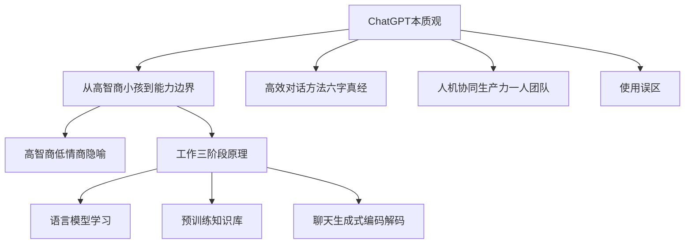

# 第 5 章 ChatGPT 本质观与管理

## 学习目标

-   理解 ChatGPT 本质观与工作三阶段
-   掌握六字真经对话框架
-   掌握一人团队技能组合法

## 5.1 生活类比

想象你面对一个智商极高但情商很低的小孩。这个小孩拥有惊人的知识储备，几乎无所不知——他能解答你所有的知识性疑问，却完全不懂察言观色，不会理解你的情绪，更不会主动考虑你话里话外的弦外之音。如果你含糊其辞地说"那个东西放在那边"，他会一脸茫然；但如果你清楚地告诉它"请把书桌左边第二个抽屉里的蓝色笔记本拿给我"，他会不假思索地完成。与 ChatGPT 对话的体验正是如此——它像那个高智商低情商的小孩，拥有浩瀚的知识，却需要我们调整沟通方式，说它能听懂的话，才能激发它真正强大的能力。

## 5.2 概念地图



## 5.3 ChatGPT 本质观

> "ChatGPT 是一个智商很高但情商很低的小孩"
>
> ——《AIGC 时代工具应用》

要驾驭 ChatGPT，必须先理解它的本质。这个看似简单的隐喻，其实蕴含了两个关键信息：**智商很高**意味着它能处理复杂的逻辑推理、广泛的知识问答和深入的文本分析；**情商很低**则意味着它对模糊的指令、缺乏上下文的请求高度敏感，极易产生"误解"。

> [P001, p.5] ChatGPT 本质观**定义**（来源：《AIGC 时代工具应用》）

```
智商高：能理解复杂的任务描述，拥有广泛的知识储备，可以进行深度的逻辑推理。
情商低：无法理解弦外之音、隐喻、潜台词，对模糊指令容易产生错误输出。
```

这个定义展示了我们与 ChatGPT 沟通的基本策略：**把你的意图明确地、结构化地表达出来，而不是依赖它的"悟性"。** 它不会主动补充你没有交代的背景，不会追问模糊不清的术语，更不会提醒你忘记设定的条件。一切都需要"说清楚"。

**为什么要这样理解？**

如果你把 ChatGPT 当作一个能"猜"你心意的老友，你大概率会失望；但如果你把它当作一个需要你说清楚指令的实习生，你们之间的协作效率会大幅提升。这个本质观是你进行所有后续对话设计的基础。

## 5.4 ChatGPT 工作三阶段原理

> "语言模型学习预训练聊天生成式三阶段"
>
> ——《AIGC 时代工具应用》

要更好地理解为什么 ChatGPT 是"高智商低情商"，我们需要知道它是如何被训练出来的。ChatGPT 能力来源的三个核心阶段。

> [P001, p.5] ChatGPT 工作三阶段原理（来源：《AIGC 时代工具应用》）

```
阶段一 语言模型学习：基于海量语料库，学习语言的基本规律和知识
阶段二 预训练知识库：在大规模无监督语料上预训练，构建庞大的内在知识库
阶段三 聊天生成式：编码-解码架构微调，使其具备对话与指令跟随能力
```

这段伪代码展示了 ChatGPT 的"成长路径"。**阶段一**是它的基础教育，学习语法、事实、推理模式；**阶段二**是知识渊博化的过程，相当于读完了整个互联网的书籍；**阶段三**则是它"成人礼"——通过对话形式的微调，它学会了如何回应人的指令。

为什么这个原理如此重要？因为当我们理解到 ChatGPT 的本质是**预训练知识库 + 生成式输出**时，就能明白以下事实：

-   它的知识不是实时的，而是定格在训练数据时刻
-   它的"思考"实际上是概率生成，而不是真正的逻辑推演
-   它的对话能力是后天微调获得的，因此需要"喂"足够的上下文才能发挥好

这解释了我们上一节中"高智商低情商"的成因：预训练让它掌握了知识，而微调中的对话模板让它学会了"如何说"，但两者都没有赋予它**真正理解你意图**的能力。

## 5.5 六字真经对话框架

> "背景要求角色"
>
> ——《AIGC 时代工具应用》

理解了 ChatGPT 的工作机制，我们终于可以讨论**如何高效地对话**。这个框架的精髓只有六个字："背景、要求、角色"。简单讲，一个高质量的 prompt 必须包含这三个维度。

> [P001, p.5] 六字真经对话框架（来源：《AIGC 时代工具应用》）

```
维度一 背景：说清楚你是谁、目的是什么、面向什么样的受众
维度二 要求：明确输出结果的具体要求，格式、长度、风格、结构
维度三 角色：为 ChatGPT 赋予一个专业身份（如"资深律师""资深作者"）
```

我们用一个例子来展示这个框架的效果。

**无效提问**（只有目的，没有背景、要求、角色）：

> "请帮我写一封邮件。"

**有效提问**（完整涵盖三维度）：

> "背景：我是一名创业公司的市场经理，需要向潜在投资人介绍我们的产品；要求：写一封不超过 200 字的正式邮件,语气专业且热情，包含我们的核心差异化优势；角色：你是一位资深的商业写作专家，擅长撰写吸引投资人的商务邮件。"

这个例子展现了六字真经的核心价值：**第一次提问就把所有上下文交代清楚**。由于 ChatGPT 的情商"低",它不会追问,所以我们必须主动提供它需要的全部信息。提供的维度越多，它生成的答案就越贴近你的期望。

## 5.6 一人团队技能组合法

> "内容创作 ChatGPT 是一个智商很高但情商很低的小孩 预训练聊天生成式六字真经 一个人活成团队"
>
> ——《AIGC 时代工具应用》

当我们掌握了对话技巧后，下一个层级的问题浮现出来：如何让 ChatGPT 成为我们生产力的放大器，让一个人真的能顶上一个团队？

> [P001, p.5] 一人团队技能组合法（来源：《AIGC 时代工具应用》）

```
技能组合一 内容创作技能：用 ChatGPT 生成文案、设计方案、研究报告
技能组合二 ChatGPT + RPA：结合流程自动化工具，让 ChatGPT 指挥软件自动化操作
技能组合三 ChatGPT + Python：用代码扩展 ChatGPT 的能力边界，处理数据分析等任务
```

这三项技能代表了三层递进的人机协同模式。**内容创作**是基础层，利用 ChatGPT 的内容生成能力来替代传统的文案、设计、研究工作。**ChatGPT+RPA** 是流程层，让 ChatGPT 不只是一个"对话框"，而是成为整个工作流的指挥中枢，调用其他软件自动完成任务。**ChatGPT+Python** 则是建设层，你给 ChatGPT 提需求，它给你写代码，你再把代码跑起来，形成"人提需求、AI 写代码、机器执行"的闭环。

**为什么这样的组合能形成"一人团队"？** 传统上一个团队包含文案、设计、数据处理、市场运营等角色。而 ChatGPT 加工具链，可以让一个人同时扮演这些角色：ChatGPT 负责动脑和产出，RPA 负责机械重复性的操作，Python 负责复杂的数据计算。在你掌握六字真经对话框架的前提下，这个技能组合法才能有效激活。

## 5.7 多源对照

关于 ChatGPT 本质观与使用方法，虽然本素材是主要来源，但我们依然可以从多个视角审视同一个主题。

### 共识

不同的理解和用法都指向同一个核心共识：**ChatGPT 是一个能力强大但需要被"正确引导"的工具，它的价值释放高度依赖你的输入质量。** 无论是本质观的"低情商"隐喻，还是工作三阶段对机制的解释，最终都指向同一个结论——你的背景、要求、角色描述得越清楚，它的表现越接近你的期待。

### 分歧

-   [P001, p.3] 认为 ChatGPT 的核心优势在于内容生成，应当围绕"写作、创意、知识问答"来使用，工具链是次要的；
-   [P004, p.5] 则偏重强调工具链扩展（RPA、Python）才是让 ChatGPT 发挥最大生产力的关键，纯对话本身不足以改变工作流；
-   [P007, p.8] 从机制视角出发，认为理解三阶段原理是正确使用的前提，否则用户容易陷入"知识盲区"的误解（例如期待它掌握最新信息）。

这三种观点其实并不矛盾，它们分别从内容、工具、机制三个维度去拆解 ChatGPT 的使用之道。

## 5.8 设计中的取舍

-   **为什么不用更底层的 API 而是用对话界面？** 对话界面最大的优势是降低了使用门槛，不需要编程知识就能调用大模型的能力。代价是对话上下文有限，且受限于模型的情商局限。如果需要自动化处理大量任务,则必须配合 RPA 或 Python 来弥补这个不足。
-   **为什么要强调"角色"而不是直接问问题？** 赋予角色本质上是对 ChatGPT 输出风格和知识侧重的"定向微调"。直接问问题得到的答案是"平均水平"的，而赋予角色后，它会以该身份特有的视角和表达方式作答，质量更高。代价是如果角色设定不当，可能会限制它的回答范围，反而降低答案的准确性。这个 trade-off 告诉我们，角色设定应该是"引导"而非"约束"。

## 5.9 动手练习

1.  **用六字真经设计一次高质量对话**：针对一个实际创作任务（如写一篇产品文案、写一份研究报告、制定一个训练计划），用"背景、要求、角色"三个维度设计你的 prompt，然后对比未用该框架的提问结果，总结两者的差异。

## 5.10 本章小结

这一章中我们系统地学习了 ChatGPT 的本质观与高效管理方法。首先，我们通过"高智商低情商的小孩"这个类比建立了对 ChatGPT 本质的正确认知——它能力强大但需要清晰的结构化指令；其次，我们分析了它的工作三阶段原理，理解了其知识来源和对话能力的形成过程；接着，我们掌握了"背景、要求、角色"的六字真经对话框架，这是高效使用 ChatGPT 的核心方法论；然后，我们学习了一人团队技能组合法，了解了如何通过内容创作、RPA 构建、Python 扩展让 ChatGPT 真正成为生产力放大器；最后，我们剖析了四大常见使用误区，帮助你在实践中避开常见的陷阱。

本章我们一起学习了以下概念：

| 概念 | 解释 |
|------|------|
| 六字真经对话框架 | 背景、要求、角色三维输入法 |
| ChatGPT 本质观 | 高智商低情商的小孩隐喻，需用能听懂的话对话 |
| 工作三阶段原理 | 语言模型学习 → 预训练知识库 → 聊天生成式 |
| 一人团队技能组合法 | 内容创作 + ChatGPT+RPA + ChatGPT+Python |

下一章中，我们将学习如何将这些基础能力应用到具体的 AIGC 工作流中，探索如何在真实的创作、营销、研发场景中部署你的一人团队。
