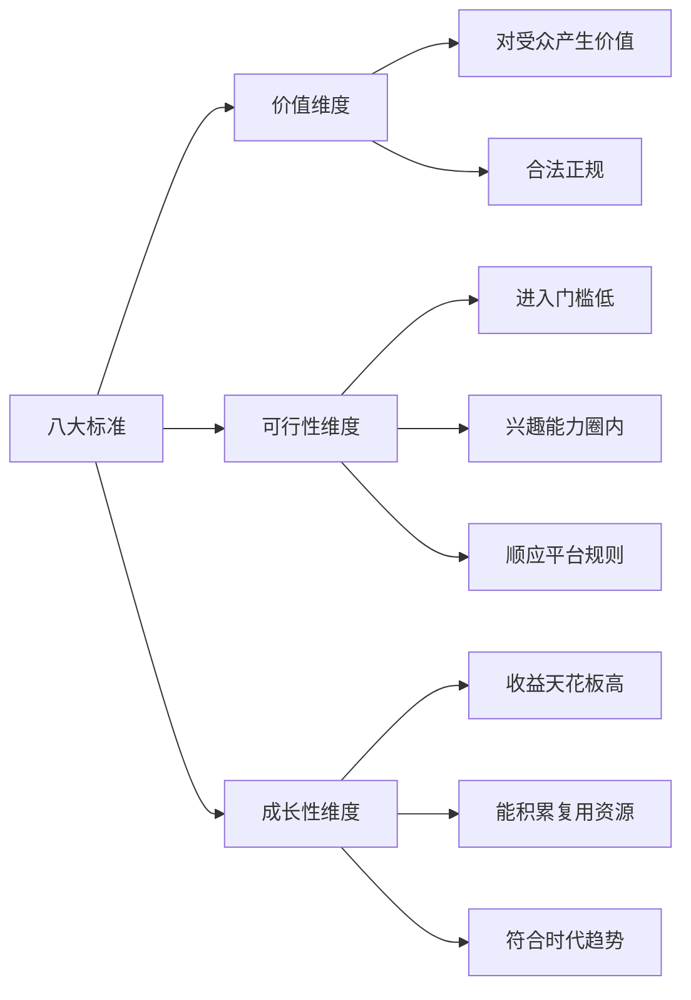

# AI 时代的赚钱新范式

**副标题：个体与中小企业的定位、壁垒与变现方法论**

---

## 前言

在 AI 浪潮汹涌而至的当下，无数个体创业者、自由职业者、中小企业主，甚至普通的职场人，都在思考同一个问题：我该如何在这样一个时代赚钱？

本书想要回答的，正是这个问题。它的核心命题可以浓缩为一句话：

> **AI 时代个体与中小企业的赚钱新范式：聚焦「5%优势」，以工具（GPT/AI）提效，以资源差构建壁垒，通过公域引流+私域深耕实现持续变现。**

这本书不是某个单一平台的操作手册，也不是空洞的商业理论堆砌。它是一套经过实战检验的、可操作的方法论体系，遵循「道 — 法 — 术 — 器」的逻辑递进：

- **道（认知升级）**：先打破你对「赚钱」的固有认知，理解赚钱的本质是交易，是价值交换。
- **法（战略定位）**：再学会战略聚焦——永远只做属于你的 5% 生意，善用资源差构建壁垒。
- **术（流量与变现）**：然后掌握各平台的实操打法和完整案例复盘。
- **器（AI 工具）**：最终学习把 ChatGPT 等 AI 工具变成你的生产力放大器。

本书的每一章、每一条知识点，都能回溯到具体的实战素材来源。我们在写作过程中，学习并提炼了大量一线操盘者与创业者的真实经验——从「如何发掘资源差」到「永远只做 5% 的生意」，从「创业层级决定利润天花板」到「ChatGPT 六字真经」。这些经验不是纸上谈兵，而是一个个普通人在真实市场中摸爬滚打、真金白银验证过的成果。

希望这本书能为你拨开信息过载的迷雾，帮你找到属于自己的那条聚焦、有壁垒、可持续的变现之路。

---

## 目录

**第 1 章 交易式赚钱 —— 把目光所及变成可卖的商品**
- 1.1 学习目标
- 1.2 生活类比：赚钱就像在集市上摆摊
- 1.3 概念地图
- 1.4 交易式赚钱 —— 给赚钱一个最底层的定义
- 1.5 三多增收法 —— 把交易规模从三个方向撑大
- 1.6 稀缺与定价权 —— 谁稀缺谁说了算
- 1.7 设计中的取舍
- 1.8 动手练习
- 1.9 本章小结

**第 2 章 商业思维入门 —— 从赚钱到系统化变现**
- 2.1 生活类比：组装流水线
- 2.2 概念地图
- 2.3 赚钱三要素模型
- 2.4 三大赚钱原理
- 2.5 八大项目筛选标准
- 2.6 双维归因框架
- 2.7 多源对照
- 2.8 设计中的取舍
- 2.9 动手练习
- 2.10 本章小结

**第 3 章 商业定位 —— 主动做 5% 的生意**
- 3.1 生活类比：餐厅挑食客
- 3.2 概念地图
- 3.3 用户选择权
- 3.4 三差模型
- 3.5 好生意五特征
- 3.6 5% 规模悖论
- 3.7 多源对照
- 3.8 设计中的取舍
- 3.9 动手练习
- 3.10 本章小结

**第 4 章 创业层级 —— 从卖货到建生态的阶梯**
- 4.1 创业的七层阶梯
- 4.2 概念地图
- 4.3 创业七层级：定义与边界
- 4.4 利润天花板定理
- 4.5 收入可波动但层级必须增加定理
- 4.6 创业层级评估法
- 4.7 多源对照
- 4.8 设计中的取舍
- 4.9 动手练习
- 4.10 本章小结

**第 5 章 ChatGPT 本质观与管理**
- 5.1 生活类比：高智商低情商的小孩
- 5.2 概念地图
- 5.3 ChatGPT 本质观
- 5.4 ChatGPT 工作三阶段原理
- 5.5 六字真经对话框架
- 5.6 一人团队技能组合法
- 5.7 多源对照
- 5.8 设计中的取舍
- 5.9 动手练习
- 5.10 本章小结

---

# 第 1 章 交易式赚钱 —— 把目光所及变成可卖的商品

## 1.1 学习目标

读完本章，你将能够：

- 理解「赚钱=交易=买卖」的底层逻辑，能用交易视角统一解释各种赚钱形态。
- 掌握三多增收法的公式拆解（收入 = 卖出的件数 × 单件价格 × 可卖的品类数）。
- 掌握稀缺与定价权的关系，能判断什么条件下自己拥有定价权。
- 能运用三多增收法为具体产品或服务设计增收路径。
- 能识别交易成立的边界条件（双向自愿、存在可接受对价等）。

## 1.2 生活类比：赚钱就像在集市上摆摊

赚钱就像在集市上摆摊。你每天在集市上支起一个小摊，摊上摆着你带来的东西——可能是你亲手做的馒头，可能是你帮人跑腿省下的时间，也可能是你从别处批发来的新奇玩意儿。路过的顾客看中了某样东西，愿意用你认可的货币换走它，交易就成了。交易完成的那一刻，你手里的物品变成了钱，顾客手里的钱变成了物品，双方都觉得自己占了便宜，这才是赚钱最朴素的样子。

摆摊的本质不是「生产」，而是「交换」：你手里有别人想要的，别人手里有你想拿的，交换让双方各取所需。如果没人愿意掏钱跟你换，那摊位上堆得再多也只是库存；如果有人愿意排长队来买，那你摊位上哪怕是普通石头也能卖出黄金的价。

集市上的摊位各有各的绝活，有的摊位回头客络绎不绝（卖得多），有的摊位独此一家别无分号（卖得贵），有的摊位从针线到电器样样齐全（卖得多元）。理解了摆摊的逻辑，你就理解了赚钱的全部秘密：它与你的出身、学历、身处何处无关，只与你在集市上如何摆摊、如何定价、如何让更多人愿意和你交换有关。

这个「摆摊」类比会贯穿全章——交易定义对应「支摊」，三多增收对应「扩大摊位生意」，稀缺定价对应「独家商品」。

## 1.3 概念地图

```
交易式赚钱
├── 本质定义
│   ├── 赚钱 = 交易 = 买卖
│   ├── 交易必须双向成立
│   └── 未卖出的生产不构成赚钱
├── 三多增收法
│   ├── 卖得多（复购+分销）
│   ├── 卖得贵（稀缺定价）
│   └── 卖得多元（品类扩展）
├── 稀缺与定价权
│   ├── 稀缺方掌控定价权
│   ├── 稀缺来源（产品/技能/渠道/信息/品牌信任）
│   └── 稀缺与圈层/信息差
└── 边界条件
    ├── 需要可接受对价
    ├── 交易必须自愿
    └── 稀缺相对买方成立
```

## 1.4 交易式赚钱 —— 给赚钱一个最底层的定义

> **[素材摘录]**（来源：《看了100+精华帖后，我梳理了一套赚钱的知识体系》）
> 「赚钱的本质是交易、卖东西。赚钱=交易=买卖。目光所及之处皆是商品。」

当你说「我在赚钱」时，你实际上在把你的什么东西卖给别人。这个「什么东西」可以是产品（一杯奶茶）、服务（一次咨询）、时间（八小时劳动），甚至可以是你的注意力（给平台拍短视频）。把它们和一个数字（价格）挂钩，然后完成交付，货币就流进了你的口袋。

这就是交易式赚钱的**底层定义**：

> **赚钱 = 交易 = 买卖**

$$\text{赚钱} \;\xleftrightarrow{\text{等价}}\; \text{交易} \;\xleftrightarrow{\text{等价}}\; \text{买卖}$$

这个公式展示了三件关键的事：(1) 赚钱不是孤立行为，它必须有一个交易对手——买家；(2) 交易必须双向成立，你给出价值、对方给出货币，缺一不可；(3) 买卖是交易最具体的形态，「卖」是你的动作，「买」是对方的动作。

在形式化定义之后，我们再来看它的**边界条件**。如果交易价格为**零**，那就不叫「赚钱」，而叫「赠送」。**价格为零 = 赠送 ≠ 赚钱**，这是定义的第一条边界线。

这条定义看起来简单，但它有几个强大的推论：

- **赚钱不需要自己生产**：交易的本质是交换，你只需要拥有别人想要的东西——哪怕它是你从别人那里买来的，转手倒卖也是交易。
- **赚钱的起点是「可卖」**：你的时间、技能、产品如果不能被包装成「可卖的商品」，就永远停留在「资产」层面，无法转化为「收入」。
- **赚钱的终点是「成交」**：只有对方愿意掏钱那一刻，交易才成立。所以赚钱能力 = 让别人为你的价值付费的能力。

这段推导让我们明确了一个关键认知：**赚钱不是一种技能，而是一种交易结构**。你的关注点不应放在「我有什么」上，而应放在「别人愿意为什么付钱」上。

## 1.5 三多增收法 —— 把交易规模从三个方向撑大

> **[素材摘录]**（来源：《看了100+精华帖后，我梳理了一套赚钱的知识体系》）
> 「卖得多（可复购+分销）、卖得贵（稀缺定价）、卖得多元（粉丝多重变现）。」

理解了赚钱=交易=买卖，下一个问题自然浮现：既然赚钱就是卖东西，那我怎么才能卖得更多、赚得更多？答案可以归结为**三多增收法**：卖得多、卖得贵、卖得多元。这三条路径不是互斥的，你可以同时从三个方向撑大交易规模。

> **三多增收法**（来源：《看了100+精华帖后，我梳理了一套赚钱的知识体系》）

从数学上，三多增收的本质是拆解收入公式：**收入 = 卖出的件数 × 单件价格 × 可卖的品类数**。「卖得多」提升第一项（件数），「卖得贵」提升第二项（价格），「卖得多元」提升第三项（品类）。三根杠杆同时撬动，收入以乘法而非加法增长——这就是三多增收法威力远大于单点优化的原因。

**「卖得多」的两个引擎**值得单独展开：

- **可复购**：让同一个客户反复购买。理发店的会员卡、咖啡店的「买十送一」、SaaS 的订阅制，都是通过把一次性交易变成持续循环来拉高「件数」。可复购的本质是建立用户黏性。
- **分销**：让更多人帮你卖。微商的层级代理、淘宝客的 CPS 分成、社群的分佣裂变，都是通过把「卖」的动作复制给渠道，让一件产品触达指数级放大的买家。

我们用一个具体的例子把三多串起来：

| 增收维度 | 杠杆手段 | 奶茶店的例子 |
|---------|---------|------------|
| 卖得多 | 可复购 | 推出「买十送一」会员卡，锁定同一顾客每周买 2 次 |
| 卖得多 | 分销 | 招募校园代理，让 100 个学生帮你拉新客，每单给提成 |
| 卖得贵 | 稀缺定价 | 推出「城市限定款」，每天只做 50 杯，卖完即止 |
| 卖得多元 | 品类扩展 | 从奶茶扩展到咖啡、甜品、零食，让一次进店产生多笔消费 |

## 1.6 稀缺与定价权 —— 谁稀缺谁说了算

> **[素材摘录]**（来源：《看了100+精华帖后，我梳理了一套赚钱的知识体系》）
> 「稀缺方掌控定价权……当供给充分的时候，资源不再是优势方，手握现金的买家才是优势方，那么降价就成必然。」

三多增收法中的「卖得贵」并不适用于所有商品——为什么你的奶茶只能卖 15 元，而某品牌的「季节限定款」能卖 45 元还排队？答案是**稀缺性**。

> **稀缺定价**（来源：《看了100+精华帖后，我梳理了一套赚钱的知识体系》）

$$\text{定价权} \propto \text{稀缺度}\quad\text{且}\quad \text{定价权}_{\text{买方}} + \text{定价权}_{\text{卖方}} = 1$$

这个公式展示了定价权的不对称分布：买卖双方掌握的定价权加起来是 1，但分配比例完全由稀缺度决定。如果一件商品遍地都是（卖方稀缺度低），定价权完全在买方手里；如果一件商品只此一家（卖方稀缺度高），定价权完全在卖方手里。

「稀缺」在赚钱语境下远比我们想象的宽泛。总共有五种稀缺可以转化为定价权：

| 稀缺类型 | 含义 | 例子 |
|---------|------|------|
| 产品稀缺 | 你有别人做不出来的东西 | 拥有独家配方的饮料 |
| 技能稀缺 | 你有很难学会的能力 | 顶尖外科医生的手术技艺 |
| 渠道稀缺 | 你掌握别人进不去的通路 | 某品牌的独家代理权 |
| 信息稀缺 | 你比别人知道得更多更早 | 提前知晓某地块要建地铁 |
| 品牌信任稀缺 | 客户只信你，别人复制不了 | 老字号的招牌 |

稀缺的来源不同，但逻辑一致：**定价权永远偏向资源更稀缺的那一方**。当你发现自己总在被压价时，本质原因是你的可替代性太高——你并不稀缺。反过来，想掌握定价权的方法只有一个：让自己成为某个维度上不可替代的那个人。

还有一条延伸推论值得注意：「圈层变多，信息差扩大，流通价值增大。」当你和越来越多的圈层发生连接时，你在每个圈层里的信息就变成了「稀缺信息」——你在 A 圈层的见闻对 B 圈层是稀缺的。**跨圈层的信息搬运者，天然拥有定价权**。

## 1.7 设计中的取舍

**为什么用「卖得多」而不是「卖得贵」作为增收的重心？**

从数学上看，增收 = 单价 × 数量。单价（卖得贵）的提升有上限——人们的支付意愿是有天花板的；而数量（卖得多）的提升几乎是无限的——可复购 + 分销能把同一产品卖向无穷多的买家。卖得贵依赖稀缺，稀缺天然意味着「少」；卖得多依赖复制和传播，天然意味着「多」。聪明的做法不是二选一，而是用「基础款走量 + 稀缺款拉高调性」组合出拳。

**为什么「价格为零 = 赠送 ≠ 赚钱」这条边界如此重要？**

如果不画这条边界，我们很容易陷入自我感动式的「伪赚钱」——天天免费帮人解决问题，忙到脚不沾地，却一分钱没进账。划定这条边界之后，「赚钱」的定义就清晰了：**必须有正价格、有货币回流**。这不是冷血，而是让劳动真正进入交易系统的前提。

## 1.8 动手练习

**练习 1：拆解身边的赚钱案例** — 以你熟悉的一家奶茶店为例，指出其「卖得多（可复购+分销）」「卖得贵（稀缺定价）」「卖得多元（品类扩展）」各采取了哪些动作，分析哪个维度最强、哪个最弱，并回答该店是否拥有定价权。

**练习 2：用收入公式设计增收路径** — 给定某知识付费博主的收入数据（单门课程 ¥199/1000份；¥99/年社群会员/500人），计算当前年收入，分别按「多卖、贵卖、多元卖」给出三种增收方案并估算收入上限，最后叠加计算理论最大年收入。

**练习 3：定价权来源分析** — 以「顶尖眼科医生」为例，判断其稀缺类型，分析被 AI 辅助诊断替代后的定价权变化，提出两种维持定价权的策略。

## 1.9 本章小结

这一章确立了「赚钱=交易」的总纲。首先我们在集市场景中建立了对交易的直觉；然后给出了赚钱最底层的定义（赚钱=交易=买卖），以「价格为零=赠送≠赚钱」划出边界；接着介绍了三多增收法，从卖得多、卖得贵、卖得多元三个方向拆解了撑大交易规模的手段；最后剖析了「卖得贵」背后的稀缺原理。核心概念总结如下：

| 概念 | 解释 |
|------|------|
| 赚钱=交易=买卖 | 赚钱的本质是价值与货币的双向交换 |
| 三多增收法 | 从卖得多、卖得贵、卖得多元三个方向撑大交易规模 |
| 稀缺与定价权 | 稀缺一方掌控定价权，定价权按稀缺度不对称分配 |

这一章确立了「赚钱=交易」的总纲，但还有一个问题悬而未决：你要「卖」的东西到底从哪里来？下一章中，我们将学习如何从自己的已有资源中识别、打磨甚至创造出可交易的产品，并掌握一套筛选与归因的方法论。

> **本章素材来源**：`docs/202304/doxcnk4mqgBMJTv0mklq0eR48fg.md`《看了100+精华帖后，我梳理了一套赚钱的知识体系》

---

# 第 2 章 商业思维入门 —— 从赚钱到系统化变现

## 2.1 学习目标

- 理解赚钱三要素模型，能把赚钱拆解为可操作的组件。
- 掌握八大项目筛选标准，能对风向逐项校验。
- 掌握双维归因框架，能从成功与失败中正确复盘。

## 2.2 生活类比：组装流水线

想象你要组装一条完整的流水线来生产一台机器。如果缺少任何一个关键组件——比如没有电源、没有传送带、没有操作工人——整条流水线就无法运转。赚钱也是如此：它不是靠某一个孤立的灵感或单一的努力就能实现的，而是需要像组装流水线一样，将四个必要的组件全部备齐、衔接顺畅，才能让整个系统运转起来并持续产出收益。

这一章的切入点，就是把「赚钱」这件看起来复杂而模糊的事，拆解成可以观察、可以检查、可以优化的组件，让你从「凭感觉做事」转向「按框架决策」。

## 2.3 赚钱三要素模型

> **[素材摘录]**（来源：《生财有术赚钱体系梳理（新人启航指南）》）
> 「赚钱的要素组成：用户需求、产品服务、用户增长、商业变现。」

> **赚钱三要素模型**：赚钱系统 = ⟨用户需求，产品服务，用户增长，商业变现⟩

任何商业活动，无论规模大小、线上还是线下，都可以映射到这个四元组中。缺了任何一项，系统就会运转失灵。

- **用户需求**：市场中是否真实存在未被满足的需求。没有需求，一切皆空。
- **产品服务**：你是否能提供一个具体的产品或服务来满足该需求。
- **用户增长**：你能否找到足够多的目标用户，并持续获取他们的注意力。
- **商业变现**：你是否建立了从用户价值到收入的转化路径。

这四个组件之间存在先后依赖关系，构成一个完整的商业闭环：从用户需求出发，设计产品服务，通过用户增长触达市场，最终实现商业变现。

进一步地，任何商业活动要完成交易，还必须同时满足三个必要条件：

> **交易三要素**：交易发生 ⟺ 掌握资源 ∧ 找到买家 ∧ 完成交易

三者缺一不可，互动构成交易闭环。

## 2.4 三大赚钱原理

> **[素材摘录]**（来源：《生财有术赚钱体系梳理（新人启航指南）》）
> 「信息不对称、交付不便利、信用不传递。」

既然交易需要三要素齐备，那现实中为什么很多交易没有发生？答案是：存在摩擦力。本节介绍三种根本性的「摩擦力」——它们既解释了为什么赚钱困难，也揭示了赚钱机会的来源。

**信息不对称即圈层差**：不同圈层的人掌握着不同信息，这种差异天然存在。信息差不是偶然的，而是由圈层结构和壁垒强度决定的。圈层半径越大，接触信息越多；圈层间壁垒越高，信息越难流通。

**交付不便利**：即使买卖双方都找到了对方，如果交付过程过于繁琐、成本过高，交易依然不会发生。体现在：物流成本高、时间成本高、流程复杂、服务不稳定。

**信用不传递**：陌生双方之间缺乏信任，交易就无法启动。信用问题本质上是信息不对称的延伸——因为不了解对方，所以无法相信对方。

这三大原理共同构成了一张「摩擦力地图」：**你之所以能赚钱，是因为你在帮助社会消除某一类摩擦力。** 你能消除的摩擦力越大，你创造的价值就越高，获得的回报也就越丰厚。

## 2.5 八大项目筛选标准

> **[素材摘录]**（来源：《生财有术赚钱体系梳理（新人启航指南）》）
> 「对受众产生价值、进入门槛低、兴趣能力圈内、收益天花板高、合法正规、顺应平台规则、能积累复用资源、符合时代趋势。」

这八个标准可以进一步归纳为三组维度：



- **价值维度**审视项目本身的正当性和意义；**可行性维度**衡量你能否真正做起来；**成长性维度**评估项目是否有长期发展潜力。

筛选的实际操作是「逐项打分」：对候选项目按八个标准分别评分（1-5分）。如果某一项完全不达标，该方向直接淘汰；如果全部达标，综合得分最高的项目就是优先选项。

## 2.6 双维归因框架

> **[素材摘录]**（来源：《生财有术赚钱体系梳理（新人启航指南）》）
> 「成功项目底层能力：强目标导向、关键事项意识、执行闭环、定期复盘、情绪调节、空杯心态。」
> 「失败四维度：不懂自己、不懂用户、不懂平台、不懂借力。」

> **双维归因框架**：归因 = 成功维度（内部底层能力）∪ 失败维度（外部认知盲区）

项目成功时，向内归因于六项底层能力；项目失败时，从四个「不懂」中寻找原因。

成功的底层能力包含六个维度：强目标导向（始终清楚要达成的结果）、关键事项意识（识别最重要的20%事项）、执行闭环（从计划到执行到反馈形成循环）、定期复盘（按固定节奏检查和调整）、情绪调节（面对挫折保持稳定）、空杯心态（随时接纳新信息）。

失败的四个「不懂」给出了系统性排查路径：「不懂自己」是最常见也最隐蔽的问题；「不懂用户」意味着需求假设可能是错的；「不懂平台」在依赖第三方平台的场景中尤为致命；「不懂借力」提醒你单打独斗效率远低于善用外部资源。

实践中的正确姿势是：项目失败时，先检查四个「不懂」中哪个最致命；项目成功时，也用六项能力复盘确认，而不是简单归结为运气。

## 2.7 多源对照

本章素材相对集中在单一来源。与经典商业模式画布对照：**共识**在于「用户需求」对应「价值主张」和「客户细分」，「用户增长」对应「渠道通路」和「客户关系」，「商业变现」对应「收入来源」和「成本结构」。**分歧**在于：本素材不强调「核心资源」和「关键业务」的区分，而是收拢进「产品服务」一个组件中，优点是更简洁易上手，代价是牺牲了对内部资源配置的精细化视角。

## 2.8 设计中的取舍

**为什么「赚钱三要素模型」采用四组件而不是更细或更粗的粒度？** 四组件的粒度恰好落在「可操作」与「可记忆」的平衡点上。拆太细则难以在决策时快速调用；只有两个组件则失之于粗疏。四组件恰好构成一条完整价值链，每一步都有明确的行动指向。

**为什么「双维归因框架」把成功归因于内在能力，而把失败归因于认知盲区？** 这种设计刻意反其道而行之——成功时向内看能力沉淀方法论；失败时向内看认知盲区。目的是最大化学习效率。代价是较少讨论外部环境因素，使用时需额外补充环境分析。

## 2.9 动手练习

选择三个你真正考虑过的方向（副业、创业或职业转型），针对每个方向按八大标准逐项打分（1-5分）。得分最低的方向直接放弃；得分最高的方向，本月制定一个最小可行行动方案并在执行后复盘。

## 2.10 本章小结

这一章建立了一套从个人赚钱到系统化变现的完整商业思维框架。首先将「赚钱」拆解为四个可操作组件，并指出任何商业活动都需同时满足掌握资源、找到买家、完成交易三个必要条件；接着分析了三大摩擦力原理；然后给出八大项目筛选标准；接着构建了双维归因框架；最后讨论了模型设计取舍。核心概念：**赚钱三要素模型、交易三要素、三大摩擦力、八大校验清单、双维归因框架**。

> **本章素材来源**：`docs/202304/EnMvdgCPboEplRxJPdXcMUrznbf.md`《生财有术赚钱体系梳理（新人启航指南）》

---

# 第 3 章 商业定位 —— 主动做 5% 的生意

## 3.1 学习目标

- 理解用户选择权，认识到品牌拥有选择客户的主动权。
- 掌握三差模型，知道赚钱能力来自认知差、信息差、资源差。
- 掌握好生意五特征，能快速评估一个生意是否值得投入。
- 理解 5% 规模悖论，明白「少即是多」的商业逻辑。

## 3.2 生活类比：餐厅挑食客

想象你是一位经营私房菜的餐厅老板。很多餐厅的思路是「来者即是客」，希望菜单越全越好、客人越多越好。但你选择了另一条路：你只做自己最擅长的六道菜，每天限量接待二十位客人，甚至挂一块牌子写明「本店不接待带小孩的客人、不提供酒水、不接待赶时间的客人」。

刚开始，家人朋友都说你在「赶客」。但你很快发现一个有趣的现象：那些被你「筛选」进来的客人，恰恰是最懂得欣赏你手艺的人。他们愿意提前三天预约、愿意为一顿饭等上半小时、愿意支付比普通餐厅贵三倍的价格。他们不仅自己来，还会把朋友带来。而那些被你「拒绝」的客人，即使进门了，也会嫌上菜慢、嫌菜太辣——他们带来的麻烦远远超过贡献的收入。

这个故事告诉我们：**品牌拥有选择客户的主动权**。生意的好坏不在于你服务了多少人，而在于你服务了「对」的人。

## 3.3 用户选择权

> **[素材摘录]**（来源：《复盘：如何发掘资源差并变现》《永远只做 5% 的生意》）
> 「用户不是上帝。」

这句话的本意是：**品牌拥有选择客户的主动权**。商家和用户之间是双向选择关系，而不是单向的「商家伺候用户」。

**第一层：定位决定选择。** 你选择做什么生意，就同时在选择不做什么生意。一个卖高端定制西装的人，天然放弃了追求平价快时尚的客户群。这种「放弃」不是失败，恰恰是定位的起点。

**第二层：筛选降低成本。** 当你主动筛选客户时，你的获客成本、服务成本和售后成本都会显著下降。精准客户带来的转化率、复购率和口碑传播效率，远高于泛泛而来的「流量」。

这个逻辑可以用一个公式概括：**生意价值 = 客户质量 × 客户匹配度 × 服务效率**。生意的核心变量不是客户数量，而是客户质量与匹配度的乘积。主动筛选客户是建立垄断壁垒的前置条件——只有当你能「挑」客户时，你才拥有定价权和溢价能力。

## 3.4 三差模型

> **[素材摘录]**（来源：《复盘：如何发掘资源差并变现》）
> 「认知差、信息差、资源差。」

这是人际赚钱能力差异的三个来源，构成一套「优势诊断框架」。

**认知差**：你对某个行业、某个用户群体、某种需求的理解，比竞争对手更深刻。比如，别人看到的是「奶茶生意」，你看到的是「年轻人下午三点的社交货币」。认知差最难复制、最持久。

**信息差**：你掌握了一些别人不知道的信息，可能是供应链的渠道、政策的窗口期、流量的红利，或某个细分市场的真实数据。信息差往往有时效性——一旦信息扩散，优势就会消失。

**资源差**：你拥有别人难以获取的资源，可能是资金、人脉、牌照、渠道、专利，或特殊地理位置。资源差特点在于获取难度大，但一旦建立，就是最强的护城河。

| 差异类型 | 本质 | 获取难度 | 持久性 |
|---------|------|---------|--------|
| 认知差 | 看得更深 | 高 | 长期 |
| 信息差 | 知道更多 | 中 | 短期 |
| 资源差 | 拥有稀缺 | 高 | 长期 |

特别强调：**资源差是垄断的基础，但因获取难度大，建议用认知差和信息差「降维代替」**。如果你暂时没有资源，不要硬碰硬去拼资本，而是用更聪明的认知和更快的信息响应切入市场。

## 3.5 好生意五特征

> **[素材摘录]**（来源：《复盘：如何发掘资源差并变现》）
> 「关注低、产品少、转化高、竞争少、毛利大。」

1. **关注低**：这个领域关注的人少，意味着竞争烈度低，你有时间从容布局。
2. **产品少**：产品 SKU 精简，供应链简单、库存压力低、聚焦度高。
3. **转化高**：流量进来之后容易成交，说明产品与需求匹配度高。
4. **竞争少**：直接竞争对手少，你有定价权而不必陷入价格战。
5. **毛利大**：毛利率高，有足够利润空间做服务升级和品牌建设。

好生意评分 = 关注低 + 产品少 + 转化高 + 竞争少 + 毛利大。**不必五项全占，但至少要满足三个**。如果连三个都不满足，那这门生意大概率是辛苦而不赚钱的。五特征筛选出的生意，往往恰好是那些容易建立垄断地位的领域——竞争少、壁垒高、利润厚。

## 3.6 5% 规模悖论

> **[素材摘录]**（来源：《永远只做 5% 的生意》）
> 「永远只做 5% 的生意。」「少即是多。」

**5% 规模悖论**可以用一句话概括：**当你主动放弃 95% 的潜在客户时，你反而能获得更大的市场规模。**

**第一步：筛选提高匹配度。** 当你只承接 5% 的目标客户时，你提供的产品和服务与他们的需求高度吻合。这意味着更高的转化率、更高的客单价、更高的复购。

**第二步：精准带来口碑裂变。** 这 5% 的客户会因为体验超预期而主动转介绍。他们的社交圈子里往往也聚集着类似的人——于是你虽然只做了 5% 的生意，但这 5% 的裂变效率远高于服务泛人群时的被动等待。

**第三步：规模悖论成立。** 服务泛人群时，你的产能被大量低质量客户占用；当你放弃那 95% 之后，所有资源都聚焦于 5%，单位客户产值大幅提升——总营收反而可能超过「什么生意都做」的时期。

| 策略 | 客户池 | 转化率 | 客单价 | 口碑效率 | 总营收潜力 |
|------|--------|--------|--------|---------|-----------|
| 全量承接 | 100% | 低 | 低 | 低 | 中 |
| 5% 精准承接 | 5% | 高 | 高 | 高 | 高 |

**成功万能公式**：

> **成功 = 热情 × 方向 × 执行力**（来源：《复盘：如何发掘资源差并变现》）

这个公式有三个要点。第一，它是**乘法关系**——任一要素为零，结果就是零。第二，「方向」正是本章所讲的定位与筛选：选对 5% 的客户，就是方向正确。第三，三个要素有优先级：先选方向（定位），再谈热情和执行力。

## 3.7 多源对照

本章核心素材来自两篇（083、088），它们共同支撑「主动做 5% 的生意」，但侧重点不同。

**共识**：都认可三个前提——品牌拥有选择客户的主动权；好生意可以通过五特征识别；主动放弃大部分客户反而带来更大收益。

**分歧**：[083]（《复盘：如何发掘资源差并变现》）侧重方法论，给出了五特征筛选清单和 5% 客户筛选法，语气是「如何做」；[088]（《永远只做 5% 的生意》）侧重战略原理，强调垄断护城河和三差模型，语气是「为什么这样做」。

## 3.8 设计中的取舍

**为什么不用「来者不拒」的策略？** 全量承接带来了三个隐性成本：获客成本的分散、服务质量的稀释、品牌定位的模糊。当你服务所有人时，实际上你谁也没服务好——高价值客户觉得你不专业，低价值客户觉得你太贵。

**这种设计的 trade-off 是什么？** 主动做 5% 的生意，你需要付出的代价是：初期增长慢（因为你在拒绝客户）、市场声音小（因为你不做泛流量）、团队需要更强自律（因为筛选标准需长期坚持）。但这些短期代价换来长期壁垒：更高的利润空间、更深的客户信任、更强的定价权。你用「慢」换「稳」，用「小」换「强」。

**为什么用「至少满足三个特征」而不用「必须全满」？** 五个特征之间天然存在张力：关注低的领域往往毛利不高，竞争少的市场往往规模有限。要求全部满足会发现根本找不到可做的生意。放宽到三个，是在「可能性」和「质量」之间取一个实操上最优的平衡点。

## 3.9 动手练习

用关注低|产品少|转化高|竞争少|毛利大五维评估一门你熟悉的生意，各项打 1-5 分。找出它的短板，思考如何通过调整定位来弥补。

## 3.10 本章小结

这一章完成了一次商业视角的重构：从不加区分地接待客户，转向主动选择和精准定位。核心概念总结如下：

| 概念 | 解释 |
|------|------|
| 用户选择权 | 品牌拥有选择客户的主动权，定位决定选择 |
| 三差模型 | 赚钱能力差异来自认知差、信息差、资源差 |
| 好生意五特征 | 关注低、产品少、转化高、竞争少、毛利大，至少满足三个 |
| 5% 的生意 | 主动放弃 95% 潜在生意，只承接 5% 目标客户 |
| 5% 规模悖论 | 精准选择放弃大部分反而带来高转化、高毛利、更大规模 |
| 成功万能公式 | 成功 = 热情 × 方向 × 执行力，乘法关系缺一不可 |

既然你已经确定了只做 5% 的生意，那么下一步就是在产品设计、团队搭建和日常运营中落实这个定位。下一章我们将学习如何把「定位」转化为具体执行力与商业模式设计。

> **本章素材来源**：`docs/202304/20230418_083.md`《复盘：如何发掘资源差并变现》、`docs/202304/20230418_088.md`《永远只做 5% 的生意》

---

# 第 4 章 创业层级 —— 从卖货到建生态的阶梯

## 4.1 学习目标

- 理解创业七层级框架，能判断业务所处层级。
- 掌握「创业层级决定利润天花板」定理。
- 掌握创业层级评估法，能识别低水平重复并规划升级路径。

## 4.2 生活类比：爬七层楼

想象你正在爬一栋七层的楼。每一层看到的风景不同，能做的生意也不同——这不是一个平面的赛跑，而是一段垂直的攀登。创业不是在同一水平线上比谁跑得快，而是在七级台阶上比谁爬得高。你可以暂时在某一层停留、修整、甚至小步后退，但真正意义上的「进步」，只有一个标准：你是否站到了更高的层级上。

**层级决定视野，视野决定选择，选择决定利润**。一楼做流量生意，三楼做产品生意，五楼做生态生意，七楼做的是「见天地、见众生、见自己」的格局生意。

## 4.3 创业七层级：定义与边界

> **[素材摘录]**（来源：《你创业的层级决定利润的天花板》）
> 「流量型业务、产品型业务、头部类目、圈行业、建生态、推动领域、见天地见众生见自己。」

| 层级 | 名称 | 业务形态描述 |
|------|------|--------------|
| 第一级 | 流量型业务 | 靠流量变现，货架思维，卖货赚钱 |
| 第二级 | 产品型业务 | 打造有竞争力的产品，以产品力驱动增长 |
| 第三级 | 头部类目 | 在某个细分品类做到头部，形成品牌效应 |
| 第四级 | 圈行业 | 从单品扩展到行业解决方案，覆盖更多客户 |
| 第五级 | 建生态 | 搭建平台或生态，让外部参与者共同创造价值 |
| 第六级 | 推动领域 | 影响整个领域的规则、标准或基础设施 |
| 第七级 | 见天地见众生见自己 | 超越具体业务，承担社会使命，与时代共振 |

每一级跃迁不是简单规模扩张，而是**商业模式的质变**——你在第一级赚差价，在第五级赚平台服务费，在第七级赚影响力与信任。

## 4.4 利润天花板定理

> **[素材摘录]**（来源：《你创业的层级决定利润的天花板》）
> 「你创业的层级决定利润的天花板。」

> **利润天花板定理**：Profit_max = f(Layer)

利润不是你努力程度的函数，而是你所在层级的函数。第一个公式展示利润上限与创业层级的函数关系；第二行则把它具体化——层级越高，利润天花板越高，且排序严格。

**很多创业者「累死累活不赚钱」不是能力问题，而是层级问题**。在第一级做流量生意，利润天花板可能就是百万级；做到第三级做头部品类，天花板上升到千万级；做到第五级建生态，天花板可以到百亿级。这也解释了为什么有些公司收入很大却不赚钱——因为它们所在层级的利润结构太薄。**收入的「量」不等于利润的「质」，层级才是决定利润质量的核心变量**。

## 4.5 收入可波动但层级必须增加定理

> **[素材摘录]**（来源：《你创业的层级决定利润的天花板》）
> 「收入可以波动但创业层级一定要增加。没有进步就是退步。」

> **收入可波动但层级必须增加定理**：Layer(t+1) ≥ Layer(t)；若 Layer(t+1)=Layer(t)，则相对进步为零。

这条定理从动态视角完善了前一条。**收入波动是允许的**——市场有周期性，产品有生命周期，收入短期下滑不可怕，只要你的层级在上升，长期利润空间就在扩大。**但层级停滞是危险的**——如果你连续多年在同一层级打转，即使收入稳定，也意味着你在相对退步，因为竞争对手在往上走。

这条定理本质上是给创业者一个**战略罗盘**：每当面临重大决策时，问自己一个问题——这个选择是让我往更高层级走，还是让我在原来的层级里打转？前者是投资，后者是消耗。

## 4.6 创业层级评估法

> **[素材摘录]**（来源：《你创业的层级决定利润的天花板》）
> 「以是否提升创业层级、避免低水平重复作为评价标准。」

**创业层级六步评估法**：

```text
Algorithm: 创业层级六步评估法
1. 识别当前业务所处层级（对照七层级定义）
2. 列出当前所有战略项目和资源投入
3. 对每个项目判断：它是否有助于提升到更高层级？
4. 标记所有「低水平重复」项目（留在同一层级的项目）
5. 重新分配资源：减少低水平重复，增加层级跃迁投入
6. 定期（季度/年度）重新评估层级变化
```

评估法的核心价值在于**打破虚假的勤奋**。很多创业者每天很忙，但忙的都是第一级的活：谈客户、发货、对账、催款。这些事当然要做，但如果你把所有时间都花在这里，就永远留在第一级。评估法逼迫你回答：**你今天的忙碌，是在为下一级台阶铺路，还是在原地重复昨天的动作？**

实际操作中，你可以对每一个项目问四个问题：这个项目做到最好能带我到达哪个层级？如果放弃它我的层级会下降吗？在当前资源下是否存在更快提升层级的路径？我是否在用「忙碌」掩盖「层级的停滞」？

## 4.7 多源对照

与经典创业理论（如《精益创业》）对照：精益创业强调快速试错和迭代，层级框架强调方向性跃迁；前者关注「如何更快地跑」，后者关注「是否在正确的阶梯上跑」。二者可以互补，但优先级不同：**层级框架认为「方向对了再谈速度」**。[需要补充文献]

## 4.8 设计中的取舍

**为什么不用「收入规模」或「利润额」作为创业层级的划分标准？** 因为收入是结果，不是结构。一家年营收 1 亿的流量分销商，和一家年营收 5000 万的生态平台，前者收入更高但层级更低。用层级做标准，我们能看清：流量分销商的天花板就在那儿，平台的天花板远在其上。**层级是「图纸」，收入是「施工进度」**。

**这种设计的 trade-off 是什么？** 层级框架最大优点是方向指引性强，但它牺牲了细分维度——同一层级内部也有巨大差异。另一个代价是它天然偏向「做大」叙事，可能让「小而美」创业者感到压力；但反过来也可解释为：**小而美也可以做到较高层级，层级不等于规模**。

## 4.9 动手练习

用七层级定位你的创业：判断当前业务所处层级，并用六步评估法分析升级路径。

## 4.10 本章小结

这一章学习了创业七层级框架，从卖货到建生态的完整阶梯。核心概念总结如下：

| 概念 | 解释 |
|------|------|
| 创业七层级 | 从流量型到见天地见众生见自己的七级阶梯 |
| 利润天花板定理 | 创业层级决定利润上限，层级越高利润空间越大 |
| 收入可波动但层级必须增加定理 | 短期收入允许波动，但层级必须随时间递增，没有进步就是退步 |
| 创业层级评估法 | 以是否提升创业层级、避免低水平重复作为评价标准的六步决策方法 |

下一章，我们将学习在新经济时代如何利用 AI 工具作为生产力杠杆，在提升创业效率的同时，以更低的成本跨越创业层级。

> **本章素材来源**：`docs/202304/20230418_092.md`《你创业的层级决定利润的天花板》

---

# 第 5 章 ChatGPT 本质观与管理

## 5.1 学习目标

- 理解 ChatGPT 本质观与工作三阶段，建立正确的工具认知。
- 掌握六字真经对话框架，能设计高质量 prompt。
- 掌握一人团队技能组合法，理解人机协同的生产力提升路径。

## 5.2 生活类比：高智商低情商的小孩

想象你面对一个智商极高但情商很低的小孩。这个小孩拥有惊人的知识储备，几乎无所不知，却完全不懂察言观色，不会理解你的情绪，更不会主动考虑你话里话外的弦外之音。如果你含糊其辞地说「那个东西放在那边」，他会一脸茫然；但如果你清楚地告诉它「请把书桌左边第二个抽屉里的蓝色笔记本拿给我」，他会不假思索地完成。

与 ChatGPT 对话的体验正是如此——它像那个高智商低情商的小孩，拥有浩瀚的知识，却需要我们调整沟通方式，说它能听懂的话，才能激发它真正强大的能力。

## 5.3 ChatGPT 本质观

> **[素材摘录]**（来源：《玩 ChatGPT 2 个月后，我总结出高效对话的 6 字真经》）
> 「ChatGPT 是一个智商很高但情商很低的小孩。」

要驾驭 ChatGPT，必须先理解它的本质。这个看似简单的隐喻蕴含了两个关键信息：**智商很高**意味着它能处理复杂的逻辑推理、广泛的知识问答和深入的文本分析；**情商很低**则意味着它对模糊指令、缺乏上下文的请求高度敏感，极易产生「误解」。

```text
智商高：能理解复杂的任务描述，拥有广泛知识，可进行深度逻辑推理
情商低：无法理解弦外之音、隐喻、潜台词，对模糊指令易出错
```

策略：**把你的意图明确地、结构化地表达出来，而不是依赖它的「悟性」**。它不会主动补充你没有交代的背景，不会追问模糊不清的术语。把它当作需要你说清楚指令的实习生，而非能「猜」你心意的老友。

## 5.4 ChatGPT 工作三阶段原理

> **[素材摘录]**（来源：《玩 ChatGPT 2 个月后，我总结出高效对话的 6 字真经》）
> 「语言模型学习 → 预训练知识库 → 聊天生成式。」

要更好地理解 ChatGPT 为什么「高智商低情商」，我们需要知道它如何被训练出来：

```text
阶段一 语言模型学习：基于海量语料库，学习语言基本规律和知识
阶段二 预训练知识库：在大规模无监督语料上预训练，构建庞大内在知识库
阶段三 聊天生成式：编码-解码架构微调，使其具备对话与指令跟随能力
```

这三阶段对应它的「成长路径」：阶段一是基础教育（学语法、事实、推理模式）；阶段二是知识渊博化（相当于读完整个互联网）；阶段三是它的「成人礼」（学会如何回应人的指令）。

理解这个原理，我们就能明白：**它的知识不是实时的，而是定格在训练数据时刻**；**它的「思考」实际是概率生成，而非真正的逻辑推演**；**它的对话能力是后天微调获得**，因此需要「喂」足够的上下文才能发挥好。

## 5.5 六字真经对话框架

> **[素材摘录]**（来源：《玩 ChatGPT 2 个月后，我总结出高效对话的 6 字真经》）
> 「背景、要求、角色。」

高效对话的精髓只有六个字：**背景、要求、角色**。一个高质量 prompt 必须包含这三个维度：

```text
维度一 背景：说清楚你是谁、目的是什么、面向什么样的受众
维度二 要求：明确输出结果的具体要求（格式、长度、风格、结构）
维度三 角色：为 ChatGPT 赋予专业身份（如「资深律师」「资深商业写作专家」）
```

我们用一个例子展示区别。

**无效提问**（只有目的）：> 「请帮我写一封邮件。」

**有效提问**（完整涵盖三维度）：> 「背景：我是创业公司市场经理，需向潜在投资人介绍产品；要求：写一封不超过 200 字的正式邮件，语气专业且热情，包含核心差异化优势；角色：你是资深商业写作专家，擅长撰写吸引投资人的商务邮件。」

六字真经的核心价值：**第一次提问就把所有上下文交代清楚**。由于 ChatGPT 的情商「低」，它不会追问，所以我们必须主动提供它需要的全部信息。提供的维度越多，生成的答案越贴近期望。

## 5.6 一人团队技能组合法

> **[素材摘录]**（来源：《玩 ChatGPT 2 个月后，我总结出高效对话的 6 字真经》）
> 「内容创作 + ChatGPT+RPA + ChatGPT+Python。一个人活成一个团队。」

当我们掌握了对话技巧后，下一个问题是：如何让 ChatGPT 成为我们生产力的放大器，让一个人真的能顶上一个团队？

```text
技能组合一  内容创作技能：用 ChatGPT 生成文案、设计方案、研究报告
技能组合二  ChatGPT + RPA：结合流程自动化工具，让 ChatGPT 指挥软件自动操作
技能组合三  ChatGPT + Python：用代码扩展能力边界，处理数据分析等任务
```

这三项技能代表了三层递进的人机协同模式。**内容创作**是基础层，利用内容生成能力替代传统文案、设计、研究工作。**ChatGPT+RPA** 是流程层，让 ChatGPT 不仅是一个「对话框」，而是成为整个工作流的指挥中枢，调用其他软件自动完成任务。**ChatGPT+Python** 是建设层，你给需求它写代码，你再把代码跑起来，形成「人提需求、AI 写代码、机器执行」的闭环。

**为什么这样的组合能形成「一人团队」？** 传统上一个团队包含文案、设计、数据处理、市场运营等角色。而 ChatGPT 加工具链，可以让一个人同时扮演这些角色：ChatGPT 负责动脑和产出，RPA 负责机械重复性操作，Python 负责复杂计算。在掌握六字真经对话框架的前提下，这个技能组合法才能有效激活。

值得强调的是 AIGC 时代的两大能力论：**行业经验 + 执行力**。工具让所有人都站在同一起跑线上，真正拉开差距的是你的行业经验（决定如何训练工具）和执行力（决定你是否坚持打磨）。

## 5.7 多源对照

关于 ChatGPT 本质观与使用，不同视角都指向一个核心共识：**ChatGPT 是能力强大但需被「正确引导」的工具，其价值释放高度依赖你的输入质量**。无论本质观的「低情商」隐喻，还是工作三阶段对机制的解释，最终都指向同一个结论——你的背景、要求、角色描述得越清楚，它的表现越接近你的期待。

**分歧**：有人认为 ChatGPT 核心优势在内容生成，工具链是次要的；有人偏重强调工具链扩展（RPA、Python）才是让 ChatGPT 发挥最大生产力的关键；还有人从机制视角认为理解三阶段原理是正确使用的前提。这三种观点从内容、工具、机制三个维度拆解使用之道，并不矛盾。

## 5.8 设计中的取舍

**为什么不用更底层的 API 而是用对话界面？** 对话界面最大的优势是降低使用门槛，不需要编程知识就能调用大模型能力。代价是对话上下文有限、受限于模型情商局限；如需自动化处理大量任务，必须配合 RPA 或 Python。

**为什么要强调「角色」而不是直接问问题？** 赋予角色本质上是对输出风格和知识侧重的「定向微调」。直接问问题得到「平均水平」的答案，而赋予角色后模型会以该身份特有的视角作答，质量更高。代价是角色设定不当可能限制回答范围；**角色设定应该是「引导」而非「约束」**。

## 5.9 动手练习

用六字真经设计一次高质量对话：针对一个实际创作任务（如写一篇产品文案、写一份研究报告、制定一个训练计划），用「背景、要求、角色」三个维度设计 prompt，然后对比未用该框架的提问结果，总结两者的差异。

同时反思你自己的工具使用习惯：你是否正成为一个「工具囤积者」？评估自己在「行业经验」和「执行力」两个维度上分别处于什么水平。

## 5.10 本章小结

这一章系统学习了 ChatGPT 的本质观与高效管理方法。核心概念总结如下：

| 概念 | 解释 |
|------|------|
| 六字真经对话框架 | 背景、要求、角色三维输入法 |
| ChatGPT 本质观 | 高智商低情商的小孩隐喻，需用能听懂的话对话 |
| 工作三阶段原理 | 语言模型学习 → 预训练知识库 → 聊天生成式 |
| 一人团队技能组合法 | 内容创作 + ChatGPT+RPA + ChatGPT+Python |
| AIGC 双能力论 | 行业经验 + 执行力，工具只是放大器 |

我们通过本质观建立了对 ChatGPT 的正确认知，通过工作三阶段理解了其知识来源，通过六字真经掌握了高效对话的核心方法论，通过一人团队技能组合法了解了如何让 ChatGPT 成为生产力放大器。下一章（未来扩展）我们将探索如何将这些能力应用到具体的创作、营销、研发场景中部署你的一人团队，以及在更广阔的 AI 应用领域中抓住时代红利。

> **本章素材来源**：`docs/202304/AnkEdEtEtoXIbexWlQ3cL6zenFf.md`《玩 ChatGPT 2 个月后，我总结出高效对话的 6 字真经》

---

## 结语

至此，我们完成了从「道」（认知升级）到「法」（战略定位）再到「器」（AI 工具）的完整学习闭环。

回顾这本书的核心脉络：

1. **第 1 章**确立了「赚钱=交易=买卖」的底层认知，理解了价值交换的本质。
2. **第 2 章**构建了从赚钱本质到项目筛选的完整商业思维框架。
3. **第 3 章**教会你战略聚焦——永远只做 5% 的生意，用资源差构建壁垒。
4. **第 4 章**揭示了创业层级的跃迁规律，理解利润天花板的本质。
5. **第 5 章**带你掌握 AI 时代的核心生产力工具——ChatGPT 的高效使用。

这套方法论的落点始终指向同一个目标：**帮助普通个体与中小企业在 AI 时代找到属于自己的、聚焦的、有壁垒的、可持续的变现之路**。

正如一位一线操盘者所说：「选择比努力更重要。」方向对了，再谈速度。希望本书能成为你在 AI 时代扬帆起航的指南针。

---

*本书基于「龙哥赚钱周报（生财有术）」2023 年 04 月内容整理提炼，所有知识点均可溯源到对应素材原文。*