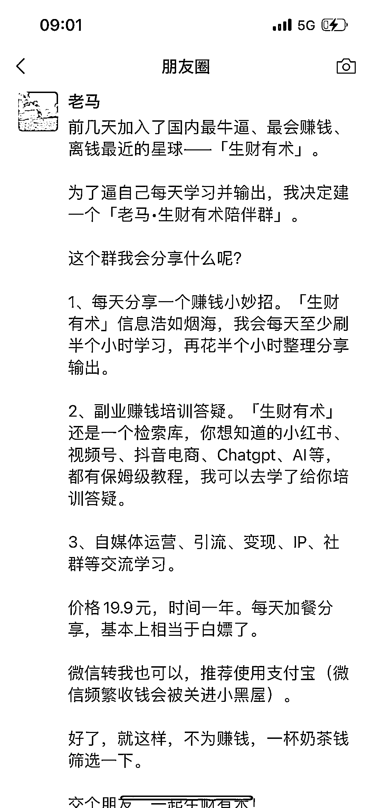
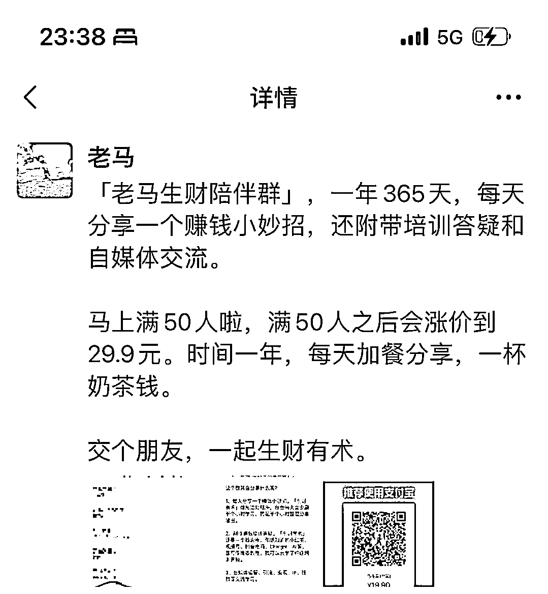
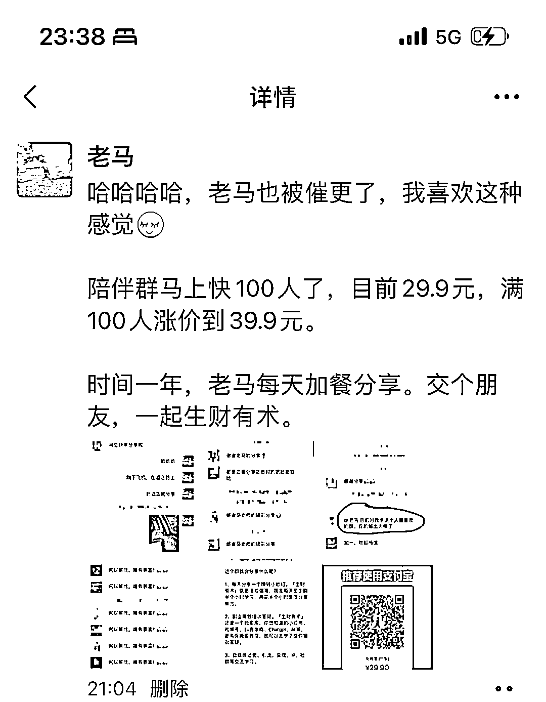
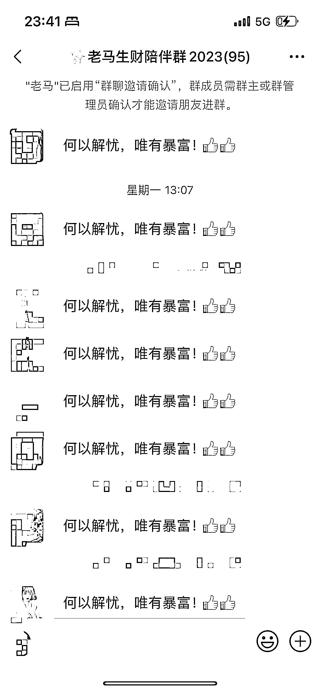
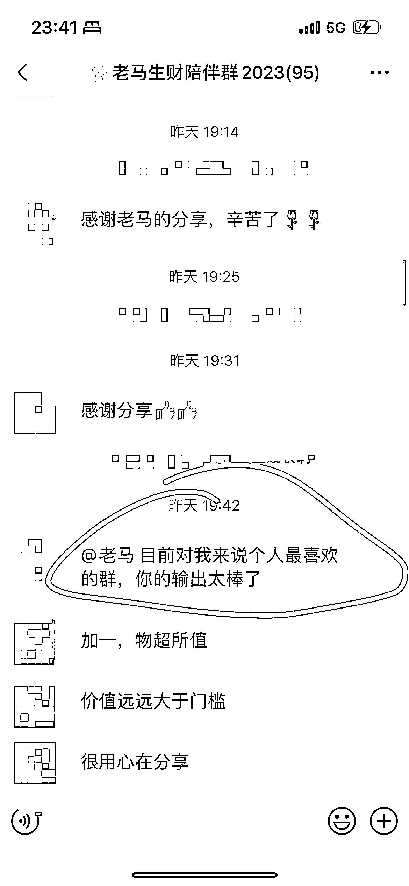
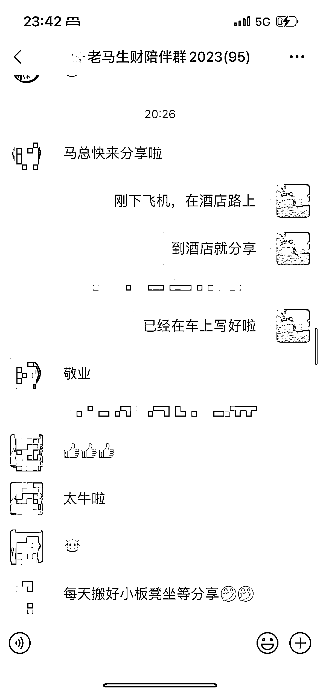

# ('《新人做赚钱陪伴群，3 天赚回门票钱》', (2, 21))

三天回本：新人靠每日共学社群赚回赚钱入场费

> 来源：赚钱有术精华区 · 2023年4月

大家好，我是老马，今年刚成为赚钱圈的一份子。为了把星球的干货真正消化掉，我自己拉了一个为期一年的共学社群。每天都会从星球里挑一个知识点，套进自己的真实经历重讲一遍，这其实就是费曼学习法。

这个群是周一刚开的，到现在已经进了95个人，收了2300+，入场费基本回本。复盘一下，有几个点值得说道说道。

自己的底子并不厚。今年初才认真做线上的内容，微信好友750个左右，最终买单的94人，成交比例差不多12%。对这个数据，我已经很满意了。

为什么要做一年期而不是短期群？一是逼自己每天都有内容产出，二是顺带把成本收回来。

价格上用了简单阶梯：50人内19.9元，51-100人29.9元，满100人39.9元，之后固定不动。新人在圈子里没什么话语权，价格一旦定高，基本推不动。

阶梯的设计实测有效。人到40左右时，我发消息说50人后要提价，结果不到一小时就满员了。现在群里90人，我刚放了“破百后继续涨”的风声，看势头今晚或明早就能达标。

共学社群也分很多玩法。一两周的短期见证营，好处是启动快、交付轻、马上有现金流，但口碑和用户黏性会弱一些；我选的年度型社群，交付更重，可只要扛过前期，粉丝忠诚度完全不一样。

还有一点很重要：不能只守着低价产品。假如只有19.9元这一档，天天加餐会越来越觉得不值，人也就容易泄气。应该把产品矩阵搭起来，比如在社群之上增加中阶星球、高阶咨询服务，让大家顺着台阶往上走。我后面就打算出中端星球和一个偏高端的私教服务。

分钱方面，我开的是60%的高分成给推广者，自己留40%。行业默认可能是五五开，但多分出去一点，愿意帮你推的人就会多一点。在一个社群里，学会让利才能做大。

这个模式还有一个隐藏收益。跟读一年之后，到明年418招募节点，群里的老铁早就懂赚钱是什么了，根本不需要反复科普。只要给核心会员一点专属福利，他们自然会从我的邀请链接入会。假设年底有500人在群，哪怕只有10%的人愿意转介绍，那也是50个新成员，冲上推荐榜单很稳。所以说，现在做的每一分交付，都是在为明年铺路。

当然，一切的前提是每天坚持更新，且内容质量要过关。我最大的成就感已经不是收钱，而是群里有人追着催更，这种被需要的感觉，会推着你一直写下去。

下面放几张推广文案、提价公告和群内聊天截图，需要的自取：

留言区里，圈友小吴说这招既能赚到当下的钱，又在提前攒信任，等赚钱官方做拉新活动时，群里的成交效果估计相当猛；老马回了句“过奖了”。另外有群友跑来认领称老马是大神，还有人问截图里那套话术能不能借用，老马说随便拿去用；一位叫海盐的朋友打算照着做，老马回了一句“一起冲”。