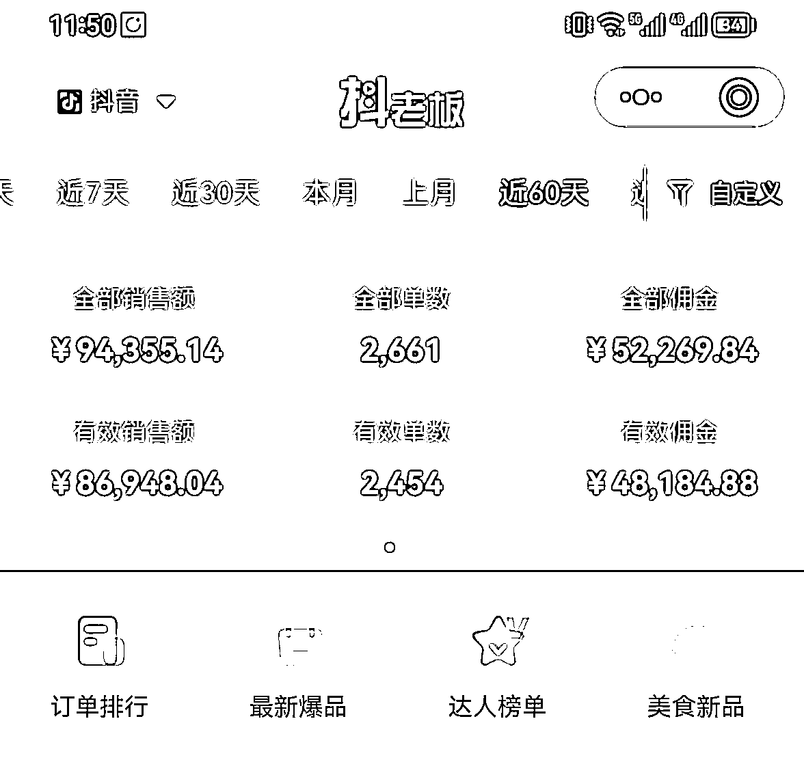

# 95 后上班族，利用下班时间做抖音银发书单生意，单月进账 5 万+的完整复盘

> 原文出处：[`www.yuque.com/for_lazy/thfiu8/kz9taix89zil0h61`](https://www.yuque.com/for_lazy/thfiu8/kz9taix89zil0h61)

## 从手游公司职员到副业月入5万，我经历了什么？

作者：刘逍遥  
整理时间：2023年4月12日

先自我介绍一下：各位好，我叫逍遥，在一家手游研发企业上班，是个标准的95后职场人，同时也是赚钱有术第七期的新成员。

回顾我的互联网副业经历，最早能追溯到2019年。那会儿做的是影视剪辑类内容，在西瓜视频、大鱼号、百家号这些平台发作品。后来短视频平台搞起了中视频计划，我也跟着切换了赛道。再往后，我慢慢摸索到了现在正在做的这个面向银发人群的书单带货方向。

今天这篇文章主要想和大家聊三件事：

1. 是什么机缘让我最终押注银发书单这个方向；
2. 一个对电商带货零基础的人，怎样靠着业余时间做到两个月收益破5万；
3. 项目真正跑顺之后，我对这个赛道下一步有哪些畅想。

## 为什么我会选中“银发书单”？

时间回到2022年10月。那天我照常刷短视频，无意间点进了一个卖养生茶的直播间。主播在介绍款名叫“四个舌头”的产品，短短一小时，这个直播间就涌进来几千单。评论区里几乎全是上年纪的用户在着急问怎么买、怎么付款、有没有效果。这种火爆的场景让我一下子被吸引了。

我大致算了一笔账。那款养生茶的定价并不亲民，最基础的茶包也要卖到58.8元。但它成功抓住了中老年人“怕生病”的焦虑心理，精准锁定了用户的真实诉求。当时我脑子里冒出的第一个念头，就是自己也去做养生茶。可冷静下来一查，才发现自己供应链、选品、平台规则全都摸不清，完全是个门外汉。

于是我开始去知乎这类平台上找答案。后来越研究越觉得，银发人群虽然对互联网各种玩法和套路不了解，但他们特别看重内容是否靠谱。只要你的东西能真正打动他们，付费的时候是很爽快的。而且这个群体普遍有退休工资托底，消费能力真不一定比年轻人弱。

顺着这个思路往下走，书单这个品类对我来说就成了绝佳的切入点。它不需要囤货，物流风险低，加上年纪大的人对书本有天然的好感。只要选品足够对路，内容能传递温度，信任一旦建立起来，成交就是顺理成章的事。

让我特别想提一句的是拱卒老师那篇关于账号冷启动的文章。当时我就是看着那份超级细致的实操指南一步一步做起来的，整个过程省了太多摸索的时间。白天上班，晚上回来用碎片时间发作品，前后花了大概两个月，我的副业总流水做到了5万元，其中单月峰值也稳步突破了5万。

现在这个项目还在继续打磨中，我脑子里也攒了不少新想法，比如爆款选题的筛选逻辑、视频画面呈现风格、要不要搞多账号矩阵运营等等。更多细节我都整理在飞书文档里了，感兴趣的朋友可以去原文链接里看完整的版本。拱卒老师那篇起号攻略的链接我也放在原文评论区了，现在翻出来看依然很能打。