# 《抢购生意迎来玩法升级：懂流量的人依然能轻松进场》

> 原文：[`www.yuque.com/for_lazy/thfiu8/al4xm8qgp0gmg6gd`](https://www.yuque.com/for_lazy/thfiu8/al4xm8qgp0gmg6gd)

## 作者：Hello·德柯
## 日期：2023-04-12

很多朋友对“抢购”这个玩法并不陌生：在各大电商平台来回穿梭，捕捉优惠券和返利机会，用远低于行情价的价格把茅台、球鞋、潮玩等货物拿到手，再转手卖出，中间的差额就进了自己的口袋。靠信息不对称来获利，这个思路早已是公开的秘密。

道理容易懂，可真要下决心去实践，很多人会被激烈的竞争劝退。但我的观点是，只要掌握了获取关注和促成成交的核心方法，不管你是普通职员、在校学生还是全职妈妈，都有机会从这个市场里分到属于自己的那份回报。

我们目前的主攻方向，是在短视频平台发布图文内容，把公域的注意力引入私人社交号再完成成交，单条作品通常能沉淀近千名高意向用户。接下来，我会以这段真实操作经历为样本，带大家深入拆解这套传统模式的商业内核。

文章分为两大板块：前半部分帮新手把行业大局看清；后半部分为想要在内容平台上开展抢购业务的朋友，提供可以照搬的实战经验。

## 目录

**上篇**
一、到底什么是抢购
二、掌握信息渠道的价值在哪
三、业务的标准作业流程
四、什么人适合把它当兼职

**下篇**
一、为什么这个行业总有机会
二、谁进场更容易赚到钱
三、探鹿人的内容获客与成交实战
四、我们有什么产品

如今打工人面对的外部环境越来越不可控，裁员、降薪的消息从未断过，搞点额外收入几乎成了刚需。抢购在副业圈被称作“王牌中的王牌”，可整个行业也已进入贴身肉搏的阶段。

短视频平台上，做抢购内容的大多是些“糙汉子”，既不擅长内容创作，也不懂用户运营和圈子玩法。真正能在这个细分赛道里吃到最后一波机会的人，必然是懂内容、懂成交的玩家，而我们恰好属于这类玩家。

简单自我介绍：我是德柯，02年出生，山西人。高三起开始做生意，在抢购圈摸爬滚打六年。目前人在上海，带了一个二十人左右的小团队，年净利润两百万以上。我的处事原则一直没变：简单、真诚、利他。

抢购的本质，是利用互联网上的信息不对称做低买高卖的差价生意。操作场地通常是京东、淘宝、苏宁等平台，手法是叠加高额优惠券和返现，把买价打到最低。

每逢双十一、双十二、元旦、五一等大促节点，平台常会出现“一元购”级别的价格。此时按远低于市价的价格入手，再以市价出货，中间的差额就是利润。

简单讲，抢购就是跑在别人前面，把低于真实价值的商品拿下来，再转手卖出去。它和过去的“倒爷”“黄牛”是同一类生意，唯一不同在于，今天做抢购更需要具备互联网商业意识。

抢购覆盖的品类非常多，我粗略梳理了十大方向：

**一、文娱票务。**周杰伦、林俊杰、刘德华的演唱会门票都有溢价空间，人气live house同样如此。

**二、电子数码。**属于稳妥的搬砖型品类，单笔赚得不多，但胜在细水长流。

**三、酒类。**重中之重是茅台，大家常说的就是53度飞天。

**四、潮玩。**难抢、难中签，可一旦拿到，回报非常丰厚。像前两年大火的泡泡玛特，某个1000%尺寸的系列，市场溢价能到几千上万。

**五、收藏品类。**黄金、邮票、纪念币、纪念钞等，自带收藏与金融属性，溢价天然存在。

**六、美妆护肤。**宝妈和女性用户最爱，早年微商的重仓地，自用省钱，转手赚钱，两头都划算。

**七、茶叶。**大益茶、普洱、毛尖等。我们当初刚入行时，一个晚上做大益茶就做出过几十万流水。

**八、宠物用品。**大促期间，用专属券囤下猫咪饮水机、宠物服饰、出行包等，放在闲鱼上慢慢消化。

**九、数字藏品。**近两年兴起的新物种，利润涨跌幅度大，花时间深耕也可以获得可观的收入。

**十、其他。**母婴、食品类经常有0元购机会，属于长期稳定的补充收益。

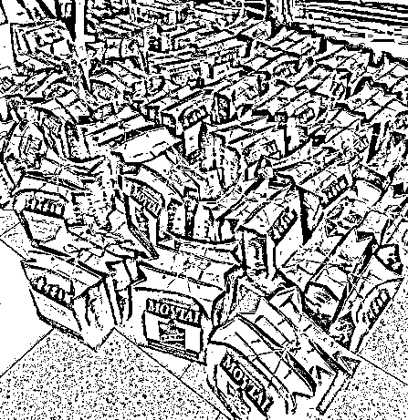

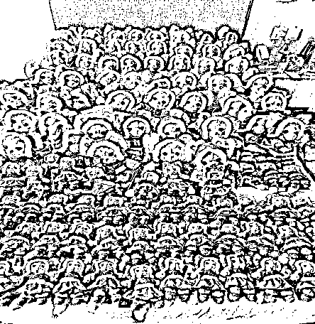

##

**（1）日常消费成本极低。**
因为天天盯着全平台的最低价，玩家给自己买东西时，基本都能拿到远低于市面的正品价。想换双空军一号、换个华为手机，实际花费可能只有普通人的一半甚至更少。

**（2）圈子质量与整体收入更高。**
抢购做得好，金钱回报不会少，附带的人脉网络和资源整合能力也会越来越强。

**（3）兼职属性经久不衰，赚钱窗口始终存在。**
哪怕今天赛道已经很拥挤，普通人能抓的机会依然不少。核心是信息要够快、动作要够早——你还在犹豫时，别人已经吃饱下桌了。
我印象最深的一次：2018年建行积分兑换小米手环，知道的人很少，我们提前跑通流程，单凭这一条信息就赚了好几万。

## 

标准流程一句话讲清：群里发布可操作方案 → 成员看到后下单 → 完成后在群公告报备 → 货到当日算清本金和佣金。

**（1）方案来源。**
我们拥有独家技术和情报渠道，能锁定约99%盈利概率的线报，并有专人负责筛选出同一时间段里收益最高的方案。

**（2）吃透平台规则。**
不同平台的规则差异很大，既要熟知还要遵守。你越老实，账号的存活率和赚钱概率就越高。
比如茅台手动预约，官方其实写了技巧，很多人抢不到只是没研究过规则，而我们研究透了。

**（3）扩大下单规模。**
部分商品对一个账号的购买数量有限制，那就发动更多人帮忙下单，把总单量做上去，利润也跟着放大。

**（4）收货和出货。**
我们在全国多地设有合作仓库，专人统一收货，按件结算保管费。每批货尽量发往出价最高的市场，每条方案都配有指定收货点。会员的货款由公司财务统一结算。
出货对象以企业、社区店和线下小实体为主，比起走档口，这种模式留出的利润空间大得多。

**（5）回款周期。**
正常情况，下单后三到五天资金回到账户，快递签收当天即结算本金和佣金。

**（6）利润弹性。**
单张方案赚几十、几百到几千都有可能，取决于方案质量和行情。我们承诺：下单包回收，且不会让你亏本。

##

普通工薪族、学生党以及全职妈妈都能参与。抢购更接近一门手艺，而不是一份固定工作——手艺越熟练，时间成本越低，产出也越高。和下班后躺平刷手机相比，这是一种主动提升自己的路径。

## 

抢购是个相对内卷的行业，人尽皆知它赚钱。但真正同时拥有渠道、内容创作能力和私域运营技巧的人，少之又少，这正是我们能快速成型的原因。这门生意从五十年代至今，已经演化出一套非常完整的系统。

说三个事实：
**（1）早入局的人确实拿了大结果。**我17年入行，带我进门的学长，三年内在上海买了房，而且是两套。
第一批、第二批、第三批进场的人，都陆续拿到了自己想要的，这个事实会继续吸引后面的人加入。

**（2）现在想学抢购、想入圈的人越来越多。**有商业嗅觉的老板们已经看到机会——做培训，比做业务本身更赚钱。

**（3）最核心的一点：抢购从业者普遍不擅长自媒体。**你去短视频平台上看这个细分赛道的内容，质量普遍不行，但即便是这样的内容，也捧出了不少年入百万的博主。

所以我的建议是：把抢购当成一个优质盘，用好自媒体这个放大器，至少是一千万级的市场。目前我们也只做到了一百多万而已。

**（1）已经做过抢购的人，**马上补上内容获客和产品设计两门课，赚钱只是时间问题。
**（2）有IP基础，特别是专注副业方向的创作者，**引入抢购业务，反馈来得很快，还能从收益维度直接拉高IP的价值。
**（3）有大量副业用户运营经验的人，**把项目直接接进来，交付交给专业团队，你只专注获客和成交，收入实惠又轻松。

任何行业在短视频平台都值得重新做一遍，抢购自然也不例外。

想在抢购方向持续赚到钱，就必须建立一套标准作业程序。流程标准化，效率才高，变现才稳定。我们团队反复磨合后，总结出的高效路径是：

全平台的图文或人设内容 → 导流到社交号做信任培育 → 托管式交付 → 完成业务闭环

**（1）掌握短视频运营，从第一个关注开始获利。**

#### 1.账号养号
养号是所有计划的第一步。地基没打好，后面的努力都是无效做功。

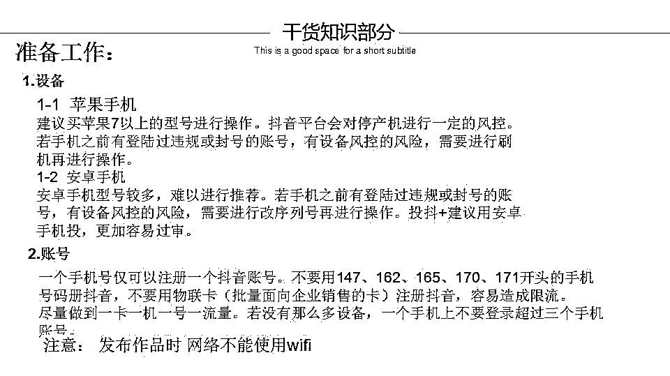

#### 2.编写文案，发布图文内容

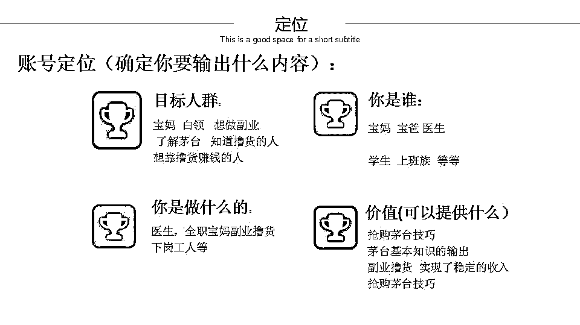

#### 3.熟练之后，批量生产图文，把获客规模滚起来

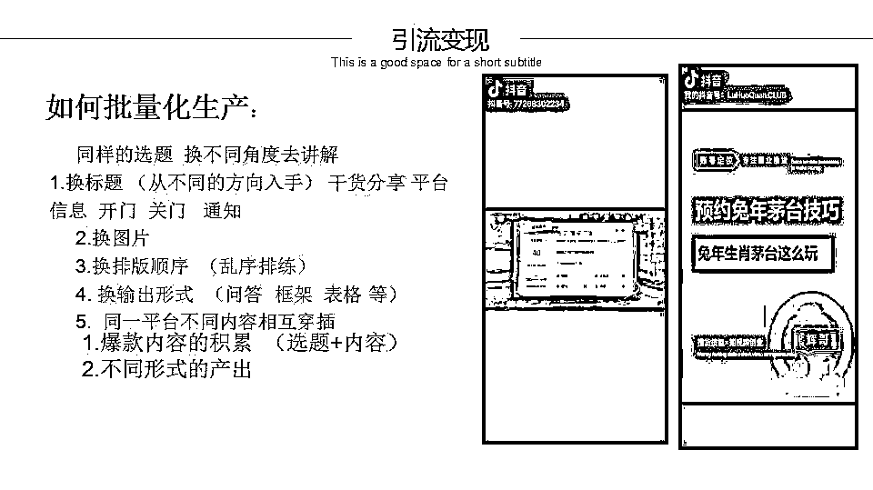

日常发布可参考这些行业标签：
#抢购 #牛牛 #daoye #球鞋搬砖 #美妆搬砖 #得物搬砖 #i茅台 #撸茅台 #牛牛党
#1499抢茅台 #飞天茅台 #鞋狗的日常 #得物美妆搬砖 #daoye联盟

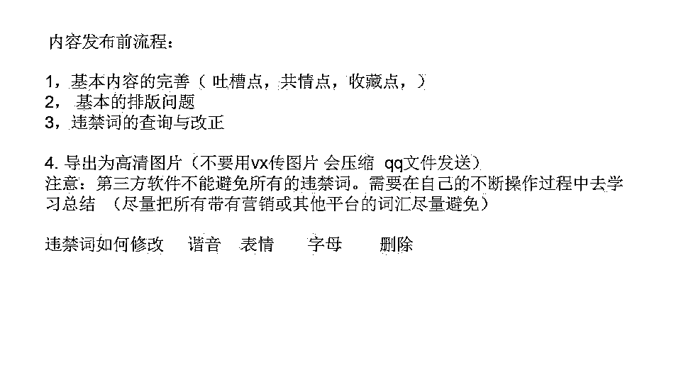

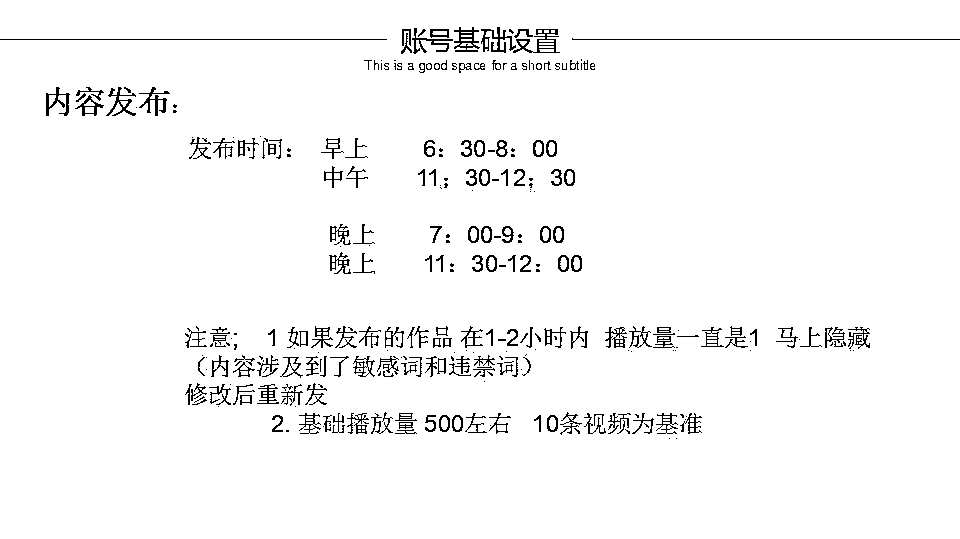

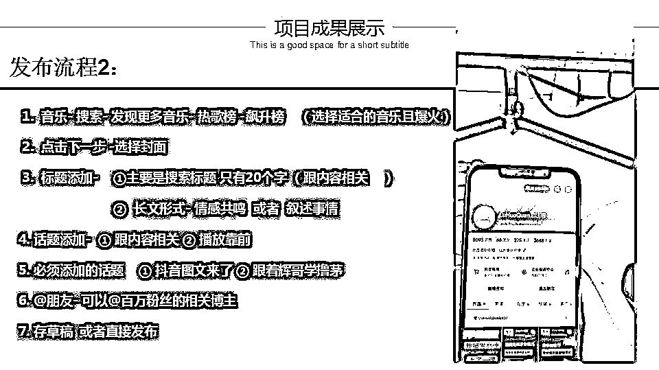

#### 4.把短视频平台的用户引导到个人社交账号

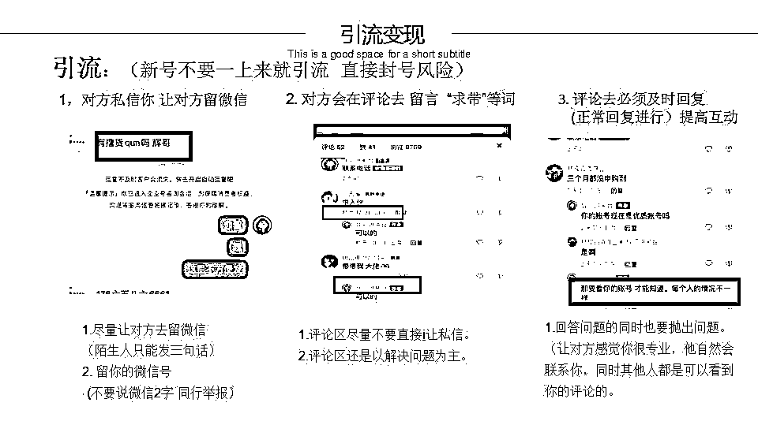

**（2）社交账号的精细化运营与高转化**

#### 1.快速用标签筛选用户，让转化效率翻倍
每位添加成功的朋友，我们先用三个问题快速了解他的基础情况，为他打上对应标签，再提供针对性的服务。随着交流深入，标签数量也会增加，目前平均每个人被标记三十个左右。
标签越细，后面做营销、回访和临门一脚时就越从容。

#### 2.社交动态的内容运营
①展示成果
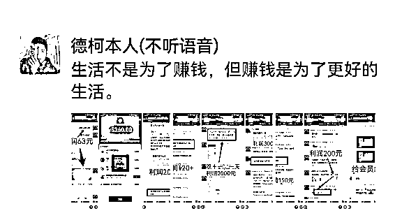
②展示过程
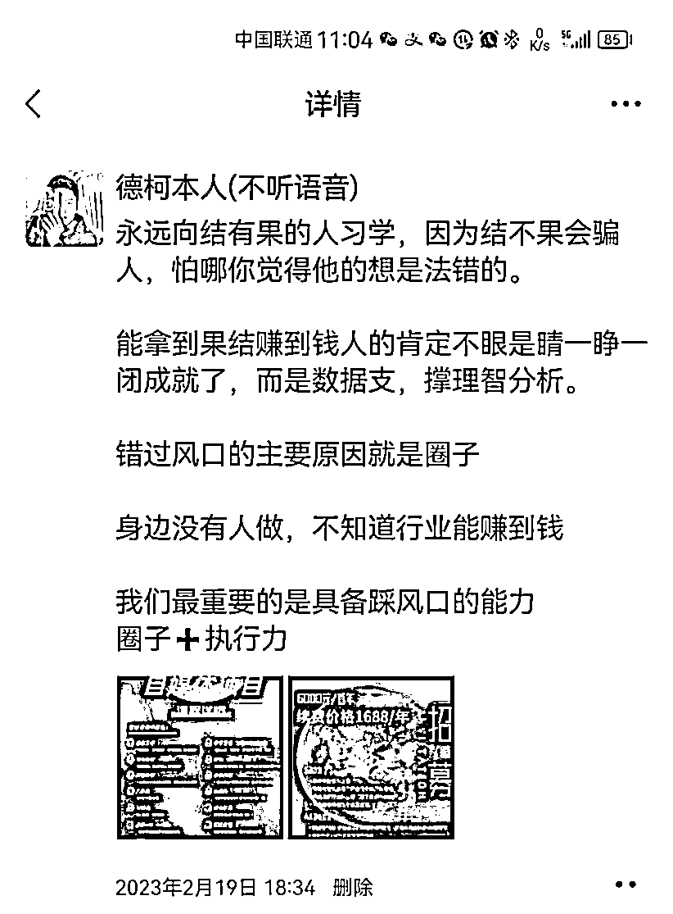
③感谢信
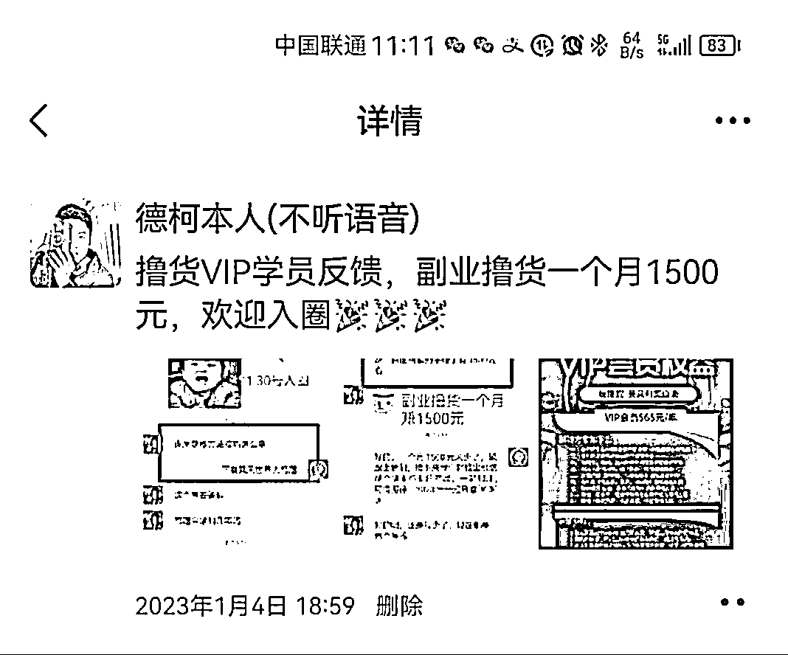
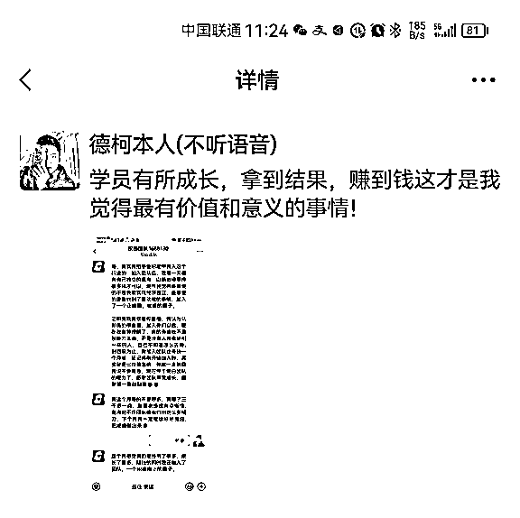
④情绪价值
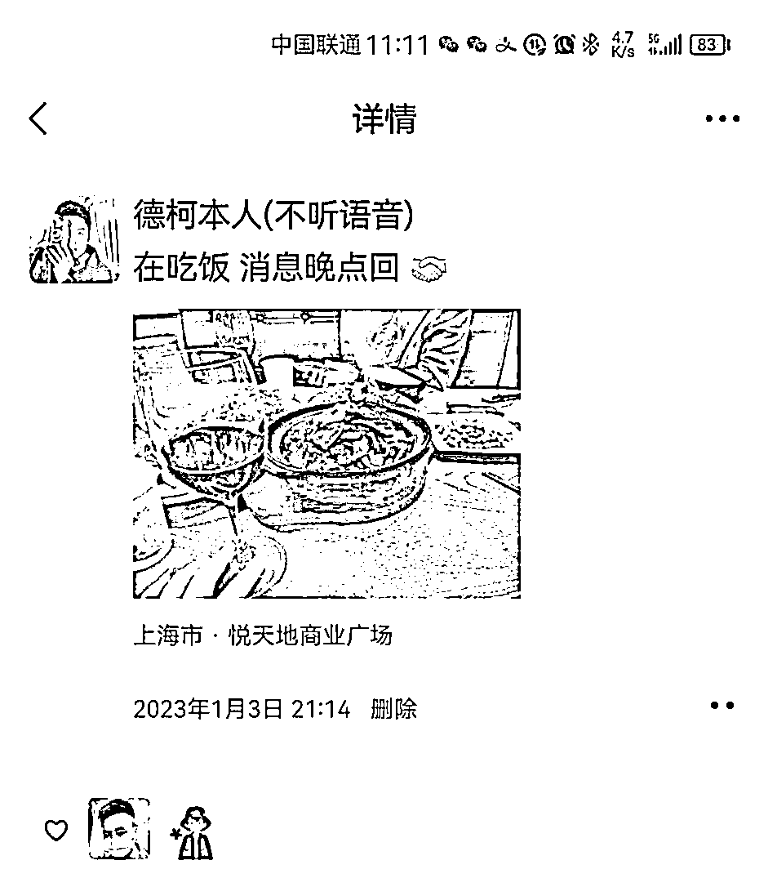
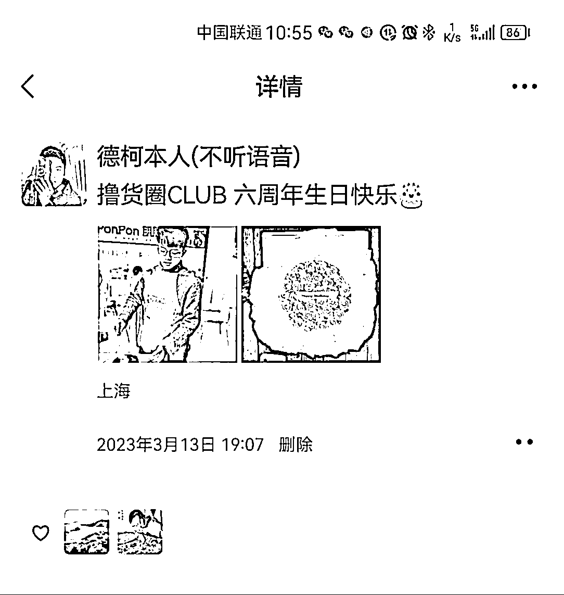
⑤专业价值
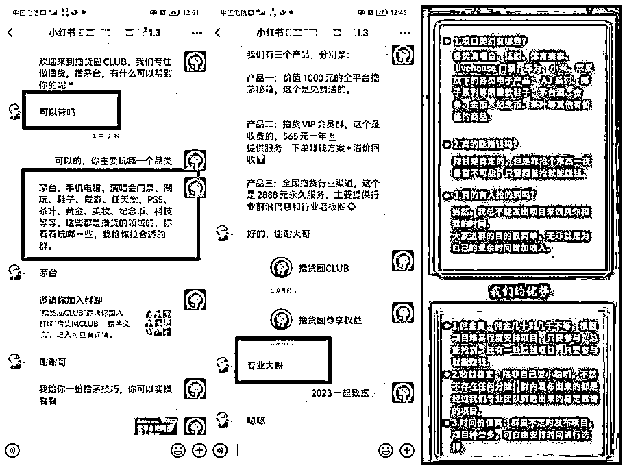
⑥观赏价值
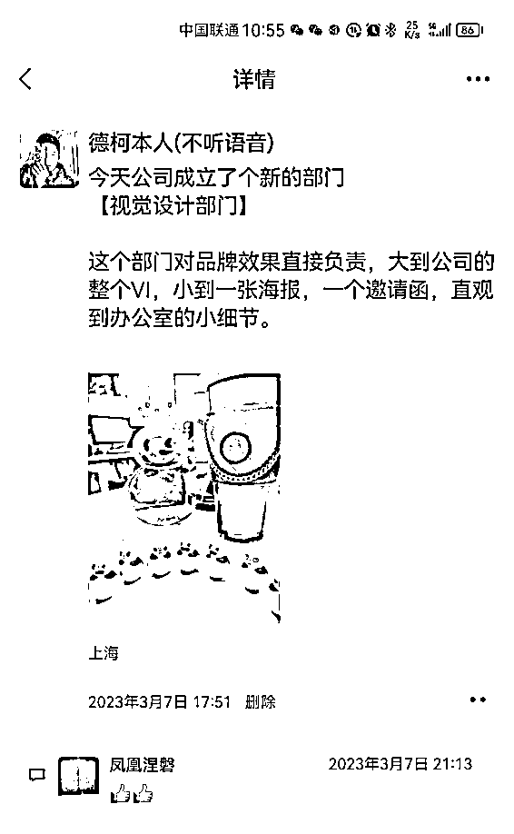
社交动态这部分我只放截图作为参考，不详细展开，方法也是从赚钱有术学的。

#### 3.订阅号矩阵：个人号+企业号
个人订阅号保持日更用于吸引关注，企业号用心编排内容作为项目展示窗口。
目前的表现是：从订阅号过来的用户，信任度高到直接找我们要收款码付款，几乎不需要多余转化。只要保持日更，这个号每年能给公司带来20万纯利润。

**（3）学员交付**

#### 1.积分体系，打造闭环
我们的服务目前做到零退款，年度续费率约60%。

积分是VIP会员与我们完成交易后获得的奖励，可以兑换商城礼品或参与官方活动。

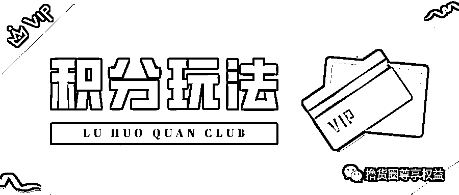

积分如何获取：
- 交易金额每满1000元，增加1积分。
- 每成功邀请1位VIP会员，奖励100积分。
- 按参与项目的活跃度，随机不定期加分。
- 大促节点有额外福利。

积分如何使用：
1. 参与抽奖。满20分即可参加月度抽奖，中奖者得88元现金红包。
2. 兑换商城的独家项目、方案和课程。
3. 兑换实物商品，品类会动态更新。
4. 兑换现金红包，1积分=1元。

积分体系引入后，用户开始自发下单、学习和分享，群活跃度和年度续费率都得到了明显拉升。

**（1）社群CLUB VIP**
价格：565元/年（原365元/年，每满1000人涨100元）
定位：互联网副业项目
人群：宝妈、国企职员、自由职业者等副业群体
价值：
1. 公司提供抢购方案，会员只需下单，后续收货、出货全由公司负责。
2. 公司兜底，行情波动导致的亏损公司包赔。
3. 承诺一年内没赚回本，全额退款。

**（2）社群流量合伙人**
价格：2888元/年
定位：流量招商
人群：对内容获客有强烈意愿、愿意与我们保持长期深度合作的人
价值：
1. 学习短视频起号和抢购获客的完整方法。
2. 专业流量团队带跑，实测三条作品就能从零涨到一千精准关注。
3. 3V1师徒制，三位老师带一名学员，沉淀六年抢购经验，随时答疑。
4. 代表团队洽谈合作，体验撮合资源带来的收益快感。

**（3）社群私董会**
定位：圈子、社交
人群：同行
价格：1.8万/年
价值：
1. 同行交流，相互补课，把各自的利润空间做大。
2. 洞察市场风向，协作控价。
3. 对接渠道，长期深耕抢购行业。

能读到这里，说明你对抢购这个盘的潜力已经有了自己的判断。如果你愿意，我们完全可以建立连接。

带了这么多人，我发现一条铁律：能沉下心把某个方向做透的人，大概率会拿到结果。
比如我们第一位做出30万爆款的流量合伙人，是一位40岁的宝妈，那是她第一次在短视频上发内容，说实话我完全没想到。
我一直觉得，带着付费伙伴一边成长一边赚到真金白银，是这家公司做的最有价值的事之一。

最后说点内行话：想跻身抢购行业真正的顶层圈子，接触的都是操控几个亿货盘的老板，行业的内幕和潜规则必须门儿清。这是我在这个圈子混了六年最真实的感受。

评论区：