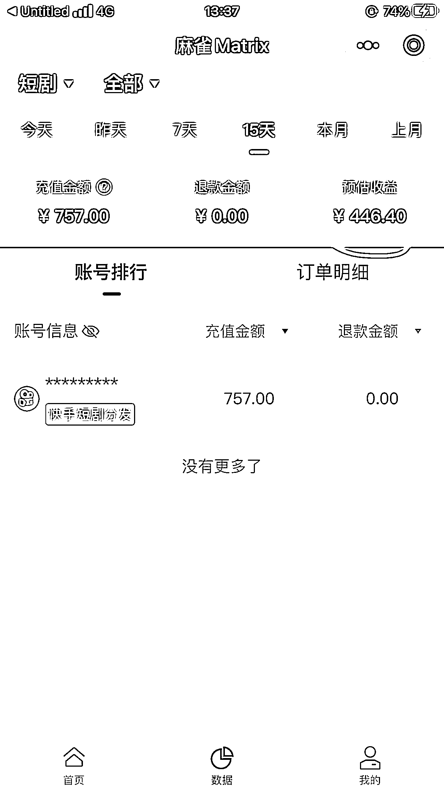
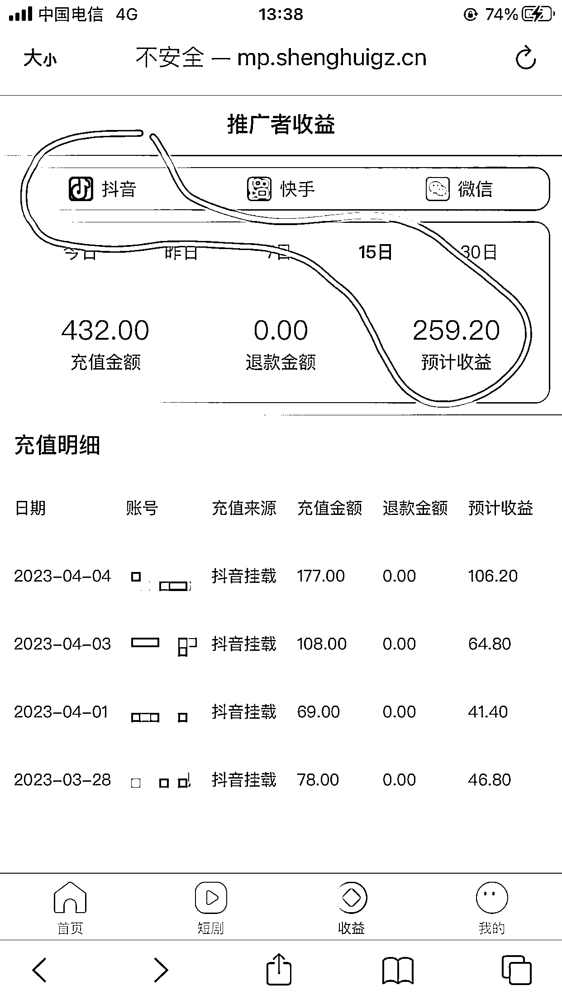
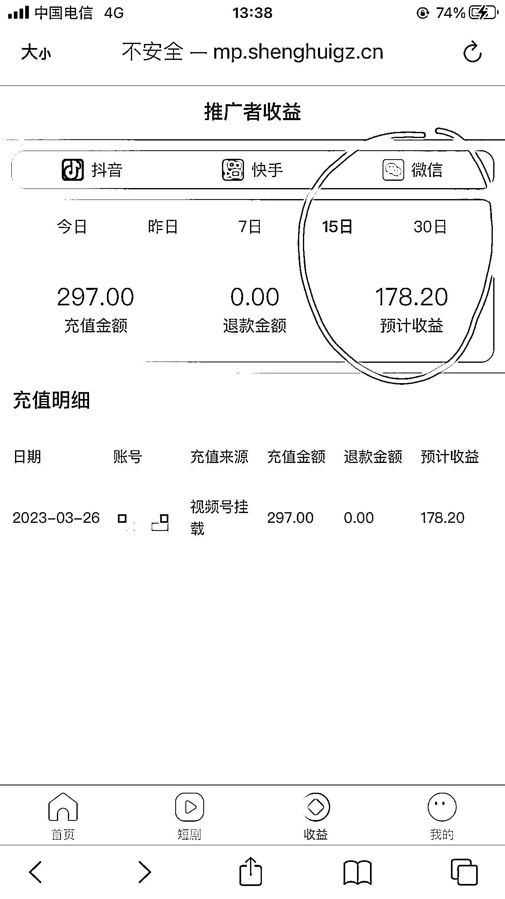
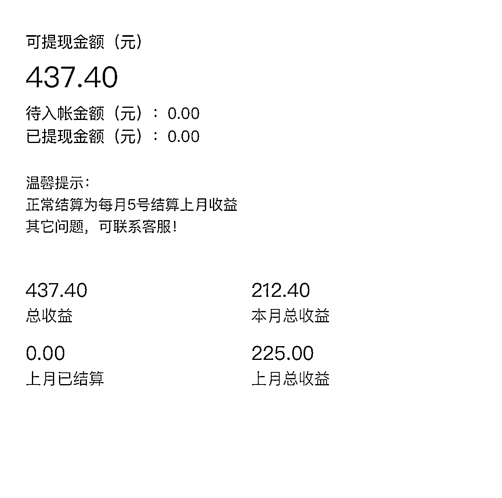

# 一个月赚钱实战复盘：从零到第一笔副业收入的 30 天

> 原文：[`www.yuque.com/for_lazy/thfiu8/ma9cf1f6k7g675er`](https://www.yuque.com/for_lazy/thfiu8/ma9cf1f6k7g675er)

## 《加入赚钱一个月，我到底做了什么》

作者：肖一 
日期：2023-04-05

新人报到，先刷个存在感。大家好，我是肖一，3月18号入圈龙哥盟的。来跟大家同步一下认识赚钱满一个月，我都干了些啥。

1、我的本职工作是教育 SaaS 这边的 B 端产品经理。受当下环境影响，又碰上家里一些变故，今年对我来说特别需要一笔额外收入，也想突破现在的圈层。无意间刷到龙哥盟的知识星球，被鱼丸拉进了 3 天免费体验营。进去之前我的想法很佛系，就当逛逛看看，压根没想过要付费。

2、结果一下子就陷进去了。内容量非常大，关键是全是能直接上手的那种干货。三天几乎是熬夜刷完整个平台的帖子，脑子里就蹦出一个能马上跑的项目：短剧分发。细节上还有很多问号，就去找了项目作者聊。顺便说一句，当时看到帖子里有联系方式，就在那三天里疯狂加了好多人，完全没自我介绍，现在回头看有点唐突了，但当时就是太着急了。

3、运气好赶上思蒙的短剧训练营在招人，完成打卡任务就能退保证金。抱着试试水的想法就报了名。我的投放阵地主要是快手和抖音，两个平台一起发，每天保持 1-2 条的频率。大概坚持到第 4 天，就有了第一笔成交，账户上出现了收益。

4、这个正反馈来得太及时了。体验营结束没几天，我就下定决心付费入圈，不过正式开放要等到 3 月 18 日。等期间我也没停手，一直把这个项目做下去，不仅把保证金赚了回来，还拿到了副业以外的第一个 1000 元。

接下来聊聊项目过程中，除了钱之外的一些体感：

5、短剧这个赛道现在正处于野蛮生长期，平台波动很大。时不时小程序挂不了，规则渠道一变，剧场佣金又调整换家。每天政策都不一样，有几天收益上不去的时候我也动摇过，想过要不要直接撤了。

6、最终还是说服自己先把保证金拿回来再说。我开始认真拆解对标账号，尤其是数据不错但又跟别人不一样的账号。挑了一条表现不错的视频模板照着学，做了 4 条同款风格的分发内容，分两天同步上了抖音、快手和视频号。

7、没想到凌晨一点随手发的视频，第二天早上起来一看，视频号直接炸了，播放冲到 104 万，涨粉 4800 多。唯一的遗憾是转化没跟上，充值才两百多，实际到手的佣金只有 138 块左右。

8、吃到甜头后我继续深挖。给评论区做了引导，混进了演员的粉丝群，还去演员的视频底下做互动。调整完这些动作后，抖音和快手的转化明显变好，有意思的是，我一周没更了，它还在持续出单。

9、做短剧的这一个月，最大的隐性收获是网感和剪辑能力在飞速提升。这两项东西我觉得是通用的，以后换项目也能直接用上，这比那点佣金更值钱。

10、复盘为什么有的剧能爆、转化能高时，我发现剪辑师群体里有个小痛点。剧场官方并不会把所有片单都公开，谁手里能提前拿到资源，谁就能抢占首发流量。于是淘宝、拼多多上出现了卖「剧场片单资源」的虚拟项目，还有代理分销模式。至于这些资源具体来源是否合规、私下运作的方式，现在还在研究。

11、这个发现给我打开了新的思路。短剧其实在淘宝、拼多多、抖音到处都在卖，只是玩法不一样。我可以往无货源模式去试一试。

写这么多，核心就一句话：赚钱是我到目前为止最有体感的第一个正反馈，给了我极大的信心。后面肯定还会踩坑，但圈子里前辈总结的经验太多了，完全不用自己从零摸索。站在别人的肩膀上走，轻松很多。希望能在这里认识更多志同道合的伙伴，一起冲向第一笔 1 万、10 万。2023.04.05

评论区：

木头 : 加油[强] 罗宇 : 加油[强] 读行 : 加油 肖一 : [抱拳] 肖一 : [抱拳] 肖一 : 一起加油[抱拳] 龙哥 : 行动力强，说干就干，加上赚钱带来的信息增量，感觉很快就要起飞。 谦羽【生命成长教练】 : 哇撒，这行动力杠杠的