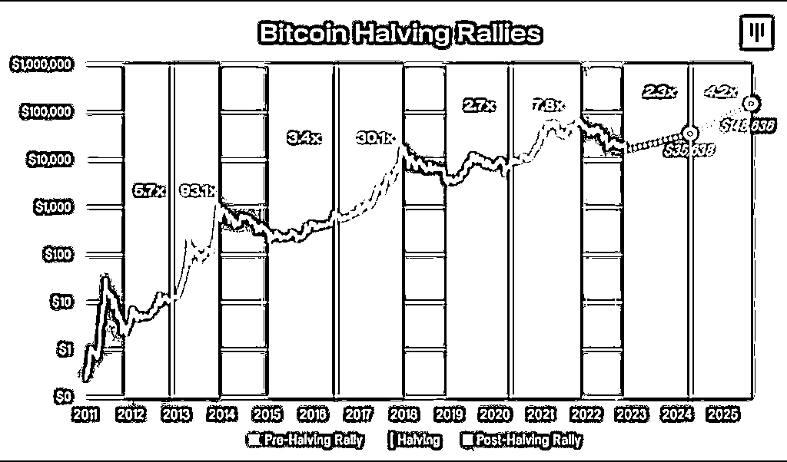
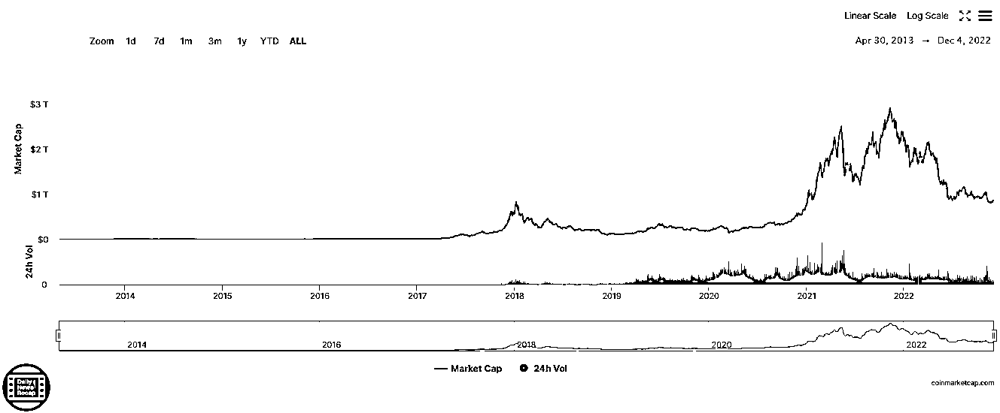
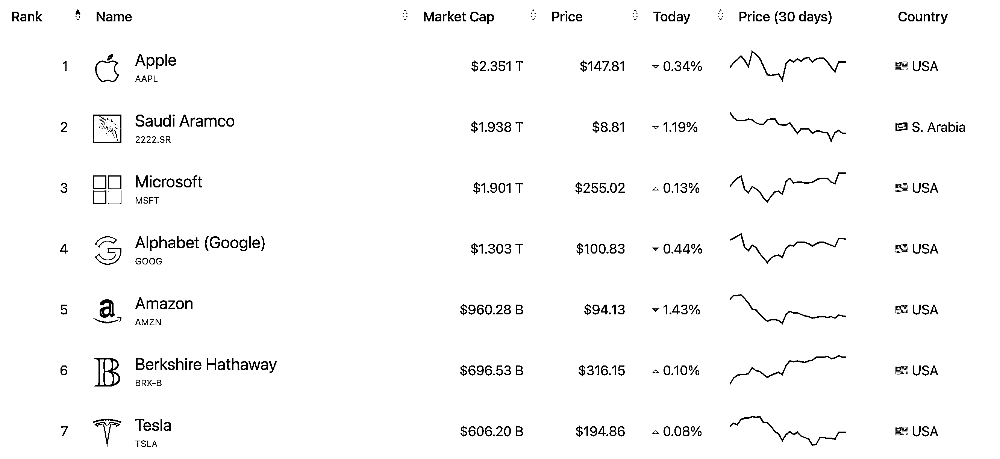

# 新手如何更快地成为 Web3 的建设者，而非旁观者

> 原文：[`www.yuque.com/for_lazy/thfiu8/kt21lpqgomgc18mr`](https://www.yuque.com/for_lazy/thfiu8/kt21lpqgomgc18mr)

## 《Web3 新人如何更快的参与到 Web3 的建设》

作者：Start9527 
日期：2023-04-03 

#start 讲 web3# 

#龙哥盟 no.23# 

#Web3 新人如何更快的参与到 Web3 的建设# 

距离目标还差 27 篇原创文章 

严格来说这篇不算原创，我是去年12月在龙哥盟 Web3 第一期小航海上的分享实录。当时得到 @龙哥老师认可，@静伟老师邀请，@小霸王老师跟进协助。虽然是去年的内容，放到现在看依然适用。数据有变动，但对刚想入场或在赛道里迷路的新人，依然有参考价值。下面进入正文。

Web3 本质上是比特币和区块链故事的延续，所以谈 Web3 离不开加密资产。坦白说，我并没资格做交易教练，我想从建设者的角度，聊聊另一种进入赛道的方式。

我的履历谈不上光鲜。参与过北大出版社联合出版的《从零开始读懂 Web3》，由 Anoymose 主编，我负责统筹。在市值前40的公链 Flow 担任中国大使，也是国内知名一级投资知识付费社区稳赢&加密湾的联合创始人。社区聚焦一级市场，包括打新、空投、赛道深研等，聚集了大量社区创始人、项目方、投资机构。赚钱的伙伴也有不少在里面，比如秋兴、焦波、胭脂王等。

下面从五个角度展开。

1，赛道仍有空间，值得长期下场；
2，我的亲身经历与最终定位 选择建设而非投机；
3，利润越高，安全越要摆第一；
4，怎么找到兴趣点并深耕；
5，Web3 创收的底层逻辑。

#### 1，赛道仍有空间，值得长期下场

 

比特币总体数据线及预测 

综合历史来看，加密市场存在四年减半的规律，2022年底基本是上一轮牛市与下一轮牛市的底部交接。所以我认为，龙哥盟在那个节点启动 Web3 首期小航海，客观上帮助很多人避开了熊市的回撤。

 

上图来自 coinmarketcap 的加密全行业总市值走势。现在全市场市值约0.85万亿美元，而历史高点也不过3万亿美元。这个体量意味着什么，对比下图就能看清。

 

当前整个加密行业总市值排不进前五，甚至不如亚马逊一家。类比一下：如果把时间拉回二十五年前，整个互联网行业的估值也未必能进前五。而如今单一互联网公司就能长期霸榜。未来加密赛道能否诞生类似的超级公司不好说，但可以确定的是，赛道整体市值会在现有基础上大幅增长。

再看单体项目的机会。数字代币、NFT、GameFi 等赛道都有极致案例：

数字货币——比特币。白皮书内容咱们小航海也讲过。从13万枚比特币换一个披萨，到现在一个币能买1.3万个披萨，十年跨度，涨幅惊人；
NFT——Cryptopunks。作为加密猫之后的 NFT 鼻祖，从几乎白送到地板价80ETH约70万人民币，四年完成，顶峰价格更夸张；
GameFi——Axie。作为 GameFi 的代表，去年8月在赚钱私董会上温虾米还在讲，当时游戏内 NFT 被炒到上海一套小户型的价格，一年多时间完成跃升。

列这些不是让大家去追高，这些标的早已高不可攀或错过最佳窗口。只是想说明赛道的造富效应在全行业里都少见。对想以小博大的人来说，机会窗口依然存在。

#### 2，个人历程与定位 选择建设而非买币赌博

在赚钱的诸多项目里，Web3 其实一直是被低估的赛道。除了行业自身特殊性，赚钱对相关内容管控较严，更关键的是太多人用错了理解方式。赚钱是目的，但赚钱有道靠运气赚来的钱终究会靠实力亏回去，这点老伙伴都深有体会。所以我非常认同这次小航海的初衷：先普及知识，而不是 FOMO 去投机，先打好基础，捡钱的机会不会少。

我自己在 Web3 没有什么亮眼的交易战绩，不会开发，投研偏好也不主流，从去年8、9月听了温虾米、杰森李、金马在私董会的分享，10月经焦波大哥引荐进入稳赢&加密湾后，长期处于 FOMO 状态，经历了艰难的认知转型：

1，自卑期。很多东西不会，像刚进群的大家一样问东问西，现在看来研究一下就懂的事，当时完全搞不定；
2，迷之自信被打脸期。靠运气赌对了却不及时止盈，继续梭哈最后亏完，投资前必须学会仓位管理，别冲动；
3，赌徒心态期。赚到超出认知的钱后红了眼，亏得更惨，这是牌桌上必经阶段；
4，自省期。剖析自己不适合二级交易，擅长运营和出版，于是有了后续在 Web3 的工作经历和参与出书；
5，转机期。熬过四个月被压榨的 mod 日子，开始有了职业化路径，先是 Flow 中国大使，后是动漫项目的总运营，新书也登上当当榜首；
6，蜕变期。状态好了运气才跟着变，我经手的 NFT 项目主体公司也将在纳斯达克上市；
7，趋于稳定期。投资上偶尔还 FOMO，但已经有了相对稳定的 Web3 收入来源，算是熬过最难的阶段。

我能扛过来，相信新人也会遇到同样的每一步。你准备好了吗，能坚持住吗？

为了更快上手，首先要理解赛道演变。Web3 在去中心化前提下重新定义价值与权利，最容易量化的首先是金权信任，所以 DeFi 是最核心应用，解决金权问题；第二阶段是物权，NFT 成为入场通行证；第三阶段是 DAO 去中心化自组织，重新定义人与组织关系，即人权；之后是信息自由与创作者权益，即智权，故事还在继续。

在此基础上，行业可分为四层，来自我们与北大出版社未出版新书《零基础读懂 Web3》：

系统协议层：公链、跨链桥、底层协议
基础设施层：存储、审计、身份、通信、治理
用户应用层：DeFi、NFT、DAO、GameFi
系统接入层：钱包、聚合器

最后是参与方式。很多岗位以 DAO 形式运作，你可以从任何感兴趣的方向切入，找到项目申请成为 MOD 或大使，有的带薪有的不带薪但能深度学习。对新人建议优先选择不需投入本金的项目，即便前期被白嫖劳动力也值得。参与后快速研读白皮书、路线图、团队架构、代币模型，认知迭代就会更快找到定位。

我进入赛道三个月就成为 Flow 公链中国大使，让我对赛道有了立体认知。相信赚钱的朋友也能更快成为核心贡献者，成为真正的建设者。

#### 3，越是暴利，越要警惕安全

这个行业破圈的两种典型，一种是晒赚了多少钱，一种是亏了多少钱出事。比盈亏更隐蔽的是各种被攻击或误点钓鱼链接导致的资金损失，每年损失金额以亿美元计。新人必须重视，核心就一句话：别贪心。

别乱点链接，务必从官网进入。通常是钓鱼为主，要么声称你中奖了，一不小心点进去就归零；要么抛出天花乱坠的财富密码，钱包一连就被盗；要么是图省事相信发链接的人，点完才后悔。

这部分焦波大哥经验丰富，专门写过防骗指南。新手手册里也有，Web3 生存指南之防骗反诈安全手册 V1.0 版.pdf

#### 4，如何找到兴趣点并深度参与

我一直觉得，买亚马逊股票的人不一定赚钱，但在亚马逊工作的人一定赚到钱。相较市场情绪的制造者，更愿意扎进项目里去耕耘的人，才配得上建设者的称号。

所以深度学习 Web3 并进入行业，是最佳路径之一。我一月份成为 Flow 中国大使，有稳定薪酬；五月份进入一家 NFT 公司做全职 Leader，从0到1推进项目；六月底协助 InverseDAO 发起人 Anymose 及 DAO 成员与北大出版社策划《零基础读懂 Web3》，预计年前上线。这些经历对我的 Web3 职业生涯意义重大，若能影响到你，意义更大。

这一切源于我真心相信赛道会带来不一样的财富积累。从去年十月入场开始就深度参与项目建设，被白嫖过多次，但付出终有回报，短期内也积累了一些成绩。

给新人的建议是：低成本快速进入 Web3 的方式，不是真金白银去投资。钱能换来收益，换不来真正理解。就像德扑真正赚钱就几把，大多数时候是陪跑，所以别过早交出筹码。更好的方式是用时间去项目方做核心贡献，按兴趣选择方向：链游、公链、DeFi 都可以。

#### 5，Web3 的赚钱本质，仅为个人理解

现实是，这个赛道真正赚大钱的，要么有开发能力，要么有批量撸毛工作室，要么有消息面，要么是早期低成本持有主流币的幸运儿。经历了一年的沉浮，我不擅长交易，也不属于早期玩家，更没有开发能力，于是我的定位是搭建工作室并在一级社区做核心贡献者。

工作室层面可批量撸空投、打新或做链游打金。

撸空投。我在 Aptos 上小赚过，每个账号均值约一万元。最近重仓参与 OP 第二期、StarkNET、Aptos 第二期、ZK 等预期高的项目，尤其偏重 OP。撸空投是一级参与方式，有的需成本有的不需，只是参与贡献和交互，我认为这是最稳的获利方式，比打新更可靠。

Web3 打新和港股打新逻辑相似，都是主流玩法，但我至今没玩明白，所以干脆避开。

链游工作室更好理解，去年链游高峰期，赚钱不少伙伴做打金工作室，赚钱时不错，回调时也很惨。

工作室除了自营收益，还能接单帮大户代撸，于是需要 IP、指纹浏览器等工具，批量化是核心，这和做抖音、视频号、跨境电商本质相同，都是规模化出结果。

消息面。这是核心圈层的福利，尤其牛市里一个消息价值千金。就像赚钱的龙珠俱乐部，进场要消耗龙珠，但内部尤其是早期的收益远超成本。资讯和圈层本身就是价值，这也是做社区的人的共识。

我目前是稳赢&加密湾的联合创始人，在一级项目筛选上能获得信息优势，进而参与优质项目，甚至以基金形式投一些好标的。

写在最后

1，我不喜欢假大空。对新人说：别迷信看起来很牛的大 V。经历熊市洗礼，尤其是 FTX 暴雷后，不少大 V 亏得所剩无几，反而很多新人储备更足。先打好基础，认真研读赚钱内容，这很重要。
2，我也不喜欢故弄玄虚。Web3 并没有那么神秘，不懂比特币是什么不影响你在这个赛道赚钱。现在阶段非常早期，甚至还不主流，巴菲特这类人甚至在诋毁。所以入场时机很好，前期慢一点反而是好事。
3，主流声音认为明年中期才会有真正行情，所以新人还有半年准备时间。多参与项目贡献，多参与社区建设，少锋芒，少本金，甚至只用可承受风险的少量资金试手感。

度过初期参与阶段，就能过渡到后期的工作室玩法。我的分享就到这里，希望认识我能帮你在 Web3 节省成本，少走弯路。

这个新赛道需要更多建设者加入，期待大家顺利完成小航海，一起加油。

我是你们的好朋友，All in Web3 的 Start。航海家俱乐部特权可以放微信，欢迎来链接，一起成长。微信：bookdao9527，Start9527 就是我。

评论区：

l : 看到这个头像反手就是一个赞(可能推特给你点赞习惯了)[呲牙] 波叔 : 感谢分享 一名 : 21 年 gamefi 赛道，挣到一些钱，也吐出去一些，从 17 年小白开始入圈 ᥬ🐳᭄ : Web3 在国内好像没有什么发展的土壤 Start9527 : 6.1 香港试点是个好转机，且看呗 Start9527 : 总结经验教训，再接再厉呗。