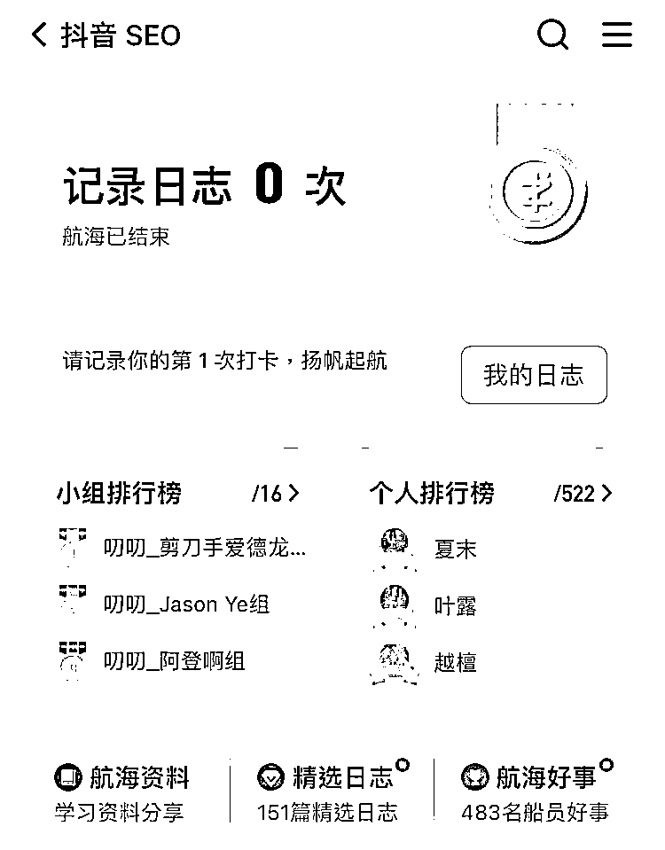

# 抖音搜索还能做吗？从增长潜力到关键词策略，这场干货拆解值得一看

> 资料来源：[`www.yuque.com/for_lazy/thfiu8/tkzswf1zglfqytz2`](https://www.yuque.com/for_lazy/thfiu8/tkzswf1zglfqytz2)

## 《抖音 SEO 的前景和选词指导》
撰稿人：Hawli
发布日期：2023-04-04

大家好，这里是李小随，目前担任抖音 SEO 航海项目的导师。

很开心能受赚钱有术之邀，和几位同频的导师一起，在航海活动中为超过五百位学员讲解搜索实操，并在线答疑，见证不少人已跑出实际效果。

航海启动后的首个周次，我为学员做了一场主题输出，核心议题围绕抖音搜索的商业空间，以及如何科学挑选关键词。听完后的反馈反馈积极。

做搜索，词的选择基本决定成败。抖音的搜索赛道现在是否仍有机会入场，该怎么选词才能更稳健？我把当时的思路整理出来了，欢迎阅读后在评论区交流你的看法。

直达原文：
[https://i.shengcaiyoushu.com/docx/MTXHdDiceoxAnwxChbWcxPfxnrg]

评论区互动：

芷蓝 : 小随太牛啦
Hawli : 谢谢芷蓝姐[耶]
子贡哥哥 : 小随老师的分享太棒了，感恩分享的极客工具
Faith : 拿到词以后怎么做排名啊，老师
Hawli : 看航海文档
Hawli : 有用就好
Faith : 在哪里啊，第一天加入的后生找不到。。。
鲸鱼🐳 : 小随姐姐无敌[呲牙]