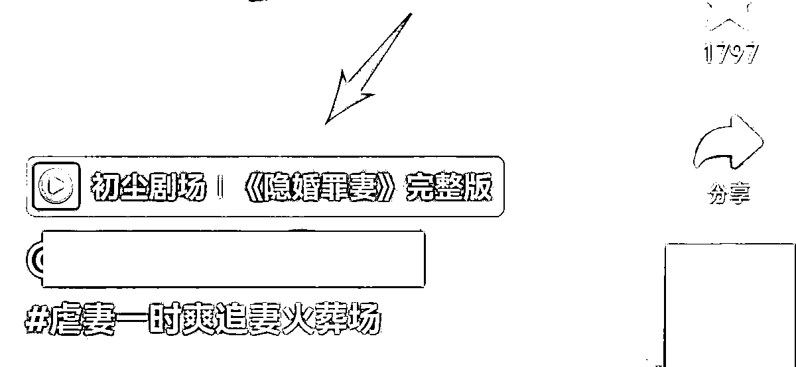
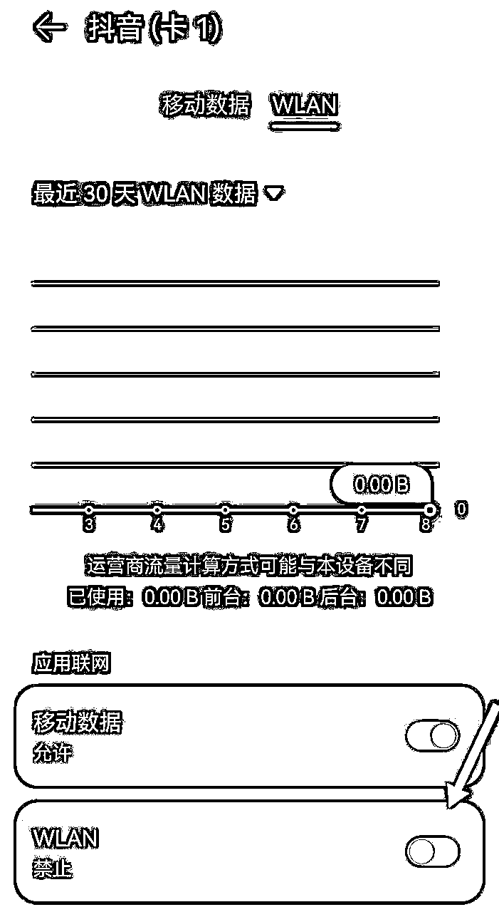
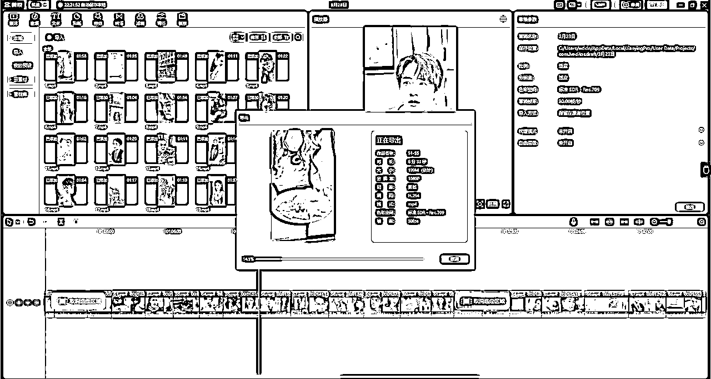
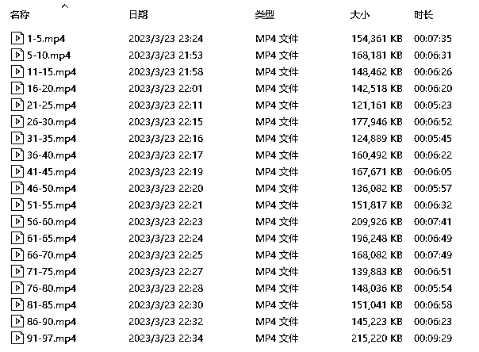
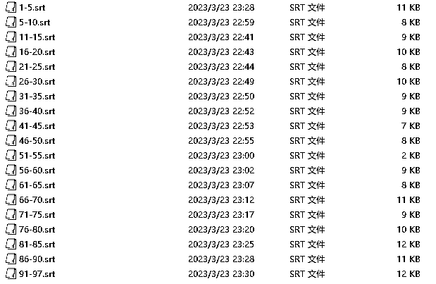
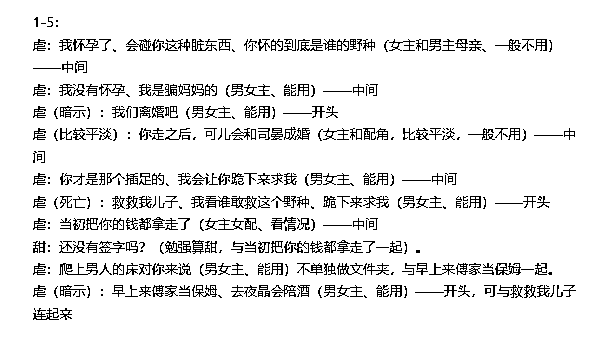
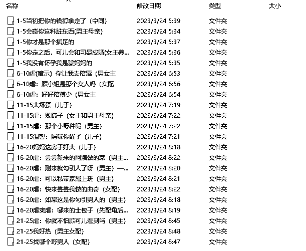
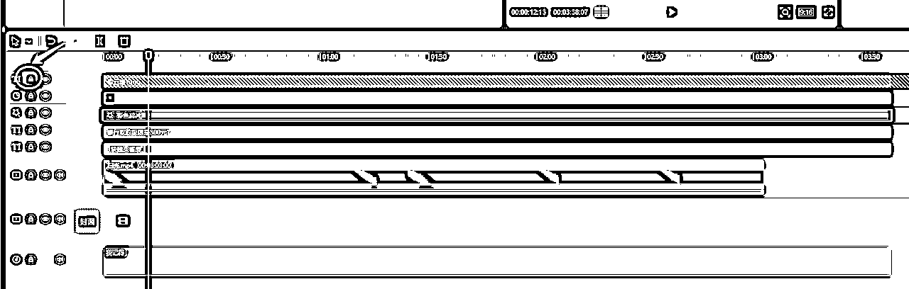
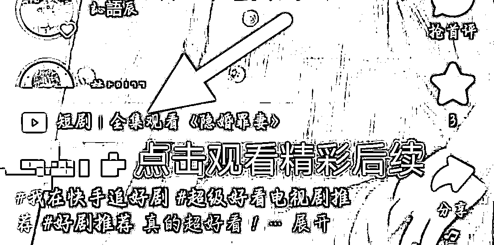

# 我把赚钱学到的方法，直接用来做短剧开单了

> 来源：[https://yf4niapxuw.feishu.cn/docx/NlqtdIqRboDI0nx8PeccsB8gneh](https://yf4niapxuw.feishu.cn/docx/NlqtdIqRboDI0nx8PeccsB8gneh)

最近在试水短剧，第一天晚上就把视频发了上去，没想到第二天一早订单就来了。这种立竿见影的反馈太爽了。

相比我之前折腾的小说推文，短剧上手快、见效快，对新手特别友好。

能这么顺利，很大程度上得益于在赚钱里积累的方法论。

饮水思源，今天就把我做短剧的实操经验掏空分享出来。

# 一、短剧到底是什么

说白了就是小说搬上荧幕，和电影电视剧一个逻辑，只是制作班底不是大牌导演和明星，投入也没有那么夸张，说不定哪天短剧里的演员就火了。

通常是一个团队买下小说或剧本版权，拍成每集1-2分钟的短视频，一部剧时长大概1-2小时。

然后版权方把片源分销给各大平台，我们从官方渠道拿到免费授权就能拿来剪辑推广。

在抖音挂上短剧链接，用户看完预告想追更就会点进去看，产生充值我们就能拿佣金。

分成比例能到50%，和推小说会员、推剧充值开会员的逻辑差不多。

剪辑的重点是卡在高潮或悬念处戛然而止，吊住好奇心，让人想继续看下去。

# 二、变现是怎么跑通的

抖音上其实到处都是这种片子，只是很多人没在意。

这类视频一般都是多条短剧片段拼接起来的。

短剧流量的核心在于去重。

去重做好了，播放就能起来，收益也就来了，即便评论区冷冷清清也没关系。

冲突不强的片段直接剪掉，结尾一定要留钩子。

比如女频里，男主知道女主受伤了会不会愧疚，这个念头可以放，但男主真愧疚的那段就别放。

再比如男频，炮灰去挑衅男主，大家都知道男主接下来要打脸，但打脸的画面不要给，让用户自己去正版里看男主怎么花式反击，获得爽感。

核心就是把用户导向左下角的小程序观看入口。

用户连续看了十几集后，遇到付费集数就需要开会员才能继续。

我们拿到的分成是50%。

举个例子，用户充100块，我们到手50块。

结算周期是按月，每月15号结算。起量后正反馈会很快，这时候可以拉朋友一起做。

# 三、短剧完整 SOP，重点看这里

## 1、拿到授权先
微信扫码小程序就能申请官方授权。

# 2、账号准备，抖音要养号后再发

# 3、新号一机一号

抖音：
关闭wifi只用移动数据。设置路径：设置-应用管理-找到抖音-禁止WLAN。不同机型位置可能略有差异。

注册账号：用全新号，没有就去某宝找换绑服务，10块钱搞定，能省7天。最好一机一号。

注册别用一键登录，用验证码登录，跳过头像资料，先不发视频。养号三天，每天刷2小时，像正常用户一样点赞关注评论，没时间就挂直播间偶尔互动一下。

三天后补全头像、简介、背景图，学校信息可隐藏。

头像去小红书找高清女生头像，背景图也是小红书找好看风景图。

简介一句话正能量，不会写就搜句子迷或励志语录大全。

昵称3-4个字，带不带短剧、追剧都行，不带也OK。想不出来就用浏览器搜姓名生成器、网名生成器。

发视频前刷10分钟以上，发布后继续刷10分钟以上，发完给自己作品点赞收藏评论。

快手：没那么多讲究，能用wifi，当天注销重注册也没问题。

视频号：也没养号要求，新号前几天流量偏大，要抓住。

养号到底要不要？有人说不实名不卖货就不必养，有人强调玄学。做短剧不实名，后期可多号操作，我建议还是按流程养一下。

## 4、拉取原片素材
授权搞定、剪辑思路清楚后就可以下载原片了。

用官方提供的链接下载，通常是百度网盘。没有会员可在拼夕夕租一天，5毛到1块，下载速度飞快。

## 5、剪辑思路，精细化操作，重点

### 1）选剧
新手建议从《顾少的隐婚罪妻》入手。
或者看平台素材库里推荐产出高的剧。
也可以问圈子里在做的朋友哪部转化高。
喜欢就选喜欢的。

有空的话，用一个号专门刷女频，每天3小时，找点赞上万、当天或前一天发布、带抢先看小程序的。
刷的时候可以遮住数据自己猜点赞量，训练判断力，也避免沉迷刷。

女频更建议新手做，因为女性用户付费意愿更强。男频也能爆，但女频上手门槛更低。

### 2）做市场调研
选定剧后，去抖音搜一下，看头部视频怎么做。

至少看10个。

细节要慢速看，剧情相近的可以2倍速。

然后照着爆款复刻一个，细节、台词可以微调。再做一个开头结尾一致中间不同的，再做一个自己理解的版本。

以《顾少的隐婚罪妻》为例，有三种找爆款的方法。

第一种看话题：搜剧名进话题页，点击立即参与旁边的空白区，看最热榜。最新高赞也可以看。

第二种看视频：搜剧名进视频页，按最多点赞排序，看一周内的。也可以看一天内或半年内的。

第三种看综合：综合页里能看到别人投流的广告，这些是花钱买来的，值得学。

### 3）素材处理，最费时间但最关键
下载原片后处理流程如下：

第一步，按5集为单位合并。
电脑配置够就直接扔剪映，用i键和o键框选需要区间，把1-5集合并成一段。全集97集就整理成19段。
配置不够就分段导出慢慢来。

为什么是5集而不是2集或10集？到后面剪开头中间结尾时会明白。

第二步，提取硬字幕。
工具排序：Videosrt > 录音啦 > 剪映。
剪映是声纹识别，音乐大就识别不准。Videosrt和录音啦是图识，准确率更高，但仍有错漏需要人工改。
改字幕的过程正好把剧看完。
做短剧推广，最好把全集看完，不然只能抄别人，永远做不出自己的爆款。

第三步，修正字幕。
把视频和字幕导入剪映，复制一份视频到主轨道做镜像蒙版，模糊处理后把原台词遮住，再把自己提取的字幕盖上去，拖动时间线检查穿帮。
不会操作就搜抖音：电脑版剪映怎么加蒙版改字幕，教程很多。

第四步，按台词切分视频。
必须有视频+字幕文件，用大拍档或CR都行，我更推荐大拍档。
切出来就是一句一句的台词片段。

第五步，归档开头中间结尾。
看完爆款就知道哪些情节适合放开头收尾，把对应片段归类整理出来。
自己总结能力强的话，改字幕时就能同步整理。
我习惯用台词命名文件名，更好记忆。

用1-5、6-10这种编号命名的原因是选材时尽量跨区间选，比如1-5配16-20，这样更容易过重。能找到爆点就优先用，不要死板。

### 4）建立去重模板
去重方法很多：画中画加2%透明度、0.1秒黑白闪转、特效透明度调到15%、左下角加小贴字、水印、加音效、变速等。
选5种组合就够了，每次复制一份草稿做小改动就行。
比如今天用星星贴纸明天用月亮，特效透明度2%改成3%，音乐字体都换一换。
素材放主轨道前记得点锁定，不然会被带动。

### 5）具体怎么剪
核心就是把你整理好的开头、中间、结尾素材放进剪映里。

新手：照着调研的10个高赞视频学，把别人的开头结尾拿来用，中间塞爆点。

老手：用半糖老师的开幕雷击法则筛选开头：异常、金钱、暴力、死亡、民族主义、性暗示、捷径等。注意抖音规范，别踩线。

结尾一定要留悬念，比如女频男主知道女主受伤会不会后悔，男频炮灰挑衅男主接下来怎么打脸，都不要揭晓，让用户自己去追。

中间放情绪爆点，剧情平淡、和男女主无关的不要放。

选材可以按角色聚焦，比如今天围绕男女主+恶毒女配，就只选相关片段，今天换婆婆线，就换人设。

一集时长5-10分钟最佳，没灵感3分钟也行。

剧情节奏建议：开幕雷击+虐+小逆袭+虐+小逆袭+虐+悬念。

虐就是主角被压制，小逆袭是语言或情绪上的反击，很多时候两者连着出现。

剪辑技巧：原片A在前B在后，你可以剪成BA，只要不影响理解。
一句台词也可以调换顺序。
多余的话直接删。
比如原句：我从高中就喜欢你，那时候的你天真善良像天使，反倒那个顾安然娇蛮任性让人吵闹。
可以逐版精简到：我从高中就喜欢你。那时候的你天真善良。我从高中就喜欢你。
不影响剧情就大胆改，这就是台词分割的意义。

### 6）发布
抖音用流量卡发布。发布前刷10分钟，发布后刷10分钟，自己点赞收藏评论。
播放破千后在评论区发引导图。

发完可换小号自检，有时图片自己能看见别人看不见。

快手和视频号随意，用wifi发也行，不用刷前刷后。

# 四、快速试错法，新手必看

细剪十几个视频不出单很打击人，还沉没成本高。

可以先快跑验证：

1、下载40集，拖进剪映用智能字幕识别，导出视频和字幕。
2、用大拍档的字幕分割功能按台词切。
3、切成一句话后快速看台词了解剧情，或3倍速看完。
4、老手按自己思路剪3分钟，新手照抄爆款剪3分钟，看市场反馈再决定是否深做。

新剧和爆款都可以用这招，哪怕没看完全集也能试。

# 五、注意事项

1）不要引导关注，也不要引导看下一集。一部剧可以出十几个视频，但不要上下关联，否则用户会等你更新而不是付费。
付费用户来自你的视频曝光，不是你的粉丝。

2）短剧基本不用投豆荚，全靠自然流。若你会投且ROI可控，可以试试，比如视频几小时破万播放，就投24小时、锁定24-30岁女性、全国。

3）女频目标人群一般是24-30岁女性。如果播放高但不出单，看下画像是不是50+。是就隐藏重发。
抖音同账号同一视频可发三次，别超三次，也别跨号发。
快手隐藏后别重发，易违规。
有时候视频中途起来几百赞，用户却不对，你舍不得删，后面就会卡在高播放不出单，很折磨。

4）破千播记得补评论引导图，表情包偶尔会掉。

5）主攻抖音，快手视频号做分发。

6）要不要加解说？文笔好或有影视解说经验可以加。轻解说模式就是原片+解说+原片，不用全程。
能力提升后可做全程解说。
新人路径是混剪→轻解说→全程解说。没做过短视频别一上来就想做原创解说，混剪先打基础。

# 六、谁适合做短剧

想改变现状、愿意坚持日更的人。
需要：一台能跑剪映的电脑，每天2小时，持续更新的习惯。
最大的好处是不用写文案，千把播放也能出单，现在属于蓝海期，会剪辑去重就能玩。

# 七、致谢

感谢张珂老师带我入小说推文和短剧。
感谢奇杰老师的混剪厨坊启发了我开头中间结尾的思路。
感谢半糖老师的开幕雷击让我懂了开头怎么抓人。
感谢无苔在群里提到CR软件，让我想到台词分割，后来在群友侣、牛顿273等人的分享下改用大拍档和Videosrt。
最后感谢赚钱有术，感谢看到这里的你，欢迎交流共进。