# 用团长联系方式做冷启动，一周内把小众资料卖到日入三位数

> 来源：[https://qirenjiangxin.feishu.cn/docx/RBo6dSQZnoLZkaxn7eGch1fWnMh](https://qirenjiangxin.feishu.cn/docx/RBo6dSQZnoLZkaxn7eGch1fWnMh)

这篇文章的核心不是项目有多大，而是在于怎么从一个极简的切口去试水。卖快团团团长资料本身体量很小，我目前也只是做到了把联系方式打包售卖这一层，其实玩法还能再往下挖。希望看到这篇内容的伙伴能多交流一下，咱们一起把这个小赛道玩出更多可能性。

我做小项目的习惯很固定：先用最低成本把它跑通变现，能拿到第一笔钱了再考虑怎么放大。那次的起点也很偶然。

# 一、先把能马上卖的东西找出来

最初的灵感来自赚钱精华贴里的一篇分享，讲的是通过联系快团团团长，让团长去帮卖权益卡。文中提到团长微信是可以找得到的，闲鱼和拼多多上就有相关资源在流通。

我自己手上正好有货，也正需要一批团长资源去对接。于是我在圈子里发了一条风向标做试探，没想到反响不错，很多人都参与讨论。

https://t.zsxq.com/0d5qSKHpn

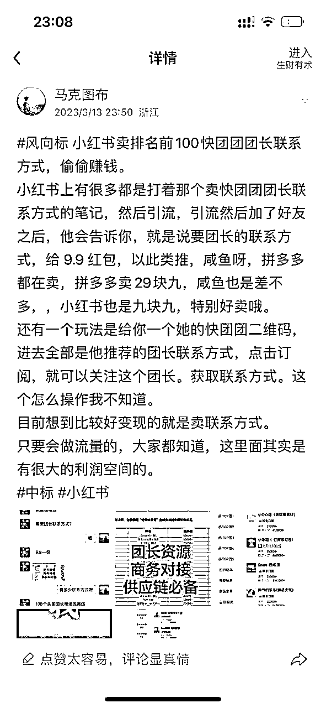

### 先看市面上的定价，确定自己卖什么形态。

在拼多多上大致就分两种常见打包方式。

#### 1、6.6元档的团长联系包，附带微信号约180个

#### 2、29.9元档的团长联系包，附带微信号约1700个

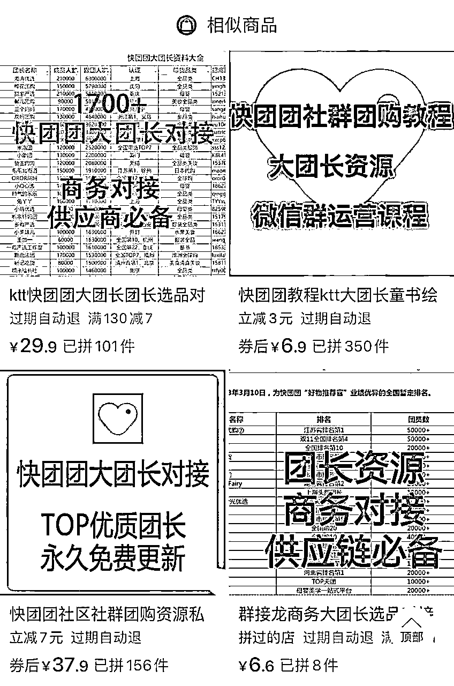

随后我在赚钱发起了一个小众筹，用6.6元的红包来换取联系方式，很多人主动找我，加我微信后付款。第一份180+团长的初始资料就这样到手了。第一波小验证成功，立刻有了继续做下去的信心。

在闲鱼上继续检索，我又发现一种新的资料形态：扫码订阅团长。

这个方向后续可以单独深挖，玩法挺有意思。

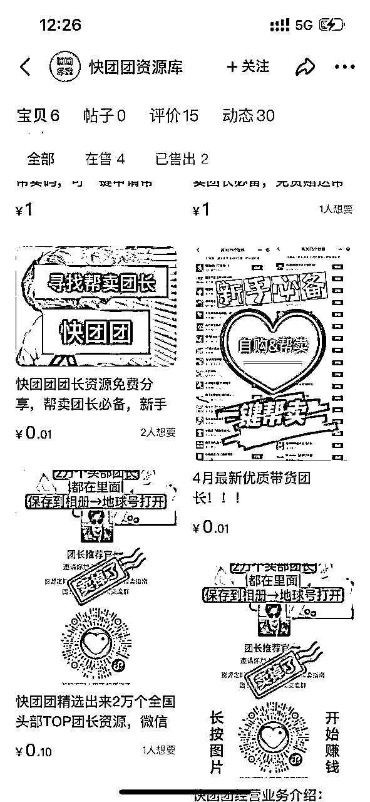

我当时的设想是，能不能让别人扫我的订阅码，我从而吃到团长的分销佣金。可惜我没有开通分销权限。

关于如何拿到这个权限，我问过几位做这行的朋友，得到的说法是通常要先达到一定的销售量，快团团才会开放分销功能。有经验的伙伴可以补充下具体路径，感激不尽。

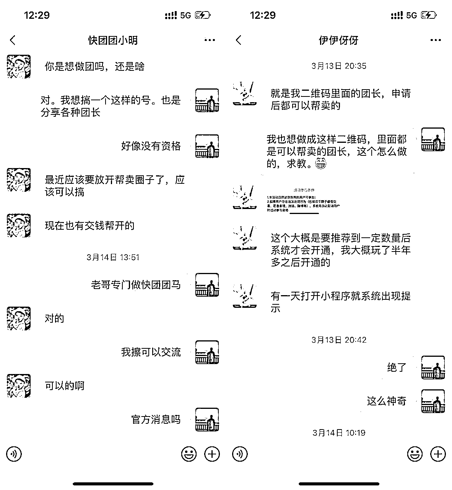

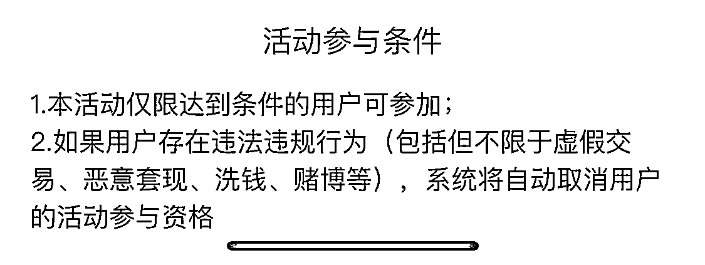

这类扫码订阅服务在市面上普遍是免费赠送的。因此我也收集到了几个团长的分销码，扫一下就能订阅大量团长。这个东西后来成了我引流阶段的重要抓手，文章后面会讲到。

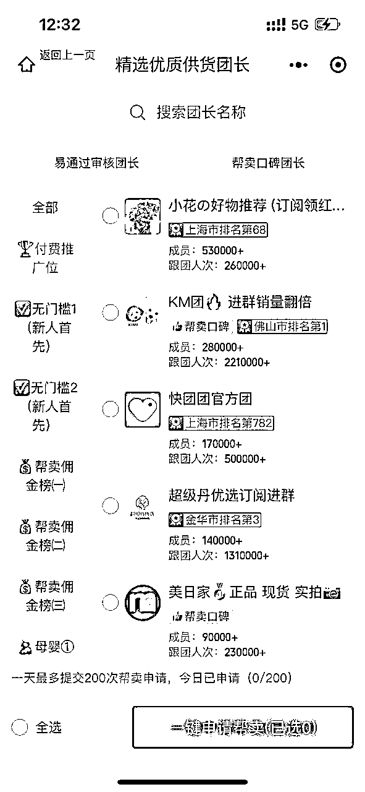

### 把能变现的载体梳理清楚后，我手上其实已经有三件商品可以卖了。

#### 1、免费的团长订阅码包。扫码即可批量关注团长。

#### 2、6.6元的团长微信Excel，约180个微信

#### 3、19.9元的团长微信Excel，约1700个微信

# 二、有了货就去找卖法，验证需求是否真实

产品只是第一步，关键是去验证它能不能被卖出去。我用之前发的风向标做测试入口，顺便把拼多多虚拟无货源开店的玩法也一起用了上去。

圈友可以点开这条风向标，里面有拼多多无货源开店和自动发货的教程，正好派上用场。

https://t.zsxq.com/0dRHuX9nU

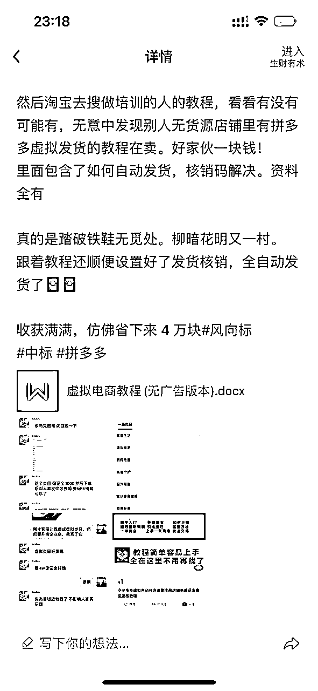

## 分渠道跑数据，看看哪边更吃香

### 2.2.1 拼多多渠道

我直接照搬同行的上架方式，把6.6元的联系方式挂了上去。

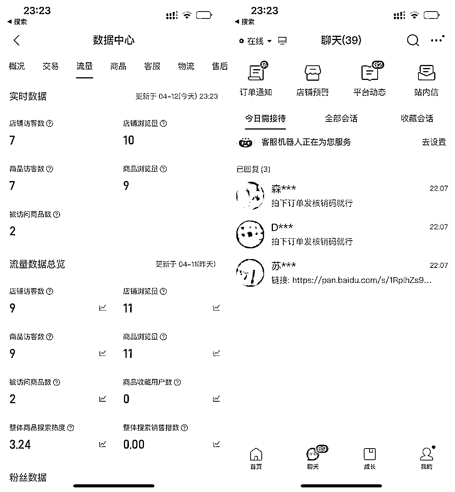

上架后自然流量就来了，基本每天能稳出1到2单。金额不大，但证明需求是真实存在的。

### 2.2.2 闲鱼渠道

闲鱼的表现比拼多多更好。

我在闲鱼定价19.9，实际上卖的是39.9的资料，也就是1700+联系方式那个版本。

平均每天成交2到3单左右。

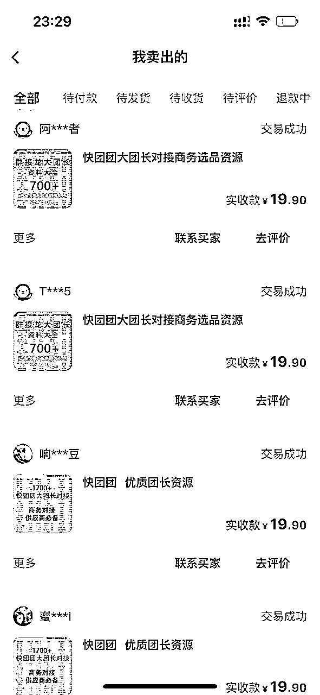

这样算下来纯利润大概在50到60元一天。只是后面账号被举报，封了几天，数据断了一段时间。

# 总结：先小范围测试，有正反馈再扩张

跑了几天后基本能确定，这类资料每天带来100+收益是可达成的，而且操作很轻，不需要投入大量时间。接下来思考的就是如何把流量做大。

# 三、用小红书主动获取流量做放量

今年小红书的流量红利很明显。我做任何新方向，都会先去搜索一下关键词的热度、内容形态和曝光量，来判断能不能快速起势。

## 3.1 话题热度足够高

搜索快团团团长资料，可以看到相关话题的曝光量都在千万级别。

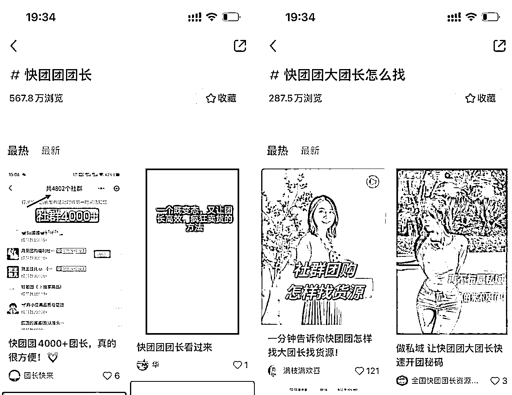

几千万的曝光意味着需求池不小，于是我开始拆解爆款笔记的结构。

## 3.2 内容门槛极低

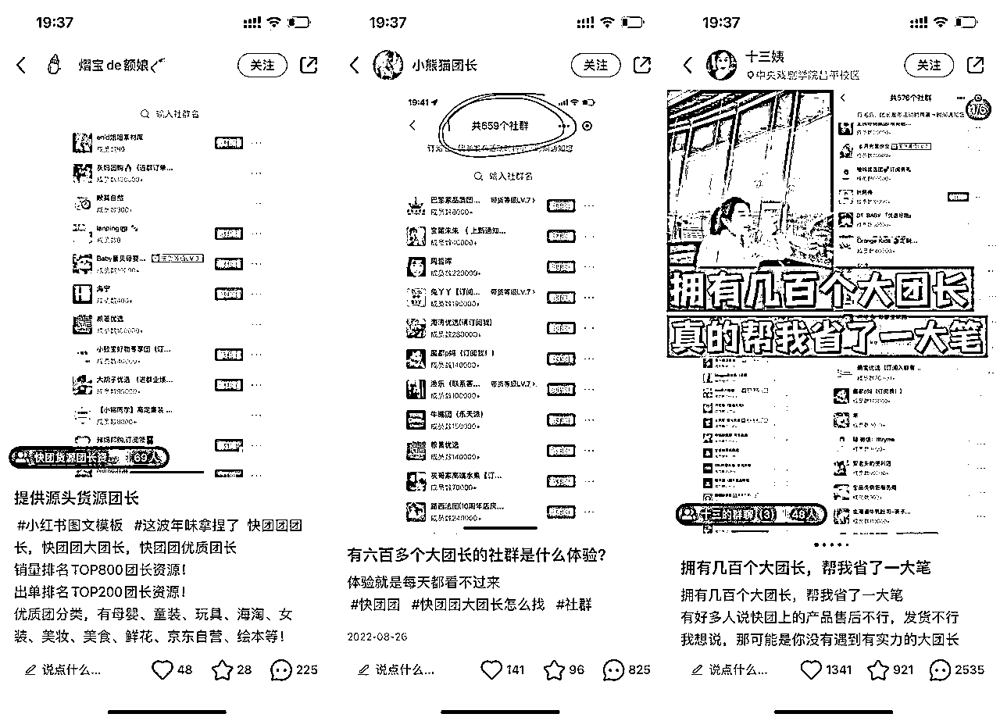

拆解下来发现，快团团相关的爆款笔记制作非常简单。只要把团长资源展示出来，标题对了就能复制。

小红书上真正直接卖联系方式的笔记其实不多，大多数高赞笔记都是在免费送分销码，引导用户扫码订阅团长。

下面是我模仿同行爆款笔记写的一版。

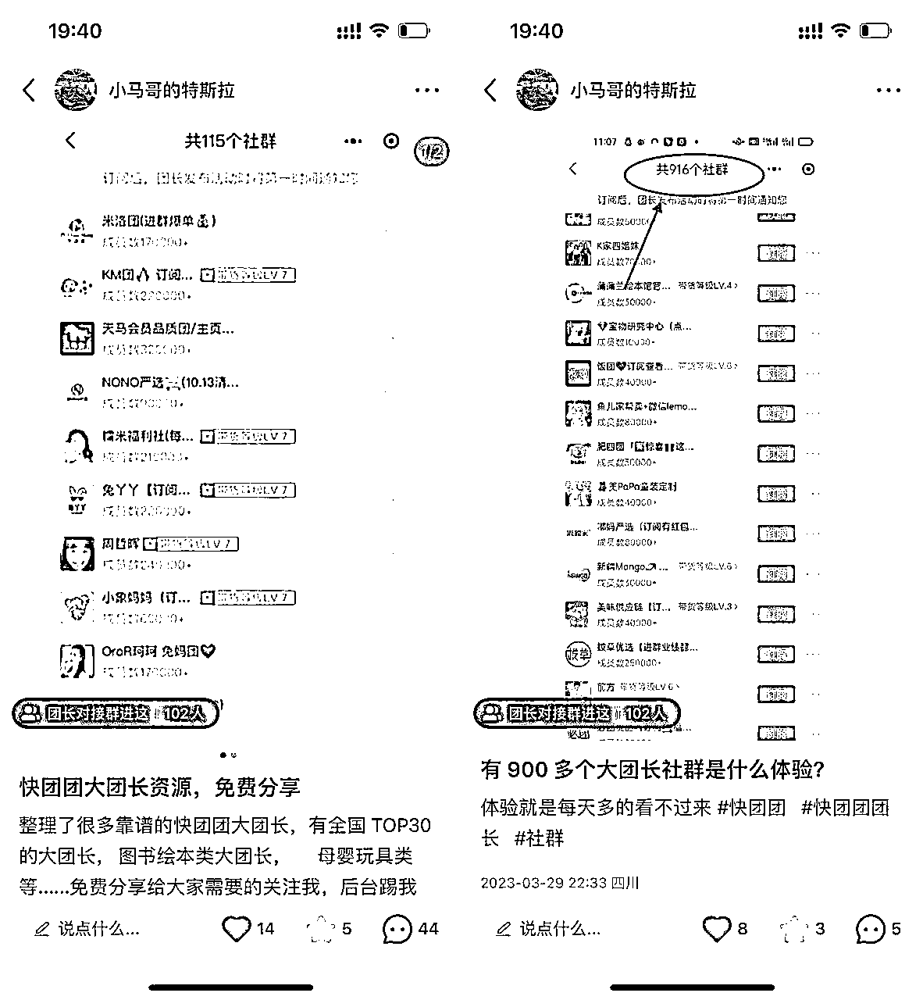

点赞可能只有十几个，但我把笔记和关联群做了绑定，很快就有大量做快团团的用户加群。进群后我再引导到微信，完成私域沉淀。

### 3.3 内容复制快，反馈也快

只要大体框架复刻到位，笔记生产成本极低，10分钟就能出一篇。

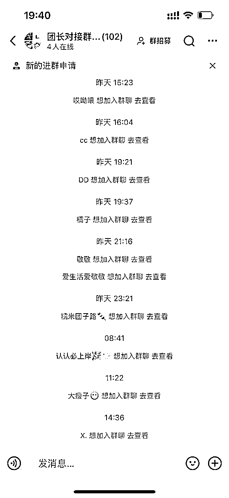

### 3.4 把公域流量导入私域

笔记发出去后要做三件事：挂关联群聊、置顶评论放群邀请码、用小号在评论区说想要我来发。制造互动氛围后，进群速度会明显加快。

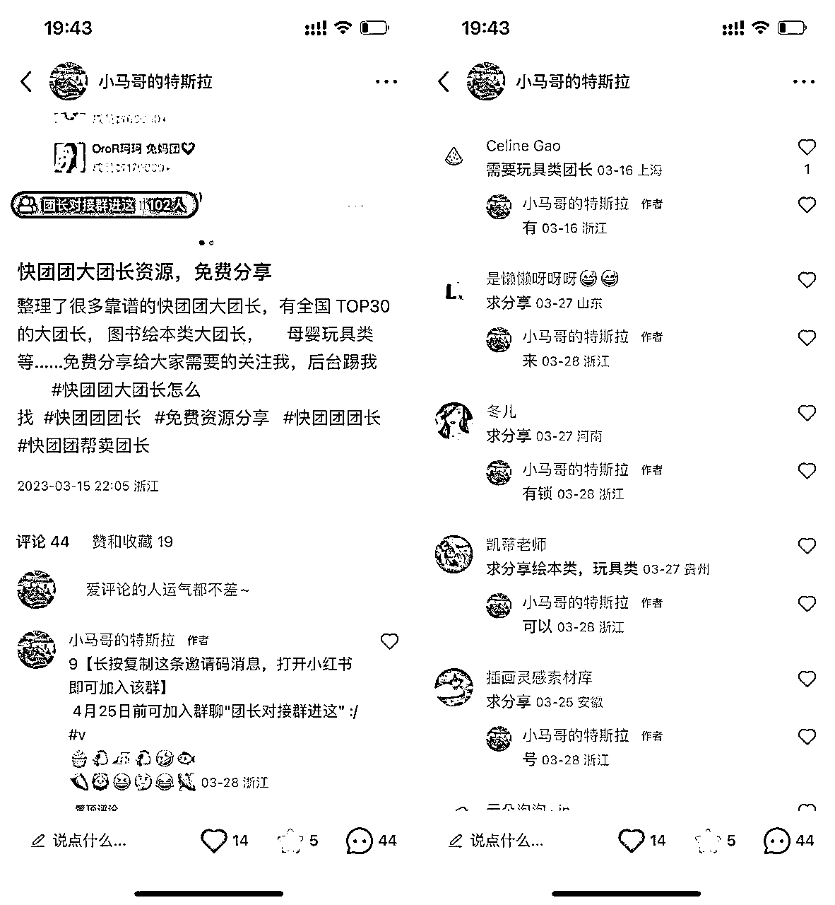

# 四、进群后的二次变现是关键

前面用免费资料把人引进来后，核心是二次转化，让用户知道联系方式是可以付费购买的。

### 4.1 私域话术迭代

我前期话术不够清晰，转化很差。后面迭代了三个版本才找到合适的沟通逻辑。

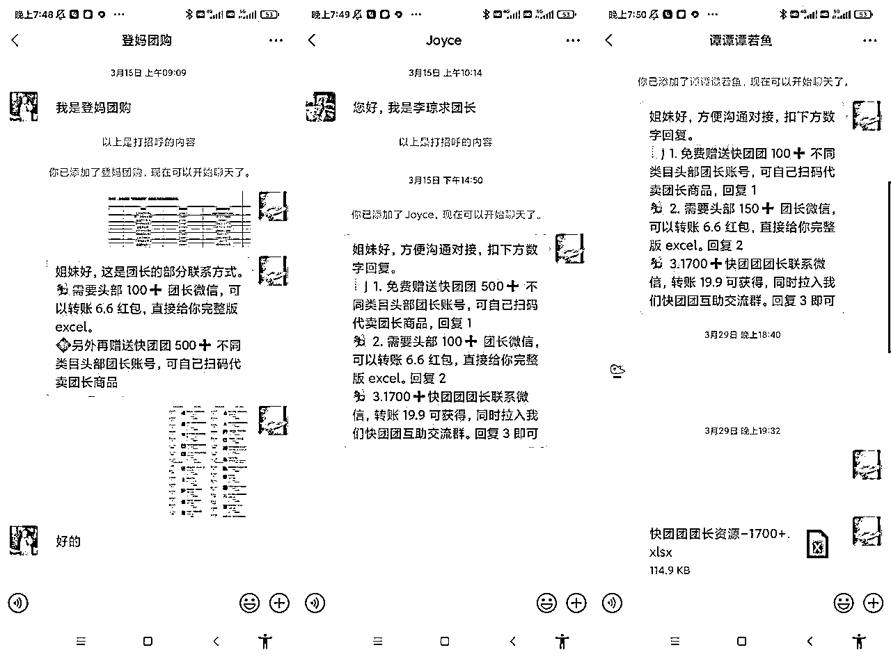

### 4.2 抄同行的转化方式效果最好

下面这张图是我抄的同行话术，比我的版本更有诱惑力，甚至还带了如何做快团团的教学。做微信变现时，直接参考同行的卖法，效率最高。

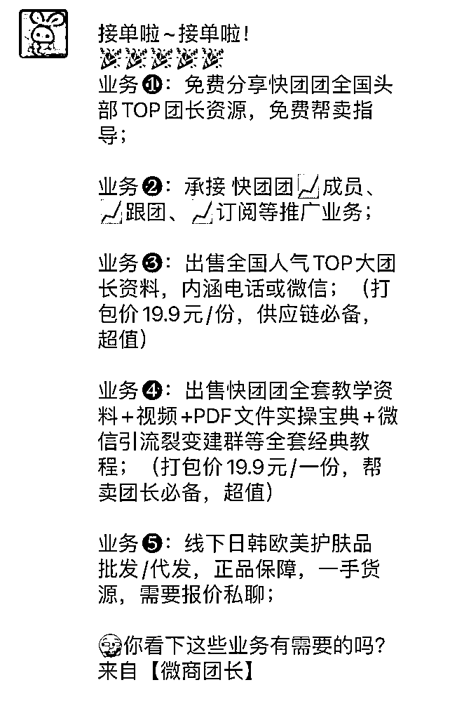

做转化效果不好的时候，最好的老师就是同行。加几个同行看看人家怎么说，直接拿来改成自己的版本就行。

# 五、一个额外的小技巧：移花接木

我本身也有货源。后来我把自己的快团团信息植入到了名单里，让自己也出现在全国Top团长的序列中。

随着名单扩散，越来越多的货主会看到我，相当于被动曝光了自己的团长身份。

# 六、这个项目带来的不止是资料费

文章的本意是给一个解题思路。单算资料的收入，一个月大概也就3000左右，但它带来的附加价值更大。

接触到资料买家后，我发现他们的需求其实很丰富：

1、大量想入行的快团团新人，私域积累起来就是一波精准人群。

2、很多人想学怎么做快团团，整理成教程就是一门知识付费。

3、有部分用户只是想通过团长买货，需要靠谱渠道。

4、大量供应链过来寻求合作。

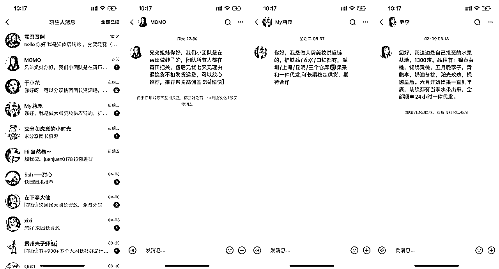

分享就到这里，希望对刚进入赚钱的伙伴有所启发。我的主页可以继续交流玩法，后续也会不断完善这篇思路。

附上之前发过的相关内容，配合来看会更顺畅：

1、新手小红书一个月从0到1，粉丝500，收入过1.5万，试用大多数小红书玩家

https://t.zsxq.com/0d6EPiAef

2、30+小红书账号私信引流，小红书安全引流私信玩法思路分享

https://t.zsxq.com/0dUpAFSRb